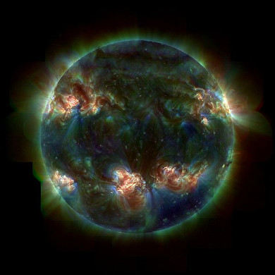

# Chapter 1: Skills for science

In this chapter learners will look at some basic skills required for practical investigations in the
                  physical sciences. A lot of these skills were introduced to the learners in Grade 10, and while doing
                  practical investigations in Grade 11. Four hours are allocated to this chapter in CAPS.

The following topics are covered in this chapter.

- **The development of a scientific theory.**
  This section should be used to show learners how scientific theories come from the studies of
                                many different people using the information of those who came before them. They should
                                understand that science is ever changing, as more of the world is understood.
- **The scientific method**
  In this section learners should generate their own experiment from a question they are
                                interested in. This includes doing background research, and following the scientific
                                method. Before designing their own experiment they should study the flow diagram of the
                                scientific method provided in the activity.
  A brief reminder of how to measure distances, temperature, mass and volumes is covered in
                                this section before the learners are required to complete an experiment. The experiment is
                                broken up into sections. In this first section they perform the experiment.
- **Data and data analysis**
  Learners are given an overview of how to present data in graphs, they are then required to
                                analyse the data they obtained in the experiment and determine whether their data is
                                qualitative or quantitative. In the third part of this experiment they have to draw a
                                conclusion based on their results and decide if the results are biased in any way. They
                                need to understand how to design a model based on their experimental data.
- **Laboratory safety procedures**
  These skills are not part of the CAPS statement for this chapter. However, it is advisable
                                that you go through these rules with the learners before they perform their first
                                experiments. It would be useful to refer them back to this section throughout the year.

There is one experiment in this chapter that is split into three parts. This is to help the learners
                  understand the scientific method better. The learners are also required to write up their own
                  experiment. This can be on a topic of their choice, but should follow the scientfic method.

The skills for science section should be taught while the learners do an investigation themselves.
                  Numerous activities have been provided and the skills for practical investigations should also be
                  discussed and practiced as a class at regular intervals throughout the year. Any support material that
                  develops these skills can be used.

This book deals with the physical sciences - physics and chemistry. All the sciences are based in the use of
            experiment and testing to understand the world around us better. The scientific method requires us to
            constantly re-examine our understanding, by testing new evidence with our current theories and making
            changes to those theories if the evidence does not meet the test. The scientific method therefore is the
            powerful tool you will use throughout the physical sciences.

Figure 1.1: An ultraviolet image of the Sun.

In this chapter you will learn how to gather evidence using the scientific method. These skills will then be
            used throughout this textbook to test scientific theories and practices.

## 1.1 The development of a scientific theory (ESCHQ)

The most important, and most exciting, thing about science and scientific theories is that they are not
                  fixed. Hypotheses are formed and carefully tested, leading to scientific theories that explain those
                  observations and predict results. **The results are not made to fit the hypotheses**. If
                  new information comes to light with the use of better equipment, or the results of other experiments,
                  this new information is used to improve and expand current theories. If a theory is found to have been
                  incorrect it is changed to fit this new information. The data should never be made to fit the theory,
                  if the data does not fit the theory then the theory is reworked or discarded. Although this changing
                  of opinion is often taken for inconsistency, it is this very willingness to adapt that makes science
                  useful, and allows new discoveries to be made.

Remember that the term theory has a different meaning in science. A **scientific theory** is
                  not like your theory of about why you can only ever find one sock. A scientific theory is one that has
                  been tested and proven through repeated experiment and data. Scientists are constantly testing the
                  data available, as well as commonly held beliefs, and it is this constant testing that allows
                  progress, and improved theories.

### Gravity (ESCHR)

The theory of gravity has been slowly developing since the beginning of the 16th century. Galileo
                        Galilei is credited with some of the earliest work. At the time it was widely believed that
                        heavier objects accelerated faster toward the earth than light objects did. Galileo had a
                        hypothesis that this was not true, and performed experiments to prove this.

Galileo's work allowed Sir Isaac Newton to hypothesise not only a theory of gravity on earth, but
                        that gravity is what held the planets in their orbits. Newton's theory was used by John Couch
                        Adams and Urbain Le Verrier to predict the planet Neptune in the solar system and this
                        prediction was proved experimentally when Neptune was discovered by Johann Gottfried Galle.

Although a large majority of gravitational motion could be explained by Newton's theory of gravity,
                        there were things that did not fit. But although a newer theory that better fit the facts was
                        eventually proved by Albert Einstein, Newton's gravitational theroy is still successfully used
                        in many applications where the masses, speeds and energies are not too large.

### Thermodynamics (ESCHS)

The principles of the three rules of thermodynamics describe how energy works, on all size levels
                        (from the workings of the Earth's core, to a car engine). The basis for these three rules
                        started as far back as 1650 with Otto von Guericke. He had a hypothesis that a vacuum pump could
                        be made, and proved this by making one. In 1656 Robert Boyle and Robert Hooke used this
                        information and built an air pump.

<Callout type="note" title="Note">
Robert Boyle should be a familiar name to you. Boyle's law came about from his air pump
                              experiments, where he discovered that pressure is inversely proportional to volume at a
                              constant temperature (p \(\propto \frac{1}{\text{V}}\) at constant T).
</Callout>

Over the next \(\text{150}\) years the theory was expanded on and improved. Denis Papin built a
                        steam pressuriser and release valve, and designed a piston cylinder and engine, which Thomas
                        Savery and Thomas Newcomen built. These engines inspired the study of heat capacity and latent
                        heat. Joseph Black and James Watt increased the steam engine efficiency and it was their work
                        that Sadi Carnot (considered the father of thermodynamics) studied before publishing a discourse
                        on heat, power, energy and engine efficiency in 1824.

This work by Carnot was the beginning of modern thermodynamics as a science, with the first
                        thermodynamics textbook written in 1859, and the first and second laws of thermodynamics being
                        determined in the 1850s. Scientists such as Lord Kelvin, Max Planck, J. Willard Gibbs (all names
                        you should recognise) among many many others studied thermodynamics. Over the course of 350
                        years thermodynamics has developed from the building of a vacuum pump, to some of the most
                        important fundamental laws of energy.
