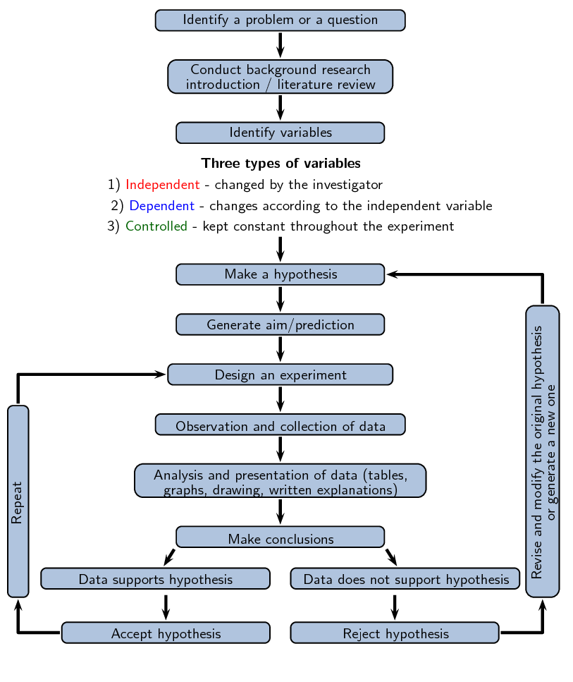
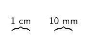
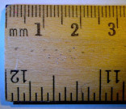
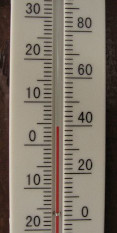
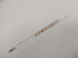
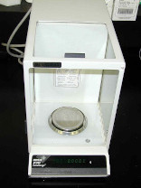
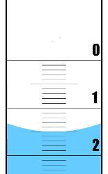
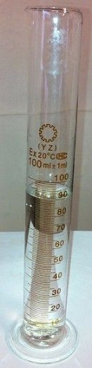
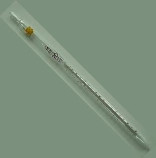
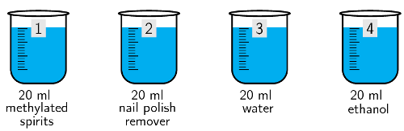

## 1.2 Scientific method (ESCHT)

The scientific method is the basic skill process in the world of science. Since the beginning of time
                        humans have been curious as to why and how things happen in the world around us. The scientific
                        method provides scientists with a well structured scientific platform to help find the answers
                        to their questions. Using the scientific method there is no limit as to what we can investigate.
                        The scientific method can be summarised as follows:

2. Ask a question about the world around you.
4. Do background research on your questions.
6. Make a hypothesis about the event that gives a sensible result. You must be able to
                                           test your hypothesis through experiment.
8. Design an experiment to test the hypothesis. These methods must be repeatable and
                                           follow a logical approach.
10. Collect data accurately and interpret the data.You must be able to take measurements,
                                           collect information, and present your data in a useful format (drawings,
                                           explanations, tables and graphs).
12. Draw conclusions from the results of the experiment. Your observations must be made
                                           objectively, never force the data to fit your hypothesis.
14. Decide whether your hypothesis explains the data collected accurately.
16. If the data fits your hypothesis, verify your results by repeating the experiment or
                                           getting someone else to repeat the experiment.
18. If your data does not fit your hypothesis perform more background research and make a
                                           new hypothesis.

Remember that in the development of both the gravitational theory and thermodynamics, scientists
                        expanded on information from their predecessors or peers when developing their own theories. It
                        is therefore very important to communicate findings to the public in the form of scientific
                        publications, at conferences, in articles or TV or radio programmes. It is important to present
                        your experimental data in a specific format, so that others can read your work, understand it,
                        and repeat the experiment.

2. Aim: A brief sentence describing the purpose of the experiment.
4. Apparatus: A list of the apparatus.
6. Method: A list of the steps followed to carry out the experiment.
8. Results: Tables, graphs and observations about the experiment.
10. Discussion: What your results mean.
12. Conclusion: A brief sentence concluding whether or not the aim was met.

**A hypothesis**

A hypothesis should be specific and should relate directly to the question you are asking. For
                        example if your question about the world was, why do rainbows form, your hypothesis could be:
                        *Rainbows form because of light shining through water droplets*. After formulating a
                        hypothesis, it needs to be tested through experiment. An incorrect prediction does not mean that
                        you have failed. It means that the experiment has brought some new facts to light that you might
                        not have thought of before.

<Callout type="note" title="Note">
In science we never 'prove' a hypothesis through a single experiment because there is a
                                chance that you made an error somewhere along the way. What you can say is that your
                                results SUPPORT the original hypothesis.
</Callout>

In the analysis of the scientific method activity:

2. The question may already be answered in the literature, or there may be
                                                   background research that you can build upon. It is also best to make a
                                                   hypothesis, prediction and an experiment with as good an understanding
                                                   of the topic as possible.
4. A controlled variable is one which you keep constant (controlled) so that it
                                                   does not have an effect between readings. The independent variable is
                                                   the one you change between collecting data points, while the dependent
                                                   variable is the variable that changes as a result of a change in the
                                                   independent variable.
   - It is important to identify all the variables that you think
                                                                     will have an effect on your investigation.
   - Firstly think of all the relevant variables you can change.
   - Secondly think of all the variables you can measure or
                                                                     observe.
   - Thirdly choose one variable to change (independent variable)
                                                                     which will have an effect on the one variable you can
                                                                     measure or observe (dependent variable).
   - All the other variables you need to keep constant
                                                                     (fixed/controlled variable).
6. - Identifying a problem involves thinking about the world
                                                                     around you and a specific part of it that you don't
                                                                     understand.
   - A hypothesis is more formal, it is a prediction about that
                                                                     problem based on your current understanding and
                                                                     background research.
   - A scientific theory comes from an experimentally tested and
                                                                     proven hypothesis. It is repeatable and current data
                                                                     fits the theory.
8. Data may fit a hypothesis in a specific instance. That does not mean that the
                                                   hypothesis is generally true. It is important to repeat the experiment
                                                   to make sure that the experiment was not an anomaly. Before something
                                                   becomes a scientific theory it must be tested repeatedly and be
                                                   repeatable by different people.

## Analysis of the scientific method.

Break into groups of 3 or 4 and study the flow diagram provided, then discuss the questions
                                that follow.

Figure 1.2: Overview of scientific method.

2. Once you have a problem you would like to study, why is it important to
                                                   conduct background research before doing anything else?
4. What is the difference between a dependent, independent, and controlled
                                                   variable and why is it important to identify them?
6. What is the difference between identifying a problem, a hypothesis, and a
                                                   scientific theory?
8. Why is it important to repeat your experiment if the data fits the
                                                   hypothesis?

When the learners design their own experiment:

2. An example of a question that the learner might ask would be why do rainbows
                                                   form?
4. Before beginning an investigation background research needs to be undertaken.
                                                   Background research should always be referenced.
   In this example the type of background research might include the particles
                                                   found in the atmosphere, the diffraction of light through water and the
                                                   different wavelengths of light.
6. Learners must write down a statement that answers their question. This is the
                                                   hypothesis and should be specific, relating directly to the question
                                                   they are asking.
   In this example their hypothesis might be: *Rainbows form because of the
                                                           diffraction of light through water droplets in the atmosphere.
                                                           If light is shone through water at the right angle a rainbow
                                                           will form*. Their hypothesis should be testable.
8. The learners should identify variables that are important in their specific
                                                   experiment. For example, the temperature of the water, the type of light
                                                   they use, the purity of the water, the angle of the light could all be
                                                   variables in their experiment.
10. The learners should understand the difference between independent, dependent
                                                   and controlled variables and be able to identify them in their
                                                   experiment.
   For example, the type of light might be controlled (sunlight). The
                                                   temperature could be a independent variable (perform the experiment on
                                                   different days with different temperatures). With the temperature as an
                                                   independent variable then the angle the light comes out at could be a
                                                   dependent variable, to see if there is a link. If the temperature is
                                                   made a controlled variable on that day, then the angle could be the
                                                   independent variable, and the shape and size of the rainbow would be the
                                                   dependent variable.
12. The learner must design an experiment that accurately tests their hypothesis.
                                                   The experiment is the most important part of the scientific method.
                                                   These are all important concepts to know when designing an experiment:
   - The method should be written so that a complete stranger will
                                                                     be able to carry out the same procedure in the exact
                                                                     same way and get almost identical results.
   - The method must be clear and precise instructions including
                                                                     the labelling of apparatus, giving exact measurements or
                                                                     quantities of chemicals or substances to be used and
                                                                     making sure that all the apparatus used is listed.
   - The method must give clear instructions about/describing how
                                                                     the results should be recorded (table, graph, etc.)
   - The method should include safety precautions where possible.
14. The learner should present a one page experimental write up with an aim, the
                                                   apparatus necessary, the method that will be followed. An example
                                                   experiment is given here. Note that this is just an example, the
                                                   learners could perform their experiment on anything.
   - **Aim**
     The aim of this experiment is to determine what happens when
                                                                     sunlight is shone through a glass of water.
   - **Apparatus**
     - A clear \(\text{500}\) \(\text{ml}\) glass,
                                                                                       three A4 pieces of white paper, a tape
                                                                                       measure, sticky tape, a pencil, a
                                                                                       thermometer
     - At least \(\text{400}\) \(\text{ml}\) of
                                                                                       water, sunlight.
   - **Method**
     2. Use the sticky tape to stick an A4 piece of a
                                                                                        paper to a sunny wall exactly
                                                                                        \(\text{1}\) \(\text{m}\) from the
                                                                                        ground.
     4. Use the sticky tape to stick an A4 piece of
                                                                                        paper above the first one, and the last
                                                                                        A4 piece of paper below the first one.
     6. Fill the glass with \(\text{400}\)
                                                                                        \(\text{ml}\) water and measure the
                                                                                        temperature (be careful to keep the
                                                                                        thermometer out of direct sunlight
                                                                                        between measuring the temperatures.
     8. Hold the glass (near the bottom) level with
                                                                                        the bottom of the middle piece of paper
                                                                                        in the sunlight. If a rainbow forms on
                                                                                        the sheets of paper, mark where it forms
                                                                                        on the paper.
     10. Measure the temperature of the water in the
                                                                                        glass, then move the glass upwards
                                                                                        \(\text{5}\) \(\text{cm}\) and repeat.
     12. Repeat step \(\text{5}\) until you reach the
                                                                                        top of the uppermost A4 piece of paper.
   - **Results**
     - Your results should be presented in the form
                                                                                       of a table (Result? should be answered
                                                                                       with a yes or a no depending on whether
                                                                                       a rainbow formed):
       | Temperature
                                                                                                                       (\(^{\circ}\)C) | Height of
                                                                                                                       glass
                                                                                                                       (m) | Result? | Height of
                                                                                                                       rainbow |
       | --- | --- | --- | --- |
       From this data the angle of refraction of the
                                                                                       water can be measured, as well as what
                                                                                       angle is required for the sunlight to
                                                                                       create a rainbow through the water.

<QuizCard id="s12-01-02a" title="Interactive Exercise 1.1" question="For this experiment, identify: the independent variable the dependent variable any fixed (controlled) variable" options=[] answer="
						1
					,
						0
					,
						2
					" hint="" explanation="What are variables? In science, a variable is any factor in an investigation that can be manipulated by the experimenter, 					    change as a result of the experiment, or affect the results of the experiment. Of all these variables, 					    one is chosen to be the independent variable, at least one is chosen as a dependent variable, and all 					    other variables that could affect the results must remain fixed (constant). In any science investigation 					    it is important to identify your variables. Recall the definition of the independent variable The independent variable (or input variable) of an investigation is the variable 						that the experimenter chooses the value of. In order for an experiment to be fair you should only test 						one independent variable at a time. We were told that Lethabo and Johan change the frequency of light. 					    They choose which frequencies to use. Therefore frequency of light is the independent variable. Recall the definition of the dependent variable The dependent variable (or output variable) of an investigation is the 						variable that changes as a result of changes to the independent variable. The experimenter 						does not choose the values of the dependent variable, but instead measures the dependent 						variable for each value of the independent variable chosen. Lethabo and Johan measured the distance of 					    the first dark band from the centre of the bright central band. This is a  measure of the degree (amount) 					    of diffraction. The bigger this distance \((\Delta y)\) , the wider the bright central band 					    and the more the light is diffracted. Therefore the distance of the first dark line from the centre of the bright central band is the dependent variable. Recall the definition of a fixed (controlled) variable A fixed variable in an investigation is any variable other than the independent 					    variable that could reasonably be expected to affect the results of an experiment. All such variables 					    must have their values fixed (kept constant) by the experimenter so that they do not change the results 					    of the experiment. This ensures that there is only one independent variable so that the experiment is fair. Any of the following are factors that might possibly affect the results of the experiment and should be kept fixed: the slit width the number of slits used the distance from the screen the intensity (brightness) of the light source used the thickness of the beam of the light source the light levels in the room (to help take consistent readings) NOTE: The most important variable to keep fixed is the first one (the slit width ) 						because we know this definitely changes the amount (degree) of diffraction. Therefore the amount of light in the room is a fixed variable. Submit your answer as: frequency of light and distance of the first dark line from the centre of the bright central band and amount of light in the room" />

## Designing your own experiment

Recording and writing up an investigation is an integral part of the scientific method. In
                                this activity you are required to design your own experiment. Use the information
                                provided below, and the flow diagram in the previous experiment to help you design your
                                experiment.

The experiment should be handed in as a \(\text{1}\) - \(\text{2}\) page report. Below are
                                basic steps to follow when designing your own experiment.

2. Ask a question which you want to find an answer to.
4. Perform background research on your topic of choice.
6. Write down your hypothesis.
8. Identify variables important to your investigation: those that are relevant,
                                                   those you can measure or observe.
10. Decide on the independent and dependent variables in your experiment, and
                                                   those variables that must be kept constant.
12. Design the experiment you will use to test your hypothesis:
   - State the aim of the experiment.
   - List the apparatus (equipment) you will need to perform the
                                                             experiment.
   - Write the method that will be used to test your hypothesis
     - in bullet format
     - in the correct sequence, with each step of the
                                                                               experiment numbered.
   - Indicate how the results should be presented, and what data is
                                                             required.

### Reading instruments (ESCHV)

Before you perform an experiment you should be comfortable with certain apparatus that you
                                will be using. The following pages give some commonly used apparatus and how to use
                                them.

Figure 1.3: The end of a ruler.

Most rulers you find have two sets of lines on them. You can ignore those with the numbers
                                spaced further apart. We only work in the metric system and those are for the imperial
                                system. The closest together lines are for millimetres, the thicker lines are for
                                \(\text{5}\) \(\text{mm}\) and the thicker, longer lines with numbers next to them mark
                                off every \(\text{10}\) \(\text{mm}\) (\(\text{1}\) \(\text{cm}\)).

Figure 1.4: Reading a thermometer.

A thermometer can have one, or two sets of numbers on it. If it has two sets of numbers one
                                will be in Celsius, and one will be in Fahrenheit. We use Celsius, so you can ignore the
                                side with a larger temperature range. In Figure 1.4 you can ignore the right-hand side. Looking
                                on the left you can see that the red line (coloured ethanol here) is next to the fourth
                                line above \(\text{0}\) \(\text{℃}\). Each small line is \(\text{1}\)
                                \(\text{℃}\), so the temperature is \(\text{4}\) \(\text{℃}\).

Figure 1.5: A laboratory style thermometer.

Laboratory thermometers will go to much higher temperatures than those used for measuring the
                                temperature outside, or your body temperature. It is important to make sure that the
                                thermometer you are using can handle the temperature you will be measuring too. If not,
                                do not use that thermometer as you will break it. Make sure your thermometer is upright
                                whenever you use it in an experiment, to avoid incorrect results.

 

                                
<a href="http://www.youtube.com/watch?v=hmMZDJ3Rwyo">Video:
                                                27HM</a>

                        

Figure 1.6: A scale (also referred to as a balance).

Different scales have different functions. However, a basic function of all scales is a
                                **tare** button. This zeros the balance. It is important that you zero the
                                balance before you take any measurements. If you are weighing something on a piece of
                                paper you should tare the balance with the piece of paper on it, and weigh the
                                substance. Make sure you check the units that your scale is weighing in. If you want
                                your value to be accurate to \(\text{,00}\) \(\text{g}\) then the scale must measure to
                                that accuracy. A scale that measures in \(\text{mg}\) would be best.

A burette is used to accurately measure the volume of a liquid added in an experiment. The
                                valve at the bottom allows the liquid to be added drop-by-drop, and the initial and
                                final volume can be measured so that the total volume added is known. More information
                                about burettes is given to you in your first titration experiment this year in Chapter
                                9.

Figure 1.7: The meniscus of water in a burette.

The surface of the water (the *meniscus*) is slightly higher at the edges of a
                                container than in the middle. This is due to surface tension and the interaction between
                                the water and the edge of the container (Figure 1.7). When measuring the volume in a burette (or
                                measuring cylinder or pipette) you should look at the bottom of the meniscus. Where that
                                lies is where you measure the volume. So in this example the meniscus is on the fifth
                                line below the large line that represents \(\text{1}\) \(\text{ml}\). Therefore the
                                volume is \(\text{1,5}\) \(\text{ml}\).

It is also possible that the liquid being measured has greater internal forces than those
                                between it and the container. Then the meniscus would be higher in the middle than at
                                the sides, and you would use the top of the meniscus to measure your volume.

Figure 1.8: A measuring cylinder with water.

A measuring cylinder is used to measure volumes that you want accurate to the nearest
                                millilitre or so. It is not a highly accurate way of measuring volumes. The volume in a
                                measuring cylinder is measured in the same way as for a burette, the difference is that
                                in a measuring cylinder the smallest volume would be at the bottom, while the largest
                                would be at the top.

Figure 1.9: A \(\text{20}\) \(\text{ml}\) volumetric pipette.

Figure 1.10: A graduated pipette.

There are two types of pipettes you might encounter this year. A volumetric pipette has a
                                large bulb, marked with the set volume it can measure. Above the bulb on these pipettes
                                there is a line. For a \(\text{5}\) \(\text{ml}\) volumetric pipette, when the meniscus
                                of your liquid sits on the line, then the volume in that pipette is \(\text{5}\)
                                \(\text{ml}\).

A graduated pipette has the same type of marking you see on a burette. The top is
                                \(\text{0}\) \(\text{ml}\), and the volume increases as you move down the pipette. In
                                this pipette you should fill the pipette to near the \(\text{0}\) \(\text{ml}\) line and
                                make a note of the volume. You can then add the desired volume, stopping when the volume
                                in the pipette has decreased by the required amount.

<QuizCard id="s12-01-02b" title="Interactive Exercise 1.2" question="What is the most appropriate unit to measure the space in your lunch box?" options=[] answer="3" hint="" explanation="Cubic units The space in your lunch box is a three dimensional space: we are measuring volume. Volume is sometimes called capacity . Volume is three dimensional so the units for volume also                         have three dimensions (the units are cubed ). Volume can also be measured in units of capacity . Volume (or capacity) is measured in two ways: cubic units , such as \(\text{mm$^{3}$, cm$^{3}$, m$^{3}$,}\) or \(\text{km$^{3}$}\) units of capacity , such as millilitres ( \(\text{mL}\) ) or litres ( \(\text{L}\) ) (usually used for liquids) where \(\text{1} \ \text{cm$^{3}$}\) = \(\text{1} \ \text{mL}\) . A cubic millimetre ( \(\text{mm$^{3}$}\) ) is the space taken up by a tiny cube with sides each one millimetre long.                         It is about the size of a breadcrumb. A cubic centimetre ( \(\text{cm$^{3}$}\) ) is the space taken up by a cube with sides each one centimetre long.                         It is about the size of a grape. A cubic metre ( \(\text{m$^{3}$}\) ) is the space taken up by a cube with sides each one metre long.                         It is about the amount of empty space underneath a square desk. A cubic kilometre ( \(\text{km$^{3}$}\) ) is the space taken up by a cube with sides each one kilometre long.                         It is a very big unit for measuring volume. If we stacked them on top of each other,                         we could fit more than 100 million minibus taxis into one cubic kilometre! Units of capacity Units of capacity are often (but not always) used for measuring liquid contents. One millilitre ( \(\text{mL}\) ) is equal to \(\text{1} \ \text{cm$^{3}$}\) . There are \(\text{330} \ \text{mL}\) in a standard can of Coca-Cola. One litre ( \(\text{L}\) ) is equal to \(\text{1  000} \ \text{ml}\) or \(\text{1 000} \ \text{cm$^{3}$}\) .                         Boxes of milk are often \(\text{1} \ \text{L}\) in volume. Choose the correct unit to measure the space in your lunch box From the given options, the most appropriate unit for measuring the space in your lunch box is \(\text{cm$^{3}$}\) . Submit your answer as: \(\text{cm$^{3}$}\)" />

<QuizCard id="s12-01-02b" title="Interactive Exercise 1.2" question="Complete the following unit conversions:" options=[] answer="1, 1000" hint="You should enter a number here. If you want to, you can use a space to separate thousands.                Example: 12 800,25 For scientific notation you need to use the multiply symbol                ( ∗ ) and the exponent symbol ( ^ ). For example 6,673 × 10 −11 should be written as: 6,673 ∗ 10^−11" explanation="Recall the relationship between \(\text{mL}\) and \(\text{cm$^{3}$}\) We must remember that: \(\text{1}\ \text{mL} = \text{1}\ \text{cm$^{3}$}\) Recall the relationship between \(\text{L}\) and \(\text{mL}\) We must remember that: \(\text{1}\ \text{L} = \text{1 000}\ \text{mL}\) Submit your answer as: and" />

<QuizCard id="s12-01-02b" title="Interactive Exercise 1.2" question="Complete the following unit conversions:" options=[] answer="100, 10000, 1000000" hint="You should enter a number here. If you want to, you can use a space to separate thousands.                Example: 12 800,25 For scientific notation you need to use the multiply symbol                ( ∗ ) and the exponent symbol ( ^ ). For example 6,673 × 10 −11 should be written as: 6,673 ∗ 10^−11" explanation="Recall the linear conversion We must remember the following unit conversions: \(\text{1}\ \text{cm} = \text{10}\ \text{mm}\) \(\text{1}\ \text{m} = \text{100}\ \text{cm}\) \(\text{1}\ \text{km} = \text{1 000}\ \text{m}\) Therefore \(\text{1}\ \text{m} = \text{100}\ \text{cm}\) . Convert units of area Now we can use the fact that \(\text{1}\ \text{m} = \text{100}\ \text{cm}\) to calculate how many \(\text{cm$^{2}$}\) there are in \(\text{1}\ \text{m$^{2}$}\) . \[ 					    \begin{aligned} 							\text{1}\ \text{m$^{2}$} &= (\text{1}\ \text{m}) \times (\text{1}\ \text{m}) \\ 						   &= (\text{100}\ \text{cm}) \times (\text{100}\ \text{cm}) \\ 						   &= \text{10 000}\ \text{cm$^{2}$} 					    \end{aligned} 					\] TIP: Area is measured in square units. To convert units of area, we multiply or divide by the squared number that would be used for linear conversions. For example, to convert from \(\text{cm}\) to \(\text{mm}\) we multiply by \(\text{10}\) . To convert from \(\text{cm$^{2}$}\) to \(\text{mm$^{2}$}\) we multiply by \(10^2 = 100\) . Convert units of volume We can use the same method as above to calculate how many \(\text{cm$^{3}$}\) there are in \(\text{1}\ \text{m$^{3}$}\) . \[ 					    \begin{aligned} 							\text{1}\ \text{m$^{3}$} &= (\text{1}\ \text{m}) \times (\text{1}\ \text{m}) \times (\text{1}\ \text{m}) \\ 					       &= (\text{100}\ \text{cm}) \times (\text{100}\ \text{cm}) \times (\text{100}\ \text{cm}) \\ 					       &= \text{1 000 000}\ \text{cm$^{3}$} 					    \end{aligned} 					\] TIP: Volume is measured in cubic units. To convert units of volume, we multiply or divide by the cubed number that would be used for linear conversions. For example, to convert from \(\text{cm}\) to \(\text{mm}\) we multiply by \(\text{10}\) . To convert from \(\text{cm$^{3}$}\) to \(\text{mm$^{3}$}\) we multiply by \(10^3=1000\) . Submit your answer as: and and" />

### Performing experiments (ESCHW)

A learner wondered whether the rate of evaporation of a substance was related to the boiling
                                point of the substance. Having done background research they realised that the boiling
                                point of a substance is linked to the intermolecular forces within the substance. They
                                know that greater intermolecular forces require more energy to overcome. This led them
                                to form the following hypothesis:

*The larger the intermolecular forces of a substance the higher the boiling point.
                                        Therefore, if a substance has higher boiling point it will have a slower rate of
                                        evaporation.*

Perform the following experiment that the learner designed to test that hypothesis.

The boiling points and rate of evaporation experiment is a very simple one meant to
                                        introduce the learners to the concept of the scientific method in a practical
                                        way. It has been broken up into three parts: performing the practical
                                        investigation, analysis of results, drawing conclusions.

The learners should be as accurated as possible when measuring the drop in volume as
                                        they will be required to plot a graph of their data.

## Boiling points and rate of evaporation: Part 1

### Aim

To determine whether the rate of evaporation of a substance is related to its
                                                boiling point.

### Apparatus

You will need the following items for this experiment:

- \(\text{220}\) \(\text{ml}\) water, \(\text{20}\)
                                                                  \(\text{ml}\) methylated spirits, \(\text{20}\)
                                                                  \(\text{ml}\) nail polish remover, \(\text{20}\)
                                                                  \(\text{ml}\) water, \(\text{20}\) \(\text{ml}\) ethanol
- One \(\text{250}\) \(\text{ml}\) beaker, four \(\text{20}\)
                                                                  \(\text{ml}\) beakers, a thermometer, a stopwatch or
                                                                  clock

### Method

<Callout type="warning" title="Note">
All alcohols are toxic, methanol is particularly toxic and can cause
                                                        blindness, coma or death. Handle all chemicals with care.
</Callout>

2. Place \(\text{200}\) \(\text{ml}\) of water into the
                                                                   \(\text{250}\) \(\text{ml}\) beaker and move the beaker
                                                                   to sunny spot. Place the thermometer in the water.
4. Label the four \(\text{20}\) \(\text{ml}\) beakers
                                                                   **\(\text{1}\)** -
                                                                   **\(\text{4}\)**. These beakers should be
                                                                   marked.
6. Place \(\text{20}\) \(\text{ml}\) methylated spirits into
                                                                   beaker 1, \(\text{20}\) \(\text{ml}\) nail polish
                                                                   remover into beaker 2, \(\text{20}\) \(\text{ml}\) water
                                                                   into beaker 3 and \(\text{20}\) \(\text{ml}\) ethanol
                                                                   into beaker 4.
   
8. Carefully move each beaker to the warm (sunny) spot.
10. Observe each dish every two minutes. Note the volume in the
                                                                   beaker each time.
12. Continue making observations for \(\text{20}\)
                                                                   \(\text{minutes}\). Record the volumes in a table.

### Results

- Record your observations from doing the investigation in a
                                                                  table like the one below.
  | Substance | Methylated spirits | Nail polish remover | Water | Ethanol |
  | --- | --- | --- | --- | --- |
  | Boiling point
                                                                                                  (\(^{\circ}\)C) | \(\text{78,5}\) | \(\text{56,5}\) | \(\text{100}\) | \(\text{78,4}\) |
  | Initial volume (ml) | \(\text{20}\) | \(\text{20}\) | \(\text{20}\) | \(\text{20}\) |
  | \(\text{2}\)
                                                                                                  \(\text{min}\) |  |  |  |  |
  | \(\text{4}\)
                                                                                                  \(\text{min}\) |  |  |  |  |
  | \(\text{6}\)
                                                                                                  \(\text{min}\) |  |  |  |  |

<QuizCard id="s12-01-02c" title="Interactive Exercise 1.3" question="Formulate an investigative question for this experiment." options=["will", "will not"] answer="
    	            	1
    	            " hint="" explanation="Formulate an investigative question for this experiment An investigative question must ask a question, and be testable . The experiment performed must be able to answer that question. In this experiment the scientists are changing the type of substance (and therefore the intermolecular forces), and measuring the boiling point .     	            	So they are investigating how intermolecular forces affect boiling point. The atmospheric pressure, volume of substance used, and type of container are the same throughout the experiment. So a good investigative question is: How does the strength of intermolecular forces affect boiling point? Submit your answer as: How does the strength of intermolecular forces affect boiling point?" />
