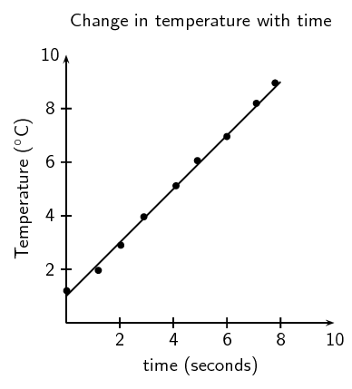
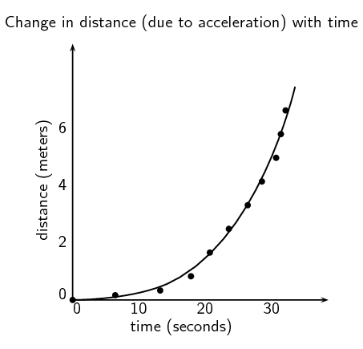
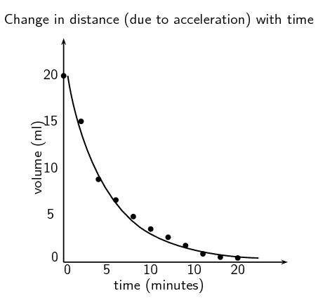

## 1.3 Data and data analysis (ESCHX)

In order to analyse the data obtained during experiments it is often necessary to convert that data
                        into different representations. One type of representation is a graph. A few examples are given
                        here.

### How to draw graphs in science (ESCHY)

For all graphs plotted from experimental data it is important to remember that you should
                                never *connect the dots*. Data will never follow a line or curve perfectly. By
                                obtaining multiple experimental data points any discrepancies in each data point can be
                                removed. The line added after the points are plotted should be a **best fit
                                        line** that can then be used to more accurately determine further
                                information.

Features of graphs you plot:

- An appropriate scale is used for each axis so that the plotted points use
                                                  most of the axis/space (work out the range of the data and the highest
                                                  and lowest points).
- The scale must **remain the same** along the entire axis and
                                                  should use easy intervals such as 10's, 20's, 50's. Use graph paper for
                                                  accuracy.
- Each axis must be labelled with what is shown on the axis and must include
                                                  the appropriate units in brackets, e.g. Temperature (\(^{\circ}\)C),
                                                  time (seconds), height (cm).
- The independent variable is generally plotted along the x-axis, while the
                                                  dependent variable is generally plotted along the y-axis.
- Each point has an x and y co-ordinate and is plotted with a symbol which is
                                                  big enough to see, e.g. a cross or circle.
- A best fit line is then added to the graph.
- **Do not** start the graph at the origin unless there is a data
                                                  point for (0,0), or if the best fit line runs through the origin.
- The graph must have a clear, descriptive title which outlines the
                                                  relationship between the dependent and independent variable.
- If there is more than one set of data drawn on a graph, a different symbol
                                                  (and/or colour) must be used for each set and a key or legend must
                                                  define the symbols.
- Use line graphs when the relationship between the dependent and independent
                                                  variables is continuous.
- For a line graph, you can draw a line of best fit with a ruler. The number of
                                                  points are distributed fairly evenly on each side of the line (see Figure 1.11).
- With an exponential graph (when the points appear to be following a curve)
                                                  you can draw a best fit line freehand (see Figure 1.12).

Figure 1.11: A straight line graph of the change in temperature with time.

Figure 1.12: A graph with an exponential best fit line.

Remember that without units much of our work as scientists would be meaningless. We need to express
                        our thoughts clearly and units give meaning to the numbers we measure and calculate. Depending
                        on which units we use, the numbers are different. For example if you have 12 water, it means
                        nothing. You could have 12 ml of water, 12 litres of water, or even 12 bottles of water. Units
                        are an essential part of the language we use. Units must be specified when expressing physical
                        quantities.

<QuizCard id="s12-01-03a" title="Interactive Exercise 1.4" question="Draw a graph of \(\dfrac{1}{p}\) vs volume and answer the questions below. What is the correct shape for the graph? What are the correct labels for the \(x\) - and \(y\) -axes?" options=["I", "II", "III", "IV", "I", "II", "III", "IV"] answer="
                        2
                    ,
                        1
                    ,
                        0
                    " hint="" explanation="Use the correct gas law to determine the shape of the graph The science class is investigating the relationship between volume and pressure. This means they are investigating Boyle's law: The pressure of an enclosed gas is inversely proportional to the volume it occupies at constant temperature . Volume and pressure are inversely proportional to each other. So this relationship can be written: \[                         \begin{array}{c}                             V \propto \dfrac{1}{p}                         \end{array}                     \] So the correct graph for \(\dfrac{1}{p}\) vs volume must be a straight line that goes through the origin: Choose the correct labels We want a graph of \(\dfrac{1}{p}\) vs volume. So the \(y\) -axis is \(\dfrac{1}{p}\) , and the \(x\) -axis is volume. It is important to include units when labelling axes. The correct labels are: \(x\) -axis: \(V\) ( \(\text{cm$^{3}$}\) ) \(y\) -axis: \(\dfrac{1}{p}\) ( \(\text{bar$^{-1}$}\) ) NOTE: We plot the dependent variable vs the independent variable. In the experiment the science class changed the volume, and recorded the pressure of the gas. So pressure is the dependent variable, and volume is the independent variable. The correct graph is: Submit your answer as: and II and I" />

<QuizCard id="s12-01-03a" title="Interactive Exercise 1.4" question="Identify a fixed variable and the independent variable in this experiment." options=["the volume of the sound", "wavelength", "period", "frequency", "the volume of the sound", "wavelength", "period", "frequency"] answer="0, 1" hint="" explanation="What are variables? In science, a variable is any factor in an investigation that can be manipulated by the experimenter, change as a result of the experiment, or affect the results of the experiment. Of all these variables, one is chosen to be the independent variable, at least one is chosen as a dependent variable, and all other variables that could affect the results must remain fixed (constant). In any science investigation it is important to identify your variables. Recall the definition of a fixed variable A fixed variable in an investigation is any variable other than the     independent variable that could reasonably be expected to affect the results of an experiment.     All such variables must have their values fixed (kept constant) by the experimenter so that     they do not change the results of the experiment. This ensures that there is only one     independent variable so that the experiment is fair. Any of the following are factors that might possibly affect the results of the experiment and should be kept fixed: the instrument used the volume of the sound distance from the microphone physical properties of the air (e.g. temperature, pressure, humidity) NOTE: In particular, the physical properties of the air will affect the speed of sound which in turn will affect the relationship between wavelength and period. The easiest way to keep the properties of the air fixed is to make sure that the experiment is completed all on the same day within a short amount of time. Therefore, from the options you were given, the volume of the sound is a fixed variable. Recall the definition of the independent variable The independent variable (or input variable) of an investigation is the     variable that the experimenter chooses the value of. In order for an experiment to be fair     you should only test one independent variable at a time. We were told that the musician played different notes of a known wavelength. The musician chose these notes to play. Therefore wavelength is the independent variable. Submit your answer as: the volume of the sound and wavelength" />

### Qualitative and quantitative analysis (ESCHZ)

**Qualitative analysis**

In **qualit**ative research you look at the quality of a substance. At how it
                                looks compared to other cases. You do an in-depth analysis of a specific case, and then
                                make an informed decision about similar cases.

For example, a qualitative study of the study habits of university students could include
                                only a few people, or over twenty. Each person would be asked in-depth questions about
                                how they study, and what works for them, and a general, informed assertion can then be
                                made about these study habits.

**Quantitative analysis**

In **quanti**tative research you look at specific numbers. You study a large
                                group (data sample) and do statistical analyses of the group, with experimental
                                controls, manipulation of variables, and the modelling and analysis of your data.

For example, a quantitative study of those same study habits of university students would
                                include a large number of people, for statistical relevance. The questions asked would
                                include raw data of actual studying hours, and the most productive study times. These
                                data points would then be analysed using graphical models.

This is the second part of the boiling points and rate of evaporation experiment.

#### Results

Learners should record their results in a table like the one given. They
                                                should then plot a graph of all four liquids on the same set of axes. An
                                                example of how the drop in nail polish remover might look is given
                                                below.

#### Discussion and conclusion

Learners should find that water takes the longest time to evaporate and so
                                                has the shallowest drop on their graph. Water has strong intermolecular
                                                forces (hydrogen bonds). Ethanol
                                                (\(\text{CH}_{3}\text{CH}_{2}\text{OH}\)) and methylated spirits (mainly
                                                ethanol (\(\text{CH}_{3}\text{CH}_{2}\text{OH}\)) with some methanol
                                                (\(\text{CH}_{3}\text{OH}\))) both have hydrogen bonds but these are
                                                slightly weaker than the hydrogen bonds in water. Nail polish remover
                                                (acetone (\(\text{CH}_{3}\text{COCH}_{3}\))) has dipole-dipole forces
                                                only and so evaporates quickly and will have the sharpest decrease on
                                                their graph.

The graph should be exponential and as time increases the dependent variable
                                                (volume) decreases.

## Boiling points and rate of evaporation: Part 2

### Results

Now that you remember how to plot graphs, go back to the data you obtained
                                                during the previous experiment.

- On the same set of axes, plot a graph of the volume (ml)
                                                                  versus the time (min) for each substance.

### Analysis of results or discussion

- Analyse the results plotted on the graphs and the table.
- Which substance has the fastest decrease in volume? Which has
                                                                  the slowest decrease?
- Discuss if there are any relationships between your
                                                                  independent (time) and dependent (volume) variables
                                                                  (what type of graph did you plot?).
- It is important to look for patterns/trends in your graphs or
                                                                  tables and describe these clearly in words.
- Compare the different graphs and the different rates of
                                                                  evaporation to the boiling points of the substances.

### Evaluation of results

- This is where you answer the question *Is the rate of
                                                                          evaporation of a substance related to its
                                                                          boiling point?*
- You need to carefully consider the results:
  - Were there any unusual results? If so then
                                                                                    these should be discussed and possible
                                                                                    reasons given for them.
  - Discuss how you ensured the validity and
                                                                                    reliability of the investigation. Was it
                                                                                    a fair test (validity) and if the
                                                                                    experiment were to be repeated would the
                                                                                    results obtained be similar
                                                                                    (reliability)? The best way to ensure
                                                                                    reliability is to repeat the experiment
                                                                                    several times and obtain an average.
  - Discuss any experimental errors that may have
                                                                                    occurred during the experiment. These
                                                                                    can include errors in the methods and
                                                                                    apparatus. Make suggestions on what
                                                                                    could be done differently next time.
  - Did this experiment yield qualitative or
                                                                                    quantitative results?

### Conclusions based on scientific evidence (ESCJ2)

## Boiling points and rate of evaporation: Part 3

### Conclusion

You have your results, and the analysis of your results. Now you need to look
                                                back at your hypothesis.

The conclusion needs to link the results to the aim and hypothesis. In a
                                                short paragraph, write down if what was observed supports or reject the
                                                hypothesis. If your original hypothesis does not match up with the final
                                                results of your experiment, do not change the hypothesis. Instead, try
                                                to explain what might have been wrong with your original hypothesis.
                                                What information did you not have originally that caused you to be wrong
                                                in your prediction.

## Conclusions and bias

Read the following extract on bias taken from radiology.rsna.org (01/09/13), and
                                        answer the questions that follow:

Bias is a form of systematic error that can affect scientific investigations
                                                and distort the measurement process. A biased study loses validity in
                                                relation to the degree of the bias. While some study designs are more
                                                prone to bias, its presence is universal. It is difficult or even
                                                impossible to completely eliminate bias. In the process of attempting to
                                                do so, new bias may be introduced or a study may be rendered less
                                                generalizable. Therefore, the goals are to minimize bias and for both
                                                investigators and readers to comprehend its residual effects, limiting
                                                misinterpretation and misuse of data.

- In the light of the above quotation, why is it important for you to
                                                          clearly state all your experimental parameters?
- Why is it important never to try and make the data fit your
                                                          hypothesis?
- Look again at the conclusions you drew during your experiment.
  - Are they biased?
  - Did you make any assumptions based on preconceived
                                                                            ideas?
  - Is the data presented in a clear way that does not
                                                                            force a reader to agree with your conclusions?

In this activity, learners could mention topics such as more direct sunlight on one
                                        container, higher volatility (though that is related to intermolecular forces),
                                        a breeze speeding up the rate of evaporation over one or more of the containers,
                                        and water vapour in the air slowing down the rate of evaporation for water.

The main point of this activity is that they understand that there can be more than
                                        one explanation for a set of data, which why repeating an experiment, doing
                                        thorough background research, and not having their ideas fixed before analysing
                                        data is so important.

## Different, but acceptable explanations for the same set of
                                        experimental data.

To prevent bias, it is important to be able to look at the same information in
                                        different ways, to make sure your conclusion is the most logical one.

Divide into groups of three or four and and compare the conclusions you drew from the
                                        boiling points and rate of evaporation experiment, and answer the questions that
                                        follow:

- Did anyone in the group draw a different conclusion from the one you
                                                          drew?
  If yes, discuss the merits and short-falls of the different
                                                          conclusions.
- Did your conclusion match what you were expecting to find from the
                                                          hypothesis?
- Can you think of any other explanation that would explain your data?

- Many natural medicines were used by people long before any studies
                                                          were performed. These plants were tried and tested by people,
                                                          and were known to help with many different ailments. Many people
                                                          seek alternative forms of treatment. In South Africa,
                                                          individuals commonly use traditional medicines like African
                                                          Potato (Hypoxis hemerocallidea) and ”Cancer bush”
                                                          (Sutherlandia frutescens), to boost the immune system while
                                                          undergoing conventional treatments.
  The cancer bush (Sutherlandia frutescent, uNwele) is an indigenous
                                                          medicinal plant which the Khoi and Nama people used to wash
                                                          wounds and to reduce high fevers. The early settlers also used
                                                          this bush to treat chicken pox, eye problems and internal
                                                          cancers. Cancer patients often lose weight and suffer muscle
                                                          wastage and a tonic made from this bush may improve appetite,
                                                          decreases anxiety and slows down the weight loss.
- A reliable way of navigating is by using the stars. The stars move so
                                                          slowly you would only notice a change in about
                                                          ~\(\text{50 000}\) years, and only in
                                                          ~\(\text{100 000}\) years would the constellations look
                                                          different enough to need a new star map. So we can say the
                                                          constellations are made up of *fixed* stars.
  The Earth, on the other hand, spins at \(\text{1 674,4}\)
                                                          \(\text{km.h$^{-1}$}\) causing the *fixed* stars to rise
                                                          and set (including the Sun) every day, and depending on your
                                                          latitude they will rise and set at specific coordinates, hence
                                                          you can calculate your latitude if you know the coordinates of
                                                          the stars you can see.
  In the Southern hemisphere we use the Southern Cross to find South.
                                                          In the northern hemisphere the Pole star can be used to find
                                                          North.
  Determining your longitude is a bit more complicated, unless you have
                                                          an accurate clock. This is why one of the essential tasks a
                                                          sailor had in the past was to reset the ship clock before
                                                          continuing the voyage, and why all major sea ports had
                                                          observatories, to provide sailors with reliable times.
  The stars tell you the time and the direction, so you know when and
                                                          where you are on Earth. Until very recently in our history,
                                                          before satellites and digital technology, stars where the most
                                                          reliable way to navigate at sea, where there are no landmarks.
  Similarly to every culture across the world, the peoples of Africa,
                                                          and more locally Southern Africa used the stars as a canvas for
                                                          their mythologies. The stars were also used as agricultural
                                                          calendars. A few brief examples include:
  - the people living along the Nile in ancient Egypt
                                                                            knew that when Sirius was seen just before
                                                                            sunrise the Nile would flood,
  - all over Africa, the IsiLimela or the Pleiades, a
                                                                            star cluster in Taurus, were used to indicate
                                                                            the start of the growing season. They are also
                                                                            called the `digging stars', and
  - the Venda people saw the Southern Cross and Pointers
                                                                            as giraffes, and in October when the `giraffes'
                                                                            were just above the trees in the evening they
                                                                            new it was time to finish planting.

## Methods of knowing used by non-scientists.

Research one of the following topics and report your findings to the class in a five
                                        minute oral presentation:

- Traditional medicines.
- Navigation and knowledge of the seasons, from the stars.

### Designing a model (ESCJ3)

Sometimes a system is too large to be studied, or too difficult to recreate experimentally.
                                In these cases it is possible to design a model based on a smaller system, that fits the
                                data observed for the larger system. Here are some key points to remember when designing
                                a model:

- A model is a testable idea that describes a large system that is not easily
                                                  testable.
- The model should be explain as many observations of the large system as
                                                  possible, and yet be relatively simple.

An example of a model was the spherical model of the Earth, rather than a flat one.

- Many educated people of the day (in the late 1400s) knew that the Earth could
                                                  not be flat due to observations that did not fit. A spherical Earth
                                                  model was proposed, which was testable on a small scale.
- The model explained many previously unexplained phenomenon (such as that
                                                  ships appeared to *sink* over the horizon, regardless of the
                                                  direction of travel).
- The model was further verified by the shape of the Earth's shadow on the moon
                                                  during lunar eclipses.
