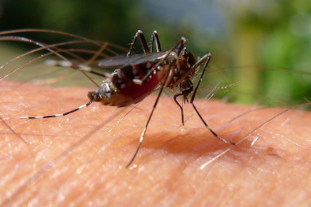
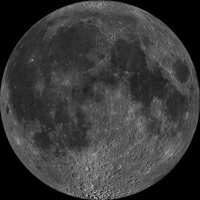

# Chapter 2: Momentum and impulse

## 2.1 Introduction (ESCJ6)

In Grade 10 we studied motion but not what caused the motion, in Grade 11 we learnt about forces and
                        how they can alter the motion of an object. In this chapter we will focus on what happens when
                        two bodies undergo a contact interaction and how their motion is affected. We learn more about
                        how force and motion are related. We are introduced to two new concepts, momentum and impulse.

We can begin by considering some scenarios to set the context. Most people have some intuition for
                        physics based on their everyday experiences but they haven't formalised it. We can use our
                        intuitive answers to lead into more structured thinking about physical events.

<Callout type="tip" title="Note">
Momentum transfer doesn't require a contact interaction but we won't consider any non-contact
                                scenarios in this chapter.
</Callout>

Everyone has experienced a mosquito landing on their arm and it can happen quite unnoticed. Consider
                        the case of a falcon landing on your arm (ignore the sharp claws for now). You would definitely
                        notice, why? What makes a mosquito different to a falcon? Would you still notice if the mosquito
                        flew the same way as a falcon, or if the falcon copied the flight of a mosquito before landing?
                        You probably would still notice, but try to think about what makes them so different.

Look at a motorcycle, motorcar and truck. Which of them is more likely to result in less damage in
                        a collision situation, why? What factors would you change to reduce potential damage.

Why is the Moon's orbit largely unaffected when it is hit by asteroid?

The factors that come up in these considerations are how fast things are moving and how massive they
                        are. A falcon moving at the same speed as a mosquito still has a much larger mass. Even if a
                        mosquito moved as fast as a falcon it wouldn't bother us because the mass of a mosquito is so
                        small.

If a motorcycle, motorcar and truck were all moving at the same speed then it would be much safer to
                        be in a collision with the motorcycle but a truck doesn't have to be moving as fast as a
                        motorcycle to have a huge impact in a collision because of its large mass.

There is an interplay between mass and speed (velocity to be precise) that governs what would happen
                        if these objects came into contact with another object. There are two quantities that depend on
                        mass and velocity, kinetic energy and momentum. Kinetic energy is something that we learnt about
                        previous. Momentum is different to kinetic energy and is what we will focus on in the first part
                        of this chapter. In the second part we will cover
                        some of the differences between kinetic energy and momentum.

<Callout type="note" title="Note">
- Units and unit conversions - Physical Sciences, Grade 10, Science skills
- Equations - Mathematics, Grade 10, Equations and inequalities
- Techniques of vector addition - Physical Sciences, Grade 10, Vectors and scalars
- Newton's laws - Physical Sciences, Grade 11, Forces
</Callout>

The following must be covered by the end of this chapter:

Momentum:

- The definition of momentum.
- The calculations done on momentum using p = mv and the change in momentum under the
                                          influence of a resultant force.
- The understanding of the vector nature of momentum and the applications concerning
                                          momentum.
- Representing momentum using vector diagrams.

Newton's second law expressed in terms of momentum:

- State Newton's second law in terms of momentum.
- Expression of Newton's second law in terms of symbols.
- Emphasis on the vector nature of momentum
- The relationship between the net force and change in momentum for a variety of
                                          motions by using different examples.
- Do calculations on the change in momentum when a resultant force acts on an object
                                          to change the velocity.

Conservation of momentum:

- Definition of :
  - A system
  - Internal forces
  - External forces
  - Isolated system
- State the law of conservation of momentum.
- Explain the difference between elastic and inelastic collisions by using the concept
                                          of kinetic energy before and after a collision.
- Do calculations on the principle of conservation of momentum.
- Do practical demonstrations on the principle of conservation of momentum.
- Applications of the principle of conservation of momentum.

Impulse:

- Definition of impulse.
- The understanding of the vector nature of impulse.
- The change in momentum and impulse are equal to each other (impulse-momentum
                                          theorem).
- Calculations done by using the impulse-momentum theorem.

<Callout type="note" title="Note">
- Units and unit conversions - Physical Sciences, Grade 10, Science skills
- Equations - Mathematics, Grade 10, Equations and inequalities
- Techniques of vector addition - Physical Sciences, Grade 10, Vectors and
                                                  scalars
- Newton's laws - Physical Sciences, Grade 11, Forces
</Callout>
