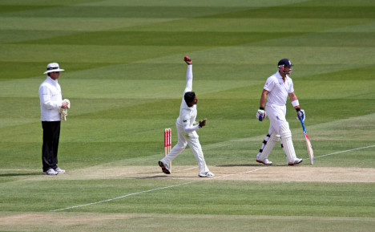
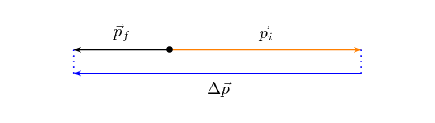
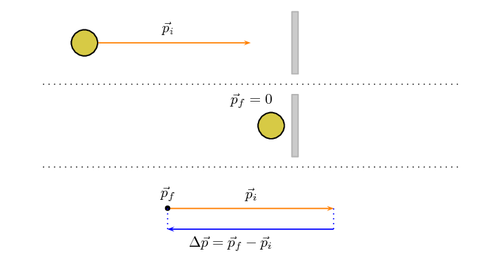
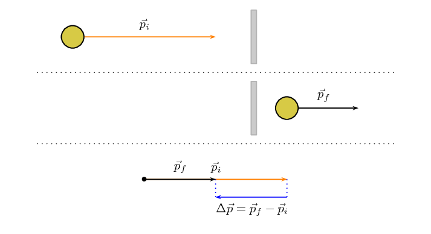
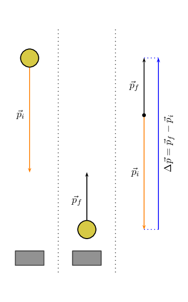

## 2.2 Momentum (ESCJ7)

Momentum is a physical quantity which is closely related to forces. Momentum is
                        a property which applies to moving objects, in fact it is mass in motion. If something
                        has mass and it is moving then it has momentum.

Momentum

The linear momentum of a particle (object) is a vector quantity equal to the
                                        product of the mass of the particle (object) and its velocity.

The momentum (symbol \(\vec{p}\)) of an object of mass \(m\)
                        moving at velocity \(v\) is:

                \[\vec{p}=m\vec{v}\]

Momentum is directly proportional to both the mass and velocity of an object. A small car
                        travelling at the same velocity as a big truck will have a smaller momentum than
                        the truck. The smaller the mass, the smaller the momentum for a fixed velocity. If
                        the mass is constant then the greater the velocity the greater the momentum. The momentum
                        will always be in the same direction as the velocity because mass is a scalar not a
                        vector.

<QuizCard id="s12-02-02a" title="Interactive Exercise 2.1" question="Define the term linear momentum ." options=["energy", "linear momentum", "kinetic energy", "power", "mechanical energy", "potential energy", "greater than", "equal to", "less than", "product of", "difference between", "sum of", "mass and its velocity", "mass and its speed", "mass and velocity squared", "vector", "scalar"] answer="0, 0, 0, 0, 0, 0" hint="" explanation="Define the linear momentum of an object The linear momentum of an object with mass is equal to the product of the object's mass and its velocity . It is a vector quantity with the same direction as the velocity of the object . Submit your answer as: linear momentum and equal to and product of and mass and its velocity and vector and the same direction as the velocity of the object." />

<QuizCard id="s12-02-02a" title="Interactive Exercise 2.1" question="What does the symbol \( m\) represent?" options=["metres", "linear momentum", "force", "mass", "acceleration", "velocity", "power", "pressure", "kinetic energy", "g\u00b7m\u00b7s\u207b\u00b9", "s", "kg", "g", "m\u00b7s", "kg\u00b7m\u00b7s", "kg\u00b7m\u00b7s\u207b\u00b9", "s\u00b7m\u207b\u00b9", "m\u00b7s\u207b\u00b9", "m\u00b7s\u207b\u00b2"] answer="linear momentum" hint="" explanation="What do the symbols in the equation mean? The equation we are working with is: \[                         \begin{aligned}                         \vec{p} & = m \vec{v}                         \end{aligned}                     \] This equation shows the relationship between the linear momentum of an object, the mass of the object and the velocity of the object. We need to know what each of the symbols in the equation mean. The symbol for: linear momentum is \(\vec{p}\) . mass is \(m\) . velocity is \(\vec{v}\) . Therefore the symbol \(m\) stands for mass . Submit your answer as: mass" />

<QuizCard id="s12-02-02a" title="Interactive Exercise 2.1" question="Linear momentum, velocity, and mass  are represented by the symbols \(p\) , \(v\) , and \(m\) respectively. These are important quantities in mechanics. Write down the equation that represents the relationship between these three quantities. Now solve this equation for \(v\) . INSTRUCTIONS: Work with magnitudes of momentum ( \(p\) ) and velocity ( \(v\) ) only. Do not use vector notation in this question." options=[] answer="['v = p / m']" hint="Your answer should be a mathematical equation. Here is an example of a famous                equation: E = mc^2 You can use the following symbols to write equations: add: + subtract: − multiply: ∗ divide: / exponent: ^ The following special symbols are also recognised: pi (π): pi infinity (∞): oo It is also possible to write certain functions: √: sqrt( ) log: log( ) sin: sin( ) cosec: cosec( ) cos: cos( ) sec: sec( ) tan: tan( ) cot: cot( ) To write a logarithm with a specific base, use the underscore _ symbol.                For example, log of x base 3 can be written as: log_3 x" explanation="Identify the relationship between the given quantities Linear momentum, velocity and mass are related to each other by the following equation: \[                     \begin{aligned}                         p & = m v                     \end{aligned}                 \] Make \(v\) the subject of the formula We start with \[                     \begin{aligned}                         p & = m v                     \end{aligned}                 \] We need to isolate \(v\) . We can  do this by dividing both sides of the equation by \(\color{blue}{m}\) . \[         \begin{aligned}             p &= m v \\             \frac{p}{\color{blue}{m}} &= \frac{m v }{\color{blue}{m}} \\             \frac{p}{m} &=  \frac{\color{grey}{m}}{\color{grey}{m}} v \\             \frac{p}{m} &= v          \end{aligned}         \] Therefore we can write the relationship between \(p\) , \(v\) , and \(m\) as: \[                     \begin{aligned}                         v & = \frac{p}{m}                     \end{aligned}                 \] Submit your answer as:" />

### Vector nature of momentum (ESCJ8)

A car travelling at \(\text{120}\) \(\text{km·hr$^{-1}$}\) will have a larger momentum
                                than the same car travelling at \(\text{60}\) \(\text{km·hr$^{-1}$}\). Momentum is
                                also related to velocity; the smaller the velocity, the smaller the momentum.

Different objects can also have the same momentum, for example a car travelling slowly can
                                have the same momentum as a motorcycle travelling relatively fast. We can easily
                                demonstrate this.

Consider a car of mass \(\text{1 000}\) \(\text{kg}\)
                                with a velocity of \(\text{8}\) \(\text{m·s$^{-1}$}\)
                                (about \(\text{30}\) \(\text{km·hr$^{-1}$}\)) East.
                                The momentum of the car is therefore:

\begin{align*}
                                \vec{p}& = m\vec{v} \\
                                & = \left(\text{1 000}\right)\left(8\right) \\
                                & = \text{8 000}\text{ kg·m·s$^{-1}$}~\text{East}
                                \end{align*}

Now consider a motorcycle, also travelling East, of mass
                                \(\text{250}\) \(\text{kg}\)
                                travelling at \(\text{32}\) \(\text{m·s$^{-1}$}\)
                                (about \(\text{115}\) \(\text{km·hr$^{-1}$}\)).
                                The momentum of the motorcycle is:

                        \begin{align*}
                        \vec{p} &= m\vec{v} \\
                        & = \left(250 \text{kg}\right)\left(32 \text{m·s$^{-1}$}\right) \\
                        & = \text{8 000}\text{ kg·m·s$^{-1}$}~\text{East}
                        \end{align*}

Even though the motorcycle is considerably lighter than the car, the fact that the motorcycle
                                is travelling much faster than the car means that the momentum of both vehicles is the
                                same.

From the calculations above, you are able to derive the unit for momentum as
                                \(\text{kg·m·s$^{-1}$}\).

Momentum is also vector quantity, because it is the product of a scalar (\(m\)) with a
                                vector \((\vec{v})\).

<Callout type="tip" title="Note">
A vector multiplied by a scalar has the same direction as the original vector but a
                                        magnitude that is scaled by the multiplicative
                                        factor.
</Callout>

This means that whenever we calculate the momentum of an object, we should include
                                the direction of the momentum.

<Callout type="note" title="Note">
<VideoPlayer src="http://www.youtube.com/embed/XFhntPxow0U" title="Video:
                                                27HN" />
</Callout>

<Callout type="tip" title="Worked example 1: Momentum of a soccer ball">
**Question:**
A soccer ball of mass \(\text{420}\) \(\text{g}\)
                                                is kicked at \(\text{20}\) \(\text{m·s$^{-1}$}\)
                                                towards the goal post. Calculate the momentum of the ball.

**Identify what information is given and what is asked for:**
The question explicitly gives:

- the mass of the ball, and
- the velocity of the ball.

The mass of the ball must be converted to SI units.

                                        \(\text{420}\text{ g}=\text{0,42}\text{ kg}\)

We are asked to calculate the momentum of the ball. From the definition of
                                                momentum,
                                                \(\vec{p}=m\vec{v}\) we see that we need the mass and velocity of the
                                                ball, which we are given.

**Do the calculation:**
We calculate the magnitude of the momentum of the ball,

                                        \begin{align*}
                                        \vec{p}& = m\vec{v} \\
                                        & = \left(\text{0,42}\right)\left(20\right) \\
                                        & = \text{8,40}\text{ kg·m·s$^{-1}$}
                                        \end{align*}

**Quote the final answer:**
We quote the answer with the direction of motion included,
                                                \(\vec{p}\) = \(\text{8,40}\) \(\text{kg·m·s$^{-1}$}\) in the
                                                direction of the goal post.
</Callout>

<Callout type="tip" title="Worked example 2: Momentum of a cricket ball">
**Question:**
A cricket ball of mass \(\text{160}\) \(\text{g}\) is bowled at \(\text{40}\)
                                                \(\text{m·s$^{-1}$}\) towards a batsman. Calculate the momentum of
                                                the cricket ball.

**Identify what information is given and what is asked for:**
The question explicitly gives

- the mass of the ball (m = \(\text{160}\) \(\text{g}\) =
                                                                  \(\text{0,16}\) \(\text{kg}\)), and
- the velocity of the ball \((\vec{v}\) = \(\text{40}\)
                                                                  \(\text{m·s$^{-1}$}\) towards the batsman)

To calculate the momentum we will use

                                        \(\vec{p}=m\vec{v}.\)

**Do the calculation:**
\begin{align*}
                                        \vec{p}& = m\vec{v} \\
                                        & = \left(\text{0,16}\right)\left(40\right) \\
                                        & = \text{6,4}\text{ kg·m·s$^{-1}$} \\
                                        & = \text{6,4}\text{ kg·m·s$^{-1}$} \text{in the direction of
                                        the batsman}
                                        \end{align*}

**Quote the final answer:**
The momentum of the cricket ball is \(\text{6,4}\)
                                                \(\text{kg·m·s$^{-1}$}\) in the direction of the batsman.
</Callout>

<Callout type="tip" title="Worked example 3: Momentum of the Moon">
**Question:**
The centre of the Moon is approximately \(\text{384 400}\) \(\text{km}\)
                                                away
                                                from the centre of the Earth and orbits the Earth in \(\text{27,3}\)
                                                days. If the Moon has a mass
                                                of \(\text{7,35} \times \text{10}^{\text{22}}\) \(\text{kg}\), what is
                                                the magnitude of its momentum (using the definition given in this
                                                chapter) if we assume a circular orbit?
                                                The actual momentum of the Moon is more complex but we do not cover that
                                                in this chapter.

**Identify what information is given and what is asked for:**
The question explicitly gives

- the mass of the Moon (\(m\) = \(\text{7,35} \times
                                                                  \text{10}^{\text{22}}\) \(\text{kg}\))
- the distance to the Moon (\(\text{384 400}\)
                                                                  \(\text{km}\) = \(\text{384 400 000}\)
                                                                  \(\text{m}\) = \(\text{3,844} \times
                                                                  \text{10}^{\text{8}}\) \(\text{m}\))
- the time for one orbit of the Moon (\(\text{27,3} \text{
                                                                  days} = \text{27,3} \times 24 \times 60 \times 60 =
                                                                  \text{2,36} \times \text{10}^{\text{6}}\text{ s}\))

We are asked to calculate only the magnitude of the momentum of the Moon
                                                (i.e. we do not need to specify a direction). In order to do this we
                                                require the mass and the magnitude of the velocity of the Moon, since

                                        \(\vec{p}=m\vec{v}.\)

**Find the magnitude of the velocity of the Moon:**
The magnitude of the average velocity is the same as the speed. Therefore:

                                        \(v=\frac{\Delta x}{\Delta t}\)

We are given the time the Moon takes for one orbit but not how far it travels
                                                in that time. However, we can work this out from the distance to the
                                                Moon and the fact that the Moon has a circular orbit. Using the equation
                                                for the circumference, C, of a circle in terms of its radius, we can
                                                determine the distance travelled by the Moon in one
                                                orbit:

                                        \begin{align*}
                                        C& = 2\pi r \\
                                        & = 2\pi \left(\text{3,844} \times \text{10}^{\text{8}}\right) \\
                                        & = \text{2,42} \times \text{10}^{\text{9}}\text{ m}
                                        \end{align*}

Combining the distance travelled by the Moon in an orbit and the time
                                                taken by the Moon to complete one orbit, we can determine the
                                                magnitude of the Moon's velocity or speed,

                                        \begin{align*}
                                        v& = \frac{\Delta x}{\Delta t} \\
                                        & = \frac{C}{T} \\
                                        & = \frac{\text{2,42} \times \text{10}^{\text{9}}\text{ m}}{\text{2,36}
                                        \times \text{10}^{\text{6}}\text{ s}} \\
                                        & = \text{1,02} \times \text{10}^{\text{3}}\text{ m·s$^{-1}$}
                                        \end{align*}

**Finally calculate the momentum and quote the answer:**
The magnitude of the Moon's momentum is:

                                        \begin{align*}
                                        \vec{p}& = m\vec{v} \\
                                        {p}& = m{v} \\
                                        & = \left(\text{7,35} \times \text{10}^{\text{22}}\right)\left(\text{1,02}
                                        \times \text{10}^{\text{3}}\right) \\
                                        & = \text{7,50} \times \text{10}^{\text{25}}\text{ kg·m·s$^{-1}$}
                                        \end{align*}

The magnitude of the momentum of the Moon is \(\text{7,50} \times
                                                \text{10}^{\text{25}}\) \(\text{kg·m·s$^{-1}$}\).
</Callout>

As we have said, momentum is a vector quantity. Since momentum is a vector, the techniques of
                                vector addition discussed in [Vectors and scalars in Grade
                                        10](/read/science/grade-10/vectors-and-scalars) must be used when dealing with momentum.

<QuizCard id="s12-02-02b" title="Interactive Exercise 2.2" question="A tennis player hits a tennis ball towards her opponent. The magnitude of the velocity of the tennis ball at a certain position is \(v = \text{42,06}\ \text{m·s$^{-1}$}\) and the magnitude of the momentum of the tennis ball at the same position in its motion is \(p = \text{2,42}\ \text{kg·m·s$^{-1}$}\) . What is the mass, \(m\) , of the tennis ball? INSTRUCTION: Round your answer to the nearest gram ." options=[] answer="58" hint="You should enter a number here. If you want to, you can use a space to separate thousands.                Example: 12 800,25 For scientific notation you need to use the multiply symbol                ( ∗ ) and the exponent symbol ( ^ ). For example 6,673 × 10 −11 should be written as: 6,673 ∗ 10^−11" explanation="Calculate the velocity Recall that: \[\begin{array}{c}\vec{p} = m \vec{v} ~~~~~\text{(1)}\end{array}\] We do not know the direction of the momentum and velocity vectors, but only their magnitudes. Therefore we will rewrite equation \(\text{(1)}\) as: \[\begin{array}{c}p = mv ~~~~~\text{(2)}\end{array}\] We will rearrange equation \(\text{(2)}\) to make \(m\) the subject of the equation: \[\begin{array}{c}m = \frac{p}{v} ~~~~~\text{(3)}\end{array}\] Substitute the given information to calculate the final result We are given the following information and convert all values to SI units: the magnitude of the momentum of the tennis ball \( p = \text{2,42}\ \text{kg·m·s$^{-1}$}\) the magnitude of the velocity of the tennis ball \( v = \text{42,06}\ \text{m·s$^{-1}$}\) Substituting the above values in \(\text{(3)}\) , we get: \[ \begin{aligned}             m & = \frac{p}{v} \\             & = \frac{(\text{2,42})}{(\text{42,06})} \\             & = (\text{0,057536...}\ \text{kg}) \times \frac{\text{1 000}\ \text{g}}{\text{1}\ \text{kg}} ~~~~~\text{(convert: kg to g)} \\             & = \text{57,53685...}\ \text{g} \qquad (\text{calculated})\\ & \approx             \text{58}\ \text{g} ~~~~~\text{(rounded)}         \end{aligned} \] Therefore the mass of the tennis ball is \(\text{58}\ \text{g}\) . Submit your answer as:" />

<QuizCard id="s12-02-02b" title="Interactive Exercise 2.2" question="A cricket player drives a cricket ball towards the fielders. The cricket ball has a mass of \(m = \text{159}\ \text{g}\) and the magnitude of the momentum of the cricket ball at a certain position in its motion is \(p = \text{23,39}\ \text{kg·m·s$^{-1}$}\) . What is the magnitude of the velocity ( \(v\) ) of the cricket ball at this point? INSTRUCTION: Round your answer to two decimal places ." options=[] answer="147.11" hint="You should enter a number here. If you want to, you can use a space to separate thousands.                Example: 12 800,25 For scientific notation you need to use the multiply symbol                ( ∗ ) and the exponent symbol ( ^ ). For example 6,673 × 10 −11 should be written as: 6,673 ∗ 10^−11" explanation="Calculate the velocity Recall that: \[\begin{array}{c}\vec{p} = m \vec{v} ~~~~~\textrm{(1)}\end{array}\] However the question asks for the magnitude of the velocity. Therefore we can rewrite equation \(\textrm{(1)}\) as: \[\begin{array}{c}p = mv ~~~~~\textrm{(2)}\end{array}\] We will rearrange equation \(\textrm{(2)}\) to make \(v\) the subject of the equation: \[\begin{array}{c}v = \frac{p}{m} ~~~~~\textrm{(3)}\end{array}\] Substitute the given information to calculate the final result We are given the following information and convert all values to SI units: the magnitude of the momentum of the cricket ball \( p = \text{23,39}\ \text{kg·m·s$^{-1}$}\) the mass of the cricket ball \( m = \text{159}\ \text{g} \times \frac{\text{1}\ \text{kg}}{\text{1 000}\ \text{g}} = \text{0,159}\ \text{kg}\) Substituting the above values in \(\textrm{(3)}\) , we get: \[ \begin{aligned}         v   & = \frac{p}{m}\\         & = \frac{(\text{23,39})}{(\text{0,159})} \\         & = \text{147,10691...}\ \text{m·s$^{-1}$} \qquad \\ & \approx         \text{147,11}\ \text{m·s$^{-1}$}     \end{aligned} \] Therefore the magnitude of the velocity of the cricket ball is \(\text{147,11}\ \text{m·s$^{-1}$}\) . Submit your answer as:" />

<QuizCard id="s12-02-02b" title="Interactive Exercise 2.2" question="Calculate the magnitude of the average velocity ( \(v_\text{avg}\) ) of the table tennis ball over this period of its trajectory. INSTRUCTION: Round your answer to two decimal places ." options=[] answer="(21.16; 21.136; 21.18)" hint="You should enter a number here. If you want to, you can use a space to separate thousands.                Example: 12 800,25 For scientific notation you need to use the multiply symbol                ( ∗ ) and the exponent symbol ( ^ ). For example 6,673 × 10 −11 should be written as: 6,673 ∗ 10^−11" explanation="Decide how to solve the problem Recall that: \[\begin{array}{c}\vec{v}_\text{avg} = \frac{\Delta \vec{x}}{\Delta t} ~~~~~\textrm{(1)}\end{array}\] We are asked to find the the magnitude of the average velocity. Therefore we can rewrite equation \(\textrm{(1)}\) as: \[\begin{array}{c}v_\text{avg} = \frac{\Delta x}{\Delta t} ~~~~~\textrm{(2)}\end{array}\] Substitute the given information to calculate the final result We are given the following information and convert all values to SI units: the magnitude of the displacement of the table tennis ball \( \Delta x = \text{0,952}\ \text{m}\) the time period for the part of the trajectory of the table tennis ball \( \Delta t = \text{0,045}\ \text{s}\) Substituting the above values in \(\textrm{(2)}\) , we get: \[ \begin{aligned}         v_\text{avg}   & = \frac{ \Delta x}{\Delta t} \\             & = \frac{(\text{0,952})}{(\text{0,045})} \\             & = \text{21,15555...}\ \text{m·s$^{-1}$} \qquad \\ & \approx             \text{21,16}\ \text{m·s$^{-1}$}     \end{aligned} \] Therefore the magnitude of the average velocity of the table tennis ball is \(\text{21,16}\ \text{m·s$^{-1}$}\) . Submit your answer as:" />

<QuizCard id="s12-02-02b" title="Interactive Exercise 2.2" question="A rugby player drop kicks a rugby ball towards the goalpost to score. The rugby ball has a mass of \(m = \text{407}\ \text{g}\) . The magnitude of the velocity of the rugby ball at a certain position in its motion is \(v = \text{21,03}\ \text{m·s$^{-1}$}\) . What is the magnitude of the momentum ( \(p\) ) of the rugby ball at this point? INSTRUCTION: Round your answer to two decimal places . Use the values for any physical constants you might need, as listed here" options=[] answer="8.56" hint="You should enter a number here. If you want to, you can use a space to separate thousands.                Example: 12 800,25 For scientific notation you need to use the multiply symbol                ( ∗ ) and the exponent symbol ( ^ ). For example 6,673 × 10 −11 should be written as: 6,673 ∗ 10^−11" explanation="Calculate the momentum Recall that: \[\begin{array}{c}\vec{p} = m \vec{v} ~~~~~\textrm{(1)}\end{array}\] We are asked to calculate the magnitude of the momentum. Therefore we can rewrite equation \(\textrm{(1)}\) as: \[\begin{array}{c}p = mv ~~~~~\textrm{(2)}\end{array}\] In other words we ignore the direction of the vectors and look only at the magnitude. Substitute the given information to calculate the final result We are given the following information and convert all values to SI units: the mass of the rugby ball \( m = \text{407}\ \text{g} \times \frac{\text{1}\ \text{kg}}{\text{1 000}\ \text{g}} = \text{0,407}\ \text{kg}\) the magnitude of the velocity of the rugby ball \( v = \text{21,03}\ \text{m·s$^{-1}$}\) Substituting the above values in \(\textrm{(2)}\) , we get: \[ \begin{aligned}         p   & = m v \\         & = (\text{0,407})(\text{21,03}) \\         & = \text{8,55921}\ \text{kg·m·s$^{-1}$} \qquad \\ & \approx         \text{8,56}\ \text{kg·m·s$^{-1}$}     \end{aligned} \] Therefore the magnitude of the momentum of the rugby ball is \(\text{8,56}\ \text{kg·m·s$^{-1}$}\) . Submit your answer as:" />

### Change in momentum (ESCJ9)

Particles or objects can collide with other particles or objects, we know
                                that this will
                                often change their velocity (and maybe their mass) so their momentum is likely
                                to change as well. We will deal with collisions in detail a little bit later
                                but we are going to start by looking at the details of the change in momentum
                                for a single particle or object.

#### Case 1: Object bouncing off a wall

Lets start with a simple picture, a ball of mass, \(m\), moving
                                        with initial velocity, \(\vec{v}_i\), to the right towards a wall.
                                        It will have momentum
                                        \(\vec{p}_i=m\vec{v}_i\) to the right as shown in this picture:

The ball bounces off the wall. It will now be moving to the left, with the same mass,
                                        but a different velocity, \(\vec{v}_f\) and therefore, a different
                                        momentum, \(\vec{p}_f=m\vec{v}_f\), as shown in this picture:

We know that the final momentum vector must be the sum of the initial momentum
                                        vector and the change in momentum vector, \(\Delta \vec{p}=m\Delta \vec{v}\).
                                        This means that, using tail-to-head vector addition, \(\Delta \vec{p}\), must
                                        be the vector that starts at the head of \(\vec{p}_i\) and ends on the head of
                                        \(\vec{p}_f\) as shown in this picture:

We also know from algebraic addition of vectors that:
                                        \begin{align*}
                                        \vec{p}_f &=\vec{p}_i + \Delta \vec{p} \\
                                        \vec{p}_f - \vec{p}_i &= \Delta \vec{p} \\
                                        \Delta \vec{p} &= \vec{p}_f - \vec{p}_i
                                        \end{align*}
                                        If we put this all together we can show the sequence and the change in momentum
                                        in one diagram:

We have just shown the case for a rebounding object. There are a few other cases we
                                        can use to illustrate the basic features but they are all built up in the same
                                        way.

#### Case 2: Object stops

In some scenarios the object may come to a standstill (rest). An example of such a
                                        case
                                        is a tennis ball hitting the net. The net stops the ball but doesn't cause it to
                                        bounce back.
                                        At the instant before it falls to the ground its velocity is zero. This scenario
                                        is described
                                        in this image:

#### Case 3: Object continues more slowly

In this case, the object continue in the same direction but more slowly. To give this
                                        some context, this could happen when a ball hits a glass window and goes through
                                        it or an object sliding on a frictionless surface encounters a small rough patch
                                        before carrying
                                        on along the frictionless surface.

**Important:** note that even though the momentum remains in the same
                                        direction the change in momentum is in the opposite direction because the
                                        magnitude of the final momentum is less than the magnitude of the initial
                                        momentum.

#### Case 4: Object gets a boost

In this case the object interacts with something that increases the velocity it has
                                        without changing its direction. For example, in squash the ball can bounce off a
                                        back wall
                                        towards the front wall and a player can hit it with a racquet in the same
                                        direction, increasing
                                        its velocity.

If we analyse this scenario in the same way as the first 3 cases, it will look like
                                        this:

#### Case 5: Vertical bounce

<Callout type="note" title="Note">
For this explanation we are ignoring any effect of gravity. This isn't
                                                accurate but
                                                we will learn more about the role of gravity in this scenarion in the
                                                next chapter.
</Callout>

All of the examples that we've shown so far have been in the horizontal direction.
                                        That is just a coincidence, this approach applies for vertical or horizontal
                                        cases. In
                                        fact, it applies to any scenario where the initial and final vectors fall on the
                                        same
                                        line, any 1-dimensional (1D) problem. We will only deal with 1D scenarios in
                                        this
                                        chapter. For example, a stationary basketball player bouncing a ball.

To illustrate the point, here is what the analysis would look like for a ball
                                        bouncing off the floor:

### Textbook Exercise 2.1

**Problem:**
The fastest recorded delivery for a cricket ball is
                                                                        \(\text{161,3}\) \(\text{km·hr$^{-1}$}\),
                                                                        bowled by Shoaib Akhtar of Pakistan during a
                                                                        match against England in the 2003 Cricket World
                                                                        Cup, held in South Africa. Calculate the ball's
                                                                        momentum if it has a mass of \(\text{160}\)
                                                                        \(\text{g}\).

**Solution:**
\[p = mv\]

\(v = \text{161,3}\text{ km·hr$^{-1}$}\) and \(m
                                                                        = \text{160}\text{ g}\).

Converting the velocity to the correct S.I units:

                                                                \begin{align*}
                                                                v & = \text{161,3}\text{ km·hr$^{-1}$} \times
                                                                \frac{\text{1 000}\text{
                                                                m}}{\text{3 600}\text{ s}} \\
                                                                & = \text{44,81}\text{ m·s$^{-1}$}
                                                                \end{align*}

Converting the mass to the correct S.I units:

                                                                \begin{align*}
                                                                m & = \text{160}\text{ g} \times
                                                                \frac{\text{1}\text{ kg}}{\text{1 000}\text{ g}} \\
                                                                & = \text{0,16}\text{ kg}
                                                                \end{align*}

Therefore, computing the momentum:

                                                                \begin{align*}
                                                                p & = mv \\
                                                                & = (\text{0,16})(\text{44,81}) \\
                                                                & = \text{7,17}\text{ kg·m·s$^{-1}$}
                                                                \end{align*}

**Problem:**
The fastest tennis service by a man is
                                                                        \(\text{246,2}\) \(\text{km·hr$^{-1}$}\) by
                                                                        Andy Roddick of the United States of America
                                                                        during a match in London in 2004. Calculate the
                                                                        ball's momentum if it has a mass of
                                                                        \(\text{58}\) \(\text{g}\).

**Solution:**
\[p = mv\]

\(v = \text{246,2}\text{ km·hr$^{-1}$}\) and \(m
                                                                        = \text{58}\text{ g}\).

Converting the velocity to the correct S.I units:

                                                                \begin{align*}
                                                                v & = \text{246,2}\text{ km·hr$^{-1}$} \times
                                                                \frac{\text{1 000}\text{
                                                                m}}{\text{3 600}\text{ s}} \\
                                                                & = \text{68,39}\text{ m·s$^{-1}$}
                                                                \end{align*}

Converting the mass to the correct S.I units:

                                                                \begin{align*}
                                                                m & = \text{58}\text{ g} \times
                                                                \frac{\text{1}\text{ kg}}{\text{1 000}\text{ g}} \\
                                                                & = \text{0,058}\text{ kg}
                                                                \end{align*}

Therefore, computing the momentum:

                                                                \begin{align*}
                                                                p & = mv \\
                                                                & = (\text{0,058})(\text{68,39}) \\
                                                                & = \text{3,97}\text{ kg·m·s$^{-1}$}
                                                                \end{align*}

**Problem:**
The fastest server in the women's game is Venus
                                                                        Williams of the United States of America, who
                                                                        recorded a serve of \(\text{205}\)
                                                                        \(\text{km·hr$^{-1}$}\) during a match in
                                                                        Switzerland in 1998. Calculate the ball's
                                                                        momentum if it has a mass of \(\text{58}\)
                                                                        \(\text{g}\).

**Solution:**
\[p = mv\]

\(v = \text{205}\text{ km·hr$^{-1}$}\) and \(m =
                                                                        \text{58}\text{ g}\).

Converting the velocity to the correct S.I units:

                                                                \begin{align*}
                                                                v & = \text{205}\text{ km·hr$^{-1}$} \times
                                                                \frac{\text{1 000}\text{
                                                                m}}{\text{3 600}\text{ s}} \\
                                                                & = \text{56,94}\text{ m·s$^{-1}$}
                                                                \end{align*}

Converting the mass to the correct S.I units:

                                                                \begin{align*}
                                                                m & = \text{58}\text{ g} \times \frac{\text{1}\text{
                                                                kg}}{\text{1 000}\text{ g}} \\
                                                                & = \text{0,058}\text{ kg}
                                                                \end{align*}

Therefore, computing the momentum:

                                                                \begin{align*}
                                                                p & = mv \\
                                                                & = (\text{0,058})(\text{56,94}) \\
                                                                & = \text{3,30}\text{ kg·m·s$^{-1}$}
                                                                \end{align*}

**Problem:**
If you had a choice of facing Shoaib, Andy or Venus
                                                                        and didn't want to get hurt, who would you
                                                                        choose based on the momentum of each ball?

**Solution:**
The ball with the smallest momentum gives you the
                                                                        least chance of being hurt and so you would
                                                                        choose to face Venus.
