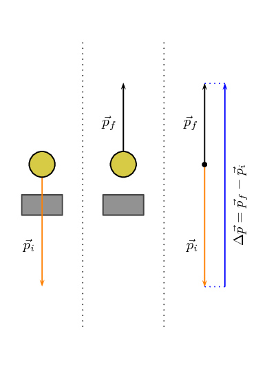
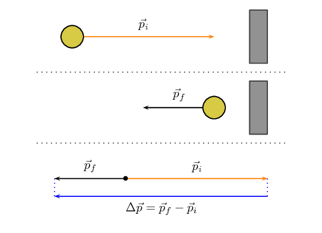
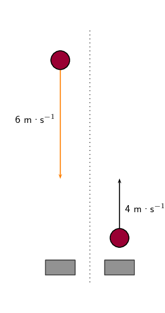
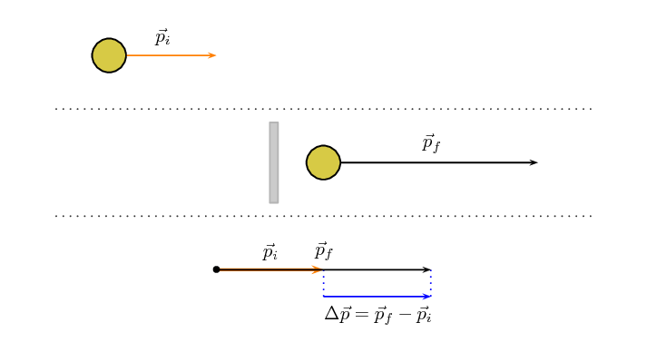

## 2.3 Newton's Second Law revisited (ESCJB)

In the previous section we considered a number of scenarios where the momentum of an object changed but we didn't
      look at the details of what caused the momentum to change. In each case it interacted with something which we know
      would have exerted a force on the object and we've learnt a lot about forces in Grade 11 so now we can tie the two
      together.

You have learnt about Newton's Laws of motion in Grade 11. We know that an object will continue in its state of
      motion unless acted on by a force so unless a force acts the momentum will not change.

In its most general form Newton's Second Law of motion is defined in terms of momentum which actually allows for
      the mass and the velocity to vary. We will not deal with the case of changing mass as well as changing velocity.

Newton's Second Law of Motion

The net or resultant force acting on an object is equal to the rate of
          change of momentum.

Mathematically, Newton's Second Law can be stated as:

    \(\vec{F}_{net}=\frac{\Delta \vec{p}}{\Delta t}\)

If
      a force is acting on an object whose mass is not changing,
      then Newton's Second Law describes the relationship
      between the motion of an object and the
      net force on the object through:

    \[\vec{F}_{\text{net}}=m\vec{a}_{\text{net}}\]

We can therefore say that because a net force causes an object
      to change its motion, it also causes its momentum
      to change.

    \begin{align*}
    \vec{F}_{net} & =m\vec{a}_{\text{net}} \\
    \vec{F}_{net} & =m\frac{\Delta \vec{v}}{\Delta t} \\
    \vec{F}_{net} & =\frac{m\Delta \vec{v}}{\Delta t} \\
    \vec{F}_{net} & =\frac{\Delta \vec{p}}{\Delta t}
    \end{align*}

Let us apply this to the last case from the previous section,
      consider a tennis ball
      (mass = \(\text{0,1}\) \(\text{kg}\))
      that is thrown and strikes the floor with a velocity of \(\text{5}\) \(\text{m·s$^{-1}$}\) downwards and
      bounces back at a final
      velocity of \(\text{3}\) \(\text{m·s$^{-1}$}\) upwards.
      As the ball approaches the floor it has an initial momentum \(\vec{p}_i\).
      When it moves away from the floor it has a final momentum \(\vec{p}_f\).
      The bounce on the floor can
      be thought of as a collision taking place where the floor exerts a force on the
      tennis ball to change its momentum.

**Remember:** momentum and velocity
      are vectors so we have to choose a
      direction as positive. For this example we choose the initial direction
      of motion as positive, in other words, downwards is positive.

    \begin{align*}
    \vec{p}_{i}& = m\vec{v}_{i} \\
    & = \left(\text{0,1}\right)\left(+5\right) \\
    & = \text{0,5}\text{ kg·m·s$^{-1}$}~\text{downwards}
    \end{align*}

When the tennis ball bounces back it changes direction. The final velocity will
      thus have a negative value because it is in the negative direction.
      The momentum after the bounce can be calculated as follows:

    \begin{align*}
    \vec{p}_{f}& = m\vec{v}_{f} \\
    & = \left(\text{0,1}\right)\left(-3\right) \\
    & = -\text{0,3} \\
    & = \text{0,3}\text{ kg·m·s$^{-1}$}~\text{upwards}
    \end{align*}

Now let us look at what happens to the momentum of the tennis ball. The momentum changes during this bounce.

We keep our initial choice of downwards as positive. This means that the final
      momentum will have a negative number.

    \begin{align*}
    \Delta \vec{p}& = \vec{p}_{f}-\vec{p}_{i} \\
    & = m\vec{v}_{f}-m\vec{v}_{i} \\
    & = \left(-\text{0,3}\right)-\left(\text{0,5}\right) \\
    & = -\text{0,8} \\
    & =\text{0,8}\text{ kg·m·s$^{-1}$}~\text{upwards}
    \end{align*}

You will notice that this number is bigger than the previous momenta calculated.
      This should be the case as the change has to cancel out the initial momentum and then still
      be as large as the final momentum over and above the initial momentum.

<Callout type="tip" title="Worked example 4: Change in Momentum">
**Question:**
A tennis ball of mass \(\text{58}\) \(\text{g}\) strikes a wall perpendicularly with a velocity of
          \(\text{10}\) \(\text{m·s$^{-1}$}\). It rebounds at a velocity of \(\text{8}\)
          \(\text{m·s$^{-1}$}\). Calculate the change in the momentum of the tennis ball caused by the wall.

**Identify the information given and what is asked:**
The question explicitly gives a number of values which we identify and
          convert into SI units:

- the ball's mass (m = \(\text{58}\) \(\text{g}\)=\(\text{0,058}\) \(\text{kg}\)),
- the ball's initial velocity (\(\vec{v}_{i}=\text{10}\text{ m·s$^{-1}$}\)) towards the wall, and
- the ball's final velocity (\(\vec{v}_{f}=\text{8}\text{ m·s$^{-1}$}\)) away from the wall

We are asked to calculate the change in momentum of the ball,

        \[\Delta \vec{p}=m\vec{v}_{f}-m\vec{v}_{i}\]

We have everything we need to find \(\Delta \vec{p}\). Since the initial momentum is directed towards the
          wall and the final momentum is away from the wall, we can use the algebraic method of subtraction discussed in
          Vectors in Grade 10.

**Choose a frame of reference:**
Let us choose towards the wall as the positive direction.

**Do the calculation:**
\begin{align*}
        \Delta \vec{p}& = m\vec{v}_{f}-m\vec{v}_{i} \\
        & = \left(\text{0,058}\right)\left(-8\right)-\left(\text{0,058}\right)\left(+10\right) \\
        & = \left(-\text{0,46}\right)-\left(\text{0,58}\right) \\
        & = -\text{1,04} \\
        & = \text{1,04}\text{ kg·m·s$^{-1}$}~\text{away from the wall}
        \end{align*}

**Quote the final answer:**
The change in momentum is \(\text{1,04}\) \(\text{kg·m·s$^{-1}$}\)
          away from the wall.
</Callout>

<Callout type="tip" title="Worked example 5: Change in momentum">
**Question:**
A rubber ball of mass \(\text{0,8}\) \(\text{kg}\) is dropped and strikes the floor with an initial velocity
          of \(\text{6}\) \(\text{m·s$^{-1}$}\). It bounces back with a final velocity of \(\text{4}\)
          \(\text{m·s$^{-1}$}\). Calculate the change in the momentum of the rubber ball caused by the floor.

**Identify the information given and what is asked:**
The question explicitly gives a number of values which we identify and
          convert into SI units:

- the ball's mass (m = \(\text{0,8}\) \(\text{kg}\)),
- the ball's initial velocity (\(\vec{v}_{i}=\text{6}\text{ m·s$^{-1}$}\)) downwards, and
- the ball's final velocity (\(\vec{v}_{f}=\text{4}\text{ m·s$^{-1}$}\)) upwards

We are asked to calculate the change in momentum of the ball,

        \[\Delta \vec{p}=m\vec{v}_{f}-m\vec{v}_{i}\]

**Do the calculation:**
Let us choose down as the positive direction.

        \begin{align*}
        \Delta \vec{p}& = m\vec{v}_{f}-m\vec{v}_{i} \\
        & = \left(\text{0,8}\right)\left(-4\right)-\left(\text{0,8}\right)\left(+6\right) \\
        & = \left(-\text{3,2}\right)-\left(\text{4,8}\right) \\
        & = -\text{8} \\
        & = \text{8,0}\text{ kg·m·s$^{-1}$}~\text{upwards}
        \end{align*}

**Quote the final answer:**
The change in momentum is \(\text{8,0}\) \(\text{kg·m·s$^{-1}$}\) upwards.
</Callout>

<Callout type="tip" title="Worked example 6: Change in momentum">
**Question:**
A regulation squash ball weighs
          \(\text{24}\) \(\text{g}\). In a squash match
          a ball bounces off the back wall in the direction of the front wall
          at \(\text{1}\) \(\text{m·s$^{-1}$}\)
          before a player hits it with a racquet. After being struck towards the front
          wall the ball is moving at
          \(\text{20}\) \(\text{m·s$^{-1}$}\). What
          is the change in momentum?

**Identify the information given and what is asked:**
The question explicitly gives a number of values which we identify and
          convert into SI units:

- the ball's mass (m = \(\text{24}\) \(\text{g}\)=\(\text{0,024}\) \(\text{kg}\)),
- the ball's initial velocity (\(\vec{v}_{i}=\text{1}\text{ m·s$^{-1}$}\)) towards the front wall, and
- the ball's final velocity (\(\vec{v}_{f}=\text{20}\text{ m·s$^{-1}$}\)) towards the front wall

We are asked to calculate the change in momentum of the ball,

        \[\Delta \vec{p}=m\vec{v}_{f}-m\vec{v}_{i}\]

We have everything we need to find \(\Delta \vec{p}\).

**Choose a frame of reference:**
Let us choose towards the front wall as the positive direction.

**Do the calculation:**
\begin{align*}
        \Delta \vec{p}& = m\vec{v}_{f}-m\vec{v}_{i} \\
        & = \left(\text{0,024}\right)\left(20\right)-\left(\text{0,024}\right)\left(+1\right) \\
        & = \left(\text{0,48}\right)-\left(\text{0,024}\right) \\
        & = \text{0,456} \\
        & = \text{0,46}\text{ kg·m·s$^{-1}$}~\text{towards the front wall}
        \end{align*}

**Quote the final answer:**
The change in momentum is \(\text{0,46}\) \(\text{kg·m·s$^{-1}$}\) towards the front wall.
</Callout>

### Textbook Exercise 2.2

**Problem:**
Which expression accurately describes the change of momentum of an object?

2. \(\frac{\vec{F}}{m}\)
4. \(\frac{\vec{F}}{\Delta t}\)
6. \(\vec{F}·m\)
8. \(\vec{F}·\Delta t\)

**Solution:**
\(\vec{F}·\Delta t\)

**Problem:**
A child drops a ball of mass \(\text{100}\) \(\text{g}\). The ball strikes the ground with a velocity of
              \(\text{5}\) \(\text{m·s$^{-1}$}\) and rebounds with a velocity of \(\text{4}\)
              \(\text{m·s$^{-1}$}\). Calculate the change of momentum of the ball.

**Solution:**
Choose down as positive.

We convert the mass to kilograms:
              \begin{align*}
              m & = \text{100}\text{ g} \times \frac{\text{1}\text{ kg}}{\text{1 000}\text{ g}} \\
              & = \text{0,1}\text{ kg}
              \end{align*}
              \begin{align*}
              \Delta \vec{p} &= m\vec{v}_f-m\vec{v}_i \\
              & = (\text{0,1})(-\text{4})-(\text{0,1})(5) \\
              & = \text{0,9}\text{ kg·m·s$^{-1}$ }~\text{upwards}
              \end{align*}
