## 2.4 Conservation of momentum (ESCJC)

In this section we are going to look at momentum when two objects interact with each other and, specifically,
      treat both objects as one system. To do this properly we first need to define what we mean we talk about a system,
      then we need to look at what happens to momentum overall and we will explore the applications of momentum in these
      interactions.

### Systems (ESCJD)

System

A system is a physical configuration of particles and or objects that we study.

For example, earlier we looked at what happens when a ball bounces off a wall. The system that we were studying
        was just the wall and the ball. The wall must be connected to the Earth and something must have thrown or hit
        the ball but we ignore those. A system is a subset of the physical world that we are studying. The system exists
        in some larger environment.

In the problems that we are solving we actually treat our system as being isolated from the environment. That
        means that we can completely ignore the environment. In reality, the environment can affect the system but we
        ignore that for isolated systems. We try to choose isolated systems when it makes sense to ignore the
        surrounding environment.

Isolated system

          An isolated system is a physical configuration of particles and or objects that we study
          that doesn't exchange any matter with
          its surroundings and is not subject to any force whose source is
          external to the system.

An external force is a force acting on the pieces of the system that we are studying
        that is not caused by a component of the system.

It is a choice we make to treat objects as an isolated system but we can only
        do this if we think it really make sense, if the results we are going to get
        will still be reasonable. In reality,
        no system is competely isolated except for the whole universe (we think). When
        we look at a ball hitting a wall it makes sense to ignore the force of gravity.
        The effect isn't exactly zero but it will be so small that it will not
        make any real difference to our results.

<QuizCard id="s12-02-04a" title="Interactive Exercise 2.5" question="Use the drop down menus below to correctly define a closed system ." options=["A closed system", "A conserved system", "An open system", "An isolated object", "A linear system", "an object", "a system", "two objects", "two systems", "on which the resultant force is non-zero", "which experiences a zero resultant external force", "which experiences a zero normal force", "which is not in contact with the ground", "which is far from all other systems"] answer="0, 0, 0" hint="" explanation="State the definition of a  closed system We state the definition of a  closed system follows: A closed system is a system which experiences a zero resultant external force . Submit your answer as: A closed system and a system and which experiences a zero resultant external force" />

### Conservation of momentum (ESCJF)

There is a very useful property of isolated systems, total momentum is conserved.

Lets use a practical example to show why this is the case, let us consider two billiard
        balls moving towards each other.
        Here is a sketch (not to scale):

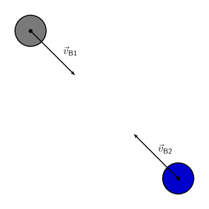

When they come into contact, ball 1 exerts a contact force on the ball 2,
        \(\vec{F}_{\text{B1}}\), and the ball 2 exerts a
        force on ball 1, \(\vec{F}_{\text{B2}}\). We also know
        that the force will result in a change in momentum:

      \[\vec{F}_{net} =\frac{\Delta \vec{p}}{\Delta t}\]

We also know from Newton's third law that:

      \begin{align*}
      \vec{F}_{\text{B1}} & = - \vec{F}_{\text{B2}}\\
      \frac{\Delta \vec{p}_{\text{B1}}}{\Delta t} & = - \frac{\Delta \vec{p}_{\text{B2}}}{\Delta t}\\
      \Delta \vec{p}_{\text{B1}} & = - \Delta \vec{p}_{\text{B2}}\\
      \Delta \vec{p}_{\text{B1}} + \Delta \vec{p}_{\text{B2}} & = 0
      \end{align*}

This says that if you add up all the changes in momentum for an isolated system
        the net result will be zero. If we add up all the momenta in the system the total
        momentum won't change because the net change is zero.
        **Important:** note that this is because the forces
        are internal forces and Newton's third law applies. An external force would not
        necessarily allow momentum to be conserved.

In the absence of an external force acting on a system, momentum is
        conserved.

## Newton's cradle demonstration

### Momentum conservation

A Newton's cradle demonstrates a series of collisions in which momentum is conserved.

## Conservation of momentum

### Aim

To investigate the changes in momentum when two bodies are separated by an explosive force.

### Apparatus

- two spring-loaded trolleys
- stopwatch
- meter-stick
- two barriers

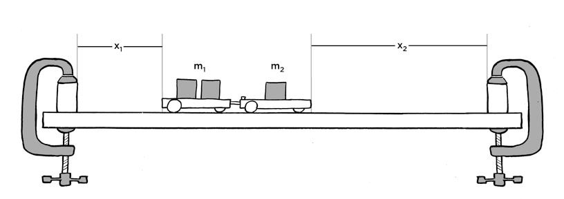

**Proper illustration still pending**

### Method

- Clamp the barriers one metre apart onto a flat surface.
- Find the mass of each trolley and place a known mass on one of the trolleys.
- Place the two trolleys between the barriers end to end so that the spring on the one trolley is in
                  contact with the flat surface of the other trolley
- Release the spring by hitting the release knob and observe how the trolleys push each other apart.
- Repeat the explosions with the trolleys at a different position until they strike the barriers
                  simultaneously. Each trolley now has the same time of travel t.
- Measure the distances \({x}_{1}\) and \({x}_{2}\). These can be taken as measures of the respective
                  velocities.
- Repeat the experiment for a different combination of masses.

### Results

Record your results in a table, using the following headings for each trolley. Total mass in kg, distance
            travelled in m, momentum in \(\text{kg·m·s$^{-1}$}\). What is the relationship between the total
            momentum after the explosion and the total momentum before the explosion?

Conservation of Momentum

The total momentum of an isolated system is constant.

The total momentum of a system is calculated by the vector sum of the momenta
        of all the objects or particles in the system. For a system with \(n\) objects
        the total momentum is:

      \[\vec{p}_T = \vec{p}_1 + \vec{p}_2 + \ldots + \vec{p}_n\]

<Callout type="tip" title="Worked example 7: Calculating the total momentum of a system">
**Question:**
Two billiard balls roll towards each other. They each have a mass
            of \(\text{0,3}\) \(\text{kg}\).
            Ball 1 is moving at
            \(\vec{v}_{1}=\text{1}\text{ m·s$^{-1}$}\)
            to the right, while ball 2 is moving at
            \(\vec{v}_{2}=\text{0,8}\text{ m·s$^{-1}$}\)
            to the left. Calculate the total momentum of the system.

**Identify what information is given and what is asked for:**
The question
            explicitly gives

- the mass of each ball,
- the velocity of ball 1, \(\vec{v}_{1}\), and
- the velocity of ball 2, \(\vec{v}_{2}\),

all in the correct units.

We are asked to calculate the **total momentum of
              the system**. In this example our system consists of two balls. To find
            the total momentum we must determine the momentum of each ball and add them.

          \[\vec{p}_{T}=\vec{p}_{1}+\vec{p}_{2}\]

Since ball 1 is moving to the right, its momentum is in this direction,
            while the second ball's momentum is directed towards the left.

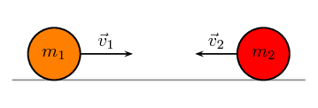

Thus, we are required to find the sum of two vectors acting along the
            same straight line.

**Choose a frame of reference:**
Let us choose moving to the right as the
            positive direction.

**Calculate the momentum:**
The total momentum of the system is then the sum of the two momenta
            taking the directions of the velocities into account. Ball 1 is travelling
            at \(\text{1}\) \(\text{m·s$^{-1}$}\) to
            the right or \(\text{+1}\) \(\text{m·s$^{-1}$}\).
            Ball 2 is travelling at \(\text{0,8}\) \(\text{m·s$^{-1}$
            }\) to the left or \(-\text{0,8}\) \(\text{m·s$^{-1}$}\). Thus,

          \begin{align*}
          \vec{p}_{T}& = {m}_{1}\vec{v}_{1}+{m}_{2}\vec{v}_{2} \\
          & = \left(\text{0,3}\right)\left(+1\right)+\left(\text{0,3}\right)\left(-\text{0,8}\right) \\
          & = \left(\text{+0,3}\right)+\left(-\text{0,24}\right) \\
          & = \text{+0,06}\\
          & = \text{0,06}\text{ kg·m·s$^{-1}$}~\text{to the right}
          \end{align*}

In the last step the direction was added in words. Since the result
            in the second last line is positive, the total momentum of the system
            is in the positive direction (i.e. to the right).
</Callout>

### Textbook Exercise 2.3

**Problem:**
Two golf balls roll towards each other. They each have a mass of \(\text{100}\) \(\text{g}\). Ball 1 is
              moving at \(\vec{v}_{1}=\text{2,4}\text{ m·s$^{-1}$}\) to the right, while ball 2 is moving at
              \(\vec{v}_{2}=\text{3}\text{ m·s$^{-1}$}\) to the left. Calculate the total momentum of the system.

**Solution:**
Choose moving to the right as the positive direction.

\(m_1=\text{100}\text{ g}=\text{0,1}\text{ kg}\)

\(m_2=\text{100}\text{ g}=\text{0,1}\text{ kg}\)

\(\vec{v}_1=\text{2,4}\text{ m·s$^{-1}$}~\text{to the right}\)

\(\vec{v}_2=\text{3}\text{ m·s$^{-1}$}~\text{to the left}\)

Therefore the total momentum of the system is:

            \begin{align*}
            \vec{p} & = m_1\vec{v}_1+m_2\vec{v}_2 \\
            & = (\text{0,1})(\text{2,4}) + (\text{0,1})(-\text{3}) \\
            & = -\text{0,06} \\
            & = \text{0,06}\text{ kg·m·s$^{-1}$}~\text{to the left}
            \end{align*}

**Problem:**
Two motorcycles are involved in a head on collision. Motorcycle A has a mass of \(\text{200}\)
              \(\text{kg}\) and was travelling at \(\text{120}\) \(\text{km·hr$^{-1}$}\) south. Motor cycle B has a
              mass of \(\text{250}\) \(\text{kg}\) and was travelling north at \(\text{100}\)
              \(\text{km·hr$^{-1}$}\). A and B are about to collide. Calculate the momentum of the system before
              the collision takes place.

**Solution:**
First convert the velocities to the correct units:

motorcycle 1:

            \[\frac{(120)(\text{1 000})}{\text{3 600}} = \text{33,33}\text{ m·s$^{-1}$}\]

motorcycle 2:

            \[\frac{(100)(\text{1 000})}{\text{3 600}} = \text{27,78}\text{ m·s$^{-1}$}\]

Taking south as positive:

            \begin{align*}
            p_{\text{total}} & = m_{1}v_{1} + m_{2}v_{2} \\
            & = (\text{200})(\text{33,33}) + (\text{250})(-\text{27,78}) \\
            & = -\text{279}\text{ kg·m·s$^{-1}$}
            \end{align*}

**Problem:**
A \(\text{700}\) \(\text{kg}\) truck is travelling north at a velocity of \(\text{40}\)
              \(\text{km·hr$^{-1}$}\) when it is approached by a \(\text{500}\) \(\text{kg}\) car travelling south
              at a velocity of \(\text{100}\) \(\text{km·hr$^{-1}$}\). Calculate the total momentum of the system.

**Solution:**
We need to convert the velocities to the correct units:

Truck:

            \[\frac{(40)(\text{1 000})}{\text{3 600}} = \text{11,11}\text{ m·s$^{-1}$}\]

Car:

            \[\frac{(100)(\text{1 000})}{\text{3 600}} = \text{27,78}\text{ m·s$^{-1}$}\]

Take north to be positive.

            \begin{align*}
            p_{\text{total}} & = m_{1}v_{1} + m_{2}v_{2} \\
            & = (\text{700})(\text{11,11}) + (\text{500})(-\text{27,78}) \\
            & = -\text{6 113}\text{ kg·m·s$^{-1}$}
            \end{align*}

### Collisions (ESCJG)

We have shown that the net change in momentum is zero for an isolated system. The
        momenta of the **individual objects can change** but the
        total momentum of the **system remains constant**.

This means that it makes sense to define the total momentum at the begining of
        the problem as the initial total momentum, \(\vec{p}_{Ti}\), and the final
        total momentum \(\vec{p}_{Tf}\). Momentum conservation implies that, no matter what
        happens inside an isolated system:

      \[\vec{p}_{Ti} = \vec{p}_{Tf}\]

This means that in an isolated system the total momentum before
        a **collision** or **explosion**
        is equal to the total momentum after the collision or explosion.

Consider a simple collision of two billiard balls. The balls are rolling on a frictionless,
        horizontal surface and the system is isolated. We can apply conservation of momentum. The first
        ball has a mass \({m}_{1}\) and an initial velocity \(\vec{v}_{i1}\).
        The second ball has a mass \({m}_{2}\) and moves first ball with an initial
        velocity \(\vec{v}_{i2}\). This
        situation is shown in Figure 2.1.

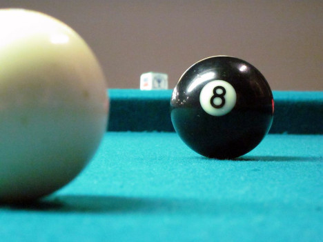

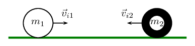

Figure 2.1: Before the collision.

The total momentum of the system before the collision, \(\vec{p}_{Ti}\) is:

      \(\vec{p}_{Ti}={m}_{1}\vec{v}_{i1}+{m}_{2}\vec{v}_{i2}\)

After the two balls collide and move away they each have a different momentum. If the first ball has a final
        velocity of \(\vec{v}_{f1}\) and the second ball has a final velocity of \(\vec{v}_{f2}\) then we have the
        situation shown in Figure 2.2.

Figure 2.2: After the collision.

The total momentum of the system after the collision, \(\vec{p}_{Tf}\) is:

      \(\vec{p}_{Tf}={m}_{1}\vec{v}_{f1}+{m}_{2}\vec{v}_{f2}\)

This system of two balls is isolated since there are no external forces acting on the balls. Therefore, by the
        principle of conservation of linear momentum, the total momentum before the collision is equal to the total
        momentum after the collision. This gives the equation for the conservation of momentum in a collision of two
        objects,

| \(\vec{p}_{i}=\vec{p}_{f}\) |
| --- |
| \({m}_{1}\vec{v}_{i1}+{m}_{2}\vec{v}_{i2}={m}_{1}\vec{v}_{f1}+{m}_{2}\vec{v}_{f2}\) |
| \({m}_{1}\) | : mass of object 1 (kg) |
| \({m}_{2}\) | : mass of object 2 (kg) |
| \(\vec{v}_{i1}\) | : initial velocity of object 1 (\(\text{m·s$^{-1}$}\) + direction) |
| \(\vec{v}_{i2}\) | : initial velocity of object 2 (\(\text{m·s$^{-1}$}\) - direction) |
| \(\vec{v}_{f1}\) | : final velocity of object 1 (\(\text{m·s$^{-1}$}\) - direction) |
| \(\vec{v}_{f2}\) | : final velocity of object 2 (\(\text{m·s$^{-1}$}\) + direction) |

This equation is always true - momentum is always conserved in collisions.

<Callout type="tip" title="Worked example 8: Conservation of momentum">
**Question:**
A toy car of mass \(\text{1}\) \(\text{kg}\)
            moves westwards with a speed of
            \(\text{2}\) \(\text{m·s$^{-1}$}\).
            It collides head-on with a toy train. The train has a mass
            of \(\text{1,5}\) \(\text{kg}\)
            and is moving at a speed of
            \(\text{1,5}\) \(\text{m·s$^{-1}$}\)
            eastwards. If the car rebounds at
            \(\text{2,05}\) \(\text{m·s$^{-1}$}\),
            calculate the final velocity of the train.

**Analyse what you are given and draw a sketch:**
The question explicitly gives a number of values which we identify and
            convert into SI units if necessary:

- the train's mass (\({m}_{1}= \text{1,50}\text{ kg}\)),
- the train's initial velocity (\(\vec{v}_{1i}=\text{1,5}\text{ m·s$^{-1}$}\) eastward),
- the car's mass (\({m}_{2}= \text{1,00}\text{ kg}\)),
- the car's initial velocity (\(\vec{v}_{2i}=\text{2,00}\text{ m·s$^{-1}$}\) westward), and
- the car's final velocity (\(\vec{v}_{2f}=\text{2,05}\text{ m·s$^{-1}$}\) eastward).

We are asked to find the final velocity of the train.

**Choose a frame of reference:**
We will choose to the East as positive.

**Apply the Law of Conservation of momentum:**
\begin{align*}
          \vec{p}_{Ti}& = \vec{p}_{Tf} \\
          {m}_{1}\vec{v}_{i1}+{m}_{2}\vec{v}_{i2}& = {m}_{1}\vec{v}_{f1}+{m}_{2}\vec{v}_{f2} \\
          \left(\text{1,5}\right)\left(\text{+1,5} \right)+\left(1\right)\left(-2 \right)& =
          \left(\text{1,5}\right)\left(\vec{v}_{f1}\right)+\left(1\right)\left(\text{2,05} \right) \\
          \text{2,25} -2 -\text{2,05}& = \left(\text{1,5}\right)\vec{v}_{f1} \\
          -\text{1,8} & = \left(\text{1,5}\right)\vec{v}_{f1} \\
          \vec{v}_{f1}& = -\text{1,2} \text{ m}·{\text{s}}^{-1} \\
          \vec{v}_{f1}& = \text{1,2} \text{ m}·{\text{s}}^{-1} \text{ westwards}
          \end{align*}
</Callout>

<Callout type="tip" title="Worked example 9: Conservation of momentum">
**Question:**
A jet flies at a speed of \(\text{275}\) \(\text{m·s$^{-1}$}\). The pilot fires a missile forward off
            a mounting at a
            speed of \(\text{700}\) \(\text{m·s$^{-1}$}\) relative
            to the ground.
            The respective masses of the jet and the missile are
            \(\text{5 000}\) \(\text{kg}\) and
            \(\text{50}\) \(\text{kg}\).
            Treating the system as an isolated system, calculate the new speed of the
            jet immediately after the missile had been fired.

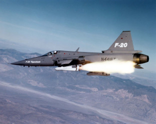

**Analyse what you are given and draw a sketch:**
The question explicitly gives a number of values which we identify and
            convert into SI units if necessary:

- the mass of the jet (\({m}_{1}\) = \(\text{5 000}\) \(\text{kg}\))
- the mass of the rocket (\({m}_{2}\) = \(\text{50}\) \(\text{kg}\))
- the initial velocity of the jet and rocket (\(\vec{v}_{i1}\) = \(\vec{v}_{i2}\) = \(\text{275}\)
                \(\text{m·s$^{-1}$}\) to the left)
- the final velocity of the rocket (\(\vec{v}_{f2}\) = \(\text{700}\) \(\text{m·s$^{-1}$}\) to the
                left)

We need to find the final speed of the jet and we can use momentum conservation
            because we can treat it as an isolated system. We choose the original direction that the
            jet was flying in as the positive direction, to the left.

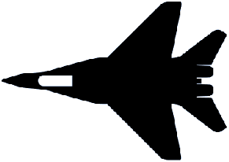

After the missile is launched we need to take both into account:

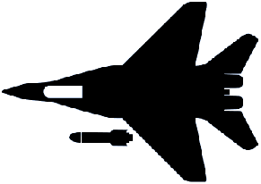

jet and missile

**Apply the Law of Conservation of momentum:**
The jet and missile are connected initially and move at the same velocity. We will therefore combine their
            masses and change the momentum equation as follows:

          \begin{align*}
          \vec{p}_{i}& = \vec{p}_{f} \\
          \left({m}_{1}+{m}_{2}\right)\vec{v}_{i}& = {m}_{1}\vec{v}_{f1}+{m}_{2}\vec{v}_{f2} \\
          \left(\text{5 000}+50\right)\left(275 \right)& =
          \left(\text{5 000}\right)\left(\vec{v}_{f1}\right)+\left(50\right)\left(700 \right) \\
          \text{1 388 750} -\text{35 000} & =
          \left(\text{5 000}\right)\left(\vec{v}_{f1}\right) \\
          \vec{v}_{f1}& = \text{270,75} \text{m·s$^{-1}$}~\text{in the original direction}
          \end{align*}

**Quote the final answer:**
The speed of the jet is the magnitude of the final velocity, \(\text{270,75}\) \(\text{m·s$^{-1}$}\).
</Callout>

<Callout type="tip" title="Worked example 10: Conservation of momentum">
**Question:**
A bullet of mass \(\text{50}\) \(\text{g}\) travelling horizontally to the right at \(\text{500}\)
            \(\text{m·s$^{-1}$}\) strikes a stationary wooden block of mass \(\text{2}\) \(\text{kg}\) resting on a
            smooth horizontal surface. The bullet goes through the block and comes out on the other side at
            \(\text{200}\) \(\text{m·s$^{-1}$}\). Calculate the speed of the block after the bullet has come out
            the other side.

**Analyse what you are given and draw a sketch:**
The question explicitly gives a number of values which we identify and
            convert into SI units if necessary:

- the mass of the bullet (\({m}_{1}\) = \(\text{50}\) \(\text{g}\)=\(\text{0,50}\) \(\text{kg}\))
- the mass of the block (\({m}_{2}\) = \(\text{2,00}\) \(\text{kg}\))
- the initial velocity of the bullet (\(\vec{v}_{i1}\) = \(\text{500}\) \(\text{m·s$^{-1}$}\) to the
                right)
- the final velocity of the bullet (\(\vec{v}_{f1}\) = \(\text{200}\) \(\text{m·s$^{-1}$}\) to the
                right)

We need to find the velocity of the wood block. We choose the direction in
            which the bullet was travelling to be the positive direction, to the right.

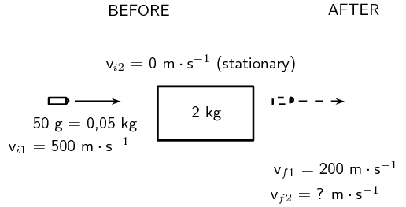

**Apply the Law of Conservation of momentum:**
\begin{align*}
          \vec{p}_{i}& = {p}_{f} \\
          {m}_{1}\vec{v}_{i1}+{m}_{2}\vec{v}_{i2}& = {m}_{1}\vec{v}_{f1}+{m}_{2}\vec{v}_{f2} \\
          \left(\text{0,05}\right)\left(+500 \right)+\left(2\right)\left(0 \right)& =
          \left(\text{0,05}\right)\left(+200 \right)+\left(2\right)\left(\vec{v}_{f2}\right) \\
          25+0-10& = 2 \vec{v}_{f2} \\
          \vec{v}_{f2}& = \text{7,5} \text{m·s$^{-1}$} \text{in the same direction as the bullet}
          \end{align*}

**Apply the Law of Conservation of momentum:**
The block is travelling at
            \(\text{7,5}\) \(\text{m·s$^{-1}$}\).
</Callout>

We have been applying conservation of momentum to collisions and explosion which
      is valid but there are actually two different types of collisions and they have
      different properties.

Two types of collisions are of interest:

- elastic collisions
- inelastic collisions

In both types of collision, total momentum is *always* conserved. Kinetic energy is conserved for elastic
      collisions, but not for inelastic collisions.

Initially in a collision the objects have kinetic energy. In some collisions
      that energy is transformed through processes like deformation. In a car crash the car
      gets all mangled which requires the permanent transfer of energy.

### Elastic collisions (ESCJH)

Elastic Collisions

An elastic collision is a collision where total momentum and total kinetic energy are both conserved.

This means that in an elastic collision the total momentum
        *and* the total kinetic energy before the collision is
        the same as after the collision. For these kinds of collisions, the kinetic energy is
        not tranformed permanently through work or deformation of the objects. During the collision
        the energy is going to be transferred (for example as a ball compresses) but will be recovered
        during the elastic response of the system (for example the ball then expanding again).

#### Before the collision

Figure 2.3 shows two balls rolling toward each
          other, about to collide:

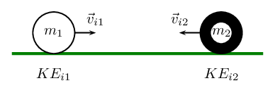

Figure 2.3: Two balls before they collide.

We have calculated the total initial momentum previously, now we calculate the
          total kinetic energy of the system in the same way. Ball 1 has a kinetic energy
          which we call \(K{E}_{i1}\) and ball 2 has a kinetic energy which
          we call \({\text{KE}}_{i2}\), the total kinetic energy
          before the collision is:

        \(K{E}_{Ti}=K{E}_{i1}+K{E}_{i2}\)

#### After the collision

Figure 2.4 shows two balls after they have
          collided:

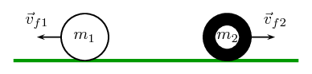

Figure 2.4: Two balls after they collide.

Ball 1 now has a kinetic energy which we call \(K{E}_{f1}\) and
          ball 2 now has a kinetic energy which we call \({\text{KE}}_{f2}\),
          it means that the total kinetic energy after the collision is:

        \(K{E}_{Tf}=K{E}_{f1}+K{E}_{f2}\)

Since this is an *elastic* collision,
          the total momentum before the collision equals the total momentum after the
          collision **and** the total kinetic energy
          before the collision equals the total kinetic energy after the collision. Therefore:

        \begin{align*}
        \vec{p}_{Ti}& = \vec{p}_{Tf}\\
        \vec{p}_{i1}+\vec{p}_{i2}& = \vec{p}_{f1}+\vec{p}_{f2}\\
        & \mathbf{\text{and}} \\
        {\text{KE}}_{Ti}& = {\text{KE}}_{Tf}\\
        {\text{KE}}_{i1}+{\text{KE}}_{i2}& = {\text{KE}}_{f1}+{\text{KE}}_{f2}
        \end{align*}

<Callout type="tip" title="Worked example 11: An elastic collision">
**Question:**
Consider a collision between two pool balls. Ball 1 is at rest and ball 2 is moving towards it with a
              speed of \(\text{2}\) \(\text{m·s$^{-1}$}\). The mass of each ball is \(\text{0,3}\) \(\text{kg}\).
              After the balls collide *elastically*, ball 2 comes to an immediate stop and ball 1 moves off. What
              is the final velocity of ball 1?

**Choose a frame of reference:**
Choose to the right as positive and we assume that ball 2 is moving towards the
              left approaching ball 1.

**Determine what is given and what is needed:**
- Mass of ball 1, \({m}_{1}=0,3~\text{kg}\).
- Mass of ball 2, \({m}_{2}=0,3~\text{kg}\).
- Initial velocity of ball 1, \(\vec{v}_{i1}=\text{0}\text{ m·s$^{-1}$}\).
- Initial velocity of ball 2, \(\vec{v}_{i2}=\text{2}\text{ m·s$^{-1}$}\) to the left.
- Final velocity of ball 2, \(\vec{v}_{f2}=\text{0}\text{ m·s$^{-1}$}\).
- The collision is elastic.

All quantities are in SI units. We need to find the final velocity of ball 1, \({v}_{f1}\). Since the
              collision is elastic, we know that

- momentum is conserved,
                    \({m}_{1}\vec{v}_{i1}+{m}_{2}\vec{v}_{i2}={m}_{1}\vec{v}_{f1}+{m}_{2}\vec{v}_{f2}\)
- energy is conserved,
                    \(\frac{1}{2}\left({m}_{1}{v}_{i1}^{2}+{m}_{2}{v}_{i2}^{2}\right)=\frac{1}{2}\left({m}_{1}{v}_{f1}^{2}+{m}_{2}{v}_{f2}^{2}\right)\)

**Draw a rough sketch of the situation:**
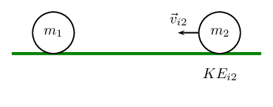

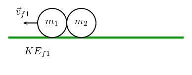

**Solve the problem:**
Momentum is conserved in all collisions so it makes sense to begin
              with momentum. Therefore:

            \begin{align*}
            \vec{p}_{Ti}& = \vec{p}_{Tf}\\
            {m}_{1}\vec{v}_{i1}+{m}_{2}\vec{v}_{i2}& = {m}_{1}\vec{v}_{f1}+{m}_{2}\vec{v}_{f2}\\
            \left(0,3\right)\left(0\right)+\left(0,3\right)\left(-2\right)& = \left(0,3\right)\vec{v}_{f1}+0\\
            \vec{v}_{f1}& = -\text{2,00}\text{ m·s$^{-1}$}
            \end{align*}

**Quote your final answer:**
The final velocity of ball 1 is \(\text{2}\) \(\text{m·s$^{-1}$}\) to the left.
</Callout>

<Callout type="tip" title="Worked example 12: Another elastic collision">
**Question:**
Consider 2 marbles. Marble 1 has mass
              \(\text{50}\) \(\text{g}\) and
              marble 2 has mass
              \(\text{100}\) \(\text{g}\).
              Edward rolls marble 2 along the ground towards marble 1 in the positive x-direction.
              Marble 1 is initially at rest and marble 2 has a velocity of
              \(\text{3}\) \(\text{m·s$^{-1}$}\) in the positive x-direction.
              After they collide *elastically*,
              both marbles are moving. What is the final velocity of each marble?

**Decide how to approach the problem:**
We are given:

- mass of marble 1, \({m}_{1}=50~\text{g}\)
- mass of marble 2, \({m}_{2}=100~\text{g}\)
- initial velocity of marble 1, \(\vec{v}_{i1}=\text{0}\text{ m·s$^{-1}$}\)
- initial velocity of marble 2, \(\vec{v}_{i2}=\text{3}\text{ m·s$^{-1}$}\) to the right
- the collision is elastic

The masses need to be converted to SI units.

            \begin{align*}
            {m}_{1}& = 0,05\text{kg}\\
            {m}_{2}& = 0,1\text{kg}
            \end{align*}

We are required to determine the final velocities:

- final velocity of marble 1, \(\vec{v}_{f1}\)
- final velocity of marble 2, \(\vec{v}_{f2}\)

Since the collision is elastic, we know that

- momentum is conserved, \(\vec{p}_{Ti}=\vec{p}_{Tf}\).
- energy is conserved, \(K{E}_{Ti}=K{E}_{Tf}\).

We have two equations and two unknowns (\(\vec{v}_{1}\), \(\vec{v}_{2}\)) so it is a simple case of
              solving a set of simultaneous equations.

**Choose a frame of reference:**
Choose to the right as positive.

**Draw a rough sketch of the situation:**
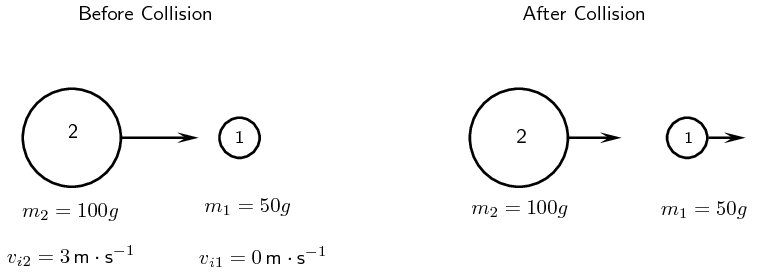

**Solve the problem:**
Momentum is conserved. Therefore:

            \begin{align*}
            \vec{p}_{i}& = \vec{p}_{f}\\
            \vec{p}_{i1}+\vec{p}_{i2}& = \vec{p}_{f1}+\vec{p}_{f2}\\
            {m}_{1}\vec{v}_{i1}+{m}_{2}\vec{v}_{i2}& = {m}_{1}\vec{v}_{f1}+{m}_{2}\vec{v}_{f2}\\
            {m}_{2}\vec{v}_{i2}& = {m}_{1}\vec{v}_{f1}+{m}_{2}\vec{v}_{f2}\\
            {m}_{1}\vec{v}_{f1} & = {m}_{2}\vec{v}_{i2}- {m}_{2}\vec{v}_{f2} \\
            \vec{v}_{f1} & = \frac{{m}_{2}}{{m}_{1}}(\vec{v}_{i2}- \vec{v}_{f2})
            \end{align*}

Energy is also conserved. Therefore:

            \begin{align*}
            K{E}_{i}& = K{E}_{f}\\
            K{E}_{i1}+K{E}_{i2}& = K{E}_{f1}+K{E}_{f2}\\
            \frac{1}{2}{m}_{1}{v}_{i1}^{2}+\frac{1}{2}{m}_{2}{v}_{i2}^{2}& =
            \frac{1}{2}{m}_{1}{v}_{f1}^{2}+\frac{1}{2}{m}_{2}{v}_{f2}^{2}\\
            \frac{1}{2}{m}_{2}{v}_{i2}^{2}& = \frac{1}{2}{m}_{1}{v}_{f1}^{2}+\frac{1}{2}{m}_{2}{v}_{f2}^{2}\\
            {m}_{2}{v}_{i2}^{2}& = {m}_{1}{v}_{f1}^{2}+{m}_{2}{v}_{f2}^{2}
            \end{align*}

Substitute the expression we derived from conservation of momentum
              into the expression derived from conservation of kinetic energy
              and solve for \({v}_{f2}\).

            \begin{align*}
            {m}_{2}{v}_{i2}^{2}& = {m}_{1}{v}_{f1}^{2}+{m}_{2}{v}_{f2}^{2}\\
            &={m}_{1}{\left(\frac{{m}_{2}}{{m}_{1}}\left({v}_{i2}-{v}_{f2}\right)\right)}^{2}+{m}_{2}{v}_{f2}^{2}\\
            &={m}_{1}\frac{{m}_{2}^{2}}{{m}_{1}^{2}}{\left({v}_{i2}-{v}_{f2}\right)}^{2}+{m}_{2}{v}_{f2}^{2}\\
            &=\frac{{m}_{2}^{2}}{{m}_{1}}{\left({v}_{i2}-{v}_{f2}\right)}^{2}+{m}_{2}{v}_{f2}^{2}\\
            {v}_{i2}^{2}& = \frac{{m}_{2}}{{m}_{1}}{\left({v}_{i2}-{v}_{f2}\right)}^{2}+{v}_{f2}^{2}\\
            &=\frac{{m}_{2}}{{m}_{1}}\left({v}_{i2}^{2}-2·{v}_{i2}·{v}_{f2}+{v}_{f2}^{2}\right)+{v}_{f2}^{2}\\
            0& =
            \left(\frac{{m}_{2}}{{m}_{1}}-1\right){v}_{i2}^{2}-2\frac{{m}_{2}}{{m}_{1}}{v}_{i2}·{v}_{f2}+\left(\frac{{m}_{2}}{{m}_{1}}+1\right){v}_{f2}^{2}\\
            &=\left(\frac{\text{0,1}}{\text{0,05}}-1\right){\left(3\right)}^{2}-2\frac{\text{0,1}}{\text{0,05}}\left(3\right)·{v}_{f2}+\left(\frac{\text{0,1}}{\text{0,05}}+1\right){v}_{f2}^{2}\\
            &=\left(2-1\right){\left(3\right)}^{2}-2·2\left(3\right)·{v}_{f2}+\left(2+1\right){v}_{f2}^{2}\\
            &=9-12{v}_{f2}+3{v}_{f2}^{2}\\
            &=3-4{v}_{f2}+{v}_{f2}^{2}\\
            &=\left({v}_{f2}-3\right)\left({v}_{f2}-1\right)
            \end{align*}

Therefore \({v}_{f2}=1\) or \({v}_{f2}=3\)

Substituting back into the expression from conservation of momentum,
              we get:

            \begin{align*}
            {v}_{f1}& = \frac{{m}_{2}}{{m}_{1}}\left({v}_{i2}-{v}_{f2}\right)\\
            &=\frac{\text{0,1}}{\text{0,05}}\left(3-3\right)\\
            &=0\\
            & \text{or} \\
            {v}_{f1}&=\frac{{m}_{2}}{{m}_{1}}\left({v}_{i2}-{v}_{f2}\right)\\
            &=\frac{\text{0,1}}{\text{0,05}}\left(3-1\right)\\
            &=\text{4}\text{ m·s$^{-1}$}
            \end{align*}

But according to the question, marble 1 is moving after the collision, therefore marble 1 moves to the
              right at \(\text{4}\) \(\text{m·s$^{-1}$}\).

Therefore marble 2 moves with a velocity of \(\text{1}\) \(\text{m·s$^{-1}$}\) to the right.
</Callout>

<Callout type="tip" title="Worked example 13: Colliding billiard balls">
**Question:**
Two billiard balls each with a mass of \(\text{150}\) \(\text{g}\) collide head-on in an elastic
              collision. Ball 1 was travelling at a speed of \(\text{2}\) \(\text{m·s$^{-1}$}\) and ball 2 at a
              speed of \(\text{1,5}\) \(\text{m·s$^{-1}$}\). After the collision, ball 1 travels away from ball 2
              at a velocity of \(\text{1,5}\) \(\text{m·s$^{-1}$}\).

2. Calculate the velocity of ball 2 after the collision.
4. Prove that the collision was elastic. Show calculations.

**Choose a frame of reference:**
Choose to the right as positive.

**Draw a rough sketch of the situation:**
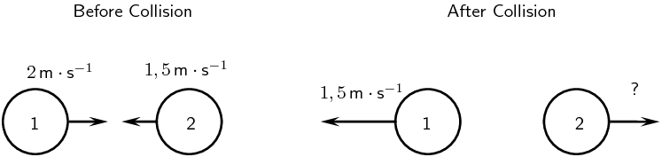

**Decide how to approach the problem:**
Since momentum is conserved in all kinds of collisions, we can use conservation of momentum to solve for
              the velocity of ball 2 after the collision.

**Solve problem:**
\begin{align*}
            \vec{p}_{Ti}& =\vec {p}_{Tf}\\
            {m}_{1}\vec{v}_{i1}+{m}_{2}\vec{v}_{i2}& = {m}_{1}\vec{v}_{f1}+{m}_{2}\vec{v}_{f2}\\
            \left(\frac{150}{1000}\right)\left(2\right)+\left(\frac{150}{1000}\right)\left(-1,5\right)& =
            \left(\frac{150}{1000}\right)\left(-1,5\right)+\left(\frac{150}{1000}\right)\left(\vec{v}_{f2}\right)\\
            \text{0,3}-\text{0,22}5& = -\text{0,225}+\text{0,15}\vec{v}_{f2}\\
            \vec{v}_{f2}& = \text{2}\text{ m·s$^{-1}$}
            \end{align*}

So after the collision, ball 2 moves with a velocity of \(\text{2}\) \(\text{m·s$^{-1}$}\) to the
              right.

**Elastic collisions:**
The fact that characterises an elastic collision is that the total kinetic energy of the particles before
              the collision is the same as the total kinetic energy of the particles after the collision. This means
              that if we can show that the initial kinetic energy is equal to the final kinetic energy, we have shown
              that the collision is elastic.

**Calculating the initial total kinetic energy:**
\begin{align*}
            E{K}_{before}& = \frac{1}{2}{m}_{1}{v}_{i1}^{2}+\frac{1}{2}{m}_{2}{v}_{i2}^{2}\\
            & =
            \left(\frac{1}{2}\right)\left(\text{0,15}\right){\left(2\right)}^{2}+\left(\frac{1}{2}\right)\left(\text{0,15}\right){\left(-\text{1,5}\right)}^{2}\\
            & = \text{0,46875}\text{ J}
            \end{align*}

**Calculating the final total kinetic energy:**
\begin{align*}
            E{K}_{after}& = \frac{1}{2}{m}_{1}{v}_{f1}^{2}+\frac{1}{2}{m}_{2}{v}_{f2}^{2}\\
            & =
            \left(\frac{1}{2}\right)\left(\text{0,15}\right){\left(-\text{1,5}\right)}^{2}+\left(\frac{1}{2}\right)\left(\text{0,15}\right){\left(2\right)}^{2}\\
            & = \text{0,46875}\text{ J}
            \end{align*}

So \(E{K}_{Ti}=E{K}_{Tf}\) and hence the collision is elastic.
</Callout>

### Inelastic collisions (ESCJJ)

Inelastic Collisions

An inelastic collision is a collision in which **total momentum** is conserved but
            **total kinetic energy** is *not* conserved. The kinetic energy is *transformed*
            from or into other kinds of energy.

So the total momentum before an inelastic collisions is the same as after the collision. But the total
        *kinetic* energy before and after the inelastic collision is *different*. Of course this does not
        mean that total energy has not been conserved, rather the energy has been *transformed* into another type
        of energy.

As a rule of thumb, inelastic collisions happen when the colliding objects are distorted in some way. Usually
        they change their shape. The modification of the shape of an object requires energy and this is where the
        “missing” kinetic energy goes. A classic example of an inelastic collision is a motor car accident.
        The cars change shape and there is a noticeable change in the kinetic energy of the cars before and after the
        collision. This energy was used to bend the metal and deform the cars. Another example of an inelastic collision
        is shown in Figure 2.5.

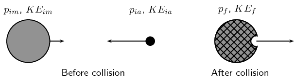

Figure 2.5: Asteroid moving towards the Moon.

An asteroid is moving through space towards the Moon. Before the asteroid crashes into the Moon, the total
        momentum of the system is:

      \[\vec{p}_{Ti}=\vec{p}_{iM}+\vec{p}_{ia}\]

The total kinetic energy of the system is:

      \[K{E}_{i}=K{E}_{iM}+K{E}_{ia}\]

When the asteroid collides **inelastically** with
        the Moon, its kinetic energy is transformed mostly into heat energy. If this heat
        energy is large enough, it can cause the asteroid and the area of the Moon's surface
        that it hits, to melt into liquid rock. From the force of impact of the asteroid,
        the molten rock flows outwards to form a crater on the Moon.

After the collision, the total momentum of the system will be the same as before.
        But since this collision is *inelastic*,
        (and you can see that a change in the shape of objects has taken place), total
        kinetic energy is **not** the same as before
        the collision.

Momentum is conserved:

      \[\vec{p}_{Ti}=\vec{p}_{Tf}\]

But the total kinetic energy of the system is not conserved:

      \[K{E}_{i}\ne K{E}_{f}\]

<Callout type="tip" title="Worked example 14: An inelastic collision">
**Question:**
Consider the collision of two cars. Car 1 is at rest and Car 2 is moving at a speed of \(\text{2}\)
            \(\text{m·s$^{-1}$}\) to the left. Both cars each have a mass of \(\text{500}\) \(\text{kg}\). The cars
            collide *inelastically* and stick together. What is the resulting velocity of the resulting mass of
            metal?

**Draw a rough sketch of the situation:**

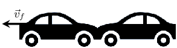

**Determine how to approach the problem:**
We are given:

- mass of car 1, \({m}_{1}=500\text{kg}\)
- mass of car 2, \({m}_{2}=500\text{kg}\)
- initial velocity of car 1, \(\vec{v}_{i1}=0\text{m}{\text{s}}^{-1}\)
- initial velocity of car 2, \(\vec{v}_{i2}=2\text{m}{\text{s}}^{-1}\) to the left
- the collision is inelastic

All quantities are in SI units. We are required to determine the final velocity of the resulting mass,
            \(\vec{v}_{f}\).

Since the collision is inelastic, we know that

- momentum is conserved,
                  \({m}_{1}\vec{v}_{i1}+{m}_{2}\vec{v}_{i2}={m}_{1}\vec{v}_{f1}+{m}_{2}\vec{v}_{f2}=\left({m}_{1}+{m}_{2}\right)\vec{v}_{f}\)
- kinetic energy is not conserved

**Choose a frame of reference:**
Choose to the left as positive.

**Solve problem:**
So we must use conservation of momentum to solve this problem.

          \begin{align*}
          \vec{p}_{Ti}& = \vec{p}_{Tf}\\
          \vec{p}_{i1}+\vec{p}_{i2}& = \vec{p}_{f}\\
          {m}_{1}\vec{v}_{i1}+{m}_{2}\vec{v}_{i2}& = \left({m}_{1}+{m}_{2}\right)\vec{v}_{f}\\
          \left(500\right)\left(0\right)+\left(500\right)\left(2\right)& = \left(500+500\right)\vec{v}_{f}\\
          1000& = 1000\vec{v}_{f}\\
          \vec{v}_{f}& = 1\text{m·s$^{-1}$}
          \end{align*}

Therefore, the final velocity of the resulting mass of cars is \(\text{1}\) \(\text{m·s$^{-1}$}\) to
            the left.
</Callout>

## Collisions

### Textbook Exercise 2.4

A truck of mass \(\text{4 500}\) \(\text{kg}\) travelling at \(\text{20}\)
                \(\text{m·s$^{-1}$}\) hits a car from behind. The car (mass \(\text{1 000}\) \(\text{kg}\))
                was travelling at \(\text{15}\) \(\text{m·s$^{-1}$}\). The two vehicles, now connected carry on
                moving in the same direction.

**Problem:**
Calculate the final velocity of the truck-car combination after the collision.

**Solution:**
\begin{align*}
                m_{1}v_{1} + m_{2}v_{2} & = (m_{1} + m_{2})v \\
                v & = \frac{(\text{4 500})(\text{20}) + (\text{1 000})(\text{15})}{\text{4 500} +
                \text{1 000}} \\
                & = \text{19,09}\text{ kg·m·s$^{-1}$}
                \end{align*}

**Problem:**
Determine the kinetic energy of the system before and after the collision.

**Solution:**
\begin{align*}
                KE & = \frac{1}{2}mv^{2} \\
                KE_{1i} &= \frac{1}{2}(\text{4 500})(\text{20})^{2}=\text{900 000}\text{ J} \\
                KE_{2i} & = \frac{1}{2}(\text{1 000})(\text{15})^{2} = \text{112 500}\text{ J} \\
                KE_{Ti} & = KE_{1i} + KE_{2i} = \text{900 000} + \text{112 500} =
                \text{1 012 500}\text{ J} \\
                KE_{Tf} & = \frac{1}{2}mv_{f}^{2} = \frac{1}{2}(\text{5 500})(\text{19,09})^{2} =
                \text{1 002 177}\text{ J}
                \end{align*}

\(KE_{Ti} = \text{1 012 500}\text{ J}\)

\(KE_{Tf} = \text{1 002 177}\text{ J}\)

**Problem:**
Explain the difference in your answers for b).

**Solution:**
The energy difference is permanently transferred into non-elastic deformation during the collision.

**Problem:**
Was this an example of an elastic or inelastic collision? Give reasons for your answer.

**Solution:**
Inelastic. Kinetic energy was not conserved in the collision.

**Problem:**
Two cars of mass \(\text{900}\) \(\text{kg}\) each collide head-on and stick together.
                Determine the final velocity of the cars if car 1 was travelling at
                \(\text{15}\) \(\text{m·s$^{-1}$}\) and car 2 was travelling
                at \(\text{20}\) \(\text{m·s$^{-1}$}\).

**Solution:**
\begin{align*}
              m_{1}\vec{v}_1 + m_{2}\vec{v}_{2} & = (m_{1}+m_{2})\vec{v}\\
              (\text{900})(\text{15}) + (\text{900})(-\text{20}) & = (\text{900}+\text{900})\vec{v} \\
              \vec{v} & = -\text{2,5}\text{ m·s$^{-1}$}
              \end{align*}

\(\vec{v} = \text{2,5}\text{ m·s$^{-1}$}\) in the same direction as the car that was originally
                travelling at \(\text{20}\) \(\text{m·s$^{-1}$}\)
