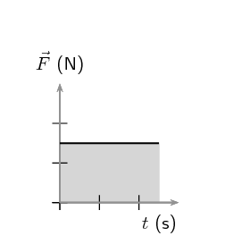
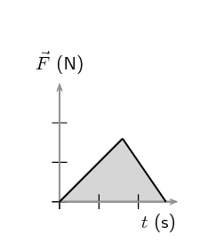
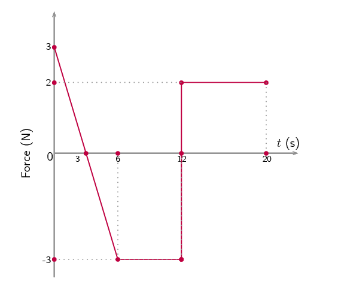
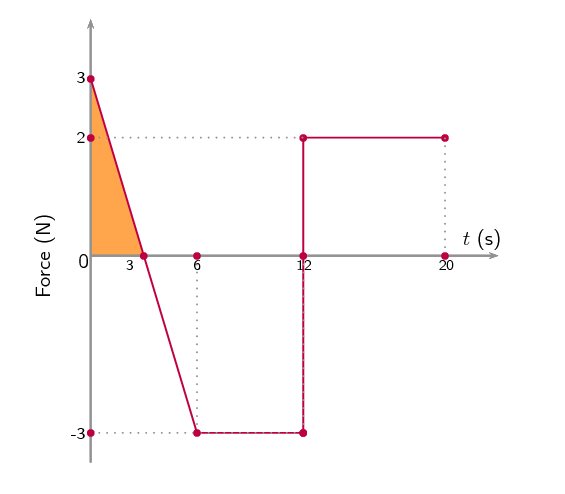
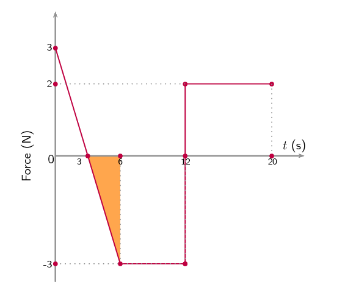
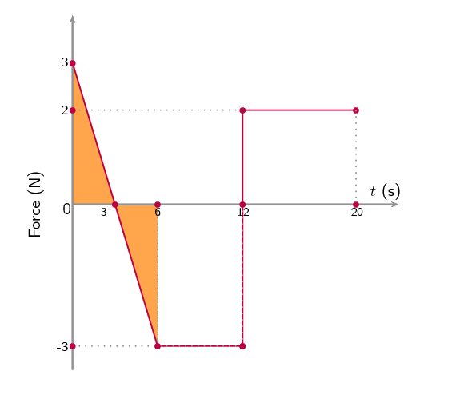
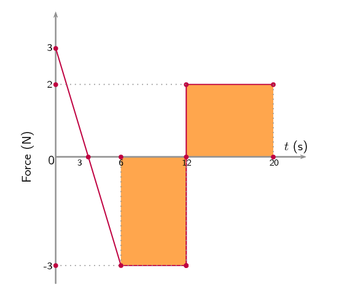
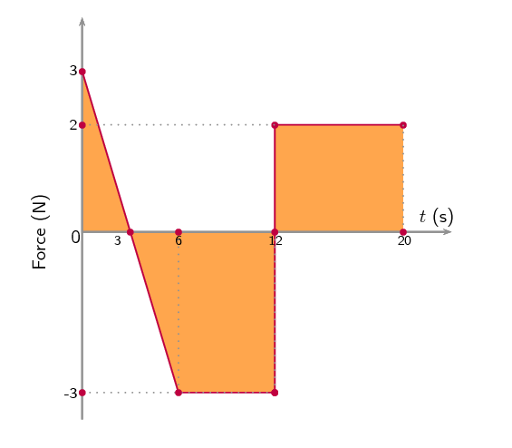
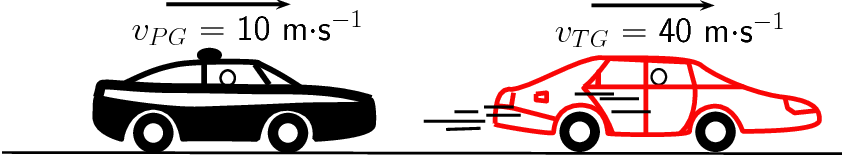
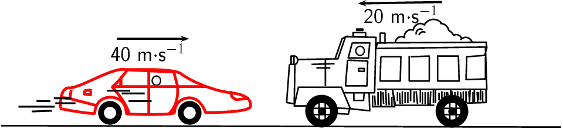

## 2.5 Impulse (ESCJK)

When a net force acts on a body it will result in an acceleration which alters the
      motion of the body. A large net force will cause a larger acceleration than a small net
      force. The total change in motion of the object can be the same if the large and small
      forces act for different time intervals. The combination of the force and time that it
      acts is a useful quantity which leads us to define impulse.

Impulse

Impulse is the product of the net force and the time interval for which the force acts.

        \[\text{Impulse}=\vec{F}_{net}·\Delta t\]

However, from Newton's Second Law, we know that

    \begin{align*}
    \vec{F}_{net}& = \frac{\Delta \vec{p}}{\Delta t} \\
    \therefore \vec{F}_{net}·\Delta t& = \Delta \vec{p} \\
    & = \text{Impulse}
    \end{align*}

Therefore we can define the impulse-momentum theorem:

    \[\text{Impulse}=\Delta \vec{p}\]

Impulse is equal to the change in momentum of an object. From this equation we see,
      that for a given change in momentum, \(\vec{F}_{net}\Delta t\) is fixed.
      Thus, if \(\vec{F}_{net}\) is reduced, \(\Delta t\) must be
      increased (i.e. a smaller resultant force must be applied for longer to bring
      about the same change in momentum). Alternatively if \(\Delta t\)
      is reduced (i.e. the resultant force is applied for a shorter period) then the
      resultant force must be increased to bring about the same change in momentum.

The graphs below show how the force acting on a body changes with time.

The area under the graph, shaded in, represents the impulse of the body.

<Callout type="tip" title="Worked example 15: Impulse and change in momentum">
**Question:**
A \(\text{150}\) \(\text{N}\) resultant force
          acts on a \(\text{300}\) \(\text{kg}\) trailer.
          Calculate how long it takes this force to change the trailer's velocity
          from \(\text{2}\) \(\text{m·s$^{-1}$}\)
          to \(\text{6}\) \(\text{m·s$^{-1}$}\) in
          the same direction. Assume that the forces acts to the right which is the direction
          of motion of the trailer.

**Identify what information is given and what is asked for:**
The question explicitly gives

- the trailer's mass as \(\text{300}\) \(\text{kg}\),
- the trailer's initial velocity as \(\text{2}\) \(\text{m·s$^{-1}$}\) to the right,
- the trailer's final velocity as \(\text{6}\) \(\text{m·s$^{-1}$}\) to the right, and
- the resultant force acting on the object.

We are asked to calculate the time taken \(\Delta t\) to accelerate the trailer from the \(\text{2}\) to
          \(\text{6}\) \(\text{m·s$^{-1}$}\). From the Newton's second law,

        \begin{align*}
        \vec{F}_{net}\Delta t& = \Delta \vec{p} \\
        & = m\vec{v}_{f}-m\vec{v}_{i} \\
        \Delta t& = \frac{m}{\vec{F}_{net}}\left(\vec{v}_{f}-\vec{v}_{i}\right).
        \end{align*}

Thus we have everything we need to find \(\Delta t\)!

**Choose a frame of reference:**
Choose right as the positive direction.

**Do the calculation and quote the final answer:**
\begin{align*}
        \Delta t& = \frac{m}{\vec{F}_{net}}\left(\vec{v}_{f}-\vec{v}_{i}\right) \\
        \Delta \text{t}& = \left(\frac{300}{+150}\right)\left(\left(+6 \right)-\left(+2 \right)\right) \\
        \Delta \text{t}& = \left(\frac{300}{150}\right)\left(4 \right) \\
        \Delta t& = \frac{\left(300\right)\left(+4 \right)}{150} \\
        \Delta t& = \text{8}\text{ s}
        \end{align*}

It takes \(\text{8}\) \(\text{s}\) for the force to change the object's velocity from \(\text{2}\)
          \(\text{m·s$^{-1}$}\) to the right to \(\text{6}\) \(\text{m·s$^{-1}$}\) to the right.
</Callout>

<Callout type="tip" title="Worked example 16: Impulsive cricketers">
**Question:**
A cricket ball weighing \(\text{156}\) \(\text{g}\)
          is moving at \(\text{54}\) \(\text{km·hr$^{-1}$}\)
          towards a batsman. It is hit by the batsman back towards the bowler
          at \(\text{36}\) \(\text{km·hr$^{-1}$}\).
          Calculate

2. the ball's impulse, and
4. the average force exerted by the bat if the ball is in contact with the bat for \(\text{0,13}\)
                 \(\text{s}\).

**Identify what information is given and what is asked for:**
The question explicitly gives

- the ball's mass,
- the ball's initial velocity,
- the ball's final velocity, and
- the time of contact between bat and ball

We are asked to calculate the impulse:

        \[\text{Impulse}=\Delta \vec{p}=\vec{F}_{\text{net}}\Delta t\]

Since we do not have the force exerted by the bat on the ball ( \(\vec{F}_{\text{net}}\)), we have to
          calculate the impulse from the change in momentum of the ball. Now, since

        \begin{align*}
        \Delta \vec{p}& = \vec{p}_{f}-\vec{p}_{i} \\
        & = m\vec{v}_{f}-m\vec{v}_{i},
        \end{align*}

we need the ball's mass, initial velocity and final velocity, which we are given.

**Convert to S.I. units:**
Firstly let us change units for the mass

        \begin{align*}
        \text{1 000} \text{g}& = 1 \text{kg} \\
        \text{So,} 1 \text{g}& = \frac{1}{\text{1 000}} \text{kg} \\
        \therefore 156\times 1 \text{g}& = 156\times \frac{1}{\text{1 000}} \text{kg} \\
        & = \text{0,156} \text{kg}
        \end{align*}

Next we change units for the velocity

        \begin{align*}
        1 \text{km}·{\text{h}}^{-1}& =
        \frac{\text{1 000} \text{m}}{\text{3 600} \text{s}} \\
        \therefore 54\times 1 \text{km}·{\text{h}}^{-1}& = 54\times
        \frac{\text{1 000} \text{m}}{\text{3 600} \text{s}} \\
        & = 15 \text{m·s$^{-1}$}
        \end{align*}

Similarly, \(\text{36}\) \(\text{km·hr$^{-1}$}\) = \(\text{10}\) \(\text{m·s$^{-1}$}\).

**Choose a frame of reference:**
Let us choose the direction from the batsman to the bowler as the
          positive direction. Then the initial velocity of the ball is
          \(\vec{v}_{i}=-\text{15}\text{ m·s$^{-1}$}\), while the final
          velocity of the ball is \(\vec{v}_{f}=+\text{10}\text{ m·s$^{-1}$}\).

**Calculate the momentum:**
Now we calculate the change in momentum,

        \begin{align*}
        \Delta \vec{p}& = \vec{p}_{f}-\vec{p}_{i} \\
        & = m\vec{v}_{f}-m\vec{v}_{i} \\
        & = m\left(\vec{v}_{f}-\vec{v}_{i}\right) \\
        & = \left(\text{0,156}\right)\left(\left(+10 \right)-\left(-15 \right)\right) \\
        & = \text{+3,9}  \\
        & = \text{3,9}\text{ kg·m·s$^{-1}$}~\text{in the direction from the batsman to the bowler}
        \end{align*}

**Determine the impulse:**
Finally since impulse is just the change in momentum of the ball,

        \begin{align*}
        \text{Impulse}& = \Delta \vec{p} \\
        & =\text{3,9}\text{ kg·m·s$^{-1}$}~\text{in the direction from the batsman to the bowler}
        \end{align*}

**Determine the average force exerted by the bat:**
\(\text{Impulse}=\vec{F}_{net}\Delta t=\Delta \vec{p}\)

We are given \(\Delta t\) and we have calculated the impulse of the ball.

        \begin{align*}
        \vec{F}_{net}\Delta t& = \text{Impulse} \\
        \vec{F}_{net}\left(\text{0,13}\right)& = \text{+3,9} \\
        \vec{F}_{net}& = \frac{\text{+3,9}}{\text{0,13}} \\
        & = +30 \\
        & = \text{30}\text{ N}~\text{in the direction from the batsman to the bowler}
        \end{align*}
</Callout>

<Callout type="tip" title="Worked example 17: Analysing a force graph">
**Question:**
Analyse the Force vs. time graph provided and answer the following questions:

- What is the impulse for the interval
              \(\text{0}\) \(\text{s}\) to
              \(\text{3}\) \(\text{s}\)?
- What is the impulse for the interval
              \(\text{3}\) \(\text{s}\) to
              \(\text{6}\) \(\text{s}\)?
- What is the change in momentum for the interval
              \(\text{0}\) \(\text{s}\) to
              \(\text{6}\) \(\text{s}\)?
- What is the impulse for the interval
              \(\text{6}\) \(\text{s}\) to
              \(\text{20}\) \(\text{s}\)?
- What is the impulse for the interval
              \(\text{0}\) \(\text{s}\) to
              \(\text{20}\) \(\text{s}\)?

**Identify what information is given and what is being asked for:**
A graph of force versus time is provided. We are asked to determine both impulse
          and change in momentum from it.

We know that the area under the graph is the impulse and we can relate impulse to
          change in momentum with the impulse-momentum theorem.

We need to calculate the area under the graph for the various intervals to determine impulse
          and then work from there.

**Impulse for interval \(\text{0}\) \(\text{s}\) to
          \(\text{3}\) \(\text{s}\):**

We need to calculate the area of the shaded portion under the graph. This is a triangle with
          a base of \(\text{3}\) \(\text{s}\) and a height of
          \(\text{3}\) \(\text{N}\) therefore:

        \begin{align*}
        \text{Impulse} &= \frac{1}{2}bh \\
        & = \frac{1}{2}(3)(3) \\
        & = \text{4,5}\text{ N·s}
        \end{align*}

The impulse is \(\text{4,5}\) \(\text{N·s}\) in the positive direction.

**Impulse for interval \(\text{3}\) \(\text{s}\) to
          \(\text{6}\) \(\text{s}\):**

We need to calculate the area of the shaded portion under the graph. This is a triangle with
          a base of \(\text{3}\) \(\text{s}\) and a height of
          \(-\text{3}\) \(\text{N}\). Note that the force has a
          negative value so is pointing in the negative direction.

        \begin{align*}
        \text{Impulse} &= \frac{1}{2}bh \\
        & = \frac{1}{2}(3)(-3) \\
        & = -\text{4,5}\text{ N·s}
        \end{align*}

The impulse is \(\text{4,5}\) \(\text{N·s}\) in the negative direction.

**What is the change in momentum for the interval \(\text{0}\) \(\text{s}\) to
          \(\text{6}\) \(\text{s}\):**

From the impulse-momentum theorem we know that that impulse is equal to the change in
          momentum. We have worked out the impulse for the two sub-intervals making up
          \(\text{0}\) \(\text{s}\) to
          \(\text{6}\) \(\text{s}\). We can sum them to find the
          impulse for the total interval:

        \begin{align*}
        \text{impulse}_{0-6} & = \text{impulse}_{0-3} + \text{impulse}_{3-6} \\
        &= (\text{4,5})+(-\text{4,5}) \\
        &= \text{0}\text{ N·s}
        \end{align*}

The positive impulse in the first 3 seconds is exactly opposite to the impulse in the second
          3 second interval making the total impulse for the first 6 seconds zero:

        \[\text{impulse}_{0-6} = \text{0}\text{ N·s}\]

From the impulse-momentum theorem we know that:

        \[\Delta \vec{p} = \text{impulse} = \text{0}\text{ N·s}\]

**What is the impulse for the interval \(\text{6}\) \(\text{s}\) to
          \(\text{20}\) \(\text{s}\):**

We need to calculate the area of the shaded portion under the graph.
          This is divided into two areas, \(\text{6}\) \(\text{s}\) to \(\text{12}\) \(\text{s}\) and \(\text{12}\)
          \(\text{s}\) to \(\text{20}\) \(\text{s}\), which we need to sum to get the
          total impulse.

        \begin{align*}
        \text{Impulse}_{6-12} &= (6)(-3) \\
        & = -\text{18}\text{ N·s}
        \end{align*}\begin{align*}
        \text{Impulse}_{12-20} &= (8)(2) \\
        & = +\text{16}\text{ N·s}
        \end{align*}

The total impulse is the sum of the two:

        \begin{align*}
        \text{Impulse}_{6-20} &= \text{Impulse}_{6-12} + \text{Impulse}_{12-20} \\
        &= (-18) + (16) \\
        &= -\text{2}\text{ N·s}
        \end{align*}

The impulse is \(\text{2}\) \(\text{N·s}\) in the negative direction.

**What is the impulse of the entire period:**

The impulse is \(\text{2}\) \(\text{N·s}\) in the negative direction.
</Callout>

<Callout type="tip" title="Worked example 18: Car chase [Excerpt from NSC 2011 Paper 1]">
**Question:**
A patrol car is moving on a straight horizontal road at a velocity of \(\text{10}\)
          \(\text{m·s$^{-1}$}\) east. At the same time a thief in a car ahead of him is driving at a velocity of
          \(\text{40}\) \(\text{m·s$^{-1}$}\) in the same direction.

\(v_{PG}\): velocity of the **p**atrol car relative to the **g**round

          \(v_{TG}\): velocity of the **t**hief's car relative to the **g**round

**Questions 1 and 2 from the original version in 2011 Paper 1 are no longer
            part of the curriculum.**

2. While travelling at \(\text{40}\) \(\text{m·s$^{-1}$}\), the thief's car of mass
                 \(\text{1 000}\) \(\text{kg}\), collides head-on with a truck of mass \(\text{5 000}\)
                 \(\text{kg}\) moving at \(\text{20}\) \(\text{m·s$^{-1}$}\). After the collision, the car and the
                 truck move together. Ignore the effects of friction.
   
   State the *law of conservation of linear momentum* in words.
   (2 marks)
4. Calculate the velocity of the thief's car immediately after the collision.
   (6 marks)
6. Research has shown that forces greater than 85 000 N during collisions may cause fatal injuries. The
                 collision described above lasts for \(\text{0,5}\) \(\text{s}\).
   Determine, by means of a calculation, whether the collision above could result in a fatal injury.
   (5 marks)

**[TOTAL: 13 marks]**

**Question 1**

The total (linear) momentum remains constant (**OR** is conserved **OR** does not
        change) in an isolated (**OR** in a closed system **OR** in the absence of external
        forces).

(2 marks)

**Question 2**

**Option 1:**

Taking to the right as positive

      \begin{align*}
      \sum p_{\text{before}} & = \sum p_{\text{after}} \\
      (\text{1 000})(\text{40})+(\text{5 000})(-\text{20}) & = (\text{1 000}+\text{5 000})v_f \\
      v_f & = -\text{10 m}\cdot\text{s}^{-1}\\
      & = \text{10 m}\cdot\text{s}^{-1} \quad \text{left OR west}
      \end{align*}

**Option 2:**

Taking to the right as positive

      \begin{align*}
      \Delta p_{\text{car}}& = - \Delta p_{\text{truck}} \\
      m_{\text{car}}(v_f -v_{i,\text{car}}) & = - m_{\text{truck}}(v_f -v_{i,\text{truck}}) \\
      (\text{1 000})(v_f-(\text{40})) & = -(\text{5 000})(v_f -(-\text{20})) \\
      \text{6 000}v_f & = -\text{60 000} \\
      \therefore v_f & = -\text{10 m}\cdot\text{s}^{-1} \\
      \therefore v_f & = \text{10 m}\cdot\text{s}^{-1} \quad \text{left OR west}
      \end{align*}

(6 marks)

**Question 3**

**Option 1:**

Force on the car: (Taking to the right as positive)

      \begin{align*}
      F_{\text{net}} \Delta t & = \Delta p = mv_f - mv_i \\
      F_{\text{net}} (\text{0,5}) & = (\text{1 000})(-\text{10}-\text{40}) \\
      \therefore F_{\text{net}} & = -10^5\text{ N} \\
      & \text{OR} \\
      \therefore F_{\text{net}} & = 10^5\text{ N} \quad (\text{100 000 N})\\
      \therefore F_{\text{net}} & > \text{85 000 N}
      \end{align*}

Yes, the collision is fatal.

**OR**

Force on the car: (Taking to the left as positive)

      \begin{align*}
      F_{\text{net}} \Delta t & = \Delta p = mv_f - mv_i \\
      F_{\text{net}} (\text{0,5}) & = (\text{1 000})(\text{10}-(-40)) \\
      \therefore F_{\text{net}} & = 10^5\text{ N} \quad (\text{100 000 N})\\
      \therefore F_{\text{net}} & > \text{85 000 N}
      \end{align*}

Yes, the collision is fatal.

**Option 2:**

Force on the truck: (Taking to the right as positive)

      \begin{align*}
      F_{\text{net}} \Delta t & = \Delta p = mv_f - mv_i \\
      F_{\text{net}} (\text{0,5}) & = (\text{5 000})(-10-(-20)) \\
      \therefore F_{\text{net}} & = 10^5\text{ N} \quad (\text{100 000 N})\\
      \therefore F_{\text{net}} & > \text{85 000 N}
      \end{align*}

Yes, the collision is fatal.

**OR**

Force on the truck: (Taking to the left as positive)

      \begin{align*}
      F_{\text{net}} \Delta t & = \Delta p = mv_f - mv_i \\
      F_{\text{net}} (\text{0,5}) & = (\text{1 000})(\text{10}-\text{20}) \\
      \therefore F_{\text{net}} & = -10^5\text{ N} \\
      & \text{OR} \\
      \therefore F_{\text{net}} & = 10^5\text{ N} \quad (\text{100 000 N})\\
      \therefore F_{\text{net}} & > \text{85 000 N}
      \end{align*}

Yes, the collision is fatal.

**Option 3:**

Force on the car: (Taking to the right as positive)

      \begin{align*}
      v_f & = v_i + a \Delta t \\
      -10 & = \text{40} + a (\text{0,5})\\
      \therefore a & = -\text{100 m}\cdot\text{s}^{-2}\\
      F_{\text{net}} & = ma \\
      & = (\text{1 000})(-100) \\
      F_{\text{net}} & = -10^5\text{ N} \quad (-\text{100 000 N})\\
      F_{\text{net}} & = 10^5\text{ N} \quad (\text{100 000 N})\\
      \therefore F_{\text{net}} & > \text{85 000 N}
      \end{align*}

Yes, the collision is fatal.

**OR**

Force on the car: (Taking to the left as positive)

      \begin{align*}
      v_f & = v_i + a \Delta t \\
      \text{10} & = -40 + a (\text{0,5})\\
      \therefore a & = \text{100 m}\cdot\text{s}^{-2}\\
      F_{\text{net}} & = ma \\
      & = (\text{1 000})(\text{100}) \\
      F_{\text{net}} & = 10^5\text{ N} \quad (\text{100 000 N})\\
      \therefore F_{\text{net}} & > \text{85 000 N}
      \end{align*}

Yes, the collision is fatal.

**Option 4:**

Force on the truck: (Taking to the right as positive)

      \begin{align*}
      v_f & = v_i + a \Delta t \\
      -10 & = -20 + a (\text{0,5})\\
      \therefore a & = \text{20 m}\cdot\text{s}^{-2}\\
      F_{\text{net}} & = ma \\
      & = (\text{5 000})(\text{20}) \\
      F_{\text{net}} & = 10^5\text{ N} \quad (\text{100 000 N})\\
      \therefore F_{\text{net}} & > \text{85 000 N}
      \end{align*}

Yes, the collision is fatal.

**OR**

Force on the truck: (Taking to the left as positive)

      \begin{align*}
      v_f & = v_i + a \Delta t \\
      \text{10} & = \text{20} + a (\text{0,5})\\
      \therefore a & = -\text{20 m}\cdot\text{s}^{-2}\\
      F_{\text{net}} & = ma \\
      & = (\text{5 000})(-20) \\
      F_{\text{net}} & = -10^5\text{ N} \quad (-\text{100 000 N})\\
      F_{\text{net}} & = 10^5\text{ N} \quad (\text{100 000 N})\\
      \therefore F_{\text{net}} & > \text{85 000 N}
      \end{align*}

Yes, the collision is fatal.

(5 marks)

**[TOTAL: 13 marks]**
</Callout>

### Textbook Exercise 2.5

**Problem:**
Which one of the following is **not** a unit of impulse?

2. \(\text{N·s}\)
4. \(\text{kg·m·s$^{-1}$}\)
6. \(\text{J·m·s$^{-1}$}\)
8. \(\text{J·m$^{-1}$·s}\)

**Solution:**
\(\text{J·m·s$^{-1}$}\)

A toy car of mass \(\text{1}\) \(\text{kg}\) moves eastwards with a speed of \(\text{2}\)
              \(\text{m·s$^{-1}$}\). It collides head-on with a toy train. The train has a mass of \(\text{2}\)
              \(\text{kg}\) and is moving at a speed of \(\text{1,5}\) \(\text{m·s$^{-1}$}\) westwards. The car
              rebounds (bounces back) at \(\text{3,4}\) \(\text{m·s$^{-1}$}\) and the train rebounds at
              \(\text{1,2}\) \(\text{m·s$^{-1}$}\).

**Problem:**
Calculate the change in momentum for each toy.

**Solution:**
Take Eastwards as positive.

For the car:

              \begin{align*}
              Δp & = mv_{f} - mv_{i} \\
              & = (1)(-\text{3,4}) - (1)(\text{2}) \\
              & = \text{5,4}\text{ kg·m·s$^{-1}$}
              \end{align*}

For the train:

              \begin{align*}
              Δp & = mv_{f} - mv_{i} \\
              & = (2)(\text{1,2}) - (2)(-\text{1,5}) \\
              & = \text{5,4}\text{ kg·m·s$^{-1}$}
              \end{align*}

**Problem:**
Determine the impulse for each toy.

**Solution:**
For the car:

              \[\text{Impulse} = \text{5,4}\text{ kg·m·s$^{-1}$}\]

For the train:

              \[\text{Impulse} = \text{5,4}\text{ kg·m·s$^{-1}$}\]

**Problem:**
Determine the duration of the collision if the magnitude of the force exerted by each toy is
                \(\text{8}\) \(\text{N}\).

**Solution:**
\begin{align*}
              F_{\text{net}}\Delta t & = \Delta p \\
              \Delta t & = \frac{\text{5,4}}{8} \\
              & = \text{0,675}\text{ s}
              \end{align*}

A bullet of mass \(\text{20}\) \(\text{g}\) strikes a target at \(\text{300}\) \(\text{m·s$^{-1}$}\)
              and exits at \(\text{200}\) \(\text{m·s$^{-1}$}\). The tip of the bullet takes \(\text{0,0001}\)
              \(\text{s}\) to pass through the target. Determine:

**Problem:**
the change of momentum of the bullet.

**Solution:**
\begin{align*}
              \Delta p & = mv_f - mv_i \\
              & = (\text{0,02})(\text{200}) - (\text{0,02})(\text{300}) \\
              & = -\text{2}\text{ kg·m·s$^{-1}$}
              \end{align*}

**Problem:**
the impulse of the bullet.

**Solution:**
\[\text{Impulse} = -\text{2}\text{ kg·m·s$^{-1}$}\]

**Problem:**
the magnitude of the force experienced by the bullet.

**Solution:**
\begin{align*}
              F_{\text{net }} \Delta t & = \Delta p \\
              F_{\text{net }} & = \frac{2}{\text{0,0001}} \\
              & = \text{20 000}\text{ N}
              \end{align*}

A bullet of mass \(\text{20}\) \(\text{g}\) strikes a target at \(\text{300}\)
              \(\text{m·s$^{-1}$}\). Determine under which circumstances the bullet experiences the greatest change
              in momentum, and hence impulse:

**Problem:**
When the bullet exits the target at \(\text{200}\) \(\text{m·s$^{-1}$}\).

**Solution:**
If the bullet leaves the target its total momentum is:
                \(\Delta\vec{p} = (\text{0,02})(\text{200}) - (\text{0,02})(\text{300}) = -\text{2}\text{
                kg·m·s$^{-1}$}\)

**Problem:**
When the bullet stops in the target.

**Solution:**
If the bullet remains in the target its total momentum is:
                \(\Delta\vec{p} = (\text{0,02})(\text{0}) - (\text{0,02})(\text{300}) = -\text{6}\text{
                kg·m·s$^{-1}$}\)

**Problem:**
When the bullet rebounds at \(\text{200}\) \(\text{m·s$^{-1}$}\).

**Solution:**
If the bullet rebounds from the target its total momentum is:
                \(\Delta\vec{p} = (\text{0,02})(-\text{200}) - (\text{0,02})(\text{300}) = -\text{10}\text{
                kg·m·s$^{-1}$}\)

So the bullet experiences the greatest change in momentum and hence impulse, when it rebounds from the
                target.

A ball with a mass of \(\text{200}\) \(\text{g}\) strikes a wall perpendicularly at a velocity of
              \(\text{12}\) \(\text{m·s$^{-1}$}\) and rebounds at a velocity of \(\text{9}\)
              \(\text{m·s$^{-1}$}\).

**Problem:**
Calculate the change in the momentum of the ball.

**Solution:**
Take the direction towards the wall as positive.

              \begin{align*}
              \Delta p & = mv_i - mv_f \\
              & = (\text{200})(\text{12}) - (\text{200})(-\text{9}) \\
              & = -\text{4,2}\text{ kg·m·s$^{-1}$}
              \end{align*}

**Problem:**
What is the impulse of the wall on the ball?

**Solution:**
\(-\text{4,2}\) \(\text{kg·m·s$^{-1}$}\)

**Problem:**
Calculate the magnitude of the force exerted by the wall on the ball if the collision takes
                \(\text{0,02}\) \(\text{s}\).

**Solution:**
\begin{align*}
              F_{\text{net }} \Delta t & = \Delta p \\
              F_{\text{net }} & = \frac{-\text{4,2}}{\text{0,02}} \\
              & = \text{210}\text{ N}
              \end{align*}

If the ball in the previous problem is replaced with a piece of clay of \(\text{200}\) \(\text{g}\) which
              is thrown against the wall with the same velocity, but then sticks to the wall, calculate:

**Problem:**
The impulse of the clay on the wall.

**Solution:**
Calculate the change in momentum of the clay:

              \begin{align*}
              \Delta\vec{p} & = m\vec{v}_f - m\vec{v}_i \\
              & = (\text{0,2})(0) - (\text{0,2})(12) \\
              & = - (\text{0,2})(12) \\
              & = - \text{2,4} \\
              & = \text{2,4}\text{ kg·m·s$^{-1}$}~\text{away from the wall}
              \end{align*}

The change in momentum of the wall is equal and opposite to the change in momentum of the clay,
                therefore:

              \(\Delta\vec{p}_{wall} = \text{2,4}\text{ kg·m·s$^{-1}$}~\text{into the wall}\)

The impulse on the wall is equivalent to its change in momentum, therefore

\(\text{impulse} = \text{2,4}\text{ kg·m·s$^{-1}$}~\text{into the wall}\)

              \(\text{impulse} = \text{2,4}\text{ kg·m·s$^{-1}$}~\text{into the wall}\)

**Problem:**
The force exerted by the clay on the wall if it is in contact with the wall for \(\text{0,5}\)
                \(\text{s}\) before it comes to rest.

**Solution:**
\begin{align*}
                F& = \frac{\Delta \vec{p}}{\Delta t} \\
                F& = \frac{\text{2,4}}{\text{0,5}} \\
                & = \text{4,8}\text{ N}~\text{into the wall}
                \end{align*}
