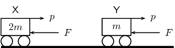
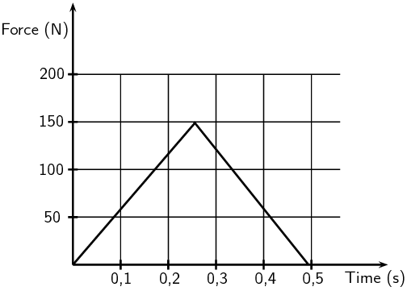
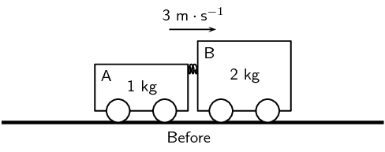
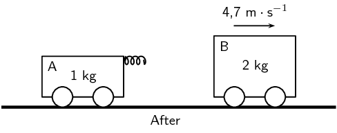

## Momentum

### Textbook Exercise 2.7

**Problem:**
[SC 2003/11]A projectile is fired vertically upwards from the ground.
                                                At the highest point of its motion, the projectile explodes and
                                                separates into two pieces of equal mass. If one of the pieces is
                                                projected vertically upwards after the explosion, the second
                                                piece will...

2. drop to the ground at zero initial speed.
4. be projected downwards at the same initial speed as
                                                                   the first piece.
6. be projected upwards at the same initial speed as the
                                                                   first piece.
8. be projected downwards at twice the initial speed as
                                                                   the first piece.

**Solution:**
be projected downwards at the same initial speed as the first piece.

**Problem:**
[IEB 2004/11 HG1] A ball hits a wall horizontally with a speed of
                                                \(\text{15}\) \(\text{m·s$^{-1}$}\). It rebounds
                                                horizontally with a speed of \(\text{8}\)
                                                \(\text{m·s$^{-1}$}\). Which of the following statements
                                                about the system of the ball and the wall is
                                                **true**?

2. The total linear momentum of the system is not
                                                                   conserved during this collision.
4. The law of conservation of energy does not apply to
                                                                   this system.
6. The change in momentum of the wall is equal to the
                                                                   change in momentum of the ball.
8. Energy is transferred from the ball to the wall.

**Solution:**
The change in momentum of the wall is equal to the change in momentum
                                                of the ball.

**Problem:**
[IEB 2001/11 HG1] A block of mass M collides with a stationary block
                                                of mass 2M. The two blocks move off together with a velocity of
                                                \(\vec{v}\). What is the velocity of the block of mass M
                                                immediately **before** it collides with the block
                                                of mass 2M?

2. \(\vec{v}\)
4. 2\(\vec{v}\)
6. 3\(\vec{v}\)
8. 4\(\vec{v}\)

**Solution:**
\begin{align*}
                                        M\vec{v}_{1i} + 2M\vec{v}_{2i} & = (M+2M)\vec{v} \\
                                        M\vec{v}_{1i} & = 3M\vec{v} \\
                                        \vec{v}_{1i} & = 3\vec{v}
                                        \end{align*}

3\(\vec{v}\)

**Problem:**
[IEB 2003/11 HG1] A cricket ball and a tennis ball move horizontally
                                                towards you with the same momentum. A cricket ball has
                                                greater mass than a tennis ball. You apply the same force in
                                                stopping each ball.

How does the time taken to stop each ball compare?

2. It will take longer to stop the cricket ball.
4. It will take longer to stop the tennis ball.
6. It will take the same time to stop each of the balls.
8. One cannot say how long without knowing the kind of
                                                                   collision the ball has when stopping.

**Solution:**
Since their momenta are the same, and the stopping force applied to
                                                them is the same, it will take the same time to stop each of the
                                                balls.

**Problem:**
[IEB 2004/11 HG1] Two identical billiard balls collide head-on with
                                                each other. The first ball hits the second ball with a speed of
                                                V, and the second ball hits the first ball with a speed of 2V.
                                                After the collision, the first ball moves off in the opposite
                                                direction with a speed of 2V. Which expression correctly gives
                                                the speed of the second ball after the collision?

2. V
4. 2V
6. 3V
8. 4V

**Solution:**
V

**Problem:**
[SC 2002/11 HG1] Which one of the following physical quantities is
                                                the same as the rate of change of momentum?

2. resultant force
4. work
6. power
8. impulse

**Solution:**
resultant force

**Problem:**
[IEB 2005/11 HG] Cart X moves along a smooth track with momentum p. A
                                                resultant force F applied to the cart stops it in time t.
                                                Another cart Y has only half the mass of X, but it has the same
                                                momentum p.

In what time will cart Y be brought to rest when the same resultant
                                                force F acts on it?

2. \(\frac{1}{2}t\)
4. \(t\)
6. \(2t\)
8. \(4t\)

**Solution:**
\(t\)

**Problem:**
[SC 2002/03 HG1]
                                                A ball with mass m strikes a wall perpendicularly with a speed,
                                                v. If it rebounds in the opposite direction with the same speed,
                                                v, the magnitude of the change in momentum will be ...

2. \(2mv\)
4. \(mv\)
6. \(\frac{1}{2}mv\)
8. \(0mv\)

**Solution:**
\(2mv\)

**Problem:**
Show that impulse and momentum have the same units.

**Solution:**
The units of momentum are \(\text{kg⋅m⋅s$^{-1}$}\):

Impulse can be defined as force over total time:
                                                \(\text{N⋅s}\). \(\text{1}\text{ N} = \text{1}\text{
                                                kg⋅m⋅s$^{-2}$}\). Therefore the units for impulse
                                                are: \(\text{kg⋅m⋅s$^{-1}$}\)

This is the same as the units for momentum.

A golf club exerts an average force of \(\text{3}\) \(\text{kN}\) on
                                                a ball of mass \(\text{0,06}\) \(\text{kg}\). If the golf club
                                                is in contact with the golf ball for \(\text{5} \times
                                                \text{10}^{-\text{4}}\) \(\text{seconds}\), calculate

**Problem:**
the change in the momentum of the golf ball.

**Solution:**
\begin{align*}
                                                \Delta p & = F_{\text{net}}\Delta t \\
                                                & = (\text{3} \times \text{10}^{\text{3}})(\text{5} \times
                                                \text{10}^{-\text{4}}) \\
                                                & = \text{1,5}\text{ kg⋅m⋅s$^{-1}$}
                                                \end{align*}

**Problem:**
the velocity of the golf ball as it leaves the club.

**Solution:**
\begin{align*}
                                                \Delta p & = mv \\
                                                \text{1,5} & = \text{0,06}v \\
                                                v & = \text{25}\text{ m⋅s$^{-1}$}
                                                \end{align*}

During a game of hockey, a player strikes a stationary ball of mass
                                                \(\text{150}\) \(\text{g}\) . The graph below shows how the
                                                force of the ball varies with the time.

**Problem:**
What does the area under this graph represent?

**Solution:**
Impulse

**Problem:**
Calculate the speed at which the ball leaves the hockey
                                                        stick.

**Solution:**
\begin{align*}
                                                \text{Impulse } & = F \Delta t \\
                                                & = \Delta p = m \Delta v
                                                \end{align*}

The impulse is the area under the graph:

                                                \begin{align*}
                                                \text{Impulse } & = (\text{0,5})(150)(\text{0,5}) \\
                                                & = \text{37,5}\text{ N}
                                                \end{align*}

The speed is:

                                                \begin{align*}
                                                \Delta v & = \frac{\text{37,5}}{\text{0,150}} \\
                                                & = \text{250}\text{ m⋅s$^{-1}$}
                                                \end{align*}

**Problem:**
The same player hits a practice ball of the same mass, but
                                                        which is made from a softer material. The hit is such
                                                        that the ball moves off with the same speed as before.
                                                        How will the **area**, the
                                                        **height** and the **base** of
                                                        the triangle that forms the graph, compare with that of
                                                        the original ball?

**Solution:**
The area will remain the same because the final velocity and
                                                        the
                                                        mass are the same. The duration of the contact between
                                                        the bat and the
                                                        ball will be longer as the ball is soft, so the base
                                                        will be wider. In
                                                        order for the area to be the same, the height must be
                                                        lower. Therefore,
                                                        the player can hit the softer ball with less force to
                                                        impart the same
                                                        velocity on the ball.

**Problem:**
The fronts of modern cars are deliberately designed in such a way
                                                that in case of a head-on collision, the front would crumple.
                                                Why is it desirable that the front of the car should crumple?

**Solution:**
If the front crumples then the force of the
                                                collision is reduced. The energy of the collision would go into
                                                making
                                                the front of the car crumple and so the passengers in the car
                                                would feel
                                                less force.

[SC 2002/11 HG1] In a railway shunting yard, a locomotive of mass
                                                \(\text{4 000}\) \(\text{kg}\), travelling due east at a
                                                velocity of \(\text{1,5}\) \(\text{m·s$^{-1}$}\), collides
                                                with a stationary goods wagon of mass \(\text{3 000}\)
                                                \(\text{kg}\) in an attempt to couple with it. The coupling
                                                fails and instead the goods wagon moves due east with a velocity
                                                of \(\text{2,8}\) \(\text{m·s$^{-1}$}\).

**Problem:**
Calculate the magnitude and direction of the velocity of the
                                                        locomotive immediately after collision.

**Solution:**
\begin{align*}
                                                m_{1}v_{i1} + m_{2}v_{i2} & = m_{1}v_{f1} + m_{2}v_{f2} \\
                                                (\text{4 000})(\text{1,5}) & =
                                                (\text{3 000})(\text{2,8}) + (\text{4 000})v_{f2} \\
                                                v_{f2} & = -\text{0,6}\text{ m⋅s$^{-1}$} \\
                                                & = \text{0,6}\text{ m⋅s$^{-1}$}
                                                \text{ west}
                                                \end{align*}

**Problem:**
Name and state in words the law you used to answer the
                                                        previous question

**Solution:**
The principle of conservation of linear momentum. The total
                                                        linear momentum of an isolated system is constant.

[SC 2005/11 SG1] A combination of trolley A (fitted with a spring) of
                                                mass \(\text{1}\) \(\text{kg}\), and trolley B of mass
                                                \(\text{2}\) \(\text{kg}\), moves to the right at \(\text{3}\)
                                                \(\text{m·s$^{-1}$}\) along a frictionless, horizontal
                                                surface. The spring is kept compressed between the two trolleys.

While the combination of the two trolleys is moving at \(\text{3}\)
                                                \(\text{m·s$^{-1}$}\), the spring is released and when it
                                                has expanded completely, the \(\text{2}\) \(\text{kg}\) trolley
                                                is then moving to the right at \(\text{4,7}\)
                                                \(\text{m·s$^{-1}$}\) as shown below.

**Problem:**
State, in words, the principle of *conservation of linear
                                                                momentum*.

**Solution:**
The total linear momentum of an isolated system is constant.

**Problem:**
Calculate the magnitude and direction of the velocity of the
                                                        \(\text{1}\) \(\text{kg}\) trolley immediately after the
                                                        spring has expanded completely.

**Solution:**
\begin{align*}
                                                (m_{1}+m_{2})\vec{v}_i & = m_{1}\vec{v}_{f1} +
                                                m_{2}\vec{v}_{f2} \\
                                                (\text{2}+\text{1})(\text{3}) & = (\text{2})(\text{4,7}) +
                                                (\text{1})\vec{v}_{f2} \\
                                                \vec{v}_{f2} & = -\text{0,4}\text{ m·s$^{-1}$}
                                                \end{align*}

\(\vec{v}_{f2} = \text{0,4}\text{ m·s$^{-1}$}\) to the
                                                        left

\(\text{0,4}\) \(\text{m·s$^{-1}$}\) to the left

**Problem:**
[IEB 2002/11 HG1] A ball bounces back from the ground. Which of the
                                                following statements is true of this event?

2. The magnitude of the change in momentum of the ball
                                                                   is equal to the magnitude of the change in
                                                                   momentum of the Earth.
4. The magnitude of the impulse experienced by the ball
                                                                   is greater than the magnitude of the impulse
                                                                   experienced by the Earth.
6. The speed of the ball before the collision will
                                                                   always be equal to the speed of the ball after
                                                                   the collision.
8. Only the ball experiences a change in momentum during
                                                                   this event.

**Solution:**
The magnitude of the change in momentum of the ball is equal to the
                                                magnitude of the change in momentum of the Earth.

[SC 2002/11 SG] A boy is standing in a small stationary boat. He
                                                throws his schoolbag, mass \(\text{2}\) \(\text{kg}\),
                                                horizontally towards the jetty with a velocity of \(\text{5}\)
                                                \(\text{m·s$^{-1}$}\). The *combined mass* of the
                                                boy and the boat is \(\text{50}\) \(\text{kg}\).

**Problem:**
Calculate the magnitude of the horizontal momentum of the bag
                                                        immediately after the boy has thrown it.

**Solution:**
\begin{align*}
                                                p & = mv \\
                                                & = (2)(5) \\
                                                & = \text{10}\text{ kg·m·s$^{-1}$}
                                                \end{align*}

**Problem:**
Calculate the velocity (magnitude and direction) of the
                                                        *boat-and-boy* immediately after the bag is
                                                        thrown.

**Solution:**
\begin{align*}
                                                0 & = m_{1}\vec{v}_{1f} + m_2\vec{v}_{2f} \\
                                                -\text{10}& = (\text{50})\vec{v}_{2f}\\
                                                \vec{v}_{2f} & = \frac{-\text{10}}{\text{50}}\\
                                                & = -\text{0,2}\text{ m·s$^{-1}$}
                                                \end{align*}

\(\text{0,2}\) \(\text{m·s$^{-1}$}\) in the opposite
                                                        direction to the jetty
