## 3.2 Vertical projectile motion (ESCJW)

In Grade 11, we studied the motion of objects in free fall and saw that such an object has a
      constant gravitational acceleration of \(\vec{g}\). We now study the motion of
      objects that are moving upwards or downwards while experiencing a force due to gravity.
      We call this projectile motion. We will only consider the case where objects move vertically
      upwards and/or downwards - meaning that there is no horizontal displacement of the object,
      only vertical displacement.

When we talk about a projectile we mean a body or particle that is project or launched and then
      moves under the influence of **only gravity**.

### Motion in a gravitational field (ESCJX)

We know from Newton's Law of Universal Gravitation that an object in the Earth's
        gravitational field experiences
        a force pulling it towards the centre of the Earth. If this is the only force acting on
        the object then the object
        will accelerate towards the centre of the Earth.

A person standing on the Earth's surface will interpret this acceleration as objects
        always falling downwards.

In Grade 11, we showed that the value of the acceleration due to gravity can be
        treated as a having a constant magnitude of
        \(g=\text{9,8}\text{ m·s$^{-2}$}\).

<Callout type="note" title="Note">
In reality, if you go very far away from the Earth's surface, the magnitude of
          \(\vec{g}\) would change, but, for everyday problems, we can safely treat it as constant. We also ignore
          any effects that air resistance (drag) might have.
</Callout>

For the rest of this chapter we will deal only with the case where the force due
        to gravity is the only force acting on the projectile that is falling. Any projectile can be described
        as falling, even if its motion is upwards initially.

The initial velocity, \(\vec{v}_i\), that an object has and the acceleration that it experiences are two
        different quantities. It is very important to
        remember that the gravitational acceleration is always towards the centre of the Earth and constant, regardless
        of the direction or magnitude
        of the velocity.

<Callout type="tip" title="Note">
Projectiles moving upwards or downwards in the Earth's gravitational field always accelerate
          downwards with a constant acceleration
          \(\vec{g}\). Note: non-zero acceleration means that the velocity is
          *changing*.
</Callout>

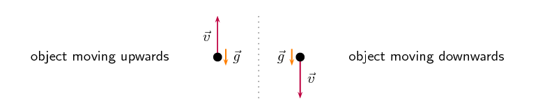

Figure 3.1: Objects moving upwards or downwards in the Earth's gravitational field always accelerate
            towards the centre of the Earth. This looks like a downwards
            acceleration to someone standing on the Earth's surface. We don't draw both vectors on the object because we
            would be mixing velocity and acceleration
            which are two *different* physical quantities.

<Callout type="note" title="Note">
<VideoPlayer src="http://www.youtube.com/watch?v=xQ4znShlK5A" title="Video: 27JZ" />
</Callout>

This means that if an object is moving upwards with some initial velocity in the vertical direction, the
        magnitude of the velocity in the vertical direction
        decreases until it stops (\(v=0\)
        \(\text{m·s
        $^{-1}$}\)) for an instant. The point at which the velocity is reduced to zero corresponds
        with the maximum height, \(h_{max}\), that the object reaches. After this, the object
        starts to fall. It is very important to remember that the acceleration is constant but the
        velocity vector has changed in magnitude and direction. At the maximum height where the velocity
        is zero the acceleration is still \(\vec{g}\).

<Callout type="tip" title="Note">
Projectiles that have an initial velocity upwards will have zero velocity at
          their greatest height, \(h_{max}\). The acceleration is still \(\vec{g}\).
</Callout>

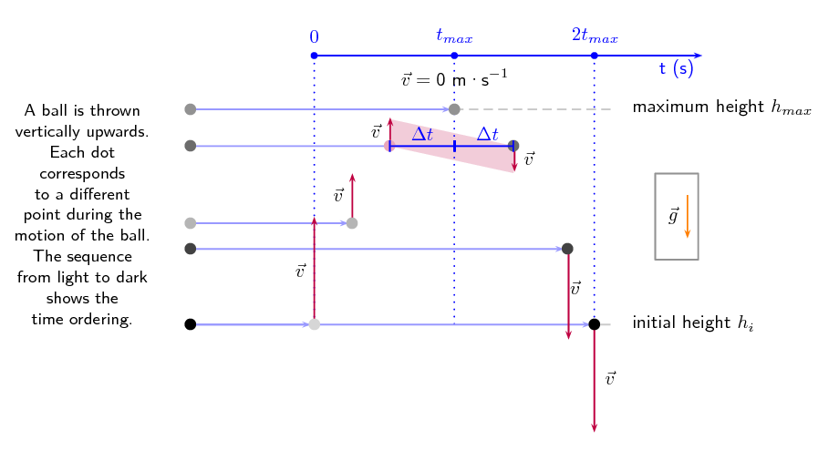

Figure 3.2: (a) An object is thrown upwards from height
            \({h}_{i}\). After time
            \({t}_{m}\), the object reaches its maximum height, and starts to drop downwards. After a time
            \(2{t}_{m}\) the object returns to height
            \({h}_{i}\).

Consider an object thrown upwards from a vertical height
        \({h}_{i}\). We have said that the object will travel upwards with decreasing vertical velocity
        until it stops, and then starts moving vertically downwards. The time that it takes for the object to fall back
        down to
        height
        \({h}_{i}\) is the same as the time taken for the object to reach its maximum height from height
        \({h}_{i}\). This is known as *time symmetry*. This is a consquence
        of the uniform acceleration the projectile experiences.

This has two implications for projectiles that pass through a point on both the upward and downward part of
        their motion when in free-fall:

- **time symmetry:** the time intervals during the upward motion and the downward motion
            are the same, for example it will take the same time to rise from initial position to maximum height as it
            will to drop
            back to the initial position. This applies to any point as shown
            by the pink dot in Figure 3.2. The time
            interval between
            the projectile passing the point and being at maximum height is the same, \(\Delta t\).
- **magnitude of velocity:** the magnitude of the velocity at the same point on the upward
            and downward motion will be the same, the direction will be reversed, as indicated by the shaded
            region in Figure 3.2.

This is very useful when solving problems because if you have any information about the upward motion you
        can learn something about the downward motion as well and vice versa.

## Investigate the motion of a falling body

### Aim

To measure the position and time during motion and to
            use that data to plot a “Position vs Time” and “Velocity
            vs Time” graph from which
            we can calculate the magnitude for gravitational acceleration, \(\vec{g}\).

### Apparatus

- ticker tape apparatus
- ticker timer
- tape
- graph paper
- ruler
- foam cushion

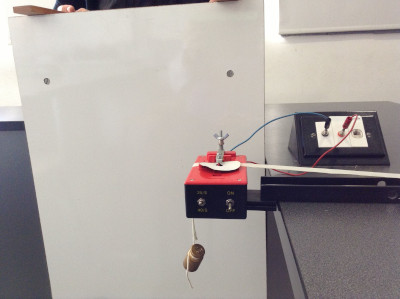

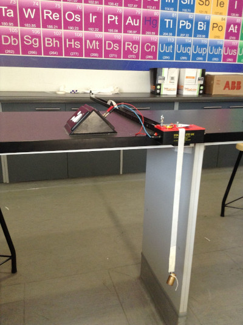

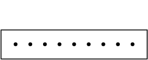

Motion at constant velocity

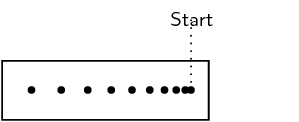

Motion with increasing velocity

### Method

2. Work with a friend. Copy the table below into your workbook.
4. Clamp the timer to the table to allow the tape to fall through the staples on the timer such that the
                 ticker tape will be perpendicular to the floor. Plug in the timer.
6. Thread a piece of ticker tape through the staples. Make sure the tape is under the carbon disc. The
                 length of the tape should be the distance from the timer to the floor.
8. Using masking tape attach a 100 g mass to the end of the tape closest to the floor.
10. Position the foam cushion directly below the mass. (The cushion will protect your masses and your floor)
12. Hold the tape so that it is vertical and will easily pass through the staples.
14. Turn on the timer.
16. Let go of the tape with the mass, allowing it to drop to the floor.
18. Turn off the timer.
20. Repeat.
22. Take each tape and find the first clear dot nearest the mass end of the tape. Circle this first clear
                 dot and label it as zero. Then count five dots and label the fifth dot as number 1.
                 Count another 5 dots and label the fifth dot number 2. Continue this procedure.
24. On each piece of tape, measure the distance between successive dots. Note these distances in
                   the table below.
26. Use the frequency of the ticker timer to work out the time intervals between successive dots.
                   Note these times in the table below.
28. Work out the average of the two distance values between successive numbered dots.
30. The time interval between two dots is 0,02 s so the time between numbered dots is 0,1 s.
32. Use the average distance between numbered dots and the known time interval to calculate velocity.
34. Use the magnitude of the velocity and time values to plot a graph of “Velocity vs Time”
                   *onto graph paper*. Stick the graph paper into your workbook.
36. Draw the best straight line through your data points.
38. Determine the slope of the straight line. This is the magnitude of the acceleration.

### Results

| Change in distance (m) | Change in time (s) | Magnitude of velocity (\(\text{m·s$^{-1}$}\)) |
| --- | --- | --- |

### Discussion

Describe the motion of the mass using the graphs.

### Equations of motion (ESCJY)

The equations of rectilinear motion that you learnt about in Grade 10 can be used for vertical projectile
        motion, with acceleration from gravity:
        \(\vec{a}=\vec{g}\). Why, because the equations of rectilinear motion can be applied to any motion
        in a straight line with constant acceleration. If we are only considering vertical motion (up and down) it is
        motion in a straight line and the acceleration,
        \(\vec{g}\), is constant and along the same line. We use the magnitude of
        \(g=
        \text{9,8}\text{ m·s
        $^{-2}$}\) for our calculations.

<Callout type="note" title="Note">
Now would be a good time to revise both rectilinear motion and quadratic equations
          from Grade 10.
</Callout>

Remember that when you use these equations, you are dealing with vectors which have magnitude
        *and* direction. Therefore, you need to decide which direction will be the
        positive direction so that your vectors have the correct signs. The equations of motion that you learnt about
        in Grade 10 are:

      \begin{align*}
      \vec{v}_{f}& = \vec{v}_{i}+\vec{a}t \\
      \Delta \vec{x}& = \frac{\left(\vec{v}_{i}+\vec{v}_{f}\right)}{2}t \\
      \Delta \vec{x}& = \vec{v}_{i}t+\frac{1}{2}\vec{a}{t}^{2} \\
      \vec{v}_{f}^{2}& = \vec{v}_{i}^{2}+2\vec{a}\Delta\vec{ x }
      \end{align*}

In the case of vertical projectile motion, we know that the only force we will consider is gravity and
        therefore the acceleration will be \(\vec{a}=\vec{g}\).

      \begin{align*}
      \vec{v}_{f}& = \vec{v}_{i}+\vec{g}t \\
      \Delta \vec{x}& = \frac{\left(\vec{v}_{i}+\vec{v}_{f}\right)}{2}t \\
      \Delta \vec{x}& = \vec{v}_{i}t+\frac{1}{2}\vec{g}{t}^{2} \\
      \vec{v}_{f}^{2}& = \vec{v}_{i}^{2}+2\vec{g}\Delta x
      \end{align*}\begin{align*}
      &\text{where}\\
      \vec{v}_{i}& = \text{initial velocity} \text{(}\text{m}·{\text{s}}^{-1}\text{)} \text{at start}
      \\
      \vec{v}_{f}& =
      \text{final velocity} \text{(}\text{m}·{\text{s}}^{-1}\text{)} \text{at time} t \\
      \Delta \vec{x}& = \text{change in vertical position} \text{(m)} \\
      t& = \text{time} \text{(s)} \\
      \Delta t& = \text{time interval} \text{(s)} \\
      \vec{a}&=\vec{g} = \text{acceleration due to gravity} \text{(}\text{m}·{\text{s}}^{-2}\text{)}
      \end{align*}

<Callout type="note" title="Note">
\(\Delta \vec{x}\) is displacement, the change in position. If the coordinate system you choose
          isn't centred at the point from which the motion starts (i.e. you don't have \(\vec{x}_i=0\))
          then you must remember that the displacement and the final position are not the same. The position
          is given by \(\vec{x}_f=\vec{x}_i+\Delta \vec{x}\). If \(\vec{x}_i=0\)
          then \(\vec{x}_f=(0)+\Delta \vec{x}\).
</Callout>

<Callout type="note" title="Note">
[Simulation:
            27K2](http://phet.colorado.edu/en/simulation/projectile-motion)
</Callout>

Now we can apply this mathematical description of vertical motion to solving problems.

<Callout type="tip" title="Worked example 1: Projectile motion">
**Question:**
A ball is thrown vertically upwards with an initial velocity of
            \(\text{10}\) \(\text{m·s
            $^{-1}$}\). A photograph (shown) is taken when the ball is
            \(\text{1,5}\) \(\text{m}\) above the point of release.

2. Determine the maximum height above the thrower's hand reached by the ball.
4. Determine the time it takes the ball to reach its maximum height.
6. Determine the time(s) when the ball will be at the position shown in the photograph.

**Identify what is required and what is given:**
We are required to determine the maximum height reached by the ball and how long it takes to
            reach this height. We are given the initial velocity
            \(\vec{v}_{i}=\text{10}\text{ m·s$^{-1}$}\) upwards and the acceleration due to gravity
            \(\vec{g}=
            \text{9,8}\text{ m·s
            $^{-2}$}\) downwards. We also need to determine when the ball is at the position shown in the
            photograph.

The ball is thrown straight up and will reach a maximum height, at which point its velocity will be zero,
            before beginning to fall downwards. The height of the ball in the photograph is given
            as \(\text{1,5}\) \(\text{m}\) above the initial point. Adding the information to the picture helps us
            understand what is going on more effectively:

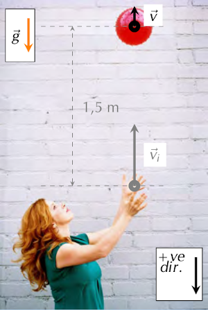

**Determine how to approach the problem:**
Even though there are a number of questions to answer, the best approach is to work through them
            one at a time.

First, as with rectilinear motion in Grade 10, select a positive direction. We choose
            **down as positive** and
            remember to **keep this sign convention** for the whole problem.
            This will allow us to analyse the information
            given and determine directions and signs. We know that at the maximum height the velocity of the ball
            is
            \(\text{0}\) \(\text{m·s
            $^{-1}$}\). We therefore have the following:

- \(\vec{v}_{i}=
                  -\text{10}\text{ m·s
                  $^{-1}$}\)(it is negative because we chose downwards as positive)
- \(\vec{v}_{f}=
                  \text{0}\text{ m·s
                  $^{-1}$}\)
- \(\vec{g}=
                  \text{9,8}\text{ m·s
                  $^{-2}$}\)

We know that the position shown (\(\text{1,5}\) \(\text{m}\) above the point of release) will be passed as
            the ball rises to its maximum height and
            then again as the ball falls downwards.

**Identify the appropriate equation to determine the maximum height:**
We can use
            \(\vec{v}_{f}^{2}=\vec{v}_{i}^{2}+2\vec{g}\Delta \vec{x}\) to solve for the height.

**Substitute the values into the equation and find the maximum height:**
\begin{align*} \vec{v}_{f}^{2}& = \vec{v}_{i}^{2}+2\vec{g}\Delta \vec{x} \\
          {\left(0\right)}^{2}& = {\left(
          -\text{10}\right)}^{2}+\left(2\right)\left(
          \text{9,8}\right)\left(\Delta x\right) \\
          -\text{100}& =
          \text{19,6}\Delta x \\
          \Delta x& =
          -\text{5,102}\text{ m}\end{align*}

The value for the displacement will be negative because the displacement is upwards and we have
            chosen downward as positive (and upward as negative). The maximum height will be a positive number,
            \(h_m=
            \text{5,10}\text{ m}\).

**Identify the appropriate equation to determine the time to reach maximum height:**
We know the values of \(\vec{v}_i\), \(\vec{v}_f\) and \(\vec{g}\) so
            we can use:
            \(\vec{v}_{f}=\vec{v}_{i}+\vec{g}t\) to solve for the time.

**Substitute the values in and find the time to reach maximum height:**
\begin{align*} \vec{v}_{f}& = \vec{v}_{i}+\vec{g}t \\
          \text{0}& =
          -\text{10}+
          \text{9,8}t \\
          \text{10}& =
          \text{9,8}t \\
          t& =
          \text{1,02}\text{ s}\end{align*}

**Determine the times at which the ball is in the position in the photograph:**
We know the displacement, initial velocity and the acceleration of the ball. We also expect to get
            two values as we know the ball will pass through the point twice.

We substitute our values into the equation
            \(\Delta \vec{x} = \vec{v}_{i}t+\frac{1}{2}\vec{g}{t}^{2}\), which is a quadratic equation in time, so we
            expect to find
            two different solutions if we solve for time.

It is important to notice that we can use the value
            \(-\text{1,5}\) \(\text{m}\) as the displacement above the initial position.

          \begin{align*} \Delta \vec{x} & = {v}_{i}t+\frac{1}{2}\vec{g}{t}^{2} \\
          %& \text{We will solve for time using the quadratic formula} \\
          \frac{1}{2}\vec{g}{t}^{2} + \vec{v}_{i}t - \Delta \vec{x} & =
          \text{0}\\
          \frac{1}{2}(
          \text{9,8})t^2 + (
          -\text{10})t - (
          -\text{1,5}) & =
          \text{0}\\
          \underbrace{(
          \text{4,9})}_{a}\underbrace{t^2}_{x^2} + \underbrace{(
          -\text{10})}_{b}\underbrace{t}_{x}+\underbrace{(\text{1,5})}_{c} & = 0 \\
          t &=
          \frac{-b\pm\sqrt{b^2-
          \text{4}ac}}{
          \text{2}a} \\
          t &= \frac{-(
          -\text{10})\pm\sqrt{(
          -\text{10})^2-
          \text{4}(
          \text{4,9})(
          \text{1,5})}}{
          \text{2}(
          \text{4,9})} \\
          t &= \frac{
          \text{10}\pm\sqrt{
          \text{70,6}}}{
          \text{9,8}} \\
          t &= \frac{
          \text{10}\pm
          \text{8,40238}}{
          \text{9,8}} \\
          t &=
          \text{1,02041}\pm
          \text{0,857386}\\
          t =
          \text{0,16}\text{ s}\ & \text{or}\ t =
          \text{1,88}\text{ s}\end{align*}

**Write the final answer:**
The ball:

2. reaches a maximum height of
                 \(\text{5,10}\) \(\text{m}\);
4. takes
                 \(\text{1,02}\) \(\text{s}\) to reach the top; and
6. passes through the point in the photograph at
                 \(t\)=
                 \(\text{0,16}\) \(\text{s}\) on the way up and t =
                 \(\text{1,88}\) \(\text{s}\) on the way down.
</Callout>

The use of a sign convention should not affect your result. As an exercise, repeat the previous worked example
        using the opposite
        sign convention to verify that you do get the same result.

<Callout type="tip" title="Worked example 2: Height of a projectile">
**Question:**
A cricketer hits a cricket ball so that it goes vertically upwards. If the ball
            takes
            \(\text{10}\) \(\text{s}\) to return to the initial height, determine its maximum height above the initial
            position.

**Identify what is required and what is given:**
We need to find how high the ball goes. We know that it takes
            \(\text{10}\) \(\text{s}\) to go up and down. We do not know what the initial velocity (\(\vec{v}_{i}\)) of
            the ball is.

After the batsman strikes the ball it goes directly upwards and the only force that will be
            acting on the ball will be the gravitational force. This information is represented in the photograph below:

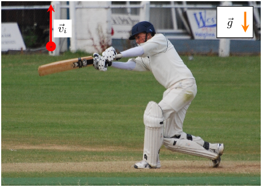

**Determine how to approach the problem:**
For a problem like this it is useful to divide the motion into two parts. The first part of the
            motion consists of the upward motion of the ball with an initial velocity (\(\vec{v}_{i}\)) and
            a final velocity (\(\vec{v}_{f}=0\)) at the maximum height. The second part of the motion consists of
            the downward motion of the ball with an initial velocity (\(\vec{v}_{i}=0\)) and final velocity
            (\(\vec{v}_{f}\)) which is not yet known.

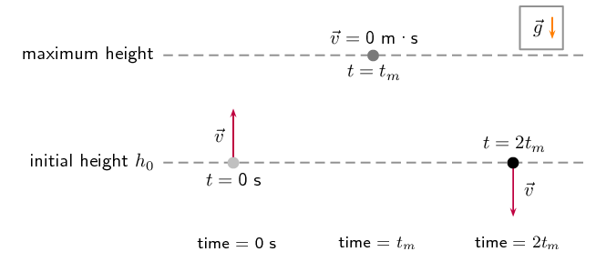

**Choose down as positive**. We know that at the maximum height, the velocity of the ball is
            \(\text{0}\) \(\text{m·s
            $^{-1}$}\). We also know that the ball takes the same time to reach its maximum height as it takes
            to travel from its maximum height to the initial position, due to time symmetry. The time taken is half the
            total time.
            Therefore, we have the following information for the second (downward) part of the motion of the ball:

- \(t=\text{5}\text{ s}\) (half of the total time)
- \(\vec{v}_{\mathrm{top}}=\text{0}\text{ m·s$^{-1}$}\)
- \(\vec{g}=
                  \text{9,8}\text{ m·s
                  $^{-2}$}\) downwards
- \(\Delta \vec{x}=~?\)

**Find an appropriate equation to use:**
We do not know the final velocity of the ball coming down. We need to choose an equation that
            does not have
            \(\vec{v}_{f}\) in it. We can use the following equation to solve for
            \(\Delta \vec{x}\):

          \[\Delta \vec{x}=\vec{v}_{i}t+\frac{1}{2}\vec{g}{t}^{2}\]

**Substitute values and find the height:**
\begin{align*} \Delta \vec{x}& = \left(
          \text{0}\right)\left(
          \text{5}\right)+\frac{
          \text{1}}{
          \text{2}}\left(
          \text{9,8}\right){\left(
          \text{5}\right)}^{2} \\
          \Delta \vec{x}& =
          \text{122,5}\text{ m}~\text{downwards}\end{align*}

In the second motion, the displacement of the ball is
            \(\text{122,5}\) \(\text{m}\) downwards. This means that the height was
            \(h =
            \text{122,5}\text{ m}\).

**Write the final answer:**
The ball reaches a maximum height of
            \(\text{122,5}\) \(\text{m}\).
</Callout>

<Callout type="tip" title="Worked example 3: Equal displacements [attribution: Sunil Kumar Singh]">
**Question:**
A sequence of balls are successively dropped from the top of a tower. The time interval between
            the release of consecutive balls is equal. At the precise instant that the ninth ball (ball 9) is released,
            the
            first ball hits the ground. Which of the balls in the sequence is at \(\frac{3}{4}\) of the height,
            \(h\), of the tower when the first ball hits the ground?

**Understand what is happening:**
A ball is dropped from a tower. After a time, \(t_i\), a second ball is dropped. After another time
            interval,
            \(t_i\), a third ball is dropped. This means that when ball 3 is dropped the total time that
            has passed is \(2t_i\).

After a third time interval,
            \(t_i\), a fourth ball is dropped. This means that at the instant that ball 4 is dropped the total time that
            has passed is \(3t_i\).
            This process continues until the ninth ball is dropped. At the same instant that the ninth ball is dropped,
            the first ball that was dropped strikes the ground.
            The ninth ball would have been
            released after 8 time intervals, therefore it took the first ball a time interval of \(8t_i\) to hit the
            ground.

**Describe the events mathematically:**
As this is a vertical motion problem where everything is falling towards the ground, it is
            simplest to choose downwards as the positive direction.

The first ball hits the ground when
            the ninth ball is dropped. This means that the first ball has fallen for a total time of
            \((
            \text{9}-
            \text{1})t_i =
            \text{8}t_i\).
            The displacement of the first ball is also described by the equation \(\Delta
            \vec{x}=\vec{v}_{i}t+\frac{1}{2}\vec{g}t^2\). The balls are dropped so
            their initial velocity is zero, \(\vec{v}_{i}=0\) and the we know the time for the first ball to fall the
            height of the tower therefore, in the case
            of the first ball, we have:

          \begin{align*}
          \Delta \vec{x} &=\vec{v}_{i}t+\frac{1}{2}\vec{g}t^2 \\
          h &=\frac{1}{2}(\text{9,8})(\text{8}t_i)^2
          \end{align*}

Let the \(n\)th ball be the ball that is at \(\frac{3}{4}\) of the height, \(h\), of the tower when the
            first ball strikes the ground. The
            \(n\)th ball will have fall for a time of \((n-1)t_i\). If it is \(\frac{3}{4}\) of the way up the tower it
            will have fall a distance of
            \(\frac{1}{4}h\). This motion is also described by \(\Delta \vec{x}=\vec{v}_{i}t+\frac{1}{2}\vec{g}t^2\),
            and therefore we know, in the case of the
            \(n\)th ball, we have:

          \begin{align*}
          \Delta \vec{x} &=\vec{v}_{i}t+\frac{1}{2}\vec{g}t^2 \\
          \frac{1}{4}h &=\frac{1}{2}(\text{9,8})((n-\text{1})t_i)^2 \\
          h &=2(\text{9,8})((n-\text{1})t_i)^2
          \end{align*}

We can't solve for \(n\) from this final equation because it will contain \(h\) and \(t_i\). We can use the
            two equations
            we have to eliminate \(h\). Both equations are written in the form \(h=...\) therefore we can equate them
            eliminating \(h\):

          \begin{align*}
          \frac{1}{2}(\text{9,8})(\text{8}t_i)^2 & = 2(\text{9,8})((n-\text{1})t_i)^2 \\
          \frac{1}{2}(\text{9,8})\text{8}^2t_i^2 & = 2(\text{9,8})(n-\text{1})^2t_i^2 \\
          \left(\frac{2}{(\text{9,8})t_i^2}\right)\times\frac{1}{2}(\text{9,8})\text{8}^2t_i^2 & =
          \left(\frac{2}{(\text{9,8})t_i^2}\right)\times 2(\text{9,8})(n-\text{1})^2t_i^2 \\
          \text{8}^2 & = 4(n-\text{1})^2 \\
          \text{8} & = 2(n-\text{1}) \\
          \text{4} & = (n-\text{1}) \\
          n & = 5
          \end{align*}

<Callout type="note" title="Note">
We know that \(n\) must be a positive integer which is why we use the positive roots when we take the
              square root above.
</Callout>

**Write the final answer:**
The fifth ball is at
            \(\frac{3}{4}\) of the height of the tower when the first ball strikes the ground.
</Callout>

## Equations of motion

### Textbook Exercise 3.1

**Problem:**
A cricketer hits a cricket ball straight up into the air. The cricket ball has an initial
                velocity of
                \(\text{20}\) \(\text{m·s
                $^{-1}$}\) vertically upwards.

2. What height does the ball reach before it stops to fall back to the ground.
4. How long has the ball been in the air for when it reaches that maximum height?

**Solution:**
2. Note that the final velocity is 0 at the maximum height that the ball reaches. (Take upwards as +ve
                       direction.)
                     \begin{align*}
                     \vec{v}_{f}^{2} &=\vec{v}_i^{2} + 2\vec{g} \Delta\vec{x}\\
                     \Delta\vec{x}&=\frac{\vec{v}_i^{2}}{2\vec{g}} \\
                     &=\frac{-(\text{20}^{2})}{(\text{2})(-\text{9,8})} \\
                     &= \text{20,41}\text{ m}
                     \end{align*}
4. \begin{align*}
                     \vec{v}_{f}& = \vec{v}_{i} +\vec{g}t \\
                     t &= \frac{\vec{v}_{f}- \vec{v}_{i}}{\vec{g}} \\
                     &= \frac{\text{0}-\text{20}}{-\text{9,8}}\\
                     &=\text{2,04}\text{ s}
                     \end{align*}

2. \(\text{20,41}\) \(\text{m}\)
4. \(\text{2,04}\) \(\text{s}\)

**Problem:**
Zingi throws a tennis ball straight up into the air. It reaches a height of
                \(\text{80}\) \(\text{cm}\).

2. Determine the initial velocity of the tennis ball.
4. How long does the ball take to reach its maximum height?

**Solution:**
2. We first convert the height given to m:
                     \(\frac{\text{80}}{\text{100}}=\text{0,8}\text{ m}\)
                     \begin{align*}
                     \vec{v}_{f}^2 &= \vec{v}_{i}^2 + 2\vec{g}\Delta{\vec{x}} \\
                     0 &= \vec{v}_{i}^2 + 2(-\text{9,8})(\text{0,8}) \\
                     \vec{v}_{i}^2 &= \text{15,68} \\
                     \vec{v}_{i} &= \text{3,96}\text{ m·s$^{-1}$}
                     \end{align*}
4. \begin{align*}
                     \vec{v}_{f} &= \vec{v}_{i} + \vec{g}t \\
                     \text{0}&= \text{3,96} + (-\text{9,8})(t) \\
                     \text{9,8}t &=\text{3,96} \\
                     t &= \text{0,4}\text{ s}
                     \end{align*}

2. \(\text{3,96}\) \(\text{m·s$^{-1}$}\) upwards
4. \(\text{0,4}\) \(\text{s}\)

**Problem:**
A tourist takes a trip in a hot air balloon. The hot air balloon is ascending (moving up) at a
                velocity of
                \(\text{4}\) \(\text{m·s
                $^{-1}$}\) vertically upwards. He accidentally drops his camera over the side of the balloon's basket,
                at a height of
                \(\text{20}\) \(\text{m}\). Calculate the velocity with which the camera hits the ground.

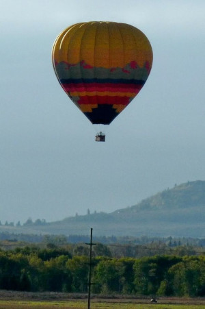

**Solution:**
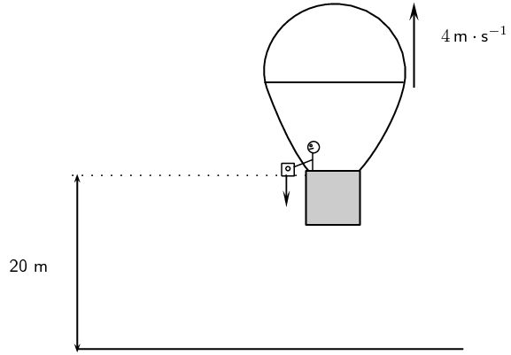

Draw a rough sketch:

We now calculate the additional height above the ground that the camera reaches:

              \begin{align*}
              \vec{v}_{f}^2 &= \vec{v}_{i}^2 + 2\vec{g}\Delta{\vec{x}} \\
              \Delta{\vec{x}} &= \frac{\text{14}^{2}}{\text{2}(\text{9,8})} \\
              &= \text{0,82}\text{ m}
              \end{align*}

So the total height above the ground is \(\text{20,82}\) \(\text{m}\).

              \begin{align*}
              \vec{v}_{f}^2 &= \vec{v}_{i}^2 + 2\vec{g}\Delta{\vec{x}} \\
              \vec{v}_{f}^2 &= \text{2}(\text{9,8})(\text{20,82}) = \text{408,072} \\
              \vec{v}_{f} &= \text{20,2}\text{ m·s$^{-1}$}
              \end{align*}
              \(\text{20,2}\) \(\text{m·s$^{-1}$}\)

**Problem:**
A ball is dropped vertically from a tower. If the vertical distance covered in the last second is
                equal to the distance covered in first three seconds, find the height of the tower.

**Solution:**
Let us consider that the ball covers the height \(y_n\) in \(n^{\text{th}}\) second. Then, the distance
                covered in the \(n^{\text{th}}\) second is given as :

              \begin{align*}
              y_n & = u + \frac{g}{2} \times (2n - 1) \\
              & = 0 + \frac{\text{9,8}}{2} \times (2n - 1) \\
              & = \text{9,8}n - 5
              \end{align*}

On the other hand, the distance covered in first 3 seconds is :

              \begin{align*}
              y_3 & = ut + \frac{1}{2}gt^{2} \\
              & = 0 + \frac{1}{2} \times \text{9,8} \times 3^{2} \\
              & = \text{44,1}\text{ m}
              \end{align*}

According to question,

              \begin{align*}
              y_n & = y_3 \\
              \text{9,8}n - 5 & = 44,1 \\
              n & = \text{5,01}\text{ s}
              \end{align*}

Therefore, the height of the tower is :

              \begin{align*}
              y & = \frac{1}{2} \times \text{9,8} \times \text{5,01}^2 \\
              & = \text{123}\text{ m}
              \end{align*}

### Graphs of vertical projectile motion (ESCJZ)

We can describe vertical projectile motion through a series of graphs: position, velocity and acceleration
        versus time graphs. This isn't new, in Grade 10 you learnt about the graphs for describing rectilinear motion
        with constant acceleration. In the previous section we motivated for using the same equations of motion as in
        rectilinear motion. Therefore, everything you learnt about the graphs describing rectilinear motion is
        applicable when describing vertical projectile motion.

<Callout type="note" title="Note">
Now would be a good time to revise the section on graphs in rectilinear motion from Grade 10.

Remember that:
          \[\vec{a}=\frac{\Delta \vec{v}}{\Delta t}\]

          \[\vec{v}=\frac{\Delta \vec{x}}{\Delta t}\]
          For the graphs of these quantities the slope and the area under a graph can tell us about changes in other
          quantities. As a reminder, here is a summary table, from Grade 10 rectilinear motion, about which information
          we can derive from the slope and the area of various graphs:

| Graph | Slope | Area |
| --- | --- | --- |
| Displacement vs time | \(\vec{v}\) | - |
| Velocity vs time | \(\vec{a}\) | \(\Delta \vec{x}\) |
| Acceleration vs time | - | \(\vec{v}\) |

| Stationary object |  |  |  |
| --- | --- | --- | --- |
| Uniform motion |  |  |  |
| Constant acceleration |  |  |  |

Figure 3.3: Position vs time, velocity vs time and acceleration vs time graphs.
</Callout>

The graphs are the graphical representations of the equations of motion. This means that if you have the graph
        for one of position, velocity or acceleration you should be able to write down the corresponding equation and
        vice versa.

The type of graphs is related to the equation of motion: position is a parabola, velocity is a straight line
        and acceleration is a constant. The characteristic features then depend on the sign convention and the specific
        values of the problem.

To illustrate the variation, we consider three separate cases: (1) the object has an initial velocity in the
        upward direction (opposite direction to \(\vec{g}\)), (2) the object falls from rest (no initial velocity), and
        (3) the object has an initial velocity in the downward direction (same direction as \(\vec{g}\)).

**Important:** the horizontal axis in these graphs is time, not space.

#### Case 1: Initial velocity upwards

Consider an object undergoing the following motion:

2. at time \(t=\text{0}\text{ s}\) the object has an initial position, \(\vec{x}_i=0\), and an
               initial upward velocity of magnitude \(v_i\),
4. the object reaches a maximum height, \(h_m\), above the ground,
6. the object then falls down to a final position, \(\vec{x}_f\), with a final velocity \(v_f\) downward at
               time = \(t_f\).

The equation for position is given by:
          \(\vec{x} = \vec{x}_i + \vec{v}_{i}t+\frac{1}{2}\vec{g}{t}^{2}\). We
          have to choose a positive direction as before. We choose upwards as positive.
          The position versus time graph for the motion described is shown below:

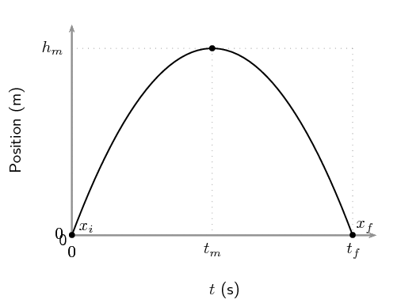

<Callout type="note" title="Note">
It is important to notice that we are plotting position versus time and the initial position,
            \(\vec{x}_{i}\), is not necessarily zero. The position as a function of time
            will be given by \(\vec{x}_f = \vec{x}_{i} + \vec{v}_{i}t+\frac{1}{2}\vec{g}{t}^{2}\).
            The initial position, \(\vec{x}_{i}\), will shift the graph of \(\vec{x}\)
            up or down by a constant value. Whether it is an upward or downward shift will depend on which direction
            was chosen as the positive direction. The magnitude of the shift will depend on the choice of origin for the
            coordinate system (frame of reference).
</Callout>

The second graph is a linear function showing the velocity as a function of time:
          \(\vec{v}_{f} = \vec{v}_{i}+\vec{g}t\). Note that we chose upwards as our positive direction therefore the
          acceleration due to gravity will be negative. The slope (i.e.
          the coefficient of \(t\)) of the
          velocity versus time graph is the acceleration and the slope is negative which is
          consistent with our expectations after choosing upwards as the positive direction.

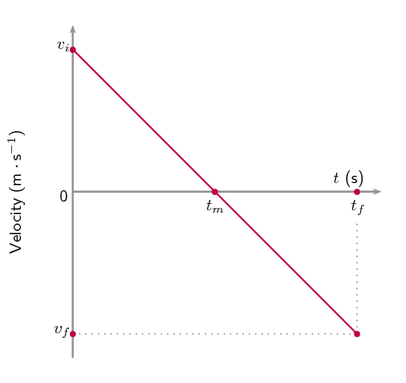

The final plot is a graph of acceleration versus time, and is constant because the magnitude and direction of
          the acceleration due to gravity are constant.

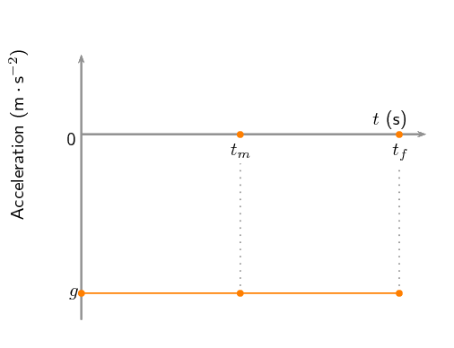

#### Cases 2 and 3: Initial velocity zero or downwards

We start by choosing a direction as the positive direction. We want to compare the graphs with the first
          case, so
          we will choose the same direction (upwards) to be the positive direction.

The one thing that remains the same is the acceleration,
          \(\vec{g}\), due to gravity. Therefore:

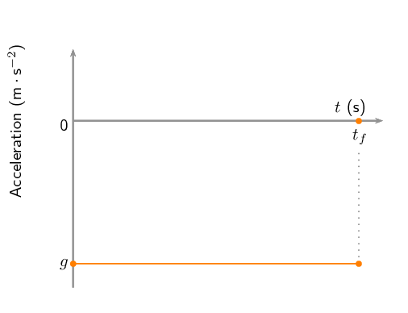

If an object starts from rest (for example is dropped), then the initial velocity is zero. We know that there
          is constant acceleration and hence the graph of velocity
          versus time looks like this:

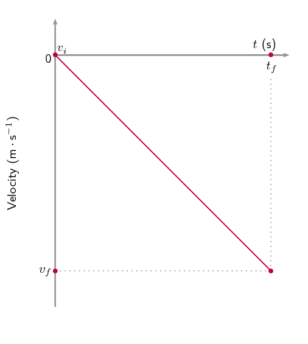

If the object starts with an initial velocity downwards the velocity
          graph looks like:

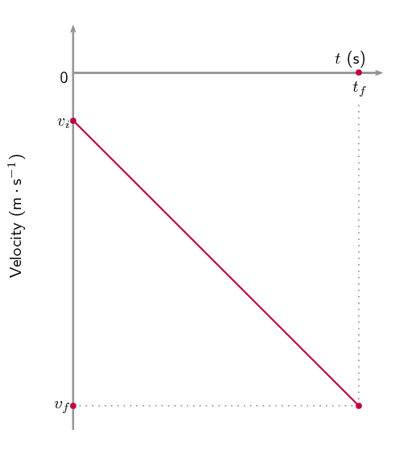

<Callout type="note" title="Note">
It is important to notice that the slope of all the velocity versus time graphs has the same magnitude. If
            the same direction is chosen as positive then the slope
            has the same magnitude AND the same sign (direction). The difference in these graphs is related to the
            initial velocity, \(\vec{v}_{i}\). The magnitude of the slope of the graph is the magnitude of the
            acceleration.
</Callout>

For the case where the object falls from rest, the equation for position is \(\vec{x} = \vec{x}_i
          +\underbrace{\vec{v}_{i}t}_{\text{0}}+\frac{1}{2}\vec{g}{t}^{2}\) and the graph of the position versus time
          looks like this:

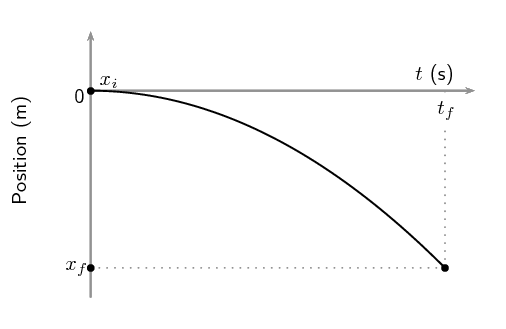

For motion with an initial velocity in the negative direction, the graph of displacement versus
          time will be a narrower parabola as compared to the case where the object falls from rest. This is shown in
          this graph
          where the initial velocity is in the negative direction:

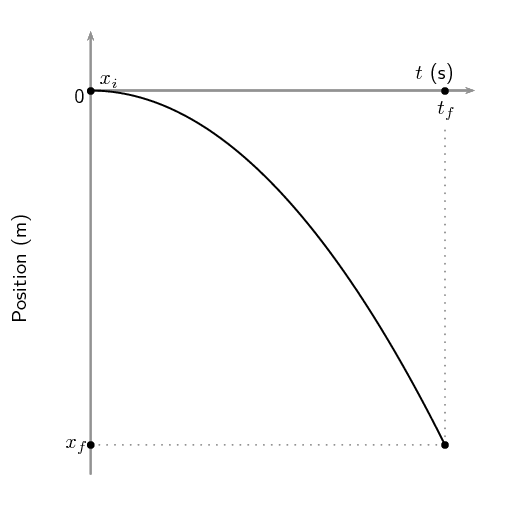

The primary difference in features between the cases we've looked at is that for Case 1,
        the position graph has a maximum positive displacement (it has a peak), while in Cases
        2 and 3, where the initial velocity is negative, the displacement is always negative.

You may be wondering if the final position is always the same as the initial position, as we had for our
        Case 1 example. That is not necessarily true. If an object is thrown up from the edge of a cliff,
        the initial position of the object will be the height of the cliff but the final position will
        be at the base of the cliff. If we choose the point from which the object is thrown as the origin
        of our coordinate system then the graph will look like this:

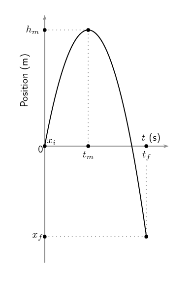

If we choose to centre our coordinate system at the base of the cliff then the graph will look like this,
        because the initial displacement is the height of the cliff:

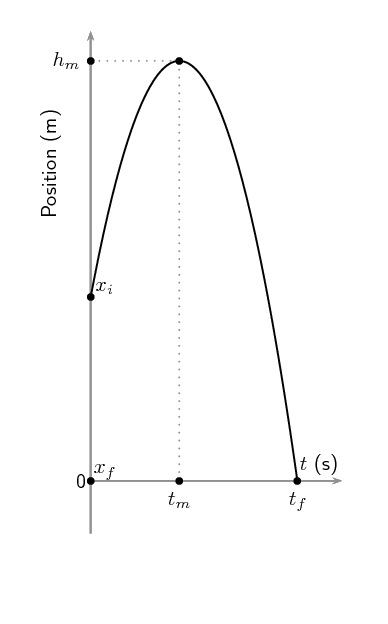

<Callout type="tip" title="Worked example 4: Drawing graphs of projectile motion">
**Question:**
Stanley is standing on a balcony
            \(\text{20}\) \(\text{m}\) above the ground. Stanley tosses a rubber ball upwards with an initial velocity
            of
            \(\text{4,9}\) \(\text{m·s
            $^{-1}$}\). The ball travels upwards to a maximum height, and then falls to the ground. Draw graphs of
            position vs time,
            velocity vs time and acceleration vs time. Choose upwards as the positive direction.

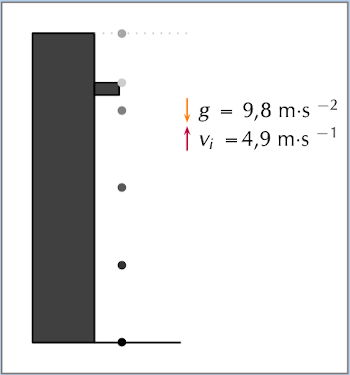

**Determine what is required:**
We are required to draw graphs of:

2. \(\vec{x}\) vs \(t\)
4. \(\vec{v}\) vs
                   \(t\)
6. \(\vec{a}\) vs
                   \(t\)

**Determine how to approach the problem:**
There are two parts to the motion of the ball:

2. ball travelling upwards from the building
4. ball falling to the ground

We examine each of these parts separately. To be able to draw the graphs, we need to determine
            the time taken and displacement for each of the motions.

**Find the height and the time taken for the first motion:**
For the first part of the motion we have:

- \(\vec{v}_{i}=
                  \text{+4,9}\text{ m·s
                  $^{-1}$}\)
- \(\vec{v}_{f}=
                  \text{0}\text{ m·s
                  $^{-1}$}\)
- \(\vec{g}=
                  -\text{9,8}\text{ m·s
                  $^{-2}$}\)

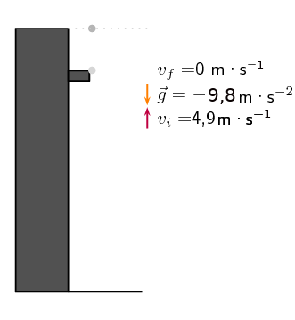

Therefore we can use
            \(\vec{v}_{f}^{2}=\vec{v}_{i}^{2}+2\vec{g}\Delta \vec{x}\) to solve for the height and
            \(\vec{v}_{f}=\vec{v}_{i}+\vec{g}t\) to solve for the time.

          \begin{align*}
          \vec{v}_{f}^{2}& = \vec{v}_{i}^{2}+2\vec{g}\Delta \vec{x} \\
          {\left(0\right)}^{2}& = {\left( \text{4,9}\right)}^{2}+2\times \left(-\text{9,8}\right)\times \Delta
          \vec{x} \\
          \text{19,6}\Delta x& = {\left(\text{4,9}\right)}^{2} \\
          \Delta \vec{x}& = + \text{1,225}\text{ m} \\
          h & = \Delta x = \text{1,225}\text{ m}
          \end{align*}\begin{align*} \vec{v}_{f}& = \vec{v}_{i}+\vec{g}t \\
          0& =
          \text{4,9}+\left(
          -\text{9,8}\right)\times t \\
          \text{9,8}t& =
          \text{4,9}\\
          t& =
          \text{0,5}\text{ s} \end{align*}

**Find the height and the time taken for the second motion:**
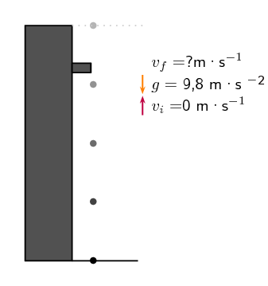

For the second part of the motion we have:

- \(\vec{v}_{i}=\text{0}\text{ m·s$^{-1}$}\)
- \(\Delta \vec{x}=-\left(\text{20}+\text{1,225}\right) \text{m}\)
- \(\vec{g}=
                  -\text{9,8}\text{ m·s
                  $^{-2}$}\)

Therefore we can use
            \(\Delta \vec{x}=\vec{v}_{i}t+\frac{1}{2}\vec{g}{t}^{2}\) to solve for the time.

          \begin{align*} \Delta \vec{x}& = \vec{v}_{i}t+\frac{1}{2}\vec{g}{t}^{2} \\
          -\left(\text{20}+\text{1,225}\right)& = \left(0\right)\times t+\frac{1}{2}\times \left(
          -\text{9,8}\right)\times {t}^{2} \\
          -\text{21,225}& = 0
          -\text{4,9}{t}^{2} \\
          {t}^{2}& = \text{4,33163}... \\
          t& =
          \text{2,08125}\text{ s} \end{align*}

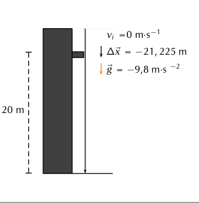

**Graph of position vs time:**
The ball starts from a position of
            \(\text{20}\) \(\text{m}\) (at t =
            \(\text{0}\) \(\text{s}\)) from the ground and moves upwards until it reaches
            \(\text{20}\)+\(\text{1,225}\) \(\text{m}\) (at \(t=\text{0,5}\text{ s}\)). It then falls back to
            \(\text{20}\) \(\text{m}\) (at
            \(t=\text{0,5}+\text{0,5}=
            \text{1,0}\text{s}\)) and then falls to the ground,
            \(\Delta \vec{x}=\text{0}\text{ m}\) (at \(t=\text{0,5}+\text{2,08}=\text{2,58}~\text{s}\)).

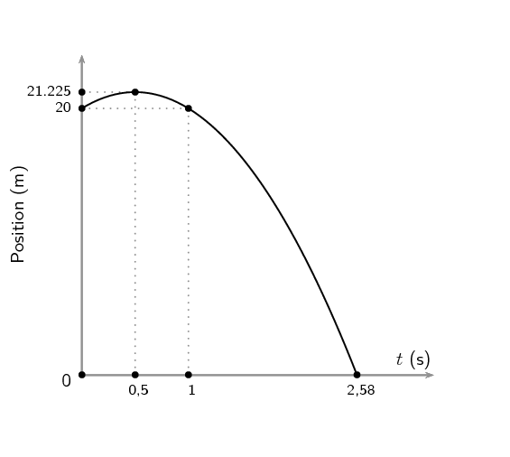

**Graph of velocity vs time:**
The ball starts off with a velocity of
            \(\text{+4,9}\) \(\text{m·s
            $^{-1}$}\) at t =
            \(\text{0}\) \(\text{s}\), it then reaches a velocity of
            \(\text{0}\) \(\text{m·s
            $^{-1}$}\) at t =
            \(\text{0,5}\) \(\text{s}\). It stops and falls back to the Earth. At t =
            \(\text{1,0}\) \(\text{s}\) (i.e. after a further
            \(\text{0,5}\) \(\text{s}\)) it has a velocity of
            \(-\text{4,9}\) \(\text{m·s
            $^{-1}$}\). This is the same as the initial upwards velocity but it is downwards. It carries on at
            constant acceleration until \(t=\text{2,58}\text{ s}\).
            In other words, the velocity graph will be a straight line. The final velocity of the
            ball can be calculated as follows:

          \begin{align*} \vec{v}_{f}& = \vec{v}_{i}+\vec{g}t \\
          & = 0+\left(
          -\text{9,8}\right)\left(
          \text{2,08}...\right) \\
          & =
          -\text{20,396}... \text{m}·{\text{s}}^{-1} \end{align*}

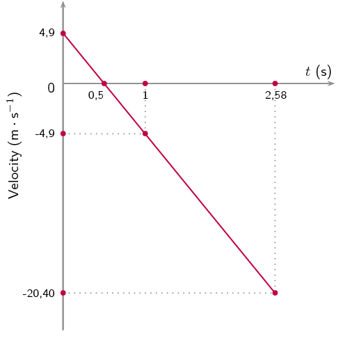

**Graph of \(a\) vs \(t\):**
We chose upwards to be positive. The acceleration of the ball is downward,
            \(\vec{g}=
            \text{9,8}\text{ m·s
            $^{-2}$}\) downwards. Because the acceleration is constant throughout the motion, the graph looks
            like this:

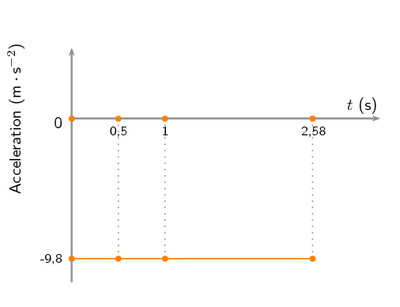
</Callout>

<Callout type="tip" title="Worked example 5: Analysing graphs of projectile motion">
**Question:**
The graph below (not drawn to scale) shows the motion of a tennis ball that was thrown vertically
            upwards from an open window some distance from the ground. It takes the ball
            \(\text{0,2}\) \(\text{s}\)to reach its highest point before falling back to the ground. Study the graph
            given and
            calculate:

2. how high the window is above the ground.
4. the time it takes the ball to reach the maximum height.
6. the initial velocity of the ball.
8. the maximum height that the ball reaches.
10. the final velocity of the ball when it reaches the ground.

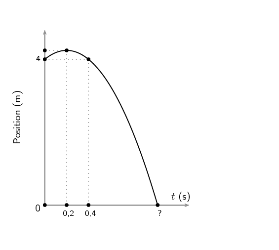

**Find the height of the window:**
The initial position of the ball will tell us how high the window is. From the y-axis on the
            graph we can see that the ball is
            \(\text{4}\) \(\text{m}\) from the ground.

The window is therefore
            \(\text{4}\) \(\text{m}\) above the ground.

**Find the time taken to reach the maximum height:**
The maximum height is where the position vs time graph reaches its maximum position.
            This is when t =
            \(\text{0,2}\) \(\text{s}\).

It takes the ball
            \(\text{0,2}\) \(\text{s}\) to reach the maximum height.

**Find the initial velocity (
            \(\vec{v}_{i}\)) of the ball:**
To find the initial velocity we only look at the first part of the motion of the ball. That is
            from when the ball is released until it reaches its maximum height. We have the following for this: In
            this case, let's choose upwards as positive.

          \begin{align*} t& =
          \text{0,2} \text{s} \\
          \vec{g}& =
          \text{9,8}\text{ m·s
          $^{-2}$}\\
          \vec{v}_{f}& = 0 \text{m}·{\text{s}}^{-1} \text{(because the ball stops)}
          \end{align*}

To calculate the initial velocity of the ball (
            \(\vec{v}_{i}\)), we use:

          \begin{align*} \vec{v}_{f}& = \vec{v}_{i}+\vec{g}t \\
          0& = \vec{v}_{i}+\left(
          -\text{9,8}\right)\left(
          \text{0,2}\right) \\
          {v}_{i}& =
          \text{1,96} \text{m}·{\text{s}}^{-1} \end{align*}

The initial velocity of the ball is
            \(\text{1,96}\) \(\text{m·s
            $^{-1}$}\)upwards.

**Find the maximum height of the ball:**
To find the maximum height we look at the initial motion of the ball. We have the
            following:

          \begin{align*} t& =
          \text{0,2} \text{s} \\
          \vec{g}& =
          \text{9,8}\text{ m·s
          $^{-2}$}\\
          \vec{v}_{f}& = \text{0} \text{m}·{\text{s}}^{-1}~\text{(because the ball stops)} \\
          \vec{v}_{i}& =
          \text{+1,96} \text{m}·{\text{s}}^{-1}\text{(calculated above)} \end{align*}

To calculate the displacement from the window to the maximum height (\(\Delta x\)) we use:

          \begin{align*} \Delta \vec{x}& = \vec{v}_{i}t+\frac{1}{2}\vec{g}{t}^{2} \\
          \Delta \vec{x}& =
          \left(
          \text{1,96}\right)\left(
          \text{0,2}\right)+\frac{1}{2}\left(
          -\text{9,8}\right){\left(
          \text{0,2}\right)}^{2} \\
          \Delta \vec{x}& =
          \text{0,196} \text{m} \end{align*}

The maximum height of the ball is
            \(\left(\text{4}+\text{0,196}\right)=
            \text{4,196} \text{m}\) above the ground.

**Find the final velocity (
            \(\vec{v}_{f}\)) of the ball:**
To find the final velocity of the ball we look at the second part of the motion. For this we
            have:

          \begin{align*} \Delta \vec{x}& =
          -\text{4,196} \text{m}~\text{(because upwards is positive)} \\
          \vec{g}& =
          -\text{9,8}\text{ m·s
          $^{-2}$}\\
          \vec{v}_{i}& = \text{0} \text{m}·{\text{s}}^{-1} \end{align*}

We can use
            \(\vec{v}^2_{f}=\vec{v}^2_{i}+2\vec{g}\Delta\vec{x}\) to calculate the final
            velocity of the ball.

          \begin{align*}
          \vec{v}^2_{f}=\vec{v}^2_{i}+2\vec{g}\Delta\vec{x} \\
          \vec{v}^2_{f}& = {\left(0\right)}^{2}+2\left(
          -\text{9,8}\right)\left(
          -\text{4,196}\right) \\
          \vec{v}^2_{f}& =
          \text{82,2416}\\
          \vec{v}_{f}& =
          \text{9,0687}\text{ m·s$^{-1}$}~\text{downwards} \end{align*}

The final velocity of the ball is
            \(\text{9,07}\) \(\text{m·s
            $^{-1}$}\)
            *downwards*.
</Callout>

<Callout type="tip" title="Worked example 6: Describing projectile motion">
**Question:**
A cricketer hits a cricket ball from the ground and the following graph of velocity vs time was
            drawn. Upwards was taken as positive. Study the graph and follow the instructions below:

2. Describe the motion of the ball according to the graph.
4. Draw a sketch graph of the corresponding position-time graph. Label the axes.
6. Draw a sketch graph of the corresponding acceleration-time graph. Label the axes.

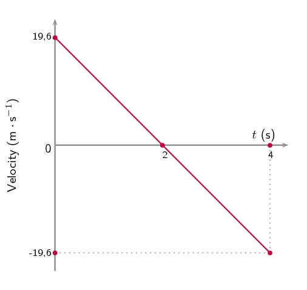

**Describe the motion of the ball:**
We need to study the velocity-time graph to answer this question. We will break the motion of the
            ball up into two time zones: \(t=\text{0}\text{ s}\) to \(t=\text{2}\text{ s}\) and \(t=\text{2}\text{ s}\)
            to \(t=\text{4}\text{ s}\).

From \(t=\text{0}\text{ s}\) to \(t=\text{2}\text{ s}\) the following happens:

The ball starts to move at an initial velocity of
            \(\text{19,6}\) \(\text{m·s
            $^{-1}$}\) and decreases its velocity to
            \(\text{0}\) \(\text{m·s
            $^{-1}$}\) at \(t=\text{2}\text{ s}\). At \(t=\text{2}\text{ s}\) the velocity of the ball is
            \(\text{0}\) \(\text{m·s
            $^{-1}$}\) and therefore it stops.

From \(t=\text{2}\text{ s}\) to \(t=\text{4}\text{ s}\) the following happens:

The ball moves from a velocity of
            \(\text{0}\) \(\text{m·s
            $^{-1}$}\) to
            \(\text{19,6}\) \(\text{m·s
            $^{-1}$}\) in the opposite direction to the original motion.

If we assume that the ball is hit straight up in the air (and we take upwards as positive), it
            reaches its maximum height at \(t=
            \text{2}\text{ s}\), stops, and falls back to the Earth to reach the ground
            at \(t=
            \text{4}\text{ s}\).

**Draw the position-time graph:**
To draw this graph, we need to determine the displacements at \(t =
            \text{2}\text{ s}\) and \(t =
            \text{4}\text{ s}\).

At \(t =
            \text{2}\text{ s}\):

The displacement is equal to the area under the graph:

Area under graph = Area of triangle

\(\text{Area}=\frac{1}{2}bh\)

\(\text{Area}=\frac{1}{2}\times 2\times
            \text{19,6}\)

Position =
            \(\text{19,6}\) \(\text{m}\)

At \(t =
            \text{4}\text{ s}\):

The displacement is equal to the area under the whole graph (top and bottom). Remember that an
            area under the time line must be subtracted:

Area under graph = Area of triangle 1 + Area of triangle 2

\(\text{Area}=\frac{1}{2}bh+\frac{1}{2}bh\)

\(\text{Area}=\left(\frac{1}{2}\times 2\times
            \text{19,6}\right)+\left(\frac{1}{2}\times 2\times \left(
            -\text{19,6}\right)\right)\)

\(\text{Area}=19,6-19,6\)

Displacement =
            \(\text{0}\) \(\text{m}\)

The position vs time graph for motion at constant acceleration is a curve. The graph will look
            like this:

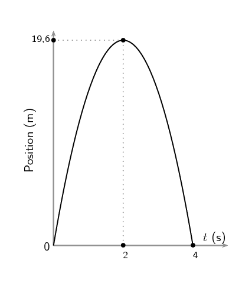

**Draw the acceleration versus time graph:**
To draw the acceleration vs time graph, we need to know what the acceleration is. The
            velocity versus time graph is a straight line which means that the acceleration is constant. The gradient of
            the line will give the acceleration.

The line has a negative slope (goes down towards the left) which means that the acceleration has
            a negative value.

Calculate the gradient of the line:

          \begin{align*}
          \text{gradient}=\frac{\Delta \vec{v}}{\Delta t} \\
          \text{gradient}=\frac{0
          -\text{19,6}}{2-0} \\
          \text{gradient}=\frac{
          -\text{19,6}}{2} \\
          \text{gradient}=
          -\text{9,8}
          \end{align*}

Therefore the acceleration =
            \(\text{9,8}\) \(\text{m·s
            $^{-2}$}\) downwards.

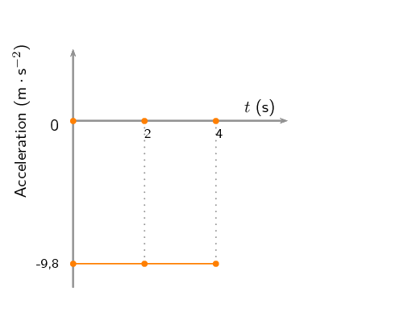
</Callout>

<Callout type="tip" title="Worked example 7: Interpreting velocity graphs">
**Question:**
Describe the motion corresponding to the following graph and plot the position vs time and acceleration vs
            time assuming the initial position is \(\text{0}\):

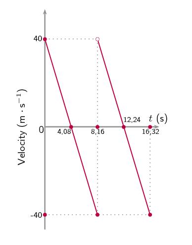

**Determine what is required:**
The velocity vs time graph corresponding to the motion of an object is given, using the graph we need to
            describe the actual motion. Notice that the graph has discontinuities,
            this naturally breaks the graph into phases. We should process each phase separately and then try to infer
            (figure out) what probably happened to change
            from one phase to the next.

The first thing that you normally do in a vertical projectile motion problem is choose
            a positive direction. In this case you can't do that because it has already been decided.
            We need to use the information given to figure out which direction was chosen as positive.

**Determine the direction chosen as positive:**
We are given a velocity vs time graph. We know that the slope of the velocity time
            graph is the acceleration and we know that in these problems we are only dealing with
            gravitational acceleration. We can use what we know about gravitational acceleration
            and the slope of the graph to determine which direction was chosen as positive.

Gravitational acceleration is always directed towards the centre of the Earth. If we
            choose:

- **upwards as the positive** direction then the slope of the velocity vs time graph
                will be negative
- **downwards as the positive** direction then the slope of the velocity vs time graph
                will be positive

In this problem the slope of the velocity vs time graph is negative and so we know
            that upwards was chosen as the positive direction.

**First phase:**
In the plot below we highlight only the first phase of interest.

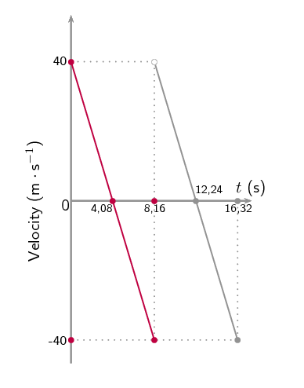

The initial velocity is positive and then decreases linearly, passes through zero and reaches the same
            magnitude in the negative direction. The positive starting value means
            the object was going upwards, the linear decreases means a constant acceleration in the negative direction,
            passing through zero means that the object reaches a maximum
            height before beginning to fall in the negative direction. The fact that the magnitude of the initial and
            final velocities is the same means that there is time symmetry.

This is just the plot of an object being thrown/shot/projected upwards, peaking and falling back to the
            same level as it was thrown from.

**Second phase:**
In the plot below we highlight only the second phase.

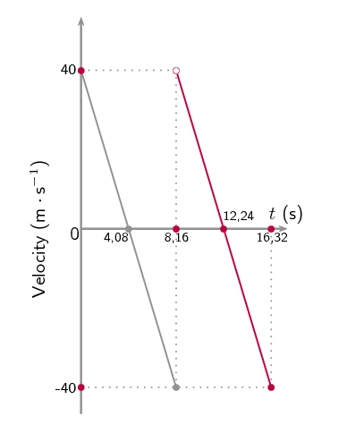

Just as in the first phase, the initial velocity is positive and then decreases linearly, passes through
            zero and reaches the same magnitude in the negative direction. The positive starting value means
            the object was going upwards, the linear decreases means a constant acceleration in the negative direction,
            passing through zero means that the object reaches a maximum
            height before beginning to fall in the negative direction. The fact that the magnitude of the initial and
            final velocities is the same means that there is time symmetry.

This is just the plot of an object being thrown upwards, peaking and falling back to the same level as it
            was thrown from.

**Combining phases:**
We know that the two phases look the same, the object starts off moving upwards, peaks, falls down to the
            initial position and then repeats the process.
            This could be a description of a ball bouncing as an example.

**Position vs time:**
To draw an accurate position graph we know that we are dealing with the Case 1 situation from earlier. We
            need to determine the height that the object rises to and then
            we can plot the position vs time. We know the timing information from the velocity vs time plot.

We can verify that the acceleration is in fact from gravity by using \(\vec{v}_f=\vec{v}_i+\vec{g}t\):

          \begin{align*}
          \vec{v}_f & =\vec{v}_i+\vec{g}t \\
          (-\text{40}) & = (\text{40}) +\vec{g}(\text{8,16}) \\
          (-\text{80}) & = \vec{g}(\text{8,16}) \\
          \vec{g} & = \frac{-\text{80}}{\text{8,16}} \\
          \vec{g} & = -\text{9,8}\text{ m·s $^{-2}$}
          \end{align*}

We can work out the height using the equation for displacement:

          \begin{align*}
          \vec{v}_f^2 & =\vec{v}_i^2+2\vec{g}\Delta \vec{x} \\
          0 & =(\text{40})^2+2(-\text{9,8})\Delta \vec{x} \\
          \Delta \vec{x} & =\frac{-(\text{40})^2}{(-\text{19,6})} \\
          \Delta \vec{x} & = \text{81,63}\text{ m}
          \end{align*}

So we can now draw the displacement vs time plot:

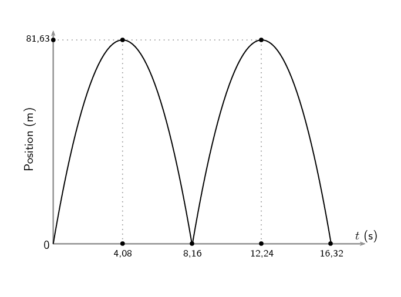

**Acceleration vs time:**
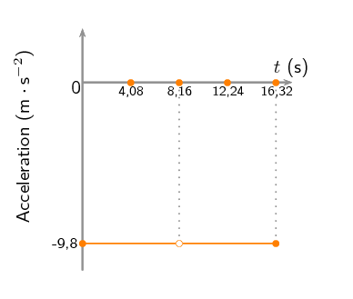

The acceleration is due to gravity except at one point, when the object bounces. At that point the
            acceleration must be some other, very large,
            value in the positive direction but we don't have enough information to determine what the value must be. We
            explicitly note that at that point the
            acceleration is NOT -\(\text{9,8}\) \(\text{m·s $^{-2}$}\).
</Callout>

<Callout type="tip" title="Worked example 8: Hot air balloon [NSC 2011 Paper 1]">
**Question:**
A hot-air balloon is moving vertically upwards at a constant speed. A camera is accidentally dropped from
            the balloon at a height of \(\text{92,4}\) \(\text{m}\) as shown in the diagram below. The camera strikes
            the ground after \(\text{6}\) \(\text{s}\). Ignore the effects of friction.

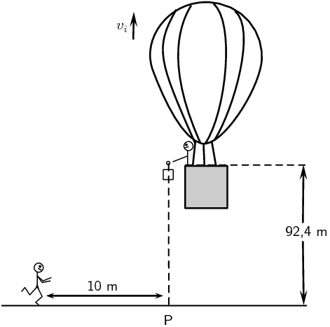

2. At the instant the camera is dropped, it moves upwards. Give a reason for this observation.
   (1 mark)
4. Calculate the speed \(v_i\) at which the balloon is rising when the camera is dropped.
   (4 marks)
6. Draw a sketch graph of velocity versus time for the entire motion of the camera.
   Indicate the following on the graph:
   - Initial velocity
   - Time at which it reaches the ground
   (4 marks)
8. If a jogger, \(\text{10}\) \(\text{m}\) away from point **P** as shown in the above
                   diagram and running at a constant speed of \(\text{2}\) \(\text{m·s$^{-1}$}\), sees the camera at
                   the same instant it starts falling from the balloon, will he be able to catch the camera before it
                   strikes the ground?
   Use a calculation to show how you arrived at the answer.
   (5 marks)

**[TOTAL: 14 marks]**

**Question 1**

The initial velocity / speed of the camera is the same (as that of the balloon).

(1 marks)

**Question 2**

**Taking downwards as the positive direction:**

        \begin{align*}
        \Delta y &= v_i \Delta t + \frac{1}{2} a \Delta t^2 \\
        \therefore \text{92,4} &= v_i (\text{6}) + \frac{1}{2} (\text{9,8}) (\text{6})^2 \\
        \therefore v_i &= -\text{14 m}\cdot\text{s}^{-1} \\
        \therefore v_i &= \text{14 m}\cdot\text{s}^{-1}
        \end{align*}

**Taking downwards as the negative direction:**

        \begin{align*}
        \Delta y &= v_i \Delta t + \frac{1}{2} a \Delta t^2 \\
        \therefore -\text{92,4} &= v_i (\text{6}) + \frac{1}{2} (-\text{9,8}) (\text{6})^2 \\
        \therefore v_i &= \text{14 m}\cdot\text{s}^{-1}
        \end{align*}

(4 marks)

**Question 3**

**Taking downwards as the positive direction:**

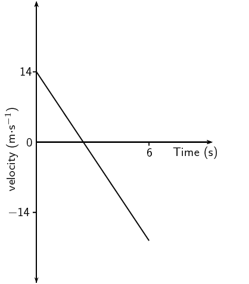

**Criteria for graph:**

- Correct shape as shown. (Straight line with gradient.)
- Graph starts at \(v = \text{14 m}\cdot\text{s}^{-1}\ /\ v_i\) at \(t = \text{0 s}.\)
- Graph extends below \(t\) axis until \(t = \text{6 s}.\)
- Section of graph below \(t\) axis is longer than section above \(t\) axis.

**Taking downwards as the negative direction:**

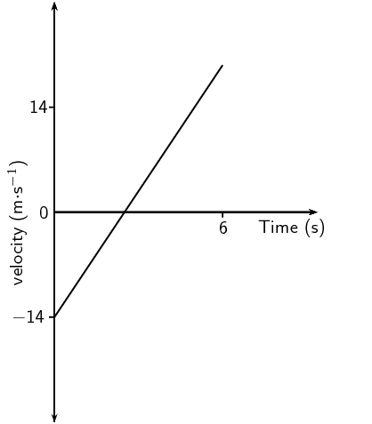

**Criteria for graph:**

- Correct shape as shown. (Straight line with gradient.)
- Graph starts at \(v = -\text{14 m}\cdot\text{s}^{-1}\ /\ v_i\) at \(t = \text{0 s}.\)
- Graph extends above \(t\) axis until \(t = \text{6 s}.\)
- Section of graph above \(t\) axis is longer than section below \(t\) axis.

(4 marks)

**Question 4**

**Option 1:**

        \begin{align*}
        \Delta x &= v \Delta t \\
        \therefore \text{10} &= (\text{2}) \Delta t \\
        \therefore \Delta t &= \text{5 s}
        \end{align*}

Yes, he will catch the camera since the time is less than \(\text{6}\) \(\text{s}\).

**Option 2:**

        \begin{align*}
        \Delta x & = v \Delta t \\
        \therefore & = (\text{2})(\text{6}) \\
        \therefore & = \text{12 m}
        \end{align*}

Yes, he will catch the camera since the distance covered is greater than \(\text{10}\) \(\text{m}\).

**Option 3:**

        \begin{align*}
        \Delta x & = v_i \Delta t + \frac{1}{2} a \Delta t^2 \\
        \therefore \text{10} & = (\text{2})\Delta t + \frac{1}{2}(\text{0})\Delta t^2 \\
        \therefore \Delta t & = \text{5 t}
        \end{align*}

Yes, he will catch the camera since the time is less than \(\text{6}\) \(\text{s}\).

**Option 4:**

        \begin{align*}
        \Delta x & = \left( \frac{v_i+v_f}{2} \right ) \Delta t \\
        \therefore \text{10} & = \left( \frac{\text{2}+\text{2}}{2} \right ) \Delta t \\
        \therefore \Delta t & = \text{5 t}
        \end{align*}

Yes, he will catch the camera since the time is less than \(\text{6}\) \(\text{s}\).

**Option 5:**

        \begin{align*}
        \Delta x & = \left( \frac{v_i+v_f}{2} \right ) \Delta t \\
        & = \left( \frac{\text{2}+\text{2}}{2} \right )(\text{6}) \\
        \therefore \Delta x & = \text{12 m}
        \end{align*}

Yes, he will catch the camera since the distance covered is greater than \(\text{10}\) \(\text{m}\).

(5 marks)

**[TOTAL: 14 marks]**
</Callout>

## Graphs of vertical projectile motion

### Textbook Exercise 3.2

**Problem:**
Amanda throws a tennis ball from a height of
                \(\text{1,5}\) \(\text{m}\) straight up into the air and then lets it fall to the ground. Draw graphs of
                \(x\) vs \(t\); \(v\) vs \(t\) and \(a\) vs \(t\) for the motion of the ball. The initial velocity of
                the
                tennis ball is
                \(2 \text{m}·{\text{s}}^{-1}\). Choose upwards as positive.

**Solution:**
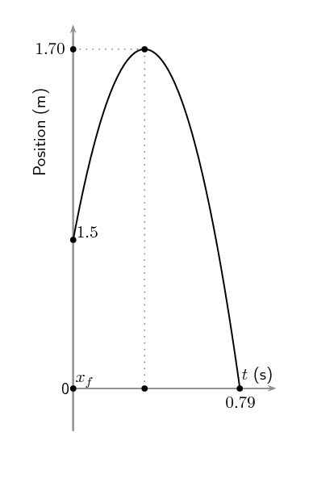

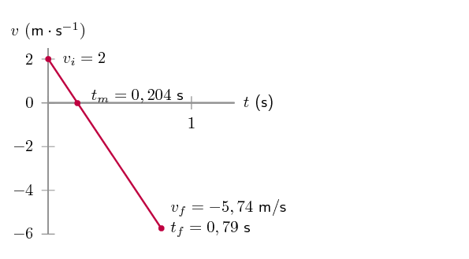

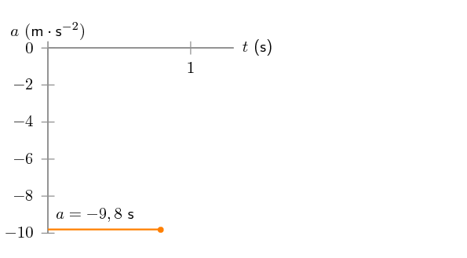

**Problem:**
A bullet is shot straight upwards from a gun. The following graph is drawn. Downwards was chosen
                as positive

2. Describe the motion of the bullet.
4. Draw a displacement - time graph.
6. Draw an acceleration - time graph.

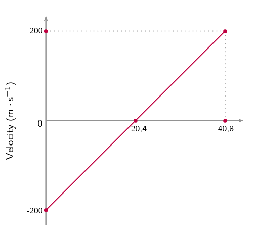

**Solution:**
2. The bullet moves at a decreasing velocity upwards for \(\text{20,4}\) \(\text{s}\). It then stops
                       and drops back down for another \(\text{20,4}\) \(\text{s}\) until it reaches a speed of
                       \(\text{200}\) \(\text{m·s$^{-1}$}\) which is the same speed with which it started.
4. 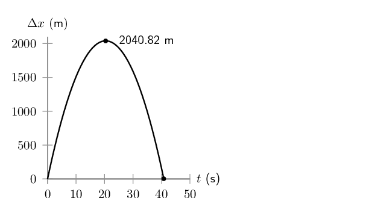
6. 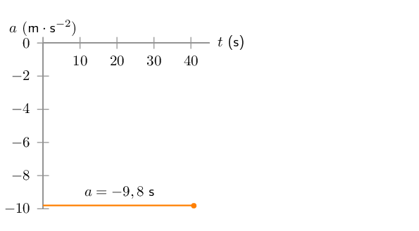

**Problem:**
Describe the motion resulting from the velocity vs time graph shown below, assuming an initial height
                of \(\text{0}\) \(\text{m}\), and draw a displacement vs time graph and an
                acceleration vs time graph:

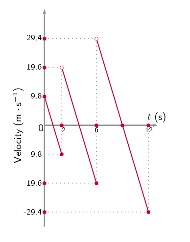

**Solution:**
The object starts with an initial height of \(\text{0}\) \(\text{m}\), moves upwards for \(\text{1}\)
                \(\text{s}\), then slows and falls back to its starting position where it bounces upwards at a higher
                velocity, and travels upwards (higher than before) for \(\text{2}\) \(\text{s}\), then stops and falls
                back to its starting position where it bounces upwards again at an even higher velocity, travelling over
                \(\text{3}\) \(\text{s}\) to an even higher position, before finally falling back to the ground and
                stopping.

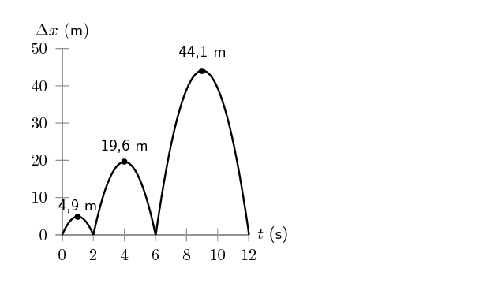

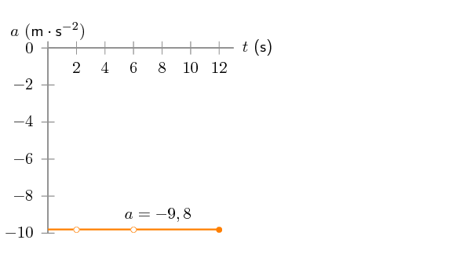

**Problem:**
What is the initial height? Draw a velocity vs time graph and an acceleration vs time graph that would
                result in this displacement vs time graph:

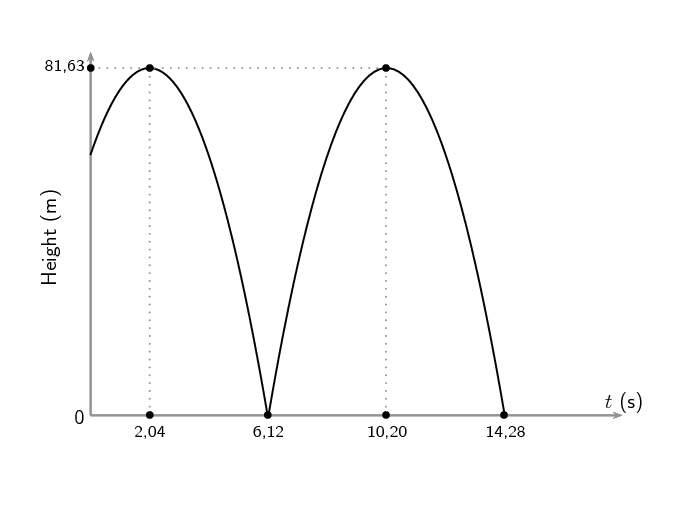

**Solution:**
Calculate starting height, we can use time symmetry. The initial height is at time zero and
                the max is at time \(\text{2,04}\) s. The ball will fall back to the same height as the initial height
                in
                \(\text{2,04}\) s, therefore:

              \begin{align*}
              s &= \frac{1}{2}\vec{g}t^2 \\
              &= \frac{1}{2}(\text{9,8})(\text{2,04})^2 \\
              &= \text{20,39} \text{ downwards}
              \end{align*}

Therefore initial height is 81.63-20,39 = 61,24 m.

**Problem:**
A ball that always bounces off the floor with the same magnitude of the velocity as it hit the floor is
                dropped from \(\text{3}\) \(\text{m}\)
                above a stack of 4 crates. Each crate is \(\text{30}\) \(\text{cm}\) high. After the ball bounces off a
                crate it is quickly removed so that
                the next time the ball bounces it bounces off the next crate in the pile. This is repeated until all the
                crates have been removed. Draw the following graphs for the situation:

- Displacement vs time
- Velocity vs time
- Acceleration vs time

**Solution:**
The time in each case for the ball to fall from maximum to the crate can be calculated from the
                distance:
                \begin{align*}
                s&=ut+\frac{1}{2}gt^2 \\
                &(u=0) \\
                s&=\frac{1}{2}gt^2 \\
                \frac{2s}{g}&=t^2 \\
                t&= \sqrt{\frac{2s}{g}}
                \end{align*}
                The ball bounces perfectly which means it always bounces back to the original height. The distances for
                each bounce are then:

- \(x_1 = \text{3}\text{ m}\)
- \(x_2 = \text{3,3}\text{ m}\)
- \(x_3 =\text{3,6}\text{ m}\)
- \(x_4 =\text{3,9}\text{ m}\)

The times to drop these distances under gravitational acceleration from rest are then:

- \(x_1= \text{3}\text{ m}~ ;~ t_1=\text{0,782460}\text{ s}\)
- \(x_2 = \text{3,3}\text{ m}~ ;~ t_2=\text{0,820651}\text{ s}\)
- \(x_3 =\text{3,6}\text{ m}~ ;~ t_3=\text{0,857142}\text{ s}\)
- \(x_4 =\text{3,9}\text{ m}~ ;~ t_4=\text{0,892142}\text{ s}\)

- \(x_1= \text{3}\text{ m}~ ;~ t_1=\text{0,782460}\text{ s}\)
- \(x_2 = \text{3,3}\text{ m}~ ;~ t_2=\text{0,820651}\text{ s}\)
- \(x_3 =\text{3,6}\text{ m}~ ;~ t_3=\text{0,857142}\text{ s}\)
- \(x_4 =\text{3,9}\text{ m}~ ;~ t_4=\text{0,892142}\text{ s}\)

**Problem:**
A ball is dropped from \(\text{4}\) \(\text{m}\)
                above a cushioned mat. Each time the ball bounces the magnitude of the velocity in the upwards direction
                is half the magnitude of the velocity with which it hit the floor.
                The ball is allowed to bounce 2 times, draw the following graphs for the situation and the equation
                describing each section of the graph:

- Displacement vs time
- Velocity vs time
- Acceleration vs time

**Solution:**
The time in each case for the ball to fall from maximum to the mat can be calculated from the distance:

              \begin{align*}
              s&=ut+\frac{1}{2}gt^2 \\
              &(u=0) \\
              s&=\frac{1}{2}gt^2 \\
              \frac{2s}{g}&=t^2 \\
              t&= \sqrt{\frac{2s}{g}}
              \end{align*}

We calculate the velocity with which it hits the mat from:

              \[v^2 =u^2+2gs\]

After the bounce it has an initial velocity upwards of 1/2 the magnitude that it hit with. We
                use this reduced initial velocity to calculate the new height.

              \[v^2 =u^2+2gs\]

2. First motion:
                     \begin{align*}
                     v_{1f}^2&=2gs \\
                     v_{1f}^2&=2(\text{9,8})(4) \\
                     v_{1f}&=\sqrt{2(\text{9,8})(4)} \\
                     v_{f1}&= \text{8,854}\ldots\text{ m·s$^{-1}$}
                     \end{align*}
   Time to fall from max:
                     \begin{align*}
                     s_1&=ut+\frac{1}{2}gt_1^2 \\
                     &(u=0) \\
                     s_1&=\frac{1}{2}gt_1^2 \\
                     \frac{2s_2}{g}&=t_1^2 \\
                     t_1&= \sqrt{\frac{2s_1}{g}} \\
                     t_1&= \sqrt{\frac{2(4)}{\text{9,8}}} \\
                     &= \text{0,903}\ldots\text{ s}
                     \end{align*}
4. First bounce, height attained:
                     \begin{align*}
                     v_{max}^2&=v_{i2}^2+2gs \\
                     &(v_{max}=0) \\
                     -(\text{0,5}\times\text{8,854}\ldots)^2&=2(-\text{9,8})s \\
                     s_2&=\frac{-(\text{0,5}\times\text{8,854}\ldots)^2}{2(-\text{9,8})} \\
                     s_2&= \text{1}\text{ m}
                     \end{align*}
   Time to fall from max:
                     \begin{align*}
                     s_2&=\frac{1}{2}gt_2^2 \\
                     &(v_i=0) \\
                     s_2&=\frac{1}{2}gt_2^2 \\
                     \frac{2s_2}{g}&=t_2^2 \\
                     t_2&= \sqrt{\frac{2s_2}{g}} \\
                     t_2&= \sqrt{\frac{2(1)}{\text{9,8}}} \\
                     &= \text{0,451}\ldots\text{ s}
                     \end{align*}
6. Second bounce, height attained:
                     \begin{align*}
                     v_{max}^2&=v_{i3}^2+2gs \\
                     &(v_{max}=0) \\
                     -(\text{0,5}\times\text{0,5}\times\text{8,854}\ldots)^2&=2(-\text{9,8})s_3 \\
                     s_3&=\frac{-(\text{0,5}\times\text{0,5}\times\text{8,854}\ldots)^2}{2(-\text{9,8})} \\
                     s_3&=\text{0,25}\text{ m}
                     \end{align*}
   Time to fall from max:
                     \begin{align*}
                     s_3&=\frac{1}{2}gt_3^2 \\
                     &(u=0) \\
                     s_3&=\frac{1}{2}gt_3^2 \\
                     \frac{2s_3}{g}&=t_3^2 \\
                     t_3&= \sqrt{\frac{2s_3}{g}} \\
                     t_3&= \sqrt{\frac{2(\text{0,25})}{\text{9,8}}} \\
                     &= \text{0,22587}\ldots \\
                     &\approx \text{0,226 s}
                     \end{align*}

