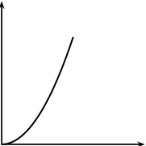
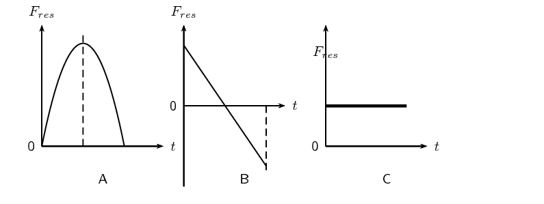
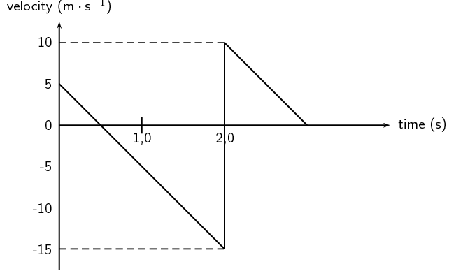
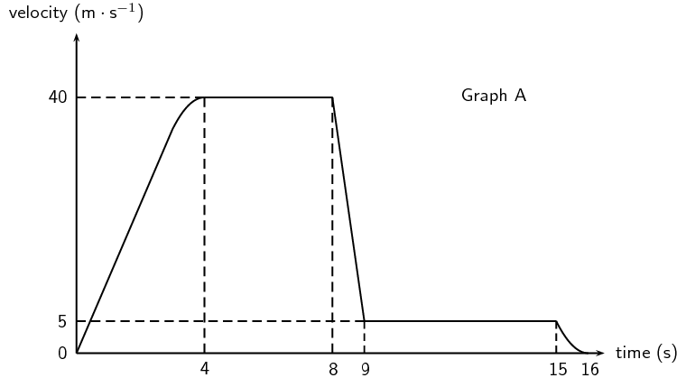
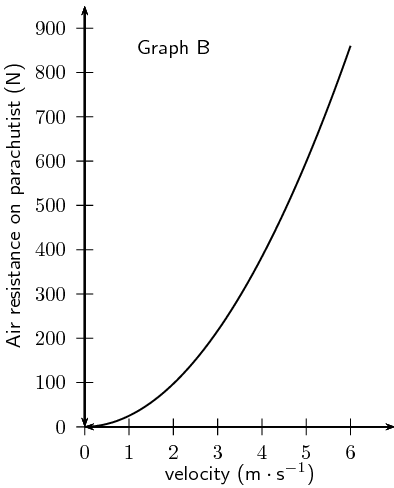
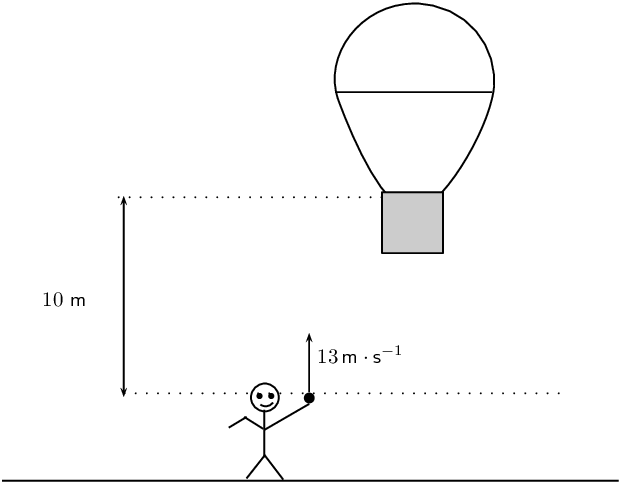

### Textbook Exercise 3.3

**Problem:**
[SC 2001/11 HG1] A bullet fired vertically upwards reaches a maximum height and falls back to the
            ground.

Which
            **one** of the following statements is
            **true** with reference to the acceleration of the bullet during its motion,
            if air resistance is ignored? The acceleration:

2. is always downwards
4. is first upwards and then downwards
6. is first downwards and then upwards
8. decreases first and then increases

**Solution:**
is always downwards

**Problem:**
[IEB 2002/11 HG1] Two balls, P and Q, are simultaneously thrown into the air from the same height
            above the ground. P is thrown vertically upwards and Q vertically downwards with the same initial speed.
            Which of the following is true of both balls just before they hit the ground? (Ignore any air resistance.
            Take downwards as the positive direction.)

|  | Velocity | Acceleration |
| --- | --- | --- |
| A | The same | The same |
| B | P has a greater velocity than Q | P has a negative acceleration; Q has a positive acceleration |
| C | P has a greater velocity than Q | The same |
| D | The same | P has a negative acceleration; Q has a positive acceleration |

**Solution:**
A. The same velocity and the same acceleration.

**Problem:**
[SC 2003/11] A ball X of mass m is projected vertically upwards at a speed
            \({u}_{x}\) from a bridge
            \(\text{20}\) \(\text{m}\) high. A ball Y of mass
            \(2m\) is projected vertically downwards from the same bridge at a speed of
            \({u}_{y}\). The two balls reach the water at the same speed. Air friction can be
            ignored.

Which of the following is true with reference to the speeds with which the balls are
            projected?

2. \({u}_{x}=\frac{1}{2}{u}_{y}\)
4. \({u}_{x}={u}_{y}\)
6. \({u}_{x}=2{u}_{y}\)
8. \({u}_{x}=4{u}_{y}\)

**Solution:**
b) \({u}_{x}={u}_{y}\)

**Problem:**
[SC 2002/03 HG1] A stone falls freely from rest from a certain height. Which one of the following
            quantities could be represented on the y-axis of the graph below?

2. velocity
4. acceleration
6. momentum
8. displacement

**Solution:**
d) displacement

**Problem:**
A stone is thrown vertically upwards and it returns to the ground. If friction is ignored, its
            acceleration as it reaches the highest point of its motion is

2. greater than just after it left the throwers hand.
4. less than just before it hits the ground.
6. the same as when it left the throwers hand.
8. less than it will be when it strikes the ground.

**Solution:**
c) the same as when it left the throwers hand.

**Problem:**
[IEB 2004/11 HG1] A stone is thrown vertically up into the air. Which of the following graphs best
            shows the resultant force exerted on the stone against time while it is in the air? (Air resistance is
            negligible.)

**Solution:**
C - the force is constant since the acceleration is constant.

**Problem:**
What is the velocity of a ball just as it hits the ground if it is thrown upward at
            \(\text{10}\) \(\text{m·s
            $^{-1}$}\) from a height
            \(\text{5}\) meters above the ground?

**Solution:**
The ball will travel upwards, stop at its highest point, and then fall back down to the ground. As it
            reaches the initial position of \(\text{5}\) metres above the ground, it will be travelling once again at
            \(\text{10}\) \(\text{m·s$^{-1}$}\) but this time in the downwards direction. Taking downwards as the
            +ve direction:

          \begin{align*}
          v_{f}^2 & = v_{i}^2 + 2a\Delta x \\
          &= (\text{10})^2 + 2(\text{9,8})(\text{5}) \\
          &= \text{198} \\
          v_{f} &= \sqrt{\text{198}} = \text{14,07}\text{ m·s$^{-1}$}
          \end{align*}

**Problem:**
[IEB 2002/11 HG1 - Bouncing Ball]

A ball bounces vertically on a hard surface after being thrown vertically up into the air by a boy
            standing on the ledge of a building.

Just before the ball hits the ground for the first time, it has a velocity of magnitude
            \(\text{15}\) \(\text{m·s
            $^{-1}$}\). Immediately, after bouncing, it has a velocity of magnitude
            \(\text{10}\) \(\text{m·s
            $^{-1}$}\).

The graph below shows the velocity of the ball as a function of time from the moment it is thrown
            upwards into the air until it reaches its maximum height after bouncing once.

2. At what velocity does the boy throw the ball into the air?
4. What can be determined by calculating the gradient of the graph during the first two
                   seconds?
6. Determine the gradient of the graph over the first two seconds. State its units.
8. How far below the boy's hand does the ball hit the ground?
10. Use an equation of motion to calculate how long it takes, from the time the ball was thrown, for
                   the ball to reach its maximum height after bouncing.
12. What is the position of the ball, measured from the boy's hand, when it reaches its maximum
                   height after bouncing?

**Solution:**
2. \(\text{5}\) \(\text{m·s$^{-1}$}\)
4. the acceleration of the ball
6. \begin{align*}
                   \text{gradient} &= \frac{\Delta y}{\Delta x} \\
                   &= \frac{(\text{5}- (-\text{15}))}{(\text{2}- \text{0})} \\
                   & = \text{10}
                   \end{align*}
                   \(\text{10}\) \(\text{m·s$^{-2}$}\)
8. According to the graph, the ball reaches the boy's hand again after \(\text{1}\) second (when the
                   downward speed of \(\text{5}\) \(\text{m·s$^{-1}$}\) is the same as its initial upward speed.)
                   Therefore the area under the graph between \(\text{1}\) and \(\text{2}\) seconds (when it reaches its
                   maximum negative velocity) is equal to the remaining distance the ball falls to the ground. The area is
                   equal to \(\text{10}\).
   Distance = \(\text{10}\) \(\text{m}\).
10. It takes \(\text{2}\) \(\text{s}\) until the ball bounces. Calculate the additional time from bouncing
                   to reach maximum height. **Assume the acceleration is the same as before, ** i.e.
                   \(\text{10}\) \(\text{m·s$^{-2}$}\).
                 \begin{align*}
                 v_{f} & = v_{i} + at \\
                 t & = \frac{v_{f} - v_{i}}{a} \\
                 & = \frac{\text{0}-\text{10}}{-\text{10}} \\
                 & = \text{1}\text{ s}
                 \end{align*}
   Therefore the total time taken is \(\text{3}\) \(\text{s}\).
12. Calculate the area under the graph for the final \(\text{1}\) second or use equation of motion to find
                   maximum height after the bounce:
                 \begin{align*}
                 \Delta x &= v_{i}t + \frac{1}{2}at^2 \\
                 &= (\text{10})(\text{1}) + \frac{1}{2}(-\text{10})(\text{1})^2 \\
                 & = \text{5}\text{ m}
                 \end{align*}
   Therefore the position of the ball, measured from the boy's hand is\(\text{5}\)
                   \(\text{m}\)-\(\text{5}\) \(\text{m}\) = \(\text{0}\) \(\text{m}\). In other words, it is the same
                   height as the boy's hand.

**Problem:**
[IEB 2001/11 HG1] -
            **Free Falling?**

A parachutist steps out of an aircraft, flying high above the ground. She falls for the first
            \(\text{8}\) seconds before opening her parachute. A graph of her velocity is shown in Graph A
            below.

2. Use the information from the graph to calculate an approximate height of the aircraft when she
                   stepped out of it (to the nearest
                   \(\text{10}\) \(\text{m}\)).
4. What is the magnitude of her velocity during her descent with the parachute fully open?
   The air resistance acting on the parachute is related to the speed at which the parachutist
                   descends. Graph B shows the relationship between air resistance and velocity of the parachutist
                   descending with the parachute open.
   
6. Use Graph B to find the magnitude of the air resistance on her parachute when she was descending
                   with the parachute open.
8. Assume that the mass of the parachute is negligible. Calculate the mass of the parachutist
                   showing your reasoning clearly.

**Solution:**
2. Calculate the area under the graph to find the total height she falls. For the first \(\text{4}\)
                   \(\text{s}\), approximate area with a triangle:
                 \begin{align*}
                 \Delta x_{1} & = \frac{1}{2}\text{base}\times\text{height} \\
                 &= \frac{1}{2}(\text{4})(\text{40}) \\
                 &= \text{80}\text{ m}
                 \end{align*}
   For the time \(\text{4}\)-\(\text{8}\) \(\text{s}\):
                 \begin{align*}
                 \Delta x_{2} & = \text{base}\times\text{height} \\
                 & = (\text{4})(\text{40}) \\
                 & = \text{160}\text{ m}
                 \end{align*}
   For the time \(\text{8}\)-\(\text{9}\) \(\text{s}\), approximate area with a triangle plus a square:
                 \begin{align*}
                 \Delta x_{3} & = \frac{1}{2}\text{base}\times\text{height} + \text{base}\times\text{height}_2\\
                 & = \frac{1}{2}(1)(\text{35}) + (\text{1})(\text{5})\\
                 & = \text{22,5}\text{ m}
                 \end{align*}
   For the time \(\text{9}\)-\(\text{15}\) \(\text{s}\), approximate area with a rectangle:
                 \begin{align*}
                 \Delta x_{4} & = (6)(5) \\
                 & =\text{30}\text{ m}
                 \end{align*}
   For the time \(\text{15}\)-\(\text{16}\) \(\text{s}\), approximate area with a triangle:
                 \begin{align*}
                 \Delta x_{5} & = \frac{1}{2}(1)(5) \\
                 & = \text{2,5}\text{ m}
                 \end{align*}
   Total distance fallen = \(\text{80}\text{ m} + \text{160}\text{ m} + \text{22,5}\text{ m} +
                   \text{30}\text{ m} + \text{2,5}\text{ m} = \text{295}\text{ m}\)
                 .
   Rounded to the nearest \(\text{10}\) \(\text{m}\) is \(\text{300}\) \(\text{m}\)
4. \(\text{5}\) \(\text{m·s$^{-1}$}\)
6. \(\text{600}\) \(\text{N}\)
8. Once the parachute is open, the parachutists falls at constant speed, implying that her net
                   acceleration is zero. Therefore the force on her due to gravity and the force on her due to air
                   resistance are equal and opposite:
                 \begin{align*}
                 \vec{F}_g & = \vec{F}_{air} \\
                 mg &= \text{600}\text{ N} \\
                 m(\text{9,8}) &= \text{600}\text{ N} \\
                 m & = \text{61,22}\text{ kg}
                 \end{align*}

2. \(\text{300}\) \(\text{m}\)
4. \(\text{5}\) \(\text{m·s$^{-1}$}\)
6. \(\text{600}\) \(\text{N}\)
8. \(\text{61,22}\) \(\text{kg}\)

**Problem:**
Niko, in the basket of a hot-air balloon, is stationary at a height of
            \(\text{10}\) \(\text{m}\) above the level from where his friend, Bongi, will throw a ball. Bongi intends
            throwing the
            ball upwards and Niko, in the basket, needs to
            **descend** (move downwards) to catch the ball at its maximum height.

Bongi throws the ball upwards with a velocity of
            \(\text{13}\) \(\text{m·s
            $^{-1}$}\). Niko starts his descent at the same instant the ball is thrown upwards, by letting air
            escape from the balloon, causing it to accelerate downwards. Ignore the effect of air friction on the
            ball.

2. Calculate the maximum height reached by the ball.
4. Calculate the magnitude of the minimum average acceleration the balloon must have in order for
                   Niko to catch the ball at its maximum height.

**Solution:**
2. \begin{align*}
                   v_{f}^2 & = v_{i}^2 + 2a\Delta x \\
                   \Delta x & = \frac{v_{f}^2 - v_{i}^2}{2a} \\
                   & = \frac{(\text{0})^2-(\text{13})^2}{\text{2}(-\text{9,8})} \\
                   & = \text{8,62}\text{ m}
                   \end{align*}
4. Calculate the time taken for the ball to reach its maximum height:
                 \begin{align*}
                 v_{f} & = v_{i} + at \\
                 t & = \frac{ v_{f}-v_{i}}{a} \\
                 & = \frac{\text{0}-\text{13}}{-\text{9,8}} \\
                 & = \text{1,33}\text{ s}
                 \end{align*}
   Now calculate the acceleration needed:
                 \begin{align*}
                 \Delta x & = v_{i}t + \frac{1}{2}at^{2} \\
                 & = (\text{0})t + \frac{1}{2}at^{2} \\
                 a & = \frac{2\Delta x}{t^2} \\
                 & = \frac{2(\text{10} - \text{8,62})}{(\text{1,33})^2} = \text{1,63}\text{ m·s$^{-2}$}
                 \end{align*}

2. \(\text{8,62}\) \(\text{m}\)
4. \(\text{1,63}\) \(\text{m·s$^{-2}$}\)
