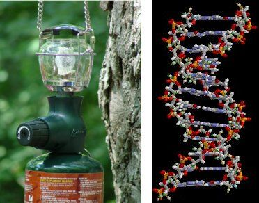

# Chapter 4: Organic molecules

## 4.1 What are organic molecules? (ESCK3)

This section studies simple organic molecules, functional groups and the physical properties
                        associated with these functional groups. Only molecules with one type of functional group, and
                        no more than three of the same functional group, should be studied. This section is a basis for
                        any organic chemistry they may study beyond school so it is important that learners have a
                        thorough understanding of this chapter. Some common polymers are also covered in this chapter,
                        learners should understand the environmental impacts of these polymers as well as their
                        connection with simple organic molecules through the monomers they are formed from.

This section of work is the first chemistry chapter of the Grade 12 year. Learners should have an
                        understanding of [intermolecular forces](todo) and [chemical bonds](todo) from Grade 11. These will be
                        particularly important in the physical properties section. Only 12 hours are allocated in CAPS
                        for this section. If possible more time could be given here to ensure a thorough understanding,
                        as there is a lot of work to cover.

Emphasis should be placed on the different representations of organic compounds: macroscopic,
                        sub-microscopic, symbolic representations and the links between all three. Where possible, use
                        atomic model kits to help explain reactions, physical properties and the structure of molecules.

The following topics are covered in this chapter.

- **What makes a molecule organic, and organic molecular structures**
  This chapter starts with a brief introduction to what makes a molecule organic
                                      (containing carbon atoms). This then leads in to the properties of carbon that make
                                      it so unique. Learners are introduced to structural, semi-structural, condensed and
                                      molecular formula representations for molecules. It is important that they have a
                                      thorough understanding of this before moving on as they will use these
                                      representations throughout the chapter. It is also important that learners
                                      understand that molecules are not two-dimensional, if possible do some
                                      demonstrations with atomic model kits so they can get a better feel for the shape of
                                      an organic molecule. Semi-structural representations are not required by CAPS, but
                                      will be shown in many textbooks and so it would be good for the student to
                                      understand them.
- **Functional groups**
  Understanding functional groups is essential to understanding organic molecules. An
                                      introduction to each of the required basic functional groups, the homologous series
                                      to which they belong, and their general formulas are covered in this section:
                                      hydrocarbons (alkanes, alkenes, alkynes), alcohols, alkyl halides (specifically
                                      haloalkanes), aldehydes, ketones, carboxylic acids and esters. The concept of
                                      saturated and unsaturated compounds is also covered, this will become more important
                                      later in the chapter when studying reactions. Isomers of compounds with the same
                                      functional groups, and compounds with different functional groups are also covered.
- **IUPAC naming**
  A good knowledge of IUPAC naming is very important in organic chemistry. This section
                                      walks the learners through the naming of the functional groups, with many worked
                                      examples. Going through those worked examples and the associated exercises will help
                                      the learners understand this section. There are a number of in-class activities
                                      provided that will also help with understanding. The naming of compounds with more
                                      than three of the same functional group, or more than one functional group, is not
                                      required by CAPS. Chain lengths of no more than eight carbon atoms are allowed, and
                                      esters may not have branched groups.
- **Physical propeties and structure**
  A revision of [Grade 11](todo) intermolecular forces
                                      would be useful before starting this section. The important IMF this year are
                                      hydrogen bonds and van der Waals forces. The physical properties covered include:
                                      viscosity, density, melting and boiling points, flammability and vapour pressure,
                                      volatility, physical state, smell. It would be good for learners to revise [molecular shape](todo) from Grade 11 as well.
                                      The changes in physical properties are linked to the intermolecular forces of the
                                      molecule, which is in turn linked to functional groups, chain length and chain
                                      branching. Although these are seperated into sections the learner should understand
                                      that they are linked (different intermolecular forces are due to functional groups,
                                      chain length, etc.).
- **Applications of organic chemistry**
  In this section learners will explore the applications of organic molecules.
                                      Specifically the cracking of hydrocarbons, and the (complete) combustion of alkanes.
                                      Esters are also covered in more detail in this section, with industrial uses.
- **Addition, elimination and substitution reactions**
  The learners need to know the addition, elimination and substitution reactions
                                      mentioned in this section, including reaction conditions and the major and minor
                                      products that will be formed. They should understand the difference between an
                                      addition reaction, an elimination reaction and a substitution reaction and the
                                      reactants required in each specific reaction.
  **No** mechanisms of reactions are required, only the reaction equations.
- **Plastics and polymers**
  The polymers covered in this section are: polyethene, polypropene, polyvinyl chloride,
                                      polyvinyl acetate, polystyrene, polyethylene terephthalate and polylactic acid.
                                      Learners should understand what makes a compound a polymer, the difference between
                                      an addition and a condensation reaction, and how to determine the polymer from the
                                      monomer and the monomer from the polymer.

There are several experiments in this chapter. The learners will be using dangerous chemicals and
                        should be properly instructed on the correct use of safety equipment, including safety goggles,
                        gloves and protective clothing. They should also be reminded not to sniff any chemicals as the
                        fumes can be dangerous as well. More information on laboratory procedures as well as safety
                        precautions is provided in [Chapter 1](todo) (Science skills).

These experiments are also an excellent opportunity to get the learners to research organic
                        molecules. Before any experiment the hazards of the chemicals being worked with should be
                        studied. Have the learners do the research for at least some of the experiments before
                        completing them as a way of better understanding the molecules.

<Callout type="tip" title="Note">
Do not confuse organic compounds with *naturally produced* food. Organic compounds are often
                        produced in a laboratory.
</Callout>

**Organic chemistry** is the branch of chemistry that deals with **organic
                        molecules**. An organic molecule is one which contains **carbon**, although
                  not all compounds that contain carbon are organic molecules. Noticeable exceptions are carbon monoxide
                  (\(\text{CO}\)), carbon dioxide (\(\text{CO}_{2}\)), carbonates (e.g. calcium carbonate), carbides
                  (e.g. calcium carbide) and cyanides (e.g. sodium cyanide). Pure carbon compounds such as diamond and
                  graphite are also **not** organic compounds. Organic molecules can range in size from
                  simple molecules to complex structures containing thousands of atoms!

Although carbon is present in all organic compounds, other elements such as hydrogen \((\text{H})\),
                  oxygen \((\text{O})\), nitrogen \((\text{N})\), sulfur \((\text{S})\) and phosphorus \((\text{P})\)
                  are also common in these molecules.

Organic molecule
An organic molecule is a molecule that contains carbon atoms (generally bonded to other carbon
                        atoms as well as hydrogen atoms).

Figure 4.1: A simple organic molecule, propane, can be used in a gas lamp (left). The complex
                              organic molecule DNA carries the genetic code of a person and can be used to identify
                              them.

Organic compounds are very important in daily life and they range from simple to extremely complex (Figure 4.1). Organic molecules make up a
                  big part of our own bodies, they are in the food we eat and in the clothes we wear. Organic compounds
                  are also used to make products such as medicines, plastics, washing powders, dyes, along with a long
                  list of other items. There are millions organic compounds found in nature, as well as millions of
                  synthetic (man-made) organic compounds.

<QuizCard id="s12-04-01a" title="Interactive Exercise 4.1" question="Give a term (one word or a phrase) for the following definition: A molecule that contains carbon atoms (covalently bonded to hydrogen atoms, and sometimes other elements such as oxygen or nitrogen)." options=[] answer="
                    ['organic molecule', 'organic', 'organic molecules', 'organic compound', 'organic compounds', 'an organic molecule', 'an organic', 'an organic molecules', 'an organic compound', 'an organic compounds', 'a organic molecule', 'a organic', 'a organic molecules', 'a organic compound', 'a organic compounds', 'the organic molecule', 'the organic', 'the organic molecules', 'the organic compound', 'the organic compounds']
                " hint="" explanation="Identify the correct term A molecule that contains carbon atoms (covalently bonded to hydrogen atoms, and sometimes other elements such as oxygen or nitrogen): NOTE: Not all compounds that contain carbon are organic molecules. Noticeable exceptions are carbon monoxide ( CO ), carbon dioxide ( CO 2 ), carbonates (e.g. calcium carbonate), carbides (e.g. calcium carbide) and cyanides (e.g. sodium cyanide). Pure carbon compounds such as diamond and graphite are also not organic compounds. The correct answer is: organic molecule . Submit your answer as:" />

<QuizCard id="s12-04-01a" title="Interactive Exercise 4.1" question="Choose the most appropriate definition for the following word or term: Organic molecule. A A molecule that contains carbon atoms (generally bonded to other carbon and hydrogen atoms) B An organic compound that has at least one double or triple carbon-carbon bond C An organic compound that contains only carbon and hydrogen atoms" options=["A", "B", "C"] answer="
                    0
                " hint="" explanation="Choose the correct option Organic molecule: NOTE: Not all compounds that contain carbon are organic molecules. Noticeable exceptions are carbon monoxide ( CO ), carbon dioxide ( CO 2 ), carbonates (e.g. calcium carbonate), carbides (e.g. calcium carbide) and cyanides (e.g. sodium cyanide). Pure carbon compounds such as diamond and graphite are also not organic compounds. The correct answer is A : A molecule that contains carbon atoms (generally bonded to other carbon and hydrogen atoms). Submit your answer as: A" />
