## 4.2 Organic molecular structures (ESCK4)

### Special properties of carbon (ESCK5)

Carbon has a number of unique properties which influence how it behaves and how it bonds with
                                other atoms:

- Carbon (Figure 4.2)
                                                  has *four valence electrons* which means that each carbon atom
                                                  can form a maximum of four bonds with other atoms. Because of the number
                                                  of bonds that carbon can form with other atoms, organic compounds can be
                                                  very complex.
  - Carbon can form bonds with other carbon atoms to form single,
                                                                    double or triple covalent bonds.
  - Carbon can also form bonds with other atoms like hydrogen,
                                                                    oxygen, nitrogen and the halogens.
  - Carbon can bond to form straight chain, branched, and cyclic
                                                                    molecules.
  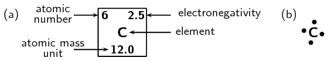
  Figure 4.2: Carbon **(a)** as seen on the
                                                                  periodic table and **(b)** a Lewis dot
                                                                  representation.
- Because of this, long *chain structures* can form. This is known as
                                                  **catenation** - the bonding of atoms of the same element
                                                  into longer chains. These chains can either be *unbranched* (Figure
                                                          4.3) or *branched* (have a branched group, Figure
                                                          4.4) and can contain single carbon-carbon bonds only, or
                                                  double and triple carbon-carbon bonds as well.
  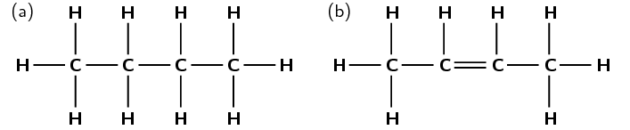
  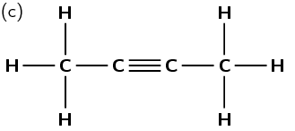
  Figure 4.3: Unbranched carbon chains with
                                                                  **(a)** single carbon-carbon bonds,
                                                                  **(b)** single and double carbon-carbon
                                                                  bonds and **(c)** single and triple
                                                                  carbon-carbon bonds.
  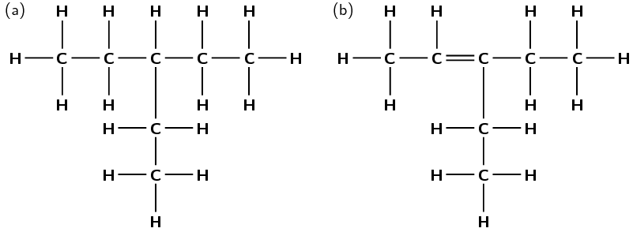
  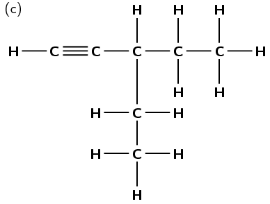
  Figure 4.4: Branched carbon chains with **(a)**
                                                                  single carbon-carbon bonds, **(b)** single
                                                                  and double carbon-carbon bonds and **(c)**
                                                                  single and triple carbon-carbon bonds.
- Because of its position on the periodic table, most of the bonds that carbon
                                                  forms with other atoms are *covalent*. Think for example of a
                                                  \(\text{C}-\text{C}\) bond. The difference in electronegativity between
                                                  the two atoms is zero, so this is a pure covalent bond. In the case of a
                                                  \(\text{C}-\text{H}\) bond, the difference in electronegativity between
                                                  carbon (\(\text{2,5}\)) and hydrogen (\(\text{2,2}\)) is so small that
                                                  \(\text{C}-\text{H}\) bonds are almost purely covalent. The result of
                                                  this is that most organic compounds are non-polar. This affects some of
                                                  the properties of organic compounds.

#### Sources of carbon

The main source of the carbon in organic compounds is **carbon dioxide**
                                        in the atmosphere. Plants use sunlight to convert carbon dioxide and water
                                        (inorganic compounds) into sugar (an organic compound) through the process of
                                        **photosynthesis**.

\(6\text{CO}_{2}(\text{g}) + 6\text{H}_{2}\text{O}(\text{ℓ})\) \(\to\)
                                        \(\text{C}_{6}\text{H}_{12}\text{O}_{6}(\text{aq}) + 6\text{O}_{2}(\text{g})\)

Plants are therefore able to make their own organic compounds through photosynthesis,
                                        while animals feed on plants or plant products in order to gain the organic
                                        compounds that they need to survive.

Other important sources of carbon are **fossil fuels** such as coal,
                                        petroleum and natural gas. This is because fossil fuels are themselves formed
                                        from the decaying remains of dead organisms.

### Representing organic molecules (ESCK6)

There are a number of ways to represent organic compounds. It is useful to know all of these
                                so that you can recognise a molecule regardless of how it is shown. There are four main
                                ways of representing a compound in two dimensions (on your page). We will use the
                                examples of two molecules called 2-methylpropane and butane to help explain the
                                difference between each.

**Structural formula**

The structural formula of an organic compound shows every bond between every atom in the
                                molecule. Each bond is represented by a line. The structural formulae of 2-methylpropane
                                and butane are shown in Figure 4.5.

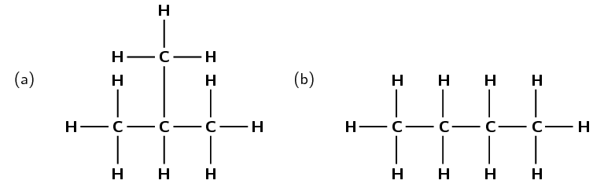

Figure 4.5: The structural formula of **(a)** 2-methylpropane
                                                and **(b)** butane.

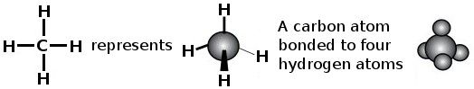

Figure 4.6: Different ways of representing a carbon atom bonding to four
                                                hydrogen atoms.

**Semi-structural formula**

It is possible to understand the structure of an organic molecule without writing out all the
                                carbon-hydrogen bonds. This way of writing a structure is called a semi-structural
                                formula and is shown in Figure 4.7.

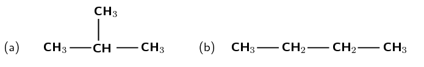

Figure 4.7: The semi-structural formulae of **(a)**
                                                2-methylpropane and **(b)** butane.

Compare these semi-structural representations with the structural representations shown in Figure 4.5.

<Callout type="tip" title="Note">
A substituent is an atom or group of atoms that replaces a hydrogen atom on the main
                                        chain of an organic molecule. Therefore a brached group is a substituent. A
                                        halogen atom can also be a substituent.
</Callout>

**Condensed structural formula**

It is also possible to represent a molecule without showing any bonds between atoms at all.
                                This is called a **condensed structural formula** (Figure 4.8). As for a
                                semi-structural representation, the carbon atoms are grouped with the hydrogen atoms
                                bonded directly to it. The bonds between these groups are not shown. Branched or
                                substituent groups are shown in brackets after the carbon atom to which they are bonded.

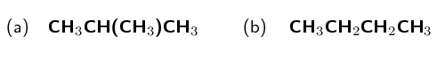

Figure 4.8: The condensed structural formulae of **(a)**
                                                2-methylpropane and **(b)** butane.

Note that in Figure 4.8 (b) the two
                                \(\text{CH}_{2}\) groups can be abbreviated to \((\text{CH}_{2})_{2}\). Compare these
                                condensed structural representations with the structural (Figure 4.5) and
                                the semi-structural
                                representations (Figure
                                        4.7).

**Molecular formula**

The molecular formula of a compound shows how many atoms of each type are in a molecule. The
                                number of each atom is written as a subscript after the atomic symbol. The molecular
                                formula of 2-methylpropane is:

**\(\text{C}_{4}\text{H}_{10}\)**

This means that each molecule of 2-methylpropane consists of four carbon atoms and ten
                                hydrogen atoms. The molecular formula of butane is also \(\text{C}_{4}\text{H}_{10}\).
                                Molecular formula gives no structural information about the compound.

Of course molecules are not two-dimensional so shown below are a few examples of different
                                ways to represent methane (\(\text{CH}_{4}\), Figure 4.9) and ethane (\(\text{C}_{2}\text{H}_{6}\),
                                Figure 4.10).

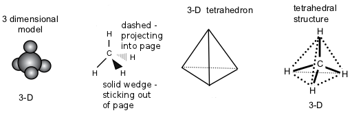

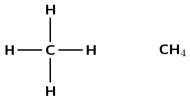

Figure 4.9: Different ways of representing methane.

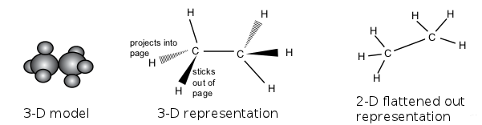

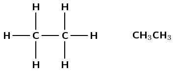

Figure 4.10: Different ways of representing ethane.

This means that butane can be represented in two dimensions as shown in Figure 4.11 (a) but it
                                actually looks more like the three-dimensional representation given in Figure 4.11 (b).

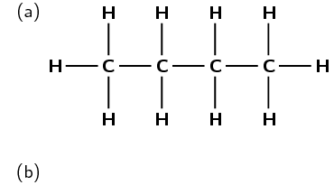

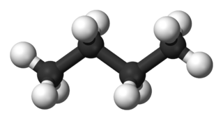

Figure 4.11: **(a)** Two-dimensional and **(b)**
                                                three-dimensional representations of butane.

## Representing organic compounds

### Textbook
                                                Exercise 4.1

For each of the following, give the **structural
                                                                        formula** and the **molecular
                                                                        formula**.

**Problem:**
\(\text{CH}_{3}\text{CH}_{2}\text{CH}_{3}\)

**Solution:**
Structural formula:

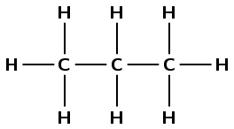

Molecular formula: \(\text{C}_{3}\text{H}_{8}\)

**Problem:**
\(\text{CH}_{3}\text{CH}_{2}\text{CH}(\text{CH}_{3})\text{CH}_{3}\)

**Solution:**
Structural formula:

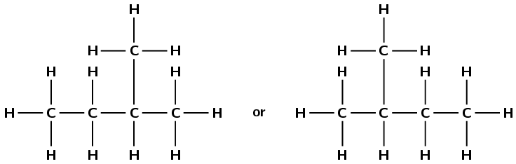

Although the condensed formula was written with the
                                                                        methyl group attached to the third carbon, if we
                                                                        look at the formula from right to left you will
                                                                        see that it is attached to the second carbon and
                                                                        so either of the representations given above are
                                                                        acceptable.

Molecular formula: \(\text{C}_{5}\text{H}_{12}\)

**Problem:**
\(\text{CH}_{3}\text{CH}_{3}\)

**Solution:**
Structural formula:

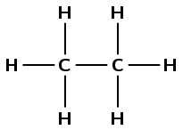

Molecular formula: \(\text{C}_{2}\text{H}_{6}\)

For each of the following organic compounds, give the
                                                                **condensed structural formula** and the
                                                                **molecular formula**.

**Problem:**
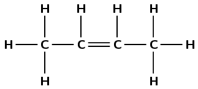

**Solution:**
Condensed Structural:
                                                                        \(\text{CH}_{3}\text{CHCHCH}_{3}\)

Molecular: \(\text{C}_{4}\text{H}_{8}\)

**Problem:**
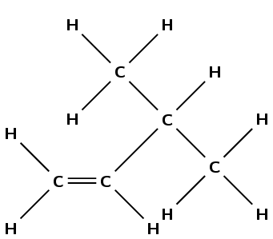

**Solution:**
Condensed Structural:
                                                                        \(\text{CH}_{2}\text{CHCH}(\text{CH}_{3})\text{CH}_{3}\)

Molecular: \(\text{C}_{5}\text{H}_{10}\)

**Problem:**
Give two possible structural formulae for the compound with a
                                                                molecular formula of \(\text{C}_{4}\text{H}_{10}\).

**Solution:**
The only two possible options are:

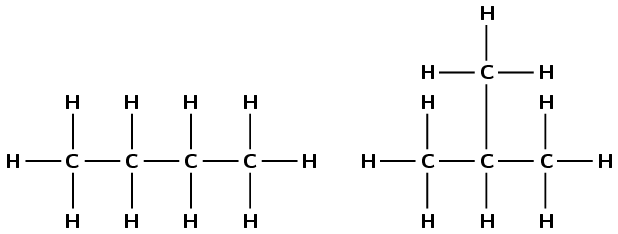

### Functional groups (ESCK7)

The way in which a compound will react is determined by a particular characteristic of a
                                group of atoms and the way they are bonded (e.g. double C\(-\)C bond, C\(-\)OH group).
                                This is called the **functional group**. This group is important in
                                determining how a compound will react. The same functional group will undergo the same
                                or similar chemical reaction(s) regardless of the size of the molecule it is a part of.
                                Molecules can have more than one functional group.

Functional group

In organic chemistry a functional group is a specific group of atoms (and the
                                                bonds between them) that are responsible for the characteristic chemical
                                                reactions of those molecules.

In one group of organic compounds, called the **hydrocarbons**, the single,
                                double and triple bonds between carbon atoms give rise to the alkanes, alkenes and
                                alkynes, respectively. The double carbon-carbon bonds (in the alkenes) and triple
                                carbon-carbon bonds (in the alkynes) are examples of functional groups.

In another group of organic compounds, called the **alcohols**, an oxygen and a
                                hydrogen atom are bonded to each other to form the functional group (in other words an
                                alcohol has an \(\text{OH}\) in it). All alcohols will contain an oxygen and a hydrogen
                                atom bonded together in some part of the molecule.

Table 4.1 summarises some of the
                                common functional groups. We will look at these in more detail later in this chapter.

| Name of group | Functional group | Example | Structural Formula |
| --- | --- | --- | --- |
| Alk ane |  | Eth ane |  |
| Alk ene |  | Eth ene |  |
| Alk yne |  | Eth yne |  |
| Haloalkane / alkyl halide |  | Chloromethane |  |
| Alcoh ol / alkan ol |  | Methan ol |  |
| Carboxylic acid |  | Methan oic acid |  |

Table 4.1: Some functional groups of organic compounds.

There are some important points to note as we discuss functional groups:

- The beginning of a compound name (prefix) comes from the number of carbons in
                                                  the longest chain:
  | meth- | 1 carbon atom |
  | --- | --- |
  | eth- | 2 carbon atoms |
  | prop- | 3 carbon atoms |
  | but- | 4 carbon atoms |
- The end of a compound name (suffix) comes from the functional group, e.g. an
                                                  alkane has the suffix -ane. Refer to the examples in Table 4.1.

For more information on naming organic molecules see [Section
                                        4.3](/read/science/grade-12/organic-molecules/04-organic-molecules-03).

<QuizCard id="s12-04-02b" title="Interactive Exercise 4.3" question="Give a term (one word or a phrase) for the following definition: A specific group of atoms (and the bonds between atoms) that are responsible for the characteristic chemical reactions of a molecule." options=[] answer="
                    ['functional group', 'functional groups', 'the functional group', 'a functional group', 'a functional groups', 'the functional groups', 'an functional group', 'an functional groups']
                " hint="" explanation="Identify the correct term A specific group of atoms (and the bonds between atoms) that are responsible for the characteristic chemical reactions of a molecule: The correct answer is: functional group . Submit your answer as:" />

<QuizCard id="s12-04-02b" title="Interactive Exercise 4.3" question="Choose the most appropriate definition for the following word or term: Functional group. A A specific group of atoms (and the bonds between atoms) that are responsible for the characteristic chemical reactions of a molecule B A carbon atom that is bonded to two other carbon atoms C A representation of a molecule where no bonds between atoms are shown and isomers cannot be distinguished" options=["A", "B", "C"] answer="
                    0
                " hint="" explanation="Choose the correct option Functional group: The correct answer is A : A specific group of atoms (and the bonds between atoms) that are responsible for the characteristic chemical reactions of a molecule. Submit your answer as: A" />

<QuizCard id="s12-04-02b" title="Interactive Exercise 4.3" question="Choose the most correct definition for the following word or term: Alkyne. A An organic compound that contains an oxygen atom bonded to two different carbon atoms, with one of those carbon atoms double bonded to another oxygen atom. B An organic compound with at least one double carbon-carbon bond and only carbon and hydrogen atoms. C A hydrocarbon with at least one triple carbon-carbon bond." options=["A", "B", "C"] answer="
	                2
	            " hint="" explanation="Choose the correct option Alkyne: The correct answer is C : A hydrocarbon with at least one triple carbon-carbon bond. Submit your answer as: C" />

<QuizCard id="s12-04-02b" title="Interactive Exercise 4.3" question="What type of compound is shown below?" options=["alkane", "alkene", "alkyne", "haloalkane", "alcohol", "aldehyde", "ketone", "carboxylic acid", "ester"] answer="
                    3
                " hint="" explanation="Recall the different homologous series and the functional groups they contain Name of homologous series Functional group Alk ane ( eth ane ) Alk ene ( eth ene ) Alk yne ( eth yne ) Haloalkane ( halo meth ane ) Alcoh ol ( methan ol ) Carboxylic acid ( methan oic acid ) Ketone ( propan one ) Aldehyde ( propan al ) Ester ( methyl methan oate ) Determine the homologous series Now we can use the information in the table above and the following flow                     diagram to decide which homologous series the compound belongs to. Therefore this compound is a haloalkane (1,4-diiodobutane). Submit your answer as: haloalkane" />

<QuizCard id="s12-04-02b" title="Interactive Exercise 4.3" question="What type of compound is shown below?" options=["alkane", "alkene", "alkyne", "haloalkane", "alcohol", "aldehyde", "ketone", "carboxylic acid", "ester"] answer="
                    4
                " hint="" explanation="Recall the different homologous series and the functional groups they contain Name of homologous series Functional group Alk ane ( eth ane ) Alk ene ( eth ene ) Alk yne ( eth yne ) Haloalkane ( halo meth ane ) Alcoh ol ( methan ol ) Carboxylic acid ( methan oic acid ) Ketone ( propan one ) Aldehyde ( propan al ) Ester ( methyl methan oate ) Determine the homologous series Now we can use the information in the table above and the following flow                     diagram to decide which homologous series the compound belongs to. Therefore this compound is an alcohol (octane-1,3-diol). Submit your answer as: alcohol" />

<QuizCard id="s12-04-02b" title="Interactive Exercise 4.3" question="What type of compound is shown below?" options=["alkane", "alkene", "alkyne", "haloalkane", "alcohol", "aldehyde", "ketone", "carboxylic acid", "ester"] answer="
                    0
                " hint="" explanation="Recall the different homologous series and the functional groups they contain Name of homologous series Functional group Alk ane ( eth ane ) Alk ene ( eth ene ) Alk yne ( eth yne ) Haloalkane ( halo meth ane ) Alcoh ol ( methan ol ) Carboxylic acid ( methan oic acid ) Ketone ( propan one ) Aldehyde ( propan al ) Ester ( methyl methan oate ) Determine the homologous series Now we can use the information in the table above and the following flow                     diagram to decide which homologous series the compound belongs to. Therefore this compound is an alkane (methane). Submit your answer as: alkane" />

### Saturated and unsaturated structures (ESCK8)

Hydrocarbons that contain only single bonds are called **saturated**
                                hydrocarbons because each carbon atom is bonded to as many hydrogen atoms as possible.
                                Figure 4.12 shows a molecule
                                of ethane, which is a saturated hydrocarbon.

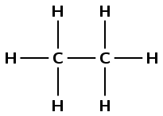

Figure 4.12: A saturated hydrocarbon, ethane.

Saturated compounds

A **saturated** compound has no double or triple bonds (i.e.
                                                they have single bonds only). All carbon atoms are bonded to four other
                                                atoms.

Hydrocarbons that contain double or triple bonds are called **unsaturated**
                                hydrocarbons because they don't contain as many hydrogen atoms as possible.

Unsaturated compounds

An **unsaturated** compound contains double or triple bonds. A
                                                carbon atom may therefore be bonded to only two or three other atoms.

Figure 4.13 shows molecules of
                                ethene and ethyne which are unsaturated hydrocarbons. If you compare the number of
                                carbon and hydrogen atoms in a molecule of ethane and a molecule of ethene, you will see
                                that the number of hydrogen atoms in ethene is *less* than the number of hydrogen
                                atoms in ethane despite the fact that they both contain two carbon atoms. In order for
                                an unsaturated hydrocarbon compound to become saturated, one of the two (or three) bonds
                                in a double (or triple) bond has to be broken, and additional atoms added.

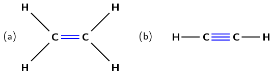

Figure 4.13: Unsaturated hydrocarbons: **(a)** ethene and
                                                **(b)** ethyne.

<Callout type="note" title="Note">
<VideoPlayer src="http://www.youtube.com/embed/PE1CDR1S5pk" title="Video:
                                                27KX" />
</Callout>

### The hydrocarbons (ESCK9)

Let us first look at a group of organic compounds known as the **hydrocarbons**.

Hydrocarbon

An organic molecule which contains only carbon and hydrogen atoms with no
                                                other functional groups besides single, double or triple carbon-carbon
                                                bonds.

The hydrocarbons that we are going to look at are called **aliphatic
                                        compounds**. The aliphatic compounds are divided into *acyclic
                                        compounds* (chain structures) and *cyclic compounds* (ring
                                structures). The chain structures are further divided into structures that contain only
                                *single bonds* (**alkanes**), those that contain at least one
                                *double bond* (**alkenes**) and those that contain at least one
                                *triple bond* (**alkynes**).

Cyclic compounds (which will not be covered in this book) include structures such as a
                                *cyclopentane ring*, which is found in insulating foam and in appliances such as
                                fridges and freezers. Figure
                                        4.14 summarises the classification of the hydrocarbons.

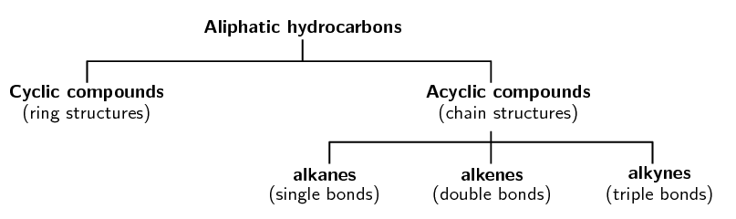

Figure 4.14: The classification of the aliphatic hydrocarbons.

<Callout type="note" title="Note">
An aliphatic compound is one that does not contain an aromatic ring:

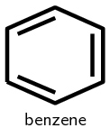

The simplest aromatic compound is benzene. There are aliphatic cyclic compounds, but
                                        if a compound contains an aromatic ring it is an aromatic compound, not an
                                        aliphatic one.
</Callout>

We will now look at each of the acyclic, aliphatic hydrocarbon groups in more detail.

#### The alkanes

The alkanes are hydrocarbons that only contain *single covalent bonds* between
                                        their carbon atoms. This means that they are *saturated* compounds and
                                        are quite unreactive. The simplest alkane has only one carbon atom and is called
                                        **methane**. This molecule is shown in Figure 4.15.

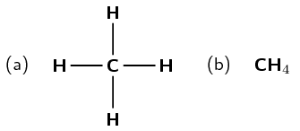

Figure 4.15: The **(a)** structural and
                                                        **(b)** molecular formula representations of
                                                        methane.

The second alkane in the series has two carbon atoms and is called
                                        **ethane**. This is shown in Figure 4.16.

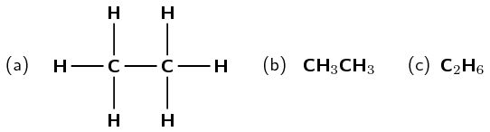

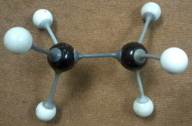

Figure 4.16: The **(a)** structural,
                                                        **(b)** condensed structural and
                                                        **(c)** molecular formula representations of
                                                        ethane. **(d)** An atomic model of ethane.

The third alkane in the series has three carbon atoms and is called
                                        **propane** (Figure 4.17).

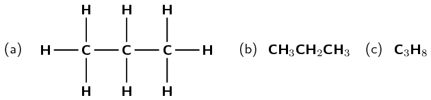

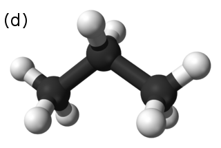

Figure 4.17: The **(a)** structural,
                                                        **(b)** condensed structural and
                                                        **(c)** molecular formula representations of
                                                        propane. **(d)** A three-dimensional computer
                                                        generated model of propane.

When you look at the molecular formula for each of the alkanes, you should notice a
                                        pattern developing. For each carbon atom that is added to the molecule, two
                                        hydrogen atoms are added. In other words, each molecule differs from the one
                                        before it by \(\text{CH}_{2}\). This is called a *homologous series*.

Homologous series

A homologous series is a series of compounds with the same general
                                                        formula. All molecules in this series will contain the same
                                                        functional groups.

<Callout type="note" title="Note">
Some fungi use alkanes as a source of carbon and energy. One fungus
                                                *amorphotheca resinae* (also known as kerosene fungus) prefers
                                                the alkanes used in aviation fuel, and this can cause problems for
                                                aircraft in tropical areas.
</Callout>

The general formula is similar to both the molecular formula and the condensed
                                        structural formula. The functional group is written as it would be in the
                                        condensed structural formula (to make it more obvious), while the rest of the
                                        atoms in the compound are written in the same style as the molecular formula.
                                        The alkanes have the **general formula**:
                                        \(\color{red}{\textbf{C}_{\textbf{n}}\textbf{H}_{\textbf{2n+2}}}\).

- The alkanes are the most important source of fuel in the world and
                                                          are used extensively in the chemical industry.
- Alkanes that contain four or less carbon atoms are gases (e.g.
                                                          methane and ethane).
  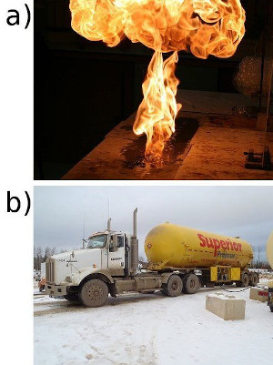
  **(a)** Methane gas bubbles burning and
                                                                          **(b)** propane (under high
                                                                          pressure) being transported by truck.
- Others are liquid fuels (e.g. octane, an important component of
                                                          petrol).
  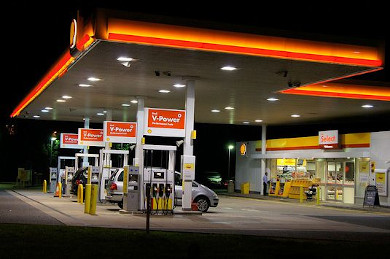
  Figure 4.19: Liquid fuels that contain octane are
                                                                          kept in tanks at petrol stations.

#### The alkenes

In the alkenes there must be at least one double bond between two carbon atoms. This
                                        means that they are *unsaturated* and are *more reactive* than the
                                        alkanes. The simplest alkene is ethene (also known as ethylene), which is shown
                                        in Figure 4.20.

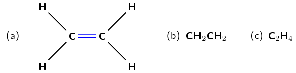

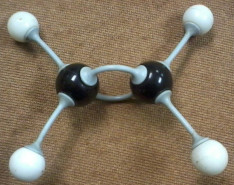

Figure 4.20: The **(a)** structural,
                                                        **(b)** condensed structural and
                                                        **(c)** molecular formula representations of
                                                        ethene. **(d)** An atomic model of ethene.

As with the alkanes, the alkenes also form a homologous series. They have the
                                        **general formula**:
                                        \(\color{red}{\textbf{C}_{\textbf{n}}\textbf{H}_{\textbf{2n}}}\). The second
                                        alkene in the series would therefore be \(\text{C}_{3}\text{H}_{6}\). This
                                        molecule is known as propene (Figure 4.21).

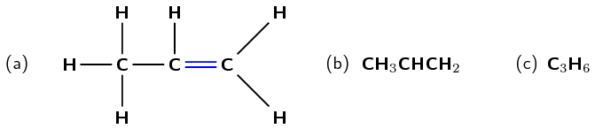

Figure 4.21: The **(a)** structural,
                                                        **(b)** condensed structural and
                                                        **(c)** molecular formula representations of
                                                        propene.

There can be more than one double bond in an alkene as shown in Figure 4.22. The
                                        naming of these compounds is covered in [Section
                                                4.3](/read/science/grade-12/organic-molecules/04-organic-molecules-03), IUPAC naming and formulae.

<Callout type="tip" title="Note">
Note that if an alkene has two double bonds, it is called a
                                                **diene**.

If you don't understand the names of compounds, don't worry. We will go into
                                                more detail on this later in the chapter.
</Callout>

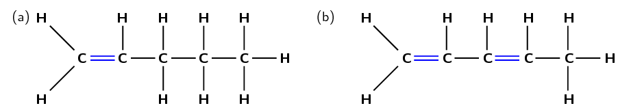

Figure 4.22: The structural representations of **(a)**
                                                        pent-1-ene and **(b)** pent-1,3-diene.

The alkenes are more reactive than the alkanes because they are unsaturated. As with
                                        the alkanes, compounds that have four or less carbon atoms are gases at room
                                        temperature. Those with five or more carbon atoms are liquids.

The alkenes have a variety of uses:

- For example, ethene is a chemical compound used in plants to
                                                          stimulate the ripening of fruits and the opening of flowers.
  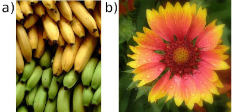
  **(a)** Unripe (green) and ripe (yellow)
                                                                          bananas and **(b)** a flowering
                                                                          plant.
- Propene is an important compound in the petrochemicals industry. It
                                                          is used to make polypropylene (see [Section
                                                                  4.7](/read/science/grade-12/organic-molecules/04-organic-molecules-07) for more information) and is
                                                          also used as a fuel gas for other industrial processes.
  
  Figure 4.24: A lamp made of polypropylene. Propene is
                                                                          used to make polypropylene.

#### The alkynes

In the alkynes there must be at least one triple bond between two of the carbon
                                        atoms. They are unsaturated compounds and are therefore more reactive than
                                        alkanes. Their **general formula** is
                                        \(\color{red}{\textbf{C}_{\textbf{n}}\textbf{H}_{\textbf{2n-2}}}\). For example
                                        **but-1-yne** has the molecular formula
                                        \({\textbf{C}_{4}{\textbf{H}_{6}}}\). The simplest alkyne is ethyne (Figure 4.25), also
                                        known as acetylene. Many of the alkynes are used to synthesise other chemical
                                        products.

<Callout type="note" title="Note">
Acetylene is the industrial name for the organic compound ethyne. The raw
                                                materials that are needed to make acetylene are calcium carbonate and
                                                coal. An important use of acetylene is in oxyacetylene gas welding. The
                                                fuel gas burns with oxygen in a torch. Because the combustion of alkenes
                                                and alkynes is exothermic an incredibly high heat is produced, which is
                                                hot enough to melt metal.

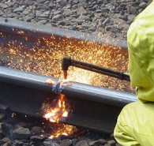
</Callout>

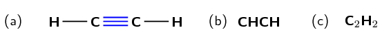

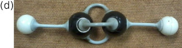

Figure 4.25: The **(a)** structural,
                                                        **(b)** condensed structural and
                                                        **(c)** molecular representations of ethyne
                                                        (acetylene). **(d)** An atomic model of ethyne.

Remember that organic molecules do not need to be straight chains. They can have
                                        branched groups as well, as shown in Figure 4.26.

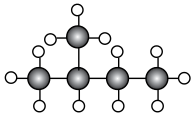

Figure 4.26: A methyl branched group on carbon 2 of butane
                                                        (2-methylbutane).

A summary of the relative reactivity and the homologous series that occur in the
                                        hydrocarbons is given in Table 4.2.

| Functional group | Homologous series | Reactivity |
| --- | --- | --- |
| alk ane | \(\color{red}{\textbf{C}_{\textbf{n}}\textbf{H}_{\textbf{2n+2}}}\) | low reactivity |
| alk ene | \(\color{red}{\textbf{C}_{\textbf{n}}\textbf{H}_{\textbf{2n}}}\) | high reactivity |
| alk yne | \(\color{red}{\textbf{C}_{\textbf{n}}\textbf{H}_{\textbf{2n-2}}}\) | high reactivity |

Table 4.2: A summary of the homologous series of the hydrocarbons.

<Callout type="note" title="Note">
Liquid bromine is highly corrosive and toxic. Handle with extreme care!

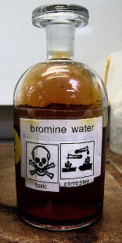
</Callout>

For the experiment on saturated and unsaturated compounds, if cyclohexane and
                                                cyclohexene are not available any alkanes/alkenes that are liquids at
                                                room temperature are acceptable. These should be relatively easy to
                                                source.

Liquid bromine is corrosive and toxic, including the fumes. If you have to
                                                prepare your own bromine water from liquid bromine do not let the
                                                learners handle the liquid bromine. Wear full safety gear and do not
                                                breath in the fumes. Work in a well ventilated area (preferably a fume
                                                hood) and be careful.

To make \(\text{50}\) \(\text{ml}\) bromine water:

- Take a bottle with a capacity of at least \(\text{100}\)
                                                                  \(\text{ml}\) and a lid that closes securely (screw
                                                                  top).
- Label the bottle and place \(\text{50}\) \(\text{ml}\) of
                                                                  water into the bottle.
- Decant the vapours from a bottle of liquid bromine (with
                                                                  appropriate precautions) into the labelled bottle until
                                                                  the airspace above the water is completely full of the
                                                                  reddish-brown gas.
- Cap both bottles and gently swirl the bromine water bottle so
                                                                  that the bromine gas dissolves in the water.
- Repeat the process at least one more time, until the water
                                                                  retains an orange colour.

## Saturated vs. unsaturated compounds

### Aim

To study the effect of bromine water and potassium permanganate on
                                                        saturated and unsaturated compounds.

### Apparatus

<Callout type="warning" title="Note">
Liquid bromine (required to make bromine water) is a highly
                                                                volatile, corrosive and toxic compound. Please handle
                                                                with care: wear the appropriate safety clothing
                                                                including gloves, labcoat, safety glasses and mask. Work
                                                                in a fumehood. If you do not have the apparatus to
                                                                handle liquid bromine safely, use potassium permanganate
                                                                only.
</Callout>

- cyclohexane, cyclohexene, bromine water
                                                                          (\(\text{Br}_{2}(\text{aq})\)), potassium
                                                                          permanganate (\(\text{KMnO}_{4}\)) in an acidic
                                                                          solution
- 4 glass containers (test tubes/beakers/shallow
                                                                          basins), two A4 sheets of paper
- 2 plastic pipettes

### Method

2. Label one piece of paper *A* and the other
                                                                           piece of paper *B*.
4. Place \(\text{20}\) \(\text{ml}\) of cyclohexane into
                                                                           a container and place the container on paper A.
6. Place \(\text{20}\) \(\text{ml}\) of cyclohexane into
                                                                           a container and place the container on paper B.
8. Repeat steps 2 and 3 with cyclohexene.
10. Take \(\text{12}\) \(\text{ml}\) of bromine water and
                                                                           add it to the beaker of cyclohexane on paper A.
                                                                           Observe any colour changes.
12. Repeat step 5 with the beaker of cyclohexene on paper
                                                                           A.
14. Take \(\text{12}\) \(\text{ml}\) of
                                                                           \(\text{KMnO}_{4}\) and add it to the beaker of
                                                                           cyclohexane on paper B. Observe any colour
                                                                           changes.
16. Repeat step 7 with the beaker of cyclohexene on paper
                                                                           B.

### Results

Record your results in the table below.

| Compound | Initial colour | Solution added | Final colour |
| --- | --- | --- | --- |
| cyclohexane |  | bromine water |  |
| cyclohexane |  | \(\text{KMnO}_{4}\) |  |
| cyclohexene |  | bromine water |  |
| cyclohexene |  | \(\text{KMnO}_{4}\) |  |

Cyclohexane is an *alkane*, cyclohexene is an *alkene*.

### Questions

- Which of these compounds (cyclohexane, cyclohexene)
                                                                          is saturated and which is unsaturated?
- What colour changes did you observe with the alkane
                                                                          compound?
- What colour changes did you observe with the alkene
                                                                          compound?
- Can you suggest a reason for the differences?

### Discussion and conclusion

Bromine water and \(\text{KMnO}_{4}\) both have intense colours.
                                                        Cyclohexane is a saturated, colourless liquid. When bromine
                                                        water and \(\text{KMnO}_{4}\) are added to the cyclohexane there
                                                        is no reaction and the solution becomes the colour of the
                                                        bromine water or \(\text{KMnO}_{4}\).

Cyclohexene is also a colourless liquid, but it is unsaturated. This
                                                        results in a reaction with bromine water and with
                                                        \(\text{KMnO}_{4}\). Cyclohexene will form a bromoalkane with
                                                        bromine water. Bromoalkanes are colourless liquids and the
                                                        solution will be colourless - liquid bromine is decolourised by
                                                        cyclohexene. Similarly \(\text{KMnO}_{4}\) will be decolourised
                                                        by the cyclohexene.

## The hydrocarbons

### Textbook Exercise 4.2

Answer these questions on the hydrocarbons.

**Problem:**
What is the difference between the alkanes,
                                                                                alkenes and alkynes?

**Solution:**
Alkanes have only single bonds between carbon
                                                                                atoms, alkenes have at least one double
                                                                                bond between carbon atoms and alkynes
                                                                                have at least one triple bond between
                                                                                carbon atoms.

**Problem:**
Give the general formula for the alkynes

**Solution:**
\(\text{C}_{\text{n}}\text{H}_{2\text{n}-2}\)

Of the alkanes, alkenes and alkynes which is:

**Problem:**
saturated

**Solution:**
the alkanes

**Problem:**
unsaturated

**Solution:**
the alkenes and alkynes

**Problem:**
Which series is the least reactive? Explain
                                                                                why.

**Solution:**
The alkanes are the least reactive. The
                                                                                saturated bonds are more reactive than
                                                                                the unsaturated double or triple bonds
                                                                                found in alkenes and alkynes.

Draw the structural formulae for:

**Problem:**
\(\text{CHCCH}_{3}\)

**Solution:**
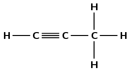

**Problem:**
\(\text{CH}_{3}\text{CH}_{2}\text{CH}_{3}\)

**Solution:**
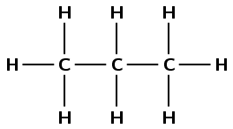

**Problem:**
\(\text{CH}_{2}\text{CHCH}_{3}\)

**Solution:**
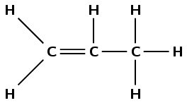

**Problem:**
Fill in the table below:

| Compound | Saturated or
                                                                                                        unsaturated? |
| --- | --- |
| \(\text{CH}_{3}\text{CH}_{2}\text{CH}_{3}\) |  |
| \(\text{CH}_{3}\text{CH}_{2}\text{CHCHCH}_{2}\text{CH}_{2}\text{CH}_{2}\text{CH}_{3}\) |  |
| heptane |  |

**Solution:**
| Compound | Saturated or
                                                                                                        unsaturated? |
| --- | --- |
| \(\text{CH}_{3}\text{CH}_{2}\text{CH}_{3}\) | saturated |
|  | unsaturated |
| \(\text{CH}_{3}\text{CH}_{2}\text{CHCHCH}_{2}\text{CH}_{2}\text{CH}_{2}\text{CH}_{3}\) | unsaturated |
| heptane | saturated |
|  | unsaturated |

### The alcohols (ESCKB)

An alcohol is any organic compound where there is a *hydroxyl* functional group
                                \((-\text{OH})\) bound to a carbon atom. The **general formula** for a
                                simple alcohol is
                                \(\color{red}{\textbf{C}_{\textbf{n}}\textbf{H}_{\textbf{2n+1}}\textbf{OH}}\).

The simplest and most commonly used alcohols are methanol and ethanol (Figures Figure 4.27 and Figure 4.28).

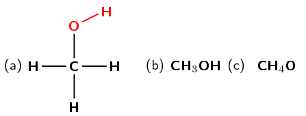

Figure 4.27: The **(a)** structural, **(b)**
                                                condensed structural and **(c)** molecular formula
                                                representations of methanol.

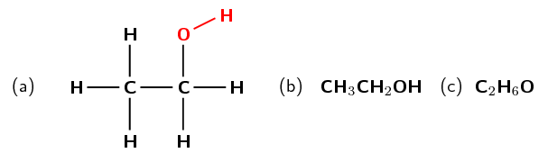

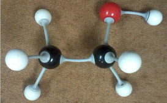

Figure 4.28: The **(a)** structural, **(b)**
                                                condensed structural and **(c)** molecular formula
                                                representations of ethanol. **(d)** An atomic model of
                                                ethanol.

There are three possible types of carbon atoms - primary, secondary and tertiary. A
                                *primary* carbon is attached to only one other carbon atom. A *secondary*
                                carbon is attached to two other carbon atoms, while a *tertiary* carbon atom is
                                attached to three other carbon atoms.

Make sure the learners understand the difference between pirmary, secondary and
                                        tertiary carbons:

- **Primary**
  A primary carbon is a carbon atom bonded to one other carbon atom.
- **Secondary**
  A secondary carbon is a carbon atom bonded to two other carbon atoms.
- **Tertiary**
  A tertiary carbon is a carbon atom bonded to three other carbon
                                                          atoms.

For example:

**\(\text{CH}_{3}\text{CH}_{2}\text{CH}_{3}\)**, carbon 1 and carbon 3
                                        are primary carbon atoms because they are only bonded to one other carbon atom.
                                        Carbon 2 is a secondary carbon atom because it is bonded to two other carbon
                                        atoms.

**\(\text{C}(\text{CH}_{3})_{3}\text{X}\)**, The central carbon atom in
                                        this compound is a tertiary carbon atom because it is bonded to three other
                                        carbon atoms.

A primary alcohol has the hydroxyl (\(-\text{OH}\)) group bonded to a primary carbon
                                        atoms. Similarly, a secondary alcohol has the hydroxyl bonded to a secondary
                                        carbon atom and a tertiary alcohol has the hydroxyl bonded to a tertiary carbon
                                        atom.

There can be a functional group attached to these different types of carbon atom. When a
                                hydroxyl \((-\text{OH})\) functional group is attached to a primary carbon atom it is
                                called a **primary alcohol**. For a **secondary alcohol** the
                                hydroxyl is bonded to a secondary carbon atom. When the hydroxyl is bonded to a tertiary
                                carbon atom it is a **tertiary alcohol**. Examples are given below.

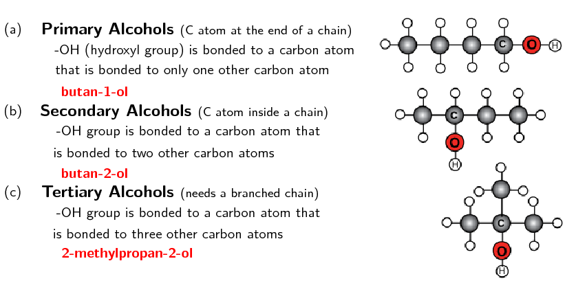

Figure 4.29: A **(a)** primary (butan-1-ol),
                                                **(b)** secondary (butan-2-ol) and **(c)**
                                                tertiary

(2-methylpropan-2-ol) alcohol.

The alcohols have a number of different uses:

- methylated spirits is ethanol with methanol added
  <Callout type="note" title="Note">
  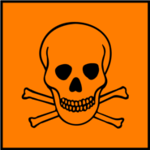
  **Methanol is toxic**. If ingested it forms formic acid
                                                          or formate salts, which damage the central nervous system and
                                                          can cause *blindness, coma* or *death*.
  </Callout>
- all alcohols are toxic, but in low concentrations ethanol can be used in
                                                  alcoholic drinks
- ethanol is the only alcohol used in alcoholic drinks
- ethanol is used as an industrial solvent
- methanol and ethanol can both be used as a fuel and they burn more cleanly
                                                  than petrol or diesel.
- ethanol is used as a solvent in medical drugs, perfumes and plant essences
- ethanol is an antiseptic

## The alcohols

### Textbook Exercise 4.3

Give the structural and condensed structural formula for the
                                                        following alcohols. State, with reasons, whether the compound is
                                                        a primary, secondary, or tertiary alcohol.

(Note: a black ball represents a carbon atom, a white ball represents
                                                        a hydrogen atom, and a red ball represents an oxygen atom)

**Problem:**

**Solution:**

\(\text{CH}_{3}\text{CH}_{2}\text{CH}_{2}\text{CH}_{2}\text{OH}\)
                                                                or
                                                                \(\text{CH}_{2}(\text{OH})\text{CH}_{2}\text{CH}_{2}\text{CH}_{3}\)

This is a primary alcohol. The hydroxyl (\(-\text{OH}\))
                                                                group is bonded to a carbon atom that is bonded to only
                                                                one other carbon atom.

**Problem:**

**Solution:**

\(\text{CH}_{3}\text{C}(\text{CH}_{3})(\text{OH})\text{CH}_{3}\)
                                                                or
                                                                \(\text{CH}_{3}\text{C}(\text{OH})(\text{CH}_{3})\text{CH}_{3}\)

This is a tertiary alcohol. The hydroxyl (\(-\text{OH}\))
                                                                group is bonded to a carbon atom that is bonded to three
                                                                other carbon atoms.

**Problem:**

**Solution:**

\(\text{CH}_{3}\text{CH}_{2}\text{CH}(\text{OH})\text{CH}_{3}\)
                                                                or
                                                                \(\text{CH}_{3}\text{CH}(\text{OH})\text{CH}_{2}\text{CH}_{3}\)

This is a secondary alcohol. The hydroxyl (\(-\text{OH}\))
                                                                group is bonded to a carbon atom that is bonded to two
                                                                other carbon atoms.

### Alkyl halides (ESCKC)

Alkyl halides are hydrocarbons with one hydrogen atom replaced by a halogen atom (F, Cl, Br,
                                I). The **alkyl** is due to the fact that a hydrocarbon branched group has
                                the suffix *-yl* and is one of the three hydrocarbons: alk*anes*,
                                alk*enes* or alk*ynes*. These *alk*yl groups contain one or more
                                halogen atoms, which leads to the name alkyl halides. Our focus will be on the
                                alk*ane* alkyl halides also known as the haloalkanes (or halogenoalkanes) (see Table 4.1).

Figure 4.30: Representations of a halomethane where X can be F, Cl, Br or I:
                                                **(a)** structural, **(b)** molecular formula,
                                                **(c)** 3-D line drawing, **(d)** 3-D ball and
                                                stick model and **e)** 3-D space-filling model.

Figure 4.31: Representations of 2-*halo*propane where X can be F, Cl,
                                                Br or I: **(a)** structural, **(b)** condensed
                                                structural, **(c)** molecular formula and
                                                **(d)** a ball and stick model.

Note that the halogen atom is called a *substituent*.

Figure 4.32: A fluorine atom as a substituent on carbon 2 of butane
                                                (2-fluorobutane).

Remember the branched chain shown in Figure 4.26. That branched chain is also called a
                                substituent.

Substituent

A substituent is *an atom or group of atoms* bonded to a carbon chain.
                                                This can be an inorganic atom (e.g. halogen) or an alkyl group that is
                                                shorter than the main group.

<Callout type="note" title="Note">
CFC stands for *chlorofluorocarbons*. Due to their low toxicity and low
                                        reactivity, CFCs were widely used in refrigeration and as propellants in
                                        aerosols. However, the low reactivity means that CFCs can get into the upper
                                        atmosphere where they are degraded by UV light and damage the ozone layer.

</Callout>

An organic compound is always named in accordance with the longest chain of carbon atoms that
                                contains the functional group. If the substituent is an alkyl group it is known as a
                                branched chain.

Some uses of haloalkanes include:

- in fire extinguishers
- as aerosol propellants
- in refrigeration
- generating foamed plastics
- solvents in dry cleaning processes (not actually *dry*, but no water
                                                  is required)

<Callout type="note" title="Note">
Chloroform (\(\text{CHCl}_{3}\)) was used as an anesthetic for years. However, aside
                                        from causing dizziness, fatigue and headaches, it was discovered to be toxic,
                                        often fatally so. Even non-fatal doses can cause damage to the kidneys and
                                        liver. Chloroform can sometimes be found in cough syrups, although not often
                                        anymore.

</Callout>

Chloroform

Haloalkanes can contain more than one halogen atom. Chloromethanes are substances
                                        that can be used as anaesthetics during operations. One example is
                                        trichloromethane, also known as *chloroform* (Figure 4.33).

Figure 4.33: The **(a)** structural and
                                                        **(b)** molecular formula representations of
                                                        trichloromethane (chloroform).

## Haloalkanes

### Textbook Exercise 4.4

Answer these questions on the haloalkanes.

**Problem:**
Give the general formula for the haloalkanes with
                                                                        only one halogen atom

**Solution:**
\(\text{C}_{\text{n}}\text{H}_{2\text{n}+1}\text{X}\)
                                                                        where X is any halogen atom

**Problem:**
Are haloalkanes saturated compounds?

**Solution:**
Yes

Draw the structural formulae for:

**Problem:**
\(\text{CH}_{2}(\text{Br})\text{CH}_{2}\text{CH}_{3}\)

**Solution:**

**Problem:**
\(\text{CH}_{3}\text{CH}(\text{Cl})\text{CH}_{2}\text{CH}_{3}\)

**Solution:**

**Problem:**
\(\text{CH}_{2}(\text{F})\text{CH}_{3}\)

**Solution:**

### Carbonyl-containing compounds (ESCKD)

The carbonyl group consists of a carbon atom that is joined to an oxygen by a double bond
                                (see Figure 4.34).

Figure 4.34: A compound containing a carbonyl group.

In Figure 4.34
                                \(\color{darkgreen}{\textbf{R'}}\) and
                                \(\color{purple}{\textbf{R}}\) are used to represent the rest of the atoms in the
                                molecule. For example \(\color{purple}{\textbf{R}}\) could represent an alkyl chain, or
                                a hydrogen atom.

#### Aldehydes and ketones

**(a)** An aldehyde and **(b)** a ketone.

If the functional group is on the *end* of the carbon chain, the organic
                                        compound is called an **aldehyde** (Figure 4.35 (a)). Being at the *end* of
                                        the chain means that \(\color{darkgreen}{\textbf{R'}}\) or
                                        \(\color{purple}{\textbf{R}}\) represents
                                        a hydrogen atom. The simplest aldehyde is *methanal*. The aldehyde
                                        containing 4 carbon atoms, butanal, is illustrated in Figure 4.36. In
                                        this example \(\color{purple}{\textbf{R}}\) represents \(\text{H}\) and
                                        \(\color{darkgreen}{\textbf{R'}}\)
                                        represents \(\text{CH}_{3}\text{CH}_{2}\text{CH}_{2}\).

<Callout type="tip" title="Note">
Note that the condensed structural formula for an aldehyde ends in
                                                **\(\text{CHO}\)** not \(\text{COH}\). This is because COH
                                                could be confused with the hydroxyl (\(-\text{OH}\)) group of an
                                                alochol.
</Callout>

Figure 4.36: The **(a)** structural,
                                                        **(b)** condensed structural and
                                                        **(c)** molecular formula representations of
                                                        butanal. **(d)** An atomic model of butanal.

Some uses of aldehydes include:

- in resins (over \(\text{6}\) million tons of formaldehyde are
                                                          produced per year)
- in the production of plasticisers and alcohols used in detergents
- in perfumes and flavourants

If the carbonyl group is in the middle of the carbon chain, the compound is called a
                                        **ketone** (Figure 4.35 (b)). Being in the *middle*
                                        of the chain means that \(\color{darkgreen}{\textbf{R'}}\) and
                                        \(\color{purple}{\textbf{R}}\)
                                        *cannot* represent \(\text{H}\). The simplest ketone is
                                        *propanone* (also known as acetone, the compound in nail varnish
                                        remover), which contains three carbon atoms. The ketone containing 4 carbon
                                        atoms, butanone, is illustrated in Figure 4.37.

Figure 4.37: The **(a)** structural,
                                                        **(b)** condensed structural and
                                                        **(c)** molecular formula representations of
                                                        butanone. **(d)** An atomic model of butanone.

<Callout type="note" title="Note">
The molecular formulae representations for butanal and butanone are identical
                                                (\(\text{C}_{4}\text{H}_{8}\text{O}\)). This is why structural and
                                                condensed structural representations are necessary.
</Callout>

Some uses of ketones include:

- as solvents
- in the production of polymers
- in the production of pharmaceuticals

The **general formula** for both the aldehydes and ketones can be
                                        written as:
                                        \(\color{red}{\textbf{C}_{\textbf{n}}\textbf{H}_{\textbf{2n}}\textbf{O}}\). This
                                        means that they cannot be told apart from their general formula alone. There are
                                        more complex general formulas that allow aldehydes and ketones to be
                                        distinguished, but they are not covered in this book.

#### Carboxylic acids

Carboxylic acids are organic acids that are characterised by having a carboxyl group,
                                        written as \(-\text{COOH}\). In a carboxyl group a carbon atom is double-bonded
                                        to an oxygen atom (carbonyl group), and it is also bonded to a hydroxyl group
                                        (\(\color{purple}{\textbf{R}}\)). The simplest carboxylic acid, methanoic acid,
                                        is shown in Figure
                                                4.38 and ethanoic acid is shown in Figure 4.39.

Figure 4.38: The **(a)** structural,
                                                        **(b)** condensed structural and
                                                        **(c)** molecular formula representations of
                                                        methanoic acid.

Figure 4.39: The **(a)** structural,
                                                        **(b)** condensed structural and
                                                        **(c)** molecular formula representations of
                                                        ethanoic acid. **(d)** An atomic model of ethanoic
                                                        acid.

Carboxylic acids are widespread in nature. Methanoic acid (also known as *formic
                                                acid*) has the formula \(\text{HCOOH}\) and is found in insect
                                        stings. Ethanoic acid \((\text{CH}_{3}\text{COOH})\), or *acetic acid*,
                                        is the main component of vinegar. More complex organic acids also have a variety
                                        of different functions. Benzoic acid for example, is used as a food
                                        preservative. Carboxylic acids have the **general formula**:
                                        \(\color{red}{\textbf{C}_{\textbf{n}}\textbf{H}_{\textbf{2n+1}}\textbf{COOH}}\).

Ethanoic acid can be produced through the oxidation of ethanol upon exposure to the
                                        oxygen in air. This is why wine that is left too long can taste acidic. Wine can
                                        easily go sour if exposed to the oxygen molecules (\(\text{O}_{2}\)) in the air,
                                        especially if the weather is warm.

Figure 4.40: The oxidation of wine.

<Callout type="note" title="Note">
A certain type of ant, called formicine ants, manufacture and secrete formic
                                                acid, which is used to defend themselves against other organisms that
                                                might try to eat them.

</Callout>

The oxidation of ethanol to ethanoic acid can also be seen in the reaction of ethanol
                                        with potassium dichromate:

\(2(\text{Cr}_{2}\text{O}_{7})^{2-}(\text{aq}) +
                                        3\text{C}_{2}\text{H}_{5}\text{OH}(\text{aq}) + 16\text{H}^{+}(\text{aq})\)
                                        \(\to\) \(4\text{Cr}^{3+}(\text{aq}) + 3\text{CH}_{3}\text{COOH}(\text{aq}) +
                                        11\text{H}_{2}\text{O}(\text{ℓ})\)

The colour change that occurs is shown in the image below and the following video:

Figure 4.41: The different colours of potassium dichromate (left) and
                                                        potassium dichromate and ethanol (right). Screenshot taken from
                                                        video by beggar098 on YouTube.

<Callout type="note" title="Note">
<VideoPlayer src="http://www.youtube.com/embed/phAvXDLAM3g" title="Video: 27M8" />
</Callout>

## Breathalysers

Read the following extract taken from HowStuffWorks (12/08/13):

The **Breathalyzer** device contains:

- A system to sample the breath of the suspect
- Two glass vials containing the chemical reaction
                                                                          mixture
- A system of photocells connected to a meter to
                                                                          measure the color change associated with the
                                                                          chemical reaction

To measure alcohol, a suspect breathes into the device. The breath
                                                        sample is bubbled in one vial through a mixture of sulfuric
                                                        acid, potassium dichromate, silver nitrate and water. The
                                                        principle of the measurement is based on the following chemical
                                                        reaction:

\(2\text{K}_{2}\text{Cr}_{2}\text{O}_{7}(\text{aq}) +
                                                        3\text{CH}_{3}\text{CH}_{2}\text{OH}(\text{aq}) +
                                                        8\text{H}_{2}\text{SO}_{4}(\text{aq})\) \(\to\)

\(2\text{Cr}_{2}(\text{SO}_{4})_{3}(\text{aq}) +
                                                        2\text{K}_{2}\text{SO}_{4} +
                                                        3\text{CH}_{3}\text{COOH}(\text{aq}) +
                                                        11\text{H}_{2}\text{O}(\text{ℓ})\)

In this reaction:

2. The **sulfuric acid removes the alcohol from
                                                                                   the air** into a liquid solution.
4. The **alcohol reacts with potassium
                                                                                   dichromate** to produce: chromium
                                                                           sulfate, potassium sulfate, acetic acid, water

The silver nitrate is a **catalyst**, a substance that
                                                        makes a reaction go faster without participating in it. The
                                                        sulfuric acid, in addition to removing the alcohol from the air,
                                                        also might provide the acidic condition needed for this
                                                        reaction.

During this reaction, the reddish-orange dichromate ion
                                                        **changes color** to the green chromium ion when it
                                                        reacts with the alcohol; the degree of the color change is
                                                        directly related to the level of alcohol in the expelled air. To
                                                        determine the amount of alcohol in that air, the reacted mixture
                                                        is compared to a vial of unreacted mixture in the
                                                        **photocell system**, which produces an
                                                        **electric current** that causes the needle in the
                                                        meter to move from its resting place. The operator then rotates
                                                        a knob to bring the needle back to the resting place and reads
                                                        the level of alcohol from the knob - the more the operator must
                                                        turn the knob to return it to rest, the greater the level of
                                                        alcohol.

Break into groups of three or four. Research breathalysers and then report
                                                your information to the class.

Make sure to cover the following areas:

- The effect of alcohol on the body
- The effect of alcohol on reaction times
- The origins of the breathalyser
- The term *mouth alcohol* and its effect on
                                                                  breathalyser tests.

#### Esters

<Callout type="tip" title="Note">
Esters will be dealt with in much greater detail in [Section
                                                        4.7](/read/science/grade-12/organic-molecules/04-organic-molecules-07).
</Callout>

When an alcohol reacts with a carboxylic acid, an **ester** is formed.
                                        Most esters have a characteristic smell. In the reaction a molecule of water is
                                        removed from the two compounds and a new bond is formed between what remains of
                                        the alcohol and the carboxylic acid. A **catalyst** is required in
                                        this reaction, in this case it must be an inorganic acid (e.g.
                                        \(\text{H}_{2}\text{SO}_{4}\)). An example is shown in Figure 4.42.

Figure 4.42: The formation of an ester and water from an alcohol and
                                                        carboxylic acid.

<Callout type="note" title="Note">
The esterification process is reversible with large quantities of water
                                                (although it can be slow). In an acidic environment the reaction speeds
                                                up. Reversible reactions are covered in greater detail in [Chapter
                                                        8](/read/science/grade-12/chemical-equilibrium).
</Callout>

The esterification process with methanol and methanoic acid is shown with atomic
                                        models in Figure 4.43. Esters have the **general
                                                formula**:
                                        \(\color{red}{\textbf{C}_{\textbf{n}}\textbf{H}_{\textbf{2n}}\textbf{O}_{\textbf{2}}}\).
                                        This general formula can also be applied to carboxylic acids, but the more
                                        complex general formula for esters alone is not covered in this book.

Figure 4.43: The esterification process of methanol and methanoic
                                                        acid to methyl methanoate and water, shown with
                                                        three-dimensional model kits.

Some common uses for esters are:

- in cosmetics and beauty products because they typically have a fruity
                                                          smell, making them good as artificial flavourants and scents
- in nail varnish remover and model plane glue
- as solvents for non-water soluble compounds (e.g. oils, resins)
                                                          because the ester of a specific carboxylic acid will be less
                                                          water soluble than the carboxylic acid
- as plasticisers because esters can make a compound less brittle, and
                                                          more flexible

### Carbonyl compounds Textbook Exercise
                                                                4.5 Answer these questions on carbonyl compounds. What other functional group does a
                                                                                        carboxylic
                                                                                        acid have in addition to a
                                                                                        carbonyl
                                                                                        group? hydroxyl group What is the main difference between
                                                                                        aldehydes
                                                                                        and ketones An aldehyde must have the
                                                                                        carbonyl group at the end of the
                                                                                        carbon chain
                                                                                        (carbonyl carbon atom bonded to
                                                                                        a
                                                                                        hydrogen atom). A ketone must have the
                                                                                        carbonyl
                                                                                        group in the middle of
                                                                                        the chain (carbonyl carbon atom
                                                                                        not
                                                                                        bonded to a hydrogen atom). What two reactants are required to
                                                                                        make an
                                                                                        ester? alcohol and carboxylic acid How is ethanoic acid produced? Through the oxidation of ethanol. Draw the structural formulae for each of the
                                                                                following compounds. What series does
                                                                                each
                                                                                compound belong to? \(\text{CH}_{3}\text{COCH}_{3}\) ketone \(\text{CH}_{3}\text{CH}_{2}\text{COOH}\) carboxylic acid \(\text{CH}_{3}\text{CH}_{2}\text{CHO}\) aldehyde \(\text{CH}_{3}\text{COOCH}_{3}\) ester

## Functional groups

### Textbook Exercise 4.6

Write down the:

**Problem:**
name of the homologous series of:

\(\text{CH}_{3}\text{CH}(\text{CH}_{3})\text{CH}_{2}\text{CH}(\text{CH}_{3})\text{CH}_{2}\text{CH}_{3}\)

**Solution:**
All the carbon atoms are bonded to the
                                                                                maximum number of other atoms (four) and
                                                                                there are only hydrogen and carbon atoms
                                                                                in the molecule. Therefore this is an
                                                                                alkane.

OR

Draw the structural formula:

There are only single carbon-carbon bonds,
                                                                                and all the atoms are carbon or hydrogen
                                                                                atoms. Therefore this compound belongs
                                                                                to the alkanes.

**Problem:**
general formula of:

**Solution:**
\(\text{C}_{\text{n}}\text{H}_{2\text{n}}\)

**Problem:**
name of the homologous series of:

**Solution:**
esters

**Problem:**
structural formula of:

\(\text{CH}_{3}\text{CH}_{2}\text{COOH}\)

**Solution:**

Look at the list of organic compounds in the table
                                                                        below:

| Organic
                                                                                                        compound | Homologous
                                                                                                        series |
| --- | --- |
| \(\text{CH}_{3}\text{CH}_{2}\text{CH}_{2}\text{COOH}\) |  |
| \(\text{CH}_{3}\text{CHO}\) |  |
| \(\text{CH}_{3}\text{CCCH}_{2}\text{CH}_{2}\text{CH}_{2}\text{CH}_{3}\) |  |

**Problem:**
Complete the table by identifying the
                                                                                functional group of each compound.

**Solution:**
| Organic
                                                                                                                compound | Homologous
                                                                                                                series |
| --- | --- |
| \(\text{CH}_{3}\text{CH}_{2}\text{CH}_{2}\text{COOH}\) | carboxylic acid |
|  | ester |
| \(\text{CH}_{3}\text{CHO}\) | aldehyde |
|  | alkane |
| \(\text{CH}_{3}\text{CCCH}_{2}\text{CH}_{2}\text{CH}_{2}\text{CH}_{3}\) | alkyne |

**Problem:**
Give the structural representation of the
                                                                                compounds represented by condensed
                                                                                structural formulae.

**Solution:**
- \(\text{CH}_{3}\text{CH}_{2}\text{CH}_{2}\text{COOH}\)
  
- \(\text{CH}_{3}\text{CHO}\)
  
- \(\text{CH}_{3}\text{CCCH}_{2}\text{CH}_{2}\text{CH}_{2}\text{CH}_{3}\)
  

A chemical reaction takes place and ethyl methanoate
                                                                        is formed.

**Problem:**
Identify the homologous series to which ethyl
                                                                                methanoate belongs?

**Solution:**
Esters

**Problem:**
Name the two types of reactants used to
                                                                                produce this compound in a chemical
                                                                                reaction.

**Solution:**
alcohol and carboxylic acid

**Problem:**
Give the structural formula of ethyl
                                                                                methanoate
                                                                                (\(\text{HCOOCH}_{2}\text{CH}_{3}\)).

**Solution:**

The following reaction takes place:

\(\text{CH}_{3}\text{CHCH}_{2}(\text{g})\) +
                                                                        \(\text{H}_{2}(\text{g})\) \(\to\)
                                                                        \(\text{CH}_{3}\text{CH}_{2}\text{CH}_{3}(\text{g})\)

**Problem:**
Give the name of the homologous series of the
                                                                                organic compound in the reactants.

**Solution:**
Draw the structural representation:

The organic compound in the reactants has a
                                                                                double carbon-carbon bond, therefore it
                                                                                is an alkene.

**Problem:**
What is the name of the homologous series of
                                                                                the product?

**Solution:**
Draw the structural representation:

The organic compound in the reactants has
                                                                                only single carbon-carbon bonds and no
                                                                                other functional group. Therefore it is
                                                                                an alkane.

**Problem:**
Which compound in the reaction is a saturated
                                                                                hydrocarbon?

**Solution:**
The product (the alkane), propane.

### Isomers (ESCKF)

It is possible for two organic compounds to have the same *molecular formula* but a
                                different *structural formula*. Look at the two organic compounds that are shown
                                in Figure 4.44 for example.

Figure 4.44: Isomers of a 4-carbon organic compound with the molecular
                                                formula \(\text{C}_{4}\text{H}_{10}\).

**(a)** butane and **(b)** 2-methylpropane.

<Callout type="note" title="Note">
Both butane and 2-methylpropane (isobutane) are used in camping stoves and lighters.

</Callout>

If you were to count the number of carbon and hydrogen atoms in each compound, you would find
                                that they are the same. They both have the same molecular formula
                                \(\text{C}_{4}\text{H}_{10}\), but their structure is different and so are their
                                properties. Such compounds are called **isomers**.

Isomer

In chemistry, isomers are molecules with the same molecular formula but
                                                different structural formula.

Isomers are molecules with the same molecular formula and often (though not always) with the
                                same kinds of chemical bonds between atoms, but with the atoms arranged differently.

The isomers shown in Figure 4.44
                                differ only in the location of the carbon atoms. The functional groups are the same but
                                butane has all four carbons in one chain, while 2-methylpropane has three carbons in the
                                longest chain and a methyl group attached to the second carbon in the chain. It is also
                                possible to have *positional* isomers (Figure 4.45). In this case the \(-\text{OH}\)
                                functional group can be on different carbon atoms, for example carbon 1 for pentan-1-ol,
                                on carbon 2 for pentan-2-ol or on carbon 3 for pentan-3-ol.

Figure 4.45: The structural and condensed structural representations of the
                                                isomers **(a)** pentan-1-ol, **(b)**
                                                pentan-2-ol and **(c)** pentan-3-ol.

Positional isomers are also found in esters. If one ester was made from ethanol and hexanoic
                                acid and another was made from hexanol and ethanoic acid the two esters produced are
                                isomers (see Figure 4.46).

Figure 4.46: The structural representations of the isomers
                                                **(a)** ethyl hexanoate and **(b)** hexyl
                                                ethanoate.

It is important to note that molecules need not have the same functional groups to be
                                isomers. For example propanone (commonly known as acetone) and propanal (Figure 4.47) have the same
                                molecular formula (\(\text{C}_{3}\text{H}_{6}\text{O}\)) but different functional groups
                                and properties (Table 4.3).
                                These types of isomers are **functional isomers**.

Figure 4.47: Two \(\text{C}_{3}\text{H}_{6}\text{O}\) isomers
                                                **(a)** propanone and **(b)** propanal.

| Name | Functional Group | Melting point (℃) | Boiling point (℃) | Reactivity |
| --- | --- | --- | --- | --- |
| propan one | ketone | \(-\text{95}\) | \(\text{56}\) | less reactive |
| propan al | aldehyde | \(-\text{81}\) | \(\text{48}\) | more reactive |

Table 4.3: Some properties of the isomers propanone and propanal.

Heptanoic acid and butyl propanoate (Figure 4.48) are another example of *functional*
                                isomers (containing different functional groups). They both have the same molecular
                                formula of \(\text{C}_{7}\text{H}_{14}\text{O}_{2}\) but have different functional
                                groups and different properties (Table 4.4).

Figure 4.48: The structural representations of the isomers
                                                **(a)** heptanoic acid and **(b)** butyl
                                                propanoate.

| Name | Functional group | Melting point (℃) | Boiling point (℃) |
| --- | --- | --- | --- |
| heptanoic acid | carboxylic acid | \(-\text{7,5}\) | \(\text{223}\) |
| butyl propanoate | ester | \(-\text{89,5}\) | \(\text{145}\) |

Table 4.4: The different physical properties of the isomers heptanoic acid
                                                and butyl propanoate.

### Isomers Textbook Exercise 4.7 Match the organic compound in Column A with its
                                                                        isomer in
                                                                        Column B: Column A Column B 1 \(\text{CH}_{3}\text{CH}_{2}\text{CH}_{2}(\text{OH})\) \(\text{CH}_{3}\text{CH}(\text{CH}_{3})\text{CH}_{3}\) 2 3 \(\text{CH}_{3}\text{CH}(\text{OH})\text{CH}_{3}\) A1 (\(\text{CH}_{3}\text{CH}_{2}\text{CH}_{2}(\text{OH})\))
                                                                                        and B3 (\(\text{CH}_{3}\text{CH}(\text{OH})\text{CH}_{3}\))
                                                                                        are isomers. and B1 (\(\text{CH}_{3}\text{CH}(\text{CH}_{3})\text{CH}_{3}\))
                                                                                        are isomers. and are isomers Give the ketone isomer of butanal: A ketone requires that the carbonyl group is
                                                                                        not at the end of the
                                                                                chain.
                                                                                Therefore it must be on carbon 2. The
                                                                                isomer
                                                                                must have the same number of each type
                                                                                of atom:
                                                                                \(\text{C}_{4}\text{H}_{8}\text{O}\) Give a carboxylic acid that is an isomer of: The molecule is an ester. A carboxylic acid
                                                                                must have
                                                                                the \(-\text{COOH}\) functional group.
                                                                                The
                                                                                isomer must have the same number of each
                                                                                type of
                                                                                atom:
                                                                                \(\text{C}_{5}\text{H}_{10}\text{O}_{2}\).
                                                                                So there are four options (names not
                                                                                required): One isomer with no branching methyl groups: Two isomers that have one branching methyl
                                                                                group: One isomer that has two branching methyl
                                                                                groups:
