## 4.3 IUPAC naming and formulae (ESCKG)

### What is IUPAC naming? (ESCKH)

In order to give compounds a name, certain rules must be followed. When naming organic
                                compounds, the IUPAC (International Union of Pure and Applied Chemistry) nomenclature
                                (naming scheme) is used. This is to give consistency to the names. It also enables every
                                compound to have a unique name, which is not possible with the common names used (for
                                example in industry). We will first look at some of the steps that need to be followed
                                when naming a compound, and then try to apply these rules to some specific examples.

A good general rule to follow is to start at the **end** (the suffix) and work
                                backwards (from right to left) in the name.

<Callout type="tip" title="Note">
Molecules can contain both double or triple bonds and other functional groups (e.g.
                                        an alkene and an alcohol functional group in one molecule -
                                        prop**en**ol). However, all molecules explored in this book will
                                        contain only single carbon-carbon bonds when combined with other functional
                                        groups.
</Callout>

2. Recognise the *functional group* in the compound. This will determine
                                                   the suffix of the name (see Table 4.5).
   | Functional group | suffix |
   | --- | --- |
   | alkane | -ane |
   | alkene | -ene |
   | alkyne | -yne |
   | alcohol | -ol |
   | aldehyde | -al |
   | ketone | -one |
   | carboxylic acid | -oic acid |
   | ester | -oate |
   Table 4.5: The suffix associated with various functional
                                                                   groups.
4. Find the longest continuous carbon chain that contains the functional group
                                                   (it won't always be a *straight* chain) and count the number of
                                                   carbon atoms in this chain. This number will determine the prefix (the
                                                   *beginning*) of the compound's name (see Table 4.6).
   | Carbon atoms | prefix |
   | --- | --- |
   | 1 | meth- |
   | 2 | eth- |
   | 3 | prop- |
   | 4 | but- |
   | 5 | pent- |
   | 6 | hex- |
   | 7 | hept- |
   | 8 | oct- |
   | 9 | non- |
   | 10 | dec- |
   Table 4.6: The prefix of a compound's name is determined by
                                                                   the number of carbon atoms in the longest chain that
                                                                   contains the functional group.
6. Number the carbons in the longest carbon chain (**Important:**
                                                   If the molecule is not an alkane (i.e. has a functional group) you need
                                                   to start numbering so that the *functional group* is on the
                                                   carbon with the *lowest possible number*). Start with the carbon
                                                   at the end closest to the functional group.
8. Look for any branched groups:
   - Name them by counting the number of carbon atoms in the branched
                                                             group and referring to Table 4.6, these groups will
                                                             all end in -yl.
   - Note the position of the group on the main carbon chain. If
                                                             there is more than one of the same type of branched group then
                                                             both numbers must be listed (e.g. 2,4 -) and one of the prefixes
                                                             listed in Table 4.7 must be used.
                                                             **Important:** If the molecule is an
                                                             *alkane* the branched group must be on the carbon with
                                                             the *lowest possible number*.
   - The branched groups must be listed before the name of the main
                                                             chain in alphabetical order (ignoring di/tri/tetra).
   If there are no branched groups this step can be ignored.
   | Number | prefix |
   | --- | --- |
   | 2 | di- |
   | 3 | tri- |
   | 4 | tetra- |
   Table 4.7: Prefixes for multiple substituents with the same
                                                                   name. These apply to multiple functional groups as well.
10. For the alkyl halides the halogen atom is treated in much the same way as
                                                   branched groups:
   - To name them take the name of the halogen atom (e.g. iodine) and
                                                             replace the -ine with -o (e.g. iodo).
     | Halogen | name |
     | --- | --- |
     | fluorine | fluoro |
     | chlorine | chloro |
     | bromine | bromo |
     | iodine | iodo |
     Table 4.8: Naming halogen atoms in organic
                                                                                     molecules.
   - Give the halogen atom a number to show its position on the
                                                             carbon chain. If there is more than one halogen atom the numbers
                                                             should be listed and a prefix should be used (e.g. 3,4-diiodo-
                                                             or 1,2,2-trichloro-). See Table 4.7 for a list of the
                                                             prefixes.
   - The halogen atoms must be listed before the name of the main
                                                             chain in alphabetical order (ignore di/tri/tetra).
   If there are no halogen atoms this step can be ignored.
12. Combine the elements of the name into a single word in the following order:
   - branched groups/halogen atoms in alphabetical order (ignoring
                                                             prefixes)
   - prefix of main chain
   - name ending according to the functional group and its position
                                                             on the longest carbon chain.

<QuizCard id="s12-04-03a" title="Interactive Exercise 4.8" question="There are \(\text{5}\) carbon atoms in the longest carbon chain for an organic compound. What is the correct prefix for this compound?" options=["meth-", "eth-", "prop-", "but-", "pent-", "hex-", "hept-", "oct-"] answer="
    				4
                " hint="" explanation="Recall what you know about naming organic compounds You should be familiar with the suffixes for the following homologous series: Functional group Suffix Alkane -ane Alkene -ene Alkyne -yne Alcohol -ol Aldehyde -al Ketone -one Carboxylic acid -oic acid Ester -oate And you should know the following prefixes for the number of carbon atoms in the main carbon chain: Carbon atoms Prefix 1 meth- 2 eth- 3 prop- 4 but- 5 pent- 6 hex- 7 hept- 8 oct- Finally you should also know that if there are two of the same type of branched group or functional group then we use the word di to indicate this, e.g. dimethyl. And if there are three of the same type of branched group or functional group then we use the word tri to indicate this, e.g. trimethyl. Determine the prefix Now we are ready to tackle the problem! We are asked to state which prefix is used when there are \(\text{5}\) carbon atoms in the longest chain. Looking at the table of prefixes above tells us that the prefix must be pent-. The correct prefix for a compound with \(\text{5}\) carbon atoms in the longest carbon chain is pent- . Submit your answer as: pent-" />

<QuizCard id="s12-04-03a" title="Interactive Exercise 4.8" question="The di in prop ane-1,2- di ol tells us that there are _____ branched groups or functional groups of the same type in the compound." options=["1", "2", "3"] answer="
                    1
                " hint="" explanation="Recall what you know about naming organic compounds Organic compounds are given a systematic name that tells chemists exactly what the compound is and what the structure of the compound is. This name is made up of                     the following parts: There may not be branched groups in the compound, in this case the branched groups part of the name is left out. You should be familiar with the following suffixes for the homologous series: Homologous series Suffix Alkane -ane Alkene -ene Alkyne -yne Alcohol -ol Aldehyde -al Ketone -one Carboxylic acid -oic acid Ester -oate And you should know the following prefixes for the number of carbon atoms in                      the carbon chain: Carbon atoms Prefix 1 meth- 2 eth- 3 prop- 4 but- 5 pent- 6 hex- 7 hept- 8 oct- Determine what the di means We are asked to say how many branched or functional groups are in prop ane-1,2- di ol . We see that the word di occurs in the name and so there are \(\text{2}\) branched groups or functional groups of the same type in the compound. The di in prop ane-1,2- di ol tells us that there are \(\text{2}\) branched groups or functional groups of the same type in the compound. Submit your answer as: 2" />

<QuizCard id="s12-04-03a" title="Interactive Exercise 4.8" question="What is the correct suffix for a/an aldehyde?" options=["-ane", "-ene", "-yne", "-al", "-ol", "-one", "-oate", "-oic acid"] answer="
    				3
                " hint="" explanation="Recall what you know about naming organic compounds You should be familiar with the suffixes for the following homologous series: Functional group Suffix Alkane -ane Alkene -ene Alkyne -yne Alcohol -ol Aldehyde -al Ketone -one Carboxylic acid -oic acid Ester -oate And you should know the following prefixes for the number of carbon atoms in the main carbon chain: Carbon atoms Prefix 1 meth- 2 eth- 3 prop- 4 but- 5 pent- 6 hex- 7 hept- 8 oct- Finally you should also know that if there are two of the same type of branched group or functional group then we use the word di to indicate this, e.g. dimethyl. And if there are three of the same type of branched group or functional group then we use the word tri to indicate this, e.g. trimethyl. Determine the suffix Now we are ready to tackle the problem! We are asked to say what suffix is used for the functional group aldehyde. Looking at the table of functional groups and suffixes we see that the suffix must be -al. The correct suffix for the functional group aldehyde is -al . Submit your answer as: -al" />

<QuizCard id="s12-04-03a" title="Interactive Exercise 4.8" question="The di in oct a-1,6- di ene tells us that there are _____ branched groups or functional groups of the same type in the compound." options=["1", "2", "3"] answer="
                    1
                " hint="" explanation="Recall what you know about naming organic compounds Organic compounds are given a systematic name that tells chemists exactly what the compound is and what the structure of the compound is. This name is made up of                     the following parts: There may not be branched groups in the compound, in this case the branched groups part of the name is left out. You should be familiar with the following suffixes for the homologous series: Homologous series Suffix Alkane -ane Alkene -ene Alkyne -yne Alcohol -ol Aldehyde -al Ketone -one Carboxylic acid -oic acid Ester -oate And you should know the following prefixes for the number of carbon atoms in                      the carbon chain: Carbon atoms Prefix 1 meth- 2 eth- 3 prop- 4 but- 5 pent- 6 hex- 7 hept- 8 oct- Determine what the di means We are asked to say how many branched or functional groups are in oct a-1,6- di ene . We see that the word di occurs in the name and so there are \(\text{2}\) branched groups or functional groups of the same type in the compound. The di in oct a-1,6- di ene tells us that there are \(\text{2}\) branched groups or functional groups of the same type in the compound. Submit your answer as: 2" />

<QuizCard id="s12-04-03a" title="Interactive Exercise 4.8" question="There are \(\text{2}\) hydroxyl (alcohol) substituents in a compound. When we add this to the name of the compound we would write _____ ol." options=["di", "tri"] answer="
    				0
                " hint="" explanation="Recall what you know about naming organic compounds You should be familiar with the suffixes for the following homologous series: Functional group Suffix Alkane -ane Alkene -ene Alkyne -yne Alcohol -ol Aldehyde -al Ketone -one Carboxylic acid -oic acid Ester -oate And you should know the following prefixes for the number of carbon atoms in the main carbon chain: Carbon atoms Prefix 1 meth- 2 eth- 3 prop- 4 but- 5 pent- 6 hex- 7 hept- 8 oct- Finally you should also know that if there are two of the same type of branched group or functional group then we use the word di to indicate this, e.g. dimethyl. And if there are three of the same type of branched group or functional group then we use the word tri to indicate this, e.g. trimethyl. Determine what we need to write Now we are ready to tackle the problem! We are asked to give a word that indicates that there are \(\text{2}\) hydroxyl (alcohol) substituents in a compound. This word is di. There are \(\text{2}\) hydroxyl (alcohol) substituents. When we add this to the name of the compound we would write di ol. Submit your answer as: di" />

<QuizCard id="s12-04-03a" title="Interactive Exercise 4.8" question="The di in 2,3- di methyl but an-1- ol tells us that there are _____ branched groups or functional groups of the same type in the compound." options=["1", "2", "3"] answer="
                    1
                " hint="" explanation="Recall what you know about naming organic compounds Organic compounds are given a systematic name that tells chemists exactly what the compound is and what the structure of the compound is. This name is made up of                     the following parts: There may not be branched groups in the compound, in this case the branched groups part of the name is left out. You should be familiar with the following suffixes for the homologous series: Homologous series Suffix Alkane -ane Alkene -ene Alkyne -yne Alcohol -ol Aldehyde -al Ketone -one Carboxylic acid -oic acid Ester -oate And you should know the following prefixes for the number of carbon atoms in                      the carbon chain: Carbon atoms Prefix 1 meth- 2 eth- 3 prop- 4 but- 5 pent- 6 hex- 7 hept- 8 oct- Determine what the di means We are asked to say how many branched or functional groups are in 2,3- di methyl but an-1- ol . We see that the word di occurs in the name and so there are \(\text{2}\) branched groups or functional groups of the same type in the compound. The di in 2,3- di methyl but an-1- ol tells us that there are \(\text{2}\) branched groups or functional groups of the same type in the compound. Submit your answer as: 2" />

### Naming hydrocarbons (ESCKJ)

#### Naming alkanes

The suffix for an alkane is -ane.

<Callout type="tip" title="Worked example 1: Naming the alkanes">
**Question:**
Give the IUPAC name for the following compound:

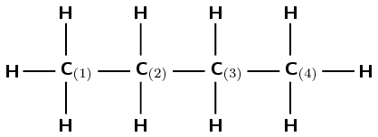

Note: The numbers attached to the carbon atoms would not normally be
                                                        shown. The carbon atoms have been numbered to help you to name
                                                        the compound.

**Identify the functional group:**
The compound is a hydrocarbon with single bonds between the carbon
                                                        atoms. It is an alkane and will have a suffix of -ane.

**Find the longest carbon chain:**
There are four carbon atoms in the longest chain. The prefix of the
                                                        compound will be but-.

**Number the carbon atoms in the longest chain:**
The numbering has been done for you here.

**Look for any branched group, name them and give their
                                                        position on the carbon chain:**
There are no branched groups in this compound.

**Combine the elements of the name into a single word:**
The name of the compound is **butane**.
</Callout>

<Callout type="tip" title="Worked example 2: Naming the alkanes">
**Question:**
Give the IUPAC name for the following compound:

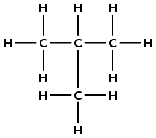

**Identify the functional group:**
The compound is a hydrocarbon with single bonds between the carbon
                                                        atoms. It is an alkane and will have the suffix -ane.

**Find the longest carbon chain:**
There are three carbon atoms in the longest chain. The prefix for
                                                        this compound is prop-.

**Number the carbons in the carbon chain:**
If we start at the carbon on the left, we can number the atoms as
                                                        shown in red (left). If we start at the carbon on the right, we
                                                        can number the atoms as shown in blue (right).

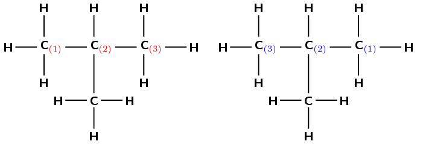

**Look for any branched groups, name them and give their
                                                        position on the carbon chain:**
There is a branched group attached to the second carbon atom. In this
                                                        case the methyl group is on carbon 2 regardless of which side
                                                        you number the longest chain from.

This group has the formula \(\text{CH}_{3}\), which is methane
                                                        without a hydrogen atom. However, because it is not part of the
                                                        main chain, it is given the suffix -yl (i.e. methyl). The
                                                        position of the methyl group comes just before its name (see the
                                                        next step).

**Combine the elements of the compound's name into a
                                                        single word in the order of branched group; prefix; name ending
                                                        according to the functional group:**
The compound's name is **2-methylpropane**.
</Callout>

<Callout type="tip" title="Worked example 3: Naming the alkanes">
**Question:**
Give the IUPAC name for the following compound:

\(\text{CH}_{3}\text{CH}(\text{CH}_{3})\text{CH}(\text{CH}_{3})\text{CH}_{3}\)

(Remember that the side groups are shown in brackets after the carbon
                                                        atom to which they are attached).

**Draw the structural formula from its condensed
                                                        structural formula:**
The structural formula of the compound is:

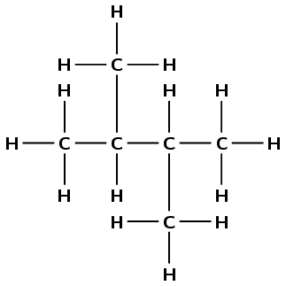

**Identify the functional group:**
The compound is a hydrocarbon with single bonds between the carbon
                                                        atoms. It is an alkane and will have the suffix -ane.

**Find the longest carbon chain:**
There are four carbon atoms in the longest chain. The prefix for this
                                                        compound is but-.

**Number the carbons in the carbon chain:**
If we start at the carbon on the left, we can number the atoms as
                                                        shown in red (left). If we start at the carbon on the right, we
                                                        can number the atoms as shown in blue (right).

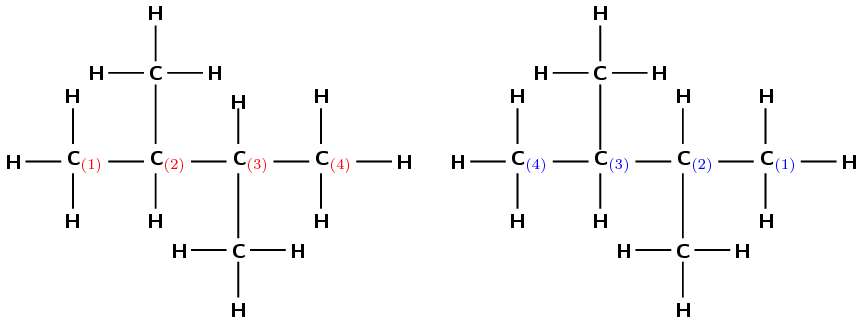

**Look for any branched groups, name them and give their
                                                        position on the carbon chain:**
There are two methyl groups attached to the main chain. The first one
                                                        is attached to the second carbon atom and the second methyl
                                                        group is attached to the third carbon atom. Notice that in this
                                                        example it does not matter how you have chosen to number the
                                                        carbons in the main chain; the methyl groups are still attached
                                                        to the second and third carbon atoms and so the naming of the
                                                        compound is not affected.

This group will be 2,3-dimethyl-

**Combine the elements of the compound's name into a
                                                        single word in the order of branched groups; prefix; name ending
                                                        according to the functional group:**
The compound's name is **2,3-dimethylbutane**.
</Callout>

<Callout type="tip" title="Worked example 4: Naming the alkanes">
**Question:**
Give the IUPAC name for the following compound:

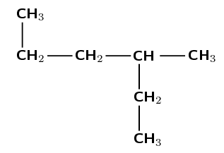

**Identify the functional group:**
The compound is a hydrocarbon with single bonds between the carbon
                                                        atoms. It is an alkane and will have the suffix -ane.

**Find the longest carbon chain and number the carbons
                                                        in the longest chain:**
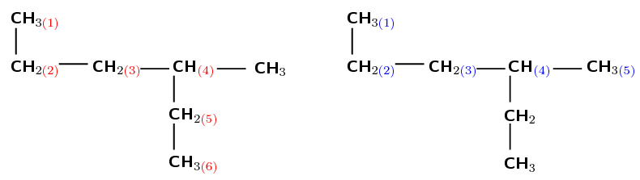

There are six carbons in the longest chain if they are numbered as
                                                        shown in red (on the left). There are only five carbon atoms if
                                                        they are numbered as shown in blue (right). Therefore, the red
                                                        numbering (on the left) is correct and the prefix for the
                                                        compound is hex-.

**Look for any branched groups, name them and give their
                                                        position on the carbon chain:**
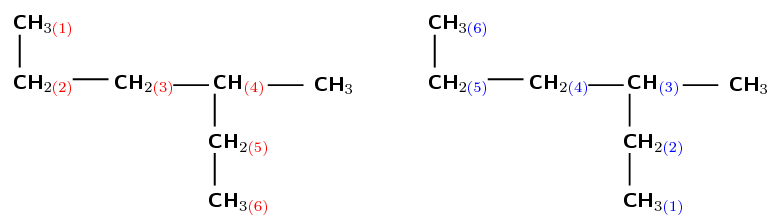

There is one methyl group attached to the main chain. If we number as
                                                        shown in red (on the left) the methyl is attached to the fourth
                                                        carbon atom. If we number as shown in blue (on the right) the
                                                        methyl is attached to the third carbon atom.

After functional groups, the branched groups should have the lowest
                                                        numbers possible. Therefore the blue numbering (on the right) is
                                                        correct. The methyl is attached to the third carbon atom
                                                        (3-methyl).

**Combine the elements of the compound's name into a
                                                        single word in the order of branched groups; prefix; name ending
                                                        according to the functional group:**
The compound's name is **3-methylhexane**.
</Callout>

<Callout type="tip" title="Worked example 5: Naming the alkanes">
**Question:**
Draw the semi-structural structural and condensed structural formula
                                                        for the organic compound **2,2,4-trimethylhexane**

**Identify the functional group:**
The name ends in -ane therefore the compound is an alkane.

**Determine the number of carbon atoms in the longest
                                                        chain:**
The longest chain has the prefix hex-. There are therefore 6 carbon
                                                        atoms in the longest chain.

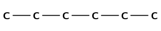

**Look for any branched groups and place them on the
                                                        structure:**
The compound is **2,2,4-trimethyl**hexane. Therefore
                                                        there are three branched groups. Two on carbon 2 and one on
                                                        carbon 4.

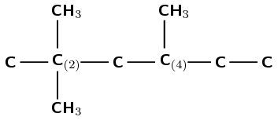

**Combine this information and add the hydrogen atoms:**
Carbon atoms can have four single bonds. Therefore wherever a carbon
                                                        atom has less than four bonds draw in hydrogen atoms until there
                                                        are four bonds.

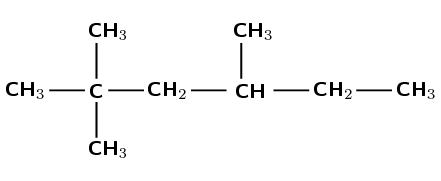

**Condense the structural formula:**
First condense the main chain:
                                                        \(\text{CH}_{3}\text{CCH}_{2}\text{CHCH}_{2}\text{CH}_{3}\)

Then add the side chains (in brackets) on the relevant carbon atoms:

**\(\text{CH}_{3}\text{C}(\text{CH}_{3})_{2}\text{CH}_{2}\text{CH}(\text{CH}_{3})\text{CH}_{2}\text{CH}_{3}\)**
</Callout>

## Naming alkanes

### Textbook Exercise 4.8

Give the structural formula for each of the following
                                                                        alkanes

**Problem:**
Octane

**Solution:**
The suffix -ane tells us that this is an
                                                                                alkane. The prefix oct- tells us that
                                                                                there are eight carbon atoms in the
                                                                                longest chain.

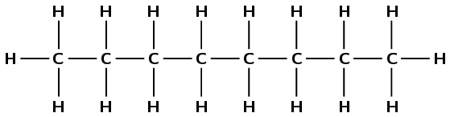

**Problem:**
Propane

**Solution:**
The suffix -ane tells us that this is an
                                                                                alkane. The prefix prop- tells us that
                                                                                there are three carbon atoms in the
                                                                                longest chain.

**Problem:**
2-methylpropane

**Solution:**
The suffix -ane tells us that this is an
                                                                                alkane. The prefix prop- tells us that
                                                                                there are three carbon atoms in the
                                                                                longest chain. 2-methyl tells us that
                                                                                there is a methyl (\(\text{CH}_{3}-\))
                                                                                branched group attached to the second
                                                                                carbon atom.

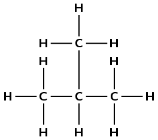

**Problem:**
3-ethylpentane

**Solution:**
The suffix -ane tells us that this is an
                                                                                alkane. The prefix pent- tells us that
                                                                                there are five carbon atoms in the
                                                                                longest chain. 3-ethyl tells us that
                                                                                there is an ethyl branched group
                                                                                (\(\text{CH}_{3}\text{CH}_{2}-\)) group
                                                                                attached to the third carbon atom.

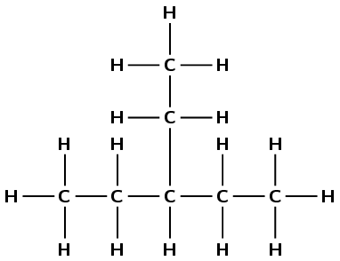

Give the IUPAC name for each of the following
                                                                        alkanes:

**Problem:**
\(\text{CH}_{3}\text{CH}_{2}\text{CH}(\text{CH}_{3})\text{CH}_{2}\text{CH}_{3}\)

**Solution:**
This is hard to do unless you draw the
                                                                                structural formula of the molecule out.
                                                                                It is recommended that you do this in
                                                                                exams.

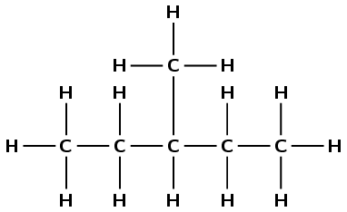

There are five carbons in the longest chain
                                                                                so the prefix is pent-. There are only
                                                                                single carbon-carbon bonds and no other
                                                                                functional group so the compound is an
                                                                                alkane and the suffix is -ane. There is
                                                                                one methyl group at position 3 (you can
                                                                                number from either end of the chain for
                                                                                this example). So the compound is
                                                                                *3-methyl**pentane***.

**Problem:**
\(\text{CH}_{3}\text{CH}(\text{CH}_{3})\text{CH}_{2}\text{CH}(\text{CH}_{3})\text{CH}_{3}\)

**Solution:**
This is hard to do unless you draw the
                                                                                structural formula of the molecule out.
                                                                                It is recommended that you do this in
                                                                                exams.

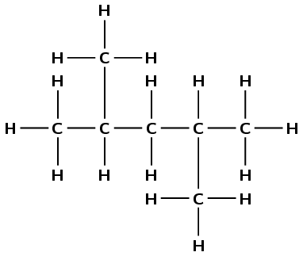

There are five carbons in the longest chain,
                                                                                so the prefix is pent-. There are only
                                                                                single carbon-carbon bonds so the
                                                                                compound is an alkane and the suffix is
                                                                                -ane. There is one methyl group at
                                                                                position 2 and one at position 4 (once
                                                                                again you can number from either end).
                                                                                So the compound is

*2,4-dimethyl**pentane***.

**Problem:**
\(\text{CH}_{3}\text{CH}_{2}\text{CH}_{2}\text{CH}_{2}\text{CH}_{2}\text{CH}_{3}\)

**Solution:**
This is hard to do unless you draw the
                                                                                structural formula of the molecule out.
                                                                                It is recommended that you do this in
                                                                                exams.

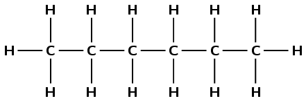

There are six carbon atoms in the longest
                                                                                chain so the prefix is hex-. There are
                                                                                only single carbon-carbon bonds and no
                                                                                other functional group so the compound
                                                                                is an alkane and the suffix is -ane.
                                                                                There are no branched groups, so the
                                                                                molecule is *hexane*.

**Problem:**
\(\text{CH}_{3}\text{CH}_{3}\)

**Solution:**
This is hard to do unless you draw the
                                                                                structural formula of the molecule out.
                                                                                It is recommended that you do this in
                                                                                exams.

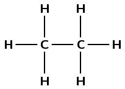

There are two carbon atoms in the longest
                                                                                chain so the prefix is eth-. There are
                                                                                only single carbon-carbon bonds and no
                                                                                other functional group so the compound
                                                                                is an alkane and the suffix is -ane.
                                                                                There are no branched groups, so the
                                                                                molecule is *ethane*.

**Problem:**
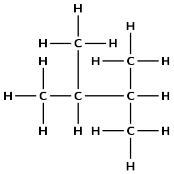

**Solution:**
There are four carbon atoms in the longest
                                                                                chain, so the prefix is but-. There are
                                                                                two methyl branches at positions 2 and
                                                                                3. The functional group is an alkane, so
                                                                                the suffix is -ane. Combining all this
                                                                                information we get:
                                                                                *2,3-dimethyl**butane***.
                                                                                Note that in this example it does not
                                                                                matter which end you start numbering
                                                                                from.

**Problem:**
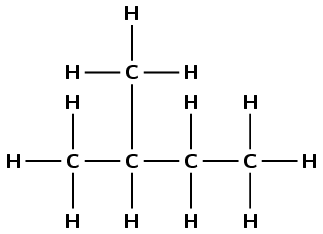

**Solution:**
There are four carbon atoms in the longest
                                                                                chain so the prefix is but-. The
                                                                                functional group is an alkane, so the
                                                                                suffix is -ane. There is one branched
                                                                                group which is a methyl group and this
                                                                                is at position 2. The molecule is
                                                                                *2-methyl**butane***.

Note that in this example it
                                                                                **does** matter which way
                                                                                you number the chain as the branched
                                                                                group needs to have the lowest number
                                                                                possible and so the compound **is
                                                                                        not** 3-methylbutane.

#### Naming alkenes

The suffix for an alkene is -ene.

<Callout type="tip" title="Worked example 6: Naming the alkenes">
**Question:**
Give the IUPAC name for the following compound:

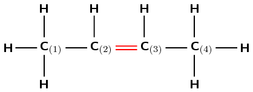

**Identify the functional group:**
The compound has a double carbon-carbon bond and is an alkene. It
                                                        will have the suffix -ene.

**Find the longest carbon chain containing the
                                                        functional group:**
The functional group is a double bond, so the longest chain must
                                                        contain the double bond. There are four carbon atoms in the
                                                        longest chain and so the prefix for this compound will be but-.

**Number the carbon atoms:**
Remember that the carbon atoms must be numbered so that the
                                                        functional group is at the lowest numbered carbon atom possible.
                                                        In this case, it doesn't matter whether we number the carbons
                                                        from the left to right, or from the right to left. The double
                                                        bond will still fall between the second and third carbon atoms.

**Look for any branched groups, name them and give their
                                                        position on the carbon chain:**
There are no branched groups in this molecule.

**Combine the elements of the name into a single word in
                                                        the following order: branched groups; prefix; name ending
                                                        according to the functional group and its position along the
                                                        longest carbon chain:**
The name of this compound is **but-2-ene** or
                                                        **2-butene**.
</Callout>

<Callout type="tip" title="Worked example 7: Naming the alkenes">
**Question:**
Draw the structural and molecular formula for the organic compound

**3-methylbut-1-ene**

**Identify the functional group:**
The suffix -ene means that this compound is an alkene and there must
                                                        be a double bond in the molecule. The number 1 immediately
                                                        before the suffix means that the double bond must be at the
                                                        first carbon in the chain (but-1-ene).

**Determine the number of carbon atoms in the longest
                                                        chain containing the functional group:**
The prefix for the compound is but- so there must be four carbons in
                                                        the longest chain containing the double bond.

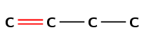

**Look for any branched groups:**
There is a methyl group at the third carbon atom in the chain. Count
                                                        from the left so that the double bond carbon is the first carbon
                                                        atom.

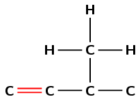

**Combine this information and add the hydrogen atoms:**
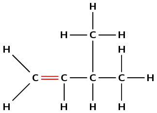

**Reduce the structural formula to the molecular formula:**
There are 5 carbon atoms and 10 hydrogen atoms so the molecular
                                                        formula is **\(\text{C}_{5}\text{H}_{10}\)**.

(Remember that there is no *structural* information given by
                                                        the molecular formula)
</Callout>

<Callout type="tip" title="Worked example 8: Naming the alkenes">
**Question:**
Give the IUPAC name for the following compound:

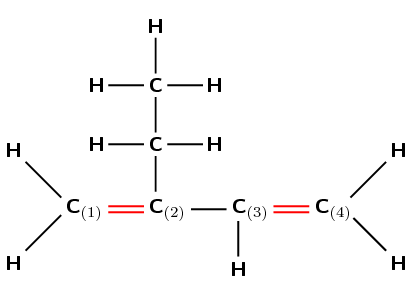

**Identify the functional group:**
The compound is an alkene and will have the suffix -ene. There is a
                                                        double bond between the first and second carbons and also
                                                        between the third and fourth carbons. The organic compound
                                                        therefore contains '1,3-diene'.

**Find the longest carbon chain containing the
                                                        functional group, and number the carbon atoms:**
Remember that the main carbon chain must contain both the double
                                                        bonds. There are four carbon atoms in the longest chain
                                                        containing the double bonds and so the prefix for this compound
                                                        will be but-. The carbon atoms are already numbered 1 to 4 in
                                                        the diagram.

**Look for any branched groups, name them and give their
                                                        position on the carbon chain:**
There is an ethyl group on the second carbon.

Note that if we had numbered from the right to left the suffix would
                                                        still have been 1,3-diene, however the ethyl group would have
                                                        been on the third carbon. So we had to number left to right.

**Combine the elements of the name into a single word in
                                                        the following order: branched groups; prefix; name ending
                                                        according to the functional group and its position along the
                                                        longest carbon chain:**
The name of this compound is **2-ethylbut-1,3-diene**.
</Callout>

## Naming alkenes

### Textbook Exercise 4.9

Give the IUPAC name for each of the following
                                                                        alkenes:

**Problem:**
\(\text{CH}_{2}\text{CHCH}_{2}\text{CH}_{2}\text{CH}_{3}\)

**Solution:**
Draw the structural representation:

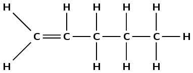

The molecule contains a double carbon-carbon
                                                                                bond. It is an alkene and so the suffix
                                                                                is -ene. There are five carbons in the
                                                                                longest chain, so the prefix is pent-.
                                                                                There are no branched groups. The double
                                                                                bond occurs between carbons 1 and 2. So
                                                                                the molecule is *1-pentene* or
                                                                                *pent-1-ene*.

Note that the way you number the carbon atoms
                                                                                matters here, the molecule is
                                                                                **not**
*pent-4-ene*.

**Problem:**
\(\text{CH}_{3}\text{CHCHCH}_{3}\)

**Solution:**
Draw the structural representation:

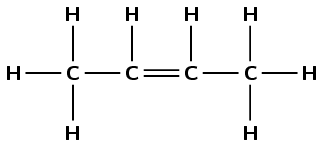

The molecule contains a double carbon-carbon
                                                                                bond. It is an alkene and so the suffix
                                                                                is -ene. There are four carbons in the
                                                                                longest chain so the prefix is but-.
                                                                                There are no branched groups. The double
                                                                                bond occurs between carbons 2 and 3. The
                                                                                molecule is *2-butene* or
                                                                                *but-2-ene*.

**Problem:**
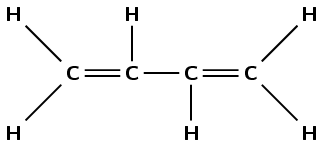

**Solution:**
The compound contains two double
                                                                                carbon-carbon bonds. It is an alkene and
                                                                                so the suffix is -diene. There are four
                                                                                carbons in the longest chain containing
                                                                                the double bonds, so the prefix is but-.
                                                                                There are no branched chains. The first
                                                                                double bond occurs between carbons 1 and
                                                                                2. The second double bond occurs between
                                                                                carbons 3 and 4. The compound is
                                                                                *but-1,3-diene*.

Give the structural formula for each of the following
                                                                        alkenes:

**Problem:**
ethene

**Solution:**
The prefix eth- tells us there are two carbon
                                                                                atoms in the chain. The suffix -ene
                                                                                tells us there is a double bond between
                                                                                these carbon atoms.

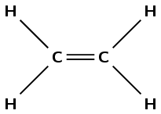

**Problem:**
hex-1-ene

**Solution:**
The prefix hex- tells us there are six carbon
                                                                                atoms in the chain. The suffix -1-ene
                                                                                tells us there is a double bond between
                                                                                the first and second carbon atoms.

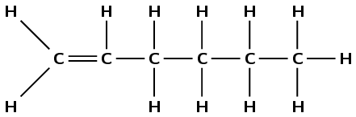

**Problem:**
hept-3-ene

**Solution:**
The prefix hept- tells us there are seven
                                                                                carbon atoms in the chain. The suffix
                                                                                -3-ene tells us there is a double bond
                                                                                between the third and fourth carbon
                                                                                atoms.

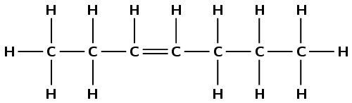

**Problem:**
4-ethyloct-3-ene

**Solution:**
The prefix oct- tells us there are eight
                                                                                carbon atoms in the longest chain
                                                                                containing the functional group. The
                                                                                suffix -3-ene tells us there is a double
                                                                                bond between the third and fourth carbon
                                                                                atoms. 4-ethyl tells us that there is an
                                                                                ethyl (\(\text{CH}_{3}\text{CH}_{2}-\))
                                                                                branched group attached to the fourth
                                                                                carbon atom.

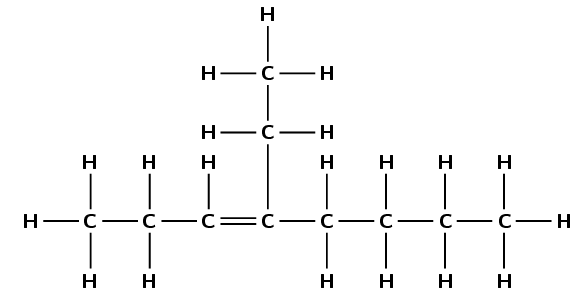

#### Naming alkynes

The suffix for an alkyne is -yne.

<Callout type="tip" title="Worked example 9: Naming the alkynes">
**Question:**
Give the IUPAC name for the following compound:

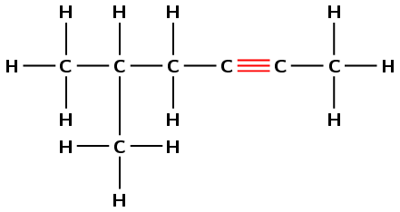

**Identify the functional group:**
There is a triple bond between two of the carbon atoms, so this
                                                        compound is an alkyne. The suffix will be -yne.

**Find the longest carbon chain containing the
                                                        functional group:**
The functional group is a triple bond, so the longest chain must
                                                        contain the triple bond. There are six carbon atoms in the
                                                        longest chain. The prefix of the compound's name will be hex-.

**Number the carbons in the longest chain:**
In this example, you will need to number the carbons from right to
                                                        left so that the triple bond is between carbon atoms with the
                                                        lowest numbers (the suffix for the compound will therefore be
                                                        -2-yne).

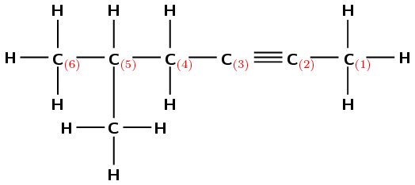

**Look for any branched groups, name them and assign the
                                                        number of the carbon atom to which the group is attached:**
There is a methyl (\(\text{CH}_{3}\)) group attached to the fifth
                                                        carbon (remember we have numbered the carbon atoms from right to
                                                        left).

**Combine the elements of the name into a single word in
                                                        the following order: branched groups; prefix; name ending
                                                        according to the functional group and its position along the
                                                        longest carbon chain:**
If we follow this order, the name of the compound is
                                                        **5-methylhex-2-yne**.
</Callout>

<Callout type="tip" title="Worked example 10: Naming the alkynes">
**Question:**
Give the IUPAC name for the following compound:

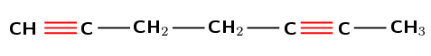

**Identify the functional group:**
There are two triple bonds. The suffix will therefore be -diyne.

**Find the longest carbon chain containing the
                                                        functional group:**
The functional group is a triple bond, so the longest chain must
                                                        contain all triple bonds. The longest carbon chain contains
                                                        seven carbon atoms, therefore the prefix will be hept-.

**Number the carbons in the longest chain:**
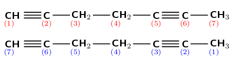

Numbering from left to right (shown in red) the first triple bond is
                                                        on carbon 1 and the second is on carbon 5. The suffix will
                                                        therefore be -1,5-diyne.

(Numbering from right to left (shown in blue) will give the suffix
                                                        -2,6-diyne, and is incorrect).

**Look for any branched groups:**
There are no branched groups for this molecule.

**Combine the elements of the name into a single word in
                                                        the following order: branched groups; prefix; name ending
                                                        according to the functional group and its position along the
                                                        longest carbon chain:**
The name of the compound is **hept-1,5-diyne**.
</Callout>

<Callout type="tip" title="Worked example 11: Naming the alkynes">
**Question:**
Draw the structural and condensed structural formula for the organic
                                                        compound

**6-methylhept-3-yne**

**Identify the functional group:**
The suffix -3-yne means that this compound is an alkyne and there
                                                        must be a triple bond located on carbon number 3.

**Determine the number of carbon atoms in the longest
                                                        chain containing the functional group:**
The prefix for the compound is hept- so there must be seven carbons
                                                        in the longest chain.

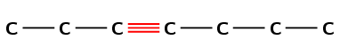

**Look for any branched groups:**
There is a methyl group located on carbon number 6.

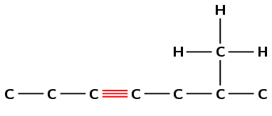

**Combine this information and add the hydrogen atoms:**
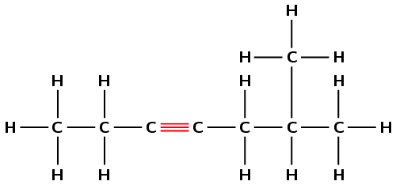

**Condense the structural formula:**
First condense the main chain:
                                                        \(\text{CH}_{3}\text{CH}_{2}\text{CCCH}_{2}\text{CHCH}_{3}\)

Then add the side chains (in brackets) on the relevant carbon atoms:

**\(\text{CH}_{3}\text{CH}_{2}\text{CCCH}_{2}\text{CH}(\text{CH}_{3})\text{CH}_{3}\)**
</Callout>

## Naming alkynes

### Textbook Exercise
                                                        4.10

Give the structural formula for each of the following
                                                                        alkynes:

**Problem:**
ethyne

**Solution:**
The prefix eth- tells us there are two carbon
                                                                                atoms in the longest chain. The suffix
                                                                                -yne tells us there is a triple bond
                                                                                between the carbon atoms.

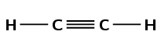

**Problem:**
pent-1-yne

**Solution:**
The prefix pent- tells us there are five
                                                                                carbon atoms in the longest chain. The
                                                                                suffix -1-yne tells us there is a triple
                                                                                bond between the first and second carbon
                                                                                atoms.

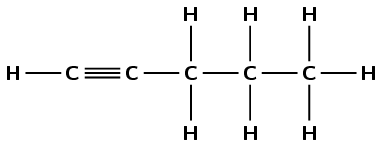

**Problem:**
5-methylhept-3-yne

**Solution:**
The prefix hept- tells us there are seven
                                                                                carbon atoms in the longest chain. The
                                                                                suffix -3-yne tells us there is a triple
                                                                                bond between the third and fourth carbon
                                                                                atoms. 5-methyl tells us there is a
                                                                                methyl branched chain on the fifth
                                                                                carbon atom.

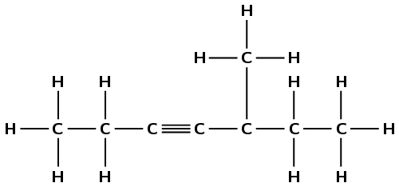

Give the IUPAC names for the following alkynes:

**Problem:**
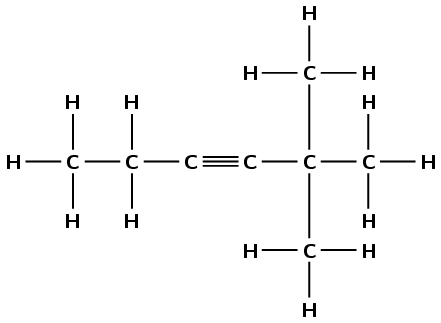

**Solution:**
There is a triple carbon-carbon bond. This
                                                                                compound is an alkyne and will have the
                                                                                suffix -yne. There are six carbon atoms
                                                                                in the longest chain, therefore the
                                                                                prefix will be hex-. The triple bond is
                                                                                between the third and fourth carbon
                                                                                atoms regardless of how you number the
                                                                                chain (-3-yne). There are two branched
                                                                                methyl groups. Depending on the order of
                                                                                numbering they are either on the fourth
                                                                                carbon atom (left to right) or the
                                                                                second carbon atom (right to left). The
                                                                                lower numbering is correct (right to
                                                                                left) and as there are two methyl groups
                                                                                this is 2,2-dimethyl. The molecule is
                                                                                **2,2-dimethylhex-3-yne**.

**Problem:**
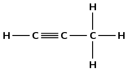

**Solution:**
There is a triple carbon-carbon bond. This
                                                                                compound is an alkyne and will have the
                                                                                suffix -yne. There are three carbon
                                                                                atoms in the longest chain, therefore
                                                                                the prefix will be prop-. The triple
                                                                                bond is between the first and second
                                                                                carbon atoms (numbering from the left)
                                                                                making the suffix -1-yne. There are no
                                                                                branched groups. This molecule is
                                                                                **prop-1-yne** or propyne.

**Problem:**
\(\text{CH}_{3}\text{CCCH}_{3}\)

**Solution:**
Draw the structure:

There is a triple carbon-carbon bond. This
                                                                                compound is an alkyne and will have the
                                                                                suffix -yne. There are four carbon atoms
                                                                                in the longest chain, therefore the
                                                                                prefix will be but-. The triple bond is
                                                                                between the second and third carbon
                                                                                atoms regardless of how you number the
                                                                                chain (-2-yne). There are no branched
                                                                                groups. This molecule is
                                                                                **but-2-yne** or 2-butyne.

Model kits are a great way to help learners understand and visualise organic
                                                molecules. If you do not have access to model kits however, substitutes
                                                can be used. A bag of jelly tots (or a similar soft sweet) would work
                                                just as well, using toothpicks to represent the bonds. It is also
                                                possible to make your own playdough (which can be coloured for different
                                                atoms using food colourants). A recipe is given here:

- 2 cups flour, 2 cups warm water, 1 cup salt, 2 tablespoons
                                                                  vegetable oil, 1 tablespoon of cream of tartar (this
                                                                  improves elasticity, and is optional).
- Mix all the ingredients together over a low heat and stir
                                                                  continually.
- When the dough pulls away from the sides of the pot, remove
                                                                  it from the heat and allow to cool.
- If your dough is still sticky just cook it a bit longer.
- Once cool, knead the dough until it becomes smooth, then
                                                                  separate and add food colourant, different colours for
                                                                  different types of atoms.
- The dough is ready. Remember to store it in an airtight
                                                                  container between uses. If it dries out a bit, knead in
                                                                  a bit of water.

The full process is provided on [www.instructables.com](http://www.instructables.com/id/How-to-Make-Playdough-Play-doh/#step1).
                                                This playdough can be used for all the model building activities.

Be careful to keep the playdough away from animals, as it is edible, but
                                                contains large amounts of salt.

## Building hydrocarbons

An example of ethane, ethene and ethyne built with atomic model kits is given
                                                in the picture below:

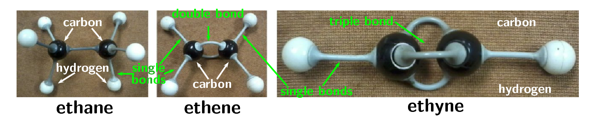

2. Using atomic model kits, build the molecules of methane,
                                                                   propane, butane, pentane and octane. If you don't have
                                                                   atomic model kits, jelly tots (or playdough) and
                                                                   toothpicks will work just as well. Use one colour jelly
                                                                   tot for the carbon atoms and one for the hydrogen atoms.
   - Remember that carbon atoms should have four
                                                                             bonds and hydrogen atoms can have only one. You
                                                                             should see that all these compounds have a
                                                                             similar formula, remember they all have the
                                                                             general formula
                                                                             \(\text{C}_{\text{n}}\text{H}_{2\text{n}+2}\).
   - What is the name of the homologous series that
                                                                             all these molecules belong to?
4. Build the molecules of prop-1-ene, but-1-ene, pent-1-ene and
                                                                   oct-1-ene. Use two toothpicks to represent a double
                                                                   bond. You should see that all these compounds have a
                                                                   similar formula. Remember, they all have the general
                                                                   formula \(\text{C}_{\text{n}}\text{H}_{2\text{n}}\).
   - Try placing the double bond at different
                                                                             positions within the molecule. Does this make
                                                                             any difference to the total number of carbon and
                                                                             hydrogen atoms in the molecule?
   - What is the name of the homologous series that
                                                                             all these molecules belong to?
6. Build the molecules of prop-1-yne, but-1-yne, pent-1-yne and
                                                                   oct-1-yne. Use three toothpicks to represent a triple
                                                                   bond. You should see that all these compounds have a
                                                                   similar formula. Remember, they are all alkynes.
   - Try placing the triple bond at different
                                                                             positions within the molecule. Does this make
                                                                             any difference to the total number of carbon and
                                                                             hydrogen atoms in the molecule?
   - What is the general formula for the alkynes?

## Naming hydrocarbons

### Textbook Exercise
                                                        4.11

Give the structural formula for each of the following
                                                                        compounds:

**Problem:**
oct-2-ene

**Solution:**
The prefix oct- tells us there are eight
                                                                                carbon atoms in the longest chain. The
                                                                                suffix -2-ene tells us there is a double
                                                                                bond between the second and third carbon
                                                                                atoms.

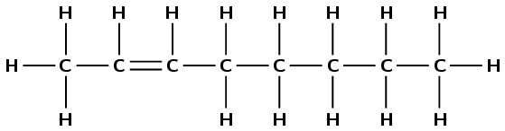

**Problem:**
3-methylhexane

**Solution:**
The prefix hex- tells us there are six carbon
                                                                                atoms in the longest chain. The suffix
                                                                                -ane tells us this is an alkane and that
                                                                                there are only single carbon-carbon
                                                                                bonds and no other functional groups.
                                                                                3-methyl tells us there is a branched
                                                                                methyl group on the third carbon atom.

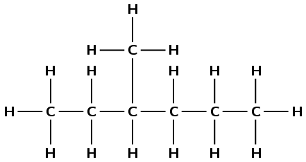

**Problem:**
hept-3-yne

**Solution:**
The prefix hept- tells us there are seven
                                                                                carbon atoms in the longest chain. The
                                                                                suffix -3-yne tells us that this is an
                                                                                alkyne and there is a triple bond
                                                                                between the third and fourth carbon
                                                                                atoms.

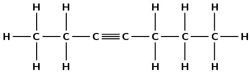

**Problem:**
4-ethyl-4-methylhept-2-yne

**Solution:**
The prefix hept- tells us there are seven
                                                                                carbon atoms in the longest chain. The
                                                                                suffix -2-yne tells us this is an alkyne
                                                                                and there is a triple bond between the
                                                                                second and third carbon atoms. The
                                                                                4-ethyl tells us there is an ethyl
                                                                                (\(\text{CH}_{3}\text{CH}_{2}-\))
                                                                                branched group on the fourth carbon
                                                                                atom. The 4-methyl tells us there is a
                                                                                methyl (\(\text{CH}_{3}-\)) branched
                                                                                group on the fourth carbon atom.

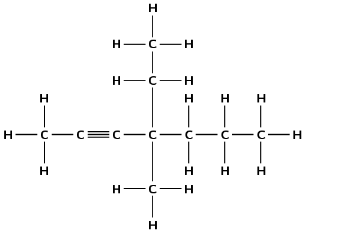

**Problem:**
pentane

**Solution:**
The prefix pent- tells us there are five
                                                                                carbon atoms in the longest chain. The
                                                                                suffix -ane tells us this is an alkane.

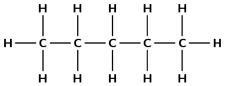

**Problem:**
2-methylbut-1-ene

**Solution:**
The prefix but- tells us there are four
                                                                                carbon atoms in the longest chain
                                                                                containing the functional group. The
                                                                                suffix -1-ene tells us that this is an
                                                                                alkene and there is a double bond
                                                                                between the first and second carbon
                                                                                atoms. 2-methyl tells us that there is a
                                                                                methyl (\(\text{CH}_{3}-\) group
                                                                                attached to the second carbon atom.

**Problem:**
propyne

**Solution:**
The prefix prop- tells us there are three
                                                                                carbon atoms in the longest chain. The
                                                                                suffix -yne tells us there is a triple
                                                                                carbon-carbon bond between the first and
                                                                                second carbon atoms.

Give the IUPAC name for each of the following organic
                                                                        compounds:

**Problem:**

**Solution:**
The compound has a double carbon-carbon bond
                                                                                and no other functional groups.
                                                                                Therefore it is an alkene and the suffix
                                                                                is -ene. There are five carbon atoms in
                                                                                the longest chain and so the prefix is
                                                                                pent-. There are no branched groups. The
                                                                                double bond occurs between carbons 2 and
                                                                                3. The compound is *2-pentene* or
                                                                                **pent-2-ene**.

Note that the way we number the carbon atoms
                                                                                matters. The double bond is given the
                                                                                lowest possible number and so this
                                                                                compound *is not* pent-3-ene.

**Problem:**

**Solution:**
There is a double carbon-carbon bond,
                                                                                therefore the compound is an alkene and
                                                                                the suffix is -ene. There are four
                                                                                carbon atoms in the main chain (the
                                                                                longest chain containing the functional
                                                                                group) so the prefix is but-. There is
                                                                                an ethyl group on the second carbon
                                                                                atom. The double bond occurs between
                                                                                carbons 1 and 2. The compound is
                                                                                therefore **2-ethylbut-1-ene
                                                                                **.

Remember that you have to have the functional
                                                                                group in the main chain so the compound
                                                                                is **not** a substituted
                                                                                pentane.

**Problem:**
\(\text{CH}_{3}\text{CH}_{2}\text{CH}_{2}\text{CH}_{2}\text{CH}_{2}\text{CH}_{3}\)

**Solution:**
Draw the structural representation:

There are only single carbon-carbon bonds in
                                                                                this compound and no other functional
                                                                                groups, therefore it is an alkane and
                                                                                the suffix is -ane. There are six carbon
                                                                                atoms in the longest chain so the prefix
                                                                                is hex-. There are no branched groups in
                                                                                this compound. This molecule is
                                                                                **hexane**.

**Problem:**
\(\text{CH}_{3}\text{CH}_{2}\text{CCH}\)

**Solution:**
Draw the structural representation of the
                                                                                compound:

The compound has a triple carbon-carbon bond,
                                                                                therefore it is an alkyne and the suffix
                                                                                is -yne. There are four carbon atoms in
                                                                                the longest chain so the prefix is but-.
                                                                                There are no branched chains. The double
                                                                                bond occurs between the first and second
                                                                                carbon atoms. The compound is therefore
                                                                                **but-1-yne** or butyne.

Note that the way we number the carbon atoms
                                                                                matters. The double bond is given the
                                                                                lowest possible number and so this
                                                                                compound *is not* but-3-yne.

**Problem:**

**Solution:**
There are only single bonds in this compound
                                                                                and no other functional groups,
                                                                                therefore it is an alkane and the suffix
                                                                                is -ane. There is one carbon atom in the
                                                                                longest chain so the prefix is meth-.
                                                                                There are no branched groups in this
                                                                                compound. This molecule is
                                                                                **methane**.

**Problem:**
\(\text{C}_{2}\text{H}_{2}\)

**Solution:**
Draw the structural representation of the
                                                                                compound:

The compound has a triple carbon-carbon bond,
                                                                                therefore it is an alkyne and the suffix
                                                                                is -yne. There are two carbon atoms in
                                                                                the longest chain so the prefix is eth-.
                                                                                There are no branched chains. There are
                                                                                only two carbon atoms, so the triple
                                                                                bond has to be between them. The
                                                                                compound is **ethyne**.

**Problem:**
\(\text{CH}_{3}\text{CHCH}_{2}\)

**Solution:**
Draw the structural representation of the
                                                                                compound:

The compound has a double carbon-carbon bond,
                                                                                therefore it is an alkene and the suffix
                                                                                is -ene. There are three carbon atoms in
                                                                                the longest chain so the prefix is
                                                                                prop-. There are no branched chains. The
                                                                                double bond occurs between the first and
                                                                                second carbon atoms. The compound is
                                                                                **propene**.

Note that the way we number the carbon atoms
                                                                                matters. The double bond is given the
                                                                                lowest possible number and so this
                                                                                compound *is not* prop-2-ene.
                                                                                Also, we do not include the 1 in the
                                                                                name as this is *the only
                                                                                        position* that the double
                                                                                bond can occur in propene.

### Naming alkyl halides (ESCKK)

All the same rules apply when naming the alkyl halides as for naming the hydrocarbons. We
                                will only be dealing with the haloalkanes (i.e. there are no other functional groups).
                                The halogen atom is treated in the same way as a branched group.

<Callout type="tip" title="Worked example 12: Naming the haloalkanes">
**Question:**
Give the IUPAC name for the following compound:

**Identify the functional group:**
There is a halogen atom and no other functional group. This compound is
                                                therefore a haloalkane, and will have the suffix -ane.

**Find the longest carbon chain containing the functional group:**
There are three carbons in the longest chain containing the halogen atom. The
                                                prefix is prop-.

**Number the carbon atoms in the longest chain:**
You need to number the carbon atoms so that the halogen atom is on the carbon
                                                atom with the lowest number. In this case you can number from either
                                                side.

**Name the halogen atom and assign the number for the carbon
                                                atom it is attached to:**
The halogen is a chlorine atom. It is attached to carbon number 2 and so will
                                                have the name 2-chloro.

**Look for branched groups:**
There are no branched groups in this compound.

**Combine the elements of the name into a single word in the
                                                following order: halogen atoms; prefix; name ending according to
                                                functional group:**
The name of the compound is **2-chloropropane**.
</Callout>

<Callout type="tip" title="Worked example 13: Naming the haloalkanes">
**Question:**
Give the IUPAC name for the following compound:

**Identify the functional group:**
There are three halogen atoms and no other functional groups. This compound
                                                is therefore a haloalkane, and will have the suffix -ane.

**Find the longest carbon chain containing the functional group:**
There are four carbons in the longest chain containing all the halogen atoms.
                                                The prefix for this compound will be but-.

**Number the carbon atoms in the longest chain:**
You need to number the carbon atoms so that the halogen atoms are on the
                                                carbon atoms with the lowest numbers. You must number from left to right
                                                here so that one halogen atom is on carbon 1 and two halogen atoms are
                                                on carbon 3.

**Name the halogen atoms and assign the number for the carbon
                                                atom attached to it:**
There are two halogen atoms that are bromine atoms and one that is fluorine.
                                                One bromine is attached to carbon 1 and one is attached to carbon 3. The
                                                fluorine atom is attached to carbon 3. So you have 1,3-dibromo- and
                                                3-fluoro.

**Look for branched groups:**
There are no branched groups in this compound.

**Combine the elements of the name into a single word in the
                                                following order: halogen atoms in alphabetical order; prefix; name
                                                ending according to functional group:**
The name of the compound is **1,3-dibromo-3-fluorobutane**. Note
                                                that we place the halogens in alphabetical order: *b*romo (ignore
                                                the di/tri/tetra) is before *f*luoro.
</Callout>

<Callout type="tip" title="Worked example 14: Naming the haloalkanes">
**Question:**
Draw the structural and condensed structural formula for the organic compound

**2-iodo-3-methylpentane**

**Identify the functional group:**
This compound has the suffix -ane, but also contains a halogen atom. It is
                                                therefore a haloalkane. Note that the methyl and iodo are written in
                                                alphabetical order.

**Find the longest carbon chain containing the functional group:**
The prefix is pent- therefore there are 5 carbons in the longest chain.

**Place the halogen atom(s) and any branched groups:**
There is an iodine atom on the second carbon atom, and a methyl branched
                                                group on the third carbon atom.

**Combine this information to and add the hydrogen atoms:**

**Condense the structural formula:**
First condense the main chain:
                                                \(\text{CH}_{3}\text{CHCHCH}_{2}\text{CH}_{3}\)

Then add the side chains and halogen atoms (in brackets) on the relevant
                                                carbon atoms:
                                                **\(\text{CH}_{3}\text{CH}(\text{I})\text{CH}(\text{CH}_{3})\text{CH}_{2}\text{CH}_{3}\)**
</Callout>

## Naming haloalkanes

### Textbook Exercise 4.12

Give the structural representation for the following
                                                                haloalkanes:

**Problem:**
2-chlorobutane

**Solution:**
The but- tells us that there are four carbon atoms in
                                                                        the longest chain. The -ane tells us there are
                                                                        only single carbon-carbon bonds. The 2-chloro
                                                                        means there is a chlorine atom attached to the
                                                                        second carbon atom.

**Problem:**
1-bromopropane

**Solution:**
The prop- tells us that there are three carbon atoms
                                                                        in the longest chain. The -ane tells us there
                                                                        are only single carbon-carbon bonds. The 1-bromo
                                                                        means there is a bromine atom attached to the
                                                                        first carbon atom.

**Problem:**
2,3-difluoropentane

**Solution:**
The pent- tells us there are five carbon atoms in the
                                                                        longest chain. The -ane tells us there are only
                                                                        single carbon-carbon bonds. The 2,3-difluoro
                                                                        means there are two fluorine atoms, one attached
                                                                        to carbon 2 and the other attached to carbon 3.

Give the IUPAC name for the following haloalkanes:

**Problem:**

**Solution:**
There is a halogen atom and only single carbon-carbon
                                                                        bonds, therefore this is a haloalkane and the
                                                                        suffix is -ane. There are three carbon atoms in
                                                                        the longest chain, therefore the prefix is
                                                                        prop-. There is an iodine atom attached to the
                                                                        second carbon atom (2-iodo). There are no
                                                                        branched groups. Therefore this molecule is
                                                                        **2-iodopropane**.

**Problem:**
\(\text{CH}_{3}\text{CH}(\text{Br})\text{CH}(\text{CH}_{3})\text{CH}_{2}\text{CH}_{2}\text{CH}_{3}\)

**Solution:**
Draw the structural representation:

There is a halogen atom and only single carbon-carbon
                                                                        bonds, therefore this is a haloalkane and the
                                                                        suffix is -ane. There are six carbon atoms in
                                                                        the longest chain, therefore the prefix is hex-.
                                                                        There is a bromine atom attached to the second
                                                                        carbon atom (2-bromo). There is a branched
                                                                        methyl group attached to the third carbon atom
                                                                        (3-methyl). This molecule is

**2-bromo-3-methylhexane**.

**Problem:**

**Solution:**
There are halogen atoms and only single carbon-carbon
                                                                        bonds, therefore this is a haloalkane and the
                                                                        suffix is -ane. There are eight carbon atoms in
                                                                        the longest chain, therefore the prefix is oct-.
                                                                        There are two chlorine atoms, one attached to
                                                                        the first carbon atom and one attached to the
                                                                        fourth carbon atom (1,4-dichloro). There are no
                                                                        branched groups. This molecule is
                                                                        **1,4-dichlorooctane**.

**Problem:**
\(\text{CH}_{2}(\text{F})\text{C}(\text{I})_{2}\text{CH}_{2}\text{CH}_{3}\)

**Solution:**
Draw the structural representation:

There are halogen atoms and only single carbon-carbon
                                                                        bonds, therefore this is a haloalkane and the
                                                                        suffix is -ane. There are four carbon atoms in
                                                                        the longest chain containing all the halogen
                                                                        atoms, therefore the prefix is but-. There is a
                                                                        fluorine atom attached to the first carbon atom
                                                                        (1-fluoro). There are two iodine atoms attached
                                                                        to the second carbon atom (2,2-diiodo). These
                                                                        must be put in alphabetical order, ignoring any
                                                                        prefixes on the halogen atoms.
                                                                        **F** comes before
                                                                        **i** (1-fluoro-2,2-diiodo). This
                                                                        molecule is
                                                                        **1-fluoro-2,2-diiodobutane**

### Naming alcohols (ESCKM)

The rules used to name the alcohols are similar to those already discussed for the
                                hydrocarbons. The suffix of an alcohol is –ol (see Table 4.5).

<Callout type="tip" title="Worked example 15: Naming the alcohols">
**Question:**
Give the IUPAC name for the following organic compound

**Identify the functional group:**
The compound has an \(-\text{OH}\) (hydroxyl) functional group and is
                                                therefore an alcohol. The compound will have the suffix -ol.

**Find the longest carbon chain containing the functional group:**
There are three carbon atoms in the longest chain that contains the
                                                functional group. The prefix for this compound will be prop-. As there
                                                are only single bonds between the carbon atoms, the prefix includes
                                                *an* to become propan-.

**Number the carbons in the carbon chain:**
In this case, it doesn't matter whether you start numbering from the left or
                                                right. The hydroxyl group will still be attached to second carbon atom
                                                (-2-ol).

**Look for branched groups:**
There are no branched groups in this compound.

**Combine the elements of the compound's name into a single word
                                                in the order of branched groups; prefix; name ending according to the
                                                functional group:**
The compound's name is **propan-2-ol** or
                                                **2-propanol**.
</Callout>

<Callout type="tip" title="Worked example 16: Naming the alcohols">
**Question:**
Give the IUPAC name for the following compound:

**Identify the functional group:**
The compound has an \(-\text{OH}\) (hydroxyl) functional group and is
                                                therefore an alcohol. There are *two* hydroxyl groups in the
                                                compound, so the suffix will be -diol.

**Find the longest carbon chain that contains the functional
                                                group:**
There are four carbon atoms in the longest chain that contains the functional
                                                group (but-) and only single bonds (an-). The prefix for this compound
                                                will be butan-.

**Number the carbons in the carbon chain:**

There are two hydroxyl groups attached to the main chain. If we number as
                                                shown in red (on the left) they are attached to the first and second
                                                carbon atoms. If we number as shown in blue (on the right) they are
                                                attached to the third and fourth carbon atoms.

The functional groups should have the lowest numbers possible. Therefore the
                                                red numbering is correct. The hydroxyl groups are attached to the first
                                                and second carbon atoms (1,2-diol).

**Look for branched groups:**
There are no branched groups in this compound.

**Combine the elements of the compound's name into a single word
                                                in the order of branched groups; prefix; name ending according to the
                                                functional group:**
The compound's name is **butan-1,2-diol**.
</Callout>

<Callout type="tip" title="Worked example 17: Naming the alcohols">
**Question:**
Draw the structural and condensed structural representations for the organic
                                                compound **4-ethyloctan-2,5-diol**

**Identify the functional group:**
The compound has the suffix -ol. It is therefore an alcohol.

**Find the longest carbon chain that contains the functional
                                                group:**
The prefix is oct- therefore there are 8 carbons in the longest chain
                                                containing the functional group.

**Place the functional group as well as any branched groups:**
There is one \(-\text{OH}\) attached to carbon 2 and one attached to carbon
                                                5. There is also an ethyl (\(-\text{CH}_{2}\text{CH}_{3}\)) branched
                                                group attached to carbon 4.

**Combine this information and add the hydrogen atoms:**

**Condense the structural formula:**
First condense the main chain:
                                                \(\text{CH}_{3}\text{CHCH}_{2}\text{CHCHCH}_{2}\text{CH}_{2}\text{CH}_{3}\)

Then add the side chains and alcohol functional groups (in brackets) on the
                                                relevant carbon atoms:
                                                **\(\text{CH}_{3}\text{CH}(\text{OH})\text{CH}_{2}\text{CH}(\text{CH}_{2}\text{CH}_{3})\text{CH}(\text{OH})\text{CH}_{2}\text{CH}_{2}\text{CH}_{3}\)**
</Callout>

## Building alcohols

The structural representation of butan-1-ol built using an atomic model kit is given
                                        below:

Using atomic model kits, build the molecules of methanol, ethanol, propan-1-ol,
                                        pentan-1-ol and octan-1-ol. If you don't have an atomic model kit remember that
                                        you can use jelly tots (or playdough) and toothpicks. Use different colour jelly
                                        tots to represent the different atoms.

- You should see that all these compounds have a similar formula.
                                                          Remember, they belong to the homologous series of the alcohols.
                                                          What is the general formula for this series?
- Try placing the hydroxyl group at different positions within the
                                                          molecule. Does this make any difference to the total number of
                                                          carbon, hydrogen and oxygen atoms in the molecule?

## Naming alcohols

### Textbook Exercise 4.13

Give the structural representation of each of the following
                                                                organic compounds:

**Problem:**
pentan-3-ol

**Solution:**
The prefix pentan- tells us there are five carbon
                                                                        atoms in the longest chain and only single
                                                                        carbon-carbon bonds. The suffix -3-ol tells us
                                                                        there is a hydroxyl (\(-\text{OH}\)) group on
                                                                        the third carbon atom.

**Problem:**
butan-2,3-diol

**Solution:**
The prefix butan- tells us there are four carbon
                                                                        atoms in the longest chain and only single
                                                                        carbon-carbon bonds. The suffix -2,3-diol tells
                                                                        us there are two hydroxyl groups, one attached
                                                                        to the second carbon atom and one attached to
                                                                        the third carbon atom.

**Problem:**
2-methylpropan-1-ol

**Solution:**
The prefix propan- tells us there are three carbon
                                                                        atoms in the longest chain and only single
                                                                        carbon-carbon bonds. The suffix -1-ol tells us
                                                                        there is a hydroxyl group attached to the first
                                                                        carbon atom. 2-methyl tells us there is a methyl
                                                                        branched group attached to the second carbon
                                                                        atom.

Give the IUPAC name for each of the following:

**Problem:**
\(\text{CH}_{3}\text{CH}_{2}\text{CH}(\text{OH})\text{CH}_{3}\)

**Solution:**
Draw the structural representation of the compound:

There is a hydroxyl group, therefore the compound is
                                                                        an alcohol and the suffix is -ol. There are four
                                                                        carbon atoms in the longest chain so the prefix
                                                                        is but-. There are only single carbon-carbon
                                                                        bonds, therefore the prefix becomes butan-.
                                                                        There are no branched groups. The hydroxyl group
                                                                        is attached to the second carbon atom. The
                                                                        molecule is *2-butanol* or
                                                                        **butan-2-ol**.

Note that the way we number the carbon atoms matters.
                                                                        The hydroxyl group is given the lowest possible
                                                                        number and so this compound **is
                                                                                not** butan-3-ol.

**Problem:**

**Solution:**
There is a hydroxyl group, therefore the compound is
                                                                        an alcohol and the suffix is -ol. There are five
                                                                        carbon atoms in the longest chain so the prefix
                                                                        is pent-. There are only single carbon-carbon
                                                                        bonds, therefore the prefix becomes pentan-.
                                                                        There are no branched groups. The hydroxyl group
                                                                        is attached to the second carbon atom. The
                                                                        molecule is *2-pentanol* or
                                                                        **pentan-2-ol**.

Note that the way we number the carbon atoms matters.
                                                                        The hydroxyl group is given the lowest possible
                                                                        number and so this compound **is
                                                                                not** pentan-4-ol.

**Problem:**

**Solution:**
There are two hydroxyl groups, therefore the compound
                                                                        is an alcohol and the suffix is -diol. There are
                                                                        seven carbon atoms in the longest chain so the
                                                                        prefix is hept-. There are only single
                                                                        carbon-carbon bonds, therefore the prefix
                                                                        becomes heptan-. The hydroxyl groups are both
                                                                        attached to the third carbon atom (-3,3-diol).
                                                                        The branched methyl chain is attached to the
                                                                        fourth carbon atom. The molecule is
                                                                        **4-methylheptan-3,3-diol**.

Note that the way we number the carbon atoms matters.
                                                                        The hydroxyl groups are given the lowest
                                                                        possible numbers and so this compound **is
                                                                                not** 4-methylheptan-5,5-diol.

### Naming carbonyl compounds (ESCKN)

A carbonyl group consists of a carbon atom that is bonded to an oxygen atom through a double
                                bond (C\(=\)O). There are many different functional groups that contain a carbonyl
                                group.

#### Naming aldehydes

If the carbonyl group is on the *end* of the carbon chain, the organic
                                        compound is called an *aldehyde*. An aldehyde has the suffix -al.

<Callout type="tip" title="Worked example 18: Naming aldehydes">
**Question:**
Give the IUPAC name and molecular formula for the following organic
                                                        compound

**Identify the functional group:**
The compound has a C\(=\)O (carbonyl) group and no other functional
                                                        groups. It is therefore either an aldehyde or a ketone. The
                                                        carbonyl group is on the last (terminal) carbon in the main
                                                        chain so the compound is an aldehyde. It will have the suffix
                                                        -al.

**Find the longest carbon chain containing the
                                                        functional group:**
There are three carbons in the longest chain that contains the
                                                        functional group. The prefix for this compound will be prop-. As
                                                        there are only single bonds between the carbon atoms, the prefix
                                                        becomes propan-.

**Number the carbon atoms in the carbon chain:**
The carbon atoms will be numbered so that the carbon atom of the
                                                        aldehyde group has the lowest number possible. In this case that
                                                        is from right to left.

**Look for any branched groups:**
There are no branched groups in this compound.

**Combine the elements of the compound's name into a
                                                        single word in the order of branched groups; prefix; name ending
                                                        according to the functional group:**
The compound's name is **propanal** (there is no need to
                                                        say propan-1-al as by definition all aldehydes are -1-al).

**Reduce the structural representation to the molecular
                                                        formula:**
There are 3 carbon atoms, 6 hydrogen atoms and 1 oxygen atom so the
                                                        molecular formula is
                                                        **\(\text{C}_{3}\text{H}_{6}\text{O}\)**.

(Remember that there is no *structural* information given by
                                                        the molecular formula)
</Callout>

<QuizCard id="s12-04-03g" title="Interactive Exercise 4.14" question="Give the IUPAC name for:" options=[] answer="
                    ['ethanal', 'ethan-1-al', '1-ethanal']
                " hint="" explanation="Determine the homologous series We first determine the suffix of the compound by determining the homologous series . Looking at this compound                     we see that there is a carbonyl ( −C=O ) group at                     the end of the carbon chain. Therefore the functional group is an aldehyde and so the                     compound will have the suffix - al . Find the longest carbon chain that contains the functional group We now find the prefix by finding the longest carbon chain that contains the functional group. This structure has \(\text{2}\) carbon atoms in the longest chain. This means that the prefix for this                     compound is eth . There are only single                     carbon-carbon bonds in the molecule, which means the prefix becomes ethan . Give the functional group the lowest carbon position Next we number the carbon atoms in the longest chain making sure to give the carbonyl carbon the lowest possible number . C (1) C (2) NOTE: We have numbered from the left here. As long as the carbonyl carbon atom has the lowest possible number this is not a problem. The CHO group is at carbon number 1: CHO C (2) NOTE: We replace C 1 with CHO . Check for branched groups Finally we check for branched groups . These                     are groups that are attached to the main carbon chain and do not contain the                     functional group. When looking at the structural formula we look                     for carbon atoms that are not part of the main chain. It may help you to block                     out or colour in the main carbon chain on the diagram and then you can see the                     branched groups. For CHOCH 3 there are no branches: CHO C (2) Combine the elements of the name Combine the elements of the name into a single word in the following order: branched groups: write the position number(s) first,                         separated by commas if there is more than one group, followed by a dash and                         the branch name (e.g. 2,2-diethyl ) prefix: determined by the number of carbon atoms in the                         main chain (e.g. hexan for a 6-carbon main                         chain with single carbon-carbon bonds) suffix: determined by the functional group: all                         aldehydes will be on carbon 1, and so we just write al Therefore this compound is ethanal . Submit your answer as:" />

<QuizCard id="s12-04-03g" title="Interactive Exercise 4.14" question="Give the IUPAC name for:" options=[] answer="
                    ['heptanal', 'heptan-1-al', '1-heptanal']
                " hint="" explanation="Determine the homologous series We first determine the suffix of the compound by determining the homologous series . Looking at this compound                     we see that there is a carbonyl ( −C=O ) group at                     the end of the carbon chain. Therefore the functional group is an aldehyde and so the                     compound will have the suffix - al . Find the longest carbon chain that contains the functional group We now find the prefix by finding the longest carbon chain that contains the functional group. This structure has \(\text{7}\) carbon atoms in the longest chain. This means that the prefix for this                     compound is hept . There are only single                     carbon-carbon bonds in the molecule, which means the prefix becomes heptan . Give the functional group the lowest carbon position Next we number the carbon atoms in the longest chain making sure to give the carbonyl carbon the lowest possible number . C (1) C (2) C (3) C (4) C (5) C (6) C (7) NOTE: We have numbered from the left here. As long as the carbonyl carbon atom has the lowest possible number this is not a problem. The CHO group is at carbon number 1: CHO C (2) C (3) C (4) C (5) C (6) C (7) NOTE: We replace C 1 with CHO . Check for branched groups Finally we check for branched groups . These                     are groups that are attached to the main carbon chain and do not contain the                     functional group. When looking at the structural formula we look                     for carbon atoms that are not part of the main chain. It may help you to block                     out or colour in the main carbon chain on the diagram and then you can see the                     branched groups. For CHOCH 2 CH 2 CH 2 CH 2 CH 2 CH 3 there are no branches: CHO C (2) C (3) C (4) C (5) C (6) C (7) Combine the elements of the name Combine the elements of the name into a single word in the following order: branched groups: write the position number(s) first,                         separated by commas if there is more than one group, followed by a dash and                         the branch name (e.g. 2,2-diethyl ) prefix: determined by the number of carbon atoms in the                         main chain (e.g. hexan for a 6-carbon main                         chain with single carbon-carbon bonds) suffix: determined by the functional group: all                         aldehydes will be on carbon 1, and so we just write al Therefore this compound is heptanal . Submit your answer as:" />

<QuizCard id="s12-04-03g" title="Interactive Exercise 4.14" question="Give the IUPAC name for CHOCH 2 CH 3 ." options=[] answer="
                    ['propanal', 'propan-1-al', '1-propanal']
                " hint="" explanation="Draw the compound Use the condensed structural formula to draw the compound. Start with the carbon backbone and then add the hydrogen atoms. Remember that each carbon atom needs four bonds. Determine the homologous series Next we need to determine the homologous series since this will give us the suffix part of the name. Looking at CHO CH 2 CH 3 we see there is a CHO group. Therefore the functional group is an aldehyde and so the compound will have the suffix - al . Find the main carbon chain We now find the longest carbon chain that contains the functional group. This is the main chain and it is used to determine the prefix part of the name. For CHOCH 2 CH 3 the main chain has \(\text{3}\) carbon atoms. This means that the prefix for this compound is prop . There are only single carbon-carbon bonds in the molecule, which means the prefix becomes propan . Give the functional group the lowest carbon position Next we number the carbon atoms in the longest chain, making sure to give the carbonyl carbon atom the lowest possible number . In aldehydes, the CHO group is always at carbon number 1: C (1) C (2) C (3) NOTE: We are numbering from the left here, but you can also number from the right. CHO C (2) C (3) NOTE: We replace C (1) with CHO Check for branched groups Finally we check for branched groups . These are groups that are attached to the main carbon chain and do not contain the functional group. When looking at the condensed structural formula we look for groups in brackets. TIP: For example CH 3 CH (CH 3 ) CH 3 . The (CH 3 ) represents a methyl branch. For CHOCH 2 CH 3 there are no branches: CHO C (2) C (3) Combine the elements of the name Combine the elements of the name into a single word in the following order: branched groups: write the position number(s) first, separated by commas if there is more than one group, followed by a dash and the branch name (e.g. 2,2-diethyl ) prefix: determined by the number of carbon atoms in the main chain (e.g. hexan for a 6-carbon main chain with single carbon-carbon bonds) suffix: all aldehydes will be on carbon 1, and so we just write al Therefore this compound is propanal . Submit your answer as:" />

<QuizCard id="s12-04-03g" title="Interactive Exercise 4.14" question="Give the IUPAC name for CHOCH 2 CH 2 CH 2 CH 2 CH(CH 3 )CH 3 ." options=[] answer="
                    ['6-methylheptanal', '6-methylheptan-1-al', '6-methyl-1-heptanal']
                " hint="" explanation="Draw the compound Use the condensed structural formula to draw the compound. Start with the carbon backbone and then add the hydrogen atoms. Remember that each carbon atom needs four bonds. Determine the homologous series Next we need to determine the homologous series since this will give us the suffix part of the name. Looking at CHO CH 2 CH 2 CH 2 CH 2 CH(CH 3 )CH 3 we see there is a CHO group. Therefore the functional group is an aldehyde and so the compound will have the suffix - al . Find the main carbon chain We now find the longest carbon chain that contains the functional group. This is the main chain and it is used to determine the prefix part of the name. For CHOCH 2 CH 2 CH 2 CH 2 CH(CH 3 )CH 3 the main chain has \(\text{7}\) carbon atoms. This means that the prefix for this compound is hept . There are only single carbon-carbon bonds in the molecule, which means the prefix becomes heptan . Give the functional group the lowest carbon position Next we number the carbon atoms in the longest chain, making sure to give the carbonyl carbon atom the lowest possible number . In aldehydes, the CHO group is always at carbon number 1: C (1) C (2) C (3) C (4) C (5) C (6) C (7) NOTE: We are numbering from the left here, but you can also number from the right. CHO C (2) C (3) C (4) C (5) C (6) C (7) NOTE: We replace C (1) with CHO Check for branched groups Finally we check for branched groups . These are groups that are attached to the main carbon chain and do not contain the functional group. When looking at the condensed structural formula we look for groups in brackets. TIP: For example CH 3 CH (CH 3 ) CH 3 . The (CH 3 ) represents a methyl branch. For CHOCH 2 CH 2 CH 2 CH 2 CH (CH 3 ) CH 3 there is a methyl group (CH 3 ) attached to carbon number \(\color{darkorange}{\text{6}}\) : CHO C (2) C (3) C (4) C (5) C (6) (CH 3 ) C (7) Combine the elements of the name Combine the elements of the name into a single word in the following order: branched groups: write the position number(s) first, separated by commas if there is more than one group, followed by a dash and the branch name (e.g. 2,2-diethyl ) prefix: determined by the number of carbon atoms in the main chain (e.g. hexan for a 6-carbon main chain with single carbon-carbon bonds) suffix: all aldehydes will be on carbon 1, and so we just write al Therefore this compound is 6-methylheptanal . Submit your answer as:" />

<QuizCard id="s12-04-03g" title="Interactive Exercise 4.14" question="Give the condensed structural formula for propanal. INSTRUCTIONS: Show what is bonded to carbon atoms in the following order: hydrogen atoms,                         functional groups, branched groups. Include brackets around any branched groups. Do not combine any \(\text{CH}_2\) groups. For example, the                         condensed structural formula for butane is \(\text{CH}_3\mathbf{\text{CH}_2\text{CH}_2}\text{CH}_3\) ." options=[] answer="
                    ['CHOCH_{2}CH_{3}', 'CH_{3}CH_{2}CHO', 'CH(O)CH_{2}CH_{3}', 'CH_{3}CH_{2}CH(O)']
                " hint="You need to write a chemical compound here. A chemical compound can be any of the                following: Element: simply type in the element symbol as it appears on the periodic table. Chemical formula: just write the numbers showing the ratios of atoms normally. For example, water (H 2 O) is written as: H2O Ion: Use the exponent symbol ( ^ ) to represent a superscript. For example, the sodium ion (Na + ) is written as: Na^+ and the sulfate ion (SO 4 2− ) is written as: SO4^2− Electron: An electron is represented using e^- Compound formula: use round brackets around a compound ion in a formula. For example, calcium permanganate (Ca(MnO 4 ) 2 ) is written as: Ca(MnO4)2" explanation="Determine the homologous series We begin by using the suffix to determine the homologous series . Looking at prop an al we see that the suffix (end of the name) is                     - al . This means that the homologous series is                     the aldehydes . This tells us that                     the compound has a carbon atom double bonded to an oxygen atom (carbonyl group)                     and a hydrogen atom. Therefore we expect to have                     ( −CHO ) in the formula. Determine the number of carbon atoms in the main chain We now use the prefix to find the number of carbon atoms in the main chain . The main chain is the longest carbon                     chain that contains the functional group. For prop an al the prefix (the part highlighted in green) is prop . From this we know                     that we need \(\text{3}\) carbon                     atoms in the main chain. So the simplified carbon                     chain is: CCC Next we number the carbon atoms in the                     main chain: C (1) C (2) C (3) NOTE: We are numbering from the left here, but you can also number from the right. Add the functional group Functional groups must always be given the lowest possible carbon position.                     This is an aldehyde, therefore the carbon-oxygen double                     bond has to be on carbon number \(\color{red}{\text{1}}\) : CHO C (2) C (3) Add branched groups Next we check for branched groups . These                     are groups that are attached to the main carbon chain and do not contain the                     functional group. When looking at the name of the compound we look at the part                     of the name before the prefix. TIP: For example, in 2-methylpropanal the 2-methyl tells us that there is a methyl group on carbon \(\text{2}\) . For this compound there are no branches. This gives us the following carbon skeleton: CHO C (2) C (3) Fill in extra hydrogen atoms and write the condensed formula Finally add hydrogen atoms to the carbon skeleton, ensuring that each carbon atom has four bonds. The condensed structural formula for propanal is: CHOCH 2 CH 3 NOTE: A representation of the full structural formula is: Submit your answer as:" />

<QuizCard id="s12-04-03g" title="Interactive Exercise 4.14" question="Give the condensed structural formula for 3-methylpentanal. INSTRUCTIONS: Show what is bonded to carbon atoms in the following order: hydrogen atoms,                         functional groups, branched groups. Include brackets around any branched groups. Do not combine any \(\text{CH}_2\) groups. For example, the                         condensed structural formula for butane is \(\text{CH}_3\mathbf{\text{CH}_2\text{CH}_2}\text{CH}_3\) ." options=[] answer="
                    ['CHOCH_{2}CH(CH_{3})CH_{2}CH_{3}', 'CH_{3}CH_{2}CH(CH_{3})CH_{2}CHO', 'CH(O)CH_{2}CH(CH_{3})CH_{2}CH_{3}', 'CH_{3}CH_{2}CH(CH_{3})CH_{2}CH(O)']
                " hint="You need to write a chemical compound here. A chemical compound can be any of the                following: Element: simply type in the element symbol as it appears on the periodic table. Chemical formula: just write the numbers showing the ratios of atoms normally. For example, water (H 2 O) is written as: H2O Ion: Use the exponent symbol ( ^ ) to represent a superscript. For example, the sodium ion (Na + ) is written as: Na^+ and the sulfate ion (SO 4 2− ) is written as: SO4^2− Electron: An electron is represented using e^- Compound formula: use round brackets around a compound ion in a formula. For example, calcium permanganate (Ca(MnO 4 ) 2 ) is written as: Ca(MnO4)2" explanation="Determine the homologous series We begin by using the suffix to determine the homologous series . Looking at                     3-methyl pent an al we see that the suffix (end of the name) is                     - al . This means that the homologous series is                     the aldehydes . This tells us that                     the compound has a carbon atom double bonded to an oxygen atom (carbonyl group)                     and a hydrogen atom. Therefore we expect to have                     ( −CHO ) in the formula. Determine the number of carbon atoms in the main chain We now use the prefix to find the number of carbon atoms in the main chain . The main chain is the longest carbon                     chain that contains the functional group. For 3-methyl pent an al the prefix (the part highlighted in green) is pent . From this we know                     that we need \(\text{5}\) carbon                     atoms in the main chain. So the simplified carbon                     chain is: CCCCC Next we number the carbon atoms in the                     main chain: C (1) C (2) C (3) C (4) C (5) NOTE: We are numbering from the left here, but you can also number from the right. Add the functional group Functional groups must always be given the lowest possible carbon position.                     This is an aldehyde, therefore the carbon-oxygen double                     bond has to be on carbon number \(\color{red}{\text{1}}\) : CHO C (2) C (3) C (4) C (5) Add branched groups Next we check for branched groups . These                     are groups that are attached to the main carbon chain and do not contain the                     functional group. When looking at the name of the compound we look at the part                     of the name before the prefix. TIP: For example, in 2-methylpropanal the 2-methyl tells us that there is a methyl group on carbon \(\text{2}\) . For this compound there is a methyl group (CH 3 ) attached to carbon number \(\color{darkorange}{\text{3}}\) . This gives us the following carbon skeleton: CHO C (2) C (3) (CH 3 ) C (4) C (5) Fill in extra hydrogen atoms and write the condensed formula Finally add hydrogen atoms to the carbon skeleton, ensuring that each carbon atom has four bonds. The condensed structural formula for 3-methylpentanal is: CHOCH 2 CH(CH 3 )CH 2 CH 3 NOTE: A representation of the full structural formula is: Submit your answer as:" />

#### Naming ketones

<Callout type="tip" title="Note">
Ketone is pronounced *key***tone**. Therefore propanone
                                                is pronounced propan**own**.
</Callout>

If the carbonyl group is in the middle of the carbon chain, the compound is called a
                                        *ketone*. A ketone has the suffix -one.

<Callout type="note" title="Note">
Note that butanone can only be butan-2-one. If the carbonyl group were on
                                                carbon 1 it would be an aldehyde, while if it were on carbon 3 we would
                                                simply count from the other side of the molecule. The 2 is still
                                                required for IUPAC naming however.
</Callout>

<Callout type="tip" title="Worked example 19: Naming ketones">
**Question:**
Give the IUPAC name and molecular formula for the following compound:

**Identify the functional group:**
The compound has a C\(=\)O (carbonyl) group and no other functional
                                                        groups. It is therefore either an aldehyde or a ketone. The
                                                        carbonyl group is **not** at the end of the chain.
                                                        Therefore the compound is a ketone and the suffix will be -one.

**Find the longest carbon chain containing the
                                                        functional group:**
There are four carbons in the longest chain that contains the
                                                        functional group, and only single carbon-carbon bonds. The
                                                        prefix for this compound will be butan-.

**Number the carbon atoms in the carbon chain:**
The carbon atoms will be numbered from left to right so that the
                                                        carbon atom of the ketone group has the lowest number possible
                                                        (-2-one).

**Look for any branched groups:**
There are no branched groups in this compound.

**Combine the elements of the compound's name into a
                                                        single word in the order of branched groups; prefix, name ending
                                                        according to the functional group:**
The compound's name is **butan-2-one** or
                                                        **2-butanone**.

**Reduce the structural representation to the molecular
                                                        formula:**
There are 4 carbon atoms, 8 hydrogen atoms and 1 oxygen atom so the
                                                        molecular formula is
                                                        **\(\text{C}_{4}\text{H}_{8}\text{O}\)**.

(Remember that there is no *structural* information given by
                                                        the molecular formula)
</Callout>

<Callout type="tip" title="Worked example 20: Naming carbonyl compounds">
**Question:**
Give the IUPAC name for the following compound:

**Identify the functional group:**
The compound has a C\(=\)O (carbonyl) group and no other functional
                                                        groups. It is therefore either an aldehyde or a ketone. The
                                                        carbonyl group is **not** at the end of the chain.
                                                        Therefore the compound is a ketone and the suffix will be -one.

**Find the longest carbon chain that contains the
                                                        functional group:**
The longest carbon chain that contains the functional group has four
                                                        carbon atoms in it, and only single bonds. The prefix for this
                                                        compound will be butan-.

**Number the carbon atoms in the carbon chain:**
The carbon atoms will be numbered from left to right so that the
                                                        carbon atom of the ketone functional group has the lowest
                                                        possible number. The suffix will be -2-one.

**Look for any branched groups:**
There is a branched group on carbon 3. This group has only one carbon
                                                        atom. The branched group is attached to the third carbon atom
                                                        (3-methyl).

**Combine the elements of the compound's name into a
                                                        single word in the order of branched groups; prefix; name ending
                                                        according to the functional group:**
The compound's name is **3-methylbutan-2-one**.
</Callout>

<Callout type="tip" title="Worked example 21: Naming carbonyl compounds">
**Question:**
Draw the structural and condensed structural representations for the
                                                        organic compound **3-methylpentanal**.

**Identify the functional group:**
The compound has the suffix -al. It is therefore an aldehyde and has
                                                        a C\(=\)O (carbonyl) group on the first carbon atom.

**Find the longest carbon chain that contains the
                                                        functional group:**
The prefix is pent- so there are 5 carbon atoms in the longest chain.

**Place the functional group as well as any branched
                                                        groups:**
There is a C\(=\)O (carbonyl) group at the first carbon atom and a
                                                        methyl group attached to the third carbon atom (3-methyl).

**Combine this information and add the hydrogen atoms:**

**Condense the structural representation:**
First condense the main chain including the carbonyl group oxygen
                                                        atom: \(\text{CHOCH}_{2}\text{CHCH}_{2}\text{CH}_{3}\)

Then add the side chains on the relevant carbon atoms:
                                                        **\(\text{CHOCH}_{2}\text{CH}(\text{CH}_{3})\text{CH}_{2}\text{CH}_{3}\)**
</Callout>

<Callout type="tip" title="Worked example 22: Naming carbonyl compounds">
**Question:**
Draw the structural and condensed structural representations for the
                                                        organic compound **3-methylpentan-2-one**.

**Identify the functional group:**
The compound has the suffix -one. It is therefore a ketone and has a
                                                        C\(=\)O (carbonyl) group. This group *cannot* be on the
                                                        first carbon atom.

**Find the longest carbon chain that contains the
                                                        functional group:**
The prefix is pent- therefore there are 5 carbon atoms in the longest
                                                        chain.

**Place the functional group as well as any branched
                                                        groups:**
There is a C\(=\)O (carbonyl) group at the second carbon atom
                                                        (-2-one) and a methyl group attached to the third carbon atom
                                                        (3-methyl).

**Combine this information and add the hydrogen atoms:**

**Condense the structural representation:**
First condense the main chain including the carbonyl group oxygen
                                                        atom: \(\text{CH}_{3}\text{COCHCH}_{2}\text{CH}_{3}\)

Then add the side chains on the relevant carbon atoms:
                                                        **\(\text{CH}_{3}\text{COCH}(\text{CH}_{3})\text{CH}_{2}\text{CH}_{3}\)**
</Callout>

## Naming aldehydes and ketones

### Textbook Exercise
                                                        4.14

Give the IUPAC name for each of the following
                                                                        compounds:

**Problem:**

**Solution:**
The compound has a carbonyl group and no
                                                                                other functional groups. Therefore it is
                                                                                either an aldehyde or a ketone. The
                                                                                carbonyl group carbon atom
                                                                                **is** the last (terminal)
                                                                                carbon atom. Therefore this is an
                                                                                aldehyde and the suffix is -al. There
                                                                                are five carbon atoms in the longest
                                                                                chain, therefore the prefix is pentan-.
                                                                                This molecule is
                                                                                **pentanal**.

Note that no number is needed for the
                                                                                position of the aldehyde. We must number
                                                                                the chain so that the carbonyl group is
                                                                                always the first carbon atom.

**Problem:**

**Solution:**
The compound has a carbonyl group and no
                                                                                other functional groups. Therefore it is
                                                                                either an aldehyde or a ketone. The
                                                                                carbonyl group carbon atom **is
                                                                                        not** the last carbon
                                                                                atom. Therefore this is a ketone and the
                                                                                suffix is -one. There are four carbon
                                                                                atoms in the longest chain, therefore
                                                                                the prefix is butan-. This molecule is
                                                                                **butan-2-one** or
                                                                                *2-butanone*.

Note that the way we number the carbon atoms
                                                                                is important. This compound **is
                                                                                        not** butan-3-one.

**Problem:**

**Solution:**
The compound has a carbonyl group and no
                                                                                other functional groups. Therefore it is
                                                                                either an aldehyde or a ketone. The
                                                                                carbonyl group carbon atom
                                                                                **is** a terminal carbon
                                                                                atom. Therefore this is an aldehyde and
                                                                                the suffix is -al. There are six carbon
                                                                                atoms in the longest chain, therefore
                                                                                the prefix is hexan-. This molecule is
                                                                                **hexanal**.

Note that no number is needed for the
                                                                                position of the aldehyde. We must number
                                                                                the chain so that the carbonyl group is
                                                                                always the first carbon atom.

**Problem:**
\(\text{HCHO}\)

**Solution:**
Draw the structural representation:

The compound has a carbonyl group and no
                                                                                other functional groups. Therefore it is
                                                                                either an aldehyde or a ketone. The
                                                                                carbonyl group carbon atom is at the end
                                                                                of the chain. Therefore this is an
                                                                                aldehyde and the suffix is -al. There is
                                                                                one carbon atom in the longest chain,
                                                                                therefore the prefix is methan-. This
                                                                                molecule is **methanal**.

**Problem:**
\(\text{CH}_{3}\text{CH}_{2}\text{COCH}_{2}\text{CH}_{3}\)

**Solution:**
Draw the structural representation:

The compound has a carbonyl group and no
                                                                                other functional groups. Therefore it is
                                                                                either an aldehyde or a ketone. The
                                                                                carbonyl group carbon atom is the third
                                                                                carbon atom. Therefore this is a ketone
                                                                                and the suffix is -3-one. There are five
                                                                                carbon atoms in the longest chain,
                                                                                therefore the prefix is pentan-. This
                                                                                molecule is
                                                                                **pentan-3-one** or
                                                                                *3-pentanone*.

Give the structural representation for the following:

**Problem:**
ethanal

**Solution:**
The prefix eth- tells us that there are two
                                                                                carbon atoms in the longest chain. The
                                                                                suffix -al tells us that the first (or
                                                                                last) carbon atom is part of a carbonyl
                                                                                group.

**Problem:**
propanone

**Solution:**
The prefix prop- tells us that there are
                                                                                three carbon atoms in the longest carbon
                                                                                chain. The suffix -one tells us that
                                                                                there is a carbonyl group and it is not
                                                                                on the end of the chain. There is only
                                                                                one carbon atom not on the end: the
                                                                                second carbon atom.

**Problem:**
heptan-3-one

**Solution:**
The prefix hept- tells us there are seven
                                                                                carbon atoms in the longest chain. The
                                                                                suffix -3-one tells us that the third
                                                                                carbon atom is part of a carbonyl group.

#### Naming carboxylic acids

Carboxylic acids are characterised by having a carboxyl group, which has the formula
                                        \(-\text{COOH}\). In a carboxyl group a carbon atom is double-bonded to an
                                        oxygen atom (a carbonyl group), and is also bonded to a hydroxyl (alcohol)
                                        group. The IUPAC suffix for a carboxylic acid is -oic acid.

<Callout type="tip" title="Worked example 23: Naming carboxylic acids">
**Question:**
Give the IUPAC name and molecular formula for the following compound:

**Identify the functional group:**
The compound has a \(-\text{COOH}\) group and is therefore a
                                                        carboxylic acid. The suffix will be -oic acid.

**Find the longest carbon chain that contains the
                                                        functional group:**
There are five carbon atoms in the longest chain that contains the
                                                        functional group, and only single bonds between carbon atoms.
                                                        The prefix for this compound is pentan-.

**Number the carbon atoms in the carbon chain:**
The carbon atoms will be numbered from right to left so that the
                                                        carboxylic acid functional group has the lowest numbered carbon
                                                        atom.

**Look for any branched groups:**
There are no branched groups in this compound.

**Combine the elements of the compound's name into a
                                                        single word in the order of branched groups; prefix, name ending
                                                        according to the functional group:**
The compound's name is **pentanoic acid**.

**Reduce the structural representation to the molecular
                                                        formula:**
There are 5 carbon atoms, 10 hydrogen atoms and 2 oxygen atoms so the
                                                        molecular formula is
                                                        **\(\text{C}_{5}\text{H}_{10}\text{O}_{2}\)**.
</Callout>

<Callout type="tip" title="Worked example 24: Naming carboxylic acids">
**Question:**
Draw the structural and condensed structural representations for the
                                                        organic compound **2-ethylhexanoic acid**.

**Identify the functional group:**
The compound has the suffix -oic acid. It is therefore a carboxylic
                                                        acid and has a \(-\text{COOH}\) group. This group can only be on
                                                        carbon 1 (at the end of the carbon chain).

**Find the longest carbon chain that contains the
                                                        functional group:**
The prefix is hex- therefore there are 6 carbons in the longest
                                                        chain.

**Place the functional group as well as any branched
                                                        groups:**
The \(-\text{COOH}\) group contains the first carbon atom. The ethyl
                                                        group is attached to the second carbon atom.

Remember that the main carbon chain **must** contain the
                                                        functional group. This is hexanoic acid and **not**
                                                        a substituted heptane.

**Combine this information and add the hydrogen atoms:**

**Condense the structural representation:**
First condense the main chain, including the \(-\text{COOH}\)
                                                        functional group:

\(\text{CH}_{3}\text{CH}_{2}\text{CH}_{2}\text{CH}_{2}\text{CHCOOH}\)

Then add the side chains (in brackets) on the relevant carbon atoms:

**\(\text{CH}_{3}\text{CH}_{2}\text{CH}_{2}\text{CH}_{2}\text{CH}(\text{CH}_{2}\text{CH}_{3})\text{COOH}\)**
</Callout>

## Building carboxylic acids

Using atomic model kits build the molecules of methanoic acid, ethanoic acid,
                                                butanoic acid, pentanoic acid and octanoic acid. If you don't have an
                                                atomic model kit remember that you can use jelly tots (or playdough) and
                                                toothpicks. Use different colour jelly tots to represent the different
                                                atoms and two toothpicks to represent double bonds.

- You should see that all these compounds have a similar
                                                                  formula. Remember, they belong to the carboxylic acid
                                                                  homologous series. What is the general formula for this
                                                                  series?
- Remember that carbon must have four bonds, oxygen must have
                                                                  two bonds and hydrogen can only have one bond. Thinking
                                                                  about this fact, is it possible to have the carboxylic
                                                                  acid (\(-\text{COOH}\)) group in a position other than
                                                                  the last (or first) carbon atom?

## Naming carboxylic acids

### Textbook Exercise
                                                        4.15

Give the structural representation for the following:

**Problem:**
pentanoic acid

**Solution:**
The prefix pent- tells us that there are five
                                                                                carbon atoms in the longest chain. The
                                                                                suffix -oic acid tells us that this is a
                                                                                carboxylic acid (\(-\)COOH).

**Problem:**
4-ethyl-7-methyloctanoic acid

**Solution:**
The prefix oct- tells us that there are eight
                                                                                carbon atoms in the longest chain. The
                                                                                suffix -oic acid tells us that this is a
                                                                                carboxylic acid (\(-\)COOH). 4-ethyl
                                                                                means that there is an ethyl branched
                                                                                group (\(\text{CH}_{3}\text{CH}_{2}-\))
                                                                                attached to the fourth carbon atom.
                                                                                7-methyl means that there is a methyl
                                                                                branched group (\(\text{CH}_{3}-\))
                                                                                attached to the seventh carbon atom.
                                                                                Remember to always number from the
                                                                                carboxylic acid side of the compound.

**Problem:**
4,4-diethylheptanoic acid

**Solution:**
The prefix hept- tells us that there are
                                                                                seven carbon atoms in the longest chain.
                                                                                The suffix -oic acid tells us that this
                                                                                is a carboxylic acid (\(-\)COOH).
                                                                                4,4-diethyl means that there are two
                                                                                ethyl branched groups
                                                                                (\(\text{CH}_{3}\text{CH}_{2}-\))
                                                                                attached to the fourth carbon atom.
                                                                                Remember to always number from the
                                                                                carboxylic acid side of the compound.

Give the IUPAC name for each of the following:

**Problem:**

**Solution:**
This compound contains a carbonyl group and a
                                                                                hydroxyl group, both attached to the
                                                                                same carbon atom. Therefore this is a
                                                                                carboxylic acid and the suffix is -oic
                                                                                acid. There are two carbon atoms in the
                                                                                longest chain, therefore the prefix is
                                                                                ethan-. There are no branched groups.
                                                                                This molecule is therefore
                                                                                **ethanoic acid**.

**Problem:**
\(\text{CH}_{3}\text{C}(\text{CH}_{3})_{2}\text{CH}_{2}\text{CH}_{2}\text{COOH}\)

**Solution:**
Draw the structural representation:

This compound contains a carbonyl group and a
                                                                                hydroxyl group, both attached to the
                                                                                same carbon atom. Therefore this is a
                                                                                carboxylic acid and the suffix is -oic
                                                                                acid. There are five carbon atoms in the
                                                                                longest chain, therefore the prefix is
                                                                                pentan-. There are two branched groups
                                                                                attached to the fourth carbon atom
                                                                                (remember to count from the carboxylic
                                                                                acid functional group). This molecule is
                                                                                therefore **4,4-dimethylpentanoic
                                                                                        acid**.

**Problem:**

**Solution:**
This compound contains a carbonyl group and a
                                                                                hydroxyl group, both attached to the
                                                                                same carbon atom. Therefore this is a
                                                                                carboxylic acid and the suffix is -oic
                                                                                acid. There are three carbon atoms in
                                                                                the longest chain, therefore the prefix
                                                                                is propan-. There are no branched
                                                                                groups. This molecule is therefore
                                                                                **propanoic acid**.

**Problem:**
\(\text{CH}_{3}\text{CH}_{2}\text{CH}_{2}\text{CH}(\text{CH}_{2}\text{CH}_{3})\text{CH}_{2}\text{CH}(\text{CH}_{2}\text{CH}_{3})\text{COOH}\)

**Solution:**
Draw the structural representation:

This compound has a carbonyl group and a
                                                                                hydroxyl group, both attached to the
                                                                                same carbon atom. Therefore this is a
                                                                                carboxylic acid and the suffix is -oic
                                                                                acid. There are seven carbon atoms in
                                                                                the longest chain, therefore the prefix
                                                                                is heptan-. There are two branched ethyl
                                                                                groups
                                                                                (\(\text{CH}_{3}\text{CH}_{2}-\)), one
                                                                                attached to the second carbon atom and
                                                                                one attached to the fourth carbon atom.
                                                                                This molecule is therefore
                                                                                **2,4-diethylheptanoic
                                                                                        acid**.

#### Naming esters

When an alcohol reacts with a carboxylic acid an *ester* is formed. A new bond
                                        is formed between the oxygen atom of the hydroxyl group and the carbonyl carbon
                                        atom of the carboxylic acid. The suffix for an ester is -oate.

Figure 4.49: The esterification process of ethanol and butanoic acid
                                                        to ethyl butanoate and water.

Figure 4.50: The **(a)** structural,
                                                        **(b)** condensed structural and
                                                        **(c)** molecular formula representations of ethyl
                                                        butanoate. **(d)** An atomic model of ethyl
                                                        butanoate.

Although the part of the ester from the alcohol (ethyl) is on the right, and the part
                                        from the carboxylic acid (butan-) is on the left in Figure
                                                4.51, when naming the structure the part of the name from the
                                        alcohol is written first (ethyl butanoate). Don't forget to count the carbon
                                        atom in the carbonyl group when determining the number of carbon atoms in the
                                        chain.

Figure 4.51: The **(a)** structural,
                                                        **(b)** semi-structural structural and
                                                        **(c)** condensed structural representations of
                                                        \(\color{red}{\textbf{ethyl}}\color{orange}{\textbf{
                                                        butanoate}}\).

<Callout type="tip" title="Worked example 25: Naming esters">
**Question:**
Give the IUPAC name for the following compound:

**Identify the functional group:**
There is a \(-\)C\(=\)O (carbonyl) group as well as an oxygen atom
                                                        bonded to the carbon atom of the carbonyl and another carbon
                                                        atom. This is therefore an ester and the suffix is -oate.

**Determine which part is from the alcohol and which is
                                                        from the carboxylic acid:**
An ester is a carboxylic acid derivative. Divide the molecule in two
                                                        with the carbonyl group on one side and the oxygen bonded to two
                                                        carbon atoms on the other.

The part containing the oxygen atom bonded to two different carbon
                                                        atoms was formed from the alcohol and is on the left here. The
                                                        part containing the carbonyl group was formed from the
                                                        carboxylic acid and is on the right here.

**Number the carbon atoms on the carbon chains:**
There is only one carbon atom in the left-hand chain (from the
                                                        alcohol). Therefore this will be methyl. There are three carbon
                                                        atoms in the right-hand chain (from the carboxylic acid)
                                                        therefore the prefix will be propan-.

**Combine the elements of the compound's name into a
                                                        single word in the order of chain from the alcohol; prefix (from
                                                        chain containing carbonyl functional group), name ending
                                                        according to functional group:**
The compound's name is **methyl propanoate**.
</Callout>

<Callout type="tip" title="Worked example 26: Naming esters">
**Question:**
Draw the structural and condensed structural representations for the
                                                        organic compound **ethyl hexanoate**.

**Identify the functional group:**
The compound has the suffix -oate. It is therefore an ester and has a
                                                        \(-\)C\(=\)O (carbonyl) group as well as an oxygen atom bonded
                                                        to the carbon atom of the carbonyl and another carbon atom.

**Determine which part is from the alcohol and which is
                                                        from the carboxylic acid:**
The ethyl tells us that there are two carbon atoms in the part of the
                                                        chain from the alcohol. The prefix hex- tells us that there are
                                                        six carbon atoms from the part of the chain from the carboxylic
                                                        acid.

**Place the functional group as well as any branched
                                                        groups:**
The oxygen atom bonded to two different carbon atoms is located
                                                        between the two sections. The \(-\)C\(=\)O (carbonyl) group is
                                                        located at the first carbon atom of the carboxylic acid chain.

**Combine this information and add the hydrogen atoms:**

**Condense the structural representation:**
Condense the part of the compound that came from the carboxylic acid
                                                        first, so start from the right here:
                                                        \(\text{CH}_{3}\text{CH}_{2}\text{CH}_{2}\text{CH}_{2}\text{CH}_{2}\text{COO}\)

The first O is for the \(-\)C\(=\)O, the second is from the
                                                        \(-\text{O}-\). Now condense the part that came from the
                                                        alcohol, starting from the \(-\text{O}-\):

**\(\text{CH}_{3}\text{CH}_{2}\text{CH}_{2}\text{CH}_{2}\text{CH}_{2}\text{COOCH}_{2}\text{CH}_{3}\)**
</Callout>

## Naming esters

### Textbook Exercise
                                                        4.16

Give the IUPAC name for each of the following
                                                                        compounds:

**Problem:**
\(\text{CH}_{3}\text{COOCH}_{2}\text{CH}_{3}\)

**Solution:**
Draw the structural representation:

This compound contains a carbonyl group and
                                                                                an oxygen atom attached to two different
                                                                                carbon atoms. Therefore this is an ester
                                                                                and the suffix is -oate. There are two
                                                                                carbon atoms in the chain
                                                                                **without** the carbonyl
                                                                                group (from the alcohol), therefore this
                                                                                group is ethyl. There are two carbon
                                                                                atoms in the chain **with**
                                                                                the carbonyl group (from the carboxylic
                                                                                acid), therefore the prefix is ethan-.
                                                                                There are no branched groups. This
                                                                                molecule is therefore **ethyl
                                                                                        ethanoate**.

**Problem:**

**Solution:**
This compound contains a carbonyl group and
                                                                                an oxygen atom attached to two different
                                                                                carbon atoms. Therefore this is an ester
                                                                                and the suffix is -oate. There are five
                                                                                carbon atoms in the chain
                                                                                **without** the carbonyl
                                                                                group (from the alcohol), therefore this
                                                                                group is pentyl. There is one carbon
                                                                                atom in the chain **with**
                                                                                the carbonyl group (from the carboxylic
                                                                                acid), therefore the prefix is methan-.
                                                                                There are no branched groups. This
                                                                                molecule is therefore **pentyl
                                                                                        methanoate**.

**Problem:**

**Solution:**
This compound contains a carbonyl group and
                                                                                an oxygen atom attached to two different
                                                                                carbon atoms. Therefore this is an ester
                                                                                and the suffix is -oate. There are three
                                                                                carbon atoms in the chain
                                                                                **without** the carbonyl
                                                                                group (from the alcohol), therefore this
                                                                                group is propyl. There are six carbon
                                                                                atoms in the chain **with**
                                                                                the carbonyl group (from the carboxylic
                                                                                acid), therefore the prefix is hexan-.
                                                                                There are no branched groups. This
                                                                                molecule is **propyl
                                                                                        hexanoate**.

Give the structural representations for the following
                                                                        esters:

**Problem:**
heptyl propanoate

**Solution:**
The suffix -oate tells us that this is an
                                                                                ester. The heptyl tells us that there
                                                                                are seven carbon atoms in the chain
                                                                                **without** the carbonyl
                                                                                group (from the alcohol). The prefix
                                                                                prop- tells us that there are three
                                                                                carbon atoms in the chain
                                                                                **with** the carbonyl group
                                                                                (from the carboyxlic acid).

**Problem:**
methyl octanoate

**Solution:**
The suffix -oate tells us that this is an
                                                                                ester. The methyl tells us that there is
                                                                                one carbon atom in the chain
                                                                                **without** the carbonyl
                                                                                group (from the alcohol). The prefix
                                                                                oct- tells us that there are eight
                                                                                carbon atoms in the chain
                                                                                **with** the carbonyl group
                                                                                (from the carboyxlic acid).

**Problem:**
hexyl pentanoate

**Solution:**
The suffix -oate tells us that this is an
                                                                                ester. The hexyl tells us that there are
                                                                                six carbon atoms in the chain
                                                                                **without** the carbonyl
                                                                                group (from the alcohol). The prefix
                                                                                pent- tells us that there are five
                                                                                carbon atoms in the chain
                                                                                **with** the carbonyl group
                                                                                (from the carboxylic acid).

<Callout type="tip" title="Worked example 27: Naming carbonyl compounds">
**Question:**
Give the IUPAC name for the following compound:

**\(\text{CH}_{3}\text{CH}_{2}\text{CH}(\text{CH}_{3})\text{CH}_{2}\text{CH}_{2}\)**\(\color{red}{\textbf{COOH}}\)

(Remember that the side groups are shown in brackets after the carbon
                                                        atom to which they are attached)

**Draw the structural representation:**

**Identify the functional group:**
The compound has a \(-\text{COOH}\) functional group. It is therefore
                                                        a carboxylic acid and the suffix is -oic acid.

**Find the longest carbon chain containing the
                                                        functional group:**
There are six carbon atoms in the longest chain containing the
                                                        functional group. The prefix for this compound is hexan-.

**Number the carbon atoms in the carbon chain:**
The carbon atoms should be numbered from right to left so that the
                                                        carboxylic acid functional group has the lowest numbered carbon
                                                        atom.

**Look for any branched groups, name them and give their
                                                        position on the carbon chain:**
There is a branched group attached to the fourth carbon atom. This
                                                        group has only one carbon atom and is therefore a methyl group
                                                        (4-methyl).

**Combine the elements of the compound's name into a
                                                        single word in the order of branched groups; prefix; name ending
                                                        according to the functional group:**
The compound's name is **4-methylhexanoic acid**.
</Callout>

<Callout type="tip" title="Worked example 28: Naming carbonyl compounds">
**Question:**
Give the IUPAC name for the following compound:

**\(\text{CH}_{3}\)\(\color{red}{\text{COO}}\)\(\text{CH}_{2}\text{CH}_{2}\text{CH}_{2}\text{CH}_{3}\)**

**Identify the functional group:**
The compound has a \(-\text{COO}\) functional group. It is therefore
                                                        an ester and the suffix will be -oate. This can also be shown
                                                        as:

**Determine which part is from the alcohol and which is
                                                        from the carboxylic acid:**
The left half of the compound contains the carbonyl group and is
                                                        therefore from the carboxylic acid. The right half of the
                                                        compound must be from the alcohol.

**Determine the number of carbon atoms in each chain:**
There are 2 carbon atoms in the part that contains the C\(=\)O group
                                                        (from the carboyxlic acid), therefore the prefix is ethan-.
                                                        There are 4 carbon atoms in part of the chain without the
                                                        carbonyl group (from the alcohol), which is therefore butyl.

**Look for any branched groups, name them and give their
                                                        position on the carbon chain:**
There are no branched groups.

**Combine the elements of the compound's name into a
                                                        single word in the order of name of chain from the alcohol;
                                                        prefix (from chain containing carbonyl functional group); suffix:**
The compound's name is **butyl ethanoate**.
</Callout>

## Naming carbonyl compounds

### Textbook Exercise
                                                        4.17

Give the structural representation for the following
                                                                        compounds:.

**Problem:**
3-methylpentanal

**Solution:**
The suffix -al tells us that the compound is
                                                                                an aldehyde. The prefix pent- tells us
                                                                                that there are five carbon atoms in the
                                                                                longest chain. 3-methyl tells us that
                                                                                there is a methyl branched group on the
                                                                                third carbon atom.

**Problem:**
butyl pentanoate

**Solution:**
The suffix -oate tells us that the compound
                                                                                is an ester. The prefix pent- tells us
                                                                                that there are five carbon atoms in the
                                                                                chain containing the carbonyl group.
                                                                                Butyl tells us that there are four
                                                                                carbon atoms in the chain that
                                                                                **does not** contain the
                                                                                carbonyl group. There are no branched
                                                                                groups.

**Problem:**
2-methylbutanoic acid

**Solution:**
The suffix -oic acid tells us that the
                                                                                compound is a carboxylic acid. The
                                                                                prefix but- tells us that there are four
                                                                                carbon atoms in the longest chain.
                                                                                2-methyl tells us that there is a
                                                                                branched methyl chain attached to the
                                                                                second carbon atom (remember to count
                                                                                from the carboxylic acid carbon atom).

**Problem:**
octan-4-one

**Solution:**
The suffix -4-one tells us that the compound
                                                                                is a ketone and that the fourth carbon
                                                                                atom is the carbonyl carbon atom. The
                                                                                prefix oct- tells us that there are
                                                                                eight carbon atoms in the longest chain.
                                                                                There are no branched chains.

Give the IUPAC name for each of the following
                                                                        compounds:

**Problem:**

**Solution:**
There is a carbonyl group and it is
                                                                                *not* on the first or last carbon
                                                                                atom. This compound must be a ketone and
                                                                                have the suffix -one. There are six
                                                                                carbon atoms in the longest chain
                                                                                containing the carbonyl functional
                                                                                group, therefore the prefix is hexan-.
                                                                                The carbonyl is on the second carbon
                                                                                atom. There is a branched ethyl group
                                                                                attached to the third carbon atom. This
                                                                                molecule is therefore
                                                                                **3-ethylhexan-2-one**.

Note that the way you number this compound is
                                                                                important. This is **not**
                                                                                4-ethylhexan-5-one.

**Problem:**
\(\text{CH}_{3}\text{CH}_{2}\text{CH}_{2}\text{CHO}\)

**Solution:**
Draw the structural representation:

There is a carbonyl group and it is on the
                                                                                first/last carbon atom. This compound
                                                                                must be an aldehyde and have the suffix
                                                                                -al. There are four carbon atoms in the
                                                                                chain containing the carbonyl group,
                                                                                therefore the prefix is butan-. There
                                                                                are no branched chains. This molecule is
                                                                                **butanal**.

**Problem:**

**Solution:**
There is a carbonyl group and an oxygen atom
                                                                                attached to two different carbon atoms.
                                                                                This compound must be an ester and have
                                                                                the suffix -oate. There are three carbon
                                                                                atoms in the chain
                                                                                **without** the carbonyl
                                                                                group and this is propyl. There are two
                                                                                carbon atoms in the chain
                                                                                **with** the carbonyl group
                                                                                so the prefix is ethan-. There are no
                                                                                branched chains. This molecule is
                                                                                **propyl ethanoate**.

**Problem:**
\(\text{HCOOH}\)

**Solution:**
Draw the structural representation:

There is a carbonyl group and a hydroxyl
                                                                                group attached to the same carbon atom.
                                                                                This compound must be a carboxylic acid
                                                                                and have the suffix -oic acid. There is
                                                                                one carbon atom in the longest chain
                                                                                therefore the prefix is methan-. There
                                                                                are no branched chains (there can be no
                                                                                branched chains). This molecule is
                                                                                **methanoic acid**.

## Building molecules

Using atomic model kits build molecules of butane, but-1-ene, but-1-yne, butan-1-ol,
                                        butanoic acid, butyl butanoate, butan-2-one, butanal. If you don't have an
                                        atomic model kit remember that you can use jelly tots (or playdough) and
                                        toothpicks. Use different colour jelly tots to represent the different atoms and
                                        extra toothpicks to represent double and triple bonds.

- Identify the functional group in each of these molecules. Move the
                                                          functional group around the molecule. You should find that you
                                                          can do so with but-1-ene, but-1-yne and butan-1-ol. It will not
                                                          be possible with butanoic acid and there is no functional group
                                                          to move in butane.
- Can you see that if you move the carbonyl group in butan-2-one you
                                                          will either still get butan-2-one or you will get butanal?
                                                          Similarly, when moving the carbonyl group in butanal you can
                                                          only get butanal or butan-2-one.
- Build a model of the molecule below:
  
- Compare this to butyl butanoate. What differences are there between
                                                          these two molecules? What similarities are there? What is the
                                                          name of the new molecule?
- Continue by building different compounds for your friends. Make them
                                                          identify the functional group, the number of carbon atoms and
                                                          therefore the name of the compound.

## IUPAC naming

### Textbook Exercise 4.18

Study the table below and answer the questions that follow:

|  | A | B | C |
| --- | --- | --- | --- |
|  | Compound | Functional group | Number of carbon
                                                                                                atoms |
| 1 | e.g. methane | e.g. alkane | e.g 1 |
| 2 | propanoic acid | alkyne | 8 |
| 3 | 2-chloroethane | ketone | 4 |
| 4 | 1-octanal | carboxylic acid | 6 |
| 5 | 3-heptyne | aldehyde | 2 |
| 6 | butanone | ester | 6 |
| 7 | 3-hexene | haloalkane | 1 and 5 |
| 8 | 1-hexanol | alkene | 3 |
| 9 | methyl pentanoate | alcohol | 7 |

**Problem:**
Match the compounds in column A with the correct
                                                                        functional group in column B. For example
                                                                        methane is an alkane: **A1**,
                                                                        **B1**.

**Solution:**
**A1 (methane)**, **B1
                                                                                (alkane)**

**A2 (propanoic acid)**, **B4
                                                                                (carboxylic acid)**

**A3 (2-chloroethane)**, **B7
                                                                                (haloalkane)**

**A4 (1-octanal)**, **B5
                                                                                (aldehyde)**

**A5 (3-heptyne)**, **B2
                                                                                (alkyne)**

**A6 (butanone)**, **B3
                                                                                (ketone)**

**A7 (3-hexene)**, **B8
                                                                                (alkene)**

**A8 (1-hexanol)**, **B9
                                                                                (alcohol)**

**A9 (methyl pentanoate)**, **B6
                                                                                (ester)**

**Problem:**
Match the compounds in column A with the correct
                                                                        number of carbon atoms in column C. For example
                                                                        methane has one carbon atom in its longest
                                                                        chain: **A1**, **C1**.

**Solution:**
**A1 (methane)**, **C1
                                                                                (1)**

**A2 (propanoic acid)**, **C8
                                                                                (3)**

**A3 (2-chloroethane)**, **C5
                                                                                (2)**

**A4 (1-octanal)**, **C2
                                                                                (8)**

**A5 (3-heptyne)**, **C9
                                                                                (7)**

**A6 (butanone)**, **C3
                                                                                (4)**

**A7 (3-hexene)**, **C4**
                                                                        or **C6 (6)**

**A8 (1-hexanol)**, **C4**
                                                                        or **C6 (6)**

**A9 (methyl pentanoate)**, **C7
                                                                                (1 and 5)**

**Problem:**
Match the structural representation in column A with the
                                                                condensed structural representation (column B) and IUPAC
                                                                name (column C).

|  | A | B | C |
| --- | --- | --- | --- |
|  | Structure | Condensed | IUPAC name |
| 1 |  | \(\text{CH}_{3}\text{CH}(\text{I})\text{CH}_{3}\) | ethyl methanoate |
| 2 |  | \(\text{CH}_{3}\text{CH}_{2}\text{CH}_{3}\) | propanone |
| 3 |  | \(\text{CH}_{3}\text{COCH}_{3}\) | propane |
| 4 |  | \(\text{HCOOCH}_{2}\text{CH}_{3}\) | propyne |
| 5 |  | \(\text{CH}_{3}\text{CCH}\) | propanal |
| 6 |  | \(\text{CH}_{3}\text{CHCH}_{2}\) | 2-iodopropane |
| 7 |  | \(\text{CH}_{3}\text{CH}_{2}\text{CHO}\) | propanoic acid |
| 8 |  | \(\text{CH}_{3}\text{CH}_{2}\text{COOH}\) | propene |

**Solution:**
propane - **A1**, **B2**,
                                                                **C3**

propyne - **A2**, **B5**,
                                                                **C4**

propanone - **A3**, **B3**,
                                                                **C2**

propanoic acid - **A4**, **B8**,
                                                                **C7**

2-iodopropane - **A5**, **B1**,
                                                                **C6**

ethyl methanoate - **A6**, **B4**,
                                                                **C1**

propene - **A7**, **B6**,
                                                                **C8**

propanal - **A8**, **B7**,
                                                                **C5**

**Problem:**
Fill in the gaps in the table below:

| IUPAC name | Functional group | Condensed | Structural |
| --- | --- | --- | --- |
|  |  | \(\small{{\text{CH}}_{3}{\text{CH}}_{2}{\text{CH}}_{2}{\text{CHO}}}\) |  |
| ethanol |  |  |  |
|  | carboxylic acid | \(\small{{\text{CH}}_{3}{\text{CH}}_{2}{\text{CH(CH}}_{3}{\text{)CH}}_{2}{\text{COOH}}}\) |  |
| 2-methyl pent-2-ene |  | \(\small{{\text{CH}}_{3}{\text{C(CH}}_{3}{\text{)CHCH}}_{2}{\text{CH}}_{3}}\) |  |
|  | alkane |  |  |
|  | ester | \(\small{{\text{CH}}_{3}{\text{COOCH}}_{2}{\text{CH}}_{2}{\text{CH}}_{3}}\) |  |
| butanone | ketone |  |  |
| 1-pentyne |  |  |  |
|  | alkyl halide | \(\small{{\text{CH}}_{2}{\text{(Cl)CH}}_{2}{\text{CH}}_{3}}\) |  |

**Solution:**
| IUPAC name | Functional group | Condensed | Structural |
| --- | --- | --- | --- |
| butanal | aldehyde | \(\small{{\text{CH}}_{3}{\text{CH}}_{2}{\text{CH}}_{2}{\text{CHO}}}\) |  |
| ethanol | alcohol | \(\small{{\text{CH}}_{3}{\text{CH}}_{2}{\text{OH}}}\) |  |
| 3-methyl pentanoic acid | carboxylic acid | \(\small{{\text{CH}}_{3}{\text{CH}}_{2}{\text{CH(CH}}_{3}{\text{)CH}}_{2}{\text{COOH}}}\) |  |
| 2-methyl pent-2-ene | alkene | \(\small{{\text{CH}}_{3}{\text{C(CH}}_{3}{\text{)CHCH}}_{2}{\text{CH}}_{3}}\) |  |
| 2-methyl propane | alkane | \(\small{{\text{CH}}_{3}{\text{CH(CH}}_{3}{\text{)CH}}_{3}}\) |  |
| propyl ethanoate | ester | \(\small{{\text{CH}}_{3}{\text{COOCH}}_{2}{\text{CH}}_{2}{\text{CH}}_{3}}\) |  |
| butanone | ketone | \(\small{{\text{CH}}_{3}{\text{COCH}}_{2}{\text{CH}}_{3}}\) |  |
| 1-pentyne | alkyne | \(\small{{\text{CHCCH}}_{2}{\text{CH}}_{2}{\text{CH}}_{3}}\) |  |
| 1-chloro propane | halo alkane | \(\small{{\text{CH}}_{2}{\text{(Cl)CH}}_{2}{\text{CH}}_{3}}\) |  |
