## 4.4 Physical properties and structure (ESCKP)

### Physical properties and intermolecular forces (ESCKQ)

Have the learners research the safety data for various compounds, especially those
                                        being used in the experiments in this section, as a way of linking the
                                        properties of organic molecules with their molecular structure.

The types of intermolecular forces that occur in a substance will affect its physical
                                properties, such as its **phase**, **melting point** and
                                **boiling point**. You should remember from the kinetic theory of matter
                                (see [Grade
                                        10](/read/science/grade-10/states-of-matter-and-the-kinetic-molecular-theory)), that the *phase* of a
                                substance is determined by how strong the forces are between its particles. The weaker
                                the forces, the more likely the substance is to exist as a gas. This is because the
                                particles are able to move far apart since they are not held together very strongly. If
                                the forces are very strong, the particles are held closely together in a solid
                                structure. Remember also that the *temperature* of a material affects the energy
                                of its particles. The more energy the particles have, the more likely they are to be
                                able to overcome the forces that are holding them together. This can
                                cause a
                                change in
                                phase.

Figure 4.52 shows the three
                                phases of water. Note that we are showing two-dimensional figures when in reality these
                                are three-dimensional.

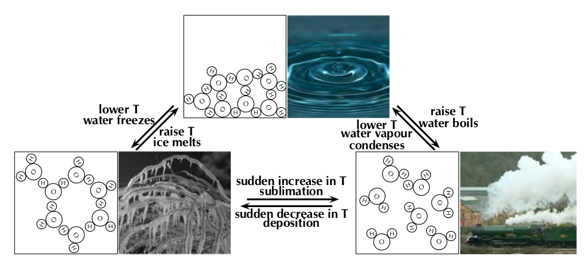

Figure 4.52: Submicroscopic diagrams of the three phases of water. Photos by
                                                Iaszlo-photo, Fields of View and Capt' Gorgeous on Flickr.

#### The effects of intermolecular forces

The forces between molecules that bind them together are known as
                                        **intermolecular forces**. Intermolecular forces allow us to
                                        determine which substances are likely to dissolve in other substances, and what
                                        the melting and boiling points of substances are. Without intermolecular forces
                                        holding molecules together we would not exist.

Intermolecular forces

Intermolecular forces are forces that act between molecules.

Remember from [Grade
                                                11](/read/science/grade-11/intermolecular-forces/04-intermolecular-forces-01#scESBMM) that
                                        a dipole molecule
                                        is a molecule that has its charge unevenly distributed. One end of the molecule
                                        is slightly positive and the other is slightly negative. An overview of the
                                        different types of intermolecular forces that are discussed in this chapter are
                                        given below:

2. **Dipole-dipole forces**
   When one dipole molecule comes into contact with another dipole
                                                           molecule, the positive pole of the one molecule will be
                                                           attracted to the negative pole of the other, and the molecules
                                                           will be held together in this way.
   One special case of this is hydrogen bonding:
   <Callout type="tip" title="Note">
   Do not confuse hydrogen bonds with *intramolecular*
                                                                   covalent bonds. Hydrogen bonding is an example of a
                                                                   scientist naming something, believing it to be one thing
                                                                   when in fact it was another. In this case the strength
                                                                   of the hydrogen bonds misled scientists into thinking
                                                                   this was an intramolecular bond when it is really just a
                                                                   strong intermolecular force.
   </Callout>
   - **Hydrogen bonds**
     As the name implies, this type of intermolecular bond
                                                                             involves a hydrogen atom. When a molecule
                                                                             contains a hydrogen atom covalently bonded to a
                                                                             small, highly electronegative atom (e.g.
                                                                             \(\text{O}\), \(\text{N}\) or \(\text{F}\)) this
                                                                             type of intermolecular force can occur. The
                                                                             highly electronegative atom on one molecule
                                                                             attracts the hydrogen atom on a nearby molecule
                                                                             (see Figure 4.53).
     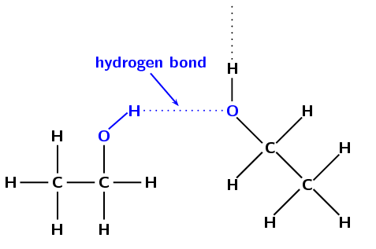
     Figure 4.53: Hydrogen bonding between
                                                                                             two molecules of ethanol.
4. **van der Waals forces**
   - **Induced-dipole forces**
     <Callout type="note" title="Note">
     Dipole-induced-dipole intermolecular forces
                                                                                     are also sometimes called
                                                                                     *London* forces or
                                                                                     *dispersion* forces.
     </Callout>
     In non-polar molecules the electronic charge is
                                                                             usually evenly distributed but it is possible
                                                                             that at a particular moment in time, the
                                                                             electrons might not be evenly distributed
                                                                             (remember that the electrons are always moving
                                                                             in their orbitals). The molecule will have a
                                                                             *temporary dipole*. When this happens,
                                                                             molecules that are next to each other attract
                                                                             each other very weakly.
   - **Dipole-induced-dipole forces**
     These forces exist between dipoles and non-polar
                                                                             molecules. The dipole induces a dipole in the
                                                                             non-polar molecule leading to a weak, short
                                                                             lived force which holds the compounds together.

In this chapter we will focus on the effects of van der Waals forces and hydrogen bonding on
                                the physical properties of organic molecules.

**Viscosity**

Viscosity is the resistance to flow of a liquid. Think how easy it is to pour water compared
                                to syrup or honey. The water flows much faster than the syrup or honey.

Viscosity
Viscosity is a measure of how much a liquid resists flowing. i.e. The higher the
                                        viscosity, the more viscous a substance is.

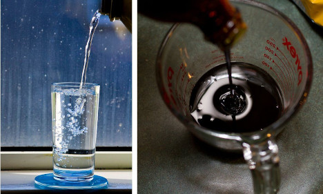

Figure 4.54: Pouring water versus pouring syrup.

You can see this if you take a cylinder filled with water and a cylinder filled with glycerol
                                (propane-1,2,3-triol). Drop a small metal ball into each cylinder and note how easy it
                                is for the ball to fall to the bottom (Figure 4.55). In the glycerol the ball falls slowly,
                                while in the water it falls faster.

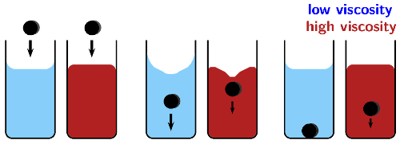

Figure 4.55: The higher the viscosity (red) the slower the ball moves through
                                                the liquid.

As implied by the definition, substances with stronger intermolecular forces are more viscous
                                than substances with weaker intermolecular forces. The stronger the intermolecular
                                forces the more the substance will resist flowing. The greater the internal friction the
                                more a substance will slow down an object moving through it.

If the glass sheet is tilted to either side during the resistance to flow activity
                                        the drops will run into each other and the activity will not work. The drops
                                        should reach the *finish* line in the order of: alcohol (least viscous),
                                        water, oil, syrup (most viscous).

## Resistance to flow

Take a sheet of glass at least \(\text{10}\) by \(\text{15}\) \(\text{cm}\) in size.
                                        Using a water-proof marker draw a straight line across the width of the glass
                                        about \(\text{2}\) \(\text{cm}\) from each end.

Place the glass flat on top of two pencils, then carefully put a drop of water on one
                                        end of the line. Leave at least \(\text{2}\) \(\text{cm}\) space next to the
                                        water drop, and carefully place a drop of alcohol. Repeat this with a drop of
                                        oil and a drop of syrup.

Slowly and carefully remove the pencil from the end opposite the drops (make sure you
                                        don't tilt the glass to either side in the process).

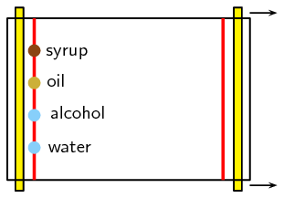

- Which drop moves fastest and reaches the end line first?
- Which drop moves slowest?

The fastest moving substance has the least resistance to flow, and therefore has the
                                        least viscosity (is the least viscous). The slowest moving substance has the
                                        most resistance to flow, and therefore has the most viscosity (is the most
                                        viscous).

**Density**

Density
Density is a measure of the mass per unit of volume.

The solid phase is often the most dense phase (water is one noteworthy exception to this).
                                This can be explained by the strong intermolecular forces found in a solid. These forces
                                pull the molecules together, which results in more molecules in one unit of volume than
                                in the liquid or gas phases. The more molecules in a unit volume the denser, and heavier
                                that volume of the substance will be.

Density can be used to separate different liquids, with the more dense liquid settling to the
                                bottom of the container, while the less dense liquid floats on top. If you throw a leaf
                                into a river or pond the leaf will float. If you instead throw a rock (with the same
                                surface area and volume) into the river or pond the rock will sink. This is due to the
                                different densities of the two substances: rocks are more dense than water while leaves
                                are less dense than water.

**Melting and boiling points**

Intermolecular forces affect the boiling and melting points of substances. Substances with
                                weak intermolecular forces will have low melting and boiling points as less energy
                                (heat) is needed to overcome these forces. Those with strong intermolecular forces will
                                have high melting and boiling points as more energy (heat) is required to overcome these
                                forces. When the temperature of a substance is raised beyond it's melting or boiling
                                point the intermolecular forces are not weakened. Rather, the molecules have enough
                                energy to overcome those forces.

<Callout type="note" title="Note">
An ether is a compound that contains two alkyl chains (e.g. methyl, ethyl) joined at
                                        an angle by an oxygen atom (\(-\)O\(-\)).
</Callout>

| Name | Main intermolecular forces | Molecular Mass (\(\text{g.mol$^{-1}$}\)) | Melting point (℃) | Boiling point (℃) | Phase (at 25℃) |
| --- | --- | --- | --- | --- | --- |
| ethane | induced-dipole | \(\text{30,06}\) | \(-\text{183}\) | \(-\text{89}\) | gas |
| dimethyl ether | dipole-dipole | \(\text{46,06}\) | \(-\text{141}\) | \(-\text{24}\) | gas |
| chloroethane | dipole-dipole | \(\text{64,5}\) | \(-\text{139}\) | \(\text{12,3}\) | gas |
| pentane | induced-dipole | \(\text{72,12}\) | \(-\text{130}\) | \(\text{36}\) | liquid |
| propan-1-ol | hydrogen bonds | \(\text{60,08}\) | \(-\text{126}\) | \(\text{97}\) | liquid |
| ethanol | hydrogen bonds | \(\text{46,06}\) | \(-\text{114}\) | \(\text{78,4}\) | liquid |
| butan-1-ol | hydrogen bonds | \(\text{74,1}\) | \(-\text{90}\) | \(\text{118}\) | liquid |
| ethanoic acid | hydrogen bonds | \(\text{60,04}\) | \(\text{16,5}\) | \(\text{118,5}\) | liquid |

Table 4.9: Relationship between intermolecular forces and melting point,
                                                boiling point and physical state.

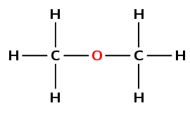

Figure 4.56: The structural formula of dimethyl ether.

As the intermolecular forces increase (from top to bottom in Table 4.9) the
                                melting and boiling points increase. The stronger the intermolecular forces the more
                                likely a substance is to be a liquid or a solid at room temperature.

<Callout type="tip" title="Worked example 29: Comparing physical properties">
**Question:**
Given:

|  | Melting point (℃) | Boiling point (℃) |
| --- | --- | --- |
| propane | \(-\text{188}\) | \(-\text{42}\) |
| butanoic acid | \(-\text{7,9}\) | \(\text{163,5}\) |
| bromoethane | \(-\text{118}\) | \(\text{38,5}\) |
| diethyl ether | \(-\text{116,3}\) | \(\text{34,6}\) |

Fill in the table below:

| Name | Main intermolecular forces | Molecular formula | Molecular mass (\(\text{g.mol$^{-1}$}\)) | Phase (at 25 ℃) |
| --- | --- | --- | --- | --- |
| propane |  |  |  |  |
| butanoic acid |  |  |  |  |
| bromoethane |  |  |  |  |
| diethyl ether |  |  |  |  |

**Draw the structural representation of each molecule:**
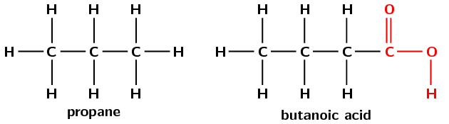

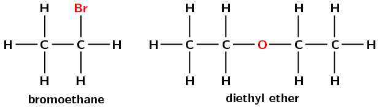

**What are the intermolecular forces that each molecule will
                                                experience?:**
- **propane** has only single carbon-carbon bonds
                                                                  and no other functional group. It will therefore have
                                                                  induced-dipole forces only.
- **butanoic acid** has the carboxylic acid
                                                                  functional group. It can therefore form hydrogen bonds.
- **bromoethane** has the highly electronegative
                                                                  bromine atom. This means that it will form dipole-dipole
                                                                  interactions with neighbouring molecules.
- **diethyl ether** will have induced-dipole
                                                                  forces, however due to the flexible nature of the
                                                                  molecule is can also have dipole-induced-dipole
                                                                  (stronger van der Waals interactions) and dipole-dipole
                                                                  forces.

**Do these forces make sense with the melting and boiling points
                                                provided?:**
Propane has the lowest melting and boiling points and the weakest
                                                interactions. The next lowest melting and boiling points are for
                                                bromoethane and diethyl ether, which both have dipole-dipole
                                                interactions, the next strongest intermolecular forces. The highest
                                                melting and boiling points are for butanoic acid which has strong
                                                hydrogen bonds. Therefore these forces do make sense.

**Calculate the molecular mass of these molecules:**
- propane - \(\text{C}_{3}\text{H}_{8}\), molecular mass =
                                                                  \(\text{44,08}\) \(\text{g.mol$^{-1}$}\)
- butanoic acid - \(\text{C}_{4}\text{H}_{8}\text{O}_{2}\),
                                                                  molecular mass = \(\text{88,08}\)
                                                                  \(\text{g.mol$^{-1}$}\)
- bromoethane - \(\text{C}_{2}\text{H}_{5}\text{Br}\),
                                                                  molecular mass = \(\text{108,95}\)
                                                                  \(\text{g.mol$^{-1}$}\)
- diethyl ether - \(\text{C}_{4}\text{H}_{10}\text{O}\),
                                                                  molecular mass = \(\text{74,10}\)
                                                                  \(\text{g.mol$^{-1}$}\)

**What will the phase of each compound be at \(\text{25}\)
                                                \(\text{℃}\)?:**
To determine the phase of a molecule at \(\text{25}\) \(\text{℃}\) look
                                                at the melting and boiling points:

- The melting and boiling points of propane are both below
                                                                  \(\text{25}\) \(\text{℃}\), therefore the molecule
                                                                  will be a gas at \(\text{25}\) \(\text{℃}\).
- The melting points of butanoic acid, bromoethane and dimethyl
                                                                  ether are below \(\text{25}\) \(\text{℃}\),
                                                                  however the boiling points of all three molecules are
                                                                  above \(\text{25}\) \(\text{℃}\). Therefore these
                                                                  molecules will be liquids at \(\text{25}\)
                                                                  \(\text{℃}\).

**Fill in the table:**
| Name | Main intermolecular forces | Molecular formula | Molecular mass (\(\text{g.mol$^{-1}$}\)) | Phase (at 25 ℃) |
| --- | --- | --- | --- | --- |
| propane | induced-dipole | \(\text{C}_{3}\text{H}_{8}\) | \(\text{44,08}\) | gas |
| butanoic acid | hydrogen bonds | \(\text{C}_{4}\text{H}_{8}\text{O}_{2}\) | \(\text{88,08}\) | liquid |
| bromoethane | dipole-dipole | \(\text{C}_{2}\text{H}_{5}\text{Br}\) | \(\text{108,95}\) | liquid |
| diethyl ether | dipole-dipole | \(\text{C}_{4}\text{H}_{10}\text{O}\) | \(\text{74,10}\) | liquid |
</Callout>

In the investigation of boiling and melting points experiment learners are required
                                        to work with ethyl methanoate. This can irritate your eyes, skin, nose and
                                        lungs. Please remind the learners to be careful and wear the appropriate safety
                                        equipment when handling all chemicals. The safety equipment includes gloves,
                                        safety glasses and protective clothing. Learners should also keep all open
                                        flames away from their experiment as they are handling flammable substances.

The boiling point of propanoic acid is approximately \(\text{141}\)
                                        \(\text{℃}\), which means that the cooking oil will be very hot by the
                                        time propanoic acid starts to boil. The learners should be reminded not to place
                                        their hands anywhere near the oil, and to allow it to cool before cleaning the
                                        apparatus.

This is a good opportunity to get the learners to research the hazard data sheets for
                                        butan-1-ol, propanoic acid and ethyl methanoate.

## Investigation of boiling and melting points

### Aim

To investigate the relationship between boiling points and intermolecular
                                                forces

### Apparatus

- butan-1-ol
                                                                  (\(\text{CH}_{2}(\text{OH})\text{CH}_{2}\text{CH}_{2}\text{CH}_{3}\)),
                                                                  propanoic acid
                                                                  (\(\text{CH}_{3}\text{CH}_{2}\text{COOH}\)) and ethyl
                                                                  methanoate (\(\text{HCOOCH}_{2}\text{CH}_{3}\)), cooking
                                                                  oil
- three test tubes, a beaker, a thermometer, a hot plate

### Method

<Callout type="warning" title="Note">
Ethyl methanoate can irritate your eyes, skin, nose and lungs. Keep
                                                        open flames away from your experiment and make sure you work in
                                                        a well ventilated area.
</Callout>

2. Label the test tubes **1**, **2**
                                                                   and **3**. Place \(\text{20}\)
                                                                   \(\text{ml}\) of butan-1-ol into test tube 1,
                                                                   \(\text{20}\) \(\text{ml}\) of propanoic acid into test
                                                                   tube 2, and \(\text{20}\) \(\text{ml}\) of ethyl
                                                                   methanoate into test tube 3.
   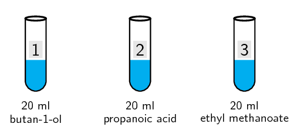
4. Half-fill the beaker with cooking oil and place it on the hot
                                                                   plate.
6. Place the thermometer and the three test tubes in the beaker.
   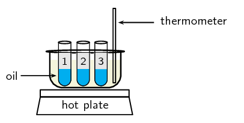
8. Make a note of the temperature when each substance starts to
                                                                   boil.

### Results

Fill in the gaps in the table below. Do the values you obtained match those
                                                reported in literature?

| Compound | ethyl methanoate | butan-1-ol | propanoic acid |
| --- | --- | --- | --- |
| Molecular formula |  |  |  |
| Molecular mass |  |  |  |
| Main intermolecular forces |  |  |  |
| Literature boiling point (℃) | \(\text{54}\) | \(\text{118}\) | \(\text{141}\) |
| Experimental boiling point (℃) |  |  |  |

Draw the structural representation of ethyl methanoate, butan-1-ol and
                                                propanoic acid.

### Discussion and conclusion

You should have found that the ethyl methanoate boiled first, then the
                                                butan-1-ol and then the propanoic acid. Ethyl methanoate has some
                                                dipole-dipole interactions, but cannot form a hydrogen bond. The alcohol
                                                (butan-1-ol) can form hydrogen bonds and so has a higher boiling point.
                                                This strong intermolecular force needs more energy to break and so the
                                                boiling point is higher. For propanoic acid hydrogen bonds form between
                                                the carbonyl group on one acid and the hydroxyl group on another. This
                                                means that each molecule of propanoic acid can be part of two hydrogen
                                                bonds (this is called dimerisation, see Figure
                                                        4.57) and so the boiling point is even higher for propanoic
                                                acid than for butan-1-ol.

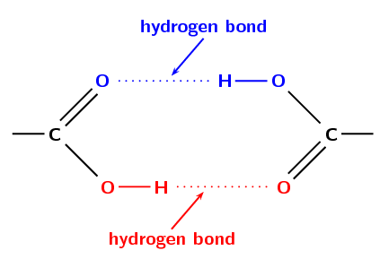

Figure 4.57: A carboxylic acid hydrogen bonding dimer.

**Flammability and vapour pressure**

Flammability is a measure of how easy it would be for a substance to catch alight and burn.
                                The *flash point* of a substance is the lowest temperature that is likely to form
                                a gaseous mixture you could set alight. If a liquid has a low enough flash point it is
                                considered flammable (able to be ignited easily) while those with higher flash points
                                are considered nonflammable. A substance that is classified as nonflammable can still be
                                forced to burn, but it will not ignite easily.

When a substance is in the liquid or solid state there will be some molecules in the gas
                                state. These molecules have enough energy to overcome the intermolecular forces holding
                                the majority of the substance in the liquid or solid phase. These gas molecules exert a
                                pressure on the liquid or solid (and the container) and that pressure is the vapour
                                pressure of that compound. The weaker the intermolecular forces within a substance the
                                higher the vapour pressure will be. Compounds with higher vapour pressures have lower
                                flash points and are therefore more flammable.

Vapour pressure

The pressure exerted (at a specific temperature) on a solid or liquid
                                                compound by molecules of that compound that are in the gas phase.

| Name | Main intermolecular forces | Vapour pressure (kPa at 20℃) | Flash point (℃) | Flammability |
| --- | --- | --- | --- | --- |
| ethane | induced-dipole | \(\text{3 750}\) | \(-\text{135}\) | very high |
| propane | induced-dipole | \(\text{843}\) | \(-\text{104}\) | very high |
| dimethyl ether | dipole-dipole | \(\text{510}\) | \(\text{41}\) | very high |
| butane | induced-dipole | \(\text{204}\) | \(-\text{60}\) | very high |
| chloroethane | dipole-dipole | \(\text{132,4}\) | \(-\text{50}\) | very high |
| pentane | induced-dipole | \(\text{57,9}\) | \(-\text{49}\) | very high |
| propanone | dipole-dipole | \(\text{24,6}\) | \(-\text{17}\) | high |
| ethanol | hydrogen bonds | \(\text{5,8}\) | \(\text{17}\) | high |
| water | hydrogen bonds | \(\text{2,3}\) | - | very low |
| propan-1-ol | hydrogen bonds | \(\text{2}\) | \(\text{22}\) | high |
| ethanoic acid | hydrogen bonds | \(\text{1,6}\) | \(\text{40}\) | moderate |
| butan-1-ol | hydrogen bonds | \(\text{0,6}\) | \(\text{35}\) | high |

Table 4.10: Relationship between intermolecular forces and the flammability
                                                of a substance.

As the intermolecular forces increase (from top to bottom in Table 4.10) you can
                                see a decrease in the vapour pressure. This corresponds with an increase in the flash
                                point temperature and a decrease in the flammability of the substance. Figure 4.58 shows a
                                few examples.

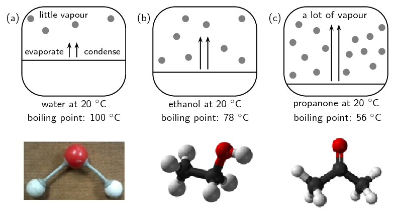

Figure 4.58: The vapour pressure of **(a)** water,
                                                **(b)** ethanol and **(c)** propanone at
                                                \(\text{20}\) \(\text{℃}\). Images by Duncan Watson.

## Types of intermolecular forces

### Textbook
                                                Exercise 4.19

Use your knowledge of different types of intermolecular
                                                                forces to explain the following statements:

**Problem:**
The boiling point of hex-1-ene is much lower than the
                                                                        boiling point of propanoic acid.

**Solution:**
Propanoic acid has hydrogen bonds which are much
                                                                        stronger than the induced-dipole forces in
                                                                        hex-1-ene. In order for a liquid to boil the
                                                                        intermolecular forces must be broken. The
                                                                        stronger the intermolecular forces, the more
                                                                        energy it will take to overcome these forces. As
                                                                        a result the boiling point will be higher for
                                                                        propanoic acid than for hex-1-ene.

**Problem:**
Water evaporates more slowly than propanone.

**Solution:**
Water has strong intermolecular forces (hydrogen
                                                                        bonds) while propanone only has weaker
                                                                        dipole-dipole forces. Substances with stronger
                                                                        intermolecular forces take longer to evaporate
                                                                        than substances with weaker intermolecular
                                                                        forces.

|  | IUPAC name | Boiling point
                                                                                                (℃) |
| --- | --- | --- |
| A | ethane | \(-\text{89,0}\) |
| B | ethanol | \(\text{78,4}\) |
| C | ethanoic acid | \(\text{118,5}\) |

**Problem:**
Which of the compounds listed in the table are gases
                                                                        at room temperature?

**Solution:**
ethane

**Problem:**
Name the main type of intermolecular forces for A, B
                                                                        and C.

**Solution:**
A - induced-dipole forces

B - hydrogen bonding

C - hydrogen bonding

**Problem:**
Account for the difference in boiling point between A
                                                                        and B.

**Solution:**
A has only induced-dipole forces (weak van der Waals
                                                                        forces). B has hydrogen bonding. Since hydrogen
                                                                        bonding is a stronger intermolecular force than
                                                                        van der Waals forces, more energy is required to
                                                                        separate the molecules of ethanol than the
                                                                        molecules of ethane. Thus ethanol has a higher
                                                                        boiling point than ethane.

**Problem:**
Account for the difference in boiling point between B
                                                                        and C.

**Solution:**
Both B and C undergo hydrogen bonding. However the
                                                                        hydrogen bonding in C (carbonyl and hydroxyl
                                                                        group) is stronger than that of B (hydroxyl
                                                                        group). This is because C forms a hydrogen
                                                                        bonding dimer (see Figure 4.57),
                                                                        while B forms only single hydrogen bonds. Thus C
                                                                        has a higher boiling point than B.

**Problem:**
Draw the structural representations of A, B and C.

**Solution:**
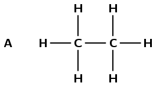

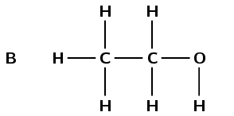

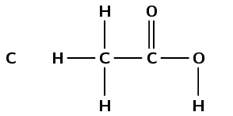

**Problem:**
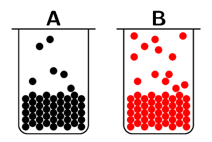

Which container (A or B) has the compound with higher
                                                                        vapour pressure in it? Explain your answer.

**Solution:**
B. There are more molecules of B in the vapour phase
                                                                        than there are of A. More molecules in the
                                                                        vapour phase means a higher vapour pressure.

Draw the condensed structural formula for each of
                                                                        these compounds:

**Problem:**
propanoic acid

**Solution:**
\(\text{CH}_{3}\text{CH}_{2}\text{COOH}\)

**Problem:**
butan-1-ol

**Solution:**
\(\text{CH}_{2}(\text{OH})\text{CH}_{2}\text{CH}_{2}\text{CH}_{3}\)

**Problem:**
Propanoic acid has a vapour pressure of
                                                                        \(\text{0,32}\) \(\text{kPa}\) at \(\text{20}\)
                                                                        \(\text{℃}\)

Butan-1-ol has a vapour pressure of \(\text{0,64}\)
                                                                        \(\text{kPa}\) at \(\text{20}\)
                                                                        \(\text{℃}\)

Explain the difference in vapour pressure.

**Solution:**
Both compounds have the same molecular mass, but
                                                                        propanoic acid has two sites for hydrogen
                                                                        bonding (can form a hydrogen bonding dimer, see
                                                                        Figure 4.57)
                                                                        while butan-1-ol has only one. So butan-1-ol has
                                                                        weaker intermolecular forces and will go into
                                                                        the vapour phase easier than propanoic acid.
                                                                        Butan-1-ol therefore has a higher vapour
                                                                        pressure than propanoic acid.

### Physical properties and functional groups (ESCKR)

Compounds that contain very similar atoms can have very different properties depending on how
                                those atoms are arranged. This is especially true when they have different functional
                                groups. Table 4.11 shows
                                some properties of different functional groups.

<Callout type="tip" title="Note">
Vanilla has a *sweet* smell. The smell of ethene and dimethyl ether cling in
                                        your nose though, and the smell of ether can even stay on your skin up to
                                        \(\text{24}\) hours.
</Callout>

| Functional group | Typical Smell | Example | Formula | Melting point (℃) | Boiling point (℃) | Phase (at 25℃) |
| --- | --- | --- | --- | --- | --- | --- |
| alkane | odourless | ethane | \(\text{C}_{2}\text{H}_{6}\) | \(-\text{183}\) | \(-\text{89}\) | gas |
| alkene | sweet/musky | ethene | \(\text{C}_{2}\text{H}_{4}\) | \(-\text{169,2}\) | \(-\text{103,7}\) | gas |
| ether (-O-) | sweet | dimethyl ether | \(\text{C}_{2}\text{H}_{6}\text{O}\) | \(-\text{141}\) | \(-\text{24}\) | gas |
| haloalkane | almost odourless | chloro ethane | \(\text{C}_{2}\text{H}_{5}\text{Cl}\) | \(-\text{139}\) | \(\text{12,3}\) | gas |
| aldehyde | pungent fruity | ethanal | \(\text{C}_{2}\text{H}_{4}\text{O}\) | \(-\text{123,4}\) | \(\text{20,2}\) | gas |
| alcohol | sharp | ethanol | \(\text{C}_{2}\text{H}_{6}\text{O}\) | \(-\text{114}\) | \(\text{78,4}\) | liquid |
| ester | often fruity | methyl methanoate | \(\text{C}_{2}\text{H}_{4}\text{O}_{2}\) | \(-\text{100}\) | \(\text{32}\) | liquid |
| alkyne | odourless | ethyne | \(\text{C}_{2}\text{H}_{2}\) | \(-\text{80,8}\) | \(-\text{84}\) | gas |
| carboxylic acid | vinegar rancid butter | ethanoic acid | \(\text{C}_{2}\text{H}_{4}\text{O}_{2}\) | \(\text{16,5}\) | \(\text{118,5}\) | liquid |

Table 4.11: Some properties of compounds with different functional groups.

Listed in the table are the common smells and other physical properties found for common
                                functional groups. Only one representative example from each homologous series is
                                provided. This does not mean that all compounds in that series have exactly the same
                                properties. For example, short-chain and long-chain alkanes are generally odourless,
                                while those with moderate chain length (approximately \(\text{6}\) - \(\text{12}\)
                                carbon atoms) smell like petrol (Table 4.15).

Some specific properties of a few functional groups will now be discussed in more detail.

#### Physical properties of the alcohols

<Callout type="note" title="Note">
In humans, ethanol reduces the secretion of a hormone called antidiuretic
                                                hormone (ADH). The role of ADH is to control the amount of water that
                                                the body retains. When this hormone is not secreted in the right
                                                quantities, it can cause dehydration because too much water is lost from
                                                the body in the urine (ethanol is a diuretic). This is why people who
                                                drink too much alcohol can become dehydrated, and experience symptoms
                                                such as headaches, dry mouth, and lethargy. Part of the reason for the
                                                headaches is that dehydration causes the brain to shrink away from the
                                                skull slightly.
</Callout>

<Callout type="note" title="Note">
Ethane has a relatively low solubility in water.

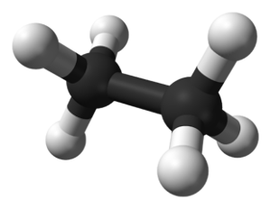

Because hydroxyl (\(-\text{OH}\)) groups can hydrogen bond, all three
                                                pentanol molecules have a greater solubility in water than ethane.

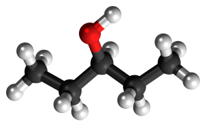

Ethanol is completely soluble in water in any amount. This is because it
                                                contains a hydroxyl group and has a much shorter non-polar chain length
                                                than pentanol.

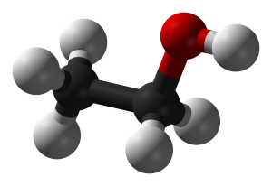

| pentanol | solubility (\(\text{g.dm$^{-3}$}\)) |
| --- | --- |
| ethane | \(\text{0,057}\) |
| 1 -pentanol | \(\text{22}\) |
| 2 -pentanol | \(\text{45}\) |
| 3 -pentanol | \(\text{59}\) |
| ethanol | soluble |
</Callout>

The hydroxyl group (\(-\text{OH}\)) affects the **solubility** of the
                                        alcohols.

Solubility
Solubility is a measure of the ability of a substance (solid, liquid or gas)
                                                to dissolve in another substance. The amount of the substance than can
                                                dissolve is the measure of its solubility.

The hydroxyl group generally makes the alcohol molecule *polar* and therefore
                                        more likely to be **soluble** in water. However, the carbon chain
                                        resists solubility, so there are two opposing trends in the alcohols. Alcohols
                                        with shorter carbon chains are usually more soluble in water than those with
                                        longer carbon chains.

Alcohols tend to have higher **boiling points** than the hydrocarbons
                                        because of the strong hydrogen bond between hydrogen atoms of one hydroxyl group
                                        and the oxygen atom of another hydroxyl group.

#### Physical properties of haloalkanes

There can be more than one halogen substituted for a hydrogen atom on one haloalkane.
                                        The more halogens are substituted the less **volatile** the
                                        haloalkane becomes. Take for example the haloalkane series shown in Figure
                                                4.59.

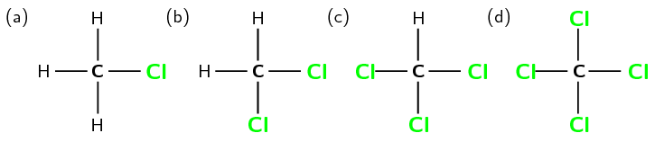

Figure 4.59: A series of haloalkanes with increasing numbers of
                                                        chlorine atoms:

**(a)** chloromethane, **(b)**
                                                        dichloromethane, **(c)** trichloromethane and
                                                        **(d)** tetracholormethane.

Volatility
The tendency of molecules at the surface of a compound to enter the gas
                                                phase. The more volatile a compound the more likely this is.

For every *extra* chlorine atom on the original methane molecule the
                                        volatility of the compound decreases. This can be seen by the increase in both
                                        the melting and boiling point (Table 4.12) as one goes from chloromethane
                                        through to tetrachloromethane. The more halogen atoms in the compound the
                                        stronger the intermolecular forces are, which leads to higher melting and
                                        boiling points.

| Common Name | Number Cl atoms | Melting point (℃) | Boiling point (℃) |
| --- | --- | --- | --- |
| chloromethane | \(\text{1}\) | \(-\text{97,4}\) | \(-\text{24,2}\) |
| dichloromethane | \(\text{2}\) | \(-\text{96,7}\) | \(\text{39,6}\) |
| trichloromethane | \(\text{3}\) | \(-\text{63,5}\) | \(\text{61,2}\) |
| tetrachloromethane | \(\text{4}\) | \(-\text{22,9}\) | \(\text{76,7}\) |

Table 4.12: Melting and boiling points of haloalkanes with increasing
                                                        numbers of chlorine atoms.

#### Properties of carbonyl compounds

Carboxylic acids are **weak acids**, in other words they only dissociate
                                        partially. Why does the carboxyl group have acidic properties? In the carboxyl
                                        group, the hydrogen tends to separate itself (dissociate) from the oxygen atom.
                                        In other words, the carboxyl group becomes a source of positively-charged
                                        hydrogen ions (\(\text{H}^{+}\)). This is shown in Figure 4.60.

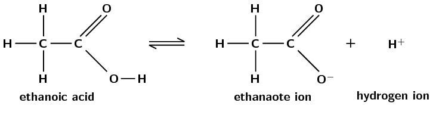

Figure 4.60: The dissociation of a carboxylic acid.

The carboxylic acid functional group is soluble in water. However, as the number of
                                        carbon atoms in the attached carbon chain increases the solubility decreases.
                                        This is discussed in greater detail in the next section.

Remember that carboxylic acids form hydrogen bonding dimers (the formation is called
                                        dimerisation) as shown in Figure 4.61.

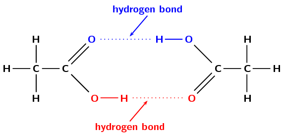

Figure 4.61: Ethanoic acid forming a carboxylic acid hydrogen bonding
                                                        dimer.

The ability of a molecule to hydrogen bond leads to increased melting and boiling
                                        points when compared to a similar molecule that is unable to hydrogen bond.
                                        Similarly, the ability of a molecule to form a hydrogen bonding dimer leads to
                                        increased melting and boiling points when compared to similar molecules that can
                                        only form one hydrogen bond (Table 4.13).

| Molecule | Hydrogen bonds per molecule | Melting point (℃) | Boiling point (℃) |
| --- | --- | --- | --- |
| ethane | 0 | -183 | -89 |
| ethanol | 1 | -114 | \(\text{78,4}\) |
| ethanoic acid | 2 | \(\text{16,5}\) | \(\text{118,5}\) |

Table 4.13: The melting and boiling points of similar organic
                                                        compounds that can form different numbers of hydrogen bonds.

#### Physical properties of ketones

Hydrogen bonds are stronger than the van der Waals forces found in ketones. Therefore
                                        compounds with functional groups that can form hydrogen bonds are more likely to
                                        be soluble in water. This applies to aldehydes as well as to ketones.

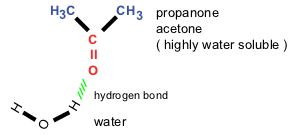

Figure 4.62: The hydrogen bond between water and a ketone
                                                        (propanone).

## Physical properties and functional groups

### Textbook Exercise 4.20

Refer to the data table below which shows the melting point
                                                                and boiling point for a number of organic compounds with
                                                                different functional groups.

| Formula | Name | Melting point
                                                                                                (℃) | Boiling point
                                                                                                (℃) |
| --- | --- | --- | --- |
| \(\text{C}_{4}\text{H}_{10}\) | butane | \(-\text{137}\) | \(\text{0}\) |
| \(\text{C}_{4}\text{H}_{8}\) | but-1-ene | \(-\text{185}\) | \(-\text{6,5}\) |
| \(\text{C}_{4}\text{H}_{10}\text{O}\) | butan-1-ol | \(-\text{90}\) | \(\text{118}\) |
| \(\text{C}_{4}\text{H}_{8}\text{O}_{2}\) | butanoic acid | \(-\text{7,9}\) | \(\text{163,5}\) |
| \(\text{C}_{5}\text{H}_{12}\) | pentane | \(-\text{130}\) | \(\text{36}\) |
| \(\text{C}_{5}\text{H}_{10}\) | pent-1-ene | \(-\text{165,2}\) | \(\text{30}\) |
| \(\text{C}_{5}\text{H}_{12}\text{O}\) | pentan-1-ol | \(-\text{78}\) | \(\text{138}\) |
| \(\text{C}_{5}\text{H}_{10}\text{O}_{2}\) | pentanoic acid | \(-\text{34,5}\) | \(\text{186,5}\) |

At room temperature (approx.
                                                                        \(\text{25}\)\(\text{°C}\)), which of the
                                                                        organic compounds in the table are:

**Problem:**
gases

**Solution:**
butane, but-1-ene

**Problem:**
liquids

**Solution:**
All except butane and but-1-ene

Look at an alkane, alkene, alcohol and carboxylic
                                                                        acid with the same number of carbon atoms:

**Problem:**
How do their melting and boiling points
                                                                                compare?

**Solution:**
The carboxylic acids have the highest melting
                                                                                and boiling points, then the alcohols,
                                                                                then the alkanes and the alkenes have
                                                                                the lowest melting and boiling points.

Looking at those compounds with four carbon
                                                                                atoms:

Butanoic acid has the highest boiling (and
                                                                                melting) point, the next highest boiling
                                                                                (and melting) point is butan-1-ol, then
                                                                                butane (the alkane) followed by
                                                                                but-1-ene (the alkene).

Looking at those compounds with five carbon
                                                                                atoms:

Pentanoic acid has the highest boiling (and
                                                                                melting) point, the next highest boiling
                                                                                (and melting) point is pentan-1-ol, then
                                                                                pentane (the alkane) followed by
                                                                                pent-1-ene (the alkene).

**Problem:**
Explain why their melting points and boiling
                                                                                points are different?

**Solution:**
The carboxylic acids have the strongest
                                                                                intermolecular forces due to their
                                                                                ability to form two hydrogen bonds
                                                                                (dimerisation). The alcohols can only
                                                                                form one hydrogen bond leading to lower
                                                                                melting and boiling points. The alkenes
                                                                                and alkanes cannot form hydrogen bonds.
                                                                                However, the alkenes are more reactive
                                                                                than the alkanes due to the double bond
                                                                                (unsaturated) and so the melting and
                                                                                boiling points of an alkene are lower
                                                                                than those of an alkane with the same
                                                                                number of carbon atoms.

### Physical properties and chain length (ESCKS)

Remember that the alkanes are a group of organic compounds that contain carbon and hydrogen
                                atoms bonded together. The carbon atoms link together to form chains of varying lengths.
                                We have already mentioned that the alkanes are relatively unreactive because of their
                                stable C-C and C-H bonds. The boiling points and melting points of these molecules are
                                determined by their molecular structure and their surface area.

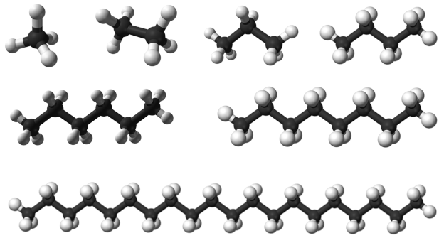

Figure 4.63: Some alkanes, from top left to bottom right: methane, ethane,
                                                propane, butane, hexane, octane and icosane.

The more carbon atoms there are in an alkane, the greater the surface area available for
                                intermolecular interactions.

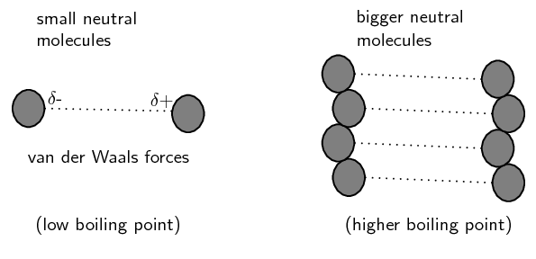

Figure 4.64: van der Waals intermolecular forces increase as chain length
                                                increases. Image by Duncan Watson.

This increase in intermolecular attractions leads to higher melting and boiling points. This
                                is shown in Table 4.14.

| Formula | Name | Molecular mass (\(\text{g.mol$^{-1}$}\)) | Melting point (℃) | Boiling point (℃) | Phase (at 25℃) |
| --- | --- | --- | --- | --- | --- |
| \(\text{CH}_{4}\) | methane | \(\text{16,04}\) | \(-\text{182}\) | \(-\text{162}\) | gas |
| \(\text{C}_{2}\text{H}_{6}\) | ethane | \(\text{30,06}\) | \(-\text{183}\) | \(-\text{89}\) | gas |
| \(\text{C}_{3}\text{H}_{8}\) | propane | \(\text{44,08}\) | \(-\text{188}\) | \(-\text{42}\) | gas |
| \(\text{C}_{4}\text{H}_{10}\) | butane | \(\text{58,1}\) | \(-\text{137}\) | \(\text{0}\) | gas |
| \(\text{C}_{6}\text{H}_{14}\) | hexane | \(\text{86,14}\) | \(-\text{95}\) | \(\text{68,5}\) | liquid |
| \(\text{C}_{8}\text{H}_{18}\) | octane | \(\text{114,18}\) | \(-\text{57}\) | \(\text{125,5}\) | liquid |
| \(\text{C}_{20}\text{H}_{42}\) | icosane | \(\text{282,42}\) | \(\text{37}\) | \(\text{343}\) | solid |

Table 4.14: The physical properties of some alkanes.

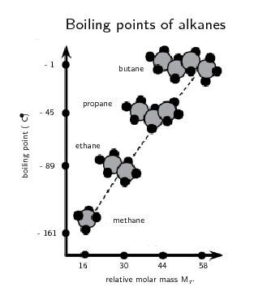

Figure 4.65: As the molar mass of an alkane increases so does the boiling
                                                point. Image by Duncan Watson.

Notice that when the molecular mass of the alkanes is low (i.e. there are few carbon atoms),
                                the organic compounds are *gases* because the intermolecular forces are weak. As
                                the number of carbon atoms and the molecular mass increases, the compounds are more
                                likely to be liquids or solids because the intermolecular forces are stronger.

The larger a molecule is, the stronger the intermolecular forces are between the molecules.
                                This is one of the reasons why methane (\(\text{CH}_{4}\)) is a gas at room temperature
                                while hexane (\(\text{C}_{6}\text{H}_{14}\)) is a liquid and icosane
                                (\(\text{C}_{20}\text{H}_{42}\)) is a solid.

<Callout type="tip" title="Note">
**Be careful** when comparing molecules with different types of
                                        intermolecular forces. For example, small molecule with hydrogen bonding can
                                        have stronger intermolecular forces than a large molecule with only van der
                                        Waals forces.
</Callout>

Table 4.15 shows some other
                                properties of the alkanes that also vary with chain length.

| Name | Density (\(\text{g.dm$^{-3}$}\)) | Flash point (℃) | Smell | Phase (at 25℃) |
| --- | --- | --- | --- | --- |
| methane | \(\text{0,66}\) | \(-\text{188}\) | odourless | gas |
| ethane | \(\text{1,28}\) | \(-\text{135}\) | odourless | gas |
| propane | \(\text{2,01}\) | \(-\text{104}\) | odourless | gas |
| butane | \(\text{2,48}\) | \(-\text{60}\) | like petrol | gas |
| hexane | \(\text{650}\) | \(-\text{26}\) | like petrol | liquid |
| octane | \(\text{700}\) | \(\text{13}\) | like petrol | liquid |
| icosane | \(\text{790}\) | \(>\text{113}\) | odourless | solid |

Table 4.15: Properties of some of the alkanes.

Density increases with increasing molecular size. Note that compounds that are gaseous are
                                much less dense than compounds that are liquid or solid.

Remember that the flash point of a volatile molecule is the lowest temperature at which that
                                molecule can form a vapour mixture with air and be ignited. The flash point increases
                                with increasing chain length meaning that the longer chains are less flammable (Table 4.10) although
                                they can still be ignited.

<Callout type="note" title="Note">
It is partly the stronger intermolecular forces that explain why petrol (mainly
                                        octane (\(\text{C}_{8}\text{H}_{18}\))) is a liquid, while candle wax
                                        (\(\text{C}_{23}\text{H}_{48}\)) is a solid. If these intermolecular forces did
                                        not increase with increasing molecular size we would not be able to put liquid
                                        fuel into our cars or use solid candles.
</Callout>

The change in physical properties due to chain length does not only apply to the
                                hydrocarbons. The solubility of ketones in water decreases as the chain length
                                increases. The longer the chain length, the stronger the intermolecular interactions
                                between the ketone molecules. This means that more energy is required to overcome those
                                interactions and the molecule is therefore less soluble in water. Long chains can also
                                fold around the polar carbonyl group and stop water molecules from bonding with it.

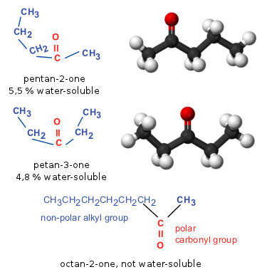

Figure 4.66: The water solubility of a ketone decreases as the chain length
                                                increases.

This same idea can be applied to all the compounds with water-soluble functional groups. The
                                longer the chain becomes, the less soluble the compound is in water.

## Physical properties and chain length

### Textbook Exercise 4.21

Refer to the table below which gives information about a
                                                                number of carboxylic acids, and then answer the
                                                                questions that follow.

| Condensed formula | Common name | Source | IUPAC name | Melting point (℃) | Boiling point (℃) |
| --- | --- | --- | --- | --- | --- |
|  | formic acid | ants | methanoic acid | \(\text{8,4}\) | \(\text{101}\) |
| \(\text{CH}_{3}\text{COOH}\) |  | vinegar | ethanoic acid | \(\text{16,5}\) | \(\text{118,5}\) |
|  | propionic acid | milk | propanoic acid | \(-\text{20,8}\) | \(\text{141}\) |
| \(\text{CH}_{3}(\text{CH}_{2})_{2}\text{COOH}\) | butyric acid | butter |  | \(-\text{7,9}\) | \(\text{163,5}\) |
|  | valeric acid | valerian root | pentanoic acid | \(-\text{34,5}\) | \(\text{186,5}\) |
| \(\text{CH}_{3}(\text{CH}_{2})_{4}\text{COOH}\) | caproic acid | goat skin |  | \(-\text{3,4}\) | \(\text{205,8}\) |
|  | enanthic acid | vines | heptanoic acid | \(-\text{7,5}\) | \(\text{223}\) |
| \(\text{CH}_{3}(\text{CH}_{2})_{6}\text{COOH}\) | caprylic acid | goat milk |  | \(\text{16,7}\) | \(\text{239,7}\) |

**Problem:**
Fill in the missing spaces in the table by writing
                                                                        the formula, common name or IUPAC name.

**Solution:**
| Condensed formula | Common name | Source | IUPAC name | Melting
                                                                                                        point (℃) | Boiling
                                                                                                        point (℃) |
| --- | --- | --- | --- | --- | --- |
| \(\text{HCOOH}\) | formic acid | ants | methanoic acid | \(\text{8,4}\) | \(\text{101}\) |
| \(\text{CH}_{3}\text{COOH}\) | acetic acid | vinegar | ethanoic acid | \(\text{16,5}\) | \(\text{118,5}\) |
| \(\text{CH}_{3}\text{CH}_{2}\text{COOH}\) | propionic acid | milk | propanoic acid | \(-\text{20,8}\) | \(\text{141}\) |
| \(\text{CH}_{3}(\text{CH}_{2})_{2}\text{COOH}\) | butyric acid | butter | butanoic acid | \(-\text{7,9}\) | \(\text{163,5}\) |
| \(\text{CH}_{3}(\text{CH}_{2})_{3}\text{COOH}\) | valeric acid | valerian root | pentanoic acid | \(-\text{34,5}\) | \(\text{186,5}\) |
| \(\text{CH}_{3}(\text{CH}_{2})_{4}\text{COOH}\) | caproic acid | goat skin | hexanoic acid | \(-\text{3,4}\) | \(\text{205,8}\) |
| \(\text{CH}_{3}(\text{CH}_{2})_{5}\text{COOH}\) | enanthic acid | vines | heptanoic acid | \(-\text{7,5}\) | \(\text{223}\) |
| \(\text{CH}_{3}(\text{CH}_{2})_{6}\text{COOH}\) | caprylic acid | goat milk | octanoic acid | \(\text{16,7}\) | \(\text{239,7}\) |

**Problem:**
Draw the structural representation of butyric acid.

**Solution:**
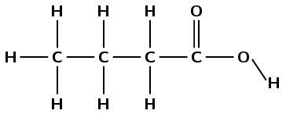

**Problem:**
Give the molecular formula for caprylic acid.

**Solution:**
\(\text{C}_{8}\text{H}_{16}\text{O}_{2}\)

**Problem:**
Draw a graph to show the relationship between
                                                                                molecular mass (on the x-axis) and
                                                                                boiling point (on the y-axis)

**Solution:**
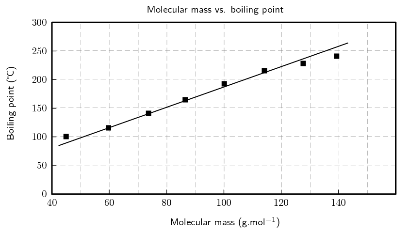

**Problem:**
Describe the trend you see.

**Solution:**
As the molecular mass increases, so does the
                                                                                boiling point OR boiling point increases
                                                                                with an increase in molecular mass
                                                                                (something along these lines).

**Problem:**
Suggest a reason for this trend.

**Solution:**
Longer chains allow for greater van der Waals
                                                                                interactions leading to higher boiling
                                                                                points OR an increase in the surface
                                                                                area of the molecules leads to greater
                                                                                intermolecular forces which leads to
                                                                                increasing boiling points OR the forces
                                                                                holding the molecules in the solid phase
                                                                                are increasing and so the boiling point
                                                                                increases, this is because the compounds
                                                                                with larger molecular mass have longer
                                                                                chains (something along these lines).

Refer to the data table below which shows the melting point
                                                                and boiling point for a number of organic compounds with
                                                                different functional groups.

| Formula | Name | Melting point
                                                                                                (℃) | Boiling point
                                                                                                (℃) |
| --- | --- | --- | --- |
| \(\text{C}_{4}\text{H}_{10}\) | Butane | \(-\text{137}\) | \(\text{0}\) |
| \(\text{C}_{5}\text{H}_{12}\) | Pentane | \(-\text{130}\) | \(\text{36}\) |
| \(\text{C}_{6}\text{H}_{14}\) | Hexane | \(-\text{95}\) | \(\text{68,5}\) |
| \(\text{C}_{4}\text{H}_{8}\) | But-1-ene | \(-\text{185}\) | \(-\text{6,5}\) |
| \(\text{C}_{5}\text{H}_{10}\) | Pent-1-ene | \(-\text{165,2}\) | \(\text{30}\) |
| \(\text{C}_{6}\text{H}_{12}\) | Hex-1-ene | \(-\text{140}\) | \(\text{63}\) |

At room temperature (approx. 25 °C), which of
                                                                        the organic compounds in the table are:

**Problem:**
gases

**Solution:**
butane, butene

**Problem:**
liquids

**Solution:**
pentane, pentene, hexane, hexene

In the alkanes:

**Problem:**
Describe what happens to the melting point
                                                                                and boiling point as the number of
                                                                                carbon atoms in the compound increases.

**Solution:**
The melting and boiling points increase as
                                                                                the number of carbon atoms increase.

**Problem:**
Explain why this is the case.

**Solution:**
As the number of carbon atoms increases, so
                                                                                does the surface area of the molecule.
                                                                                This leads to greater intermolecular
                                                                                forces, which are responsible for the
                                                                                increase in melting and boiling points.

**Problem:**
Fill in the table below. Under boiling point put 1 for the
                                                                compound with the lowest boiling point, 2 for the next
                                                                lowest boiling point until you get to 6 for the compound
                                                                with the highest boiling point. Do not use specific
                                                                boiling point values, but rather use your knowledge of
                                                                intermolecular forces.

| Compound | Condensed Structure | Boiling point |
| --- | --- | --- |
| propane | \(\text{CH}_{3}\text{CH}_{2}\text{CH}_{3}\) |  |
| hexane | \(\text{CH}_{3}\text{CH}_{2}\text{CH}_{2}\text{CH}_{2}\text{CH}_{2}\text{CH}_{3}\) |  |
| methane | \(\text{CH}_{4}\) | e.g. 1 |
| octane | \(\text{CH}_{3}\text{CH}_{2}\text{CH}_{2}\text{CH}_{2}\text{CH}_{2}\text{CH}_{2}\text{CH}_{2}\text{CH}_{3}\) |  |
| butane | \(\text{CH}_{3}\text{CH}_{2}\text{CH}_{2}\text{CH}_{3}\) |  |
| ethane | \(\text{CH}_{3}\text{CH}_{3}\) |  |

**Solution:**
| Compound | Condensed Structure | Boiling point |
| --- | --- | --- |
| propane | \(\text{CH}_{3}\text{CH}_{2}\text{CH}_{3}\) | 3 |
| hexane | \(\text{CH}_{3}\text{CH}_{2}\text{CH}_{2}\text{CH}_{2}\text{CH}_{2}\text{CH}_{3}\) | 5 |
| methane | \(\text{CH}_{4}\) | 1 |
| octane | \(\text{CH}_{3}\text{CH}_{2}\text{CH}_{2}\text{CH}_{2}\text{CH}_{2}\text{CH}_{2}\text{CH}_{2}\text{CH}_{3}\) | 6 |
| butane | \(\text{CH}_{3}\text{CH}_{2}\text{CH}_{2}\text{CH}_{3}\) | 4 |
| ethane | \(\text{CH}_{3}\text{CH}_{3}\) | 2 |

Draw the structural representations for each of the following
                                                                compounds and answer the question that follows.

**Problem:**
but-2-yne

**Solution:**
The prefix but- tells us that there are four carbon
                                                                        atoms in the longest chain. The suffix -2-yne
                                                                        tells us that there is a triple bond between the
                                                                        second and third carbon atoms.

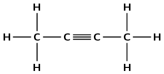

**Problem:**
hex-2-yne

**Solution:**
The prefix hex- tells us that there are six carbon
                                                                        atoms in the longest chain. The suffix -2-yne
                                                                        tells us that there is a triple bond between the
                                                                        second and third carbon atoms.

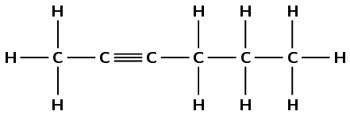

**Problem:**
pent-2-yne

**Solution:**
The prefix pent- tells us that there are five carbon
                                                                        atoms in the longest chain. The suffix -2-yne
                                                                        tells us that there is triple bond between the
                                                                        second and third carbon atoms.

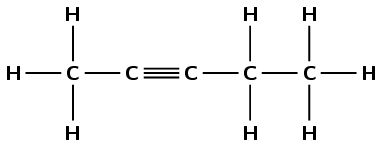

**Problem:**
Which of these compounds will have the highest
                                                                        viscosity?

**Solution:**
hex-2-yne - All three compounds are alkynes. There is
                                                                        an increase in chain length with but-2-yne
                                                                        having the shortest chain and hex-2-yne the
                                                                        longest. The van der Waals forces will be
                                                                        stronger in the longest chain compound,
                                                                        hex-2-yne, because it has more sites for the van
                                                                        der Waals forces to act (the surface area is
                                                                        larger). Hex-2-yne will therefore have the
                                                                        highest viscosity as the molecules will have the
                                                                        greatest resistance to flow.

### Physical properties and branched groups (ESCKT)

In a straight chain molecule, the carbon atoms are connected to *at most* two other
                                carbon atoms. However, in a branched molecule some carbon atoms are connected to
                                *three or four* other carbon atoms. This is the same principle that was discussed
                                with primary, secondary and tertiary alcohols.

Straight chains always have higher boiling points than the equivalent molecule with branched
                                chains. This is because the molecules with straight chains have a larger surface area
                                that allows close contact. Branched chains have a lower boiling point due to a smaller
                                area of contact. The molecules are more compact and cannot get too close together,
                                resulting in fewer places for the van der Waals forces to act.

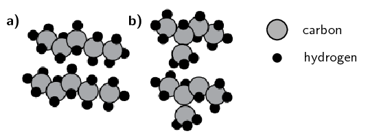

**(a)** Straight chains of pentane and **(b)**
                                                branched chains of 2-methylbutane. (Image by Duncan Watson);

Shown in Figure 4.68 are three
                                isomers that all have the molecular formula \(\text{C}_{5}\text{H}_{12}\). They are all
                                alkanes with the only difference being branched groups leading to longer or shorter main
                                chains.

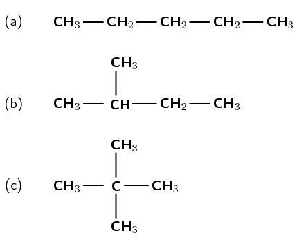

Figure 4.68: Three isomers of \(\text{C}_{5}\text{H}_{12}\):
                                                **(a)** pentane, **(b)** 2-methylbutane and
                                                **(c)** 2,2-dimethylpropane.

As shown in Table 4.16 the
                                properties of these three compounds are significantly different. The melting points have
                                significant differences and the boiling points steadily decrease with an increasing
                                number of branched groups.

| Name | Melting point (℃) | Boiling point (℃) | Density (\(\text{g.dm$^{-3}$}\)) | Vapour pressure (kPa at 20℃) | Flash point (℃) |
| --- | --- | --- | --- | --- | --- |
| pentane | \(-\text{130}\) | \(\text{36}\) | \(\text{621}\) | \(\text{57,9}\) | \(-\text{49}\) |
| 2-methyl butane | \(-\text{160}\) | \(\text{27,7}\) | \(\text{616}\) | \(\text{77}\) | \(-\text{51}\) |
| 2,2-dimethyl propane | \(-\text{16,6}\) | \(\text{9,5}\) | \(\text{586}\) | \(\text{147}\) | \(<-\text{7}\) |

Table 4.16: Properties of compounds with different numbers of branched
                                                groups.

Although the densities of all three compounds are very similar, there is a decrease in
                                density with the increase of branched groups. The vapour pressure increases with
                                increasing branched groups and the flash point of 2,2-dimethylpropane is significantly
                                higher than those of pentane and 2-methylbutane.

It is interesting that the common trend of melting and boiling points is not followed here -
                                2,2-dimethylpropane has the highest melting point, lowest boiling point and is the least
                                flammable although all three compounds are very flammable. **Symmetrical**
                                molecules (such as 2,2-dimethylpropane) tend to have higher melting points than similar
                                molecules with **less symmetry** due to their packing in the solid state.
                                Once in the liquid state they follow the normal trends.

## Physical properties and branched chains

### Textbook Exercise 4.22

| Structural Formula | Boiling point
                                                                                                (℃) |
| --- | --- |
|  | \(\text{78}\) |
|  | \(\text{51}\) |

**Problem:**
Give the IUPAC name for each compound

**Solution:**
1-chlorobutane and 2-chloro-2-methylpropane

**Problem:**
Explain the difference in the melting points

**Solution:**
The branched haloalkane (2-chloro-2-methylpropane)
                                                                        will have less surface area and thus weaker
                                                                        intermolecular forces than the straight chain
                                                                        haloalkane (1-chlorobutane). Less energy will be
                                                                        needed to break the intermolecular forces of
                                                                        2-chloro-2-methylpropane, and therefore a lower
                                                                        boiling point is observed.

There are five isomers with the molecular formula
                                                                \(\text{C}_{6}\text{H}_{14}\).

**Problem:**
Draw the structural representations of:

2-methylpentane and 2,2-dimethylbutane (two of the
                                                                        isomers)

**Solution:**
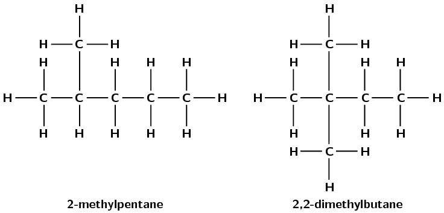

**Problem:**
What are the names of the other three isomers?

**Solution:**
hexane, 3-methylpentane and 2,3-dimethylbutane

**Problem:**
Draw the semi-structural representations of these
                                                                        three molecules.

**Solution:**
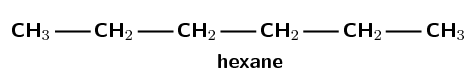

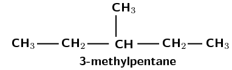

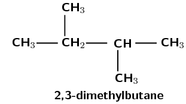

**Problem:**
The melting points of these three isomers are:
                                                                        \(-\text{118}\), \(-\text{95}\) and
                                                                        \(-\text{130}\) \(\text{℃}\). Assign the
                                                                        correct melting points to the correct isomer.
                                                                        Give a reason for your answers.

**Solution:**
The lowest melting point will be with the molecule
                                                                        with the weakest intermolecular forces. This
                                                                        molecule is 2,3-dimethylbutane as it is the
                                                                        isomer with the most branched chains. The
                                                                        highest melting point will be with the molecule
                                                                        with the strongest intermolecular forces. This
                                                                        molecule is hexane as it is the isomer with no
                                                                        branched groups.

Therefore the melting points will be:

- 2,3-dimethylbutane: \(-\text{130}\)
                                                                                          \(\text{℃}\)
- 3-methylpentane: \(-\text{118}\)
                                                                                          \(\text{℃}\)
- hexane: \(-\text{95}\)
                                                                                          \(\text{℃}\)

## Physical properties of organic compounds

### Textbook Exercise 4.23

The table shows data collected for four organic compounds
                                                        (**A** - **C**) during a practical
                                                        investigation.

|  | Compound | Molecular Mass (\(\text{g.mol$^{-1}$}\)) | Boiling point (℃) |
| --- | --- | --- | --- |
| A | \(\text{CH}_{3}\text{CH}_{2}\text{CH}_{3}\) | \(\text{44,08}\) | \(-\text{42}\) |
| B | \(\text{CH}_{3}\text{CHO}\) | \(\text{44,04}\) | \(\text{20}\) |
| C | \(\text{CH}_{3}\text{CH}_{2}\text{OH}\) | \(\text{46,06}\) | \(\text{78}\) |

**Problem:**
Is compound **A** saturated or unsaturated? Give
                                                                a reason for your answer.

**Solution:**
Saturated. It contains only single carbon-carbon bonds.

**Problem:**
To which homologous series does compound **B**
                                                                belong?

**Solution:**
aldehydes

Write down the IUPAC name for each of the following
                                                                compounds:

**Problem:**
**B**

**Solution:**
ethanal

**Problem:**
**C**

**Solution:**
ethanol

**Problem:**
Refer to intermolecular forces to explain the difference in
                                                                boiling points between compounds **A** and
                                                                **C**.

**Solution:**
Between alkane molecules/molecules of compound A/propane
                                                                molecules there are only weak van der Waals
                                                                forces/intermolecular forces.

Between alcohol molecules/molecules of compound D/ethanol
                                                                molecules there are strong hydrogen bonds (as well as
                                                                weak van der Waals forces).

More energy is needed to overcome the intermolecular
                                                                forces/hydrogen bonds between alcohol molecules/ethanol
                                                                molecules/molecules of compound C

OR

Less energy is needed to overcome the intermolecular
                                                                forces/van der Waals forces between alkane
                                                                molecules/propane molecules/molecules of compound A

**Problem:**
Which one of compounds **B** or
                                                                **C** will have the highest vapour pressure
                                                                at a specific temperature? Give a reason for your
                                                                answer.

**Solution:**
**B**. A lower boiling point (or weaker
                                                                intermolecular forces) means that more molecules will go
                                                                into the vapour phase, resulting in a higher vapour
                                                                pressure.

Give the IUPAC names for the following compounds and answer the
                                                        questions that follow.

**Problem:**
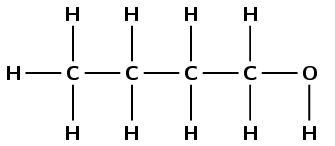

Boiling point = \(\text{118}\) \(\text{℃}\)

**Solution:**
butan-1-ol

**Problem:**
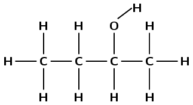

Boiling point = \(\text{99}\) \(\text{℃}\)

**Solution:**
butan-2-ol

**Problem:**
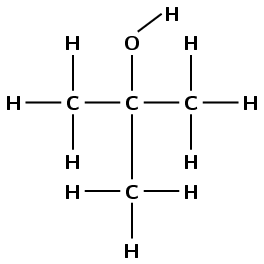

Boiling point = \(\text{82,5}\) \(\text{℃}\)

**Solution:**
2-methylpropan-2-ol

**Problem:**
Explain the difference in boiling points.

**Solution:**
The hydrogen bonding hydroxyl group is located on an end
                                                                carbon atom in butan-1-ol. This allows it to form
                                                                hydrogen bonds more easily than butan-2-ol. The branched
                                                                group in 2-methylpropan-2-ol means that it is even more
                                                                difficult for hydrogen bonds to form between these
                                                                molecules (weak intermolecular forces). The greater the
                                                                intermolecules forces, the more energy that is required
                                                                to overcome them, and the higher the boiling point will
                                                                be.
