## 4.5 Applications of organic chemistry (ESCKV)

### Alkanes as fossil fuels (ESCKW)

Fossil fuels are fuels formed by the natural process of the decomposition of organisms under heat
                        and pressure. They contain a high percentage of carbon and include fuels such as coal, petrol,
                        and natural gases. They are also a **non-renewable**.

Hydrocarbon cracking

Hydrocarbon cracking is the process of breaking carbon-carbon bonds in long-chain
                                    hydrocarbons to form simpler, shorter-chain hydrocarbons.

**Hydrocarbon cracking** is an important industrial process. Through this process
                        long, bulky alkanes are broken up into smaller compounds. These compounds include shorter
                        alkanes and alkenes. A few examples of cracking hydrocarbons are given in Figure 4.69.

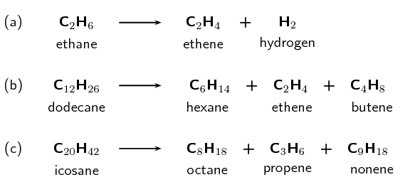

Figure 4.69: The cracking of various hydrocarbons to produce *alkanes* and
                                    *alkenes*.

There are two types of hydrocarbon cracking. **Thermal** cracking occurs under high
                        pressures and temperatures without a catalyst, **catalytic** cracking occurs at
                        lower pressures and temperatures in the presence of a catalyst. This process is a common source
                        of shorter (more useful) alkanes as well as unsaturated alkenes. The alkanes are then used in
                        combustion processes.

It is possible to separate the products of hydrocarbon cracking and obtain specific products from a
                        crude oil mix through a process called *fractional distillation*. This is done using a
                        *fractionating column*. Crude oil evaporates when heated to
                        \(\text{700}\)\(\text{°C}\). The gas bubbles through a tray that is kept at a certain
                        temperature. The alkanes and alkenes that condense at that temperature will then condense in the
                        tray. For example if the tray is kept at \(\text{170}\)\(\text{°C}\) the product will be
                        paraffin oil (Figure
                              4.70).

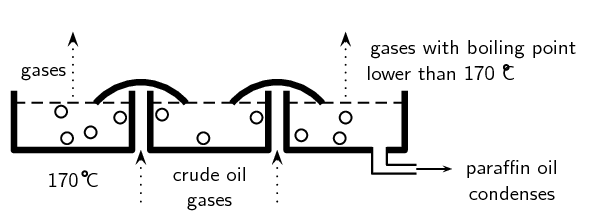

Figure 4.70: One layer of a fractionating column. Image by Duncan Watson.

A fractionating column has a series of these trays (Figure 4.71), each at a constant temperature. This means that
                        many compounds can be separated from the crude oil mix. The crude oil is heated to
                        \(\text{700}\)\(\text{°C}\) and the gas of the crude oil is passed through the column.
                        Bitumen for tar roads is collected at the bottom of the fractionating column. These are all
                        compounds with more than \(\text{70}\) carbon atoms. The temperature decreases as you move up
                        the column. As the gases rise, compounds with different length carbon chains condense until only
                        the chains with \(\text{1}\) - \(\text{4}\) carbon atoms are collected at the top of the column.
                        These are used for liquid petroleum gas.

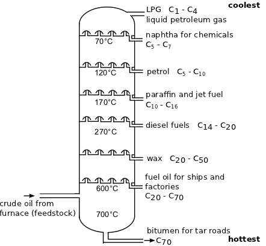

Figure 4.71: An example of a fractionating column.

For more information on the process of fractional distillation have a look at this animation:

<Callout type="note" title="Note">
[Simulation:
                                    27P3](https://vula.uct.ac.za/access/content/group/9eafe770-4c41-4742-a414-0df36366abe6/Chem%20Ind%20Resource%20Pack/html/animations/Petrochemicals.swf)
</Callout>

Note that this fits with what we learned in the previous section. The more carbon atoms in the
                        chain, the greater the intermolecular forces and therefore the higher the boiling point. That
                        means that these molecules will condense at higher temperatures.

**Combustion of alkanes**

Alkanes are our most important fossil fuels. The combustion (burning) of alkanes (also known as
                        oxidation) is highly *exothermic*.

Combustion

In a combustion reaction a substance reacts with an oxidising agent (e.g. oxygen), and
                                    heat and light are released.

In the complete combustion reaction of alkanes, carbon dioxide (\(\text{CO}_{2}\)) and water
                        (\(\text{H}_{2}\text{O}\)) are released along with energy. Fossil fuels are burnt for the energy
                        they release. The general reaction for the combustion of an alkane as a fossil fuel is given in
                        Figure 4.72

<Callout type="note" title="Note">
The complete combustion of alkanes produces only \(\text{CO}_{2}\) and
                              \(\text{H}_{2}\text{O}\). Not all combustion process are complete though. An incomplete
                              combustion will also produce carbon monoxide (\(\text{CO}\)).
</Callout>

<Callout type="tip" title="Note">
Remember that an exothermic reaction releases energy (\(\Delta \text{H} < \text{0}\)),
                              while an endothermic reaction absorbs energy (\(\Delta \text{H} > \text{0}\)). The fact
                              that energy is released in a combustion reaction implies that \(\Delta \text{H} <
                              \text{0}\) and the reaction is exothermic.
</Callout>

Figure 4.72: The complete combustion of an alkane.

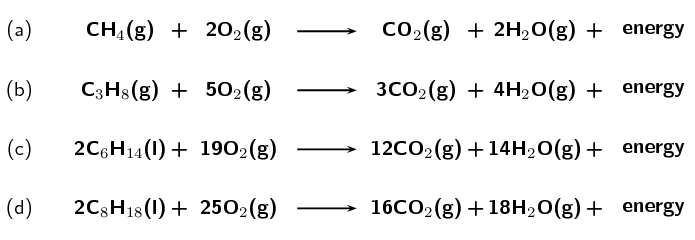

Figure 4.73: The complete combustion reactions of **(a)** methane,
                                    **(b)** propane, **(c)** hexane and **(d)**
                                    octane.

<Callout type="tip" title="Worked example 30: Balancing equations">
**Question:**
Balance the following equation:

\(\text{C}_{4}\text{H}_{10}(\text{g}) + \text{O}_{2}(\text{g})\) \(\to\)
                                    \(\text{CO}_{2}(\text{g}) + \text{H}_{2}\text{O}(\text{g})\)

**Balance the carbon atoms:**
There are 4 carbon atoms on the left. There is 1 carbon atom on the right. Add a 4 in
                                    front of the \(\text{CO}_{2}\) molecule on the right:

\(\text{C}_{4}\text{H}_{10}(\text{g}) + \text{O}_{2}(\text{g})\) \(\to\)
                                    \(4\text{CO}_{2}(\text{g}) + \text{H}_{2}\text{O}(\text{g})\)

**Balance the hydrogen atoms:**
There are 10 hydrogen atoms on the left. There are 2 hydrogen atoms on the right. Add a
                                    5 in front of the \(\text{H}_{2}\text{O}\) molecule on the right:

\(\text{C}_{4}\text{H}_{10}(\text{g}) + \text{O}_{2}(\text{g})\) \(\to\)
                                    \(4\text{CO}_{2}(\text{g}) + 5\text{H}_{2}\text{O}(\text{g})\)

**Balance the oxygen atoms:**
There are 2 oxygen atoms on the left. There are 13 oxygen atoms on the right
                                    (\(\text{4}\) x \(\text{2}\) in the \(\text{CO}_{2}\) and 5 in the
                                    \(\text{H}_{2}\text{O}\)). Divide the number of \(\text{O}\) atoms on the right by
                                    \(\text{2}\) to get \(\frac{13}{2}\), this is the number of \(\text{O}_{2}\)
                                    molecules required on the left:

\(\text{C}_{4}\text{H}_{10}(\text{g}) +\)\(\frac{13}{2}\)\(\text{O}_{2}(\text{g})\)
                                    \(\to\) \(4\text{CO}_{2}(\text{g}) + 5\text{H}_{2}\text{O}(\text{g})\)

This is acceptable but it is better for all numbers to be whole numbers.

**Make sure all numbers are whole numbers:**
There is \(\frac{13}{2}\) in front of the \(\text{O}_{2}\) while all other numbers are
                                    whole numbers. So multiply the entire equation by 2:

\(2\text{C}_{4}\text{H}_{10}(\text{g}) + 13\text{O}_{2}(\text{g})\) \(\to\)
                                    \(8\text{CO}_{2}(\text{g}) + 10\text{H}_{2}\text{O}(\text{g})\)
</Callout>

<Callout type="tip" title="Worked example 31: Balancing equations">
**Question:**
Balance the equation for the complete combustion of **heptane**

**Write the unbalanced equation:**
The molecular formula for heptane is \(\text{C}_{7}\text{H}_{16}\). Combustion always
                                    involves oxygen (\(\text{O}_{2}\)). The complete combustion of an alkane always
                                    produces carbon dioxide (\(\text{CO}_{2}\)) and water (\(\text{H}_{2}\text{O}\)):

\(\text{C}_{7}\text{H}_{16}(\text{ℓ}) + \text{O}_{2}(\text{g})\) \(\to\)
                                    \(\text{CO}_{2}(\text{g}) + \text{H}_{2}\text{O}(\text{g})\)

**Balance the carbon atoms:**
There are 7 carbon atoms on the left. There is 1 carbon atom on the right. Add a 7 in
                                    front of the \(\text{CO}_{2}\) molecule on the right:

\(\text{C}_{7}\text{H}_{16}(\text{ℓ}) + \text{O}_{2}(\text{g})\) \(\to\)
                                    \(7\text{CO}_{2}(\text{g}) + \text{H}_{2}\text{O}(\text{g})\)

**Balance the hydrogen atoms:**
There are 16 hydrogen atoms on the left. There are 2 hydrogen atoms on the right. Add
                                    an 8 in front of the \(\text{H}_{2}\text{O}\) molecule on the right:

\(\text{C}_{7}\text{H}_{16}(\text{ℓ}) + \text{O}_{2}(\text{g})\) \(\to\)
                                    \(7\text{CO}_{2}(\text{g}) + 8\text{H}_{2}\text{O}(\text{g})\)

**Balance the oxygen atoms:**
There are 2 oxygen atoms on the left. There are 22 oxygen atoms on the right
                                    (\(\text{7}\) x \(\text{2}\) in the \(\text{CO}_{2}\) and 8 in the
                                    \(\text{H}_{2}\text{O}\)). Divide the number of \(\text{O}\) atoms on the right by
                                    \(\text{2}\) to get \(\text{11}\), this is the number of \(\text{O}_{2}\) molecules
                                    required on the left:

\(\text{C}_{7}\text{H}_{16}(\text{ℓ}) + 11\text{O}_{2}(\text{g})\) \(\to\)
                                    \(7\text{CO}_{2}(\text{g}) + 8\text{H}_{2}\text{O}(\text{g})\)
</Callout>

## Alkanes as fossil fuels

### Textbook Exercise
                                    4.24

Balance the following complete combustion equations:

**Problem:**
\(\text{C}_{3}\text{H}_{8}(\text{g}) + \text{O}_{2}(\text{g})\)
                                                      \(\to\) \(\text{CO}_{2}(\text{g}) +
                                                      \text{H}_{2}\text{O}(\text{g})\)

**Solution:**
\(\text{C}_{3}\text{H}_{8}(\text{g}) + 5\text{O}_{2}(\text{g})\)
                                                      \(\to\) \(3\text{CO}_{2}(\text{g}) +
                                                      4\text{H}_{2}\text{O}(\text{g})\)

**Problem:**
\(\text{C}_{7}\text{H}_{16}(\text{ℓ}) +
                                                      \text{O}_{2}(\text{g})\)
                                                      \(\to\) \(\text{CO}_{2}(\text{g}) +
                                                      \text{H}_{2}\text{O}(\text{g})\)

**Solution:**
\(\text{C}_{7}\text{H}_{16}(\text{ℓ}) +
                                                      11\text{O}_{2}(\text{g})\)
                                                      \(\to\) \(7\text{CO}_{2}(\text{g}) +
                                                      8\text{H}_{2}\text{O}(\text{g})\)

**Problem:**
\(\text{C}_{2}\text{H}_{6}(\text{g}) + \text{O}_{2}(\text{g})\)
                                                      \(\to\) \(\text{CO}_{2}(\text{g}) +
                                                      \text{H}_{2}\text{O}(\text{g})\)

**Solution:**
\(2\text{C}_{2}\text{H}_{6}(\text{g}) + 7\text{O}_{2}(\text{g})\)
                                                      \(\to\) \(4\text{CO}_{2}(\text{g}) +
                                                      6\text{H}_{2}\text{O}(\text{g})\)

Write the balanced equation for the complete combustion of:

**Problem:**
octane

**Solution:**
\(2\text{C}_{8}\text{H}_{18}(\text{ℓ}) +
                                                      25\text{O}_{2}(\text{g})\)
                                                      \(\to\) \(16\text{CO}_{2}(\text{g}) +
                                                      18\text{H}_{2}\text{O}(\text{g})\)

**Problem:**
pentane

**Solution:**
\(\text{C}_{5}\text{H}_{12}(\text{ℓ}) +
                                                      8\text{O}_{2}(\text{g})\)
                                                      \(\to\) \(5\text{CO}_{2}(\text{g}) +
                                                      6\text{H}_{2}\text{O}(\text{g})\)

**Problem:**
hexane

**Solution:**
\(2\text{C}_{6}\text{H}_{14}(\text{ℓ}) +
                                                      19\text{O}_{2}(\text{g})\)
                                                      \(\to\) \(12\text{CO}_{2}(\text{g}) +
                                                      14\text{H}_{2}\text{O}(\text{g})\)

**Problem:**
butane

**Solution:**
\(2\text{C}_{4}\text{H}_{10}(\text{g}) + 13\text{O}_{2}(\text{g})\)
                                                      \(\to\) \(8\text{CO}_{2}(\text{g}) +
                                                      10\text{H}_{2}\text{O}(\text{g})\)

**Problem:**
Is the combustion of alkanes exothermic or endothermic? What does that
                                                mean?

**Solution:**
It is exothermic. This means that energy is released during the combustion
                                                of an alkane.

### Esters (ESCKX)

#### Production of esters

As was discussed earlier in this chapter one way to form an ester is through the reaction of
                              an alcohol and a carboxylic acid. This process is called an **acid-catalysed
                                    condensation** or **esterification** of a carboxylic acid.

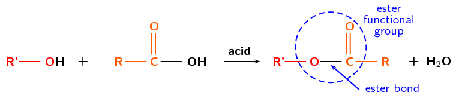

Figure 4.74: The acid-catalysed condensation of a carboxylic acid to form an
                                          ester.

<Callout type="note" title="Note">
In the formation of an ester one oxygen atom comes from the alcohol molecule, while the
                                    carbonyl group comes from the carboxylic acid. This is known because it is possible
                                    to *label* (using radioactive nuclides) the atoms of the reactants and see
                                    where they end up in the products.
</Callout>

In the general form above an alcohol (red) and a carboxylic acid (orange) combine to form an
                              ester and water. A specific example is given in Figure 4.75 for the formation of butyl propanoate and
                              water.

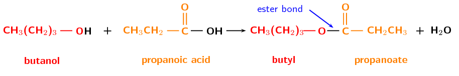

Figure 4.75: The esterification of butanol and propanoic acid to form butyl
                                          propanoate, water is also formed in this reaction.

This reaction can also be written as:

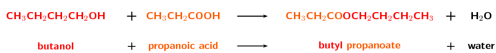

A more general example is:

It is important to be able to identify what ester a specific alcohol and carboxylic acid will
                              form. Remember that the first part of the ester name takes its prefix from the alcohol
                              with the suffix -yl. The second part of the ester takes its prefix from the carboxylic
                              acid with the ester suffix -oate.

<Callout type="tip" title="Worked example 32: Determining ester names">
**Question:**
What is the name of the ester that will form from **hexanol** and
                                          **propanoic acid**

**Which compound forms the first part of the ester name and which
                                          forms the second part of the ester name?:**
The alcohol forms the first part of the ester name and takes the suffix
                                          *-yl*. The carboxylic acid forms the second part of the ester name and
                                          takes the suffix *-oate*.

**Determine the first part of the ester name:**
The alcohol is *hex*anol, therefore there are 6 carbons and this will be
                                          hexyl.

**Determine the second part of the ester name:**
The carboxylic acid is *propan*oic acid, therefore there are 3 carbons and
                                          this will be propanoate.

**Combine the first and second parts of the ester name:**
The ester will be **hexyl propanoate**.
</Callout>

It is also important to be able to determine which compounds were used to form an ester.

<Callout type="tip" title="Worked example 33: Determining starting materials of esters">
**Question:**
What compounds did the ester **octyl heptanoate** come from?

**What types of compounds are used to form esters?:**
Esters are formed from alcohols (which become the first part of the ester name)
                                          and carboxylic acids (which become the second part of the ester name).

**Determine the prefix for the alcohol:**
The first part of the ester name comes from the alcohol (-ol). Therefore the
                                          prefix is *oct*-.

**Determine the prefix for the carboxylic acid:**
The second part of the ester name comes from the carboxylic acid (-oic acid).
                                          Therefore the prefix is *hept*-.

**Determine the compounds use to form the ester:**
Octyl heptanoate was formed from **octanol** and **heptanoic
                                                acid**.
</Callout>

A few examples of esters are given in Table 4.17.

| Ester name | Smell | Uses |
| --- | --- | --- |
| methyl methanoate | ether | quick-dry finishes | insecticide | pharmaceuticals |
| ethyl methanoate | rum | lacquers | safety glass | fumigating foods |
| propyl methanoate | pears | solvent | flavour | fragrance |
| methyl ethanoate | glue | glues | paints | nail polish remover |
| ethyl ethanoate | apple | glues etc | solvents | decaffeination |
| propyl ethanoate | pear | solvent | flavour | fragrance |
| butyl ethanoate | banana or apple | lacquers | flavour |  |
| pentyl ethanoate | banana or apple | lacquers | solvents | resins |
| methyl butanoate | apple or pineapple | flavour | fragrance |  |
| ethyl butanoate | pineapple | flavour | fragrance | plasticiser |
| propyl hexanoate | blackberry or cheese | flavour | solvent | fragrance |

Table 4.17: The uses of some esters.

The following experiment will help you to prepare esters. Use what you have learned in this
                              section to answer the questions that follow.

In the preparation of esters experiment learners are required to work with many
                                    different ester compounds, as well as a strong acid. Some esters can irritate your
                                    eyes, skin, nose and lungs, and strong, concentrated acids can cause serious burns.
                                    Please remind the learners to be careful and wear the appropriate safety equipment
                                    when handling all chemicals. The safety equipment includes gloves, safety glasses
                                    and protective clothing. Learners should also keep all open flames away from their
                                    experiment as they are handling flammable substances.

This is a good opportunity to get the learners to research the hazard data sheets for
                                    methanol, ethanol, pentanol, methanoic acid and ethanoic acid. They can also
                                    reasearch the products: methyl methanoate, methyl ethanoate, ethyl methanoate, ethyl
                                    ethanoate and pentyl ethanoate.

If vapour bubbles start to form, porcelain chips can be added to the test tube. If the
                                    learners can only smell the acid a few drops of sodium carbonate can help neutralise
                                    those acid fumes.

The exact volumes mentioned in the experiment are not that important, as long as the
                                    reactants are in approximately this ratio. Boiled water can be used instead of a
                                    water bath.

## Preparation of esters

### Aim

To prepare and identify esters.

### Apparatus

- Methanol (\(\text{CH}_{3}\text{OH}\)), ethanol
                                                        (\(\text{CH}_{3}\text{CH}_{2}(\text{OH})\)),
  pentan-1-ol
                                                        (\(\text{CH}_{3}\text{CH}_{2}\text{CH}_{2}\text{CH}_{2}\text{CH}_{2}(\text{OH})\)),
                                                        methanoic acid (\(\text{HCOOH}\)),
  ethanoic acid (\(\text{CH}_{3}\text{COOH}\)), sulfuric acid
                                                        (\(\text{H}_{2}\text{SO}_{4}\))
- Marble chips (or small, clean stones)
- Five tall test tubes or beakers, a water bath, a hot-plate (or bunsen
                                                        burner), a thermometer, rubber bands, paper towel, five bowls of
                                                        cold water

### Method

<Callout type="warning" title="Note">
Concentrated acids can cause serious burns. We suggest using gloves and
                                                safety glasses whenever you work with an acid. Always add the acid to
                                                the water and avoid sniffing the acid.

Remember that all alcohols are toxic, methanol is particularly toxic and
                                                can cause blindness, coma or death. Handle all chemicals with care.
</Callout>

2. Place the marble chips (or clean stones) in the test tubes and label
                                                         them *A - E*.
4. Add \(\text{4}\) \(\text{ml}\) methanoic acid to test tubes
                                                         **A** and **B**.
6. Add \(\text{4}\) \(\text{ml}\) ethanoic acid to test tubes
                                                         **C**, **D** and **E**.
   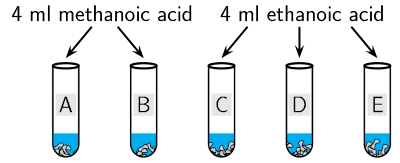
8. Add \(\text{5}\) \(\text{ml}\) methanol to test tubes
                                                         **A** and **C**.
10. Add \(\text{5}\) \(\text{ml}\) ethanol to test tubes
                                                         **B** and **D**.
12. Add \(\text{5}\) \(\text{ml}\) pentanol to test tube
                                                         **E**.
   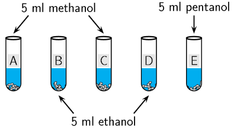
14. **Slowly** add \(\text{2}\) \(\text{ml}\)
                                                         \(\text{H}_{2}\text{SO}_{4}\) to each test tube.
16. Soak the paper towel in cold water and attach it to the sides near
                                                         the top of each test tube with a rubber band (do not close the
                                                         test tube, just wrap the paper around the sides near the top).
   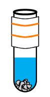
18. Heat the water bath to \(\text{60}\) \(\text{℃}\) (using the
                                                         hot-plate or bunsen burner) and place the test tubes in it for
                                                         \(\text{10}\)-\(\text{15}\) \(\text{min}\).
20. After \(\text{10}\)-\(\text{15}\) \(\text{min}\) cool each test tube
                                                         in cold water. Label the bowls of cold water *A - E* and
                                                         pour the contents of test tube A into bowl A, etc.
   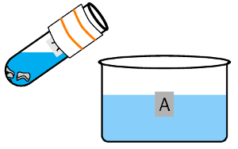
22. Observe the surface of the water and note the smell in each bowl.

### Questions

2. What is the purpose of the \(\text{H}_{2}\text{SO}_{4}\)?
4. What is the purpose of the wet paper towel?
6. What did you observe on the top of the water in each bowl at the end?
8. Fill in the details in a table like the one below:
   | Carboxylic acid | Alcohol | Product | Smell |
   | --- | --- | --- | --- |
   | methanoic acid | methanol |  |  |
   | methanoic acid | ethanol |  |  |
   | ethanoic acid | methanol |  |  |
   | ethanoic acid | ethanol |  |  |
   | ethanoic acid | pentanol |  |  |

### Discussion and Conclusion

An ester is the product of an acid-catalysed condensation between an alcohol and
                                          a carboxylic acid. Esters have identifiable aromas (like the fragrant smell
                                          and odour of fruit) and are used in perfumes. If you didn't smell anything it
                                          is likely that your water bath was set at too high a temperature and the ester
                                          degraded.

Esters are less water soluble than the carboxylic acid they were formed from and
                                          appear as an oily substance on water. Before being cooled however some of the
                                          ester would have been a vapour, so the wet paper towel would help to prevent a
                                          loss of the product.

Refer to Table 4.17 and
                                          see if the smells match those listed there. Remember to waft the smell towards
                                          you using your hand, do not sniff the fumes directly!

## Esters

### Textbook Exercise 4.25

Give the IUPAC name for the product in the esterification of ethanoic
                                                      acid with:

**Problem:**
methanol

**Solution:**
methyl ethanoate

**Problem:**
octanol

**Solution:**
octyl ethanoate

**Problem:**
hexanol

**Solution:**
hexyl ethanoate

**Problem:**
propanol

**Solution:**
propyl ethanoate

**Problem:**
What is another name for the type of reaction in the question above?

**Solution:**
acid-catalysed condensation

Give the IUPAC name for the product in the reaction of butanol with:

**Problem:**
ethanoic acid

**Solution:**
butyl ethanoate

**Problem:**
pentanoic acid

**Solution:**
butyl pentanoate

**Problem:**
heptanoic acid

**Solution:**
butyl heptanoate

**Problem:**
methanoic acid

**Solution:**
butyl methanoate

Fill in the missing reactant or part of the product name in the
                                                      reactions below:

**Problem:**
octanol + \(\_\_\_\_\_\_ \to \_\_\_\_\_\_\) hexanoate

**Solution:**
octanol + hexanoic acid \(\to\) octyl hexanoate

**Problem:**
\(\_\_\_\_\_\_\) + propanoic acid \(\to\) hexyl
                                                            \(\_\_\_\_\_\_\)

**Solution:**
hexanol + propanoic acid \(\to\) hexyl propanoate

**Problem:**
\(\_\_\_\_\_\_\) + butanol \(\to \_\_\_\_\_\_\) pentanoate

**Solution:**
pentanoic acid + butanol \(\to\) butyl pentanoate
