## 4.6 Addition, elimination and substitution reactions (ESCKY)

Mechanisms and arrow-pushing are not required by CAPS. The learners need to know the types of
                                reactants, the types of reactions and the reaction conditions.

We will study three main types of reactions - addition, elimination and substitution.

- An **addition reaction** occurs when two or more reactants combine to
                                          form a single product. This product will contain *all* the atoms that
                                          were present in the reactants. Addition reactions occur with
                                          **unsaturated** compounds.
  The general equation for an **addition** reaction: \(\text{A}+\text{B}\)
                                          \(\to\) \(\text{C}\)
  Notice that C is the final product with no A or B remaining as a residue.
- An **elimination reaction** occurs when a reactant is broken up into two
                                          products. Elimination reactions occur with **saturated** compounds.
  The general equation for an **elimination** reaction: \(\text{A}\)
                                          \(\to\) \(\text{B}+\text{C}\)
- A **substitution reaction** occurs when an exchange of elements in the
                                          reactants takes place. The initial reactants are transformed or *swopped
                                                  around* to give a final product.
  The general equation for a **substitution** reaction: \(\text{AB} +
                                          \text{CD}\) \(\to\) \(\text{AD} + \text{BC}\)

Some specific examples of these reactions are given in the following pages.

### Addition reactions (ESCKZ)

<Callout type="note" title="Note">
Remember from the section on [saturated
                                                and
                                                unsaturated structures](/read/science/grade-12/organic-molecules/04-organic-molecules-02#scESCK8) that you can perform tests to determine if a
                                        compound is saturated or not. If bromine water or potassium permanganate are
                                        decolourised by a compound the compound is unsaturated, if they are not
                                        decolourised the compound is saturated.
</Callout>

#### Hydrohalogenation

Hydrohalogenation involves the addition of a **hydrogen atom** and a
                                        **halogen atom** to an unsaturated compound (containing a
                                        carbon-carbon double bond). An example is given in Figure
                                                4.76. X can be fluorine (F), chlorine (Cl), bromine (Br) or iodine
                                        (I).

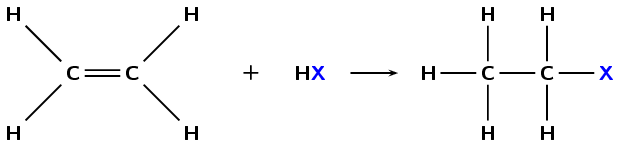

Figure 4.76: The hydrohalogenation of *ethene* to a
                                                        *haloethane*.

If more than one product is possible the **major product** will be the
                                        compound where:

<Callout type="tip" title="Note">
Remember that a \(\color{red}{\textbf{tertiary carbon atom}}\) is bonded to
                                                three other carbon atoms, a \(\color{orange}{\textbf{secondary carbon
                                                atom}}\) is bonded to two other carbon atoms, and a
                                                \(\color{blue}{\textbf{primary carbon atom}}\) is bonded to one other
                                                carbon atom. So tertiary is the most substituted, secondary is less
                                                substituted than tertiary and more substituted than primary, and primary
                                                is the least substituted.
</Callout>

- the \(\color{darkgreen}{\textbf{hydrogen atom}}\) is added to
                                                          \(\color{blue}{\textbf{least substituted carbon atom}}\)
- i.e. the carbon atom with the least number of carbon atoms bonded to
                                                          it
- the \(\color{purple}{\textbf{halogen atom}}\) is added to the
                                                          \(\color{red}{\textbf{more substituted carbon atom}}\)
- i.e. the carbon atom with the most number of carbon atoms bonded to
                                                          it

This is shown in Figure
                                                4.77.

Major and minor products

The major product of a reaction is the product that is most likely to
                                                        form. Minor products are those that are less likely to form.

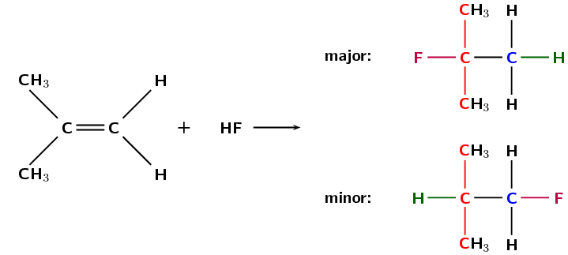

Figure 4.77: The hydrohalogenation of *2-methylpropene* to
                                                        form **2-fluoro-2-methylpropane** (major product)
                                                        and **1-fluoro-2-methylpropane** (minor product).

Reaction conditions:

- **no water** present in the reaction

#### Halogenation

Halogenation is very similar to hydrohalogenation but a **diatomic halogen
                                                molecule** is added across the double bond. An example is given
                                        in Figure 4.78.

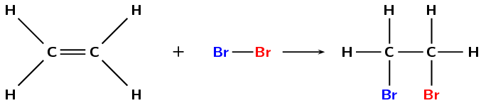

Figure 4.78: The reaction between *ethene* and
                                                        *bromine* to form *1,2-dibromoethane*.

#### Hydration

A hydration reaction involves the addition of **water**
                                        (\(\text{H}_{2}\text{O}\)) to an **unsaturated compound**. This is
                                        one way of preparing an alcohol from the corresponding alkene (Figure 4.79).

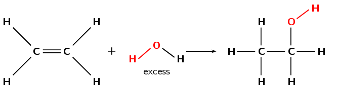

Figure 4.79: The hydration of *ethene* to *ethanol*.

If more than one product is possible the **major product** will be the
                                        compound where:

- the \(\color{darkgreen}{\textbf{hydrogen atom}}\) is added to the
                                                          \(\color{blue}{\textbf{least substituted carbon atom}}\)
- the \(\color{purple}{\textbf{hydroxyl anion}}\) (\(\text{OH}^{-}\))
                                                          is added to the \(\color{red}{\textbf{more substituted carbon
                                                          atom}}\)

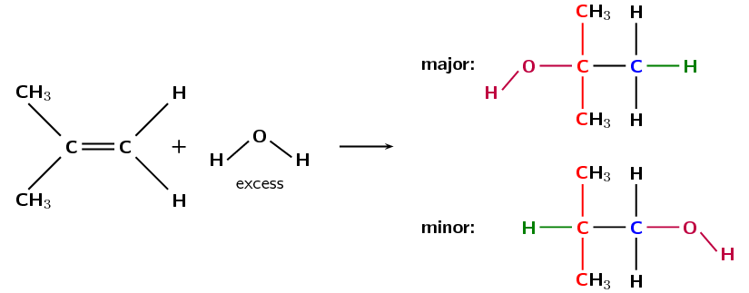

Figure 4.80: The hydration of *2-methylpropene* to form
                                                        **2-methylpropan-2-ol** (major product) and
                                                        **2-methyl-propan-1-ol** (minor product).

Reaction conditions:

- water must be present in **excess**
- an **acid catalyst** is needed for this reaction to take
                                                          place
- the catalyst that is most commonly used is phosphoric acid
                                                          (\(\text{H}_{3}\text{PO}_{4}\))

<Callout type="note" title="Note">
*Fermentation* can refer to the conversion of sugar to alcohol using
                                                yeast (a fungus). The process of fermentation produces items such as
                                                wine, beer and yogurt. To make wine, grape juice is fermented to produce
                                                alcohol. This reaction is shown below:

\(\text{C}_{6}\text{H}_{12}\text{O}_{6}\) \(\to\) \(2\text{CO}_{2} +
                                                2\text{C}_{2}\text{H}_{5}\text{OH}+\) energy
</Callout>

The learners should focus their research on the chemistry behind these
                                                fermentation processes. They can either present their findings as a
                                                discussion to the class, or in a short (1-page) report format. The
                                                research should be on local-level fermentation processes, not industrial
                                                scale breweries.

## Formation of alcohol through fermentation

Ethanol can also be formed through the process of fermentation. In almost
                                                every country there is a local product that people make by fermenting
                                                local fruits. For example in Malawi people ferment potatoes, sugar cane
                                                or maize to form *katchasu*. Here in South Africa people ferment
                                                marula fruit to make *mampoer*, grapes to make *witblits*
                                                and sorghum to make beer.

- Research the chemistry behind the fermentation process.
- What other plants do people ferment?
- Fermentation leads to acid formation, research why this
                                                                  occurs.
- Sorghum is also used to make sour porridge. How is it made?

#### Hydrogenation

Hydrogenation involves adding **hydrogen** \((\text{H}_{2})\) to an
                                        **alkene**. During hydrogenation the double bond is broken (as with
                                        hydrohalogenation and halogenation) and more hydrogen atoms are added to the
                                        molecule. A specific example is shown in Figure 4.81.

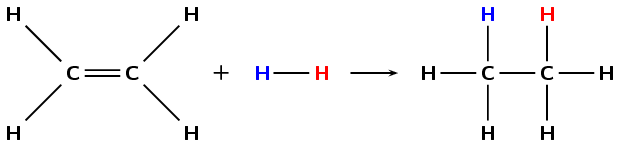

Figure 4.81: The hydrogenation of *ethene* to *ethane*.

Reaction conditions:

- a **catalyst** such as platinum (\(\text{Pt}\)),
                                                          palladium (\(\text{Pd}\)) or nickel (\(\text{Ni}\)) is needed
                                                          for these reactions
- **heating** is required
- the reaction must be done under an **inert atmosphere**,
                                                          not air (e.g. \(\text{N}_{2}(\text{g})\) atmosphere)

The hydrogenation of vegetable oils to form margarine is another example of this
                                        addition reaction (see Figure 4.82).

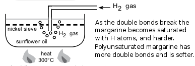

Figure 4.82: The hydrogenation of sunflower oil to make margarine.

#### Polymerisation reactions

A polymer is made up of lots of smaller units called *monomers*. When these
                                        monomers are added together, they form a polymer. One way for
                                        *polymerisation* to occur is through an **addition**
                                        reaction. More details are given later in this chapter in *Plastics and
                                                polymers* ([Section
                                                4.7](/read/science/grade-12/organic-molecules/04-organic-molecules-07)).

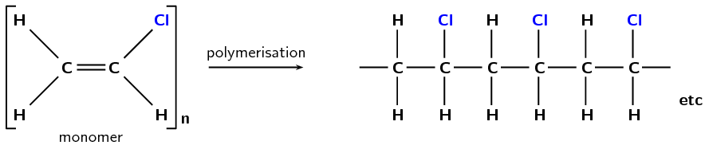

Figure 4.83: The polymerisation of **vinyl chloride**
                                                        monomers to form a **polyvinyl chloride** polymer.

Polyvinyl chloride (Figure 4.83)
                                        is used in construction and in clothing, as well as having many other uses.

## Addition reactions

### Textbook
                                                Exercise 4.26

The following diagram shows the reactants in an addition
                                                                reaction.

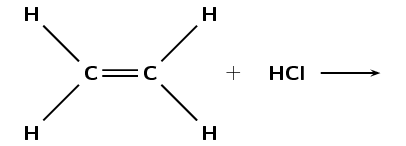

**Problem:**
Draw the structural representation of the final
                                                                        product in this reaction.

**Solution:**
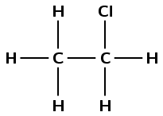

**Problem:**
What is the condensed structural representation of
                                                                        the product?

**Solution:**
\(\text{CH}_{3}\text{CH}_{2}(\text{Cl})\)

The following diagram shows the reactants in an addition
                                                                reaction.

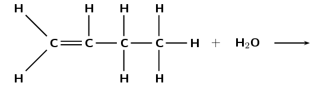

**Problem:**
Draw the structural representation of the major
                                                                        product in this reaction and give reasons.

**Solution:**
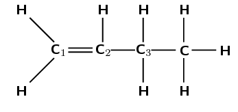

The hydroxyl anion (\(\text{OH}^{-}\)) can bond to
                                                                        carbon one, or carbon two. Carbon atom one is
                                                                        bonded only to carbon atom two. Carbon atom two
                                                                        is bonded to carbon atom one and carbon atom
                                                                        three.

Therefore, carbon atom one is less substituted and
                                                                        carbon atom two is more substituted. In the
                                                                        major product, the hydroxyl anion will add to
                                                                        the more substituted carbon atom (two).

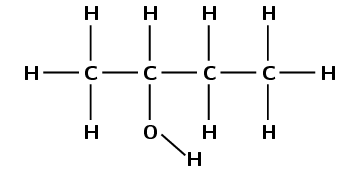

**Problem:**
Draw the structural representation of the minor
                                                                        product in this reaction and give reasons.

**Solution:**
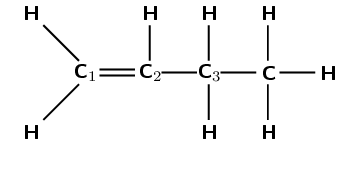

The hydroxyl anion (\(\text{OH}^{-}\)) can bond to
                                                                        carbon one, or carbon two. Carbon atom one is
                                                                        bonded only to carbon atom two. Carbon atom two
                                                                        is bonded to carbon atom one and carbon atom
                                                                        three.

Therefore, carbon atom one is less substituted and
                                                                        carbon atom two is more substituted. In the
                                                                        minor product, the hydroxyl anion will add to
                                                                        the less substituted carbon atom (one).

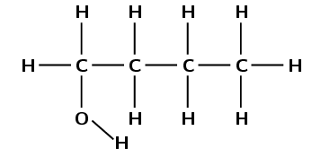

**Problem:**
What type of addition reaction is this reaction?

**Solution:**
Hydration reaction

**Problem:**
Which types of homologous series can undergo addition
                                                                        reactions?

**Solution:**
Any series where the functional group contains double
                                                                        or triple bonds (e.g. alkenes, alkynes).

**Problem:**
Is this a saturated or unstaturated series?

**Solution:**
Unsaturated

### Elimination reactions (ESCM2)

2. **Dehydrohalogenation**
   <Callout type="note" title="Note">
   Reflux is a technique whereby a reaction solution is placed in a
                                                           container with a small opening at the top. A tube that is
                                                           constantly being cooled is connected to the opening. The
                                                           solution is heated to approximately its boiling point, but any
                                                           gases produced are condensed in the tube and fall back into the
                                                           container. This way the reaction rate can be increased without
                                                           the loss of material.
   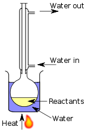
   </Callout>
   In dehydrohalogenation a **haloalkane** is exposed to a
                                                   **base**, the base then helps the elimination of the
                                                   halogen and a hydrogen atom. A double bond is formed (alkane \(\to\)
                                                   alkene). Dehydrohalogenation is considered the opposite of
                                                   hydrohalogenation. The elimination of iodine from iodoethane is an
                                                   example of dehydrohalogenation (Figure 4.84).
   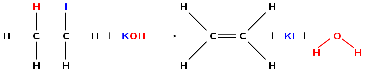
   Figure 4.84: The dehydrohalogenation of *iodoethane*
                                                                   with potassium hydroxide (\(\text{KOH}\)) to form
                                                                   *ethene*, potassium iodide (\(\text{KI}\)) and
                                                                   water.
   <Callout type="tip" title="Note">
   See hydrolysis in the [substitution
                                                                   reactions](/read/science/grade-12/organic-molecules/04-organic-molecules-06#scESCM3) section for more
                                                           information on what happens when different reaction conditions
                                                           are used.
   </Callout>
   In order for elimination to occur the following reaction conditions must be
                                                   used:
   - heat under reflux (approximately
                                                             \(\text{70}\)\(\text{°C}\))
   - a concentrated, strong base (e.g. \(\text{NaOH}\),
                                                             \(\text{KOH}\))
   - the base must be dissolved in pure ethanol (hot ethanolic base)
   Dihalogenated saturated compounds can also undergo elimination reactions to
                                                   become unsaturated, losing one halogen and one hydrogen atom. In the
                                                   example below (Figure 4.85), an atom of hydrogen and
                                                   chlorine are **eliminated** from the original compound to
                                                   form an unsaturated haloalkene and hydrochloric acid.
   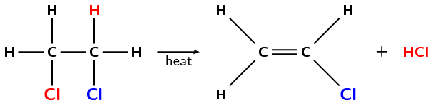
   Figure 4.85: The elimination of hydrochloric acid
                                                                   (\(\text{HCl}\)) from *1,2-dichloroethane* to
                                                                   form *chloroethene*.
   If more than one product is possible the major product will be the compound
                                                   where:
   - the hydrogen atom is removed from the \(\color{red}{\textbf{more
                                                             substituted carbon atom}}\)
   - i.e. the carbon that is bonded to the most number of carbon
                                                             atoms
   See Figure 4.86.
   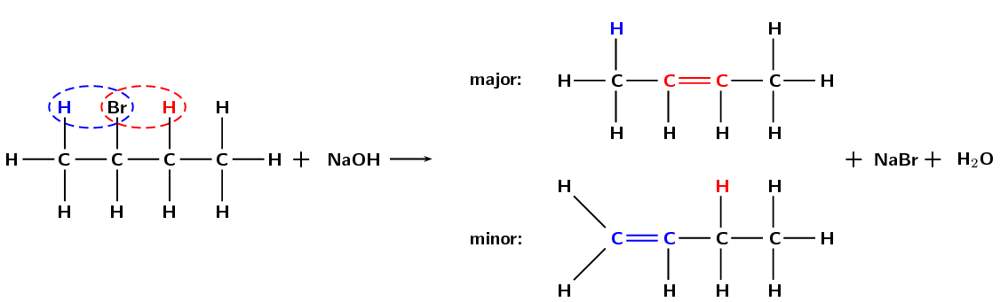
   Figure 4.86: The dehydrohalogenation of
                                                                   *2-bromobutane* to form
                                                                   **but-2-ene** (major product) and
                                                                   **but-1-ene** (minor product).
4. **Dehydration of an alcohol**
   <Callout type="note" title="Note">
   Sulfuric acid (\(\text{H}_{2}\text{SO}_{4}\)) is a dehydrating agent
                                                           and is often used to prepare dried fruits.
   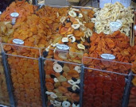
   </Callout>
   During the dehydration of an alcohol the **hydroxyl**
                                                   (\(-\text{OH}\)) group and a **hydrogen atom** are
                                                   **eliminated** from the reactant. A molecule of water is
                                                   formed as a product in the reaction, along with an alkene (Figure
                                                           4.87). This can be thought of as the reverse of a hydration
                                                   (addition) reaction.
   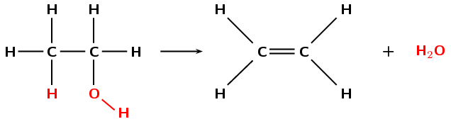
   Figure 4.87: The dehydration of *ethanol* to form
                                                                   *ethene* and \(\text{H}_{2}\text{O}\).
   Reaction conditions:
   - an **excess** of a **strong acid
                                                                     catalyst** (generally
                                                             \(\text{H}_{2}\text{SO}_{4}\) or \(\text{H}_{3}\text{PO}_{4}\))
   - high temperature (approximately
                                                             \(\text{180}\)\(\text{°C}\))
   If more than one elimination product is possible the major product will be
                                                   the compound where:
   - the hydrogen atom is removed from the carbon atom bonded to the
                                                             most number of carbon atoms (i.e., the
                                                             \(\color{blue}{\textbf{more substituted carbon atom}}\))
   This is shown in Figure 4.88.
   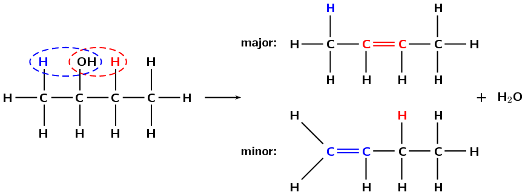
   Figure 4.88: The dehydration of *butan-2-ol* to form
                                                                   **but-2-ene** (major product) and
                                                                   **but-1-ene** (minor product).

## Elimination reactions

### Textbook Exercise 4.27

Answer the following questions about elimination reactions:

**Problem:**
What two compounds do you need for a
                                                                        dehydrohalogenation reaction?

**Solution:**
Haloalkane and a base

**Problem:**
What carbon atom will the hydrogen atom be removed
                                                                        from in a dehydration reaction (major product)?

**Solution:**
The more substituted carbon atom of those atoms
                                                                        directly bonded to the carbon atom the hydroxyl
                                                                        group is attached to. That is the carbon atom
                                                                        bonded to the most other carbon atoms.

**Problem:**
Are the reactants in an elimination reaction
                                                                        saturated or unsaturated?

**Solution:**
saturated

**Problem:**
Name the elimination reaction that is considered the
                                                                        reverse of a hydration addition reaction

**Solution:**
dehydration reaction (of an alcohol)

### Substitution reactions (ESCM3)

Some simple examples of substitution reactions are shown below:

\(\text{CH}_{4} + \text{Cl}_{2}\) \(\to\) \(\text{CH}_{3}\text{Cl} + \text{HCl}\)

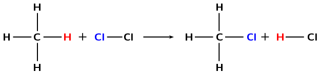

A chlorine atom (from \(\text{Cl}_{2}\)) and a hydrogen atom (from
                                                \(\text{CH}_{4}\)) are exchanged to create new products
                                                (\(\text{CH}_{3}\text{Cl}\) and \(\text{HCl}\)).

2. **Formation of haloalkanes**
   Haloalkanes can be formed when the hydroxyl (\(-\text{OH}\)) group of an
                                                   **alcohol** is replaced by a **halogen atom**
                                                   (X = Cl, Br). This reaction works best with tertiary alcohols where it
                                                   can occur at room temperature (Figure 4.89)
   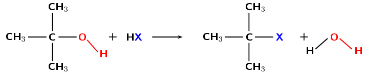
   Figure 4.89: The formation of a *tertiary haloalkane*
                                                                   from a *tertiary alcohol* by a substitution with
                                                                   HX (X = Cl, Br).
   A *tertiary* carbon atom is attached to three other carbon atoms. A
                                                   *secondary* carbon atom is attached to two other carbon atoms
                                                   while a *primary* carbon atom is attached to one other carbon
                                                   atom. In Figure 4.89 the carbon is attached to
                                                   the functional group as well as three other carbon atoms. This makes it
                                                   a tertiary alcohol on the left of the arrow and a tertiary haloalkane on
                                                   the right.
   It is possible for a secondary or primary alcohol to form a secondary or
                                                   primary haloalkane as well (see Figure 4.90) but this requires high
                                                   temperatures and the reaction is very slow.
   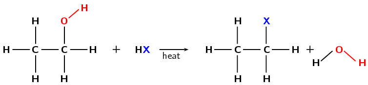
   Figure 4.90: The formation of a *primary haloethane*
                                                                   from *ethanol* by a substitution with
                                                                   \(\text{HX}\) (X = Cl, Br).
4. **Hydrolysis**
   In a previous section we saw the hydration of an ethene to form an alcohol.
                                                   That is an addition reaction. Alcohols can also be formed through a
                                                   substitution reaction with a **haloalkane**. In the example
                                                   given in Figure 4.91 the haloalkane would be
                                                   dissolved in water.
   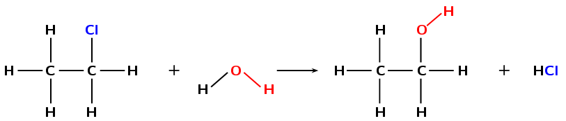
   Figure 4.91: The formation of *ethanol* from
                                                                   *chloroethane* through a substitution reaction
                                                                   with water.
   <Callout type="tip" title="Note">
   See dehydrohalogenation in the [elimination
                                                                   reactions](/read/science/grade-12/organic-molecules/04-organic-molecules-06#scESCM2) section for more
                                                           information on what happens when different reaction conditions
                                                           are used.
   </Callout>
   Using a base (e.g. \(\text{KOH}\), \(\text{NaOH}\)) dissolved in water and
                                                   warming the solution would increase the rate of the reaction (Figure 4.92). However, in order for
                                                   substitution to occur the following reaction conditions must be used:
   - low temperatures (around room temperature)
   - a dilute solution of a strong base (e.g. \(\text{NaOH}\))
   - the solution must be aqueous (in water)
   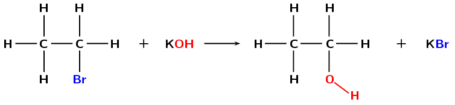
   Figure 4.92: The formation of *ethanol* from
                                                                   *bromoethane* through a substitution reaction
                                                                   with potassium hydroxide (\(\text{KOH}\)).
   If the concentration of the base is too high then the halogen atom and a
                                                   hydrogen atom could be eliminated (dehydrohalogenation).
6. **Formation of haloalkanes from alkanes**
   Another way of forming a haloalkane involves the removal of a hydrogen atom
                                                   from a **saturated compound**. The hydrogen atom is
                                                   replaced by a **halogen** (\(\text{F}\), \(\text{Cl}\),
                                                   \(\text{Br}\) or \(\text{I}\)) to form a haloalkane (Figure
                                                           4.93). As alkanes are not very reactive light is needed for
                                                   this reaction to take place.
   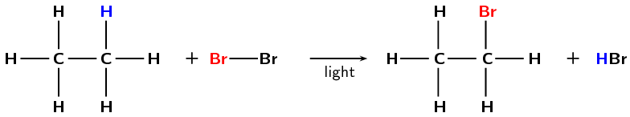
   Figure 4.93: The formation of *bromoethane* from
                                                                   *ethane* through a substitution reaction with
                                                                   \(\text{Br}_{2}\).
   <Callout type="note" title="Note">
   Refer to the section on [saturated
                                                                   and unsaturated structures](/read/science/grade-12/organic-molecules/04-organic-molecules-02#scESCK8) for more information on
                                                           why alkanes are not very reactive.
   </Callout>
   Reaction conditions:
   - energy in the form of light

## Substitution reactions

### Textbook Exercise 4.28

**Problem:**
When forming haloalkanes through a substitution reaction with
                                                                alcohols is it best to use a tertiary, secondary or
                                                                primary alcohol? Give a reason for your answer.

**Solution:**
A tertiary alcohol. The reaction works best with tertiary
                                                                alcohols (it can occur at room temperature). Higher
                                                                temperatures are required for secondary and primary
                                                                alcohols and the reaction is much slower.

**Problem:**
What is a substitution reaction?

**Solution:**
An exchange of elements in the reactants must take
                                                                        place. The initial reactants are transformed or
                                                                        'swopped around' to give the final products.

**Problem:**
Write the general equation for a substitution
                                                                        reaction using the reactants \(\text{WX}\) and
                                                                        \(\text{YZ}\)

**Solution:**
\(\text{WX} + \text{YZ}\) \(\to\) \(\text{WZ} +
                                                                        \text{XY}\) or \(\text{WX} + \text{YZ}\) \(\to\)
                                                                        \(\text{WY} + \text{XZ}\)

## Addition, elimination and substitution reactions

### Textbook Exercise 4.29

Answer the following questions about hydration reactions:

**Problem:**
What type of reaction is a hydration reaction?

**Solution:**
An addition reaction

**Problem:**
What is the most common catalyst used in this
                                                                        reaction?

**Solution:**
\(\text{H}_{3}\text{PO}_{4}\)

**Problem:**
Name one of the most common catalysts used in a hydrogenation
                                                                reaction.

**Solution:**
Platinum OR palladium OR nickel

Answer the following questions about alkane reactions

**Problem:**
Are alkanes reactive compared to alkenes and alkynes?

**Solution:**
No

**Problem:**
In a haloalkane reaction an alkane and a halogen
                                                                        react. What condition is necessary for this
                                                                        reaction to take place?

**Solution:**
Energy in the form of light

Look at the general equations given below and answer the
                                                                questions that follow:

haloalkane + base \(\to\) **A** +
                                                                        **B**

**Problem:**
Name A and B for a hydrolysis reaction.

**Solution:**
alcohol and salt (containing the halogen
                                                                                atom).

**Problem:**
What type of reaction is a hydrolysis
                                                                                reaction?

**Solution:**
substitution

haloalkane + base \(\to\) **A** +
                                                                        **B** + **C**

**Problem:**
Name A, B and C for a dehydrohalogenation
                                                                                reaction.

**Solution:**
alkene, salt and water

**Problem:**
What type of reaction is a
                                                                                dehydrohalogenation reaction?

**Solution:**
elimination

**Problem:**
Fill in the reaction conditions required for
                                                                        dehydrohalogenation and hydrolysis reactions in
                                                                        the table below:

|  | Dehydrohalogenation | Hydrolysis |
| --- | --- | --- |
| Temperature |  |  |
| Solvent |  |  |
| Concentration of
                                                                                                        base |  |  |

**Solution:**
|  | Dehydrohalogenation | Hydrolysis |
| --- | --- | --- |
| Temperature | high (\(\text{70}\)\(\text{°C}\)) | low (room temperature) |
| Solvent | alcoholic | aqueous |
| Concentration of
                                                                                                        base | concentrated | dilute |

Refer to the diagram below and then answer the questions that follow:

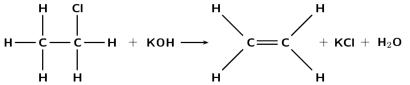

**Problem:**
What type of reaction is this reaction?

**Solution:**
Elimination

**Problem:**
Give a reason for your answer above.

**Solution:**
A single bond becomes a double bond and a hydrogen atom and a
                                                                chlorine atom are eliminated from the reactant.

**Problem:**
What are the required reaction conditions?

**Solution:**
Heat, under reflux (approximately
                                                                \(\text{70}\)\(\text{°C}\)), a concentrated
                                                                alcoholic (ethanol) solution of a strong base (e.g.
                                                                \(\text{NaOH}\) or \(\text{KOH}\)).

Write the equation for the following reactions using the condensed
                                                        structural representation. Say what type of reaction they are:

**Problem:**
The dehydration of hexan-2-ol
                                                                (\(\text{CH}_{3}\text{CH}(\text{OH})\text{CH}_{2}\text{CH}_{2}\text{CH}_{2}\text{CH}_{3}\))

**Solution:**
\(\text{CH}_{3}\text{CH}(\text{OH})\text{CH}_{2}\text{CH}_{2}\text{CH}_{2}\text{CH}_{3}\)
                                                                \(\to\)
                                                                \(\text{CH}_{3}\text{CHCHCH}_{2}\text{CH}_{2}\text{CH}_{3}
                                                                + \text{H}_{2}\text{O}\)

hexan-2-ol \(\to\) hex-2-ene + water (major product)

OR

\(\text{CH}_{3}\text{CH}(\text{OH})\text{CH}_{2}\text{CH}_{2}\text{CH}_{2}\text{CH}_{3}\)
                                                                \(\to\)
                                                                \(\text{CH}_{2}\text{CHCH}_{2}\text{CH}_{2}\text{CH}_{2}\text{CH}_{3}
                                                                + \text{H}_{2}\text{O}\)

hexan-2-ol \(\to\) hex-1-ene + water (minor product)

Elimination

**Problem:**
The hydration of pent-1-ene
                                                                (\(\text{CH}_{2}\text{CHCH}_{2}\text{CH}_{2}\text{CH}_{3}\))

**Solution:**
\(\text{CH}_{2}\text{CHCH}_{2}\text{CH}_{2}\text{CH}_{3} +
                                                                \text{H}_{2}\text{O}\) \(\to\)
                                                                \(\text{CH}_{3}\text{CH}(\text{OH})\text{CH}_{2}\text{CH}_{2}\text{CH}_{3}\)

pent-1-ene + water \(\to\) pentan-2-ol (major product)

OR

\(\text{CH}_{2}\text{CHCH}_{2}\text{CH}_{2}\text{CH}_{3} +
                                                                \text{H}_{2}\text{O}\) \(\to\)
                                                                \(\text{CH}_{2}(\text{OH})\text{CH}_{2}\text{CH}_{2}\text{CH}_{2}\text{CH}_{3}\)

pent-1-ene + water \(\to\) pentan-1-ol (minor product)

Addition

**Problem:**
The hydrolysis of 2-fluorobutane
                                                                (\(\text{CH}_{3}\text{CH}(\text{F})\text{CH}_{2}\text{CH}_{3}\))
                                                                with water (no base).

**Solution:**
\(\text{CH}_{3}\text{CH}(\text{F})\text{CH}_{2}\text{CH}_{3}
                                                                + \text{H}_{2}\text{O}\) \(\to\)
                                                                \(\text{CH}_{3}\text{CH}(\text{OH})\text{CH}_{2}\text{CH}_{3}
                                                                + \text{HF}\)

2-fluorobutane + water \(\to\) butan-2-ol + hydrofluoric acid

Substitution

The following reaction takes place:

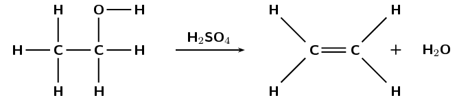

**Problem:**
What type of reaction is this?

**Solution:**
Elimination

**Problem:**
Give a reason for your answer.

**Solution:**
A saturated compound (alcohol) becomes an unsaturated
                                                                compound (alkene) with a molecule of water eliminated
                                                                from the reactant (alcohol).

Write the equations for the following reactions using condensed
                                                        structural representations. State the type of reaction as well.

**Problem:**
The hydrogenation of propene
                                                                (\(\text{CH}_{2}\text{CHCH}_{3}\))

**Solution:**
\(\text{CH}_{2}\text{CHCH}_{3} + \text{H}_{2}\) \(\to\)
                                                                \(\text{CH}_{3}\text{CH}_{2}\text{CH}_{3}\)

propene + hydrogen \(\to\) propane

Addition

The formation of a haloalkane from:

**Problem:**
butan-1-ol
                                                                        (\(\text{CH}_{2}(\text{OH})\text{CH}_{2}\text{CH}_{2}\text{CH}_{3}\))
                                                                        and hydrochloric acid (\(\text{HCl}\))

**Solution:**
\(\text{CH}_{2}(\text{OH})\text{CH}_{2}\text{CH}_{2}\text{CH}_{3}
                                                                        + \text{HCl}\) \(\to\)
                                                                        \(\text{CH}_{2}(\text{Cl})\text{CH}_{2}\text{CH}_{2}\text{CH}_{3}
                                                                        + \text{H}_{2}\text{O}\)

butan-1-ol + hydrochloric acid \(\to\) 1-chlorobutane
                                                                        + water

Substitution

**Problem:**
2-methylpent-2-ene
                                                                        (\(\text{CH}_{3}\text{C}(\text{CH}_{3})\text{CHCH}_{2}\text{CH}_{3}\))
                                                                        and hydroiodic acid (\(\text{HI}\)). Indicate
                                                                        the major and minor products and give reasons.

**Solution:**
In the major product the hydrogen will add to the
                                                                        less substituted carbon atom (third carbon
                                                                        atom), and the iodine will add to the more
                                                                        substituted carbon atom (second carbon atom):

\(\text{CH}_{3}\text{C}(\text{CH}_{3})\text{CHCH}_{2}\text{CH}_{3}
                                                                        + \text{HI}\) \(\to\)
                                                                        \(\text{CH}_{3}\text{C}(\text{CH}_{3})(\text{I})\text{CH}_{2}\text{CH}_{2}\text{CH}_{3}\)

2-methylpent-2-ene + hydroiodic acid \(\to\)
                                                                        2-iodo-2-methylpentane

In the minor product the hydrogen will add to the
                                                                        more substituted carbon atom (second carbon
                                                                        atom), and the iodine will add to the less
                                                                        substituted carbon atom (third carbon atom):

\(\text{CH}_{3}\text{C}(\text{CH}_{3})\text{CHCH}_{2}\text{CH}_{3}
                                                                        + \text{HI}\) \(\to\)
                                                                        \(\text{CH}_{3}\text{CH}(\text{CH}_{3})\text{CH}(\text{I})\text{CH}_{2}\text{CH}_{3}\)

2-methylpent-2-ene + hydroiodic acid \(\to\)
                                                                        3-iodo-2-methylpentane

Addition

Write balanced equations for the following reactions
                                                                involving hept-3-ene
                                                                (\(\text{CH}_{3}\text{CH}_{2}\text{CHCHCH}_{2}\text{CH}_{2}\text{CH}_{3}\))
                                                                and name the product.

**Problem:**
Hydrohalogenation, choose any halogen

**Solution:**
\(\text{CH}_{3}\text{CH}_{2}\text{CHCHCH}_{2}\text{CH}_{2}\text{CH}_{3}
                                                                        + \text{HX}\) \(\to\)
                                                                        \(\text{CH}_{3}\text{CH}_{2}\text{CH}(\text{X})\text{CH}_{2}\text{CH}_{2}\text{CH}_{2}\text{CH}_{3}\)

hept-3-ene + hydrochloric acid (e.g.) \(\to\)
                                                                        3-chloroheptane

OR

\(\text{CH}_{3}\text{CH}_{2}\text{CHCHCH}_{2}\text{CH}_{2}\text{CH}_{3}
                                                                        + \text{HX}\) \(\to\)
                                                                        \(\text{CH}_{3}\text{CH}_{2}\text{CH}_{2}\text{CH}(\text{X})\text{CH}_{2}\text{CH}_{2}\text{CH}_{3}\)

hept-3-ene + hydrochloric acid (e.g.) \(\to\)
                                                                        4-chloroheptane

Either product is possible as the carbons on either
                                                                        side of the double bond are equally substituted
                                                                        (bonded to two carbon atoms and one hydrogen
                                                                        atom).

Addition

**Problem:**
The dehydrohalogenation with potassium hydroxide
                                                                        (\(\text{KOH}\)) of the product from c) i

**Solution:**
\(\text{CH}_{3}\text{CH}_{2}\text{CH}(\text{X})\text{CH}_{2}\text{CH}_{2}\text{CH}_{2}\text{CH}_{3}
                                                                        + \text{KOH}\) \(\to\)

\(\text{CH}_{3}\text{CHCHCH}_{2}\text{CH}_{2}\text{CH}_{2}\text{CH}_{3}\)

3-chloroheptane + potassium hydroxide \(\to\)
                                                                        hept-2-ene

OR

\(\text{CH}_{3}\text{CH}_{2}\text{CH}(\text{X})\text{CH}_{2}\text{CH}_{2}\text{CH}_{2}\text{CH}_{3}
                                                                        + \text{KOH}\) \(\to\)

\(\text{CH}_{3}\text{CH}_{2}\text{CHCHCH}_{2}\text{CH}_{2}\text{CH}_{3}\)

3-chloroheptane + potassium hydroxide \(\to\)
                                                                        hept-3-ene

Either product is possible as the carbons on either
                                                                        side of the double bond are equally substituted
                                                                        (bonded to two carbon atoms and one hydrogen
                                                                        atom).

OR

\(\text{CH}_{3}\text{CH}_{2}\text{CH}_{2}\text{CH}(\text{X})\text{CH}_{2}\text{CH}_{2}\text{CH}_{3}
                                                                        + \text{KOH}\) \(\to\)

\(\text{CH}_{3}\text{CH}_{2}\text{CHCHCH}_{2}\text{CH}_{2}\text{CH}_{3}\)

4-chloroheptane + potassium hydroxide \(\to\)
                                                                        hept-3-ene

Elimination

**Problem:**
Halogenation, choose any halogen

**Solution:**
\(\text{CH}_{3}\text{CH}_{2}\text{CHCHCH}_{2}\text{CH}_{2}\text{CH}_{3}
                                                                        + \text{X}_{2}\) \(\to\)

\(\text{CH}_{3}\text{CH}_{2}\text{CH}(\text{X})\text{CH}(\text{X})\text{CH}_{2}\text{CH}_{2}\text{CH}_{3}\)

hept-3-ene + bromine (e.g.) \(\to\)
                                                                        3,4-dibromoheptane

Addition

**Problem:**
The dehydrohalogenation of the product from c) iii

**Solution:**
\(\text{CH}_{3}\text{CH}_{2}\text{CH}(\text{X})\text{CH}(\text{X})\text{CH}_{2}\text{CH}_{2}\text{CH}_{3}\)
                                                                        \(\to\)

\(\text{CH}_{3}\text{CH}_{2}\text{C}(\text{X})\text{CHCH}_{2}\text{CH}_{2}\text{CH}_{3}
                                                                        + \text{HX}\)

e.g. 3,4-dibromoheptane \(\to\) 3-bromohept-3-ene +
                                                                        hydrobromic acid

OR

\(\text{CH}_{3}\text{CH}_{2}\text{CH}(\text{X})\text{CH}(\text{X})\text{CH}_{2}\text{CH}_{2}\text{CH}_{3}\)
                                                                        \(\to\)

\(\text{CH}_{3}\text{CH}_{2}\text{CHC}(\text{X})\text{CH}_{2}\text{CH}_{2}\text{CH}_{3}
                                                                        + \text{HX}\)

e.g. 3,4-dibromoheptane \(\to\) 4-bromo-hept-3-ene +
                                                                        hydrobromic acid

Elimination
