## 4.7 Plastics and polymers (ESCM4)

### What is a polymer? (ESCM5)

Polymers are large molecules (macromolecules) that are made up of many repeating structural
                                units called **monomers** which have various functional groups. To put it
                                more simply, a monomer is like a building block.

<Callout type="note" title="Note">
**Mono** means one, while **poly** means many. So a monomer
                                        is the single unit, and a polymer is made from many monomers.
</Callout>

Monomer

A monomer is a small molecule that can be combined through a reaction to form
                                                a polymer. It is a repeating unit in the polymer.

When lots of monomers are joined together by covalent bonds, they form a
                                **polymer**.

Polymer

Polymer is a term used to describe large molecules consisting of repeating
                                                structural units (monomers) connected by covalent chemical bonds.

<Callout type="tip" title="Note">
A polymer consists of a backbone, made up of repeating units.

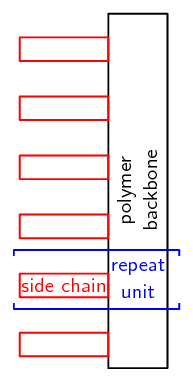
</Callout>

In an **organic polymer**, the monomers are joined by the *carbon* atoms
                                of the polymer backbone or *chain*. A polymer can also be
                                **inorganic**, in which case there may be atoms such as *silicon* in
                                the place of carbon atoms. We will look solely at organic polymers. Polymers are a
                                specific group of *macromolecules*. A macromolecule is any compound with a large
                                number of atoms. A *biological macromolecule* is one that is found in living
                                organisms. Biological macromolecules include molecules such as carbohydrates, proteins,
                                nucleic acids and lipids. They are essential for all known forms of life to survive.

Macromolecule

A macromolecule is any molecule containing a large number of atoms.

The key feature that makes a polymer different from other macromolecules is the repetition of
                                identical or similar monomers in the polymer chain. Polymers will contain chains of the
                                same type of functional group and that functional group is dependent on the monomer
                                used. The examples given over the following pages will help to make these concepts
                                clearer. *Plastics* are a group of polymers that can be molded during
                                manufacture. They can be one polymer or a blend (mixture) of polymers and may contain
                                other substances as well. These other substances can be inorganic (e.g. used for
                                electronic packaging) or stabilising (e.g. used for increasing fire resistance).

Plastic
A subgroup of organic polymers that can be molded. Plastics may contain more than
                                        one organic polymer as well as other additives.

<Callout type="note" title="Note">
A thermoplastic is a plastic that can be heated and molded multiple times without
                                        changing chemically.

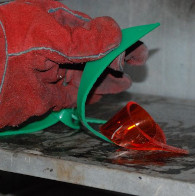
</Callout>

The learners should come back to the *What is a polymer?* concept map
                                        throughout this section, whenever they have new information to add. This can
                                        then be used as a study tool.

## What is a polymer?

2. SASOL polymers is the largest division of the Johannesburg based
                                                           companies' chemical business. Divide the class into 4 groups and
                                                           have each group research the production of polymers in South
                                                           Africa, including investigations into one of the products listed
                                                           below:
   - Kevlar and Mylar
   - Windscreens
   - Break pads
   - Polymers to replace glass
   Research the functions of the materials, who invented or discovered
                                                           them, and what they are made of. Present your findings to the
                                                           rest of the class in a five minute discussion.
4. Read this section (What is a polymer?) carefully. Research any
                                                           concepts you don't understand and draw up a concept map
                                                           (mindmap) describing what a polymer is.
   *A concept map is a way of showing concepts and linking knowledge
                                                                   using graphics.* An example is given below:
   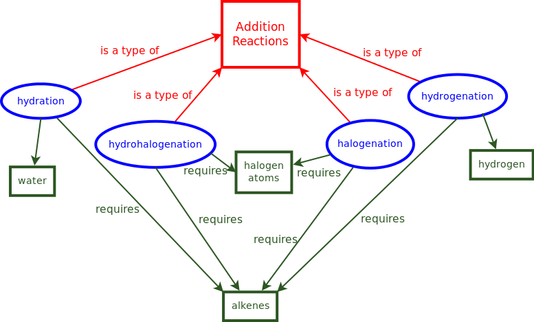

<QuizCard id="s12-04-07a" title="Interactive Exercise 4.27" question="Give a term (word or phrase) for the following definition: A small molecule that combines with itself or another small molecule in a repeating fashion to form large molecules." options=[] answer="['monomer', 'a monomer', 'monomers', 'the monomer']" hint="" explanation="Match the definition to the correct term A small molecule that combines with itself or another small molecule in a repeating fashion to form large molecules is a monomer: The correct answer is: monomer . Submit your answer as:" />

<QuizCard id="s12-04-07a" title="Interactive Exercise 4.27" question="Choose the most appropriate definition for the following term: Monomer . A A small molecule that combines with itself or another small molecule in a repeating fashion to form large molecules. B The reaction in which multiple monomers join to form longer chains. C The addition reaction of multiple monomers to form longer chains." options=["A", "B", "C"] answer="A" hint="" explanation="A monomer is a small molecule that combines with itself or another small molecule in a repeating fashion to form large molecules: Therefore, the correct answer is A : A small molecule that combines with itself or another small molecule in a repeating fashion to form large molecules. Submit your answer as: A" />

<QuizCard id="s12-04-07a" title="Interactive Exercise 4.27" question="Give a term (word or phrase) for the following definition: A subgroup of organic polymers that can be moulded (they can contain other additives)." options=[] answer="['plastic', 'plastics', 'the plastics', 'a plastic']" hint="" explanation="Match the definition to the correct term A subgroup of organic polymers that can be moulded (they can contain other additives) is a plastic: The correct answer is: plastic . Submit your answer as:" />

<QuizCard id="s12-04-07a" title="Interactive Exercise 4.27" question="Choose the most appropriate definition for the following term: Polymer . A The condensation reaction of multiple monomers to form longer chains. B A large molecule consisting of repeating structural units connected by covalent chemical bonds. C A small molecule that combines with itself or another small molecule in a repeating fashion to form large molecules." options=["A", "B", "C"] answer="B" hint="" explanation="A polymer is a large molecule consisting of repeating structural units connected by covalent chemical bonds: Therefore, the correct answer is B : A large molecule consisting of repeating structural units connected by covalent chemical bonds. Submit your answer as: B" />

<QuizCard id="s12-04-07a" title="Interactive Exercise 4.27" question="Give a term (word or phrase) for the following definition: A large molecule consisting of repeating structural units connected by covalent chemical bonds." options=[] answer="['polymer', 'a polymer', 'polymers', 'the polymer']" hint="" explanation="Match the definition to the correct term A large molecule consisting of repeating structural units connected by covalent chemical bonds is a polymer: The correct answer is: polymer . Submit your answer as:" />

<QuizCard id="s12-04-07a" title="Interactive Exercise 4.27" question="Choose the most appropriate definition for the following term: Plastic . A A large organic molecule. B A subgroup of organic polymers that can be moulded (they can contain other additives). C The reaction in which multiple monomers join to form longer chains." options=["A", "B", "C"] answer="B" hint="" explanation="A plastic is a subgroup of organic polymers that can be moulded (they can contain other additives): Therefore, the correct answer is B : A subgroup of organic polymers that can be moulded (they can contain other additives). Submit your answer as: B" />

### How do polymers form? (ESCM6)

Polymers are formed through a process called **polymerisation**, where monomers
                                react together to form a polymer chain. Two of the types of polymerisation reactions are
                                **addition polymerisation** and **condensation
                                        polymerisation**.

Polymerisation

Polymerisation is a process of bonding monomers, or *single units*
                                                together to form longer chains called polymers.

#### Addition polymerisation

In this type of reaction, **monomer molecules** are added to a growing
                                        **polymer chain** one at a time. (No *small molecules are
                                                eliminated* in the process).

Four major examples of addition polymers are polyethylene, polypropylene,
                                        polyvinylchloride (PVC) and polystyrene (Table 4.18). All four of these organic polymers
                                        are also plastics.

| Polymer name | Production (metric tons) | Some uses |
| --- | --- | --- |
| polyethylene | \(> 80\) million | plastic bags | bottles | plastic films |
| polypropylene | \(> 45\) million | labelling | textiles | stationery |
| polyvinyl chloride | \(> 30\) million | construction | clothing | insulation |
| polystyrene | \(> 2\) million | packaging | molds | cutlery |

Table 4.18: Common uses of four major polymers formed through
                                                        addition reactions.

2. **Polyethene (polyethylene)**
   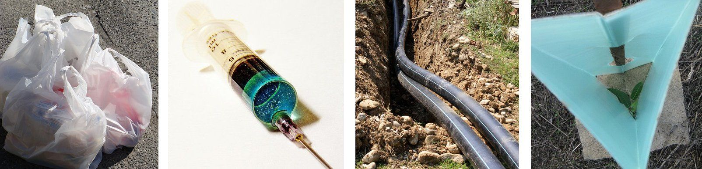
   Figure 4.94: A collection of products made from
                                                                           polyethylene: plastic bags, a syringe, pipes, a
                                                                           plastic tree guard.
   Earlier in this chapter we looked at the structure of a group of
                                                           hydrocarbons called the *alkenes*. One example is the
                                                           molecule **ethene**. The structural formula of
                                                           ethene is shown in Figure 4.95. When lots of
                                                           ethene molecules bond together, a polymer called
                                                           **polyethene** (commonly called polyethylene) is
                                                           formed. Ethene is the *unsaturated monomer* which, when
                                                           joined to other ethene molecules through an addition reaction,
                                                           forms the *saturated polymer*
   **polyethene**.
   Polyethene is the most common plastic with over 80 million metric
                                                           tons produced each year. It is commonly known as polyethylene.
                                                           It is cheap and is used to make squeeze bottles, plastic bags,
                                                           films, toys and molded objects as well as electric insulation.
                                                           It has a recycling number 4 which means that it is easy to
                                                           process, has strength, toughness, flexibility, is easy to seal
                                                           and has a barrier to moisture.
   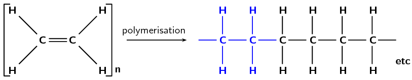
   Figure 4.95: The polymerisation of an
                                                                           **ethene** monomer to form a
                                                                           **polyethene** polymer. The repeat
                                                                           unit is highlighted in blue.
   A polymer may be a chain of thousands of monomers, and so it is
                                                           impossible to draw the entire polymer. Rather, the structure of
                                                           a polymer can be condensed and represented as shown in Figure 4.96. The monomer is
                                                           enclosed in brackets and the *n* represents the number of
                                                           **repeating units** (the saturated form of the
                                                           monomer) in the polymer, where *n* is any whole number.
                                                           What this shows is that the monomer is repeated an indefinite
                                                           number of times in a molecule of polyethene.
   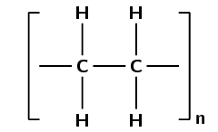
   Figure 4.96: A simplified representation of
                                                                           polyethene.
   <Callout type="note" title="Note">
   <VideoPlayer src="http://www.youtube.com/embed/xoBYLwwjr9E" title="Video:
                                                                           27QC" />
   </Callout>
4. **Polypropene (polypropylene)**
   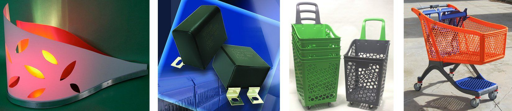
   Figure 4.97: A collection of products made from
                                                                           polypropylene: a
                                                                           lamp cover, computer parts, and shopping
                                                                           trolleys.
   Another example of a polymer is *polypropene* (Figure 4.98). Polypropene
                                                           (commonly known as polypropylene) is also a plastic, but is
                                                           stronger than polyethene and is used to make crates, fibres and
                                                           ropes as well as being used in textiles, stationery and car
                                                           parts. In this polymer, the monomer is the alkene called
                                                           **propene**.
   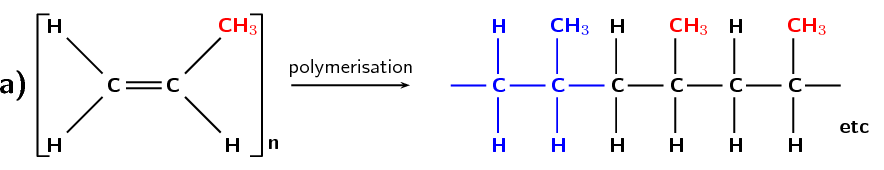
   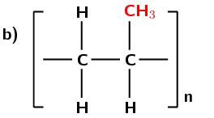
   Figure 4.98: **(a)** The polymerisation
                                                                           of a
                                                                           **propene** monomer to form a
                                                                           **polypropylene** polymer. The
                                                                           repeat unit is highlighted in blue.
                                                                           **(b)** A simplified representation
                                                                           of polypropylene.
   <Callout type="note" title="Note">
   <VideoPlayer src="http://www.youtube.com/embed/Yw75R-o4UJc" title="Video:
                                                                           27QD" />
   </Callout>
6. **Polyvinyl chloride (PVC)**
   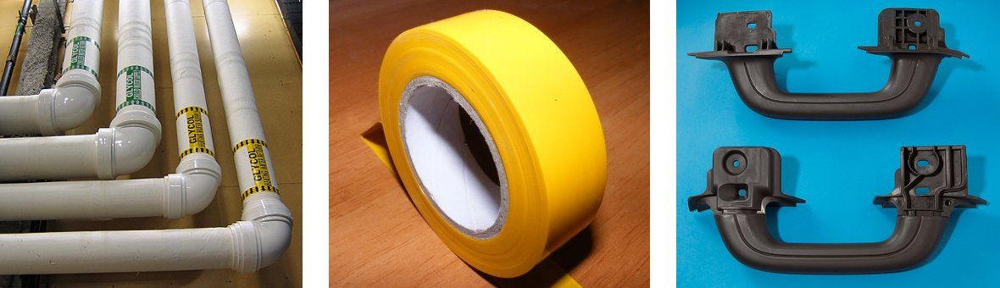
   Figure 4.99: A collection of products made from
                                                                           polyvinyl
                                                                           chloride: pipes, electrical tape, and car parts.
   Polyvinyl chloride or *PVC* (Figure 4.100) is formed from
                                                           the
                                                           monomer chloroethene, which is commonly known as vinyl chloride.
                                                           PVC is used in construction, especially plastic piping. With the
                                                           addition of a plasticiser it is also used in clothing and
                                                           upholstery and to replace rubber. The role of the plasticiser is
                                                           to increase the ability of a material to change shape without
                                                           breaking.
   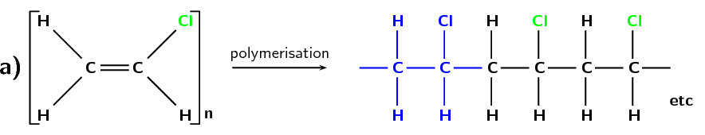
   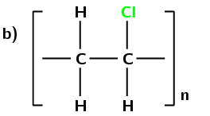
   Figure 4.100: **(a)** The polymerisation
                                                                           of a
                                                                           **chloroethane** monomer to form a
                                                                           **polyvinyl chloride** polymer. The
                                                                           repeat unit is highlighted in blue.
                                                                           **(b)** A simplified representation
                                                                           of polyvinyl chloride.
   <Callout type="note" title="Note">
   <VideoPlayer src="http://www.youtube.com/embed/ZNOvpRMdmCo" title="Video:
                                                                           27QF" />
   </Callout>
8. **Polyvinyl acetate**
   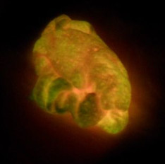
   Figure 4.101: Glowing slime made with polyvinyl
                                                                           acetate.
   Polyvinyl acetate or *PVA* (Figure 4.102) is formed from
                                                           the monomer ethenyl ethanoate, which is commonly known as vinyl
                                                           acetate. PVA is used in various glues and adhesives (such as
                                                           wood glue).
   <Callout type="tip" title="Note">
   **Ethenyl** is not the same as ethyl. Ethyl is
                                                                   an ethane molecule bonded to another compound
                                                                   (\(\color{red}{\textbf{R}}\)). Ethenyl is an ethene
                                                                   molecule bonded to another compound
                                                                   (\(\color{red}{\textbf{R}}\)).
   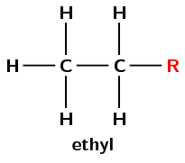
   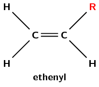
   </Callout>
   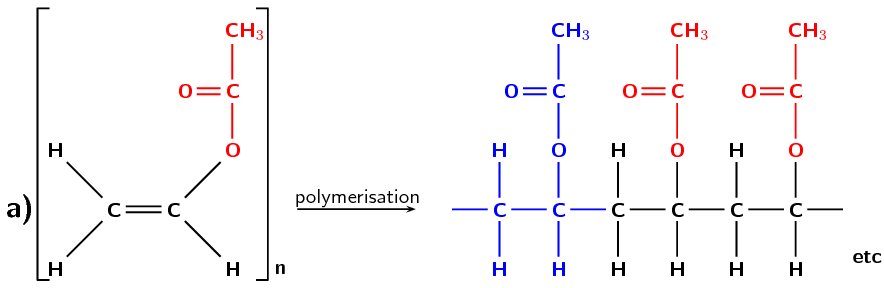
   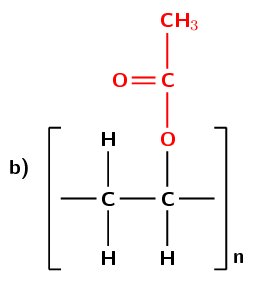
   Figure 4.102: **(a)** The polymerisation
                                                                           of an
                                                                           **ethenyl ethanoate** monomer to
                                                                           form a **polyvinyl acetate**
                                                                           polymer. The repeat unit is highlighted in blue.
                                                                           **(b)** A simplified representation
                                                                           of polyvinyl acetate.
10. **Polystyrene**
   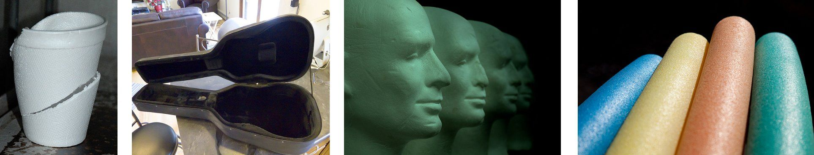
   Figure 4.103: A collection of products made from
                                                                           polystyrene: a
                                                                           cup, a guitar case, polystyrene carvings, and
                                                                           floating pool noodles.
   *Polystyrene* is made from the monomer *styrene* which
                                                           is a liquid petrochemical. Styrene consists of a benzene ring (a
                                                           six membered ring with three double bonds) bonded to an ethene
                                                           chain. Polystyrene is an aromatic polymer and has many uses
                                                           including protective packaging, in trays, as plastic lids and
                                                           bottles.
   <Callout type="note" title="Note">
   Benzene can be represented with three double bonds:
   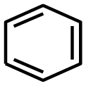
   or with a circle inside the ring:
   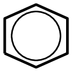
   </Callout>
   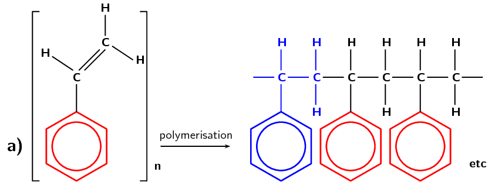
   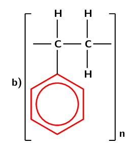
   Figure 4.104: **(a)** The polymerisation
                                                                           of a
                                                                           **styrene** monomer to form a
                                                                           **polystyrene** polymer. The repeat
                                                                           unit is highlighted in blue.
                                                                           **(b)** A simplified representation
                                                                           of polystyrene.
    

                                                           
<a
                                                                           href="http://www.youtube.com/embed/q6OVD_2xliM">Video:
                                                                           27QG</a>

                                                   

It is interesting to note that the polymerisation of a monomer leads to different
                                        physical properties of the polymer (Table 4.19). For the polymers the melting
                                        points are dependent on the polymer grade.

<Callout type="note" title="Note">
Remember that the IUPAC name of:

- ethylene is ethene
- propylene is propene
- vinyl chloride is chloroethene
</Callout>

| Name | Melting point (℃) | Boiling point (℃) | Phase (at 25℃) |
| --- | --- | --- | --- |
| ethylene | \(-\text{169,2}\) | \(-\text{103,7}\) | gas |
| polyethylene | \(\text{105}\) - \(\text{130}\) | does not boil | solid |
| propylene | \(-\text{185,2}\) | \(-\text{47,6}\) | gas |
| polypropylene | \(\text{130}\) - \(\text{171}\) | does not boil | solid |
| vinyl chloride | \(-\text{153,8}\) | \(-\text{13,4}\) | gas |
| polyvinyl chloride | \(\text{100}\) - \(\text{260}\) | does not boil | solid |
| vinyl acetate | \(-\text{93}\) | \(\text{72,7}\) | liquid |
| polyvinyl acetate | \(\text{60}\) | does not boil | solid |
| styrene | \(-\text{30}\) | \(\text{145}\) | liquid |
| polystyrene | ~\(\text{240}\) | does not boil | solid |

Table 4.19: Different physical properties of addition monomers and
                                                        polymers.

## Development of addition polymers

Polyethene was discovered by accident, twice. Look into the history of this
                                                commonly used plastic as well as other addition polymers.

- Who discovered them?
- How were they discovered?
- What difference have they made to modern life?

## Building polymers

Using atomic model kits, jelly tots, or playdough and toothpicks build four
                                                ethene monomers, four propene monomers and four vinyl chloride monomers.

- Join three of each type of monomer to form polyethene,
                                                                  polypropene and polyvinyl chloride.
- Identify the repeating unit in each polymer.
- List the differences and similarities between the monomers
                                                                  and the repeating unit.

Note that the monomers all contain double bonds, while the repeating unit has
                                                only a single bond.

## Addition polymers

### Textbook Exercise
                                                        4.30

**Problem:**
What trend is visible when comparing the melting
                                                                        points of monomers and their polymers?

**Solution:**
Polymerisation increases the melting point
                                                                        *OR* while the monomers are in the gas or
                                                                        liquid phase the polymers are solid.

Name the monomer (where polymer is given) or polymer
                                                                        (where monomer is given) for the following:

**Problem:**
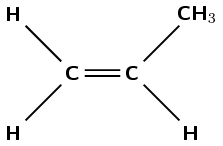

**Solution:**
The polymer is polypropene or polypropylene.

**Problem:**
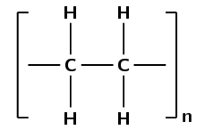

**Solution:**
The monomer is ethene or ethylene.

**Problem:**
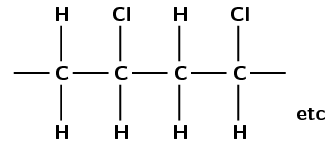

**Solution:**
The monomer is chloroethene or vinyl
                                                                                chloride.

#### Condensation polymerisation

In this type of reaction, two monomer molecules combine by means of a covalent bond,
                                        and a small molecule such as water is lost in the bonding process. Nearly all
                                        biological macromolecules are formed using this process.
                                        **Polyesters** are polymers that form through condensation
                                        polymerisation.

Polyesters have a number of characteristics which make them very useful. They are
                                        resistant to stretching and shrinking, they are easily washed and dry quickly,
                                        and they are resistant to mildew. It is for these reasons that polyesters are
                                        being used more and more in **textiles**. Polyesters are stretched
                                        out into fibres and can then be made into fabric and articles of clothing. In
                                        the home, polyesters are used to make clothing, carpets, curtains, sheets,
                                        pillows and upholstery.

Polyesters are a group of polymers that contain the **ester** functional
                                        group in their main chain. This bond is called an **ester
                                                linkage**. For a polyester however there needs to be continuation
                                        of the chain. This requires a *-diol* (two alcohol functional groups) and
                                        a *diacid* (two carboxylic acid functional groups) as shown in Figure
                                                4.105, or a monomer that contains both a hydroxyl group and a
                                        carboxylic acid.

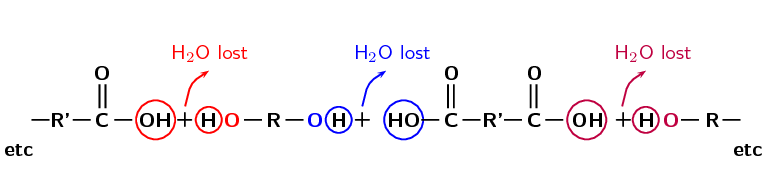

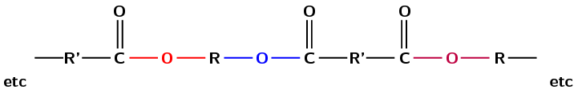

Figure 4.105: The propagation of the **ester linkage**
                                                        in a **polyester**.

2. **Polyethylene terephthalate (PET)**
   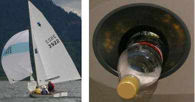
   Figure 4.106: A collection of products made from
                                                                           polyethylene
                                                                           terephthalate: sailcloth and plastic squeeze
                                                                           bottles.
   Although there are many forms of polyesters, the term
                                                           *polyester* usually refers to *polyethylene
                                                                   terephthalate (PET)*. PET is made from
                                                           ethan-1,2-diol (ethylene glycol, an alcohol) and terephthalic
                                                           acid (a carboxylic acid). In the reaction, a hydrogen atom is
                                                           lost from the alcohol, and a hydroxyl group is lost from the
                                                           carboxylic acid. Together these form one water molecule which is
                                                           lost during condensation reactions. A new bond is formed between
                                                           an oxygen and a carbon atom. This bond is called an
                                                           **ester linkage**. The reaction is shown in Figure 4.107.
   <Callout type="note" title="Note">
   Polyethylene terephthalate (PET) is not just a textile. PET
                                                                   is in fact a plastic which can also be used to make
                                                                   plastic drink bottles. Many drink bottles are recycled
                                                                   by being reheated and turned into polyester fibres. This
                                                                   type of recycling helps to reduce disposal problems.
   </Callout>
   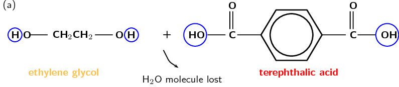
   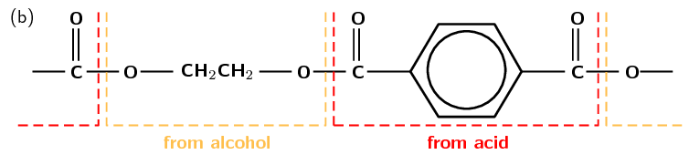
   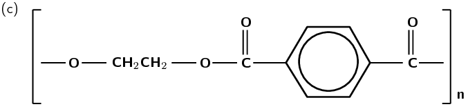
   Figure 4.107: **(a)** Ethylene glycol
                                                                           (alcohol) and
                                                                           terephthalic acid (carboxylic acid) monomers
                                                                           react to form **(b)** the polymer
                                                                           poly(ethylene terephthalate) (PET).
                                                                           **(c)** A simplified representation
                                                                           of PET.
   <Callout type="note" title="Note">
   <VideoPlayer src="http://www.youtube.com/embed/29Az-dPwtg8" title="Video:
                                                                           27QK" />
   </Callout>
4. **Polylactic acid (PLA)**
   <Callout type="note" title="Note">
   3D printing is the process of printing a solid,
                                                                   three-dimensional object. If you have a 3D printer it is
                                                                   possible to print objects ranging from fashion items
                                                                   (e.g. cell phone covers), to human organs, although
                                                                   organs require living cells as the 'ink'.
   </Callout>
   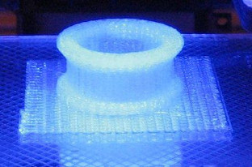
   Figure 4.108: 3-D printing using polylactic acid as
                                                                           the
                                                                           *ink*.
   Despite the name, polylactic acid (PLA) is actually a polyester (look
                                                           for the ester linkage we spoke about before). It is an
                                                           interesting polymer because the monomer used for this polymer
                                                           (Figure
                                                                   4.109) comes from the biological fermentation of
                                                           plant materials, while most monomers used in plastics come from
                                                           petroleum. As a result PLA is biodegradable and has low carbon
                                                           dioxide (\(\text{CO}_{2}\)) emissions.
   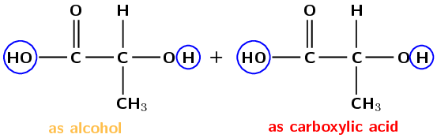
   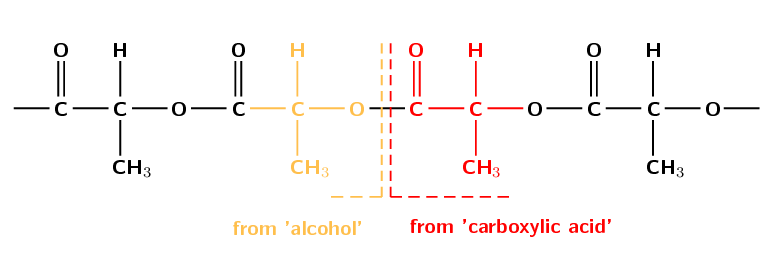
   Figure 4.109: **Ester linkages** between
                                                                           lactic acid
                                                                           monomers.
   PLA is mostly used for packaging material and, because it is
                                                           biodegradable, it has the potential to alleviate land-fill
                                                           disposal problems. The PLA polymer structural repeat unit is
                                                           given in Figure
                                                                   4.110.
   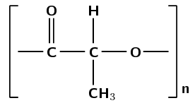
   Figure 4.110: The polyester *polylactic acid*.
    

                                                           
<a
                                                                           href="http://www.youtube.com/embed/-S7AU5DcL48">Video:
                                                                           27QM</a>

                                                   

| Polymer name | Some uses |
| --- | --- |
| polyethylene terephthalate | synthetic fibre | plastic containers | resins |
| polylactic acid | medical implants | packaging | textiles |

Table 4.20: Some common uses of polymers formed through condensation
                                                reactions.

For polyethylene terephthalate there are two monomers *ethylene glycol* and
                                *terephthalic acid* that join to form the polymer. Each monomer has its own
                                unique properties (Table
                                        4.21).

| Name | Monomer/ polymer | Melting point (℃) | Boiling point (℃) | Phase (at 25℃) |
| --- | --- | --- | --- | --- |
| \(\color{blue}{\text{terephthalic acid}}\) | monomer | \(\text{300}\) | sublimes (solid \(\to\) gas) | solid |
| \(\color{blue}{\text{ethylene glycol}}\) | monomer | \(-\text{12,9}\) | \(\text{197,3}\) | liquid |
| \(\color{blue}{\text{polyethylene}}\) \(\color{blue}{\text{terephthalate}}\) | polymer | \(>\text{250}\) | decomposes | solid |
| \(\color{red}{\text{lactic acid}}\) | monomer | \(\text{16,8}\) | \(\text{122}\) | liquid |
| \(\color{red}{\text{polylactic acid}}\) | polymer | \(\text{150}\) - \(\text{160}\) | does not boil | solid |

Table 4.21: Different physical properties of condensation monomers and
                                                polymers.

## Condensation polymers

### Textbook Exercise 4.31

**Problem:**
What is the main difference between the reactants used in an
                                                                addition polymerisation and those used in a condensation
                                                                polymerisation?

**Solution:**
A condensation reaction requires two monomer molecules (or a
                                                                monomer with two functional groups) while an addition
                                                                reaction requires only one.

OR

An addition polymerisation is an addition reaction while a
                                                                condensation polymerisation is a substitution reaction.

OR

An addition polymerisation requires an unsaturated monomer
                                                                while a condensation polymerisation does not.

Initiation, propagation and termination

There are three stages in the process of addition polymerisation.
                                        **Initiation** refers to a chemical reaction that triggers the
                                        first reaction. In other words, initiation is the starting point of the
                                        polymerisation reaction. **Chain propagation** is the part where
                                        monomers are continually added to form a longer and longer polymer chain. During
                                        chain propagation it is the reactive end groups of the polymer chain that react
                                        in each propagation step to add a new monomer to the chain. Once a monomer has
                                        been added the reactive part of the polymer is now in this last monomer unit so
                                        that propagation will continue. **Termination** refers to a
                                        chemical reaction that destroys the reactive part of the polymer chain so that
                                        propagation stops.

It is important to be able to identify the monomer used to produce a polymer from the repeat
                                unit of the chain.

<Callout type="tip" title="Worked example 34: Identifying monomers">
**Question:**
Which monomer was used to make this polymer (give the name and draw the
                                                structure):

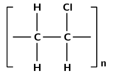

**Identify the polymer through functional groups:**
This polymer contains a chlorine atom. Which polymers contain chlorine?
                                                Polyvinyl chloride contains chlorine.

**Consider what you know of this polymer:**
PVC forms through an addition reaction. There are two carbon atoms in the
                                                repeat unit (ethane) and the polymer contains chlorine atoms.

**Apply this knowledge to the monomer:**
An addition reaction indicates that the monomer must contain a double bond.
                                                As the polymer contains units of ethane the monomer must be an ethene.
                                                The monomer must contain a chlorine atom.

**Name the monomer:**
The monomer must be **chloroethene** also known as **vinyl
                                                        chloride**

**Draw the structure of this monomer:**
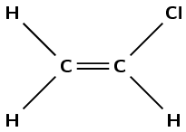
</Callout>

<Callout type="tip" title="Worked example 35: Identifying monomers">
**Question:**
Which monomer was used to make this polymer (give the name and draw the
                                                structure):

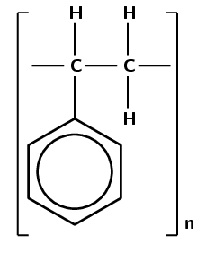

**Identify the polymer through functional groups:**
This polymer contains a benzene ring connected to two carbon atoms. Which
                                                polymers contain a benzene ring? Polystyrene contains a benzene ring
                                                connected to two carbon atoms.

**Consider what you know of this polymer:**
Polystyrene forms through an addition reaction. There are two carbon atoms
                                                attached to the benzene ring.

**Apply this knowledge to the monomer:**
An addition reaction means that the monomer must contain a double bond. The
                                                polymer contains two carbon atoms attached to the benzene ring which
                                                must be connected by a double bond in the monomer.

**Name the monomer:**
The monomer must be **styrene**.

**Draw the structure of this monomer:**
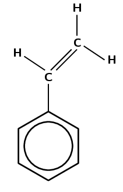
</Callout>

<Callout type="tip" title="Worked example 36: Identifying monomers">
**Question:**
Give the structure of the monomer used to make polyvinyl acetate:

**Draw the repeat unit structure of polyvinyl acetate:**
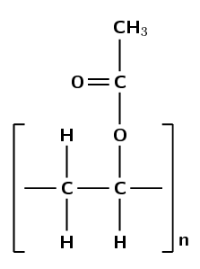

**Consider what you know of this polymer:**
Polyvinyl acetate must form from vinyl acetate. The IUPAC name of vinyl
                                                acetate is ethenyl ethanoate. The polymer forms through an addition
                                                reaction.

**Apply this knowledge to the monomer:**
An addition reaction means that the monomer must contain a double bond. The
                                                only place this bond can occur is between carbon 1 and carbon 2:

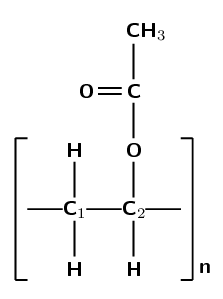

**Draw the structure of the monomer:**
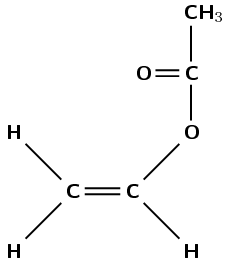
</Callout>

<Callout type="tip" title="Worked example 37: Identifying polymers">
**Question:**
Which polymer is formed from propene? Give the name and repeat structural
                                                unit.

**Draw the structural representation of the monomer:**
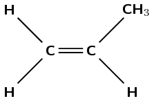

**Consider what you about this monomer:**
Propene contains a double bond between the first and second carbon atoms.

**Apply this knowledge to the polymer:**
The polymer must form through an addition reaction by breaking the double
                                                bond. There must be a methyl group on every second carbon atom.

**Name the polymer:**
The polymer must be **polypropene** (polypropylene).

**Draw the repeat structural unit of this polymer:**
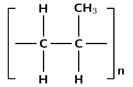
</Callout>

<Callout type="tip" title="Worked example 38: Identifying types of polymerisation reactions">
**Question:**
Was an addition or a condensation reaction used to make this polymer?

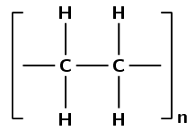

**Look at the types of bonds and functional groups in the
                                                polymer repeat unit:**
There are only single carbon-carbon bonds, there are no functional groups.

**What type of monomer could this polymer have formed from?:**
As there are no oxygen atoms in the repeat unit, this polymer could only have
                                                formed from a monomer containing a double bond.

**Apply this knowledge to determine the type of reaction:**
This polymer must have formed through an **addition** reaction.

(This is polyethene and was formed by the addition of ethene monomers)
</Callout>

<Callout type="tip" title="Worked example 39: Identifying types of polymerisation reactions">
**Question:**
Was an addition or a condensation reaction used to make this polymer?

**Look at the types of bonds in the polymer repeat unit:**
There are carbon-carbon single bonds. If you expand the repeating unit you
                                                can see that there is an ester linkage in the structural chain.

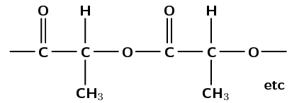

**What type of monomer could this polymer have formed from?:**
The ester linkage requires an alcohol and a carboxylic acid monomer or a
                                                monomer that contains both a hydroxyl and carboxyl functional group.

**Apply this knowledge to determine the type of reaction:**
The reaction of an alcohol and carboxylic acid to form an ester linkage (and
                                                resulting in the loss of water) is a **condensation**
                                                reaction.

(This is polylactic acid and was formed by the condensation reaction of
                                                lactic acid monomers)
</Callout>

In the making polymer slime experiment make sure the learners keep the slime away
                                        from their clothes as it can permanently stain. You can store the slime by
                                        dipping it in some water and then storing it in an air-tight container. However,
                                        it may become mouldy after a few days, at that stage throw it away (not down the
                                        sink).

## Making polymer slime

### Aim

To compare the differences in slime made from polyvinyl alcohol and polyvinyl
                                                acetate.

### Apparatus

- 4% aqueous polyvinyl alcohol solution, 4% aqueous borax
                                                                  (hydrated sodium tetraborate) solution, white glue
                                                                  (polyvinyl acetate), food colourant
- a beaker, two disposable plastic cups, a metal spatula,
                                                                  disposable plastic gloves

### Method

2. Place \(\text{40}\) \(\text{cm$^{3}$}\) of the polyvinyl
                                                                   alcohol solution in one plastic cup and label it
                                                                   *A*.
4. Place \(\text{20}\) \(\text{cm$^{3}$}\) of the white glue in
                                                                   the second cup. Add \(\text{20}\) \(\text{cm$^{3}$}\) of
                                                                   water and stir. Label this cup *B*.
6. Add one drop of food colourant to each cup and stir well.
8. Measure out \(\text{10}\) \(\text{cm$^{3}$}\) of the borax
                                                                   solution into the beaker, then add to cup A.
10. Repeat step 4 with cup B.
12. Stir until gelling is complete (i.e. the slime).
14. Put on the disposable plastic gloves, take the slime out of
                                                                   cup A and roll it around in your hand to remove air
                                                                   bubbles, repeat with the slime in cup B.

### Questions

2. Pull each slime apart slowly, what happens?
4. Pull each slime apart quickly, what happens?
6. Roll each slime into a ball and drop it onto the bench, what
                                                                   happens?
8. Place a small bit of each slime on the bench and hit it hard
                                                                   with your hand, what happens?
10. What are the similarities and differences between the two
                                                                   slimes?

### Discussion and Conclusions

You should find that the slime does not break under slow stress, but will
                                                break if you pull it apart too quickly. This is because the slime can
                                                expand under stress. It should even bounce slightly if you throw it onto
                                                a hard surface.

<QuizCard id="s12-04-07d" title="Interactive Exercise 4.30" question="Is the following reaction an addition or a condensation polymerisation reaction?" options=["an addition", "a condensation"] answer="a condensation" hint="" explanation="Recall the main features of addition and condensation polymerisation There are two types of polymerisation reaction: Addition polymerisation There is one type of monomer. This monomer always contains a double bond between two carbon atoms. The monomer molecules are added to a growing polymer chain one at a time through an addition reaction. Condensation polymerisation There may be more than one type of monomer involved in the polymerisation reaction. The monomer molecules combine through a covalent bond, with the loss of a small molecule (e.g. water). Work out the type of polymerisation In this reaction neither monomer contains a double bond between two carbon atoms. Instead ethylene glycol contains two hydroxyl functional groups, and terephthalic acid contains two carboxylic acid functional groups: Water molecules are lost during the polymerisation reaction: hydrogen atoms from the ethylene glycol molecule and hydroxyl groups from the terephthalic acid combine to form water. The monomers combined through a covalent bond, with the loss of a small molecule, to form the polymer. The correct answer is therefore a condensation polymerisation reaction. Submit your answer as: a condensation" />

<QuizCard id="s12-04-07d" title="Interactive Exercise 4.30" question="Is the following reaction an addition or a condensation polymerisation reaction?" options=["an addition", "a condensation"] answer="an addition" hint="" explanation="Recall the main features of addition and condensation polymerisation There are two types of polymerisation reaction: Addition polymerisation There is one type of monomer. This monomer always contains a double bond between two carbon atoms. The monomer molecules are added to a growing polymer chain one at a time through an addition reaction. Condensation polymerisation There may be more than one type of monomer involved in the polymerisation reaction. The monomer molecules combine through a covalent bond, with the loss of a small molecule (e.g. water). Work out the type of polymerisation In this reaction the monomer contains a double bond between two carbon atoms: All of the atoms present in the monomer (vinyl acetate) are present in the polymer (polyvinyl acetate). That is, no small molecule is lost during polymerisation and there are only single carbon-carbon bonds in the polymer. The unsaturated monomers combined through an addition reaction to form a saturated polymer. The correct answer is therefore an addition polymerisation reaction. Submit your answer as: an addition" />

<QuizCard id="s12-04-07d" title="Interactive Exercise 4.30" question="The following monomer is a reactant in an addition polymerisation reaction: What is the name of the polymer that forms from this monomer?" options=[] answer="['polypropene', 'polypropylene', 'poly propene', 'poly propylene', 'poly(propene)', 'poly(propylene)', 'poly(prop-1-ene)', 'poly(1-propene)', 'poly prop-1-ene', 'poly 1-propene', 'polyprop-1-ene', 'poly-1-propene']" hint="" explanation="Identify the monomer The monomer shown above contains an ethene group (two carbon atoms with a carbon-carbon double bond) attached to a methyl group. This monomer is therefore propene . Identify the polymer The polymer that is made through an addition reaction of propene monomers must contain a chain of carbon atoms, with every second carbon atom bonded to a methyl group: This polymer must therefore be polypropene . Submit your answer as:" />

<QuizCard id="s12-04-07d" title="Interactive Exercise 4.30" question="The following monomer is a reactant in an addition polymerisation reaction: What is the name of the polymer that forms from this monomer?" options=[] answer="['polystyrene', 'poly styrene', 'poly-styrene', 'thermocol', 'polyphenylethene', 'poly(phenylethene)', 'poly(1-phenylethene)', 'polyphenyl-1-ethene', 'poly(phenyl-1-ethene)', 'poly(1-phenyl-1-ethene)', 'polyphenyleth-1-ene', 'poly(phenyleth-1-ene)', 'poly(1-phenyleth-1-ene)', 'polyphenylethylene', 'poly(phenylethylene)', 'poly(1-phenylethylene)']" hint="" explanation="Identify the monomer The monomer shown above contains an ethene group (two carbon atoms with a carbon-carbon double bond) attached to a benzene ring. This monomer is therefore styrene . Note: The name styrene was given to this molecule when it was first isolated from tree resin. The IUPAC name for styrene is phenylethene. Identify the polymer The polymer that is made through an addition reaction of styrene monomers must contain a chain of carbon atoms, with every second carbon atom bonded to a benzene ring: This polymer must therefore be polystyrene . Submit your answer as:" />

<QuizCard id="s12-04-07d" title="Interactive Exercise 4.30" question="Is the following reaction an addition or a condensation polymerisation reaction?" options=["an addition", "a condensation"] answer="a condensation" hint="" explanation="Recall the main features of addition and condensation polymerisation There are two types of polymerisation reaction: Addition polymerisation There is one type of monomer. This monomer always contains a double bond between two carbon atoms. The monomer molecules are added to a growing polymer chain one at a time through an addition reaction. Condensation polymerisation There may be more than one type of monomer involved in the polymerisation reaction. The monomer molecules combine through a covalent bond, with the loss of a small molecule (e.g. water). Work out the type of polymerisation In this reaction the monomer does not contain a double bond between two carbon atoms. Instead the monomer contains a hydroxyl functional group and a carboxylic acid functional group: Water molecules are lost during the polymerisation reaction: a hydrogen atom from the alcohol functional group, and a hydroxyl group from the carboxylic acid functional group combine to form water. The monomers combined through a covalent bond, with the loss of a small molecule, to form the polymer. The correct answer is therefore a condensation polymerisation reaction. Submit your answer as: a condensation" />

<QuizCard id="s12-04-07d" title="Interactive Exercise 4.30" question="Adapted from DBE Nov 2015 Grade 12, P2, Q3.2 Physical constants \(·\) Chemistry formulas \(·\) Periodic table \(·\) Standard reduction potentials The condensed format of the structural formula of a polymer is shown below. Draw the structural formula of the monomer that is used to prepare the above polymer, and then answer the questions below." options=["condensation", "substitution", "elimination", "addition"] answer="
                    0
                ,
                    ['CHClCH_{2}', 'CH(Cl)CH_{2}', 'CH_{2}CHCl', 'CH_{2}CH(Cl)']
                " hint="" explanation="Recall the definitions of addition and condensation polymerisation Addition polymerisation is a reaction in which small, unsaturated monomer molecules react and form large, saturated polymers, through addition at their double bonds. Condensation polymerisation is a reaction in which molecules of two monomers with different functional groups undergo condensation reactions resulting in the loss of small molecules, usually water. Condensation polymerisation can also happen with one monomer that contains two different functional groups. The polymer is polyvinyl chloride (PVC). When polyvinyl chloride is formed, no small molecules are eliminated. Therefore the type of reaction that forms polyvinyl chloride is an addition reaction. Use what you know about polyvinyl chloride to determine the correct condensed structural formula Polyvinyl chloride is prepared from the monomer vinyl chloride : Therefore the condensed structural formula of the monomer is: CHClCH 2 Submit your answer as: addition and" />

<QuizCard id="s12-04-07d" title="Interactive Exercise 4.30" question="Adapted from DBE Nov 2015 Grade 12, P2, Q3.2 Physical constants \(·\) Chemistry formulas \(·\) Periodic table \(·\) Standard reduction potentials The structural formula of a monomer is shown below. Draw the structural formula of the polymer that is prepared from the above monomer, and then answer the questions below." options=["elimination", "condensation", "addition", "substitution"] answer="
                    1
                ,
                    2
                " hint="" explanation="Recall the definitions of addition and condensation polymerisation Addition polymerisation is a reaction in which small, unsaturated monomer molecules react and form large, saturated polymers, through addition at their double bonds. Condensation polymerisation is a reaction in which molecules of two monomers with different functional groups undergo condensation reactions resulting in the loss of small molecules, usually water. Condensation polymerisation can also happen with one monomer that contains two different functional groups. The monomer is lactic acid . Lactic acid contains two different types of functional groups (a carboxyl group and a hydroxyl group). When lactic acid monomers react, water is eliminated. Therefore the type of reaction that forms the polymer is a condensation reaction. Use what you know about lactic acid to choose the correct structural formula Lactic acid is used to prepare the polymer polylactic acid (PLA): Submit your answer as: condensation and" />

<QuizCard id="s12-04-07d" title="Interactive Exercise 4.30" question="Sketch a structural formula for 1-chloro-4-methylpentane. How many carbon atoms are there in the main chain? Choose the correct structural formula for this compound. A CH 2 (Cl)CH 2 CH 2 CH(CH 3 )CH 3 B C CH 3 C(Cl)(CH 3 )CH 2 CH(Cl)CH 3 D" options=["two", "three", "four", "five", "six", "A", "B", "C", "D", "A", "B", "C", "D", "A", "B", "C", "D"] answer="
                        3
                    ,
                        1
                    " hint="" explanation="Determine the number of carbon atoms in the main chain of 1-chloro-4-methylpentane The prefix for 1-chloro-4-methylpentane is pent . This means that there are five carbon atoms in the main chain. Sketch the structural formula for 1-chloro-4-methylpentane 1-chloro means that there is one chlorine atom on carbon number one. 4-methyl means that there is a CH 3 (methyl) substituent on carbon number four. Submit your answer as: five and B" />

<QuizCard id="s12-04-07d" title="Interactive Exercise 4.30" question="Adapted from DBE Nov 2016 Grade 12, P2, Q2 Physical constants \(·\) Chemistry formulas \(·\) Periodic table \(·\) Standard reduction potentials The letters A to F in the table below represent six organic compounds. A propanoic acid B C polylactic acid D E ethyl ethanoate F Give the letter that represents the following:" options=["A", "B", "C", "D", "E", "F", "A", "B", "C", "D", "E", "F", "A", "B", "C", "D", "E", "F", "A", "B", "C", "D", "E", "F"] answer="
                    1
                ,
                    3
                ,
                    4
                ,
                    2
                " hint="" explanation="Identify the short-chain hydrocarbon Hydrocarbons are organic compounds that contain only carbon and hydrogen. They can be further divided into the alkanes , alkenes , and alkynes , based on the type of bonds between the carbon atoms. There is only one substance that matches this description. 2-methylbut-1-ene (an alkene) Therefore the short-chain hydrocarbon is B . Identify the functional isomer of A Isomers are molecules with the same molecular formula but different structural formulas. Functional isomers are isomers where the molecules also contain different functional groups and belong to different homologous series . Compound A , propanoic acid, belongs to the carboxylic acids. It contains three carbon atoms, six hydrogen atoms and two oxygen atoms. The functional isomer of propanoic acid in the table is ethyl methanoate: The molecular formula for both of these compounds is C 3 H 6 O 2 . Therefore the functional isomer is D . Identify a compound with the same homologous series as D Compound D , ethyl methanoate, belongs to the esters. So we are looking for another ester. Ethyl ethanoate Therefore the compound in the same homologous series is E . Identify the plastic Plastics are a subgroup of organic polymers that can be moulded. Plastics may contain more than one organic polymer as well as other additives. There is one substance that matches that description. Polylactic acid (PLA) Therefore a plastic is C . Submit your answer as: B and D and E and C" />

<QuizCard id="s12-04-07d" title="Interactive Exercise 4.30" question="Sketch a structural formula for 2-bromo-3-methylbutane. How many carbon atoms are there in the main chain? Choose the correct structural formula for this compound. A B CH 3 CH(Br)CH(CH 3 )CH 3 C D CH 3 C(Br)(CH 3 )CH(Br)CH 3" options=["two", "three", "four", "five", "six", "A", "B", "C", "D", "A", "B", "C", "D", "A", "B", "C", "D"] answer="
                        2
                    ,
                        0
                    " hint="" explanation="Determine the number of carbon atoms in the main chain of 2-bromo-3-methylbutane The prefix for 2-bromo-3-methylbutane is but . This means that there are four carbon atoms in the main chain. Sketch the structural formula for 2-bromo-3-methylbutane 2-bromo means that there is one bromine atom on carbon number two. 3-methyl means that there is a CH 3 (methyl) substituent on carbon number three. Submit your answer as: four and A" />

<QuizCard id="s12-04-07d" title="Interactive Exercise 4.30" question="Adapted from DBE Nov 2016 Grade 12, P2, Q2 Physical constants \(·\) Chemistry formulas \(·\) Periodic table \(·\) Standard reduction potentials The letters A to F in the table below represent six organic compounds. A B but-1-yne C polyvinyl chloride D E propanone F Give the letter that represents the following:" options=["A", "B", "C", "D", "E", "F", "A", "B", "C", "D", "E", "F", "A", "B", "C", "D", "E", "F", "A", "B", "C", "D", "E", "F"] answer="
                    1
                ,
                    4
                ,
                    3
                ,
                    2
                " hint="" explanation="Identify the short-chain hydrocarbon Hydrocarbons are organic compounds that contain only carbon and hydrogen. They can be further divided into the alkanes , alkenes , and alkynes , based on the type of bonds between the carbon atoms. There is only one substance that matches this description. But-1-yne (an alkyne) Therefore the short-chain hydrocarbon is B . Identify the functional isomer of A Isomers are molecules with the same molecular formula but different structural formulas. Functional isomers are isomers where the molecules also contain different functional groups and belong to different homologous series . Compound A , propanal, belongs to the aldehydes. It contains three carbon atoms, six hydrogen atoms and one oxygen atom. The functional isomer of propanal in the table is propanone: The molecular formula for both of these compounds is C 3 H 6 O . NOTE: Both propanone and propanal contain the −C=O but the functional groups are actually different. In propanal the carbonyl carbon is bonded to a hydrogen atom, unlike in propanone. This −CH=O group is referred to as the formyl functional group. Therefore the functional isomer is E . Identify a compound with the same homologous series as E Compound E , propanone, belongs to the ketones. So we are looking for another ketone. Pentan-2-one Therefore the compound in the same homologous series is D . Identify the plastic Plastics are a subgroup of organic polymers that can be moulded. Plastics may contain more than one organic polymer as well as other additives. There is one substance that matches that description. Polyvinyl chloride (PVC) Therefore a plastic is C . Submit your answer as: B and E and D and C" />

### Impact of polymers and plastics (ESCM7)

<Callout type="note" title="Note">
The Great Pacific Garbage Patch is a large area of waste that has collected in the
                                        central North Pacific Ocean. It is estimated to cover at least
                                        \(\text{700 000}\) \(\text{km$^{2}$}\).

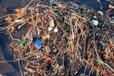
</Callout>

#### Plastics and the environment

Although plastics have had a huge impact globally, there is also an environmental
                                        price that has to be paid for their use. The following are just some of the ways
                                        in which plastics can cause damage to the environment.

2. **Waste disposal**
   Plastics are not easily broken down by micro-organisms and therefore
                                                           most are not easily biodegradeable. This leads to waste disposal
                                                           problems.
4. **Air pollution**
   When plastics burn, they can produce toxic gases such as carbon
                                                           monoxide, hydrogen cyanide and hydrogen chloride (particularly
                                                           from PVC and other plastics that contain chlorine or nitrogen).
6. **Recycling**
   It is difficult to recycle plastics because each type of plastic has
                                                           different properties and so different recycling methods may be
                                                           needed for each plastic. Some plastics can be remelted and
                                                           re-used, while others can be ground up and used as a filler. One
                                                           of the problems with recycling plastics is that they have to be
                                                           sorted according to plastic *type*. A list of some of the
                                                           different types and their identification codes are given in Table
                                                                   4.22. Alternatively, plastics should be re-used. In
                                                           many countries, including South Africa, shoppers must now pay
                                                           for plastic bags. This encourages people to collect and re-use
                                                           the bags they already have.

| PIC | Plastic type | Properties | Uses | Recycling |
| --- | --- | --- | --- | --- |
|  | polyethylene terephthalate | very clear high strength barrier to gas barrier to moisture | water bottles peanut butter jars mouthwash bottles | can recycle most places |
|  | high-density polyethylene | very stiff high strength barrier to moisture allows gas through | yoghurt tubs detergent bottles cereal box liners | can recycle most places |
|  | polyvinyl chloride | can be blended easily high strength very toughness | detergent bottles medical equipment piping | very rarely recycled |
|  | low-density polyethylene | very flexible high strength barrier to moisture | clothing squeeze bottles bread bags | not often recycled |
|  | polypropylene | high strength resistance to heat barrier to moisture | syrup bottles plastic caps straws | fairly easy to recycle |
|  | polystyrene | many uses very clear is easily formed | egg cartons disposable cups take-away boxes | fairly easy to recycle |
|  | other | dependent on combination of polymers | large containers sunglasses computer cases | often not recycled |

Table 4.22: The plastic identification code (PIC), type, properties
                                                        and uses of various commonly used plastics.

## Plastic pollution in South Africa

Read the following extract, taken from *Planet Ark* (September 2003),
                                                and then answer the questions that follow.

'South Africa launches a programme this week to exterminate its
                                                        *national flower* - the millions of used plastic bags
                                                        that litter the landscape.

Beginning on Friday, plastic shopping bags used in the country must
                                                        be both thicker and more recyclable, a move officials hope will
                                                        stop people from simply tossing them away. 'Government has
                                                        targeted plastic bags because they are the most visible kind of
                                                        waste,' said Phindile Makwakwa, spokeswoman for the Department
                                                        of Environmental Affairs and Tourism. 'But this is mostly about
                                                        changing people's mindsets about the environment.'

South Africa is awash in plastic pollution. Plastic bags are such a
                                                        common eyesore that they are dubbed *roadside daisies*
                                                        and referred to as the national flower. Bill Naude of the
                                                        Plastics Federation of South Africa said the country used about
                                                        eight billion plastic bags annually, a figure which could drop
                                                        by 50 percent if the new law works.'

It is difficult sometimes to imagine exactly how much waste is produced in
                                                our country every year. Where does all of this go to? You are going to
                                                do some simple calculations to try to estimate the volume of plastic
                                                packets that is produced in South Africa every year.

2. Take a plastic shopping packet and fold it until it forms a
                                                                   tightly compressed cube.
   2. Measure the approximate length, breadth and
                                                                                      depth of your compressed plastic bag.
   4. Calculate the approximate volume that is
                                                                                      occupied by the packet.
   6. Now calculate the approximate volume of your
                                                                                      classroom by measuring its length,
                                                                                      breadth and height.
   8. Calculate the number of compressed plastic
                                                                                      packets that would fit into a classroom
                                                                                      of this volume.
   10. If South Africa produces an average of 8
                                                                                      billion plastic bags each year, how many
                                                                                      classrooms would be filled if all of
                                                                                      these bags were thrown away and not
                                                                                      re-used?
4. What has South Africa done to try to reduce the number of
                                                                   plastic bags that are produced?
6. Do you think this has helped the situation?
8. What can *you* do to reduce the amount of plastic that
                                                                   you throw away?
10. Take a survey of your classmates, family and friends on the
                                                                   quantities and types of solid waste they generate. What
                                                                   methods could they use to reduce that waste?
12. It has now been over *ten years* since shops started
                                                                   charging for plastic bags. Research the effects this law
                                                                   has had on South African plastic waste.

## Biodegradable plastics

Read the following extract, taken from Nova: Science in the news (July 2006),
                                                and then answer the questions that follow.

Our whole world seems to be wrapped in plastic. Almost every product
                                                        we buy, most of the food we eat and many of the liquids we drink
                                                        come encased in plastic. Plastic packaging provides excellent
                                                        protection for the product, it is cheap to manufacture and seems
                                                        to last forever. Lasting forever, however, is proving to be a
                                                        major environmental problem. Another problem is that traditional
                                                        plastics are manufactured from non-renewable resources - oil,
                                                        coal and natural gas. In an effort to overcome these problems,
                                                        researchers and engineers have been trying to develop
                                                        biodegradable plastics that are made from renewable resources,
                                                        such as plants.

The term biodegradable means that a substance can be broken down into
                                                        simpler substances by the activities of living organisms, and
                                                        therefore is unlikely to remain in the environment. The reason
                                                        most plastics are not biodegradable is because their long
                                                        polymer molecules are too large and too tightly bonded together
                                                        to be broken apart and used by decomposer organisms. However,
                                                        plastics based on natural plant polymers that come from wheat or
                                                        corn starch have molecules that can be more easily broken down
                                                        by microbes.

Starch is a natural polymer. It is a white, granular carbohydrate
                                                        produced by plants during photosynthesis and it serves as the
                                                        plant's energy store. Many plants contain large amounts of
                                                        starch. Starch can be processed directly into a bioplastic but,
                                                        because it is soluble in water, articles made from starch will
                                                        swell and deform when exposed to moisture, and this limits its
                                                        use. This problem can be overcome by changing starch into a
                                                        different polymer. First, starch is harvested from corn, wheat
                                                        or potatoes, then micro-organisms transform it into lactic acid,
                                                        a monomer. Finally, the lactic acid is chemically treated to
                                                        cause the molecules of lactic acid to link up into long chains
                                                        or polymers, which bond together to form a plastic called
                                                        polylactide (PLA).

PLA can be used for products such as plant pots and disposable
                                                        nappies. It has been commercially available in some countries
                                                        since 1990, and certain blends have proved successful in medical
                                                        implants, sutures and drug delivery systems because they are
                                                        able to dissolve away over time. However, because PLA is much
                                                        more expensive than normal plastics, it has not become as
                                                        popular as one would have hoped.

### Questions

2. In your own words, explain what is meant by a
                                                                           *biodegradable plastic*.
4. Using your knowledge of chemical bonding, explain why
                                                                           some polymers are biodegradable and others are
                                                                           not.
6. Explain why lactic acid is a more useful monomer than
                                                                           starch, when making a biodegradable plastic.
8. If you were a consumer (shopper), would you choose to
                                                                           buy a biodegradable plastic rather than another?
                                                                           Explain your answer.
10. What do you think could be done to make biodegradable
                                                                           plastics more popular with consumers?

## Polymers

### Textbook Exercise 4.32

The following monomer is a reactant in a polymerisation reaction:

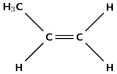

**Problem:**
What is the IUPAC name of this monomer?

**Solution:**
propene

**Problem:**
Give the structural representation of the polymer that is
                                                                formed in this polymerisation reaction.

**Solution:**
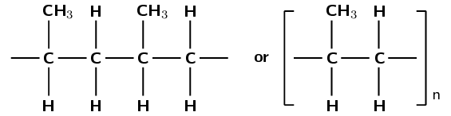

**Problem:**
Is the reaction an addition or condensation reaction?

**Solution:**
Addition

The polymer below is the product of a polymerisation reaction.

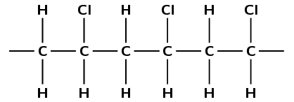

**Problem:**
Give the structural formula of the monomer used to form this
                                                                polymer.

**Solution:**

**Problem:**
What is the name of the monomer?

**Solution:**
The monomer is chloroethene or vinyl chloride.

**Problem:**
Draw the abbreviated structural formula for the polymer (the
                                                                repeat unit).

**Solution:**

**Problem:**
Has this polymer been formed through an addition or
                                                                condensation polymerisation reaction?

**Solution:**
Addition

A polymerisation reaction takes place between two lactic acid
                                                        monomers.

Give the structural representation for:

**Problem:**
lactic acid

**Solution:**

**Problem:**
the repeat unit of the polymer product

**Solution:**

**Problem:**
What is the name of the product?

**Solution:**
polylactic acid

**Problem:**
Was this polymer formed through an addition or a condensation
                                                                reaction?

**Solution:**
Condensation
