### Textbook Exercise 4.33

Give **one word or phrase** for each of the following descriptions:

**Problem:**
The name of the homologous series to which 2-methylpropene belongs.

**Solution:**
Alkenes

**Problem:**
The name of the functional group that gives alcohols their properties.

**Solution:**
Hydroxyl group

**Problem:**
The group of organic compounds that have acidic properties.

**Solution:**
Carboxylic acid

**Problem:**
The IUPAC name of the organic compound that is found in vinegar.

**Solution:**
Ethanoic acid

**Problem:**
The name of the organic compound that is found in alcoholic beverages.

**Solution:**
Ethanol

**Problem:**
When 1-propanol is oxidised by acidified potassium permanganate, the possible product
                                    formed is:

- propane
- propanoic acid
- methyl propanol
- propyl methanoate

(IEB 2004)

**Solution:**
propanoic acid

**Problem:**
What is the IUPAC name for the compound represented by the following structure?

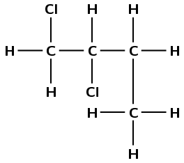

- 1,2-dichlorobutane
- 2,2-dichlorobutane
- 1,2-dichloro-3-methylpropane
- 1,1-dichloro-3-methylpropane

(IEB 2003)

**Solution:**
1,2-dichlorobutane

**Problem:**
Give the structural representation and IUPAC name of all possible isomers for
                                    \(\text{C}_{6}\text{H}_{14}\) (hint: there are 5)

**Solution:**
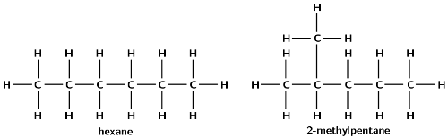

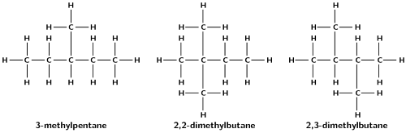

Write balanced equations for the following reactions:

**Problem:**
Ethene reacts with bromine (use condensed structural representations)

**Solution:**
\(\text{CH}_{2}\text{CH}_{2} + \text{Br}_{2}\) \(\to\)
                                          \(\text{CH}_{2}(\text{Br})\text{CH}_{2}(\text{Br})\)

ethene + bromine \(\to\) 1,2-dibromoethane

**Problem:**
The complete combustion of ethyne gas (used molecular formula)

**Solution:**
\(2\text{C}_{2}\text{H}_{2}(\text{g}) + 5\text{O}_{2}(\text{g})\) \(\to\)
                                          \(4\text{CO}_{2}(\text{g}) + 2\text{H}_{2}\text{O}(\text{g})\)

**Problem:**
Ethanoic acid ionises in water

**Solution:**
\(\text{CH}_{3}\text{COOH}(\text{ℓ}) +
                                          \text{H}_{2}\text{O}(\text{ℓ})\) \(\to\)
                                          \(\text{CH}_{3}\text{COO}^{-}(\text{aq}) +
                                          \text{H}_{3}\text{O}^{+}(\text{aq})\)

The table below gives the boiling point of ten organic compounds.

|  | Compound | Molecular formula | Boiling Point (°C) |
| --- | --- | --- | --- |
| \(\text{1}\) | methane | \(\text{CH}_{4}\) | \(-\text{162}\) |
| \(\text{2}\) | ethane | \(\text{C}_{2}\text{H}_{6}\) | \(-\text{89}\) |
| \(\text{3}\) | propane | \(\text{C}_{3}\text{H}_{8}\) | \(-\text{42}\) |
| \(\text{4}\) | butane | \(\text{C}_{4}\text{H}_{10}\) | \(\text{0}\) |
| \(\text{5}\) | pentane | \(\text{C}_{5}\text{H}_{12}\) | \(\text{36}\) |
| \(\text{6}\) | methanol | \(\text{CH}_{4}\text{O}\) | \(\text{64,7}\) |
| \(\text{7}\) | ethanol | \(\text{C}_{2}\text{H}_{6}\text{O}\) | \(\text{78,4}\) |
| \(\text{8}\) | propan-1-ol | \(\text{C}_{3}\text{H}_{8}\text{O}\) | \(\text{97}\) |
| \(\text{9}\) | propan-1,2-diol | \(\text{C}_{3}\text{H}_{8}\text{O}_{2}\) | \(\text{188}\) |
| \(\text{10}\) | propan-1,2,3-triol | \(\text{C}_{3}\text{H}_{8}\text{O}_{3}\) | \(\text{290}\) |

The following questions refer to the compounds shown in the above table.

To which homologous series do the following compounds belong?

**Problem:**
Compounds 1 - 5

**Solution:**
Alkanes

**Problem:**
Compounds 6 - 10

**Solution:**
Alcohols

**Problem:**
Which of the above compounds are gases at room temperature?

**Solution:**
Methane, ethane, propane and butane (i.e. compounds 1 - 4)

**Problem:**
What is the reason for the trend of increasing boiling points seen in compounds 1
                                          to 5?

**Solution:**
As the alkanes increase in chain length so does their surface area. This leads to
                                          stronger intermolecular forces and an increase in boiling point.

**Problem:**
Despite the fact that the length of the carbon chain in compounds 8,9 and 10 is
                                          the same, the boiling point of propan-1,2,3-triol is much higher than the
                                          boiling point of propan-1-ol. What is responsible for this large difference in
                                          boiling point?

**Solution:**
As each hydroxyl group is added the strength of the intermolecular forces
                                          increases. The compound can form more hydrogen bonds. This leads to an
                                          increase in the boiling point.

**Problem:**
Give the IUPAC name and the structural representation of an isomer of butane.

**Solution:**
2-methylpropane

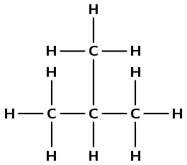

**Problem:**
Which **one** of the compounds is used as a reactant in the
                                          preparation of the ester ethyl methanoate?

**Solution:**
Ethanol (7)

**Problem:**
Using structural representation, write an equation for the reaction which
                                          produces ethyl methanoate.

(*IEB 2004*)

**Solution:**
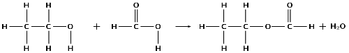

Refer to the numbered diagrams below and then answer the questions that follow.

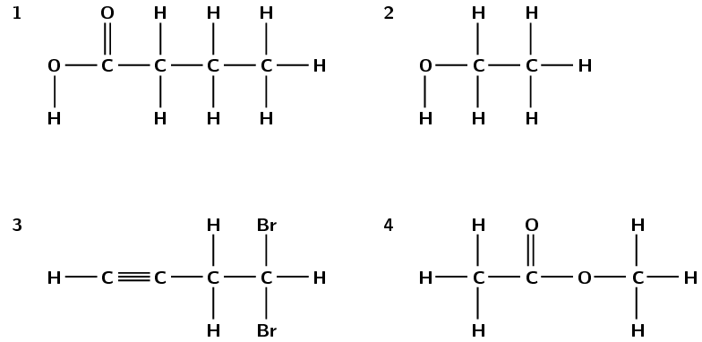

**Problem:**
Which one of the above compounds is produced from the fermentation of starches
                                          and sugars in plant matter?

**Solution:**
compound 2, ethanol

**Problem:**
To which one of the following homologous series does compound 1 belong?

2. esters
4. alcohols
6. aldehydes
8. carboxylic acids

**Solution:**
iv) carboxylic acids

**Problem:**
The correct IUPAC name for compound 3 is...

2. 1,1-dibromobut-3-yne
4. 4,4-dibromobut-1-yne
6. 2,4-dibromobut-1-yne
8. 4,4-dibromoprop-1-yne

**Solution:**
ii) 4,4-dibromobut-1-yne

**Problem:**
What is the correct IUPAC name for compound 4?

2. propanoic acid
4. ethyl methanoate
6. methyl ethanoate
8. methyl propanoate
   *IEB 2005*

**Solution:**
iii) methyl ethanoate

Answer the following questions:

**Problem:**
Explain the term homologous series.

**Solution:**
A homologous series is a series of compounds with the same general formula. All
                                          molecules in this series will contain the same functional groups. For example
                                          the alkanes are a homologous series: they have the general formula
                                          \(\text{C}_{\text{n}}\text{H}_{2\text{n}+2}\); for every *extra* carbon
                                          atom there are two *extra* hydrogen atoms.

A mixture of ethanoic acid and methanol is warmed in the presence of concentrated
                                          sulfuric acid.

**Problem:**
Using structural representations, give an equation for the reaction which
                                                takes place.

**Solution:**
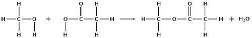

**Problem:**
What is the IUPAC name of the organic compound formed in this reaction?

**Solution:**
methyl ethanoate

Consider the following hydrocarbon:

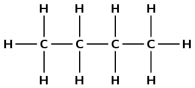

**Problem:**
Give the IUPAC name for this compound.

**Solution:**
There are four carbon atoms, therefore the prefix is but-. There are only
                                                single carbon-carbon bonds and no other functional group, therefore this
                                                is an alkane and the suffix is -ane.

butane

**Problem:**
Give the balanced equation for the complete combustion of this compound in
                                                excess oxygen (use molecular formulae).

(IEB Paper 2, 2003)

**Solution:**
Write the unbalanced equation:

\(\text{C}_{4}\text{H}_{10}(\text{g}) + \text{O}_{2}(\text{g})\) \(\to\)
                                                \(\text{CO}_{2}(\text{g}) + \text{H}_{2}\text{O}(\text{g})\)

Balance the equation:

\(2\text{C}_{4}\text{H}_{10}(\text{g}) + 13\text{O}_{2}(\text{g})\) \(\to\)
                                                \(8\text{CO}_{2}(\text{g}) + 10\text{H}_{2}\text{O}(\text{g})\)

Consider the organic compounds labelled A to D.

A. \(\text{CH}_{3}\text{CH}_{2}\text{CH}_{2}\text{CH}_{2}\text{CH}_{2}\text{CH}_{3}\)

B. \(\text{C}_{6}\text{H}_{6}\)

C. \(\text{CH}_{3}-\text{Cl}\)

D.

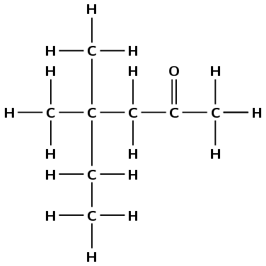

**Problem:**
Write a balanced chemical equation for the preparation of compound C using an
                                          alkane as one of the reactants.

**Solution:**
\(\text{CH}_{4} + \text{Cl}_{2} + \text{light}\) \(\to\) \(\text{CH}_{3}\text{Cl}
                                          + \text{HCl}\)

**Problem:**
Write down the IUPAC name for compound D.

**Solution:**
There are six carbon atoms in the longest chain containing the functional group
                                          so the prefix is hex-. The compound is a ketone and the ketone carbon is the
                                          second carbon atom, so the suffix is -2-one. There are 2 methyl groups
                                          attached to the fourth carbon atom (4,4-dimethyl). The compound is
                                          *4,4-dimethylhexan-2-one*.

**Problem:**
Write down the structural representation of an isomer of compound A that has only
                                          FOUR carbon atoms in the longest chain.

**Solution:**
The molecular formula of compound A is \(\text{C}_{6}\text{H}_{14}\).

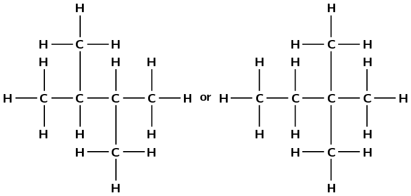

Note that these are the only two possibilities.

**Problem:**
Write down the structural representation of compound B.

**Solution:**
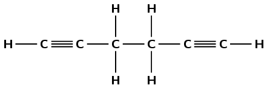

or

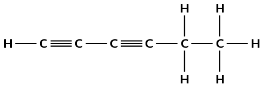

or

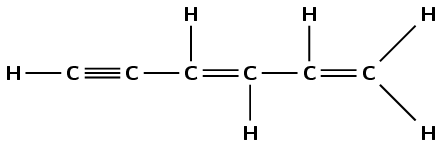

Any one of the above structures is reasonable. Learners can also draw
                                          *benzene*.

Chlorine and ethane react to form chloroethane and hydrochloric acid.

**Problem:**
Write a balanced chemical equation for this reaction, using molecular formulae.

**Solution:**
\(\text{Cl}_{2}(\text{g}) + \text{C}_{2}\text{H}_{6}(\text{g}) + \text{light}\)
                                          \(\to\) \(\text{C}_{2}\text{H}_{5}\text{Cl}(\text{g}) +
                                          \text{HCl}(\text{ℓ})\)

**Problem:**
Give the structural representation of chloroethane.

**Solution:**

**Problem:**
What type of reaction has taken place in this example?

**Solution:**
Substitution

Petrol is in fact not pure \(\text{C}_{8}\text{H}_{18}\) but a mixture of various
                                    *alkanes*. The *octane rating* of petrol refers to the percentage of
                                    the petrol which is \(\text{C}_{8}\text{H}_{18}\). For example, \(\text{93}\) octane
                                    fuel contains 93% \(\text{C}_{8}\text{H}_{18}\) and 7% other alkanes. The
                                    *isomer* of \(\text{C}_{8}\text{H}_{18}\) referred to in the *octane
                                          rating* is in fact not octane but 2,2,4-trimethylpentane.

**Problem:**
Write a balanced equation for the chemical reaction which takes place when
                                          \(\text{C}_{8}\text{H}_{18}\) burns in excess oxygen (complete combustion).

**Solution:**
\(2\text{C}_{8}\text{H}_{18}(\text{ℓ}) + 25\text{O}_{2}(\text{g})\) \(\to\)
                                          \(16\text{CO}_{2}(\text{g}) + 18\text{H}_{2}\text{O}(\text{g}) + \text{heat}\)

**Problem:**
Give the general formula of the *alkanes*.

**Solution:**
\({\text{C}}_{n}{\text{H}}_{2n+2}\)

**Problem:**
Define the term *isomer*.

**Solution:**
Isomers are two (or more) organic compounds that have the same molecular formula
                                          but a different structural formula.

**Problem:**
Use the information given in this question and your knowledge of naming organic
                                          compounds to deduce and draw the full structural formula for
                                          2,2,4-trimethylpentane.(I.E.B.)

**Solution:**
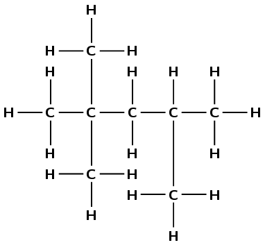
