## 5.2 Work (ESCMB)

We cover different topics in different chapters in different grades but that doesn't
                        mean that they are not related. In fact, it is very important
                        to note that all of the different topics related to mechanics (forces, mechanical energy,
                        momentum,
                        rectilinear motion) actually form a **consistent** picture of the same
                        physical system. There
                        have been examples where we've shown the same results using two methods, for example determining
                        speed or velocity using equations of motion or conservation of mechanical energy.
                        Learning about work will help us tie everything we've learnt about previously together.

Work will allow us to connect energy transfer to forces, which we have already linked to momentum and
                        the
                        equations of motion. When a force tends to act in or against the direction of motion of an
                        object we say that the
                        force is doing work on the object. Specifically, work is defined mathematically in terms of the
                        force and the
                        displacement of the object.

Work

When a force acts in or against the direction of motion of an object, work is done on
                                        the object.

                                \[W=F\Delta x\cos\theta\]

This means that in order for work to be done, an object must have its position changed by
                        an amount \(\Delta \vec{x}\) while a force, \(\vec{F}\), is acting on it such that there is some
                        non-zero
                        component of the force in the direction of the displacement. Work is calculated as:

                \[W=F\Delta x\cos\theta\]

Where:

- \(W\) = work in joules (J)
- \(F\) = magnitude of force for which we are calculating work in newtons (N)
- \(\Delta x\) = magnitude of displacement in metres (m)
- \(\theta\) = angle between the force and the direction of displacement

Note that:

- \(F\cos\theta\) is the magnitude of the component of \(\vec{F}\) in the direcion
                                  of \(\Delta \vec{x}\). If \(\theta > 90^{o}\) then the component is parallel to the
                                  direction
                                  of displacement but point in the opposite direction and the force is opposing the
                                  motion.
- We will deal with constant forces not forces that are continuously changing in this chapter.
                                  All
                                  of the principles we have covered are applicable when forces are not constant.

Figure 5.1: The force \(\vec{F}\) causes the object to be displaced by \(\Delta
                                        \vec{x}\) at angle θ.

**Important:** \(\cos\theta\) tells you the relative direciton of
                        the force and the displacment which is
                        important. If the component of the force along the direction of the displacement is opposite
                        in direction to the displacement then the sign of the displacement vector and force vector
                        will be different. This is regardless of which direction was chosen as a positive direction.

Let us look at some examples to understand this properly. In the images below the grey dot
                        represents an object. A force, \(\vec{F}\), acts on the object. The object moves
                        through a displacement, \(\Delta \vec{x}\). What is the sign of the work done in each case?

At \(\theta=90^\circ\) the magnitude of the component of the
                        force in the direction of the displacement is zero so **no work is done**
                        as \(\cos(90)=0\).

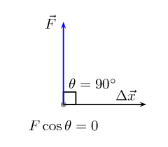

At \(\theta>90^\circ\) the magnitude of the component of the
                        force along the line of the displacement is opposite in direction to the
                        displacement so **negative work is done**, \(\cos\theta < 0\).

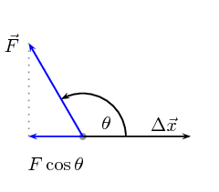

It is very important to note that for work to be done there must be a component of the applied force
                        in the direction of motion. Forces perpendicular to the direction of motion do no work.

Figure 5.2: The force \(\vec{F}\) causes the object to be displaced by \(\Delta
                                        \vec{x}\) at angle θ.

It is only the direction of the force on the object that matters and not the direction
                        from the source of the force to the object. In Figure 5.3 both
                        powerlifters are exerting an upwards force on the weights. On the left the weight is being
                        pulled upwards and on the right it is being pushed upwards.

Figure 5.3: Left: A powerlifter deadlifts a weight. Right: A powerlifter benchpresses
                                        a weight.

Weight lifting is a good context in which to think about work because it helps to identify
                        misconceptions introduced by everyday use of the term `work'.
                        In the two cases in Figure 5.3
                        everyone would
                        describe moving the weights upwards as very hard work. From a physics perspective, as the
                        powerlifters lift the weight they are exerting a force in the direction of the
                        displacement so positive work is done on the weights.

Consider the strongman walking in Figure 5.4.
                        He carries two very heavy sleds as far as he can in a competition.
                        What work is the man doing on the sleds and why?

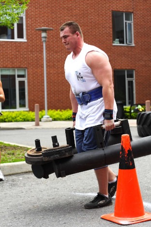

Figure 5.4: A strongman carries heavy sleds as far as possible in a
                                competition.

Most people would say he is working very
                        hard because the sleds are heavy to carry but from a physics perspective he is doing
                        no work on the sleds. The reason that he does no work is because the force he exerts is directly
                        upwards to balance the force of gravity and the displacement is in the horizontal
                        direction. Therefore there is no component of the force in the direction of displacement
                        (\(\theta=90^\circ\)) and no work done.

His muscles do need to use their energy reserves to maintain the force to
                        balance gravity. That does not result in energy transfer to the
                        sleds.

## Is work done?

Decide whether or not work is done in the following situations. Remember that for work to be
                                done
                                a force must be applied in the direction of motion and there must be a displacement.
                                Identify which
                                two objects are interacting, what the action-reaction pairs of forces are and why the
                                force
                                described is or isn't doing work.

2. Max pushes against a wall and becomes tired.
4. A book falls off a table and free falls to the ground.
6. A rocket accelerates through space.
8. A waiter holds a tray full of plates above his head with one arm and carries
                                                   it
                                                   straight across the room at constant speed.

2. Max pushes against a wall and becomes tired. Answer: No work is done
                                                           because there
                                                           is no displacement.
4. A book falls off a table and free falls to the ground. Answer: Yes
                                                           work is done
                                                           because there is a displacement in the direction of the force of
                                                           gravity.
6. A rocket accelerates through space. Answer: Yes work is done because
                                                           there is a
                                                           net force acting for there to be a net acceleration. If there is
                                                           an acceleration then
                                                           there is a displacement.
8. A waiter holds a tray full of meals above his head with one arm and
                                                           carries it straight across the room at constant speed. (Careful!
                                                           This is a tricky question.) Answer: No work is done because
                                                           there is no net force in the direction of the displacement.

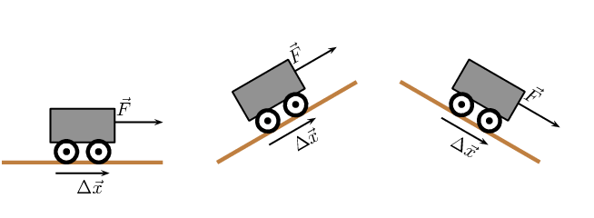

For each of the above pictures, the force vector is acting in the same direction as
                        the displacement vector. As a result, the angle \(\theta =0°\) because there is
                        no difference in angle between the direction of applied force and the
                        direction of displacement.

The work done by a force can then be positive or negative. This sign tells us about the
                        direction of the energy transfer. Work is a scalar so the sign should not be misinterpreted to
                        mean that work is a vector. Work is defined as energy transfer, energy is a scalar quantity and
                        the
                        sign indicates whether energy was increased or decreased.

- If\(\vec{F}_{\text{applied}}\) acts or has a component acting in the same direction
                                          as the motion,
                                          then positive work is being done. In this case the object on which the force is
                                          applied gains energy.
- If the direction of motion and \(\vec{F}_{\text{applied}}\) are opposite, then
                                          negative work is being done. This means that energy is lost and the object
                                          exerting the force gains energy. For example, if you try to push a car uphill by
                                          applying a force up the
                                          slope and instead the car rolls down the hill you are doing negative work on the
                                          car.
                                          Alternatively, the car is doing positive work on you!

<Callout type="tip" title="Note">
The everyday use of the word "work" differs from the physics use. In physics, only the
                                component of the applied force that is parallel to the motion does work on an object.
                                So, for example, a person holding up a heavy book does no work on the book.
</Callout>

As with all physical quantities, work must have units. Following from the definition, work is
                        measured in \(\text{N·m}\). The name given to this combination of S.I. units is the joule
                        (symbol J).

<Callout type="tip" title="Worked example 1: Calculating work on a car when speeding up.">
**Question:**
A car is travelling along a straight horizontal road. A
                                        force of \(\text{500}\) \(\text{N}\) is applied to the car in the direction that
                                        it is travelling, speeding it up. While it is speeding up is covers a distance
                                        of
                                        \(\text{20}\) \(\text{m}\). Calculate the work done on the car.

**Analyse the question to determine what information is provided:**
- The magnitude of the force applied is \(F=\text{500}\text{ N}\).
- The distance moved is \(\Delta x\) = \(\text{20}\) \(\text{m}\).
- The applied force and distance moved are in the same
                                                          direction. Therefore, the
                                                          angle between the force and displacement is
                                                          \(\theta=0^\circ\).

These quantities are all in SI units, so no unit conversions
                                        are required.

**Analyse the question to determine what is being asked:**
- We are asked to find the work done on the car. We know from the
                                                          definition that work done is \(W={F}\Delta x\cos\theta\).

**Next we substitute the values and calculate the work done:**
\begin{align*}
                                W& = {F}\Delta x\cos\theta\\
                                & = \left(500\right)\left(20\right) \left(\cos 0\right)\\
                                & = \left(500\right)\left(20\right) \left(1\right)\\
                                & = \text{10 000}\text{ J}
                                \end{align*}

Remember that the answer must be
                                        *positive*, as the applied force
                                        and the displacement are in the same direction. In this case,
                                        the car gains kinetic energy.
</Callout>

<Callout type="tip" title="Worked example 2: Calculating work on the car while braking">
**Question:**
The same car now slows down when a force of
                                        \(\text{300}\) \(\text{N}\) is applied
                                        opposite to the direction of motion while it travels \(\text{25}\) \(\text{m}\)
                                        forward. Calculate the work done on the car.

**Analyse the question to determine what information is provided:**
- The magnitude of the force applied is \(F=\text{300}\text{ N}\).
- The distance moved is \(\Delta x\) = \(\text{25}\) \(\text{m}\).
- The applied force and distance moved are in the opposite direction.
                                                          Therefore, the
                                                          angle between the force and displacement is
                                                          \(\theta=180^\circ\).

These quantities are all in the correct units, so no unit conversions are required.

**Analyse the question to determine what is being asked:**
- We are asked to find the work done on the car. We know from the
                                                          definition that work done is \(W={F}\Delta x\cos\theta\)

**Next we substitute the values and calculate the work done:**
\begin{align*}
                                W& = {F}\Delta x\cos\theta\\
                                & = \left(300\right)\left(25\right) \left(\cos 180\right)\\
                                & = \left(300\right)\left(25\right) \left(-1\right)\\
                                & = -\text{7 500}\text{ J}
                                \end{align*}

Note that the answer must be *negative*
                                        as the applied force and the displacement are in opposite directions.
                                        This means that the energy is being lost by the car. This may be energy
                                        lost as heat to the environment. Energy conservation still holds, the energy
                                        has just been transferred to a larger system that contains the car.
</Callout>

What happens when the applied force and the motion are not parallel? By
                        using the formula \(W=F\Delta x\cos\theta\) , we are actually
                        calculating the *component * of the applied
                        force in the direction of motion. Note that the component of the force
                        perpendicular to the direction of motion does no work.

<Callout type="tip" title="Worked example 3: Calculating work done on a box pulled at an angle.">
**Question:**
Calculate the work done on a box, if it is pulled \(\text{5}\) \(\text{m}\) along the
                                        ground by applying a force of \(F=\text{20}\text{ N}\) at an angle of
                                        \(\text{60}\)\(\text{°}\) to the horizontal.

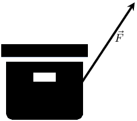

**Analyse the question to determine what information is provided:**
- The force applied is \(F\)=\(\text{20}\) \(\text{N}\)
- The distance moved is \(\Delta x\) = \(\text{5}\) \(\text{m}\) along
                                                          the ground
- The angle between the applied force and the motion is
                                                          \(\theta\)=\(\text{60}\)\(\text{°}\)

These quantities are in the correct units so we do not need to perform
                                        any unit conversions.

**Analyse the question to determine what is being asked:**
- We are asked to find the work done on the box.

**Substitute and calculate the work done:**
Now we can calculate the work done on the box:

                                \begin{align*}
                                W& = {F}\Delta x\cos\theta\\
                                & = \left(20 \right)\left(5 \right) \left(\cos 60\right)\\
                                & = \text{50}\text{ J}
                                \end{align*}

Note that the answer is positive as the component of the force parallel to
                                        the direction of motion is in the same direction as the motion.

The work done on the box is
                                        \(\text{50}\) \(\text{J}\).
</Callout>

## Work

### Textbook Exercise 5.1

**Problem:**
A \(\text{10}\) \(\text{N}\) force is applied to push a block across
                                                        a frictionless surface for a displacement of \(\text{5,0}\)
                                                        \(\text{m}\) to the right. The block has a weight \(\vec{F}_{g
                                                        }\) of \(\text{20}\) \(\text{N}\). Determine the work done by
                                                        the following forces: normal force, weight \(\vec{F}_{g }\),
                                                        applied force.

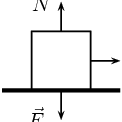

**Solution:**
Normal force acts perpendicular and therefore does no work.

The weight acts perpendicular to the direction of motion and does no
                                                        work.

The applied force:
                                                        \begin{align*}
                                                        W_{\text{applied}}&= F\Delta x \cos\theta \\
                                                        &= (10)(5) \\
                                                        & = 50~\text{J}
                                                        \end{align*}

                                                Normal force:0 J, weight: 0 J, applied force: 50 J.

**Problem:**
A \(\text{10}\) \(\text{N}\) frictional force slows a moving block to
                                                        a stop after a displacement of \(\text{5,0}\) \(\text{m}\) to
                                                        the right. The block has a weight of \(\text{20}\) \(\text{N}\)
                                                        Determine the work done by the following forces: normal force,
                                                        weight, frictional force.

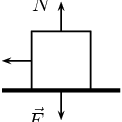

**Solution:**
Normal force acts perpendicular and therefore does no work.

The weight acts perpendicular to the direction of motion and does no
                                                        work.

The frictional force:
                                                        \begin{align*}
                                                        W_{friciton}&= F\Delta x \cos\theta \\
                                                        &= (10)(5)\cos(180) \\
                                                        & = -50~\text{J}
                                                        \end{align*}

                                                Normal force:0 J, weight: 0 J, frictional force: -50 J.

**Problem:**
A \(\text{10}\) \(\text{N}\) force is applied to push a block across
                                                        a frictional surface at constant speed for a displacement of
                                                        \(\text{5,0}\) \(\text{m}\) to the right. The block has a weight
                                                        of \(\text{20}\) \(\text{N}\) and the frictional force is
                                                        \(\text{10}\) \(\text{N}\). Determine the work done by the
                                                        following forces: normal force, weight, applied force and
                                                        frictional force.

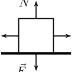

**Solution:**
Normal force acts perpendicular and therefore does no work.

The weight acts perpendicular to the direction of motion and does no
                                                        work.

The frictional force:
                                                        \begin{align*}
                                                        W_{friciton}&= F\Delta x \cos\theta \\
                                                        &= (10)(5)\cos(180) \\
                                                        & = -50~\text{J}
                                                        \end{align*}

The applied force:
                                                        \begin{align*}
                                                        W_{\text{applied}}&= F\Delta x \cos\theta \\
                                                        &= (10)(5) \\
                                                        & = 50~\text{J}
                                                        \end{align*}

                                                Normal force:0 J, weight: 0 J, frictional force: -50 J, applied force:
                                                50 J.

**Problem:**
An object with a weight of \(\text{20}\) \(\text{N}\) is sliding at
                                                        constant speed across a frictionless surface for a displacement
                                                        of \(\text{5}\) \(\text{m}\) to the right. Determine if there is
                                                        any work done.

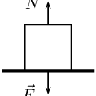

**Solution:**
No work is done as all the forces act perpendicular to the
                                                direction of displacement.

**Problem:**
An object with a weight of \(\text{20}\) \(\text{N}\) is pulled
                                                        upward at constant speed by a \(\text{20}\) \(\text{N}\) force
                                                        for a vertical displacement of \(\text{5}\) \(\text{m}\).
                                                        Determine if there is any work done.

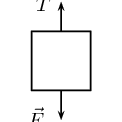

**Solution:**
The applied force:
                                                        \begin{align*}
                                                        W_{\text{applied}}&= F\Delta x \cos\theta \\
                                                        &= (20)(5) \\
                                                        & = 100~\text{J}
                                                        \end{align*}

The gravitational force:
                                                        \begin{align*}
                                                        W_{gravitational}&= F\Delta x \cos\theta \\
                                                        &= (20)(5)\cos(180) \\
                                                        &= -(20)(5) \\
                                                        & = -100~\text{J}
                                                        \end{align*}

                                                Work done by applied force is 100 J, work done by gravity is -100 J

**Problem:**
Before beginning its descent, a roller coaster is always pulled up
                                                        the first hill to a high initial height. Work is done on the
                                                        roller coaster to achieve this initial height. A coaster
                                                        designer is considering three different incline angles
                                                        **of the hill** at which to drag the
                                                        \(\text{2 000}\) \(\text{kg}\) car train to the top of the
                                                        \(\text{60}\) \(\text{m}\) high hill. In each case, the force
                                                        applied to the car will be applied parallel to the hill. Her
                                                        critical question is: which angle would require the least work?
                                                        Analyse the data, determine the work done in each case, and
                                                        answer this critical question.

| Angle of Incline | Applied Force | Distance | Work |
| --- | --- | --- | --- |
| \(\text{35}\)\(\text{°}\) | \(\text{1,1} \times \text{10}^{\text{4}}\)
                                                                                \(\text{N}\) | \(\text{100}\) \(\text{m}\) |  |
| \(\text{45}\)\(\text{°}\) | \(\text{1,3} \times \text{10}^{\text{4}}\)
                                                                                \(\text{N}\) | \(\text{90}\) \(\text{m}\) |  |
| \(\text{55}\)\(\text{°}\) | \(\text{1,5} \times \text{10}^{\text{4}}\)
                                                                                \(\text{N}\) | \(\text{80}\) \(\text{m}\) |  |

**Solution:**
| Angle of Incline | Applied Force | Distance | Work |
| --- | --- | --- | --- |
| \(\text{35}\)\(\text{°}\) | \(\text{1,1} \times \text{10}^{\text{4}}\)
                                                                                \(\text{N}\) | \(\text{100}\) \(\text{m}\) | \(\text{9,01} \times \text{10}^{\text{5}}\)
                                                                        \(\text{J}\) |
| \(\text{45}\)\(\text{°}\) | \(\text{1,3} \times \text{10}^{\text{4}}\)
                                                                                \(\text{N}\) | \(\text{90}\) \(\text{m}\) | \(\text{8,27} \times \text{10}^{\text{5}}\)
                                                                        \(\text{J}\) |
| \(\text{55}\)\(\text{°}\) | \(\text{1,5} \times \text{10}^{\text{4}}\)
                                                                                \(\text{N}\) | \(\text{80}\) \(\text{m}\) | \(\text{6,88} \times \text{10}^{\text{5}}\)
                                                                        \(\text{J}\) |

An angle of 55° requires the least amount of work to be done.

**Problem:**
A traveller carries a \(\text{150}\) \(\text{N}\) suitcase up four
                                                        flights of stairs (a total height of \(\text{12}\) \(\text{m}\))
                                                        and then pushes it with a horizontal force of \(\text{60}\)
                                                        \(\text{N}\) at a constant speed of \(\text{0,25}\)
                                                        \(\text{m·s$^{-1}$}\) for a horizontal distance of
                                                        \(\text{50}\) \(\text{m}\) on a frictionless surface. How much
                                                        work does the traveller do on the suitcase during this entire
                                                        trip?

**Solution:**
1800 J up stairs and 3000 J along passage.

**Problem:**
A parent pushes down on a pram with a force of \(\text{50}\)
                                                        \(\text{N}\) at an angle of \(\text{30}\)\(\text{°}\) to
                                                        the horizontal. The pram is moving on a frictionless surface. If
                                                        the parent pushes the pram for a horizontal distance of
                                                        \(\text{30}\) \(\text{m}\), how work is done on the pram?

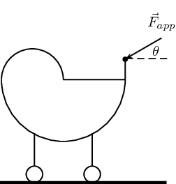

**Solution:**
\begin{align*}
                                                W&= F\Delta x \cos\theta \\
                                                &= (50)(30)\cos(30)\\
                                                & = \text{1 299,00}\text{ J}
                                                \end{align*}

                                                1,30 kJ

**Problem:**
How much work is done by the force required to raise a
                                                        \(\text{2 000}\) \(\text{N}\) lift 5 floors vertically at a
                                                        constant speed? The vertical distance between floors is
                                                        \(\text{5}\) \(\text{m}\) high.

**Solution:**
\begin{align*}
                                                W&= F\Delta x \cos\theta \\
                                                &= (2000)(5\times 5) \cos(0) \\
                                                &= 2000 \times 25 \\
                                                &= \text{50 000}\text{ J}
                                                \end{align*}
                                                50 000 J

**Problem:**
A student with a mass of \(\text{60}\) \(\text{kg}\) runs up three
                                                        flights of stairs in \(\text{15}\) \(\text{s}\), covering a
                                                        vertical distance of \(\text{10}\) \(\text{m}\). Determine the
                                                        amount of work done by the student to elevate her body to this
                                                        height.

**Solution:**
\begin{align*}
                                                W&= F\Delta x \cos\theta \\
                                                &= mg \Delta x \cos \theta \\
                                                &= (60)(9,8) (10) \\
                                                &= \text{5 880}\text{ J}
                                                \end{align*}
                                                5 880 J

### Net work (ESCMC)

We have only looked at a single force acting on an object. Sometimes more than one force
                                acts at the same time (we dealt with this in Grade 11). We call the work done after
                                taking
                                all the forces into account the **net work done**. If there is
                                only one force acting then the work it does, if any, is the net work done. In this
                                case there are two equivalent
                                approaches we can adopt to finding the net work done on the object. We can:

- **Approach 1:** calculate the work done by **each
                                                  force individually** and then sum them **taking
                                                  the signs into account**. If one force does positive work and
                                          another
                                          does the same amount of work but it is negative then they cancel out.
- **Approach 2:** calculate the resultant force from all the forces
                                          acting and calculate
                                          the work done using the resultant force. This will be equivalent to Approach 1.
                                          If the
                                          resultant force parallel to the direction of motion is zero, no net work will be
                                          done.

Remember that work done tells you about the energy transfer to or from an object by means of
                                a force. That is
                                why we can have zero net work done even if multiple large forces are acting on an
                                object. Forces
                                that result in positive work increase the energy of the object, forces that result in
                                negative
                                work reduce the energy of an object. If as much energy is transferred to an object as is
                                transferred away then the final result is that the object gains no energy overall.

<Callout type="tip" title="Worked example 4: Approach 1, calculating the net work on a car">
**Question:**
The same car is now accelerating forward, but friction is working against the
                                                motion of the car. A force of \(\text{300}\) \(\text{N}\) is applied
                                                forward on the car while it is travelling \(\text{20}\) \(\text{m}\)
                                                forward. A frictional force of \(\text{100}\) \(\text{N}\) acts to
                                                oppose the motion. Calculate the net work done on the car.

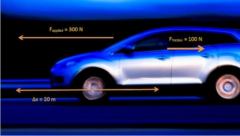

Only forces with a component in the plane of motion are shown on the diagram.
                                                No work is done by \({F}_{g}\) or \({F}_{\text{normal}}\) as they act
                                                perpendicular to the direction of motion.

**Analyse the question to determine what information is provided:**
- The force applied is \(F_{\text{applied}}\)=\(\text{300}\)
                                                                  \(\text{N}\) forwards.
- The force of friction is
                                                                  \(F_{\text{friction}}\)=\(\text{100}\) \(\text{N}\)
                                                                  opposite to the direction of motion.
- The distance moved is \(\Delta x\) = \(\text{20}\)
                                                                  \(\text{m}\).
- The applied force and distance moved are in the same plane so
                                                                  we can calculate the work done by the applied forward
                                                                  force and the work done by the force of friction
                                                                  backwards.

These quantities are all in the correct units, so no unit conversions are
                                                required.

**Analyse the question to determine what is being asked:**
- We are asked to find the net work done on the car. We know
                                                                  from the definition that work done is \(W={F}\)\(\Delta
                                                                  x\) \(\cos\theta\)

**Next we calculate the work done by each force.:**
\begin{align*}
                                        W_{\text{applied}}& = {F}_{\text{applied}}\Delta x\cos\theta\\
                                        & = \left(300\right)\left(20\right) \left(\cos 0\right)\\
                                        & = \left(300\right)\left(20\right) \left(1\right)\\
                                        & = \text{6 000}\text{ J}
                                        \end{align*}\begin{align*}
                                        W_{\text{friction}}& = {F}_{\text{friction}}\Delta x\cos\theta\\
                                        & = \left(100\right)\left(20\right) \left(\cos 180\right)\\
                                        & = \left(100\right)\left(20\right) \left(-1\right)\\
                                        & = -\text{2 000}\text{ J}
                                        \end{align*}\begin{align*}
                                        {W}_{\text{net}}& = {W}_{\text{applied}} + {W}_{\text{friction}} \\
                                        & = \left(6000\right) + \left(-2000\right) \\
                                        & = \text{4 000}\text{ J}
                                        \end{align*}

The answer shown in this worked example shows that although energy has been
                                                lost by the car to friction, the total work done on the car has resulted
                                                in a net energy gain. This can be seen by the positive answer.
</Callout>

As mentioned before, there is an alternative method to solving the same
                                problem, which is to determine the net force acting on the car and to use
                                this to calculate the work. This means that the vector forces acting in the
                                plane of motion must be added to get the net force \(\vec{F}_{\text{net}}\).
                                The net force is then applied over the displacement to get the net
                                work \({W}_{\text{net}}\).

<Callout type="tip" title="Worked example 5: Approach 2, calculating the net force">
**Question:**
The same car is now accelerating forward, but friction is working against the
                                                motion of the car. A force of \(\text{300}\) \(\text{N}\) is applied
                                                forward on the car while it is travelling \(\text{20}\) \(\text{m}\)
                                                forward. A frictional force of \(\text{100}\) \(\text{N}\) acts to
                                                oppose the motion. Calculate the net work done on the car.

Only forces with a component in the plane of motion are shown on the diagram.
                                                No work is done by \({F}_{g}\) or \({F}_{\text{normal}}\) as they act
                                                perpendicular to the direction of motion. The net force acting in the
                                                plane of motion will be calculated using the non-perpendicular forces.

**Analyse the question to determine what information is provided:**
- The force applied is
                                                                  \(\vec{F}_{\text{applied}}\)=\(\text{300}\) \(\text{N}\)
                                                                  forwards.
- The force of friction is
                                                                  \(\vec{F}_{\text{friction}}\)=\(\text{100}\)
                                                                  \(\text{N}\) backwards.
- The distance moved is \(\Delta x\) = \(\text{20}\)
                                                                  \(\text{m}\).
- The applied forces \(\vec{F}_{\text{applied}}=
                                                                  \text{300}\text{ N}\) and the force of friction
                                                                  \(\vec{F}_{\text{friction}}= \text{100}\text{ N}\) are
                                                                  in the same plane as the distance moved. Therefore, we
                                                                  can add the vectors. As vectors require direction, we
                                                                  will say that forward is positive and therefore backward
                                                                  is negative. Note, the force of friction is acting at
                                                                  \({180}^{0}\) i.e. backwards and so is acting in the
                                                                  opposite vector direction i.e. negative.

These quantities are all in the correct units, so no unit conversions are
                                                required.

**Analyse the question to determine what is being asked:**
- We are asked to find the net work done on the car. We know
                                                                  from the definition that work done is
                                                                  \(W_{\text{net}}={F}_{\text{net}}\)\(\Delta x \cos
                                                                  \theta\)

**We calculate the net force acting on the car, and we convert
                                                this into net work.:**
First we draw the force diagram:

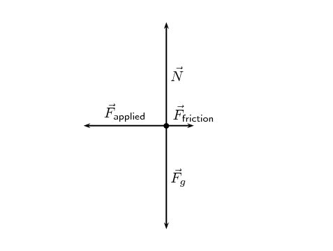

Let forwards (to the left in the picture) be positive. We know that the
                                                motion of
                                                the car is in the horizontal direction so we can neglect the force due
                                                to gravity,
                                                \(\vec{F}_g\), and the normal force, \(\vec{N}\). **Note:**
                                                if the car were on a slope we would need to
                                                calculate the component of gravity parallel to the slope.

                                        \begin{align*}
                                        \vec{F}_{\text{net}}& = \vec{F}_{\text{applied}} +
                                        \vec{F}_{\text{friction}}\\
                                        & = \left(+300\right) + \left(-100\right)\\
                                        \vec{F}_{\text{net}}& = \text{200}\text{ N}~\text{forwards}
                                        \end{align*}

\(\vec{F}_{\text{net}}\) is pointing in the same direction as the
                                                displacement, therefore the angle between the force and displacement is
                                                \(\theta=0^\circ\).

                                        \begin{align*}
                                        {W}_{\text{net}}& = {F}_{\text{net}}\Delta x \cos \theta \\
                                        & = \left(200\right)\left(20\right)\cos\left(0\right)\\
                                        & = \text{4 000}\text{ J}
                                        \end{align*}
</Callout>

<Callout type="note" title="Note">
The two different approaches give the same result but it is very important to treat
                                        the
                                        signs correctly. The forces are vectors but work is a scalar so they shouldn't
                                        be interpreted
                                        in the same way.
</Callout>
