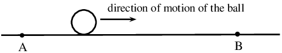
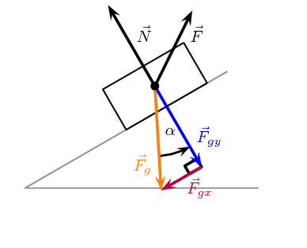
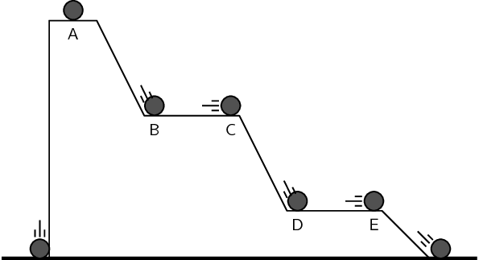
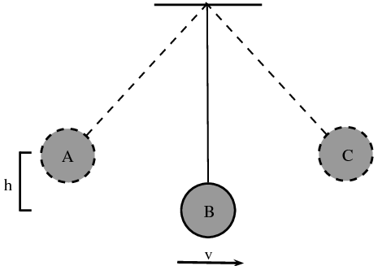

## 5.3 Work-energy theorem (ESCMD)

### Conservative and non-conservative forces (ESCMF)

In Grade 10, you saw that mechanical energy was conserved in the
                                **absence** of
                                non-conservative forces. It is important to know whether a force is an conservative
                                force or
                                an non-conservative force in the system, because this is related to whether the force
                                can
                                change an object's total mechanical energy when it does work on an object.

When the only
                                forces doing work are conservative forces (for example, gravitational
                                and spring forces), energy changes forms - from kinetic to
                                potential (or vice versa); yet the total amount of mechanical energy (\(E_K + E_P\)) is
                                conserved.
                                For example, as an
                                object falls in a gravitational field from a high elevation to a lower elevation,
                                some of the object's potential energy is changed into kinetic energy. However,
                                the sum of the kinetic and potential energies remain constant.

## Non-conservative forces

We can investigate the effect of non-conservative forces on an object's total
                                        mechanical energy by rolling a ball along the floor from point A to point B.

Find a nice smooth surface (e.g. a highly polished floor), mark off two positions, A
                                        and B, and roll the ball between them.

The total mechanical energy of the ball, at each point, is the sum of its kinetic
                                        energy (\(E_k\)) and gravitational potential energy (\(E_p\)):

                                \begin{align*}
                                {E}_{\text{total},\text{A}}& = {E_k}_{,\text{A}}+{E_p}_{,\text{A}}\\
                                & = \frac{1}{2}m{v}_{\text{A}}^{2}+mg{h}_{\text{A}}\\
                                & = \frac{1}{2}m{v}_{\text{A}}^{2}+mg\left(0\right)\\
                                & = \frac{1}{2}m{v}_{\text{A}}^{2}
                                \end{align*}\begin{align*}
                                {E}_{\text{total},\text{B}}& = {E_k}_{\text{B}}+{E_p}_{\text{B}}\\
                                & = \frac{1}{2}m{v}_{\text{B}}^{2}+mg{h}_{\text{B}}\\
                                & = \frac{1}{2}m{v}_{\text{B}}^{2}+mg\left(0\right)\\
                                & = \frac{1}{2}m{v}_{\text{B}}^{2}
                                \end{align*}

In the absence of friction and other non-conservative forces, the ball should slide
                                        along the floor and its speed should be *the same* at positions A and B.
                                        Since there are no non-conservative forces acting on the ball, its total
                                        mechanical energy at points A and B are equal.

                                \begin{align*}
                                {v}_{A}& = {v}_{\text{B}}\\
                                \frac{1}{2}m{v}_{\text{A}}^{2}& = \frac{1}{2}m{v}_{B}^{2}\\
                                {E}_{\text{total},\text{A}}& = {E}_{\text{total},\text{B}}
                                \end{align*}

Now, let's investigate what happens when there is friction (an *non-conservative
                                                force*) acting on the ball.

Roll the ball along a rough surface or a carpeted floor. What happens to the speed of
                                        the ball at point A compared to point B?

If the surface you are rolling the ball along is very rough and provides a large
                                        non-conservative frictional force, then the ball should be moving much slower at
                                        point B than at point A.

Let's compare the total mechanical energy of the ball at points A and B:

                                \begin{align*}
                                {E}_{\text{total},\text{A}}& = {\text{EK}}_{\text{A}}+{\text{PE}}_{\text{A}}\\
                                & = \frac{1}{2}m{v}_{\text{A}}^{2}+mg{h}_{\text{A}}\\
                                & = \frac{1}{2}m{v}_{\text{A}}^{2}+mg\left(0\right)\\
                                & = \frac{1}{2}m{v}_{\text{A}}^{2}
                                \end{align*}\begin{align*}
                                {E}_{\text{total},\text{B}}& = {\text{EK}}_{\text{B}}+{\text{PE}}_{\text{B}}\\
                                & = \frac{1}{2}m{v}_{\text{B}}^{2}+mg{h}_{\text{B}}\\
                                & = \frac{1}{2}m{v}_{\text{B}}^{2}+mg\left(0\right)\\
                                & = \frac{1}{2}m{v}_{\text{B}}^{2}
                                \end{align*}

However, in this case, \({v}_{A}\ne {v}_{B}\) and therefore
                                        \({E}_{\text{total},\text{A}}\ne {E}_{\text{total},\text{B}}\). Since

                                \begin{align*}
                                {v}_{\text{A}}& > {v}_{\text{B}}\\
                                {E}_{\text{total},\text{A}}& > {E}_{\text{total},\text{B}}
                                \end{align*}

Therefore, the ball has lost mechanical energy as it moves across the carpet.
                                        However, although the ball has lost mechanical energy, energy in the larger
                                        system has still been conserved. In this case, the missing
                                        energy is the work done by the carpet through applying a frictional force on the
                                        ball. In this case the carpet is doing negative work on the ball.

When an non-conservative force (for example friction, air resistance, applied
                                force) does work on an object, the total mechanical energy (\(E_k + E_p\)) of that
                                object changes. If positive work is done, then the object will gain energy.
                                If negative work is done, then the object will lose energy.

When a net **force does work**
                                on an object, then there
                                is **always a change in the kinetic energy**
                                of the object. This is because the object experiences an acceleration and therefore
                                a change in velocity.

This leads us to the work-energy theorem.

Work-energy theorem

The work-energy theorem states that the work done on an object by the net force
                                        is equal to the change in its kinetic energy:

                                \[W_{\text{net}}=\Delta E_k={E}_{k,f}-{E}_{k,i}\]

The work-energy theorem is another example of the conservation of energy which
                        you saw in Grade 10.

<Callout type="tip" title="Worked example 6: Work-energy theorem">
**Question:**
A \(\text{1}\) \(\text{kg}\) brick is
                                        dropped from a height of \(\text{10}\) \(\text{m}\).
                                        Calculate the work that has been done on the brick between the moment it is
                                        released
                                        and the moment when it hits the ground. Assume that air resistance can be
                                        neglected.

**Determine what is given and what is required:**
- Mass of the brick: \(m=\text{1}\text{ kg}\).
- Initial height of the brick: \({h}_{i}=\text{10}\text{ m}\).
- Final height of the brick: \({h}_{f}=\text{0}\text{ m}\).
- We are required to determine the work done on the brick as it hits
                                                          the ground.

**Determine how to approach the problem:**
The brick is falling freely, so energy is conserved. We know that the work done is
                                        equal to the difference in kinetic energy. The brick has no kinetic energy at
                                        the moment it is dropped, because it is stationary. When the brick hits the
                                        ground, all the brick's potential energy is converted to kinetic energy.

**Determine the brick's potential energy at \({h}_{i}\):**
\begin{align*}
                                E_p& = m·g·h\\
                                & = \left(1\right)\left(\text{9,8}\right)\left(10\right)\\
                                & = \text{98}\text{ J}
                                \end{align*}

**Determine the work done on the brick:**
The brick had \(\text{98}\) \(\text{J}\) of potential energy when it was released and
                                        \(\text{0}\) \(\text{J}\) of kinetic energy. When the brick hit the ground, it
                                        had \(\text{0}\) \(\text{J}\) of potential energy and \(\text{98}\) \(\text{J}\)
                                        of kinetic energy. Therefore \({E}_{k,i}=\text{0}\text{ J}\) and
                                        \({E}_{k,f}=\text{98}\text{ J}\).

From the work-energy theorem:

                                \begin{align*}
                                W_{\text{net}}& = \Delta E_k\\
                                & = {E}_{k,f}-{E}_{k,i}\\
                                & = 98-0\\
                                & = \text{98}\text{ J}
                                \end{align*}

Hence, \(\text{98}\) \(\text{J}\) of work was done on the brick.
</Callout>

<Callout type="tip" title="Worked example 7: Work-energy theorem 2">
**Question:**
The driver of a \(\text{1 000}\) \(\text{kg}\) car travelling at a speed of
                                        \(\text{16,7}\) \(\text{m·s$^{-1}$}\) applies the car's brakes when he sees
                                        a red light. The car's brakes provide a frictional force of
                                        \(\text{8 000}\) \(\text{N}\). Determine the stopping distance of the car.

**Determine what is given and what is required:**
We are given:

- mass of the car: \(m = \text{1 000}\text{ kg}\)
- speed of the car: \(v = \text{16,7}\text{ m·s$^{-1}$}\)
- frictional force of brakes: \(\vec{F} = \text{8 000}\text{ N}\)

We are required to determine the stopping distance of the car.

**Determine how to approach the problem:**
We apply the work-energy theorem. We know that all the car's kinetic energy is lost
                                        to friction. Therefore, the change in the car's kinetic energy is equal to the
                                        work done by the frictional force of the car's brakes.

Therefore, we first need to determine the car's kinetic energy at the moment of
                                        braking using:

                                \(E_k=\frac{1}{2}m{v}^{2}\)

This energy is equal to the work done by the brakes. We have the force applied by the
                                        brakes, and we can use:

                                \(W=F \Delta x \cos \theta\)

to determine the stopping distance.

**Determine the kinetic energy of the car:**
\begin{align*}
                                E_k& = \frac{1}{2}m{v}^{2}\\
                                & = \frac{1}{2}\left(1000\right){\left(\text{16,7}\right)}^{2}\\
                                & = \text{139 445}\text{ J}
                                \end{align*}

**Determine the work done:**
Assume the stopping distance is \({\Delta x}_{0}\). Since the direction of the
                                        applied force and the displacement are in opposite directions, \(\theta =
                                        180°\). Then the work done is:

                                \begin{align*}
                                W& = F \Delta x \cos \theta\\
                                & = \left(8000\right)\left( \Delta x_0 \right) \cos (180) \\
                                & = \left(8000\right)\left( \Delta x_0 \right)(-\text{1}) \\
                                & = \left(-\text{8 000}\right)\left( \Delta x_0 \right)
                                \end{align*}

**Apply the work-enemy theorem:**
The change in kinetic energy is equal to the work done.

                                \begin{align*}
                                \Delta E_k& = W_{\text{net}}\\
                                {E}_{k,f}-{E}_{k,i}& = \left(-8000\right)\left({\Delta x_0}\right)\\
                                \text{0}-\text{139 445} & = \left(-8000\right)\left({\Delta x_0}\right)\\
                                \therefore \Delta x_0 & = \frac{139445}{8000}\\
                                & = \text{17,4}\text{ m}
                                \end{align*}

**Write the final answer:**
The car stops in \(\text{17,4}\) \(\text{m}\).
</Callout>

<Callout type="tip" title="Note">
A force only does work on an object for the time that it is in contact with the object. For
                                example, a person pushing a trolley does work on the trolley, but the road does no work
                                on the tyres of a car if they turn without slipping (the force is not applied over any
                                distance because a different piece of tyre touches the road every instant).
</Callout>

<Callout type="tip" title="Worked example 8: Block on an inclined plane [credit: OpenStax College]">
**Question:**
A block of \(\text{2}\) \(\text{kg}\)
                                        is pulled up along a smooth incline of length
                                        \(\text{10}\) \(\text{m}\) and height
                                        \(\text{5}\) \(\text{m}\)
                                        by applying an non-conservative force. At the end of incline, the block is
                                        released from rest to slide down
                                        to the bottom. Find the

2. work done by the non-conservative force,
4. the kinetic energy of the
                                                   block at the end of round trip, and
6. the speed at the end of the round trip.

**Analyse what is given and what is required:**
There are three forces on the block while going up:

2. weight of the block, \(\vec{F}_g=m\vec{g}\),
4. normal force, \(\vec{N}\), applied by the block and
6. non-conservative force, \(\vec{F}\).

                                On the other hand, there are only two forces while going
                                down. The non-conservative force is absent in downward journey. The force diagram of
                                the forces is shown here for upward motion of the block.

**Work done by non-conservative force during round trip:**
The work done by the non-conservative force we will call \(W_F\).

We have not been given a magnitude or direction for \(\vec{F}\),
                                        all we do know is that it must result in the block moving up the slope.

We have represented
                                        the non-conservative force on the force diagram with an arbitrary vector.
                                        \(\vec{F}\) acts only during upward journey. Note that the
                                        block is simply released at the end of the upward journey. We
                                        need to find the work done by the non-conservative force only during the upward
                                        journey.

                                \[W_F=W_{F\text{ (up)}}+W_{F\text{ (down)}}=W_{F\text{ (up)}}+0=W_{F\text{ (up)}}\]

The kinetic energies in the beginning and at the end of the motion up the slope
                                        are zero.

We can conclude that sum of the work
                                        done by all three forces is equal to zero during the upward motion. The change
                                        in kinetic energy is zero which implies that the net work done is zero.

                                \begin{align*}
                                W_{\text{net}} & = W_{F(up)} + W_{g(up)} + W_{N(up)} \\
                                0 & = W_{F(up)} + W_{g(up)} + W_{N(up)}
                                \end{align*}

If we know the work done by the other two forces
                                        (normal force and gravity), then we can calculate the work done by
                                        the non-conservative force, \(F\), as required.

**Work done by normal force during upward motion:**
The block moves up the slope, the normal force is perpendicular to the
                                        slope and, therefore, perpendicular to the direction of motion.
                                        Forces that are perpendicular to the direction of motion do no
                                        work.

                                \begin{align*}
                                0 & = W_{F\text{ (up)}} + W_{g\text{ (up)}} + W_{N\text{ (up)}} \\
                                0 & = W_{F\text{ (up)}} + W_{g\text{ (up)}} + (0)\\
                                W_{F\text{ (up)}} & = - W_{g\text{ (up)}}
                                \end{align*}

Thus, we need to compute work done by the gravity in order to compute
                                        work by the non-conservative force.

**Work done by gravity during upward motion:**
The component of the force due to gravity that is perpendicular
                                        to the slope, \(\vec{F}_{gy}\), will do no work so we only need to consider the
                                        component
                                        parallel to the slope, \(\vec{F}_{gx}\).

For the upward motion \(\vec{F}_{gx}\)
                                        is in the opposite direction to the motion, therefore the angle between them is
                                        \(\theta = 180°\), which means \(\cos \theta = -1\), so we expect to see
                                        negative work is done.

The magnitude of \(\vec{F}_{gx}\) is \(F_{gx} = mg\sin\alpha\). So the work done by
                                        gravity during the upward motion is :

                                \begin{align*}
                                W_{g\text{ (up)}}& = F_{gx} \Delta x \cos \theta \\
                                & = mg \sin\alpha\cdot\Delta x \cos \theta\\
                                &=(2)(\text{9,8})(\frac{5}{10})(10)\cos(180)\\
                                &=−\text{98}\text{ J}
                                \end{align*}

<Callout type="note" title="Note">
Be careful not to be confused by which angle has been labelled \(\alpha\) and
                                                which \(\theta\). \(\alpha\) is
                                                not the angle between the force and the direction of motion but the
                                                incline of the plane in this
                                                particular problem. It is important to understand which symbol
                                                represents which physical quantity
                                                in the equations you have learnt.
</Callout>

Hence, the work done by the non-conservative force during the round trip is:

                                \begin{align*}
                                W_F = W_{F\text{ (up)}} & = - W_{g\text{ (up)}} \\
                                =−(−\text{98})\\
                                =\text{98}\text{ J}
                                \end{align*}

**Kinetic energy at the end of round trip:**
The kinetic energy at the end of the upward motion was zero but it is not
                                        zero at the end of the entire downward motion.

We can use the work-energy theorem to analyse the whole motion:

                                \begin{align*}
                                W_{(round\ trip)} & = E_{k,f} - E_{k,i} \\
                                & = E_{k,f} - 0 \\
                                & = E_{k,f}
                                \end{align*}

To determine the net work done, \(W_{\text{ (round trip)}}\), we need to sum the work
                                        done by each force acting during the period. We have calculated the work done by
                                        \(\vec{F}\) already and we know that there is no work done by the normal force.

The total work done during round trip by gravity is the sum of the work done
                                        during the upward motion (where the force is in the opposite direction to the
                                        motion)
                                        and the downward motion (where the force is in the same direction as the
                                        motion).

The distance over which the force acts is the same during the upward and downward
                                        motion and the magnitude of the force is the same. The only difference between
                                        the
                                        calculation for the work done during the upward and downward motion is the sign
                                        because of the change of direction of the motion. Therefore:

                                \begin{align*}
                                W_{g\text{ (round trip)}} &=W_{g\text{ (up)}} + W_{g\text{ (down)}} \\
                                & = ( mg\sin\alpha \cdot \Delta x \cos 180°) + (mg\sin\alpha \cdot \Delta x
                                \cos 0°)\\
                                & = ( −mg\sin\alpha \cdot \Delta x) + (mg\sin\alpha \cdot\Delta x)\\
                                &= \text{0}\text{ J}
                                \end{align*}

Hence, the total work done during round trip is:

                                \begin{align*}
                                W_{(round\ trip)} & = W_{F} + W_{g} + W_{N} \\
                                & = W_{F} + W_{g(up)} + W_{N(up)} \\
                                & = (\text{98})+ (0) + (0) \\
                                & = \text{98}\text{ J}
                                \end{align*}

We can now use this in the equation for the work-energy theorem:

                                \begin{align*}
                                W_{(round\ trip)} & = E_{k,f} \\
                                E_{k,f} & =\text{98}\text{ J}
                                \end{align*}

**Speed of the block:**
We know the kinetic energy of the block therefore we can determine its
                                        speed:

                                \begin{align*}
                                E_{k,f} &= \frac{1}{2}mv^2 \\
                                \frac{1}{2}mv^2&= E_{k,f} \\
                                v &=\pm\sqrt{\frac{2}{m}E_{k,f}} \\
                                &=\pm\sqrt{\frac{2}{(2)}(\text{98})} \\
                                &=\pm\text{9,89949493661} \\
                                &=\text{9,90}\text{ m·s$^{-1}$}
                                \end{align*}

Note that the total work done during the
                                        upward motion is zero as the block is stationary at the beginning and at the
                                        end of the motion up the incline. The positive work done by the non-conservative
                                        force is cancelled by the fact that exactly the same amount of negative work is
                                        done by
                                        gravity. The net work comes from the work done during the downward motion by
                                        gravity.
                                        Net work done results in a change in kinetic energy as per the work-energy
                                        theorem.
</Callout>

## Energy

### Textbook Exercise 5.2

**Problem:**
Fill in the table with the missing information using the positions of
                                                        the 1 kg ball in the diagram below combined with the work-energy
                                                        theorem.

| position | \(EK\) | \(PE\) | v |
| --- | --- | --- | --- |
| A |  | \(\text{50}\) \(\text{J}\) |  |
| B |  | \(\text{30}\) \(\text{J}\) |  |
| C |  |  |  |
| D |  | \(\text{10}\) \(\text{J}\) |  |
| E |  |  |  |
| F |  |  |  |
| G |  |  |  |

**Solution:**
| position | \(EK\) | \(PE\) | v |
| --- | --- | --- | --- |
| A | 0 | \(\text{50}\) \(\text{J}\) | 0 |
| B | 20 | \(\text{30}\) \(\text{J}\) | 6,3 |
| C | 20 | \(\text{30}\) \(\text{J}\) | 6,3 |
| D | 40 | \(\text{10}\) \(\text{J}\) | 8,9 |
| E | 40 | \(\text{10}\) \(\text{J}\) | 8,9 |
| F | 50 | \(\text{0}\) \(\text{J}\) | 10 |
| G | 50 | \(\text{0}\) \(\text{J}\) | 10 |

**Problem:**
A falling ball hits the ground at \(\text{10}\)
                                                        \(\text{m·s$^{-1}$}\) in a vacuum. Would the speed of the
                                                        ball be increased or decreased if air resistance were taken into
                                                        account. Discuss using the work-energy theorem.

**Solution:**
We can assume that the only force acting on the ball is gravity.

                                                        The speed of the ball would be decreased when it hit the ground
                                                        if air resistance
                                                        were taken into account. Air resistance, just like friction on a
                                                        surface, will be a force
                                                        opposing the motion and will result in negative work done. By
                                                        the work energy theorem, this
                                                        will reduce the net work done on the object falling and
                                                        therefore reduce the total
                                                        change in Kinetic Energy.

**Problem:**
A pendulum with mass \(\text{300}\) \(\text{g}\) is attached to the
                                                        ceiling. It is pulled up to point A which is a height h =
                                                        \(\text{30}\) \(\text{cm}\) from the equilibrium position.

Calculate the speed of the pendulum when it reaches point B (the
                                                        equilibrium point). Assume that there are no non-conservative
                                                        forces acting on the pendulum.

**Solution:**
We can apply the work energy theorem. The only force that does work
                                                        on the
                                                        pendulum is gravity and we know from the conservation of
                                                        mechanical energy that
                                                        the change in gravitational potential energy will correspond to
                                                        the opposite change
                                                        in kinetic energy. That is, if gravitational potential energy
                                                        decreases by an amount
                                                        kinetic energy will increase by the same amount and vice versa.

Height is not in S.I. units and should be converted.

                                                \begin{align*}
                                                PE_i + KE_i & = PE_f + KE_f \\
                                                mgh_i + (0) &= mgh_f +KE_f \\
                                                mgh_i - mgh_f &= KE_f \\
                                                mg(h_i - h_f) & \frac{1}{2}mv^2 \\
                                                g(h_i - h_f) & \frac{1}{2}v^2 \\
                                                2g(\text{0,30}) & = v^2 \\
                                                v & = \sqrt{2(\text{9,8})(\text{0,30})} \\
                                                & = \text{2,42}\text{ m·s$^{-1}$}
                                                \end{align*}
                                                \(\text{2,42}\) \(\text{m·s$^{-1}$}\)
