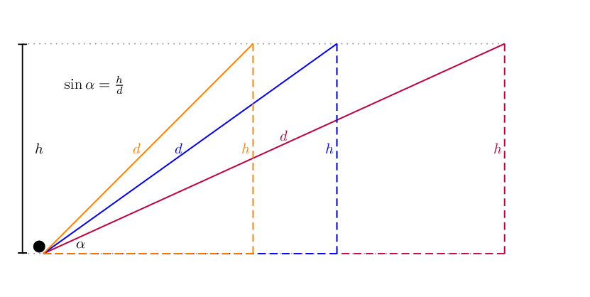
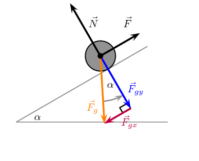
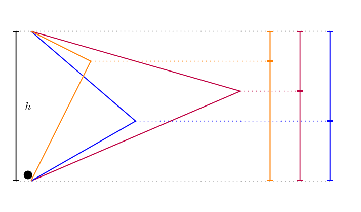
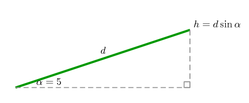
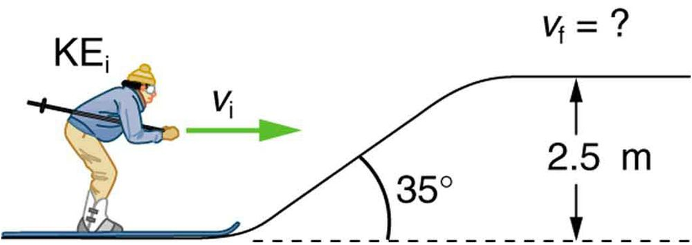

## 5.4 Conservation of energy (ESCMG)

There are two categories of forces we will consider, conservative and non-conservative.

Conservative force
A conservative force is one for which work done
        by or against it depends only on the starting and ending points of a motion and not
        on the path taken.

A **conservative force** results in stored or
      **potential energy** and we can define
      a potential energy (\(E_p\)) for any conservative force.

Gravity is a conservative force and we studied gravitational potential energy
      in Grade 10. We now have all the concepts we need to actually deduce this ourselves.
      Let us consider pushing a ball up a number of different slopes.

Figure 5.5: Three different slopes are shown, all rising to a height of \(h\). The
        imaginary
        right-angled triangle is shown for each slope. \(d\) is the length of the slope. \(\alpha\) is the angle the
        slope makes with the horizontal.

The slope, of length \(d\) is the hypotenuse of an imaginary
      right-angled triangle. The work done by gravity while pushing a ball of
      mass, \(m\), up each of the slopes can be calculated. We know that the component of the gravitational
      force parallel to the slope is \(\vec{F}_{gx}=\vec{F}_g\sin\alpha\) down the slope.

The work done by gravity when the force \(\vec{F}\) pushes the ball up the slope will be
      negative because the direction of the motion and \(\vec{F}_g\sin\alpha\) are opposite.

    \begin{align*}
    W_g &= F d \cos\theta \\
    &= (\vec{F}_g\sin\alpha) d (-1) \\
    &= - \vec{F}_g (\sin\alpha) d \\
    &= - \vec{F}_g \left(\frac{\text{opposite}}{\text{hypotenuse}}\right) d \\
    &= - \vec{F}_g \left(\frac{h}{d}\right) d \\
    &= - \vec{F}_g h
    \end{align*}

This final result is independent of the angle of the slope. This is because
      \(\sin\alpha=\frac{\text{opposite}}{\text{hypotenuse}}=\frac{h}{d}\) and so the distance cancels out. If the ball
      moves down the slope the only change is the sign, the work done by gravity
      still only depends on the change in height. This is why mechanical energy includes gravitational potential energy
      and is conserved. If an object goes up
      a distance \(h\) gravity does negative work, if it moves back down
      \(h\) gravity does positive work, but the absolute amount of work is the same
      so you `get it back', no matter what path you take!

This means that the work done by gravity will be same for the ball moving up any of the slopes because the end
      position
      is at the same height. The different slopes do not end in exactly the same position in the picture. If we break
      each slope into two sections
      as show in Figure 5.6 then we have 3 different paths to precisely
      the same end-point. In this case the total work done by gravity along each path is the sum of the work
      done on each piece which is just related to the height. The total work done is related to the total height.

Figure 5.6: Three different paths that lead from the same start-point to the same-end
        point.
        Each path leads to the same overall change in height, \(h\), and, therefore, the
        same work done by gravity.

There are other examples, when you wind up a toy,
      an egg timer, or an old-fashioned watch, you do work against its spring and store energy
      in it. (We treat these springs as ideal, in that we assume there is no friction and no
      production of thermal energy.) This stored energy is recoverable as work, and it is useful
      to think of it as potential energy contained in the spring.

The total work done by a conservative force results in a change in potential energy,
      \(\Delta E_p\). If the conservative force does positive work then the change
      in potential energy is negative. Therefore:

    \[W_{\text{conservative}}=-\Delta E_p\]

Non-conservative force
A non-conservative force is one for which work done
        on the object depends on the path taken by the object.

<Callout type="note" title="Note">
Non-conservative forces do not imply that total energy is not conserved. Total energy
        is always conserved. Non-conservative forces mean that mechanical energy isn't conserved in a particular system
        which
        implies that the energy has been transferred in a process that isn't reversible.
</Callout>

Friction is a good example of a non-conservative force because if removes energy from the system so
      the amount of mechanical energy is not conserved. Non-conservative forces can also do positive work
      thereby increasing the total mechanical energy of the system.

The energy transferred to overcome friction depends on the distance covered and is converted to thermal
      energy which can't be recovered by the system.

### Non-conservative forces and work-energy theorem (ESCMH)

We know that the net work done will be the sum of the work done by all of the individual forces:

      \begin{align*}
      F_{\text{net}} & = F_{\text{conservative}}+F_{\text{non-conservative}} \\
      & (\text{the work done by these forces yields}) \\
      W_{\text{net}} & = W_{\text{conservative}}+W_{\text{non-conservative}} \\
      & (\text{using the work-energy theorem}) \\
      \Delta E_k & = W_{\text{conservative}}+W_{\text{non-conservative}}\\
      &(\text{using}~W_{\text{conservative}}=-\Delta PE) \\
      \Delta E_k & = -\Delta E_p +W_{\text{non-conservative}} \\
      W_{\text{non-conservative}} & = \Delta E_k + \Delta E_p
      \end{align*}

When the non-conservative forces oppose the motion, the work done by the non-conservative forces
        is negative, causing a decrease in the mechanical energy of the system. When the non-conservative
        forces do positive work, energy is added to the system. If the sum of the non-conservative forces is
        zero then mechanical energy is conserved.

<Callout type="tip" title="Worked example 9: Sliding footballer [credit: OpenStax College Physics]">
**Question:**
Consider the situation shown where a football player slides to a stop on
            level ground. Using energy considerations, calculate the distance the \(\text{65,0}\) \(\text{kg}\)
            football player slides, given that his initial speed is \(\text{6,00}\) \(\text{m·s$^{-1}$}\) and the
            force of friction against him is a constant
            \(\text{450}\) \(\text{N}\).

**Analyse the problem and determine what is given:**
Friction stops the player by converting his kinetic energy into other forms, including
            thermal energy. In terms of the work-energy theorem, the work done by friction, which is
            negative, is added to the initial kinetic energy to reduce it to zero. The work done by
            friction is negative,
            because \(F_f\) is in the opposite direction of the motion (that is,
            \(θ=\text{180}\text{ º}\)
            , and so
            \(\cos\theta=-1\)). Thus \(W_{\text{non-conservative}} = -F_f \Delta x\).

There is no change in potential energy.

**Next we calculate the distance using the conservation of energy:**
We begin with conservation of energy:

          \[W_{\text{non-conservative}} = \Delta EK + \Delta PE\]

The equation expands to:

          \begin{align*}
          W_{\text{non-conservative}} & = \Delta E_k + \Delta E_p \\
          & = E_{k,f} - E_{k,i} + (0) \\
          -F_f \Delta x & = E_{k,f} - E_{k,i} \\
          -F_f \Delta x & = (0) - E_{k,i} \\
          F_f \Delta x & = \frac{1}{2}mv_i^2 \\
          \Delta x &= \frac{mv_i^2}{2F_f} \\
          & = \frac{(\text{65,0})(\text{6,00})^2}{2(\text{450})} \\
          & = \text{2,60}\text{ m}
          \end{align*}

**Quote the final answer:**
The footballer comes to a stop after sliding for \(\text{2,60}\) \(\text{m}\).

**Discussion**

The most important point of this example is that the amount of
            non-conservative work equals the change in mechanical energy. For example, you must work harder
            to stop a truck, with its large mechanical energy, than to stop a mosquito.
</Callout>

<Callout type="tip" title="Worked example 10: Sliding up a slope [credit: OpenStax College Physics]">
**Question:**
The same \(\text{65,0}\) \(\text{kg}\) footballer running at
            the same speed of \(\text{6,00}\) \(\text{m·s$^{-1}$}\)
            dives up the inclined embankment at the side of the field. The force of friction is still
            \(\text{450}\) \(\text{N}\) as it is the same surface, but
            the surface is inclined at \(\text{5}\) \(\text{º}\). How
            far does he slide now?

**Analyse the question:**
Friction stops the player by converting his kinetic energy into other forms, including
            thermal energy, just in the previous worked example. The difference in this case is that
            the height of the player will change which means a non-zero change to gravitational
            potential energy.

The work done by friction is negative, because
            \(F_f\) is in the opposite direction of the motion (that is, \(θ=\text{180}\text{ º}\)).

We sketch the situation showing that the footballer slides a distance \(d\)
            up the slope.

In this case, the work done by the non-conservative friction force on the
            player reduces the mechanical energy he has from his kinetic energy at
            zero height, to the final mechanical energy he has by moving through
            distance \(d\) to reach height \(h\) along the incline.
            This is expressed by the equation:

          \begin{align*}
          W_{\text{non-conservative}} & = \Delta E_k + \Delta E_p \\
          & = E_{k,f} - E_{k,i} + E_{p,f} - E_{p,i} \\
          W_{\text{non-conservative}} + E_{k,i} + E_{p,i} & = E_{k,f} + E_{p,f}
          \end{align*}

We know that:

- the work done by friction is \(W_{\text{non-conservative}} = - F_f d\),
- the initial potential energy is \(E_{p,i} = mg(0)=0\),
- the initial kinetic energy is \(E_{k,i}=\frac{1}{2}mv_i^2\),
- the final kinetic energy is \(E_{k,f}=0\), and
- the final potential energy is \(E_{p,f}=mgh=mgd \sin \theta\).

**Solve for the distance:**
\begin{align*}
          W_{\text{non-conservative}} + E_{k,i} + E_{p,i} & = E_{k,f} + E_{p,f} \\
          (-F_fd) + \frac{1}{2}mv_i^2 + 0 & = 0 +mgd\sin \theta \\
          (-F_fd) - mgd\sin \theta &=-\frac{1}{2}mv_i^2 \\
          d (F_f + mg\sin\theta) & = \frac{1}{2}mv_i^2 \\
          d & = \frac{\frac{1}{2}mv_i^2}{F_f + mg\sin\theta} \\
          & =
          \frac{\frac{1}{2}(\text{65,0})(\text{6,00})^2}{\text{450}+(\text{65,0})(\text{9,8})\sin(\text{5,00})}\\
          & = \text{2,31}\text{ m}
          \end{align*}

**Quote the final answer:**
The player slides for \(\text{2,31}\) \(\text{m}\) before
            stopping.
</Callout>

As might have been expected, the footballer slides a shorter
        distance by sliding uphill. Note that the problem could also have been solved in terms
        of the forces directly and the work energy theorem, instead of using the potential energy.
        This method would have required combining the normal force and force of gravity vectors,
        which no longer cancel each other because they point in different directions, and friction,
        to find the net force. You could then use the net force and the net work to find the
        distance \(d\) that reduces the kinetic energy to zero. By applying
        conservation of energy and using the potential energy instead, we need only consider
        the gravitational potential energy, without combining and resolving force vectors.
        This simplifies the solution considerably.

## Energy conservation

### Textbook Exercise 5.3

**Problem:**
A \(\text{60,0}\) \(\text{kg}\) skier with an initial speed of
              \(\text{12,0}\) \(\text{m·s$^{-1}$}\)
              coasts up a \(\text{2,50}\) \(\text{m}\)-high rise as
              shown in the figure. Find her final speed at the top,
              given that the coefficient of friction between her skis and the snow is \(\text{0,0800}\).
              (Hint:
              Find the distance traveled up the incline assuming a straight-line path as shown in the
              figure.)

**Solution:**
We need to determine the length of the slope as this is the distance over which
              friction acts as well as the normal force of the skier on the slope to determine the magnitude
              of the force due to friction. The normal force balances the component of gravity perpendicular to
              the slope, therefore:
              \begin{align*}
              F_{\text{friction}}&= - \mu N \\
              &= - \mu F_g\cos\theta \\
              &= - \mu mg \cos\theta
              \end{align*}
              The length of the slope will be \(\Delta x = \dfrac{h}{\sin\theta}\).

            \begin{align*}
            W_{\text{non-conservative}} + E_{k,i} + E_{p,i} & = E_{k,f} + E_{p,f} \\
            -\mu mg\cos\theta \dfrac{h}{\sin\theta} + \frac{1}{2}mv_i^2 +mgh_i &= \frac{1}{2}mv_f^2 + mgh_f \\
            -\mu g\cos\theta \dfrac{h}{\sin\theta} + \frac{1}{2}v_i^2 +gh_i &= \frac{1}{2}v_f^2 + gh_f \\
            \frac{1}{2}v_f^2 + gh_f &= -\mu g\cos\theta \dfrac{h}{\sin\theta} + \frac{1}{2}v_i^2 +gh_i \\
            \frac{1}{2}v_f^2 + &= -\mu g\cos\theta \dfrac{h}{\sin\theta} + \frac{1}{2}v_i^2 +g(h_i -h_f) \\
            v_f^2 &= -2\mu g\cos\theta \dfrac{h}{\sin\theta} + v_i^2 +2g(h_i -h_f)
            \end{align*}
            \begin{align*}
            v_f^2 &= -2(0,08)(9,8) \cos(35) \dfrac{2.5}{\sin(35)} + (12)^2 +2(9,8)(-2,5) \\
            v_f & = \sqrt{89,4016598} \\
            v_f & = \text{9,46}\text{ m·s$^{-1}$}
            \end{align*}
            \(\text{9,46}\) \(\text{m·s$^{-1}$}\)

**Problem:**
How high a hill can a car coast up (engine disengaged) if work done by friction is
              negligible and its initial speed is \(\text{110}\) \(\text{km·h$^{-1}$}\)?

**Solution:**
\begin{align*}
                110 km/hr&= 110 \times \frac{1000}{3600} \\
                &= \text{30,56}\text{ m·s$^{-1}$}
                \end{align*}
                \begin{align*}
                mgh&= \frac{1}{2}mv^2 \\
                h&= \frac{v^2}{2g} \\
                &= \frac{(\text{30,56})^2}{2(\text{9,8})} \\
                &= \text{47,65}\text{ m}
                \end{align*}

              \(\text{47,65}\) \(\text{m}\)

**Problem:**
If, in actuality, a \(\text{750}\) \(\text{kg}\) car with an
              initial speed of \(\text{110}\) \(\text{km·h$^{-1}$}\)
              is observed to coast up a hill to a height \(\text{22,0}\) \(\text{m}\) above its
              starting point, how much thermal energy was generated by friction?

**Solution:**
Kinetic energy was converted into potential energy. The addition of friction as a dissipative
                force ensures that some of the kinetic energy is lost as thermal energy. The difference in
                the potential energy gained with and without friction is the energy lost to friction. The gravitational
                potential energy gained is only related to height so the difference in height allows us to
                determine the energy lost to friction quickly.

Without friction the car rose to a height of \(\text{47,65}\)\(\text{m}\), with friction
                the height was only \(\text{22}\)\(\text{m}\). The energy lost to friction is
                equivalent to the energy required to increase the gravitational potential energy by raising the
                vehicle a height of \(\text{25,65}\)\(\text{m}\). Therefore the energy lost to friction is:

              \begin{align*}
              W&= mgh \\
              &= (750)(9,8)(25.65) \\
              & = \text{188 527,5}\text{ J}
              \end{align*}

We calculated the gravitational potential energy that was lost as friction but the correct answer
                will be negative this quantity as the work done by friction is negative:
                -\(\text{188 527,5}\) \(\text{J}\)

**Problem:**
What is the
              average force of friction if the hill has a slope \(\text{2,5}\) \(\text{º}\) above the horizontal?

**Solution:**
We will assume a constant force of friction. The disance over which the friction acted
                is the length of the slope, we know the angle of the slope and the vertical height so we can
                calculate the distance (hypotenuse). We can use the definition of work to calculate the force,
                remember that friction acts opposite to the displacement:

              \begin{align*}
              W_{friction}&= F_{friction}\Delta x \cos\theta \\
              &= -F \Delta x \\
              &= -F \frac{h}{\sin(2.5)} \\
              -\text{188 527,5}&= -F \frac{h}{\sin(2.5)} \\
              F&= \text{188 527,5} \frac{\sin(2.5)}{22} \\
              F&= \text{373,79}\text{ N}
              \end{align*}
              \(\text{373,79}\) \(\text{N}\)

**Problem:**
A bullet traveling at 100 m/s just pierces a wooden plank of 5 m. What should be the speed (in m/s) of the
            bullet to pierce a wooden plank of same material, but having a thickness of 10m?

**Solution:**
Final speed and hence final kinetic energy are zero in both cases. From "work- kinetic energy" theorem,
              initial kinetic energy is equal to work done by the force resisting the motion of bullet. As the material
              is
              same, the resisting force is same in either case. If subscript "1" and "2" denote the two cases
              respectively, then:

**5m:**

            \begin{align*}
            0−\frac{1}{2}mv_1^2 & = −Fx_1 \\
            \frac{1}{2}m(100)^2=F\times 5
            \end{align*}

**10m:**

            \begin{align*}
            0−\frac{1}{2}mv_2^2 & = −Fx_2 \\
            \frac{1}{2}mv_2^2=F\times 10
            \end{align*}

Take the ratio of these two equations:

            \begin{align*}
            \frac{v_2^2}{(100)^2} &=\frac{F\times 10}{F\times 5}=2 \\
            v_2^2 & = 2 \times 10000 = 20000 \\
            v_2 & = \text{141,4}\text{ m·s$^{-1}$}
            \end{align*}

\(\text{141,4}\) \(\text{m·s$^{-1}$}\)
