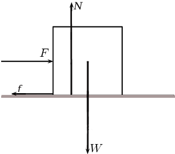
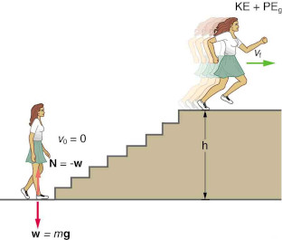

## 5.5 Power (ESCMJ)

Now that we understand the relationship between work and energy, we are ready to look at a quantity
                        related the rate of energy
                        transfer. For example, a mother pushing a trolley full of groceries can take \(\text{30}\)
                        \(\text{s}\) or \(\text{60}\) \(\text{s}\) to push the trolley down an aisle. She does the same
                        amount of work, but takes a different length of time. We use the idea of *power* to
                        describe the rate at which work is done.

<Callout type="note" title="Note">
The unit watt is named after Scottish inventor and engineer James Watt (19 January 1736 - 19
                                August 1819) whose improvements to the steam engine were fundamental to the Industrial
                                Revolution. A key feature of it was that it brought the engine out of the remote coal
                                fields into factories.
</Callout>

Power

Power is defined as the rate at which work is done or the rate at which energy is
                                        transfered to or from a system. The mathematical definition for power is:

                                \(P=\frac{W}{t}\)

Power is easily derived from the definition of work. We know that:

                \(W=F \Delta x \cos \theta\)

Power is defined as the rate at which work is done. Therefore,

                \begin{align*}
                P & = \frac{W}{t} \\
                & = \frac{F \Delta x \cos \theta}{t} \\
                & \text{in the case where }F \text{ and }\Delta x \text{ are in the same direction} \\
                & = \frac{F \Delta x}{t} \\
                & = F \frac{ \Delta x}{t} \\
                & = F v
                \end{align*}

<Callout type="note" title="Note">
In the case where the force and the velocity are in opposite directions the power will be
                                negative.
</Callout>

The unit of power is watt (symbol W).

<Callout type="note" title="Note">
Historically, the *horsepower* (symbol hp) was the unit used to describe the power
                                delivered by a machine. One horsepower is equivalent to approximately \(\text{750}\)
                                \(\text{W}\). The horsepower was derived by James Watt to give an indication of the
                                power of his steam engine in terms of the power of a horse, which was what most people
                                used to for example, turn a mill wheel.
</Callout>

<Callout type="tip" title="Worked example 11: Power calculation 1">
**Question:**
Calculate the power delivered by a force of \(\text{10}\) \(\text{N}\)
                                        which is required to move a \(\text{10}\) \(\text{kg}\) box at a constant speed
                                        of \(\text{1}\) \(\text{m·s$^{-1}$}\) over a rough surface.

**Determine what is given and what is required.:**
- We are given the applied force, \(F=10~\text{N}\).
- We are given the constant speed,
                                                          \(v=1~\text{m}·{\text{s}}^{-1}\).
- We are required to calculate the power required.

**Draw a force diagram:**

**Determine how to approach the problem:**
From the force diagram, we see that the weight of the box and the normal force are
                                        acting at right angles
                                        to the direction of motion. These forces do not contribute to the work done and
                                        do not contribute to the power calculation.
                                        We can therefore calculate power from: \(P=F·v\) using only the applied
                                        force.

**Calculate the power required:**
\begin{align*}
                                P& = F·v\\
                                & = \left(10 \text{N}\right)\left(1 \text{m}·{\text{s}}^{-1}\right)\\
                                & = 10 \text{W}
                                \end{align*}

**Write the final answer:**
\(\text{10}\) \(\text{W}\) of power are required for a force of \(\text{10}\)
                                        \(\text{N}\) to move a \(\text{10}\) \(\text{kg}\) box at a speed of
                                        \(\text{1}\) \(\text{m·s$^{-1}$}\) over the rough surface.

**NOTE:** The power dissipated by the frictional force will be \(-10 \text{ W}\)
                                        so that
                                        the net
                                        power of the system is \(0 \text{ W}\). The applied
                                        force puts in as much energy per second as the frictional force removes \((10
                                        \text{ J·s${^{-1}}$})\) and so the kinetic energy and
                                        velocity remain constant.
</Callout>

Machines are designed and built to do work on objects. All machines usually have a power rating. The
                        power rating indicates the rate at which that machine can do work upon other objects.

A car engine is an example of a machine which is given a power rating. The power rating relates to
                        how rapidly the car can accelerate. Suppose that a 50 kW engine could accelerate the car
                        from \(\text{0}\) \(\text{km·hr$^{-1}$}\) to \(\text{60}\) \(\text{km·hr$^{-1}$}\) in
                        \(\text{16}\) \(\text{s}\). Then a car with four times the power rating (i.e. \(\text{200}\)
                        \(\text{kW}\)) could do the same amount of work in a quarter of the time. That is, a
                        \(\text{200}\) \(\text{kW}\) engine could accelerate the same car from \(\text{0}\)
                        \(\text{km·hr$^{-1}$}\) to \(\text{60}\) \(\text{km·hr$^{-1}$}\) in \(\text{4}\)
                        \(\text{s}\).

<Callout type="tip" title="Worked example 12: Power calculation 2">
**Question:**
A forklift lifts a crate of mass \(\text{100}\) \(\text{kg}\) at a constant velocity
                                        to a height of \(\text{8}\) \(\text{m}\) over a time of \(\text{4}\)
                                        \(\text{s}\). The forklift then holds the crate in place for \(\text{20}\)
                                        \(\text{s}\). Calculate how much power the forklift exerts in lifting the crate?
                                        How much power does the forklift exert in holding the crate in place?

**Determine what is given and what is required:**
We are given:

- mass of crate: m=\(\text{100}\) \(\text{kg}\)
- height that crate is raised: h=\(\text{8}\) \(\text{m}\)
- time taken to raise crate: \({t}_{r}=4~\text{s}\)
- time that crate is held in place: \({t}_{s}=20~\text{s}\)

We are required to calculate the power exerted.

**Determine how to approach the problem:**
We can use:

                                \(P=Fv=F\frac{\Delta x}{\Delta t}\)

to calculate power. The force required to raise the crate is equal to the weight of
                                        the crate.

**Calculate the power required to raise the crate:**
\begin{align*}
                                P& = F\frac{\Delta x}{\Delta t}\\
                                & = m·g\frac{\Delta x}{\Delta t}\\
                                & =
                                \left(100 \text{kg}\right)\left(9,8 \text{m}·{\text{s}}^{-2}\right)\frac{8 \text{m}}{4 \text{s}}\\
                                & = 1960 \text{W}
                                \end{align*}

**Calculate the power required to hold the crate in place:**
While the crate is being held in place, there is no displacement. This means there is
                                        no work done on the crate and therefore there is no power exerted.

**Write the final answer:**
\(\text{1 960}\) \(\text{W}\) of power is exerted to raise the crate and no
                                        power is exerted to hold the crate in place.
</Callout>

<Callout type="tip" title="Worked example 13: Stair climb">
**Question:**
What is the power output for a \(\text{60,0}\) \(\text{kg}\) woman who runs up a
                                        \(\text{3,00}\) \(\text{ m}\)
                                        high flight of stairs in \(\text{3,50}\) \(\text{s}\), starting from rest but
                                        having a final speed of
                                        \(\text{2,00}\) \(\text{m·s$^{-1}$}\)?
                                        Her power output depends on how fast she does this.

**Analyse the question:**
The work going into mechanical energy is \(W= E_k + E_p\). At the bottom of the
                                        stairs,
                                        we take both \(E_k\) and the potential energy due to gravity, \(E_{p,g}\), as
                                        initially zero;
                                        thus, \(W=E_{k,f}+ E_{p,g}=\frac{1}{2}mv_f^2+mgh\),
                                        where \(h\) is the vertical height of the stairs. Because all terms are given,
                                        we can calculate \(W\) and then divide it by time to get power.

**Calculate power:**
Substituting the expression for \(W\) into the definition of power given in the
                                        previous equation,
                                        \(P=\frac{W}{t}\) yields:

                                \begin{align*}
                                P &=\frac{W}{t}\\
                                &=\frac{\frac{1}{2}mv_f^2+mgh}{t} \\
                                &=\frac{\frac{1}{2}(\text{60,0})(\text{2,00})^2+(\text{60,0})(\text{9,80})(\text{3,00})}{\text{3,50}}
                                \\
                                & = \frac{120 +1764}{\text{3,50}} \\
                                & = \text{538,3}\text{ W}
                                \end{align*}

**Quote the final answer:**
The power generated is \(\text{538,0}\) \(\text{W}\).

The woman does \(\text{1 764}\) \(\text{J}\) of work to move up the stairs
                                        compared with only \(\text{120}\) \(\text{J}\) to increase her kinetic energy;
                                        thus, most of her power output is required for climbing rather than
                                        accelerating.
</Callout>

<Callout type="tip" title="Worked example 14: A borehole">
**Question:**
What is the power required to pump water from a borehole that has a depth
                                        \(h=\text{15,0}\text{ m}\) at a rate of
                                        \(\text{20,0}\) \(\text{l·s$^{-1}$}\)?

**Analyse the question:**
We know that we will have to do work on the water to overcome gravity to raise it a
                                        certain height.
                                        If we ignore any inefficiencies we can calculate the work, and power, required
                                        to raise the mass of
                                        water the appropriate height.

We know how much water is required in a single second. We can first determine the
                                        mass of water:
                                        \(\text{20,0}\text{ l}
                                        \times\frac{\text{1}\text{ kg}}{\text{1}\text{ l}} = \text{20,0}\text{ kg}\).

The water will also have non-zero kinetic energy when it gets to the surface because
                                        it needs to
                                        be flowing. The pump needs to move \(\text{20,0}\) \(\text{kg}\)
                                        from the depth of the borehole every second, we know the depth so we know the
                                        speed that the water
                                        needs to be moving is \(v=\frac{h}{t}=\frac{\text{15,0}}{1}=\text{15,0}\text{
                                        m·s$^{-1}$}\).

**Work done to raise the water:**
We can use

                                \begin{align*}
                                W_{\text{non-conservative}} & = \Delta E_k + \Delta E_p \\
                                & = E_{k,f} - E_{k,i} + E_{p,f} - E_{p,i} \\
                                & = \frac{1}{2}mv^2 -(0) + mgh - 0 \\
                                & = \frac{1}{2}(20)(15)^2 + (20)(\text{9,8})(15) \\
                                & = \text{2,25} \times \text{10}^{\text{3}} + \text{2,94} \times
                                \text{10}^{\text{3}} \\
                                & = \text{5,19} \times \text{10}^{\text{3}}\text{ J}
                                \end{align*}

**Calculate power:**
\begin{align*}
                                P &= \frac{W}{t} \\
                                &= \frac{\text{5,19} \times \text{10}^{\text{3}}}{1} \\
                                & = \text{5,19} \times \text{10}^{\text{3}}\text{ W}
                                \end{align*}

**Quote the final answer:**
The minimum power required from the pump is \(\text{5,19} \times
                                        \text{10}^{\text{3}}\) \(\text{W}\).
</Callout>

## Simple measurements of human power

You can perform various physical activities, for example lifting measured weights or climbing
                                a flight of stairs to estimate your output power, using a stop watch. Note: the human
                                body is not very efficient in these activities, so your actual power will be much
                                greater than estimated here.

## Power

### Textbook Exercise 5.4

**Problem:**
[IEB 2005/11 HG] Which of the following is equivalent to the SI unit
                                                        of power:

2. \(\text{V·A}\)
4. \(\text{V·A$^{-1}$}\)
6. \(\text{kg·m·s$^{-1}$}\)
8. \(\text{kg·m·s$^{-2}$}\)

**Solution:**
\(\text{V·A}\)

**Problem:**
Two students, Bill and Bob, are in the weight lifting room of their
                                                        local gym. Bill lifts the \(\text{50}\) \(\text{kg}\) barbell
                                                        over his head 10 times in one minute while Bob lifts the
                                                        \(\text{50}\) \(\text{kg}\) barbell over his head 10 times in
                                                        \(\text{10}\) \(\text{seconds}\). Who does the most work? Who
                                                        delivers the most power? Explain your answers.

**Solution:**
The displacement is 0 and so there is no work done.
                                                Since power is the rate at which work is done, the power is also 0.

**Problem:**
Jack and Jill ran up the hill. Jack is twice as massive as Jill; yet
                                                        Jill ascended the same distance in half the time. Who did the
                                                        most work? Who delivered the most power? Explain your answers.

**Solution:**
With comparative problems we always write the values for one of the
                                                        objects/people
                                                        in terms of the values for the other. So:

                                                \begin{align*}
                                                m_{Jack}&= 2\times m_{Jill} \\
                                                \frac{1}{2}t_{Jack}&= t_{Jill} \\
                                                t_{Jack}&= 2\times t_{Jill}
                                                \end{align*}

The work done was to increase the gravitational potential energy of
                                                        the system. If the hill has
                                                        a height of \(h\) then:

                                                \begin{align*}
                                                W_{Jill}&= m_{Jill}gh \\
                                                W_{Jack}&= m_{Jack}gh \\
                                                W_{Jack}&= (2\times m_{Jill})gh \\
                                                W_{Jack}&= 2\times (m_{Jill}gh \\
                                                W_{Jack}&= 2\times W_{Jill}
                                                \end{align*}

The power comparison is similar:

                                                \begin{align*}
                                                P_{Jill}&= \frac{W_{Jill}}{t_{Jill}} \\
                                                P_{Jack}&= \frac{W_{Jack}}{t_{Jack}} \\
                                                P_{Jack}&= \frac{2\times W_{Jill}}{2\times t_{Jill}} \\
                                                P_{Jack}&= \frac{ W_{Jill}}{t_{Jill}} \\
                                                P_{Jack}&= P_{Jill}
                                                \end{align*}

                                                Jack did twice as much work as Jill but the same power.

**Problem:**
When doing a chin-up, a physics student lifts her \(\text{40}\)
                                                        \(\text{kg}\) body a distance of \(\text{0,25}\) \(\text{m}\) in
                                                        \(\text{2}\) \(\text{s}\). What is the power delivered by the
                                                        student's biceps?

**Solution:**
The work done by the biceps (a non-conservative force) increased the
                                                        net mechanical
                                                        energy of the system. The kinetic energy is zero at the top and
                                                        bottom so we are
                                                        only interested in the gravitational potential energy.

                                                \begin{align*}
                                                W_{\text{non-conservative}} & = \Delta E_k + \Delta E_p \\
                                                & = E_{p,f} - E_{p,i} \\
                                                & = mgh(h_f-h_i) \\
                                                & = (40)(9,8)(0,25)\\
                                                & = \text{98}\text{ J}
                                                \end{align*}
                                                \begin{align*}
                                                P&=\frac{W}{t} \\
                                                &= \frac{(98)}{2} \\
                                                &= \text{49}\text{ W}
                                                \end{align*}
                                                49 W

**Problem:**
The unit of power that is used on a monthly electricity account is
                                                        *kilowatt-hours* (symbol \(\text{kWh}\)). This is a unit
                                                        of energy delivered by the flow of \(\text{1}\) \(\text{kW}\) of
                                                        electricity for \(\text{1}\) \(\text{hour}\). Show how many
                                                        joules of energy you get when you buy \(\text{1}\)
                                                        \(\text{kWh}\) of electricity.

**Solution:**
\(1 \text{kWh} = 1000 \text{Wh} = 1000 \text{Wh} \times
                                                \frac{3600}{\text{h}}=\text{3 600 000}\text{ J}\)

**Problem:**
An escalator is used to move 20 passengers every minute from the
                                                        first floor of a shopping mall to the second. The second floor
                                                        is located 5-meters above the first floor. The average
                                                        passenger's mass is \(\text{70}\) \(\text{kg}\). Determine the
                                                        power requirement of the escalator in order to move this number
                                                        of passengers in this amount of time.

**Solution:**
The work done will be to move the total mass of the 20 passengers
                                                        vertically 5 m. We are
                                                        not given the mass of the elevator itself so we assume we can
                                                        ignore it. The total mass will be:
                                                        \(m_{total}=(20)(70)=\text{1 400}\text{ kg}\)

                                                \begin{align*}
                                                W&=mgh \\
                                                &= (1400)(9,8)(5) \\
                                                &= \text{68 600}\text{ J}
                                                \end{align*}
                                                \begin{align*}
                                                P&=\frac{W}{t} \\
                                                &=\frac{68600}{60} \\
                                                &= \text{1 143,33}\text{ W}
                                                \end{align*}
                                                \(\text{1 143,33}\) \(\text{W}\)
