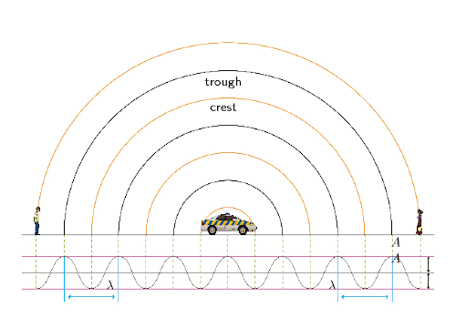
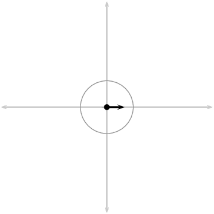
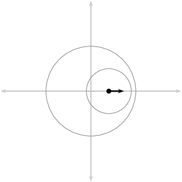
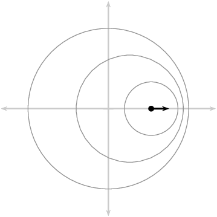
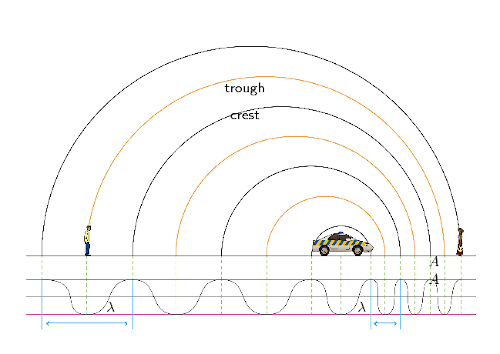
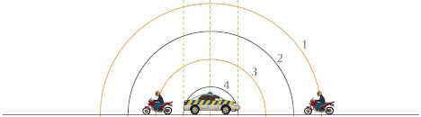
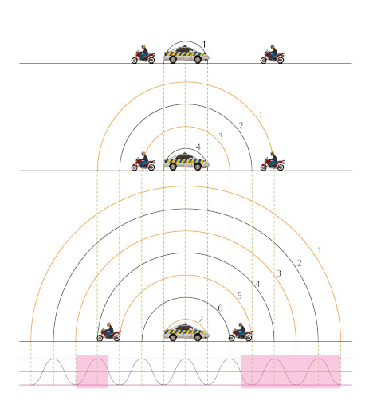
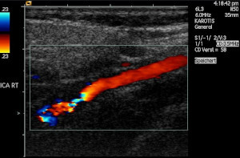

## 6.2 The Doppler effect with sound (ESCMN)

You, the person hearing the sounds, are called the *observer* or *listener* and the
                        thing emitting the sound is called the *source*. As mentioned in the introduction, there
                        are two situations which lead to the Doppler effect:

2. When the source moves relative to a stationary observer.
4. When the observer moves relative to a stationary source.

In points 1 and 2 above there is relative motion between the source and the observer.
                        Both the source and the observer can be moving at the same time but we won't deal with that case
                        in this chapter.

Doppler effect

The Doppler effect is the change in the observed frequency of a wave
                                        when the source or the detector moves relative to the transmitting medium.

The Doppler effect occurs when a source of waves and/or observer move relative to
                        each other, resulting in the observer measuring a different frequency of the waves
                        than the frequency that the source is emitting. The medium that the waves are travelling
                        through,
                        the transmitting medium, is also stationary in the cases we will study.

The question that probably comes to mind is: *"How does the Doppler effect come about?"*.
                        We can understand what is happening by thinking through the situation in detail.

### Case 1: Moving source, stationary observer (ESCMP)

Let us consider a source of sound waves with a constant frequency and amplitude.
                                The sound waves can be represented as concentric circles where each circle represents
                                a crest or peak as the wavefronts radiate away from the source. This is because
                                the waves travel away from the source in all directions and the distance between
                                consecutive crests or consecutive troughs in a wave is constant (the wavelength
                                as we learnt in Grade 10). In this figure the crests are represented by by the
                                black lines and the troughs by the orange lines.

Figure 6.1: Stationary sound source as more wavefronts are emmitted.

The sound source is the police car in the middle and is stationary. For
                                the Doppler effect to take place (manifest), the source must be moving
                                *relative* to the observer.

Let's
                                consider the following situation: The source (represented by the black dot) emits one
                                wave (the black circles
                                represent the crests of the sound wave) that moves away from the source at the
                                same rate in all directions. The distance between the crests represents
                                the wavelength (\(\lambda\)) of the sound. The closer together the crests, the higher
                                the frequency (or pitch) of the sound according to \(f=\frac{v}{\lambda}\),
                                where \(v\) (speed of sound) is constant.

As this crest moves away, the source also moves and then emits more crests. Now the two
                                circles are not concentric any more, but on the one side they are closer together and on
                                the other side they are further apart. This is shown in the next diagram.

If the source continues moving at the same speed in the same
                                direction, then the distance between crests on the right of the
                                source is constant. The distance between crests on the left is
                                also constant. The distance between successive crests on the left is constant
                                but larger than the distance between successive crests on the right.

When a car approaches you, the sound waves that reach you have a shorter wavelength and a
                                higher frequency. You hear a sound with a higher pitch. When the car moves away from
                                you, the sound waves that
                                reach you have a longer wavelength and lower frequency. You hear a sound with a lower
                                pitch.

Figure 6.2: Moving sound source as more wavefronts are emmitted.

### Case 2: Moving observer, stationary source (ESCMQ)

Just as we did before, let us consider a source (a police car) of sound waves with a constant
                                frequency and amplitude.
                                There are two observers, one on the left
                                that will move away from the source and one on the right that will move towards the
                                source.
                                We have three diagrams:

2. shows the overall situation with the siren starting at time
                                           \(t_1\);
4. shows the situation at time
                                           \(t_2\) when the observers are moving; and
6. shows the situation at \(t_3\) after the observers have been moving for a time
                                           interval,
                                           \(\Delta t=t_3-t_2\).

The crests and troughs are numbered so you can see how they
                                move further away and so that we can track which ones an observer has measured.

The observers can hear the sound waves emitted by the police car and
                                they start to move (we ignore the time it takes them to accelerate).

The frequency of the wave that an observer measures is the number of complete
                                waves cycles per unit time. By numbering the crests and troughs we can see
                                which complete wave cycles have been measured by each of the observers in time, \(\Delta
                                t\).
                                To find the frequency we divide the number of wave cycles by \(\Delta t\).

In the time interval that passed, the observer moving towards the
                                police car observed the crests and troughs numbered 1 through 5 (the portion
                                of the wave is highlighted below). The observer moving away encountered a
                                smaller portion of the wavefront, crest 3 and trough 4.
                                The time interval for each of them is the same. To the observers
                                this will mean that the frequency they measured is different.

The motion of the observer will alter the frequency of the measured sound from a stationary
                                source:

- An observer moving **towards** the source measures a
                                          **higher** frequency.
- An observer moving **away from** the source measures a
                                          **lower** frequency.

It is important to note that we have only looked at the cases where the source and observer
                                are moving directly towards or away from each other and these are the only cases we will
                                consider.

<Callout type="note" title="Note">
We didn't actually need to analyse both cases. We could have used either explanation because
                                of relative motion. The case of a stationary source with moving observer is the same as
                                the case of the stationary observer and the moving source because the relative motion is
                                the same. Do you agree? Discuss with your friends and try to convince yourselves that
                                this is the case. Being able to explain work to each other will help you understand it
                                better. If you don't understand it, you won't be able to explain it convincingly.

For a real conceptual test, discuss what you think will happen if the source and the observer
                                are both moving, in the same direction and at the same speed.
</Callout>

The formula that provides the relationship between the frequency emitted by the
                        source and the frequency measured by the listener is:

                \[\boxed{{f}_{L}=\left(\frac{v\pm{v}_{L}}{v\pm{v}_{S}}\right){f}_{S}}\]

- where \({f}_{L}\) is the frequency perceived by the observer (listener),
- \({f}_{S}\) is the frequency of the source,
- \(v\) is the speed of the waves,
- \({v}_{L}\) the speed of the listener and
- \({v}_{S}\) the speed of the source.

Note: The signs show whether or not the relative motion of the source and observer is towards each
                        other or away from each other:

| Source moves towards listener | \({v}_{S}\): negative |
| --- | --- |
| Source moves away from listener | \({v}_{S}\): positive |
| Listener moves towards source | \({v}_{L}\): positive |
| Listener moves away from source | \({v}_{L}\): negative |

We only deal with one of the source or observer moving in this chapter.
                        To understand the sign choice you can think about the pictures of the motion. For the
                        listener/observer we are using the
                        numerator in the equation. A fraction gets larger when the numerator gets larger so if we expect
                        the frequency to increase
                        we expect addition in the numerator (\({f}_{L}=(\frac{v+{v}_{L}}{v}){f}_{S}\)).
                        If the numerator gets smaller the fraction gets smaller so if we expect the
                        frequency to decrease then it is subtraction in the numerator
                        (\({f}_{L}=(\frac{v-{v}_{L}}{v}){f}_{S}\)).

For the denominator the reverse is true because of the fact that we divide by the denominator. The
                        larger the
                        denominator the smaller the fraction and vice versa. So if we expect the motion of the source to
                        increase the
                        frequency we expect subtraction in the denominator (\({f}_{L}=(\frac{v}{v-v_{S}}){f}_{S}\))
                        and if we expect the frequency to decrease we expect addition
                        in the denominator (\({f}_{L}=(\frac{v}{v+v_{S}}){f}_{S}\)).

<Callout type="note" title="Note">
<VideoPlayer src="http://www.youtube.com/embed/dc7l7Qqa8xk" title="Video: 27SS" />
</Callout>

<QuizCard id="s12-06-02a" title="Interactive Exercise 6.2" question="State the Doppler effect using the dropdown menus below." options=["Huygens effect", "photoelectric effect", "Snell effect", "wave effect", "Doppler effect", "volume", "energy", "frequency", "emission", "speed", "respondent", "source", "medium", "listener", "laser", "energy", "frequency", "emission", "phase", "amplitude", "respondent", "metal", "source", "listener", "medium", "zero", "perpendicular", "relative", "random", "adjacent", "respondent", "metal", "laser", "listener", "medium", "medium", "respondent", "metal", "source", "laser"] answer="0, 0, 0, 0, 0, 0, 0, 0" hint="" explanation="Construct the statement of the Doppler effect We state the Doppler effect as follows: The Doppler effect for a sound wave is when there is a perceived difference in frequency of a sound wave as detected by a listener compared to the true frequency emitted by the source . This occurs when there is relative motion between the listener of the sound wave and the source . Submit your answer as: Doppler effect and frequency and listener and frequency and source and relative and listener and source" />

<QuizCard id="s12-06-02a" title="Interactive Exercise 6.2" question="A pedestrian is waiting at a traffic light. A police car with its siren on is speeding towards the pedestrian. Which one of the following statements is true regarding the perceived frequency that the pedestrian will hear due to the sound emitted from the moving police car? A The frequency will be higher (than the true frequency) due to an effectively longer wavelength. B The frequency will be higher (than the true frequency) due to an effectively shorter wavelength. C The frequency will be lower (than the true frequency) due to an effectively shorter wavelength. D The frequency will be lower (than the true frequency) due to an effectively longer wavelength ." options=["A", "B", "C", "D"] answer="B" hint="" explanation="Think about wave fronts and what happens when there is relative motion between an observer and a sound emitting source Let's first summarise the information we know. The police car moves towards the pedestrian. The police car is moving. The pedestrian is stationary. We know that the police car and pedestrian are moving relative to each other. The perceived frequency heard by the pedestrian will differ from the true frequency emitted by the police car. In this case, the police car is moving towards the pedestrian. We want to know if the distance between the successive wave fronts is decreasing or increasing and how this affects the frequency heard by the pedestrian. Recall that the distance between one wave front and the next is equal to the wavelength. Look at the diagrams above. The diagram on the left shows a simplified picture of the sound waves leaving the stationary police car (here shown as a black dot) and moving through space. The distance between each concentric circle (wave front) represents the wavelength of the sound wave. When there is no relative motion between the police car and pedestrian, the listener hears the true pitch. The Doppler effect is not observed. The diagram on the right shows a moving police car. The police car emits a circular sound wave. As the police car moves towards the pedestrian, it emits another sound wave, where the centre of the sound wave is slightly shifted. In the diagram, we can see that the distance between one wave front and the next one is shorter as it approaches the pedestrian. This means that the wavelength perceived by the pedestrian \((\lambda_{\text{L}})\) is shorter . Since \(\lambda_{\text{L}}\) is effectively shorter , options A and D cannot be correct, because they say that \(\lambda_{\text{L}}\) is longer . We are left with option B and C as possible correct answers. Use the relationship between frequency and wavelength to choose the correct option The source is emitting sound waves. These sound waves travel towards the listener. The speed of sound waves ( \(v\) ) in a given medium (in this case air) is constant. The relationship between wave speed, wavelength ( \(\lambda\) ) and frequency ( \(f\) ) is given by the wave relation: \[                     \begin{aligned}                         v = \lambda f                     \end{aligned}                 \] The frequency of a sound wave that a listener measures \((f_{\text{L}})\) is the number of successive crests (or troughs) passing a given point in one second. Because the speed of sound is constant, we can say: \[                     \begin{aligned}                         f_{\text{L}} \propto \frac{1}{\lambda_{\text{L}}}                     \end{aligned}                 \] where \(\lambda_{\text{L}}\) is the wavelength perceived by the listener (the pedestrian).                     If \(\lambda_{\text{L}}\) is larger by a certain factor, then \(f_{\text{L}}\) is smaller by the same factor. Similarly if \(\lambda_{\text{L}}\) is smaller by a certain factor, \(f_{\text{L}}\) is larger by the same factor. Another way of saying this is that \(f_{\text{L}}\) is inversely proportional to \(\lambda_{\text{L}}\) . As the police car moves towards the pedestrian, the distance between successive wave fronts is effectively smaller (shorter \(\lambda_{\text{L}}\) ). This means that the number of successive wave fronts passing the observer in one second is higher (increased \(f_{\text{L}}\) ). This means that option C cannot be correct. A The frequency will be higher (than the true frequency) due to an effectively longer wavelength. \(\lambda_{\text{L}}\) is longer ✘, \(f_{\text{L}}\) increases ✔ B The frequency will be higher (than the true frequency) due to an effectively shorter wavelength. \(\lambda_{\text{L}}\) is shorter ✔, \(f_{\text{L}}\) increases ✔ C The frequency will be lower (than the true frequency) due to an effectively shorter wavelength. \(\lambda_{\text{L}}\) is shorter ✔, \(f_{\text{L}}\) decreases ✘ D The frequency will be lower (than the true frequency) due to an effectively longer wavelength . \(\lambda_{\text{L}}\) is longer ✘, \(f_{\text{L}}\) decreases ✘ Therefore the correct option is B . Submit your answer as: B" />

<QuizCard id="s12-06-02a" title="Interactive Exercise 6.2" question="The sound wave produced by the siren of a firetruck has a frequency of \(~\text{342}~\text{Hz}\) . You are standing at the side of the road. The firetruck is moving away (receding) from you at a speed of \(\text{117} ~\text{km·h}^\text{-1}\) . Assume that the speed of sound is \(\text{338}~\text{m·s}^\text{-1}\) . Use the above information to determine the following: What is the apparent frequency of the sound wave that you will hear from the siren of the receding firetruck, or \(~f_L\) ? INSTRUCTION: Round your answer to two decimal places. Use the values for any physical constants you might need, as listed here ." options=[] answer="312.00" hint="You should enter a number here. If you want to, you can use a space to separate thousands.                Example: 12 800,25 For scientific notation you need to use the multiply symbol                ( ∗ ) and the exponent symbol ( ^ ). For example 6,673 × 10 −11 should be written as: 6,673 ∗ 10^−11" explanation="The Doppler effect When the source of a sound wave is moving with respect to an observer or listener, the apparent frequency of the sound wave which the observer or listener will measure, changes depending on the relative motion of the source and observer, and the relative motion of the sound wave and the observer. This is known as the Doppler effect . When the source of a sound wave moves away from an observer or listener, the apparent frequency of the wave the observer measures, will decrease. The diagram above shows this effect as the waves being stretched out on the side where the source and the observer are receding from each other. The result of this effect is that the observer will hear the sound waves at a lower pitch, because of this decrease in the apparent frequency. This shift in frequency can be calculated by using the following equation: \[\begin{array}{c}f_L = \left(\frac{v \pm v_L}{v \pm v_S}\right) f_S~~~~~~~~\text{(1)}\end{array}\] where, \(f_L~\) is the apparent frequency of the sound wave as observed by the listener in \(~\text{Hz}\) \(v~\) is the speed of sound in the medium through which the wave propagates in \(~\text{m·s}^\text{-1}\) \(v_L~\) is the speed of the listener in \(~\text{m·s}^\text{-1}\) \(v_S~\) is the speed of the source in \(~\text{m·s}^\text{-1}\) \(f_S~\) is the emitted frequency of the sound wave by the source in \(~\text{Hz}\) The \" \(\pm\) \"-sign in equation \(\text(1)\) means that the equation changes, depending on the relative motion between the source and observer, and the wave and observer. The flow diagram below can be used to determine the correct from of equation \(\text(1)~\) to use, when either a source or an observer is in motion, while the other stays at rest: An explanation of why these rules apply can be found here . In our case, the observer (you) is at rest ( \(v_L = 0\) ), while the firetruck is moving away from you. This means that we will use Form B of equation \(\text(1)\) : \[\begin{array}{c}f_L = \left(\frac{v}{v + v_S}\right) f_S~~~~~~~~\text{(2)}\end{array}\] Substitute the given information to calculate the final result We are given the following information (convert all values to SI units): the speed of sound \(v = \text{338}~\text{m·s}^\text{-1}\) the speed of the observer or listener \(v_L = \text{0}~\text{m·s}^\text{-1}\) the speed of the source \(v_S = \text{117}~\text{km·h}^\text{-1} = \text{32,5}~\text{m·s}^\text{-1}\) (use the exact number) the frequency of the sound wave produced by the source \(f_S =  \text{342} \ \text{Hz}\) Substituting the above values in equation \(\text{(2)}\) , we get: \[                             \begin{aligned}                             f_L & = \left(\frac{v}{v + v_S}\right) f_S\\                                 & = \frac                                         {(\text{338})}                                         {(\text{338}) + (\text{32,5})}                                         \times (\text{342})\\                                 & =  \text{312,00}\ \text{Hz}~~~~~\text{(rounded)}\\                             \end{aligned}                         \] Therefore, the apparent frequency of the sound wave that you will hear from the siren of the approaching firetruck, is \(\text{312,00}~\text{Hz}\) . Submit your answer as:" />

<QuizCard id="s12-06-02a" title="Interactive Exercise 6.2" question="Adapted from DBE Feb-Mar 2017 Grade 12, P1, Q6.2 Physical constants · Physics formulas The spectral lines of a star are observed to be blue shifted at an observatory on Earth. Explain the term blue shifted in terms of wavelength. How will the frequency of the observed light from the star compare to its true value?" options=["away from", "towards", "greater than", "less than", "equal to", "greater than", "less than", "equal to"] answer="1, 1, 0" hint="" explanation="Explain blue shift using wavelength If light from the star has been blue shifted , it means that the star is moving towards the Earth. The wavefronts of the light waves emitted by the star will be closer together and so the wavelength of the light will be less than its true value. How is frequency affected? Frequency and wavelength are inversely proportional to each other. So if the wavelength is less than its true value, the frequency of the observed light will be greater than its true value. Submit your answer as: towards and less than and greater than" />

<Callout type="tip" title="Worked example 1: Ambulance siren">
**Question:**
The siren of an ambulance emits sound with a frequency of \(\text{700}\)
                                        \(\text{Hz}\). You are standing on the pavement. If the ambulance drives past
                                        you at a speed of \(\text{20}\) \(\text{m·s$^{-1}$}\), what frequency will
                                        you hear, when

2. the ambulance is approaching you
4. the ambulance is driving away from you

Take the speed of sound in air to be
                                        \(\text{340}\) \(\text{m·s$^{-1}$}\).

**Analyse the question:**
The question explicitly asks what frequency you will hear when the source is moving
                                        at a certain speed. This tells you immediately that the question is related to
                                        the Doppler effect. The values given in the question are all in S.I. units so no
                                        conversions are required.

**Determine how to approach the problem based on what is given:**
We know that we are looking for the observed frequency with a moving source. The
                                        change in frequency can be calculated using:

                                \[{f}_{L}=\left(\frac{v\pm{v}_{L}}{v\pm{v}_{S}}\right){f}_{S}\]

To correctly apply this we need to confirm that it is valid and determine what signs
                                        we need to
                                        use for the various speeds. You (the listener) are not moving but we have to
                                        consider two different cases,
                                        when the ambulance is moving towards you (a) and away from you (b).
                                        We have been told that if the source is moving towards the observer then we will
                                        use subtraction in the
                                        denominator and if it is moving away, addition. This means:

                                \begin{align*}
                                {f}_{S}& = \text{700}\text{ Hz}\\
                                v& = \text{340}\text{ m·s$^{-1}$}\\
                                {v}_{L}& = 0 \text{ because you, the observer, are not moving}\\
                                {v}_{S}& = -\text{20}\text{ m·s$^{-1}$} \text{ for (a) and}\\
                                {v}_{S}& = +\text{20}\text{ m·s$^{-1}$} \text{ for (b)}
                                \end{align*}

**Determine \({f}_{L}\) when ambulance is approaching:**
\begin{align*}
                                {f}_{L}&=\left(\frac{v\pm{v}_{L}}{v\pm{v}_{S}}\right){f}_{S} \\
                                {f}_{L}& = \left(\frac{340+0}{340-20}\right)\left(700\right)\\
                                & = \text{743,75} \text{Hz}
                                \end{align*}

**Determine \({f}_{L}\) when ambulance has passed:**
\begin{align*}
                                {f}_{L}&=\left(\frac{v\pm{v}_{L}}{v\pm{v}_{S}}\right){f}_{S} \\
                                {f}_{L}& = \left(\frac{340+0}{340+20}\right)\left(700\right)\\
                                & = \text{661,11} \text{Hz}
                                \end{align*}

**Quote the final answer:**
When the ambulance is approaching you, you hear a frequency of \(\text{743,75}\)
                                        \(\text{Hz}\) and when it is going away you hear a frequency of
                                        \(\text{661,11}\) \(\text{Hz}\)
</Callout>

<Callout type="tip" title="Worked example 2: Moving observer">
**Question:**
What is the frequency heard by a person driving at \(\text{15}\)
                                        \(\text{m·s$^{-1}$}\) toward a factory whistle that is blowing at a
                                        frequency of \(\text{800}\) \(\text{Hz}\). Assume that the speed of sound in air
                                        is \(\text{340}\) \(\text{m·s$^{-1}$}\).

**Analyse the question:**
The question explicitly asks what frequency you will hear when the observer is moving
                                        at a certain speed. This tells you immediately that the question is related to
                                        the Doppler shift. The values given in the question are all in S.I. units so no
                                        conversions are required.

**Determine how to approach the problem based on what is given:**
We can use:

                                \[{f}_{L}=\left(\frac{v\pm{v}_{L}}{v\pm{v}_{S}}\right){f}_{S}\]

with:

                                \begin{align*}
                                v& = 340 \text{m}·{\text{s}}^{-1}\\
                                {v}_{L}& = +15 \text{m}·{\text{s}}^{-1}\\
                                {v}_{S}& = 0 \text{m}·{\text{s}}^{-1}\\
                                {f}_{S}& = 800 \text{Hz}\\
                                {f}_{L}& = ?
                                \end{align*}

The listener is moving towards the source, so \({v}_{L}\) is positive and the source
                                        is stationary so \({v}_{S}=0\).

**Calculate the frequency:**
\begin{align*}
                                {f}_{L}& = \left(\frac{v+{v}_{L}}{v+{v}_{S}}\right){f}_{S}\\
                                & = \left(\frac{340+15}{340+0}\right)\left(800\right)\\
                                & = \text{835,29} \text{Hz}
                                \end{align*}

**Write the final answer:**
The driver hears a frequency of \(\text{835,29}\) \(\text{Hz}\).
</Callout>

<Callout type="tip" title="Worked example 3: Doppler effect [NSC 2011 Paper 1]">
**Question:**
A train approaches a station at a constant speed of \(\text{20}\)
                                        \(\text{m·s$^{-1}$}\) with its whistle blowing at a frequency of
                                        \(\text{458}\) \(\text{Hz}\). An observer, standing on the platform, hears a
                                        change in pitch as the train approaches him, passes him and moves away from him.

2. Name the phenomenon that explains the change in pitch heard by the
                                                           observer.
   (1 mark)
4. Calculate the frequency of the sound that the observer hears while
                                                           the train is approaching him. Use the speed of sound in air as
                                                           \(\text{340}\) \(\text{m·s$^{-1}$}\).
   (4 marks)
6. How will the observed frequency change as the train passes and moves
                                                           away from the observer? Write down only INCREASES, DECREASES or
                                                           REMAINS THE SAME.
   (1 mark)
8. How will the frequency observed by the train driver compare to that
                                                           of the sound waves emitted by the whistle? Write down only
                                                           GREATER THAN, EQUAL TO or LESS THAN. Give a reason for the
                                                           answer.
   (2 marks)

**[TOTAL: 8 marks]**

**Question 1**

Doppler effect

(1 mark)

**Question 2**

                        \begin{align*}
                        f_L & = \frac{v \pm v_L}{v \pm v_S} f_S \\
                        \therefore f_L & = \frac{\text{340} \pm \text{0}}{\text{340} - \text{20}} (\text{458}) \\
                        & = \text{486,63}~\text{ Hz}
                        \end{align*}

(4 marks)

**Question 3**

Decreases

(1 mark)

**Question 4**

Equal to, because ...

- the velocity of train driver relative to the whistle is zero. **OR**
- the train driver has same velocity as the whistle. **OR**
- there is no relative motion between source and observer.

(2 marks)

**[TOTAL: 11 marks]**
</Callout>

<QuizCard id="s12-06-02b" title="Interactive Exercise 6.3" question="The sound wave produced by the siren of an ambulance has a frequency of \(\text{734}\ \text{Hz}\) . You are standing at a pedestrian crossing. The ambulance is approaching you at a speed of \(\text{103}\ \text{km · h$^{-1}$}\) . Assume that the speed of sound is \(\text{348}\ \text{m · s$^{-1}$}\) . Use the above information to determine the following: What is the apparent frequency of the sound wave that you will hear from the siren of the approaching ambulance, or \(f_L~\) ? round your answer to two decimal places use the values for any physical constants you might need, as listed here" options=[] answer="799.75" hint="You should enter a number here. If you want to, you can use a space to separate thousands.                Example: 12 800,25 For scientific notation you need to use the multiply symbol                ( ∗ ) and the exponent symbol ( ^ ). For example 6,673 × 10 −11 should be written as: 6,673 ∗ 10^−11" explanation="The Doppler effect When the source of a sound wave is moving with respect to an observer or listener, the apparent frequency of the sound wave which the observer or listener will measure, changes depending on the relative motion of the source and observer, and the relative motion of the sound wave and the observer. This is known as the Doppler effect . When the source of a sound wave moves towards an observer or listener, the apparent frequency of the wave the observer measures, will increase. The diagram above shows this effect as the waves being squeezed together on the side where the source and the observer are approaching each other. The result of this effect is that the observer will hear the sound waves at a higher pitch, because of this increase in the apparent frequency. This shift in frequency can be calculated by using the following equation: \[\begin{array}{c}f_L = \left(\frac{v \pm v_L}{v \pm v_S}\right) f_S~~~~~~~~\text{(1)}\end{array}\] where, \(f_L~\) is the apparent frequency of the sound wave as observed by the listener in \(\text{Hz}\) \(v~\) is the speed of sound in the medium through which the wave propagates in \(\text{m · s$^{-1}$}\) \(v_L~\) is the speed of the listener in \(\text{m · s$^{-1}$}\) \(v_S~\) is the speed of the source in \(\text{m · s$^{-1}$}\) \(f_S~\) is the emitted frequency of the sound wave by the source in \(\text{Hz}\) The \" \(\pm\) \"-sign in equation \(\text(1)\) means that the equation changes, depending on the relative motion between the source and observer, and the wave and observer. The flow diagram below can be used to determine the correct from of equation \(\text(1)~\) to use, when either a source or an observer is in motion, while the other stays at rest: An explanation of why these rules apply can be found here . In our case, the observer (you) is at rest ( \(v_L = 0\) ), while the ambulance is approaching you. This means that we will use Form A of equation \(\text(1)\) : \[\begin{array}{c}f_L = \left(\frac{v}{v - v_S}\right) f_S~~~~~~~~\text{(2)}\end{array}\] Substitute the given information to calculate the final result We are given the following information (convert all values to SI units): the speed of sound \(v = \) \(\text{348}\ \text{m · s$^{-1}$}\) the speed of the observer or listener \(v_L = \) \(\text{0}\ \text{m · s$^{-1}$}\) the speed of the source \(v_S = \) \(\text{103}\ \text{km · h$^{-1}$}\) \( = \) \(\text{28,61111...}\) \(\text{m · s$^{-1}$}\) (use the exact number) the frequency of the sound wave produced by the source \(f_S = \) \(\text{734}\ \text{Hz}\) Substituting the above values in equation \(\text{(2)}\) , we get: \[                             \begin{aligned}                             f_L & = \left(\frac{v}{v - v_S}\right) f_S\\                                 & = \frac                                         {(\text{348})}                                         {(\text{348}) - (\text{28,61111...})}                                         \times (\text{734})\\                                 & = \text{799,75230...} \qquad \text{(calculated)}\\ & \approx \text{799,75}\ \text{Hz}~~~~~\text{(rounded)}                             \end{aligned}                         \] Therefore, the apparent frequency of the sound wave that you will hear from the siren of the approaching ambulance, is \(\text{799,75}\ \text{Hz}\) . Submit your answer as:" />

<QuizCard id="s12-06-02b" title="Interactive Exercise 6.3" question="The siren of an ambulance produces a sound wave with a frequency of \(\text{402}~\text{Hz}\) . You are standing at a hot dog stand. The ambulance is approaching you at a certain speed. The apparent frequency of the sound wave you hear is \(\text{444}~\text{Hz}\) . Assume that the speed of sound is \(\text{337,4}~\text{m·s}^\text{-1}\) . Use the above information to determine the following: What is the speed of the approaching ambulance, or \(~v_S\) ? INSTRUCTION: Round your answer to two decimal places. Use the values for any physical constants you might need, as listed here ." options=[] answer="['114.90', '1.15e+2']" hint="You should enter a number here. If you want to, you can use a space to separate thousands.                Example: 12 800,25 For scientific notation you need to use the multiply symbol                ( ∗ ) and the exponent symbol ( ^ ). For example 6,673 × 10 −11 should be written as: 6,673 ∗ 10^−11" explanation="The Doppler effect When the source of a sound wave is moving with respect to an observer or listener, the apparent frequency of the sound wave which the observer or listener will measure, changes depending on the relative motion of the source and observer, and the relative motion of the sound wave and the observer. This is known as the Doppler effect . When the source of a sound wave moves towards an observer or listener, the apparent frequency of the wave the observer measures, will increase. The diagram above shows this effect as the waves being squeezed together on the side where the source and the observer are approaching each other. The result of this effect is that the observer will hear the sound waves at a higher pitch, because of this increase in the apparent frequency. This shift in frequency can be calculated by using the following equation: \[\begin{array}{c}f_L = \left(\frac{v \pm v_L}{v \pm v_S}\right) f_S~~~~~~~~\text{(1)}\end{array}\] where, \(f_L~\) is the apparent frequency of the sound wave as observed by the listener in \(~\text{Hz}\) \(v~\) is the speed of sound in the medium through which the wave propagates in \(~\text{m·s}^\text{-1}\) \(v_L~\) is the speed of the listener in \(~\text{m·s}^\text{-1}\) \(v_S~\) is the speed of the source in \(~\text{m·s}^\text{-1}\) \(f_S~\) is the emitted frequency of the sound wave by the source in \(~\text{Hz}\) The \" \(\pm\) \"-sign in equation \(\text(1)\) means that the equation changes, depending on the relative motion between the source and observer, and the wave and observer. The flow diagram below can be used to determine the correct from of equation \(\text(1)~\) to use, when either a source or an observer is in motion, while the other stays at rest: An explanation of why these rules apply can be found here . In our case, the observer (you) is at rest ( \(v_L = 0\) ), while the ambulance is approaching you. This means that we will use Form A of equation \(\text(1)\) : \[\begin{array}{c}f_L = \left(\frac{v}{v - v_S}\right) f_S~~~~~~~~\text{(2)}\end{array}\] Rearrange the equation to  find \(v_S\) We need to rearrange equation \(\text{(2)}\) , to make \(v_S\) the subject of the equation: \[\begin{array}{c}v_S = \frac{{f_L}v - {f_S}v}{f_L}~~~~~~~~\text{(3)}\end{array}\] Substitute the given information to calculate the final result We are given the following information (convert all values to SI units): the apparent frequency of the sound wave heard by the listener \(f_L = \text{444}~\text{Hz}\) the speed of sound \(v = \text{337,4}~\text{m·s}^\text{-1}\) the frequency of the sound wave produced by the source \(f_S = \text{402}~\text{Hz}\) the speed of the observer or listener \(v_L = \text{0}~\text{m·s}^\text{-1}\) Substituting the above values in equation \(\text{(3)}\) , we get: \[                         \begin{aligned}                         v_S & = \frac{{f_L}v - {f_S}v}{f_L}\\                             & = \frac                                     {(\text{444})(\text{337,4}) -                                     (\text{402})(\text{337,4})}                                     {(\text{444})}\\                             & = \text{31,91621...}\ \text{m·s$^{-1}$}                         \end{aligned}                     \] We are asked for the speed of the ambulance in [ \(~\text{km·h}^\text{-1}\) ]: \[                         \begin{aligned}                         v_S & = \frac{\text{31,91621...}~\text{m}}{1~\text{s}} \times                                     \frac{1~\text{km}}{1000~\text{m}} \times                                     \frac{3600~\text{s}}{1~\text{h}}\\                             & = \text{114,89837...}\ \text{km·h$^{-1}$} \\ & \approx \text{114,90}\ \text{km·h$^{-1}$}                         \end{aligned}                     \] Therefore, the speed of the approaching ambulance, is \(\text{114,90}\ \text{km·h$^{-1}$}\) . Submit your answer as:" />

<QuizCard id="s12-06-02b" title="Interactive Exercise 6.3" question="Adapted from DBE Feb-Mar 2017 Grade 12, P1, Q1.6 Physical constants · Physics formulas A  listener hears a sound coming from a stationary sound source. The sound that the listener hears has the same pitch when compared to that produced by the source. What can you conclude about the listener from this observation? A The listener is at rest. B The listener is moving towards the source. C The listener is moving away from the source. D There is an obstacle between the source and the listener." options=["A", "B", "C", "D"] answer="A" hint="" explanation="Think about the Doppler effect The Doppler effect is the change in frequency (or pitch) of the sound detected by a listener , because the sound source and the listener have different velocities relative to the medium of sound propagation. Relative motion is towards When a sound source moves towards a stationary observer, or if the observer moves towards a stationary source: The wavefronts of the sound waves are compressed closer to each other. The perceived wavelength of the sound waves decreases . The perceived frequency (pitch) of the sound waves increases . Relative motion is away When a sound source moves away from a stationary observer, or if the observer moves away from a stationary source: The wavefronts of the sound waves are further apart from each other. The perceived wavelength of the sound waves increases . The perceived frequency (pitch) of the sound waves decreases . No relative motion And if there is no relative motion between the source and an observer? The observer detects the same wavelength and frequency as the the true values. The observer will not detect any changes! From the question, \"the sound the listener hears has the same pitch\". And the source is not moving. So if we apply our knowledge of the Doppler effect we can conclude that: A \({\color{red}{{\checkmark}{\checkmark}}}\) The listener is at rest. B The listener is moving towards the source. C The listener is moving away from the source. D There is an obstacle between the source and the listener. So Option A is correct. Submit your answer as: A" />

<QuizCard id="s12-06-02b" title="Interactive Exercise 6.3" question="Define the term Doppler effect in words." options=["decreased volume", "change in pitch", "change in volume", "decreased pitch", "very low", "different", "very high", "the same", "Hz", "s", "m\u00b7s\u207b\u00b9", "hz", "Hz", "s", "m\u00b7s\u207b\u00b9", "hz"] answer="0, 0" hint="" explanation="Define the term Doppler effect The Doppler effect is the change in frequency (or pitch) of the sound detected by a listener , because the sound source and the listener have different velocities relative to the medium of sound propagation . Submit your answer as: change in pitch and different" />

### Ultrasound and the Doppler effect (ESCMR)

Ultrasonic waves (ultrasound) are sound waves with a frequency greater than
                                \(\text{20 000}\) \(\text{Hz}\) (the upper limit of human hearing). These waves can
                                be used in medicine to determine the direction of blood flow. The device, called a
                                Doppler flow meter, sends out sound waves. The sound waves can travel through skin and
                                tissue and will be reflected by moving objects in the body (like blood). The reflected
                                waves return to the flow meter where its frequency (received frequency) is compared to
                                the transmitted frequency.
                                Because of the Doppler effect, blood that is moving towards the flow meter will change
                                the sound to a higher frequency and blood that is moving away from the flow meter will
                                cause a lower frequency.

Ultrasound can be used to determine whether blood is flowing in the right direction in the
                                circulation system of unborn babies, or identify areas in the body where blood flow is
                                restricted due to narrow veins. The use of ultrasound equipment in medicine is called
                                sonography or ultrasonography.

Colour Doppler imaging of cervicocephalic fibromuscular
                                        dysplasia

## The Doppler effect with sound

### Textbook Exercise 6.1

**Problem:**
Suppose a train is approaching you as you stand on the
                                                                platform at the station. As the train
                                                                approaches the station, it slows down. All the while,
                                                                the engineer is sounding the hooter at a
                                                                constant frequency of \(\text{400}\) \(\text{Hz}\).
                                                                Describe the pitch
                                                                of the hooter and the changes in pitch of the hooter
                                                                that you hear as the train approaches you.
                                                                Assume the speed of sound in air is \(\text{340}\)
                                                                \(\text{m·s$^{-1}$}\).

**Solution:**
The frequency of the sound gradually increases as the train
                                                                moves towards you. The pitch increases. You would hear a
                                                                higher pitched sound.

**Problem:**
Passengers on a train hear its whistle at a frequency of
                                                                \(\text{740}\) \(\text{Hz}\). Anja is standing next to
                                                                the train tracks. What frequency does Anja hear as the
                                                                train moves directly toward her at a speed of
                                                                \(\text{25}\) \(\text{m·s$^{-1}$}\)? Assume the
                                                                speed of sound in air is \(\text{340}\)
                                                                \(\text{m·s$^{-1}$}\).

**Solution:**
\begin{align*}
                                                        {f}_{L}&=\left(\frac{v+{v}_{L}}{v+{v}_{S}}\right){f}_{S} \\
                                                        {f}_{L}&=\left(\frac{340+0}{340-25}\right)(740) \\
                                                        &=\text{798,73}\text{ Hz}
                                                        \end{align*}

                                                        \(\text{798,73}\) \(\text{Hz}\)

**Problem:**
A small plane is taxiing directly away from you down a
                                                                runway. The noise of the engine, as the pilot hears it,
                                                                has a frequency \(\text{1,15}\) times the frequency that
                                                                you hear. What is the speed of the plane? Assume the
                                                                speed of sound in air is \(\text{340}\)
                                                                \(\text{m·s$^{-1}$}\).

**Solution:**
You, the listener are stationary so your velocity is 0. The
                                                                source is moving away from you at an unknown velocity.
                                                                This velocity must be positive.
                                                                We also know that:

                                                        \(f_{s} = \text{1,15}f_{L}\)
                                                        \begin{align*}
                                                        {f}_{L}&=\left(\frac{v+{v}_{L}}{v+{v}_{S}}\right){f}_{S} \\
                                                        {f}_{L}& =
                                                        \left(\frac{340+0}{340+v_{S}}\right)\left(\text{1,15}f_{S}\right)\\
                                                        340 + v_{S}&= \left(340\right)\left(\text{1,15}\right) \\
                                                        v_{S} &= \text{51}\text{ m·s$^{-1}$}
                                                        \end{align*}
                                                        \(\text{51}\) \(\text{m·s$^{-1}$}\)

**Problem:**
In places like Canada during winter temperatures can get as
                                                                low as \(-\text{35}\) \(\text{℃ }\). This affects
                                                                the speed of sound in air and you can use the Doppler
                                                                effect to determine what the speed of sound is. On a
                                                                winter's day in Canada with a temperature of
                                                                \(-\text{35}\) \(\text{℃ }\), a source emits sound
                                                                at a frequency of \(\text{1 050}\) \(\text{Hz}\)
                                                                and moves away from an observer at \(\text{25}\)
                                                                \(\text{m·s$^{-1}$}\). The frequency that the
                                                                observer measures is \(\text{971,41}\) \(\text{Hz}\),
                                                                what is the speed of sound?

**Solution:**
The observer is stationary, so \(v_{L}=0\).

                                                        \begin{align*}
                                                        {f}_{L}&=\left(\frac{v+{v}_{L}}{v+{v}_{S}}\right){f}_{S} \\
                                                        \frac{{f}_{L}}{f_{S}}&=\left(\frac{v+0}{v+{v}_{S}}\right) \\
                                                        \frac{f_{S}}{f_{L}} &=\left(\frac{v+{v}_{S}}{v}\right) \\
                                                        \frac{f_{S}}{f_{L}} &=1 + \frac{v_{S}}{v} \\
                                                        \frac{v_{S}}{v} &= \frac{f_{S}}{f_{L}} -1 \\
                                                        \frac{v_{S}}{v} &= \frac{f_{S}-f_{L}}{f_{L}} \\
                                                        \frac{v}{v_{S}} &= \frac{f_{L}}{f_{S}-f_{L}} \\
                                                        v &= v_{S}\left(\frac{f_{L}}{f_{S}-f_{L}}\right) \\
                                                        &=
                                                        25\left(\frac{\text{971,41}}{\text{1 050}-\text{971,41}}\right)\\
                                                        &= \text{309}\text{ m·s$^{-1}$}
                                                        \end{align*}
                                                        The speed of sound in air at -35 degrees celsius
                                                        is \(\text{309}\) \(\text{m·s$^{-1}$}\)

**Problem:**
Cecil approaches a source emitting sound with a
                                                                frequency of \(\text{437,1}\) \(\text{Hz}\).

2. How fast does Cecil need to move to observe a
                                                                           frequency that is 20 percent higher?
4. If he passes the source at this speed, what
                                                                           frequency will he measure when he is moving
                                                                           away?
6. What is a practical means of achieving this speed?

Assume the speed of sound in air is \(\text{340}\)
                                                                \(\text{m·s$^{-1}$}\).

**Solution:**
First we need to determine Cecil's approach speed. The source
                                                                is stationary, so \(v_{S}=0\).
                                                                We are given:

                                                        \(f_{L}=1.2f_{S}\). Rearranging the Doppler formula:
                                                        \begin{align*}
                                                        \frac{{f}_{L}}{f_{S}}&=\left(\frac{v+{v}_{L}}{v+0}\right) \\
                                                        \frac{1.2{f}_{S}}{f_{S}}&=\left(\frac{v+{v}_{L}}{v}\right)
                                                        \\
                                                        1.2 &= 1 + \frac{v_{L}}{v} \\
                                                        1.2 - 1 &= \frac{v_{L}}{340} \\
                                                        v_{L} &= \text{68}\text{ m·s$^{-1}$}
                                                        \end{align*}

The second part of the question asks what the frequency will
                                                                be that Cecil hears after passing the source and moving
                                                                away:

                                                        \begin{align*}
                                                        \frac{{f}_{L}}{f_{S}}&=\left(\frac{v-{v}_{L}}{v}\right) \\
                                                        \frac{{f}_{L}}{f_{S}}&=\left(\frac{340-68}{340}\right) \\
                                                        f_{L} &= \text{0,8}f_{S} \\
                                                        &= \text{0,8}\left(\text{437,1} \right) \\
                                                        &= \text{349,7}\text{ Hz}
                                                        \end{align*}

Converting \(\text{68}\) \(\text{m·s$^{-1}$}\) to
                                                                \(\text{km·h$^{-1}$}\):

                                                        \(68\frac{m}{s}\times\frac{1\text{km}}{1000\text{m}}\times
                                                        \frac{3600\text{s}}{1\text{h}} = \text{244,8}\text{
                                                        km·h$^{-1}$}\).

This sort of speed could be reached if the observer was in a
                                                                high-speed train or a racing car.

The approach speed is \(\text{68}\)
                                                                \(\text{m·s$^{-1}$}\).

The frequency observed when moving away is \(\text{349,7}\)
                                                                \(\text{Hz}\).

A speed of \(\text{68}\) \(\text{m·s$^{-1}$}\) or
                                                                equivalently, \(\text{244,8}\)
                                                                \(\text{km·h$^{-1}$}\), could be reached if the
                                                                observer was in a high-speed train or a racing car.
