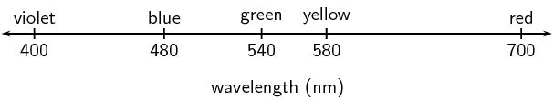
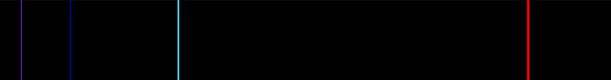
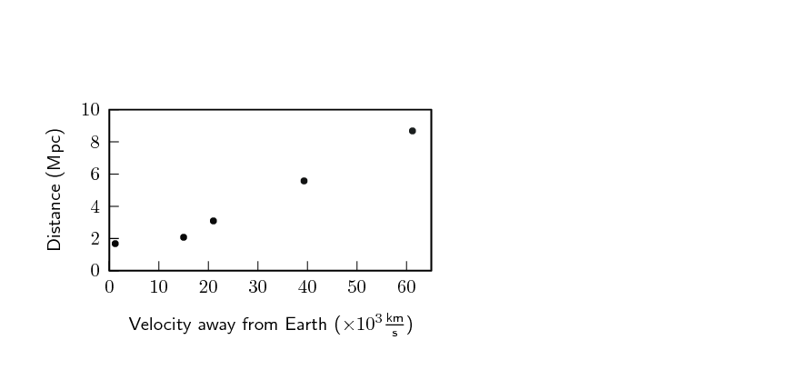

## 6.3 The Doppler effect with light (ESCMS)

Light is a wave and earlier you learnt how you can study the properties of one wave
                        and apply the same ideas to another wave. The same applies to sound and light.
                        We know the Doppler effect is relevant in the context of sound waves when the source is
                        moving. Therefore, in the context of light (EM waves), the frequency of observed light
                        should be different to the emitted frequency when the source of the light is moving
                        relative to the observer.

A frequency shift of light in the visible spectrum
                        could result in a change of colour which could be observable with the naked eye. There will
                        still be a frequency shift for frequencies of EM radiation we cannot see.

We can apply all the ideas that we learnt about the Doppler effect to light.
                        When talking about light we use slightly different terminology to describe what
                        happens. If you look at the colour spectrum (more details in Chapter
                        12) then you will see that blue
                        light has a shorter wavelength than red light. Since for light,
                        \(c=f\lambda\), shorter wavelength equals higher frequency.
                        Relative to the middle of the
                        visible spectrum (approximately green light) longer wavelengths (or lower frequencies) are
                        redder
                        and shorter wavelengths (or higher frequencies) are bluer. So we call shifts towards longer
                        wavelengths "redshifts" and shifts towards shorter wavelengths "blueshifts".

Blue light has a shorter wavelength than red light.

A shift in wavelength implies that there is also a shift in frequency. Longer wavelengths of light
                        have lower frequencies and shorter wavelengths have higher frequencies. From the Doppler effect
                        we know that when the source moves towards the observer any waves they emit that you measure are
                        shifted to shorter wavelengths (blueshifted). If the source moves away from the observer, the
                        shift is to longer wavelengths (redshifted).

<QuizCard id="s12-06-03a" title="Interactive Exercise 6.5" question="Adapted from WCED Metro Central Sep 2017 Grade 12, P1, Q1.6 Physical constants · Physics formulas Astronomers on Earth determine that the light from a distant star has been blue shifted. What can you conclude about the motion of the star as well as how the light from the star has changed due to its motion? The star is moving... A ... towards the Earth, and the light is observed to have a longer wavelength. B ... towards the Earth, and the light is observed to have a higher frequency. C ... away from the Earth, and the light is observed to have a higher energy. D ... towards the Earth, but not enough information has been provided to determine anything about how the light changes due to its motion." options=["A", "B", "C", "D"] answer="B" hint="" explanation="Think about the Doppler effect with light The Doppler effect (for light) is the change in frequency (or wavelength) of a light wave detected by an observer , because the light source and the observer have different velocities relative to the medium of light propagation. If the star is moving towards the Earth The wavefronts of the light waves are compressed closer to each other. So the perceived wavelength of the light waves decreases . So the perceived frequency of the light waves increases \(\left(f \propto \frac{1}{\lambda}\right)\) . So the perceived energy of the photons also increases \(\left(E \propto f\right)\) . And the light will become more blue (it will be blue shifted ). If the star is moving away from the Earth The wavefronts of the light waves are further apart from each other. So the perceived wavelength of the light waves increases . So the perceived frequency of the light waves decreases \(\left(f \propto \frac{1}{\lambda}\right)\) . So the perceived energy of the photons also decreases \(\left(E \propto f\right)\) . And the light will become more red (it will be red shifted ). No relative motion And if there is no relative motion between the star and the Earth? The astronomers will detect the same wavelength and frequency as the true values of the star. The astronomers will not detect any changes! We have been told that the light from the star has been blue shifted . Using the above information, we can conclude that the star is moving: A ... towards the Earth, and the light is observed to have a longer wavelength. B \({\color{red}{{\checkmark}{\checkmark}}}\) ... towards the Earth, and the light is observed to have a higher frequency. C ... away from the Earth, and the light is observed to have a higher energy. D ... towards the Earth, but not enough information has been provided to determine anything about how the light changes due to its motion. Option B is correct. Submit your answer as: B" />

<QuizCard id="s12-06-03a" title="Interactive Exercise 6.5" question="Adapted from DBE Feb-Mar 2017 Grade 12, P1, Q6.2 Physical constants · Physics formulas The spectral lines of a star are observed to be red shifted at an observatory on Earth. Explain the term red shifted in terms of frequency. How will the wavelength of the observed light from the star compare to its true value?" options=["away from", "towards", "greater than", "less than", "equal to", "greater than", "less than", "equal to"] answer="0, 1, 0" hint="" explanation="Explain red shift using frequency If light from the star has been red shifted , it means that the star is moving away from the Earth. The wavefronts of the light waves emitted by the star will be further apart and so the frequency of the light will be less than its true value. How is wavelength affected? Frequency and wavelength are inversely proportional to each other. So if the frequency is less than its true value, the wavelength of the observed light will be greater than its true value. Submit your answer as: away from and less than and greater than" />

### The expanding universe (ESCMT)

Stars emit light, which is why we can see them at night. Galaxies are huge
                                collections of stars. An example is our own Galaxy, the Milky Way, of which our sun
                                is only one of the billions of stars!

Using large telescopes like the Southern
                                African Large Telescope (SALT) in the Karoo, astronomers can measure the light
                                from distant galaxies. The spectrum of light can tell us what elements are in
                                the stars in the galaxies because each element has unique energy levels and therefore
                                emits or absorbs light at particular
                                wavelengths. These characteristic wavelengths are called spectral lines because
                                the lines show up as discrete frequencies in the spectrum of light from the star.

A subset of the spectral lines of hydrogen

If these lines are observed to be shifted
                                from their usual wavelengths to shorter wavelengths, then the light from the
                                galaxy is said to be *blueshifted*. If the
                                spectral lines are shifted to longer wavelengths, then the light from the galaxy
                                is said to be *redshifted*.
                                If we think of the blueshift and redshift in Doppler effect terms, then a
                                blueshifted galaxy would appear to be moving *towards*
                                us (the observers) and a redshifted galaxy would appear to be
                                moving *away* from us.

<Callout type="tip" title="Note">
1. If the light source is moving away from the observer (positive
                                        velocity) then the observed frequency is lower and the observed
                                        wavelength is greater (redshifted).

2. If the source is moving towards the observer (negative velocity), the observed
                                        frequency is higher and the wavelength is shorter (blueshifted).
</Callout>

Edwin Hubble (20 November 1889 - 28 September 1953) measured the Doppler shift of a large
                                sample of galaxies.
                                He found that the light from distant galaxies is *redshifted* and he
                                discovered that there is a proportionality relationship between the *redshift*
                                and the *distance* to the galaxy. Galaxies that are further away always
                                appear more redshifted than nearby galaxies. Remember that a redshift in Doppler terms
                                means a velocity of
                                the light source directed *away* from the observer. So why do all distant
                                galaxies
                                appear to be moving away from our Galaxy? None of them seem to be moving towards us.

Figure 6.3:
                                        The distance to galaxies plotted against their speed away from us. The distance
                                        Mpc is a megaparsec which is very big, 1 Mpc = 3.3 million light years. A light
                                        year is the distance that light can
                                        travel
                                        in one year,
                                        \(365~\text{days}\times 24~\text{hours} \times 60~\text{minutes} \times
                                        60~\text{s} \times 3\times 10^8 \text{m}\cdot \text{s}^{-1} = 9.5\times
                                        10^{15}~\text{m}\).

The reason is that the **universe is expanding!**
                                Some of the galaxies will be moving in our direction but more slowly than the
                                space between us and them is expanding. The expansion is so large that it is
                                the primary effect that we observe. The primary reason the light is redshifted isn't
                                actually because
                                all of the Doppler effect, it is redshifted because the space is expanding,
                                the waves are being stretched out. If the Doppler effect were a larger effect then some
                                of the galaxies would still be blueshifted (just less than if space were not expanding).

<Callout type="note" title="Note">
You might think that this means we are at the centre of the universe. This isn't
                                        correct, the situation will look the same from every galaxy because space is
                                        expanding in all directions.
</Callout>

<Callout type="note" title="Note">
Hubble's Law is:

                                \[\boxed{v = H_0\times d}\]

where latest value of \(H_0\) is \(\text{67,15}\) \(\text{km.s$^{-1}$.Mpc$^{-1}$}\)
                                        (rate of expansion of the Universe). Latest value from Planck mission, 2013.
</Callout>

There are two things you can do to help you visualise this a little better.
                                One thing to try is to get a balloon and draw some dots on it with a marker. As
                                you blow the balloon up all the dots get further away from all the other dots.
                                The dots represent galaxies in a two-dimensional, expanding universe (the balloon
                                surface). Another thing to imagine is baking raisin bread. As the bread rises,
                                the distance between all the raisins gets larger. Every raisin thinks that all
                                the other raisins are moving away from it.

In this picture the bottom vertex represents the beginning of time, the flat surface
                                represents space. As you move up through the panels you are moving later in time and the
                                expansion of the the flat surface shows the expansion of the universe. The galaxies
                                shown on the surface get further away from each other just because of the expansion
                                of space.

<Callout type="note" title="Note">
<VideoPlayer src="https://www.youtube.com/watch?v=8FPVIV-LzYM" title="Video: 27SZ" />
</Callout>

<Callout type="tip" title="Note">
Cool exercise that can be done with Sloan Digital Sky Survey data:
                                        [Sloan
                                                Digital Sky Survey](http://skyserver.sdss3.org/dr8/en/proj/basic/universe_original/simple.asp)
</Callout>
