## 7.2 Rates of reaction and factors affecting rate (ESCMX)

Firstly, let's think about some different types of reactions and how quickly or slowly they occur.

## Thinking about reaction rates

### Textbook Exercise
                                        7.1

Think about each of the following reactions:

(Hint: look at your Grade 11 textbook for a reminder on these
                                                        processes)

- corrosion (e.g. the rusting of iron)
- photosynthesis
- weathering of rocks (e.g. limestone rocks being worn away by
                                                                  water)
- combustion (e.g. propane burning in \(\text{O}_{2}\))

**Problem:**
For each of the reactions above, write a balanced chemical
                                                                equation for the reaction that takes place.

**Solution:**
- Choosing iron as an example of a metal that
                                                                                  rusts:
  \(4\text{Fe}(\text{s}) +
                                                                                  3\text{O}_{2}(\text{g})\) \(\to\)
                                                                                  \(2\text{Fe}_{2}\text{O}_{3}(\text{s})\)
- Photosynthesis:
  \(6\text{CO}_{2}(\text{g}) +
                                                                                  6\text{H}_{2}\text{O}(ℓ)\)
                                                                                  \(\to\)
                                                                                  \(\text{C}_{6}\text{H}_{12}\text{O}_{6}(\text{s})
                                                                                  + 6\text{O}_{2}(\text{g})\)
- For weathering of rocks we will use limestone
                                                                                  (calcium carbonate) as an example:
  \(\text{CaCO}_{3}(\text{s}) +
                                                                                  \text{CO}_{2}(\text{g}) +
                                                                                  2\text{H}_{2}\text{O}(ℓ)\)
                                                                                  \(\to\) \(\text{Ca}^{2+}(\text{aq}) +
                                                                                  2\text{HCO}_{3}^{-}(\text{aq})\)
- Combustion (e.g. of carbon):
  \(\text{C}(\text{s}) +
                                                                                  \text{O}_{2}(\text{g})\) \(\to\)
                                                                                  \(\text{CO}_{2}(\text{g})\)

**Problem:**
Rank these reactions in order from the fastest to the
                                                                slowest.

**Solution:**
Combustion is the fastest and weathering is the slowest. The
                                                                order of reactivity from fastest to slowest is:
                                                                combustion, photosynthesis, rusting, weathering.

**Problem:**
How did you decide which reaction was the fastest and which
                                                                was the slowest?

**Solution:**
Answers could include mention of the fact that coal and paper
                                                                burn fast, whereas rocks do not disappear overnight.
                                                                Also plants use photosynthesis to make food and this
                                                                process has to happen relatively fast but not too fast.

**Problem:**
Think of some other examples of chemical reactions. How fast
                                                                or slow is each of these reactions, compared with those
                                                                listed earlier?

**Solution:**
- Decomposition of hydrogen peroxide,
                                                                                  relatively fast
- Synthesis of water, very fast
- Any other reasonable answers

This video is a simple demonstration of how a change in **surface area** can affect the
                        average rate of a reaction.

<Callout type="note" title="Note">
<VideoPlayer src="http://www.youtube.com/embed/pNAf5s-C414" title="Video: 27TB" />
</Callout>

You can see how quickly the fuel burns when spread over the table. Think about how much more fuel
                        would be needed to cook a meal if you had it spread over a large surface area rather than kept
                        in a container with a small surface area.

### What is a reaction rate? (ESCMY)

In a chemical reaction, the substances that are undergoing the reaction are called the
                                **reactants**, while the substances that form as a result of the reaction
                                are called the **products**. The **reaction rate** describes
                                how quickly or slowly the reaction takes place. So how do we know whether a reaction is
                                slow or fast? One way of knowing is to look either at how quickly the *reactants are
                                        used* during the reaction or at how quickly the *products form*. For
                                example, iron and sulfur react according to the following equation:

\[\text{Fe}(\text{s}) + \text{S}(\text{s}) \rightarrow \text{FeS}(\text{s})\]

In this reaction, we can observe the speed of the reaction by measuring how long it takes
                                before there is no iron or sulfur left in the reaction vessel. In other words, the
                                reactants have been used. Alternatively, one could see how quickly the iron sulfide (the
                                product) forms. Since iron sulfide looks very different from either of its reactants,
                                this is easy to do.

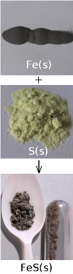

In another example:

\[2\text{Mg}(\text{s}) + \text{O}_2(\text{g}) \rightarrow 2\text{MgO}(\text{s})\]

In this case, the reaction rate depends on the speed at which the reactants (oxygen gas and
                                solid magnesium) are used, or the speed at which the product (magnesium oxide) is
                                formed.

Reaction rate

The average rate of a reaction describes how quickly *reactants are
                                                        used* or how quickly *products are formed* during a
                                                chemical reaction.

The average rate of a reaction is expressed as the number of moles of reactant used, divided
                                by the total reaction time, or as the number of moles of product formed, divided by the
                                total reaction time.

Average reaction rate for:

- the use of a reactant = \(\dfrac{
                                                  \text{moles reactant used}}{\text{reaction time (s)}}\)
- the formation of a product = \(\dfrac{
                                                  \text{moles product formed}}{\text{reaction time (s)}}\)

Using the magnesium reaction shown earlier:

- Average reaction rate of \(\text{Mg}\) being used = \(\dfrac{
                                                  \text{moles Mg used}}
                                                  {\text{reaction time (s)}}\)
- Average reaction rate of \(\text{O}_2\) being used = \(\dfrac{
                                                  \text{moles O}_2\text{ used}}{\text{reaction time (s)}}\)
- Average reaction rate of \(\text{MgO}\) being formed = \(\dfrac{
                                                  \text{moles MgO formed}}{\text{reaction time (s)}}\)

<Callout type="tip" title="Worked example 1: Reaction rates">
**Question:**
The following reaction takes place:

\[4\text{Li}(\text{s}) + \text{O}_{2}(\text{g}) \to
                                                2\text{Li}_{2}\text{O}(\text{s})\]

After two minutes, \(\text{4}\) \(\text{g}\) of lithium has been used.
                                                Calculate the rate of the reaction.

**Calculate the number of moles of lithium that are used in the
                                                reaction:**
\begin{align*}
                                        \text{n} &= \dfrac{\text{m}}{\text{M}} \\
                                        &=\dfrac{\text{4}\text{ g}}{\text{6,94}\text{g·mol$^{-1}$}} \\
                                        &= \text{0,58} \text{ mol}
                                        \end{align*}

**Calculate the time (in seconds) for the reaction:**
t = \(\text{2}\) \(\text{minutes}\) = \(\text{2}\) \(\times\) \(\text{60}\)
                                                \(\text{s}\) = \(\text{120}\) \(\text{seconds}\)

**Calculate the rate of the reaction:**
Rate of reaction of \(\text{Li}\) used \(= \dfrac{
                                                \text{moles of lithium used}}{\text{time}}\)

\(\phantom{\rule{73.pt}{0ex}} = \dfrac{\text{0,58}\text{
                                                mol}}{\text{120}\text{ s}}\)

\(\phantom{\rule{73.pt}{0ex}} =\) \(\text{0,005}\)
                                                \(\text{mol·s$^{-1}$}\)

The rate of the reaction is \(\text{0,005}\) \(\text{mol·s$^{-1}$}\)
</Callout>

## Reaction rates

### Textbook Exercise 7.2

A number of different reactions take place. The table below
                                                                shows the number of moles of reactant that are used in a
                                                                particular time for each reaction.

| Reaction | Reactants used (mol) | Time (s) | Reaction rate (\(\text{mol·s$^{-1}$}\)) |
| --- | --- | --- | --- |
| \(\text{1}\) | \(\text{2}\) | \(\text{30}\) |  |
| \(\text{2}\) | \(\text{5}\) | \(\text{120}\) |  |
| \(\text{3}\) | \(\text{1}\) | \(\text{90}\) |  |
| \(\text{4}\) | \(\text{3,2}\) | \(\text{90}\) |  |
| \(\text{5}\) | \(\text{5,9}\) | \(\text{30}\) |  |

**Problem:**
Complete the table by calculating the average rate of
                                                                        each reaction.

**Solution:**
The reaction rate is the number of moles used up
                                                                        divided by the time in seconds.

| Reaction | Reactants used
                                                                                                (mol) | Time (s) | Reaction
                                                                                                        rate (\(\text{mol·s$^{-1}$}\)) |
| --- | --- | --- | --- |
| \(\text{1}\) | \(\text{2}\) | \(\text{30}\) | \(\text{0,067}\) |
| \(\text{2}\) | \(\text{5}\) | \(\text{120}\) | \(\text{0,042}\) |
| \(\text{3}\) | \(\text{1}\) | \(\text{90}\) | \(\text{0,011}\) |
| \(\text{4}\) | \(\text{3,2}\) | \(\text{90}\) | \(\text{0,036}\) |
| \(\text{5}\) | \(\text{5,9}\) | \(\text{30}\) | \(\text{0,2}\) |

**Problem:**
Which is the *fastest* reaction?

**Solution:**
The fastest reaction is reaction \(\text{5}\)

**Problem:**
Which is the *slowest* reaction?

**Solution:**
The slowest reaction is reaction \(\text{3}\)

Iron reacts with oxygen as shown in the balanced reaction:

\[2\text{Fe}(\text{s}) + \text{O}_{2}(\text{g})
                                                                \rightarrow 2\text{FeO}(\text{s})\]

\(\text{2}\) \(\text{g}\) of \(\text{Fe}\) and
                                                                \(\text{0,57}\) \(\text{g}\) of \(\text{O}_{2}\) are
                                                                used during the reaction. \(\text{2,6}\) \(\text{g}\) of
                                                                \(\text{FeO}\) is produced. The reaction takes
                                                                \(\text{30}\) \(\text{minutes}\) to go to completion.

Calculate the average rate of reaction for:

**Problem:**
the use of \(\text{Fe}\).

**Solution:**
\(\text{n} = \dfrac{\text{m}}{\text{M}}\)

M(\(\text{Fe}\)) = \(\text{55,8}\)
                                                                        \(\text{g·mol$^{-1}$}\)

\(\text{n} = \dfrac{\text{2}\text{
                                                                        g}}{\text{55,8}\text{ g·mol$^{-1}$}}=\)
                                                                        \(\text{0,0358}\) \(\text{mol}\)

Rate of reaction is number of moles \(\text{Fe}\)
                                                                        used up per second.

time = \(\text{30}\) \(\text{minutes}\) \(\times
                                                                        \dfrac{\text{60} \text{ s}}{\text{1} {\text{
                                                                        minute}}}\) = \(\text{1 800}\) \(\text{s}\)

Average rate of reaction for \(\text{Fe}\) =
                                                                        \(\dfrac{\text{0,0358}\text{
                                                                        mol}}{\text{1 800}\text{ s}}=\text{1,99}
                                                                        \times \text{10}^{-\text{5}}\text{
                                                                        mol·s$^{-1}$}\)

**Problem:**
the use of \(\text{O}_{2}\).

**Solution:**
\(\text{n}=\dfrac{\text{m}}{\text{M}}\)

M(\(\text{O}_{2}\)) = \(\text{16}\text{
                                                                        g·mol$^{-1}$}\times 2\) = \(\text{32}\)
                                                                        \(\text{g·mol$^{-1}$}\)

\(\text{n} = \dfrac{\text{0,57}\text{
                                                                        g}}{\text{32}\text{ g·mol$^{-1}$}}=\)
                                                                        \(\text{0,0178}\) \(\text{mol}\)

Rate of reaction is number of moles \(\text{O}_{2}\)
                                                                        used up per second.

Average rate of reaction for \(\text{O}_{2}\) =
                                                                        \(\dfrac{\text{0,0178}\text{
                                                                        mol}}{\text{1 800}\text{ s}}=\text{9,89}
                                                                        \times \text{10}^{-\text{6}}\text{
                                                                        mol·s$^{-1}$}\)

**Problem:**
the formation of \(\text{FeO}\).

**Solution:**
\(\text{n} = \dfrac{\text{m}}{\text{M}}\)

M(\(\text{FeO}\)) = \(\text{55,8}\)
                                                                        \(\text{g·mol$^{-1}$}\) + \(\text{16}\)
                                                                        \(\text{g·mol$^{-1}$}\) = \(\text{71,8}\)
                                                                        \(\text{g·mol$^{-1}$}\)

\(\text{n} = \dfrac{\text{2,6}\text{
                                                                        g}}{\text{71,8}\text{ g·mol$^{-1}$}}=\)
                                                                        \(\text{0,0362}\) \(\text{mol}\)

Rate of reaction is number of moles \(\text{FeO}\)
                                                                        produced per second.

Average rate of reaction for \(\text{FeO}\) =
                                                                        \(\dfrac{\text{0,0362}\text{
                                                                        mol}}{\text{1 800}\text{ s}}=\text{2,01}
                                                                        \times \text{10}^{-\text{5}}\text{
                                                                        mol·s$^{-1}$}\)

Note that the rates of the individual reactions
                                                                        follow the stoichiometric rates ratios in the
                                                                        balanced equation:

\(\text{1,99} \times
                                                                        \text{10}^{-\text{5}}:\text{9,89} \times
                                                                        \text{10}^{-\text{6}}:\text{2,01} \times
                                                                        \text{10}^{-\text{5}}\) is \(2:1:2\)

Two reactions occur simultaneously in separate reaction
                                                                vessels. The reactions are as follows:

\(\text{Mg}(\text{s}) + \text{Cl}_{2}(\text{g})\) \(\to\)
                                                                \(\text{MgCl}_{2}(\text{s})\)

\(2\text{Na}(\text{s}) + \text{Cl}_{2}(\text{g})\) \(\to\)
                                                                \(2\text{NaCl}(\text{s})\)

After \(\text{1}\) \(\text{minute}\), \(\text{2}\)
                                                                \(\text{g}\) of \(\text{MgCl}_{2}\) has been produced in
                                                                the first reaction.

**Problem:**
How many moles of \(\text{MgCl}_{2}\) are produced
                                                                        after \(\text{1}\) \(\text{minute}\)?

**Solution:**
\(\text{n} = \dfrac{\text{m}}{\text{M}}\)

M(\(\text{MgCl}_{2}\)) = \(\text{24,3}\)
                                                                        \(\text{g·mol$^{-1}$}\) + \(\text{2}\) x
                                                                        \(\text{35,45}\) \(\text{g·mol$^{-1}$}\) =
                                                                        \(\text{95,2}\) \(\text{g·mol$^{-1}$}\)

\(\text{n} = \dfrac{\text{2}\text{
                                                                        g}}{\text{95,2}\text{ g·mol$^{-1}$}}\) =
                                                                        \(\text{0,021}\) \(\text{mol}\)

**Problem:**
Calculate the average rate of the reaction, using the
                                                                        amount of product that is produced.

**Solution:**
time = \(\text{1}\) \(\text{minute}\) \(\times
                                                                        \dfrac{\text{60} {\text{ s}}}{\text{1}
                                                                        {\text{minute}}}\) = \(\text{60}\) \(\text{s}\)

Average rate = \(\dfrac{
                                                                        \text{moles product}}{\text{time (s)}} =
                                                                        \dfrac{\text{0,021}\text{ mol}}{\text{60}\text{
                                                                        s}}\) = \(\text{3,5} \times
                                                                        \text{10}^{-\text{4}}\)
                                                                        \(\text{mol·s$^{-1}$}\)

Assuming that the second reaction also proceeds at
                                                                        the same rate, calculate:

**Problem:**
the number of moles of \(\text{NaCl}\)
                                                                                produced after \(\text{1}\)
                                                                                \(\text{minute}\).

**Solution:**
n = rate \(\times\) time = \(\text{3,5}
                                                                                \times \text{10}^{-\text{4}}\)
                                                                                \(\text{mol·s$^{-1}$}\) \(\times\)
                                                                                \(\text{60}\) \(\text{s}\) =
                                                                                \(\text{0,021}\) \(\text{mol}\)

**Problem:**
the minimum mass (in g) of sodium that is
                                                                                needed for this reaction to take place
                                                                                for \(\text{1}\) \(\text{min}\).

**Solution:**
For every \(\text{2}\) moles of
                                                                                \(\text{NaCl}\) produced \(\text{2}\)
                                                                                moles of \(\text{Na}\) is required.

n(\(\text{Na}\)) required = \(\text{0,021}\)
                                                                                \(\text{mol}\)

M(\(\text{Na}\)) = \(\text{23,0}\)
                                                                                \(\text{g·mol$^{-1}$}\)

m = n \(\times\) M = \(\text{0,021}\)
                                                                                \(\text{mol}\) \(\times\)
                                                                                \(\text{23,0}\)
                                                                                \(\text{g·mol$^{-1}$}\)
                                                                                = \(\text{0,48}\) \(\text{g}\)

### Reaction rates and collision theory (ESCMZ)

It should be clear now that the average rate of a reaction varies depending on a number of
                                factors. But how can we explain why reactions take place at different speeds under
                                different conditions? **Collision theory** is used to explain the rate of a
                                reaction.

For a reaction to occur, the particles that are reacting must collide with one another. Only
                                a fraction of all the collisions that take place actually cause a chemical change. These
                                are called *successful* or *effective* collisions.

Collision theory

Reactant particles must collide with the correct energy and orientation for
                                                the reactants to change into products.

Collision theory explains how chemical reactions occur and why reaction rates differ for
                                different reactions. It states that for a reaction to occur the reactant particles must:

- collide
- have enough energy
- have the right orientation at the moment of impact

These *successful collisions* are necessary to break the existing bonds (in the
                                reactants) and form new bonds (in the products).

## Collision Theory

### Aim

To determine the best way to approach your friend, in order to link your
                                                **right** arm with their **left** arm.

### Method

Try different ways of approaching your friend:

- back to back
  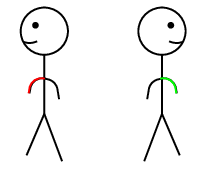
- front to back
  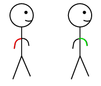
- side to front
  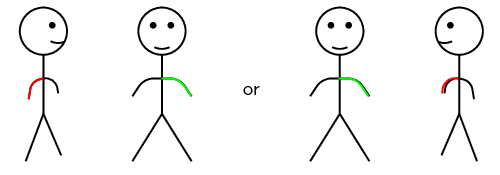
- side to side
  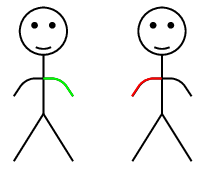
- front to front
  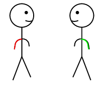
- etc

### Results

Determine how hard it is to link arms in each of these positions.

### Discussion

If you approach your friend from behind (facing their back) it is hard to
                                                link arms. Approaching from their left (sideways so that your right side
                                                is on their left), it is easy to link up.

### Conclusion

You should have found that each method had a different level of difficulty
                                                for linking arms. This is similar to how molecules (compounds) approach
                                                in a reaction. The different ways you approached your friend represent
                                                the different orientations of the molecules. The correct orientation
                                                makes successful collisions possible.

### Factors affecting reaction rates (ESCN2)

Several factors affect the average rate of a reaction. It is important to know these factors
                                so that reaction rates can be controlled. This is particularly important when it comes
                                to industrial reactions, where greater productivity leads to greater profits for
                                companies. The following are some of the factors that affect the average rate of a
                                reaction.

#### Nature of reactants

Substances have different chemical properties and therefore react differently, and at
                                        different rates (e.g. the rusting of iron vs. the tarnishing of silver).

<Callout type="note" title="Note">
<VideoPlayer src="http://www.youtube.com/embed/qDsD0neTXIc" title="Video: 27TG" />
</Callout>

<Callout type="note" title="Note">
Oxalic acid is abundant in many plants. The leaves of the tea plant
                                                (*Camellia sinensis*) contain very high concentrations of oxalic
                                                acid relative to other plants. Oxalic acid also occurs in small amounts
                                                in foods such as parsley, chocolate, nuts and berries. Oxalic acid
                                                irritates the lining of the gut when it is eaten, and can be fatal in
                                                very large doses.

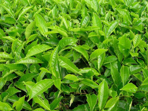
</Callout>

In the nature of reactants, surface area and concentration experiments
                                                learners are required to work with concentrated, strong acids. These
                                                acids can cause serious burns. Please remind the learners to be careful
                                                and wear the appropriate safety equipment when handling all chemicals,
                                                especially concentrated acids. The safety equipment includes gloves,
                                                safety glasses and protective clothing.

## The nature of reactants

### Aim

To determine the effect of the nature of reactants on the average
                                                        rate of a reaction.

### Apparatus

You will need the following items for this experiment:

- Oxalic acid \(((\text{COOH})_{2})\), iron(II) sulfate
                                                                          \((\text{FeSO}_{4})\), potassium permanganate
                                                                          \((\text{KMnO}_{4})\) and concentrated sulfuric
                                                                          acid \((\text{H}_{2}\text{SO}_{4})\)
- a spatula, two test tubes, a medicine dropper, a
                                                                          glass beaker and a glass rod.

### Method

<Callout type="warning" title="Note">
Concentrated \(\text{H}_{2}\text{SO}_{4}\) can cause serious
                                                                burns. We suggest using gloves and safety glasses
                                                                whenever you work with an acid. Remember to add the acid
                                                                to the water and to avoid sniffing the acid. Handle all
                                                                chemicals with care.
</Callout>

2. Label one test tube **\(\text{1}\)**.
                                                                           Prepare an iron(II) sulfate solution in test
                                                                           tube \(\text{1}\) by dissolving two spatula tips
                                                                           of iron(II) sulfate in \(\text{10}\)
                                                                           \(\text{cm$^{3}$}\) of water.
   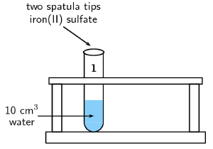
4. Label the other test tube
                                                                           **\(\text{2}\)**. Prepare a
                                                                           solution of oxalic acid in test tube
                                                                           \(\text{2}\) in the same way.
   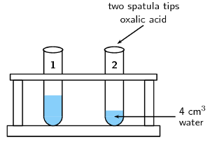
6. Prepare a separate solution of sulfuric acid by
                                                                           adding \(\text{2}\) \(\text{cm$^{3}$}\) of the
                                                                           concentrated acid to \(\text{10}\)
                                                                           \(\text{cm$^{3}$}\) of water. Remember always to
                                                                           add the **acid to the water**, and
                                                                           never the other way around.
   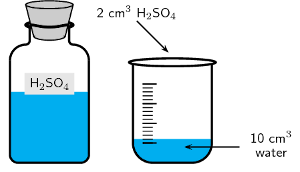
8. Add \(\text{2}\) \(\text{cm$^{3}$}\) of the sulfuric
                                                                           acid solution to the iron(II) sulfate and oxalic
                                                                           acid solutions respectively.
   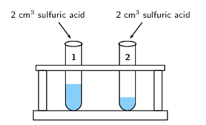
10. Using the medicine dropper, add a few drops of
                                                                           potassium permanganate to the two test tubes.
                                                                           Observe how quickly the potassium permanganate
                                                                           solution discolours in each solution.
   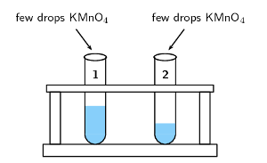

### Results

- You should have seen that the the potassium
                                                                          permanganate discolours in the oxalic acid
                                                                          solution much more slowly than in the iron(II)
                                                                          sulfate solution.
  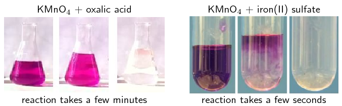
  These reactions can be seen in the following videos:
  <Callout type="note" title="Note">
  <VideoPlayer src="http://www.youtube.com/embed/HkGmIXB1ijE" title="Video:
                                                                                          27TH" />
  </Callout>
  <Callout type="note" title="Note">
  <VideoPlayer src="http://www.youtube.com/embed/_nTH04f5sVY" title="Video:
                                                                                          27TJ" />
  </Callout>
- It is the oxalate ions
                                                                          \((\text{C}_{2}\text{O}_{4}^{2-})\) and the
                                                                          \(\text{Fe}^{2+}\) ions that cause the
                                                                          discolouration. It is clear that the
                                                                          \(\text{Fe}^{2+}\)ions react much more quickly
                                                                          with the permanganate than the
                                                                          \((\text{C}_{2}\text{O}_{4}^{2-})\) ions. The
                                                                          reason for this is that there are no covalent
                                                                          bonds to be broken in the iron ions before the
                                                                          reaction can take place. In the case of the
                                                                          oxalate ions, covalent bonds between carbon and
                                                                          oxygen atoms must be broken first.

### Conclusions

Despite the fact that both these reactants (oxalic acid and iron(II)
                                                        sulfate) are in aqueous solutions, with similar concentrations
                                                        and at the same temperature, the reaction rates are very
                                                        different. This is because the nature of the reactants can
                                                        affect the average rate of a reaction.

The nature of the iron(II) sulfate in solution (iron ions, ready to
                                                        react) is very different to the nature of oxalic acid in
                                                        solution (oxalate ions with covalent bonds that must be broken).
                                                        This results in significantly different reaction rates.

<Callout type="note" title="Note">
The \(\text{KMnO}_{4}\) with oxalic acid and iron(II) sulfate pictures are
                                                screenshots from videos by katalofuromai and Aaron Huggard on Youtube.
</Callout>

#### Surface area (of solid reactants)

## Surface area and reaction rate

Marble \((\text{CaCO}_{3})\) reacts with hydrochloric acid \((\text{HCl})\)
                                                to form calcium chloride, water and carbon dioxide gas according to the
                                                following equation:

\(\text{CaCO}_{3}(\text{s}) + 2\text{HCl}(ℓ)\) \(\to\)
                                                \(\text{CaCl}_{2}(\text{s}) + \text{H}_{2}\text{O}(ℓ) +
                                                \text{CO}_{2}(\text{g})\)

### Aim

To determine the effect of the surface area of reactants on the
                                                        average rate of the reaction.

### Apparatus

- \(\text{2}\) \(\text{g}\) marble chips, \(\text{2}\)
                                                                          \(\text{g}\) powdered marble, concentrated
                                                                          hydrochloric acid (\(\text{HCl}\))
- one beaker, two test tubes.

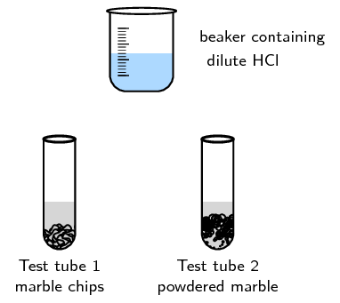

### Method

<Callout type="warning" title="Note">
Concentrated \(\text{HCl}\) can cause serious burns. We
                                                                suggest using gloves and safety glasses whenever you
                                                                work with an acid. Remember to add the acid to the water
                                                                and handle with care.
</Callout>

2. Prepare a solution of hydrochloric acid in the beaker
                                                                           by adding \(\text{2}\) \(\text{cm$^{3}$}\) of
                                                                           the concentrated acid to \(\text{20}\)
                                                                           \(\text{cm$^{3}$}\) of water.
4. Place the marble chips into one test tube and the
                                                                           powdered marble into a separate test tube.
6. Add \(\text{10}\) \(\text{cm$^{3}$}\) of the dilute
                                                                           hydrochloric acid to each of the test tubes and
                                                                           observe the rate at which carbon dioxide gas
                                                                           (\(\text{CO}_{2}\)) is produced (you should see
                                                                           bubbles of \(\text{CO}_{2}\)).

### Results

Note (write down) what you observe.

### Questions and discussion

- Which reaction proceeds faster?
- Can you explain this?

### Conclusion

The reaction with powdered marble is faster. The smaller the pieces
                                                        of marble are (in this case the powdered form is smallest), the
                                                        greater the surface area for the reaction to take place.

Only the molecules at the surface of the solid can react with the
                                                        hydrochloric acid. The next layer of molecules can only react
                                                        once the surface molecules have reacted. That is, the next layer
                                                        of molecules becomes the surface.

The chips of marble are relatively large, so only a small percentage
                                                        of the molecules are at the surface and can react initially. The
                                                        powdered marble has much smaller solid pieces, so there are many
                                                        more surface molecules exposed to the hydrochloric acid. The
                                                        more molecules exposed on the surface (the greater the surface
                                                        area) the faster the reaction will be.

For the same amount of mass, smaller pieces of solid react faster as
                                                        shown in Figure 7.2.

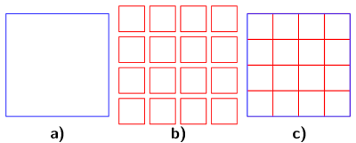

Figure 7.2: **a)** A large particle,
                                                                        **b)** small particles with the
                                                                        same volume as the large
                                                                        particle, **c)** The surface area
                                                                        of
                                                                        large
                                                                        particles (shown in blue) is much smaller than
                                                                        that of small particles (shown in red).

<Callout type="note" title="Note">
<VideoPlayer src="http://www.youtube.com/embed/FBF7auCMy58" title="Video: 27TK" />
</Callout>

Calcium carbonate reacts with hydrochloric acid according to the following reaction:

\(\text{CaCO}_{3}(\text{s}) + 2\text{HCl}(\text{aq})\) \(\to\)
                                        \(\text{CaCl}_{2}(\text{aq}) + \text{H}_{2}\text{O}(ℓ) +
                                        \text{CO}_{2}(\text{g})\)

Consider the solid calcium carbonate.

If we react \(\text{1}\) \(\text{g}\) of \(\text{CaCO}_{3}\) we find that the
                                        reaction is faster if the \(\text{CaCO}_{3}\) is powdered when compared with the
                                        \(\text{CaCO}_{3}\) being large lumps.

**Explanation:**

The large lump of \(\text{CaCO}_{3}\) has a small surface area relative to the same
                                        mass of powdered \(\text{CaCO}_{3}\). This means that more particles of
                                        \(\text{CaCO}_{3}\) will be in contact with \(\text{HCl}\) in the powdered
                                        \(\text{CaCO}_{3}\) than in the lumps. As a result, there can be more
                                        *successful* collisions per unit time and the reaction of powdered
                                        \(\text{CaCO}_{3}\) is faster.

\(\color{red}{\textbf{Increasing the surface area of the reactants increases the rate
                                        of the reaction.}}\)

The following video shows the effect of surface area on the time an effervescent
                                        tablet takes to fully dissolve. The tablet is fully dissolved once the bubbles
                                        (\(\text{CO}_{2}\) gas) stop forming.

<Callout type="note" title="Note">
<VideoPlayer src="http://www.youtube.com/embed/YFapSO1gdT8" title="Video: 27TM" />
</Callout>

#### Concentration (of solutions)

<Callout type="note" title="Note">
Surface area, concentration and pressure all have the same effect on reaction
                                                rate (an increase leads to a faster reaction rate). This is because in
                                                each case an increase in the property leads to an increase in the number
                                                of collisions in that phase of matter.
</Callout>

As the concentration of the reactants increases, so does the reaction rate.

<Callout type="note" title="Note">
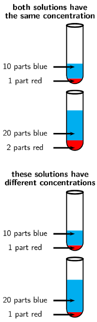
</Callout>

## Concentration and reaction rate

### Aim

To determine the effect of reactant concentration on reaction rate.

### Apparatus

- Concentrated hydrochloric acid \((\text{HCl})\),
                                                                          magnesium ribbon
- Two beakers, two test tubes and a measuring cylinder.

### Method

<Callout type="warning" title="Note">
Do not get hydrochloric acid (\(\text{HCl}\)) on your hands.
                                                                We suggest you use gloves and safety glasses whenever
                                                                handling acids and handle with care.
</Callout>

2. When diluting a solution remember that if you want a
                                                                           1:10 solution (1 part original solution in 10
                                                                           parts water) measure \(\text{10}\)
                                                                           \(\text{cm$^{3}$}\) of water in a measuring
                                                                           cylinder and pour it into a beaker, then add
                                                                           \(\text{1}\) \(\text{cm$^{3}$}\) of the original
                                                                           solution to the beaker as well. \(\text{2}\)
                                                                           parts concentrated acid to \(\text{20}\) parts
                                                                           water will also be a 1:10 solution. Remember to
                                                                           always add the *acid* to the
                                                                           *water*, and not the other way around.
   - Prepare a solution of 1 part acid to
                                                                                             10 parts water (1:10). Label a
                                                                                             test tube
                                                                                             ***A*** and
                                                                                             pour \(\text{10}\)
                                                                                             \(\text{cm$^{3}$}\) of this
                                                                                             solution into the test tube.
   - Prepare a solution of 1 part acid to
                                                                                             20 parts water (1:20). Label a
                                                                                             test tube
                                                                                             ***B*** and
                                                                                             pour \(\text{10}\)
                                                                                             \(\text{cm$^{3}$}\) of this
                                                                                             solution into the test tube.
4. Take two pieces of magnesium ribbon of the
                                                                           **same length**. At the same time,
                                                                           put one piece of magnesium ribbon into test tube
                                                                           A and the other into test tube B, and pay close
                                                                           attention to what happens.
   **Make sure that the magnesium ribbon is long
                                                                                   enough so that your hand is not close to
                                                                                   the \(\text{HCl}\).**

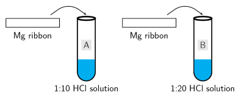

The equation for the reaction is:

\[2\text{HCl}(ℓ) + \text{Mg}(\text{s}) \to
                                                        \text{MgCl}_{2}(\text{s}) + \text{H}_{2}(\text{g})\]

### Results

Write down what happened (what did you observe?) in each test tube.

### Questions and discussion

- Which of the two solutions is more concentrated, the
                                                                          \(\text{1}\):\(\text{10}\) or
                                                                          \(\text{1}\):\(\text{20}\) hydrochloric acid
                                                                          solution?
- In which of the test tubes is the reaction faster?
                                                                          Suggest a reason for this.
- How can you measure the average rate of this
                                                                          reaction?
- Name the gas that is produced?
- Why is it important that the same length of magnesium
                                                                          ribbon is used for each reaction?

### Conclusions

The \(\text{1}\):\(\text{10}\) solution is more concentrated and
                                                        therefore this reaction proceeds faster. The greater the
                                                        concentration of the reactants, the faster the average rate of
                                                        the reaction. The average rate of the reaction can be measured
                                                        by the rate at which the magnesium ribbon disappears.

<Callout type="note" title="Note">
<VideoPlayer src="http://www.youtube.com/embed/afxwDTz_JTk" title="Video: 27TN" />
</Callout>

**Explanation:**

The greater concentration of the reactant means that there are more particles of
                                        reactant (\(\text{HCl}\)) per unit volume of solution. Therefore the chance that
                                        \(\text{HCl}\) particles will collide with the \(\text{Mg}\) particles will be
                                        higher for the solution with the greater concentration. The number of successful
                                        collisions per unit time will be higher and so the rate of the reaction will be
                                        faster.

<Callout type="note" title="Note">
<VideoPlayer src="http://www.youtube.com/embed/kjKyEdrVXJA" title="Video: 27TP" />
</Callout>

In this project the learners should design their own experiment in the
                                                following format:

- Aim
- Apparatus
- Method

They can also perform the experiment and write up results and conclusions as
                                                well.

This experiment should focus on the effect of **concentration**
                                                on the rate. The easiest way to do this is to vary the concentration of
                                                the vinegar and keep the mass of baking soda constant.

## Concentration and rate

Design an experiment to determine the effect of concentration on rate using
                                                vinegar and baking soda.

**Hint:** mix water and vinegar to change concentration but keep
                                                the total volume constant.

#### Pressure (of gaseous reactants)

As the pressure of the reactants increase, so does the reaction rate.

The higher the pressure, the more particles of gas per unit volume. Therefore there
                                        are more collisions per unit time. The number of successful collisions per unit
                                        time will be higher and so the rate of the reaction will be faster.

<Callout type="note" title="Note">
<VideoPlayer src="http://www.youtube.com/embed/Val4Vo3fVFY" title="Video: 27TQ" />
</Callout>

#### Temperature

If the temperature of the reaction increases, so does the average rate of the
                                        reaction.

In the temperature and reaction rate experiment make sure the learners do not
                                                shake the test tubes. Shaking gives energy to the reaction and affects
                                                the rate. The test tubes should be left as still as possible once the
                                                effervescent tablets have been added.

Plastic bottles, such as those shown in the picture, can be used instead of
                                                test tubes.

## Temperature and reaction rate

### Aim

To determine the effect of temperature on reaction rate.

### Apparatus

- Two effervescent tablets (e.g. Cal-C-Vita)
- An ice-bath, two test tubes
- Two balloons, two rubber bands

### Method

2. Half fill two large test tubes with water. Label them
                                                                           *A* and *B*.
4. Break two effervescent tablets in two or three pieces
                                                                           and place them in the two balloons.
   Fit one of these balloons tightly to test tube A and
                                                                           one to test tube B, being careful not to drop
                                                                           the contents into the water. You can stand the
                                                                           test tube in a beaker to help you do this.
6. Place *only* test tube A into an ice-bath and
                                                                           leave to equilibrate (come to the same
                                                                           temperature). Approximately 10 minutes should be
                                                                           enough.
8. At the same time lift the balloons on test tubes A
                                                                           and B so that the tablets go into the water.
                                                                           **Do not** shake either test tube.
   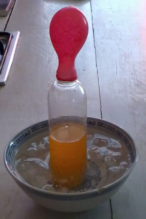
   \(\text{CO}_{2}\)(g) is released during this
                                                                           reaction.
   Observe how quickly the balloons increase in size and
                                                                           write down your observations (which increases in
                                                                           size faster).

### Results

Note (write down) your observations.

### Questions and discussion

- Which balloon expanded faster?
- Suggest a reason for the difference in rates.

### Conclusions

The balloon on test tube B will expand faster. This is because the
                                                        higher temperature (room temperature rather than an ice bath)
                                                        leads to an increase in the average rate of \(\text{CO}_{2}\)
                                                        gas production.

The video below shows how much pressure can build up when \(\text{CO}_{2}\)(g) is
                                        released during the reaction of an effervescent tablet with water.

<Callout type="note" title="Note">
<VideoPlayer src="http://www.youtube.com/embed/7piN3jk93tM" title="Video: 27TR" />
</Callout>

The higher the temperature, the greater the average kinetic energy of the particles,
                                        which means that the particles are moving faster.

Therefore:

- particles moving faster means more collisions per unit time
                                                          (collision theory)
- particles with higher kinetic energy are also more likely to react on
                                                          colliding as they have enough energy for the reaction to occur
                                                          (see Section 7.4 on the mechanism of reaction).

<Callout type="note" title="Note">
<VideoPlayer src="http://www.youtube.com/embed/t0xl0CXjB04" title="Video: 27TS" />
</Callout>

#### Catalyst

Adding a catalyst increases the reaction rate by lowering the energy required for a
                                        successful reaction to take place. A catalyst speeds up a reaction and is
                                        released at the end of the reaction, completely unchanged.

In the first catalyst and reaction rate experiment (with manganese dioxide
                                                and hydrogen peroxide) it is important to note that hydrogen peroxide
                                                can cause burns. The learners should wear safety equipment, as always
                                                when handling chemicals. If the concentration of hydrogen peroxide is
                                                too high the liquid hydrogen peroxide may splash out of the container
                                                along with the oxygen gas. As a result the learners should be
                                                particularly careful around the mouth of the containers.

In the second experiment the learners are again working with a strong acid
                                                and should follow all the usual safety procedures.

## Catalysts and reaction rate

### Aim

Hydrogen peroxide decomposes slowly over time into water and oxygen.
                                                        The aim of this experiment is to determine the effect a catalyst
                                                        has on the reaction rate.

### Apparatus

- 3% hydrogen peroxide (\(\text{H}_{2}\text{O}_{2}\)),
                                                                          manganese dioxide (\(\text{MnO}_{2}\)) powder,
                                                                          yeast powder
- two beakers or large measuring cylinders

### Method

<Callout type="warning" title="Note">
Be careful when handling \(\text{H}_{2}\text{O}_{2}\) as it
                                                                can burn you. We recommend wearing gloves and safety
                                                                glasses.
</Callout>

2. Pour \(\text{30}\) \(\text{cm$^{3}$}\)
                                                                           \(\text{H}_{2}\text{O}_{2}\) into two seperate
                                                                           containers.
4. Add a spatula tip of yeast to one container.
6. Time how long it takes for the bubbles to stop.
8. Repeat with \(\text{MnO}_{2}\) in the second
                                                                           container.
10. Compare the effect of the two catalysts.

The balanced equation for this reaction is:

\(2\text{H}_{2}\text{O}_{2}(ℓ)\) \(\to\)
                                                        \(2\text{H}_{2}\text{O}(ℓ) + \text{O}_{2}(\text{g})\)

This can also be written:

\(2\text{H}_{2}\text{O}_{2}(ℓ) + \text{catalyst}\) \(\to\)
                                                        \(2\text{H}_{2}\text{O}(ℓ) + \text{O}_{2}(\text{g}) +
                                                        \text{catalyst}\)

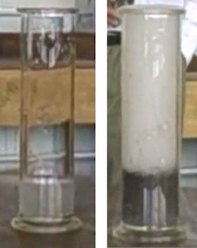

Figure 7.3: \(\text{H}_{2}\text{O}_{2}\) before the
                                                                        addition of \(\text{MnO}_{2}\) (left) and after
                                                                        the addition of \(\text{MnO}_{2}\) (right).

### Results

- Which chemical compounds are acting as catalysts in
                                                                          these reactions?
- What causes the bubbles that form in the reaction?

### Conclusions

The bubbles that form are oxygen gas formed through the decomposition
                                                        of hydrogen peroxide. This would happen over time without the
                                                        presence of the catalyst. The manganese dioxide speeds up the
                                                        reaction significantly. The yeast speeds up the reaction, but
                                                        not as much as the manganese dioxide.

<Callout type="note" title="Note">
<VideoPlayer src="http://www.youtube.com/embed/7_X8c2b0BB0" title="Video: 27TT" />
</Callout>

## Catalysts and reaction rate

### Aim

To determine the effect of a catalyst on the average rate of a
                                                        reaction

### Apparatus

- Zinc granules, \(\text{0,1}\)
                                                                          \(\text{mol·dm$^{-3}$}\) hydrochloric acid,
                                                                          copper pieces
- One test tube, a glass beaker, tongs

### Method

<Callout type="warning" title="Note">
Do not get hydrochloric acid (\(\text{HCl}\)) on your hands.
                                                                We suggest you use gloves and safety glasses whenever
                                                                handling acids. Be especially careful when removing the
                                                                copper pieces from the test tube.
</Callout>

2. Place a few of the zinc granules in the test tube,
                                                                           using tongs.
4. Measure the mass of a few pieces of copper and, using
                                                                           tongs, keep them separate from the rest of the
                                                                           copper.
6. Add \(\text{20}\) \(\text{cm$^{3}$}\) of
                                                                           \(\text{HCl}\) to the test tube. You will see
                                                                           that a gas is released. Take note of how quickly
                                                                           or slowly this gas is released (use a stopwatch
                                                                           or your cellphone to time this). Write a
                                                                           balanced chemical equation for the chemical
                                                                           reaction that takes place.
   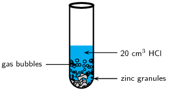
8. Now add the copper pieces to the same test tube. What
                                                                           happens to the rate at which the gas is
                                                                           produced?
10. Carefully remove the copper pieces from the test tube
                                                                           (use tongs), rinse them in water and alcohol and
                                                                           then weigh them again. Has the mass of the
                                                                           copper changed since the start of the
                                                                           experiment?

### Results

During the reaction, the gas that is released is hydrogen. The rate
                                                        at which the hydrogen is produced *increases* when the
                                                        copper pieces (the catalyst) are added. The mass of the copper
                                                        does not change during the reaction.

### Conclusions

The copper acts as a *catalyst* during the reaction. It speeds
                                                        up the average rate of the reaction, but is not changed itself
                                                        in any way.

We will return to catalysts in more detail once we have explored the mechanism of
                                        reactions later in this chapter.

In the iodine clock experiment it is important that the learners start timing the
                                        experiment as soon as the sulfuric acid and hydrogen peroxide solution is added
                                        to the potassium iodide solution. There should be a sudden colour change from
                                        colourless to purple when the sodium thiosulfate is used up and free iodine is
                                        available in the solution. The free iodine is what gives the reaction the purple
                                        colour.

This experiment is best done in groups (\(\text{3}\) - \(\text{4}\) if often a good
                                        size). You can divide your class into groups and assign each group a different
                                        experiment. Afterwards the groups can present their results and conclusions to
                                        the class. If you have time you can also vary the concentration of the hydrogen
                                        peroxide.

As always, learners need to work carefully with acids, in particular with the
                                        concentrated acids. Remind them to always add the acid to the water.

## Temperature, concentration and reaction rate

### Aim

To determine the effect of temperature and concentration on the average
                                                reaction rate of the iodine clock experiment. This experiment is best
                                                done in groups.

### Apparatus

- Potassium iodide (\(\text{KI}\)), soluble starch, sodium
                                                                  thiosulfate solution
                                                                  (\(\text{Na}_{2}\text{S}_{2}\text{O}_{3}\)), dilute
                                                                  (around \(\text{0,2}\) \(\text{mol·dm$^{-3}$}\))
                                                                  sulfuric acid (\(\text{H}_{2}\text{SO}_{4}\)), 3%
                                                                  hydrogen peroxide (\(\text{H}_{2}\text{O}_{2}\))
                                                                  solution
- Five beakers, a measuring cylinder, a hotplate, an ice bath,
                                                                  a glass stirring rod, a stop-watch

### Method

- Preheat the hotplate to \(\text{40}\) \(\text{℃}\)
- Label a beaker solution *1*. Measure \(\text{75}\)
                                                                  \(\text{ml}\) \(\text{H}_{2}\text{SO}_{4}\) into the
                                                                  beaker. Add \(\text{25}\) \(\text{ml}\) 3%
                                                                  \(\text{H}_{2}\text{O}_{2}\). Remember to use dilute
                                                                  (\(\text{0,2}\) \(\text{mol·dm$^{-3}$}\)) sulfuric
                                                                  acid.

The equations for what is occuring in this reaction are given below:

\[\text{H}_{2}\text{O}_{2}(ℓ) + 2\text{KI}(\text{s}) +
                                                \text{H}_{2}\text{SO}_{4}(ℓ) \to
                                                \color{red}{\text{I}_{2}{\text{(s)}}} +
                                                \text{K}_{2}\text{SO}_{4}(\text{aq}) + 2\text{H}_{2}\text{O}(ℓ)\]

\[\color{red}{\text{I}_{2}{\text{(s)}}} +
                                                2\text{Na}_{2}\text{S}_{2}\text{O}_{3}(\text{aq}) \to
                                                \text{Na}_{2}\text{S}_{4}\text{O}_{6}(\text{aq}) +
                                                2\text{NaI}(\text{aq})\]

It is good scientific practice to vary only one factor at a time during an
                                                experiment. Therefore, this experiment has two parts. First we will vary
                                                the concentration of \(\text{KI}\), then we will vary the temperature:

- **Varying the concentration**
  2. Weigh out \(\text{0,5}\) \(\text{g}\) of
                                                                                     \(\text{KI}\) into a beaker and label it
                                                                                     *A*.
     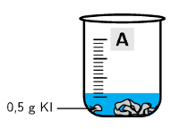
  4. Weigh out \(\text{1}\) \(\text{g}\) of
                                                                                     \(\text{KI}\) into a different beaker
                                                                                     and label it *B*.
     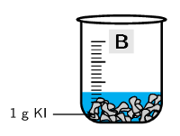
  6. Add \(\text{20}\) \(\text{ml}\)
                                                                                     \(\text{Na}_{2}\text{S}_{2}\text{O}_{3}\)
                                                                                     to both beaker A and beaker B.
     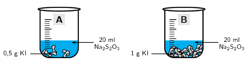
  8. Add a spatula of soluble starch to both
                                                                                     beaker A and beaker B and stir with a
                                                                                     glass rod.
     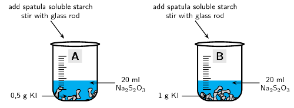
  10. Measure \(\text{15}\) \(\text{ml}\) of
                                                                                     solution *1* with the measuring
                                                                                     cylinder. Get your stopwatch ready. Pour
                                                                                     the \(\text{15}\) \(\text{ml}\) of
                                                                                     solution 1 into beaker A and start
                                                                                     timing.
     Stop timing when the solution starts to
                                                                                     change colour. Write down your time in
                                                                                     the table below.
     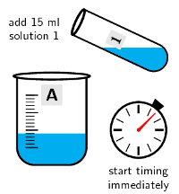
  12. Repeat step \(\text{5}\) with beaker B.
  | Beaker | Concentration (M) | Temperature
                                                                                                  (℃) | Time (s) |
  | --- | --- | --- | --- |
  | A | approx. 0.15 | room temperature |  |
  | B | approx. 0.3 | room temperature |  |
- **Varying the temperature**
  2. Weigh out \(\text{0,5}\) \(\text{g}\) of
                                                                                     \(\text{KI}\) into a new beaker and
                                                                                     label it *C*.
  4. Add \(\text{20}\) \(\text{ml}\)
                                                                                     \(\text{Na}_{2}\text{S}_{2}\text{O}_{3}\)
                                                                                     to beaker C.
  6. Add a spatula of soluble starch to beaker C
                                                                                     and stir with a glass rod.
  8. Measure \(\text{15}\) \(\text{ml}\) of
                                                                                     solution *1* with the measuring
                                                                                     cylinder.
  10. *Place beaker C in the ice bath*.
  12. Get your stopwatch ready. Pour the
                                                                                     \(\text{15}\) \(\text{ml}\) of solution
                                                                                     1 into beaker C and start timing. Stop
                                                                                     timing when the solution starts to
                                                                                     change colour. Write down your time in
                                                                                     the table below.
  14. Repeat steps 1 - 4 (label the beaker
                                                                                     *D*).
     *Place beaker D on the hotplate*. Then
                                                                                     repeat step 6
  | Beaker | Concentration (M) | Temperature
                                                                                                  (℃) | Time (s) |
  | --- | --- | --- | --- |
  | A | approx. 0.15 | room temperature |  |
  | C | approx. 0.15 | 0 |  |
  | D | approx. 0.15 | 40 |  |
  Beaker A has been included here because it has the same
                                                                  concentration as beakers C and D, but is at a different
                                                                  temperature.

### Results

Make a table with the information for all the beakers. Include columns for
                                                concentration, temperature, time, and reaction rate.

### Questions and discussion

- Did beaker A or B have the faster reaction rate?
- Why did it have a faster reaction rate?
- Did beaker A, C or D have the fastest reaction rate? Why?
- Did beaker A, C or D have the slowest reaction rate? Why?

### Conclusions

You will notice that the faster reaction rate occurs in the beaker with the
                                                higher concentration of \(\text{KI}\). You should also see that the
                                                higher the temperature, the faster the reaction rate.

<Callout type="note" title="Note">
<VideoPlayer src="http://www.youtube.com/embed/kw-Lt9-WmTg" title="Video:
                                                27TV" />
</Callout>

This video shows how this experiment can be used as a clock with the concentration chosen so
                                that the experiment changes colour at a specific time (or with a particular part of a
                                song). This is why this experiment is known as the *iodine clock reaction*.

<Callout type="note" title="Note">
<VideoPlayer src="http://player.vimeo.com/video/38297047" title="Video:
                                                27TW" />
</Callout>

<Callout type="tip" title="Worked example 2: Reaction rates">
**Question:**
Write a balanced equation for the exothermic reaction between
                                                \(\text{Zn}(\text{s})\) and \(\text{HCl}(ℓ)\). Also name three
                                                ways to increase the rate of this reaction.

**Write the equation for zinc and hydrochloric acid:**
The products must be a salt and hydrogen gas. Zinc ions have a charge of 2+
                                                while chloride ions have a charge of 1-. Therefore the salt must be
                                                \(\text{ZnCl}_{2}\).

\(\text{Zn}(\text{s}) + \text{HCl}(\text{aq})\) \(\to\)
                                                \(\text{ZnCl}_{2}(\text{aq}) + \text{H}_{2}(\text{g})\)

**Balance the equation if necessary:**
There are more chloride ions and hydrogen atoms on the right side of the
                                                equation. Therefore there must be \(\text{2}\) \(\text{HCl}\) on the
                                                left side of the equation.

\(\text{Zn}(\text{s}) + 2\text{HCl}(\text{aq})\) \(\to\)
                                                \(\text{ZnCl}_{2}(\text{aq}) + \text{H}_{2}(\text{g})\)

**Think about the methods mentioned in this section that would
                                                increase reaction rate:**
- A catalyst could be added
- The zinc solid could be ground into a fine powder to increase
                                                                  its surface area
- The \(\text{HCl}\) concentration could be increased
</Callout>

## Rates of reaction

### Textbook Exercise 7.3

Hydrochloric acid and calcium carbonate react according to
                                                                the following equation:

\(\text{CaCO}_{3}(\text{s}) + 2\text{HCl}(ℓ)\) \(\to\)
                                                                \(\text{CaCl}_{2}(\text{s}) +
                                                                \text{H}_{2}\text{O}(ℓ) +
                                                                \text{CO}_{2}(\text{g})\)

The volume of carbon dioxide that is produced during the
                                                                reaction is measured at different times. The results are
                                                                shown in the table below.

| Time (mins) | Total Volume of \(\text{CO}_{2}\)
                                                                                        produced
                                                                                        (\(\text{cm$^{3}$}\)) |
| --- | --- |
| \(\text{1}\) | \(\text{14}\) |
| \(\text{2}\) | \(\text{26}\) |
| \(\text{3}\) | \(\text{36}\) |
| \(\text{4}\) | \(\text{44}\) |
| \(\text{5}\) | \(\text{50}\) |
| \(\text{6}\) | \(\text{58}\) |
| \(\text{7}\) | \(\text{65}\) |
| \(\text{8}\) | \(\text{70}\) |
| \(\text{9}\) | \(\text{74}\) |
| \(\text{10}\) | \(\text{77}\) |

*Note: On a graph of production against time, it is the
                                                                        gradient of the tangent to the graph that shows
                                                                        the rate of the reaction at that time.*

e.g.

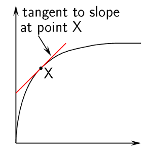

**Problem:**
Use the data in the table to draw a graph showing the
                                                                        volume of gas that is produced in the reaction,
                                                                        over a period of 10 minutes.

(Remember to label the axes and plot the graph on
                                                                        graphing paper)

**Solution:**
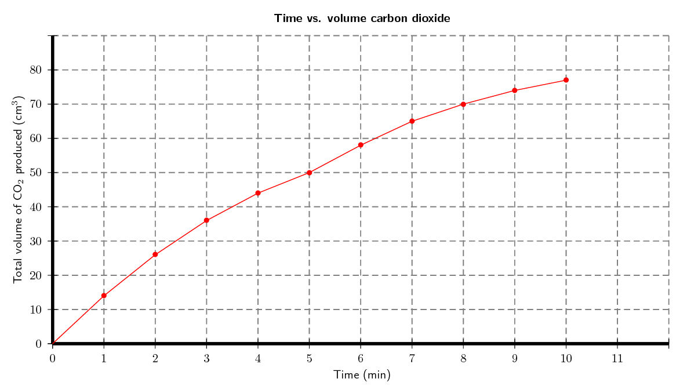

**Problem:**
At which of the following times is the reaction
                                                                        *fastest*: \(\text{1}\)
                                                                        \(\text{minute}\); \(\text{6}\)
                                                                        \(\text{minutes}\) or \(\text{8}\)
                                                                        \(\text{minutes}\). Explain.

**Solution:**
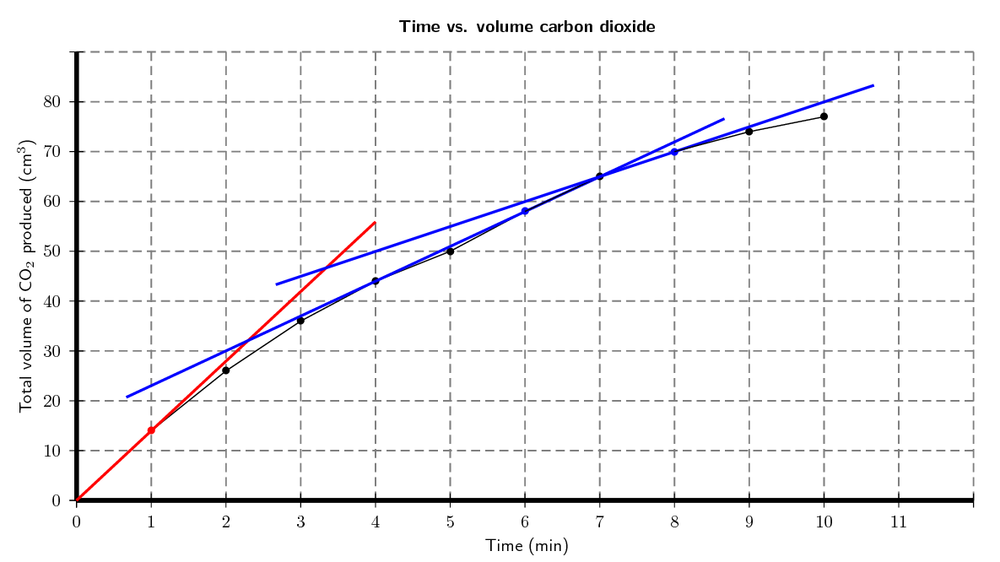

Time = 1 minute. This is where the the gradient of a
                                                                        tangent to the graph is the steepest (the red
                                                                        line on the graph). The steeper the gradient the
                                                                        faster the rate at that time.

**Problem:**
Suggest a reason why the reaction slows down over
                                                                        time.

**Solution:**
As the reaction proceeds the reactants are used up
                                                                        (form products). With a lower concentration of
                                                                        reactants the rate of the reaction decreases.

**Problem:**
Use the graph to estimate the volume of gas that will
                                                                        have been produced after 11 minutes.

**Solution:**
Approximately \(\text{79}\) \(\text{cm$^{3}$}\)

**Problem:**
How long do you think the reaction will take to stop
                                                                        (give a time in minutes)?

**Solution:**
Any answer between 15 and 25 minutes is reasonable.
                                                                        To see this extend the line and find approximate
                                                                        the time that the gradient flattens out.

If the experiment was repeated using a more
                                                                        concentrated hydrochloric acid solution:

**Problem:**
would the average rate of the reaction
                                                                                increase or decrease from the one shown
                                                                                in the graph?

**Solution:**
The rate would increase.

**Problem:**
draw a line on the same set of axes to show
                                                                                how you would expect the reaction to
                                                                                proceed with a more concentrated
                                                                                \(\text{HCl}\) solution.

**Solution:**
The red line indicates roughly how the
                                                                                reaction would proceed. Note that the
                                                                                reaction does not produce more carbon
                                                                                dioxide, it just reacts faster.

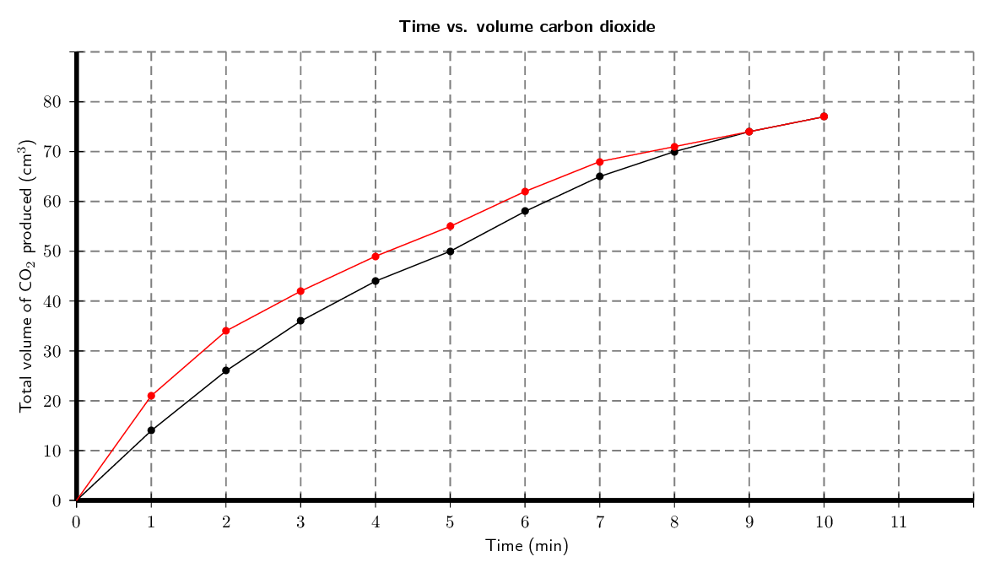
