## 7.3 Measuring rates of reaction (ESCN3)

How the average rate of a reaction is measured will depend on what the reaction is, what the
                        reactants are, and what product forms. Look back at the reactions that have been discussed so
                        far. In each case, how was the average rate of the reaction measured? The following examples
                        will give you some ideas about other ways to measure the average rate of a reaction:

<QuizCard id="s12-07-03a" title="Interactive Exercise 7.3" question="Thandolwethu wants to carry out an experiment to measure the rate of a reaction. She carries out the following reaction: A(aq) \(\:+\:\) B(aq) \(\rightarrow\) \(\downarrow\) C(ℓ) \(\:+\:\) D(aq) She notes that this is an acid-base reaction. Which of the following methods can she use to measure the rate of the reaction?" options=[] answer="
                    1
                " hint="" explanation="How can rate of the rate of a reaction be measured? To measure the rate of the reaction we can do one of the following: Measure the volume of gas produced in the reaction. Measure the time taken for a precipate to form by placing a piece of paper with a cross on it, placing it under the reaction vessel and                         measuring the time taken for the cross to no longer be visible when viewed from above. Measure the time taken for a colour change to occur. Measure the change in mass in a reaction that produces a gas. Use the information given to determine which method to use We are given the following information about the reaction: this is an acid-base reaction. This means that she can use an indicator to see the time taken for the colour to change and so measure the rate of the reaction. Therefore she can measure the rate by measuring the time taken for the reaction to change colour . Submit your answer as: measuring the time taken for the reaction to change colour." />

<QuizCard id="s12-07-03a" title="Interactive Exercise 7.3" question="What is average rate at which H 2 was used up over the first \(\text{150}\ \text{s}\) ? INSTRUCTIONS: Write your answer in scientific notation , and then round it to two decimal places . Give your answer in units of \(\text{mol·s$^{-1}$}\) ." options=[] answer="
                        ['1.40e-2', '-1.40e-2']
                    " hint="You should enter a number here. If you want to, you can use a space to separate thousands.                Example: 12 800,25 For scientific notation you need to use the multiply symbol                ( ∗ ) and the exponent symbol ( ^ ). For example 6,673 × 10 −11 should be written as: 6,673 ∗ 10^−11" explanation="Read the initial and final values from the graph The rate of a reaction is a measure of how quickly reactants are used or how quickly products are formed. The average rate of a reaction is the average rate of this change over a period of time, while an instantaneous rate is the rate at a specific time. We are asked to determine the average rate of reaction for H 2 over the first \(\text{150}\ \text{s}\) . This means that the time period we are interested in is \(\text{0}\) to \(\text{150}\ \text{s}\) . From the graph we can see that there are \(\text{4,8}\ \text{mol}\) of H 2 initially and \(\text{2,7}\ \text{mol}\) of H 2 at \(\text{150}\ \text{s}\) . Calculate the average reaction rate \[                         \begin{aligned}                             \text{reaction rate } & = \frac{n_{\text{H}_{2}} \text{used (mol)}}{\text{time interval (s)}} \\                             & = \frac{\text{4,8} - \text{2,7}}                             {\text{150}} \\                             & = \frac{\text{2,1}}{\text{150}} \\                             & = \text{1,40} \times \text{10}^{-\text{2}}\ \text{mol·s$^{-1}$}                         \end{aligned}                     \] Therefore the average rate of reaction for H 2 over the first \(\text{150}\ \text{s}\) is \(\text{1,40} \times \text{10}^{-\text{2}}\ \text{mol·s$^{-1}$}\) . Submit your answer as:" />

<QuizCard id="s12-07-03a" title="Interactive Exercise 7.3" question="Choose two essential pieces of apparatus needed to determine the rate of hydrogen production." options=["time 1", "time 2", "time 3", "time 1", "time 2", "time 3", "time 1 and time 2", "time 2 and time 3"] answer="
                        1
                    " hint="" explanation="Name the essential apparatuses To perform a rate measurement you need to be able to measure time using a watch or stopwatch. You also need to be able to accurately measure the volume of gas that forms using calibrated equipment. One option is an apparatus that expands as the gas volume increases. For example, a gas syringe. Another option is to use the downwards displacement of water as a measure of gas volume (for gases that are insoluble in water). A measuring cylinder or burette can be used for this method. Therefore, two essential apparatuses are a watch and a burette . Submit your answer as: a watch and a burette" />

<QuizCard id="s12-07-03a" title="Interactive Exercise 7.3" question="Calculate the average rate of the reaction (in \(\text{dm$^{3}$·s$^{-1}$}\) ) between \(t = \text{0}\ \text{s}\) and \(t = \text{120}\ \text{s}\) for Graph D . INSTRUCTION: Round your answer to two decimal places ." options=["greater than", "smaller than", "equal to"] answer="
                        ['0.04', '4.42e-2', '0.044']
                    " hint="You should enter a number here. If you want to, you can use a space to separate thousands.                Example: 12 800,25 For scientific notation you need to use the multiply symbol                ( ∗ ) and the exponent symbol ( ^ ). For example 6,673 × 10 −11 should be written as: 6,673 ∗ 10^−11" explanation="Calculate the average rate of the reaction To calculate the average rate take the volume of gas produced \((\Delta V)\) in the time interval, and divide it by the time interval \((\Delta t)\) . \[                         \begin{aligned}                         \text{average rate} &= \frac{\Delta V}{\Delta t} \\                         &= \frac{\text{5,3} - \text{0} } {\text{120} - \text{0} } \\                         &= \text{0,04416...} \\ & \approx \text{0,04}\ \text{dm$^{3}$·s$^{-1}$}                         \end{aligned}                     \] Submit your answer as:" />

<QuizCard id="s12-07-03a" title="Interactive Exercise 7.3" question="Adapted from DBE Nov 2015 Grade 12, P2, Q5 Physical constants \(·\) Chemistry formulas \(·\) Periodic table \(·\) Standard reduction potentials Dilute acids, indicated in the table below, react with excess cobalt in each of the three experiments to produce hydrogen gas. The cobalt is completely covered with the acid in each experiment. Exp. Dilute acid 1 \(\text{50}\ \text{cm$^{3}$}\) of \(\text{0,6}\ \text{mol·dm$^{-3}$}\) HBr 2 \(\text{100}\ \text{cm$^{3}$}\) of \(\text{0,3}\ \text{mol·dm$^{-3}$}\) H 2 SO 4 3 \(\text{100}\ \text{cm$^{3}$}\) of \(\text{0,3}\ \text{mol·dm$^{-3}$}\) HBr The initial mass of cobalt used in each experiment is \(\text{3,1}\ \text{g}\) . The balanced equation for the reaction in Experiment 2 is: Co(s) \(\:+\:\) H 2 SO 4 (aq) \(\rightarrow\) \(\downarrow\) CoSO 4 (aq) \(\:+\:\) H 2 (g) Calculate the mass of cobalt present in the flask after completion of the reaction in Experiment 2 . How will the mass of cobalt present in the flask after completion of the reaction in Experiment 3 compare to the answer to the previous question? INSTRUCTION: Round your answer to two decimal places ." options=["g", "mol", "g\u00b7mol\u207b\u00b9", "dm\u00b3", "larger than", "smaller than", "equal to"] answer="
                    (1.33; 1.27; 1.34)
                , 0,
                    0
                " hint="You should enter a number here. If you want to, you can use a space to separate thousands.                Example: 12 800,25 For scientific notation you need to use the multiply symbol                ( ∗ ) and the exponent symbol ( ^ ). For example 6,673 × 10 −11 should be written as: 6,673 ∗ 10^−11" explanation="Determine the number of moles of H 2 SO 4 used in the experiment We are interested in Experiment 2 . 2 \(\text{100}\ \text{cm$^{3}$}\) of \(\text{0,3}\ \text{mol·dm$^{-3}$}\) H 2 SO 4 First we must calculate the number of moles of H 2 SO 4 present (Remember to convert the volume to \(\text{dm$^{3}$}\) ) . \[                     \begin{aligned}                         n(\text{H}_{2}\text{S}\text{O}_{4}) &= cV \\                         &= (\text{0,3})(\text{0,1})  \\                         &= \text{0,03}\ \text{mol}                     \end{aligned}                 \] Determine the number of moles of cobalt used in the experiment We have the following equation: \(\text{1}\) Co(s) \(\:+\:\) \(\text{1}\) H 2 SO 4 (aq) \(\rightarrow\) \(\downarrow\) \(\text{1}\) CoSO 4 (aq) \(\:+\:\) \(\text{1}\) H 2 (g) There is a \(1 : 1\) molar ratio of Co \(:\) H 2 SO 4 . \[                     \begin{aligned}                         \therefore n(\text{C}\text{o}) &= n(\text{H}_{2}\text{S}\text{O}_{4}) \\ &=\text{0,03}\ \text{mol}                      \end{aligned}                 \] Determine the mass of cobalt that reacts in the experiment From the periodic table, the molar mass of cobalt is \(\text{59,0}\ \text{g·mol$^{-1}$}\) . \[                     \begin{aligned}                         n(\text{C}\text{o}) &= \frac{m}{M} \\                         \therefore m(\text{C}\text{o}) &= nM \\                         &= (\text{0,03})(\text{59,0})  \\                         &= \text{1,77}\ \text{g}                     \end{aligned}                 \] Determine the mass of cobalt remaining after Experiment 2 \[                     \begin{aligned}                         m(\text{C}\text{o})_{\text{f}} &= m(\text{C}\text{o})_{\text{i}} - m(\text{C}\text{o})_{\text{used}} \\                         &= \text{3,1} - \text{1,77}  \\                         &= \text{1,33}\ \text{g}                      \end{aligned}                 \] Therefore the amount of cobalt remaining after the completion of Experiment 2 is \(\text{1,33}\ \text{g}\) . Compare the masses of cobalt remaining in experiments 2 and 3 Now we are interested in Experiment 3 . 3 \(\text{100}\ \text{cm$^{3}$}\) of \(\text{0,3}\ \text{mol·dm$^{-3}$}\) HBr The balancing coefficient for HBr in Experiment 3 is \(\text{2}\) , so \(\text{2}\) moles of acid are                      used for every \(\text{1}\) mole of cobalt. \(\text{1}\) Co(s) \(\:+\:\) \(\text{2}\) HBr(aq) \(\rightarrow\) \(\downarrow\) \(\text{1}\) CoBr 2 (aq) \(\:+\:\) \(\text{1}\) H 2 (g) But, the balancing coefficient for H 2 SO 4 in Experiment 2 is \(\text{1}\) , so only \(\text{1}\) mole of acid is                      used for every \(\text{1}\) mole of cobalt. \(\text{1}\) Co(s) \(\:+\:\) \(\text{1}\) H 2 SO 4 (aq) \(\rightarrow\) \(\downarrow\) \(\text{1}\) CoSO 4 (aq) \(\:+\:\) \(\text{1}\) H 2 (g) Because the number of moles of acid in both experiments is the same, the moles of cobalt used in Experiment 3 is less than the number of moles used in Experiment 2 . This means more moles of cobalt will remain in Experiment 3 . Therefore we can say that the mass of cobalt present after Experiment 3 is larger than the mass present after Experiment 2 . Submit your answer as: and g and larger than" />

<QuizCard id="s12-07-03a" title="Interactive Exercise 7.3" question="Adapted from DBE Nov 2015 Grade 12, P2, Q5 Physical constants \(·\) Chemistry formulas \(·\) Periodic table \(·\) Standard reduction potentials Dilute acids, indicated in the table below, react with excess magnesium in each of the three experiments to produce hydrogen gas. The magnesium is completely covered with the acid in each experiment. Exp. Dilute acid 1 \(\text{100}\ \text{cm$^{3}$}\) of \(\text{0,3}\ \text{mol·dm$^{-3}$}\) HCl 2 \(\text{50}\ \text{cm$^{3}$}\) of \(\text{0,6}\ \text{mol·dm$^{-3}$}\) HCl 3 \(\text{100}\ \text{cm$^{3}$}\) of \(\text{0,3}\ \text{mol·dm$^{-3}$}\) H 2 SO 4 The volume of hydrogen gas produced is measured in each experiment. The graph below was obtained for Experiment 1 : Redraw the graph for Experiment 1 on a piece of paper. On the same set of axes, sketch the graphs that will be obtained for Experiments 2 , and 3 . Clearly label all three graphs, then answer the questions that follow." options=["higher than", "the same as", "lower than", "smaller than", "the same as", "larger than", "the same", "a later", "an earlier"] answer="
                    0
                ,
                    0
                ,
                    0
                ,
                    0
                " hint="" explanation="What do we know about the first two experiments? We know the following about Experiments 1 and 2 : HCl is used in both Experiment 1 and Experiment 2 . The concentration of HCl in Experiment 1 is half that used in Experiment 2 . The volume of HCl in Experiment 1 is double that used in Experiment 2 . \(n = cV\) , so the number of moles of HCl is the same in Experiments 1 and 2 . The magnesium is in excess, so all the moles of acid will be used up. The only meaningful difference between these two experiments is the initial concentration of HCl . A higher concentration of reactants leads to a faster initial reaction rate. But, as the number of moles of acid is the same, the total volume of hydrogen gas formed must be the same. What do we know about Experiments 1 and 3? We know the following about Experiments 1 and 3 : HCl is used in Experiment 1 , but H 2 SO 4 is used in Experiment 3 . The concentration of HCl in Experiment 1 is the same as the concentration of H 2 SO 4 used in Experiment 3 . The volume of HCl in Experiment 1 is also the same as the volume of H 2 SO 4 used in Experiment 3 . This means that the number of moles of each acid is the same in Experiments 1 and 3 . The meaningful difference between these two experiments is the acid used, which leads to a different balancing coefficient. HCl in Experiment 1 has a balancing coefficient of 2 . \(\text{2}\) HCl(aq) \(\:+\:\) \(\text{1}\) Mg(s) \(\rightarrow\) \(\downarrow\) \(\text{1}\) MgCl 2 (aq) \(\:+\:\) \(\text{1}\) H 2 (g) So 2 moles of HCl are needed to form 1 mole of H 2 gas. H 2 SO 4 in Experiment 3 has a balancing coefficient of 1 . \(\text{1}\) H 2 SO 4 (aq) \(\:+\:\) \(\text{1}\) Mg(s) \(\rightarrow\) \(\downarrow\) \(\text{1}\) MgSO 4 (aq) \(\:+\:\) \(\text{1}\) H 2 (g) So only 1 mole of H 2 SO 4 is needed to form 1 mole of H 2 gas. We know that the number of moles of acid is the same in both experiments. This means that the total volume of hydrogen gas that can be formed in Experiment 1 is half the total volume of hydrogen gas that can be formed in Experiment 3 . The acids have the same concentration, so the difference in balancing coefficients also means that the initial rate of formation is lower in Experiment 1 than in Experiment 3 . Answer the questions Now we can answer the questions: The initial gradient of Experiment 2 is higher (steeper) than that of Experiment 1 . The curve for Experiment 3 reaches a constant volume that is larger than the constant volume in Experiment 1 , at an earlier time. The correct graph for all three experiments is: Submit your answer as: higher than and larger than and an earlier and" />

### Measuring the volume of gas produced per unit time (ESCN4)

The volume of gas produced in a reaction may be measured by collecting the gas in a gas
                                syringe (Figure 7.4).

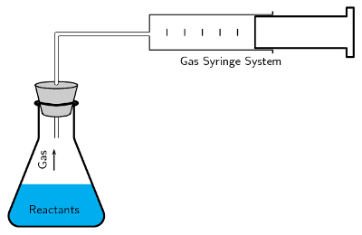

Figure 7.4: The gas syringe method.

<Callout type="note" title="Note">
<VideoPlayer src="http://www.youtube.com/embed/2Nqf-QSGoDg" title="Video:
                                                27TY" />
</Callout>

As more gas is produced, the plunger is pushed out and the volume of the gas in the syringe
                                can be recorded.

By measuring the volume at set time intervals, we can graph the data (Figure 7.5) and
                                hence determine the rate of the reaction.

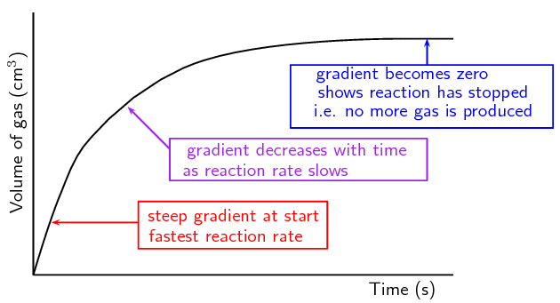

Figure 7.5: A plot of the volume of gas collected at set time intervals.

Examples of reactions that produce gas are listed below:

- *Reactions that produce hydrogen gas:*
  When a *metal reacts with an acid*, hydrogen gas is produced. The
                                                  hydrogen can be collected in a test tube. A **lit splint**
                                                  can be used to test for hydrogen. The '**pop**' sound shows
                                                  that hydrogen is present.
  For example, magnesium reacts with sulfuric acid to produce magnesium sulfate
                                                  and hydrogen.
  \[\text{Mg}(\text{s}) + \text{H}_{2}\text{SO}_{4}(\text{aq}) \to
                                                  \text{MgSO}_{4}(\text{aq}) + \text{H}_{2}(\text{g})\]
- *Reactions that produce carbon dioxide:*
  When a *carbonate reacts with an acid*, carbon dioxide gas is
                                                  produced. When carbon dioxide is passed through
                                                  **limewater**, it turns the limewater
                                                  **milky**. A burning splint will also **stop
                                                          burning** (be extinguished) in the presence of
                                                  \(\text{CO}_{2}\) gas. These are a simple tests for the presence of
                                                  carbon dioxide.
  For example, calcium carbonate reacts with hydrochloric acid to produce
                                                  calcium chloride, water and carbon dioxide.
  \[\text{CaCO}_{3}(\text{s}) + 2\text{HCl}(\text{aq}) \to
                                                  \text{CaCl}_{2}(\text{aq}) + \text{H}_{2}\text{O}(ℓ) +
                                                  \text{CO}_{2}(\text{g})\]
- *Reactions that produce oxygen:*
  Hydrogen peroxide decomposes in the presence of a manganese(IV) oxide
                                                  catalyst to produce oxygen and water.
  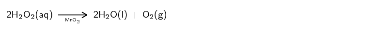

In the zinc and hydrochloric acid experiment the learners collect gas in a balloon.
                                        **Do not** light the gas in the balloon or allow it to be near
                                        flame. There will be an explosion.

## Measuring reaction rates

### Aim

To measure the effect of concentration on the average rate of a reaction.

### Apparatus

- Solid zinc granules, \(\text{1}\) \(\text{mol.dm$^{-3}$}\)
                                                                  hydrochloric acid \((\text{HCl})\)
- Two conical flasks, two beakers, two balloons, bunsen burner,
                                                                  splint of wood

### Method

<Callout type="warning" title="Note">
Do not get hydrochloric acid (\(\text{HCl}\)) on your hands. We
                                                        suggest you use gloves and safety glasses whenever handling
                                                        acids and handle with care.
</Callout>

2. Label a conical flask *A*. Weigh \(\text{5}\)
                                                                   \(\text{g}\) zinc granules into it.
   Repeat with the second conical flask but label it *B*.
   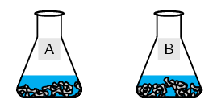
4. Label a beaker *\(\text{1}\)*. Pour \(\text{10}\)
                                                                   \(\text{cm$^{3}$}\) \(\text{HCl}\) into it.
   Label the other beaker *\(\text{2}\)*. Pour
                                                                   \(\text{5}\) \(\text{cm$^{3}$}\)
                                                                   \(\text{H}_{2}\text{O}\) into it. Add \(\text{5}\)
                                                                   \(\text{cm$^{3}$}\) \(\text{HCl}\) to this second
                                                                   beaker.
   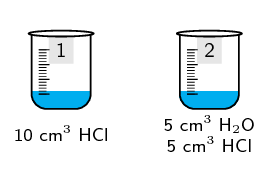
6. **Quickly:** Pour the liquid in beaker
                                                                   **\(\text{1}\)** into conical flask
                                                                   **A** and pour the liquid in beaker
                                                                   **\(\text{2}\)** into conical flask
                                                                   **B**. Attach one balloon firmly to each
                                                                   conical flask.
   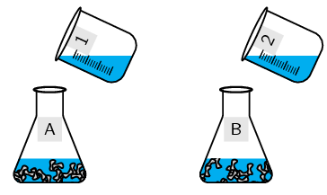
   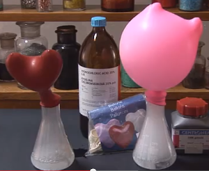
8. Note which balloon filled more quickly.
10. Fill a test tube with the gas formed. Light
                                                                   **only** the gas in the test tube. Keep
                                                                   open flames away from the balloons.

The equation for this reaction is:

\(\text{Zn}(\text{s}) + 2\text{HCl}(\text{aq})\) \(\to\)
                                                \(\text{ZnCl}_{2}(\text{aq}) + \text{H}_{2}(\text{g})\)

### Results

- Which beaker contained the more concentrated solution of
                                                                  \(\text{HCl}\)?
- Which balloon filled more quickly?
- What happened when you lit the gas in the test tube?

### Conclusions

The more concentrated solution led to a faster reaction rate (i.e. the
                                                balloon filling with \(\text{H}_{2}\) gas more quickly). The test for
                                                hydrogen gas would have resulted in a loud *pop* when the lit
                                                splint was placed near the mouth of a test tube.

<Callout type="note" title="Note">
<VideoPlayer src="http://www.youtube.com/embed/oQz5YEsx7Fo" title="Video:
                                                27TZ" />
</Callout>

### Precipitate reactions (ESCN5)

In reactions where a *precipitate* is formed, the amount of precipitate formed in a
                                period of time can be used as a measure of the reaction rate. For example, when sodium
                                thiosulfate reacts with an acid, a yellow precipitate of sulfur is formed. The reaction
                                is as follows:

<Callout type="note" title="Note">
When the reaction between two liquids forms an insoluble compound, solid material
                                        will form in the liquid. This solid is called a precipitate.
</Callout>

\(\text{Na}_{2}\text{S}_{2}\text{O}_{3}(\text{aq}) + 2\text{HCl}(\text{aq})\) \(\to\)
                                \(2\text{NaCl}(\text{aq}) + \text{SO}_{2}(\text{aq}) + \text{H}_{2}\text{O}(ℓ) +
                                \text{S}(\text{s})\)

One way to estimate the average rate of this reaction is to carry out the investigation in a
                                conical flask and to place a piece of paper with a black cross underneath the bottom of
                                the flask. At the beginning of the reaction, the cross will be clearly visible when you
                                look into the flask (Figure
                                        7.6). However, as the reaction progresses and more precipitate is formed,
                                the cross will gradually become less clear and will eventually disappear altogether.
                                Measuring the time that it takes for this to happen will give an idea of the reaction
                                rate. Note that it is not possible to collect the \(\text{SO}_{2}\) gas that is produced
                                in the reaction, because it is very soluble in water.

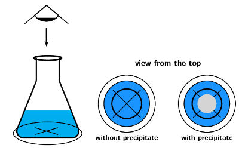

Figure 7.6: At the beginning of the reaction between sodium thiosulfate and
                                                hydrochloric acid, when no precipitate has been formed, the cross at the
                                                bottom of the conical flask can be clearly seen. As the precipitate
                                                forms less of it can be seen.

For the reaction of sodium thiosulfate with hydrochloric acid it would be good to
                                        break your class up into groups and assign different experiments to them at this
                                        point. They can report back to the rest of the class.

This experiment is recommended for informal assessment in CAPS. Remember to remind
                                        the learners about laboratory safety procedures, especially when handling acids.

## Measuring reaction rates

### Aim

To measure the effect of concentration on the average rate of a reaction.

### Apparatus

- \(\text{300}\) \(\text{cm$^{3}$}\) of sodium thiosulfate
                                                                  \(\text{Na}_{2}\text{S}_{2}\text{O}_{3}\) solution.
                                                                  (Prepare a solution of sodium thiosulfate by adding
                                                                  \(\text{12}\) \(\text{g}\) of
                                                                  \(\text{Na}_{2}\text{S}_{2}\text{O}_{3}\) to
                                                                  \(\text{300}\) \(\text{cm$^{3}$}\) of water). This is
                                                                  solution 'A'.
- \(\text{300}\) \(\text{cm$^{3}$}\) of water
- \(\text{100}\) \(\text{cm$^{3}$}\) of
                                                                  \(\text{1}\):\(\text{10}\) dilute hydrochloric acid.
                                                                  This is solution 'B'.
- Six \(\text{100}\) \(\text{cm$^{3}$}\) glass beakers,
                                                                  measuring cylinders, paper and marking pen, stopwatch or
                                                                  timer

### Method

<Callout type="warning" title="Note">
Do not get hydrochloric acid (\(\text{HCl}\)) on your hands. We
                                                        suggest you use gloves and safety glasses whenever handling
                                                        acids and that you handle with care.
</Callout>

One way to measure the average rate of this reaction is to place a piece of
                                                paper with a cross underneath the reaction beaker to see how long it
                                                takes until the cross cannot be seen due to the formation of the sulfur
                                                precipitate.

2. Set up six beakers on a flat surface and label them 1 to 6.
4. Pour \(\text{60}\) \(\text{cm$^{3}$}\) solution A into the
                                                                   first beaker and add \(\text{20}\) \(\text{cm$^{3}$}\)
                                                                   of water
6. Place the beaker on a piece of paper with a large black cross
                                                                   on it.
8. Use the measuring cylinder to measure \(\text{10}\)
                                                                   \(\text{cm$^{3}$}\) \(\text{HCl}\). Now add this
                                                                   \(\text{HCl}\) to the solution that is already in the
                                                                   first beaker (NB: Make sure that you always clean the
                                                                   measuring cylinder you have used before using it for
                                                                   another chemical).
10. Using a stopwatch with seconds, write down the time it takes
                                                                   for the precipitate that forms to block out the cross.
12. Now measure \(\text{50}\) \(\text{cm$^{3}$}\) of solution A
                                                                   into the second beaker and add \(\text{30}\)
                                                                   \(\text{cm$^{3}$}\) of water. Place the beaker over the
                                                                   black cross on the paper. To this second beaker, add
                                                                   \(\text{10}\) \(\text{cm$^{3}$}\) \(\text{HCl}\), time
                                                                   the reaction and write down the results as you did
                                                                   before.
14. Continue the experiment by diluting solution A as shown
                                                                   below.

| Beaker | Solution A (\(\text{cm$^{3}$}\)) | Water (\(\text{cm$^{3}$}\)) | Solution B (\(\text{cm$^{3}$}\)) | Time (s) |
| --- | --- | --- | --- | --- |
| \(\text{1}\) | \(\text{60}\) | \(\text{20}\) | \(\text{10}\) |  |
| \(\text{2}\) | \(\text{50}\) | \(\text{30}\) | \(\text{10}\) |  |
| \(\text{3}\) | \(\text{40}\) | \(\text{40}\) | \(\text{10}\) |  |
| \(\text{4}\) | \(\text{30}\) | \(\text{50}\) | \(\text{10}\) |  |
| \(\text{5}\) | \(\text{20}\) | \(\text{60}\) | \(\text{10}\) |  |
| \(\text{6}\) | \(\text{10}\) | \(\text{70}\) | \(\text{10}\) |  |

The equation for the reaction between sodium thiosulfate and hydrochloric
                                                acid is:

\(\text{Na}_{2}\text{S}_{2}\text{O}_{3}(\text{aq}) + 2\text{HCl}(\text{aq})\)
                                                \(\to\) \(2\text{NaCl}(\text{aq}) + \text{SO}_{2}(\text{aq}) +
                                                \text{H}_{2}\text{O}(ℓ) + \text{S}(\text{s})\)

### Results

- Calculate the reaction rate in each beaker. Remember that:
  rate of the formation of product = \(\dfrac{
                                                                  \text{moles product formed}}{\text{reaction time (s)}}\)
  In this experiment you are stopping each experiment when the
                                                                  same approximate amount of precipitate is formed (the
                                                                  cross is blocked out by precipitate). So a relative
                                                                  reaction rate can be determined using the following
                                                                  equation:
  reaction rate = \(\dfrac{1}{\text{time (s)}}\)
- Represent your results on a graph.
                                                                  **Concentration** will be on the x-axis and
                                                                  **reaction rate** on the y-axis. Note that
                                                                  the original volume of
                                                                  \(\text{Na}_{2}\text{S}_{2}\text{O}_{3}\) can be used as
                                                                  a measure of concentration.
- Why was it important to keep the volume of \(\text{HCl}\)
                                                                  constant?
- Describe the relationship between concentration and reaction
                                                                  rate.

### Conclusions

The higher the concentration of the reactants, the faster the average
                                                reaction rate.

### Changes in colour (ESCN6)

In some reactions there is a change in colour which tells us that the reaction is occuring.
                                The faster the colour change the faster the reaction rate.

For example, when ethanoic acid (acetic acid) is titrated with sodium hydroxide, an indicator
                                such as phenolphthalein is added. The solution is clear in an acidic solution and
                                changes to pink when the reaction is complete. If the concentration of the base were
                                increased, the colour change would happen faster (after a smaller volume of base was
                                added), showing that a higher concentration of base increased the reaction rate.

\[\text{CH}_{3}\text{COOH}(\text{aq}) + \text{NaOH}(\text{aq}) \to
                                \text{Na}^{+}(\text{aq}) + \text{CH}_{3}\text{COO}^{-}(\text{aq}) +
                                \text{H}_{2}\text{O}(ℓ)\]

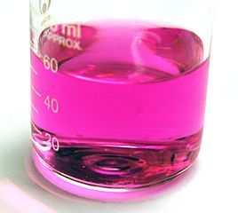

### Changes in mass (ESCN7)

For a reaction that produces gas, the mass of the reaction vessel can be measured over time.
                                The mass loss indicates the amount of gas that has been produced and escaped from the
                                reaction vessel (Figure
                                        7.7).

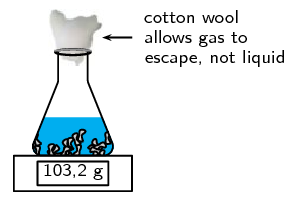

Figure 7.7: A change in mass indicating the loss of a gas (photo by tjmwatson
                                                on Flickr).

If the reaction vessel is sealed this method will not work.

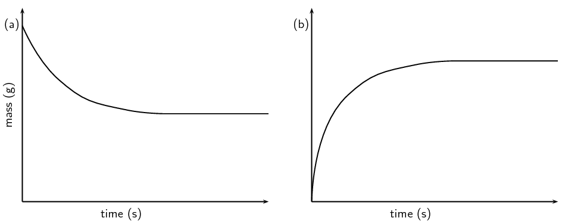

Figure 7.8: **a)** A graph of the sample mass versus time and
                                                **b)** a graph of the mass loss versus time.

Notice the difference between the two graphs in Figure 7.8. The mass of the sample will decrease as the
                                reaction proceeds. The mass lost from the sample will increase as the reaction proceeds.
                                The material lost (that accounts for the mass loss) can be collected and measured (for
                                example with the gas syringe method as shown in Figure 7.4).
