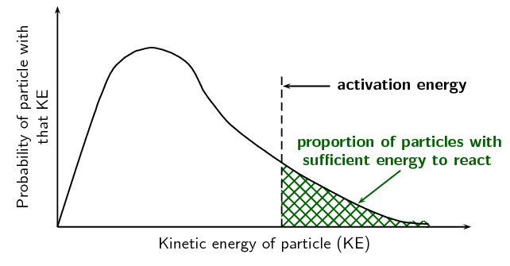
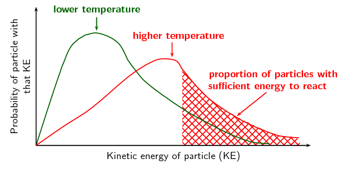
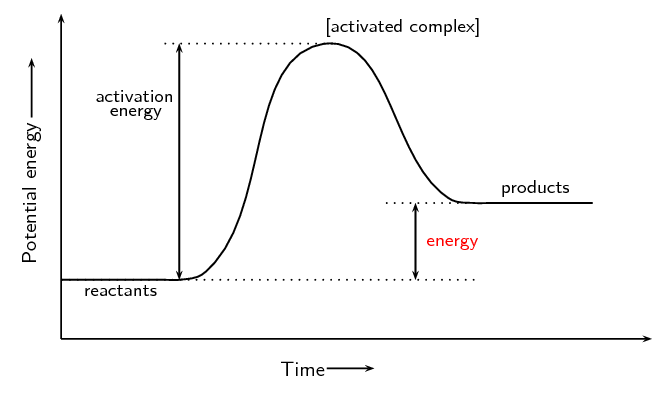
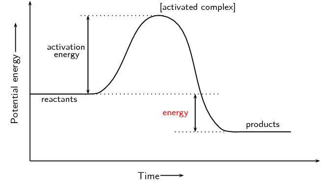
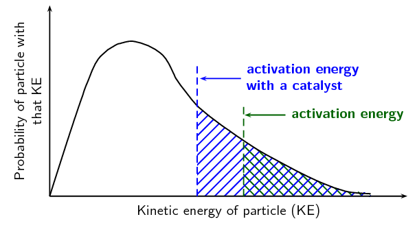
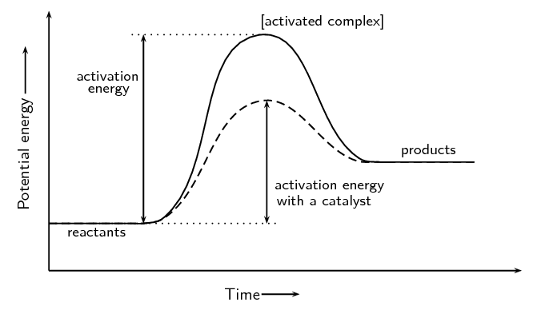

## 7.4 Mechanism of reaction and catalysis (ESCN8)

Earlier it was mentioned that it is the *collision* of particles that causes reactions to
                        occur and that only some of these collisions are successful. This is because the reactant
                        particles have a wide range of kinetic energies, and only a small fraction of the particles will
                        have enough energy (and the correct orientation) to actually break bonds so that a chemical
                        reaction can take place. The minimum energy that is needed for a reaction to take place is
                        called the **activation energy**. For more information on the energy of reactions,
                        refer to Grade 11 ([Chapter
                                12](http://www.everythingscience.co.za/grade-11/12-energy-and-chemical-change/12-energy-and-chemical-change-01.cnxmlplus)).

### Activation Energy (ESCN9)

Activation energy

The minimum energy required for a chemical reaction to proceed.

Even at a fixed temperature, the energy of the particles varies, meaning that only some of
                                them will have enough energy to be part of the chemical reaction, depending on the
                                activation energy for that reaction (Figure
                                        7.9). Increasing the reaction temperature has the effect of increasing the
                                number of particles with enough energy to take part in the reaction, and increasing the
                                reaction rate.

Figure 7.9: The distribution of particle kinetic energies at a fixed
                                                temperature.

Remember that a molecule must have energy greater than the activation energy, as well as the
                                correct orientation, for the reaction to take place.

Increasing the temperature of a reaction mixture raises the average kinetic energy of the
                                particles. As can be seen on the graph (Figure 7.10), a higher proportion of the particles can
                                now react making the reaction faster. With the increased movement of the molecules the
                                chances of a molecule having the correct orientation is also increased.

Figure 7.10: The distribution of particle kinetic energies with an increase
                                                in temperature. There is an increased number of particles with
                                                sufficient energy due to the higher temperature.

An *endothermic* reaction can be represented by:

\(\text{Reactants} + \color{red}{\text{Energy}} \to \text{Products}\) i.e. a reaction that
                                absorbs energy

This can be shown in an activation energy diagram (Figure
                                        7.11). These graphs are also sometimes called a reaction profile or a
                                potential energy graph.

Figure 7.11: An activation energy diagram with reactant energy lower than
                                                product energy, i.e. *endothermic*

An *exothermic* reaction can be represented by:

\(\text{Reactants}\to \text{Products} + \color{red}{\text{Energy}}\) i.e. a reaction that
                                releases energy

This can be shown in an activation energy diagram (Figure
                                        7.12):

Figure 7.12: An activation energy diagram with reactant energy greater than
                                                product energy, i.e. *exothermic*

Revise this section from Grade 11 ([Activation
                                        energy, Section 12.3](/read/science/grade-11/energy-and-chemical-change/12-energy-and-chemical-change-03)).

### How do catalysts work? (ESCNB)

A **catalyst** increases reaction rates in a slightly different way from other
                                methods of increasing reaction rate. The function of a catalyst is to lower the
                                activation energy so that a greater proportion of the particles have enough energy to
                                react. A catalyst can lower the activation energy for a reaction by:

- orienting the reacting particles in such a way that successful collisions are
                                                  more likely
- reacting with the reactants to form an intermediate that requires lower
                                                  energy to form the product

Some *metals* e.g. platinum, copper and iron can act as catalysts in certain
                                reactions. In our own bodies, we have *enzymes* that are catalysts, which help to
                                speed up biological reactions. Catalysts generally react with one or more of the
                                reactants to form a chemical intermediate, which then reacts to form the final product.
                                The chemical intermediate is sometimes called the **activated complex**.

<Callout type="tip" title="Note">
An activated complex occurs in reactions without catalysts as well as those with
                                        catalysts.
</Callout>

The following is an example of how a reaction involving a catalyst might proceed. A and B are
                                reactants, \(\color{blue}{\text{C}}\) is the catalyst, and D is the product of the
                                reaction of A and B.

**Step 1:** \({\text{A}} + \color{blue}{\text{C}} \to
                                \text{A}\color{blue}{\text{C}}\)

**Step 2:** \(\text{B} + \text{A}\color{blue}{\text{C}} \to
                                \text{A}\color{blue}{\text{C}}\text{B}\)

**Step 3:** \(\text{A}\color{blue}{\text{C}}\text{B} \to \color{blue}{\text{C}}
                                + \text{D}\)

\(\text{A}\color{blue}{\text{C}}\text{B}\) represents the intermediate chemical. Although the
                                catalyst (\(\color{blue}{\text{C}}\)) is consumed by reaction 1, it is later released
                                again by reaction 3, so that the overall reaction with a catalyst is as follows:

\(\text{A} + \text{B} + \color{blue}{\text{C}} \to \text{D} + \color{blue}{\text{C}}\)

You can see from this that the catalyst is released at the end of the reaction, completely
                                unchanged. Without a catalyst the overall reaction would be:

\(\text{A} + \text{B}\) \(\to\) \(\text{D}\)

The catalyst has provided an alternative set of reaction steps, which we refer to as an
                                alternative pathway. The pathway involving the catalyst requires less activation energy
                                and is therefore faster.

This can be seen in the following diagram (Figure 7.13).

Figure 7.13: The proportion of particles that have enough energy to react is
                                                increased in the presence of a catalyst.

Catalyst

A catalyst speeds up a chemical reaction, without being consumed by the
                                                reaction. It increases the reaction rate by lowering the activation
                                                energy for a reaction.

Energy diagrams are useful to illustrate the effect of a **catalyst** on
                                reaction rates. Catalysts decrease the activation energy required for a reaction to
                                proceed (shown by the smaller magnitude of the activation energy on the energy diagram
                                in Figure 7.14), and
                                therefore increase the reaction rate. Remember that with a catalyst, the average kinetic
                                energy of the molecules remains the same but the required energy decreases (Figure 7.13).

Figure 7.14: The effect of a catalyst on the activation energy of an
                                                endothermic reaction. The catalyst would act in the same way for an
                                                exothermic reaction.

## Reaction rates

### Textbook Exercise 7.4

For each of the following, say whether the statement is
                                                                **true** or **false**. If it
                                                                is false, re-write the statement correctly.

**Problem:**
A catalyst increases the energy of reactant molecules
                                                                        so that a chemical reaction can take place.

**Solution:**
False. A catalyst lowers the activation energy of a
                                                                        reaction, so that a chemical reaction can take
                                                                        place.

**Problem:**
Increasing the temperature of a reaction has the
                                                                        effect of increasing the number of reactant
                                                                        particles that have more energy than the
                                                                        activation energy.

**Solution:**
True

**Problem:**
A catalyst does not become part of the final product
                                                                        in a chemical reaction.

**Solution:**
True

\(\text{5}\) \(\text{g}\) of zinc pieces are added to
                                                                \(\text{400}\) \(\text{cm$^{3}$}\) of \(\text{0,5}\)
                                                                \(\text{mol·dm$^{-3}$}\) hydrochloric acid. To
                                                                investigate the average rate of the reaction, the change
                                                                in the mass of the flask containing the zinc and the
                                                                acid is measured by placing the flask on a direct
                                                                reading balance. The reading on the balance shows that
                                                                there is a decrease in mass during the reaction. The
                                                                reaction which takes place is given by the following
                                                                equation:

\(\text{Zn}(\text{s}) + 2\text{HCl}(\text{aq})\) \(\to\)
                                                                \(\text{ZnCl}_{2}(\text{aq}) + \text{H}_{2}(\text{g})\)

**Problem:**
Why is there a decrease in mass during the reaction?

**Solution:**
The reaction does not take place in a sealed
                                                                        container and so the hydrogen gas can escape
                                                                        from the reaction vessel.

**Problem:**
The experiment is repeated, this time using 5 g of
                                                                        powdered zinc instead of pieces of zinc. How
                                                                        will this influence the average rate of the
                                                                        reaction?

**Solution:**
The rate will increase since there will be a greater
                                                                        surface area of zinc to react with the acid.

**Problem:**
The experiment is repeated once more, this time using
                                                                        \(\text{5}\) \(\text{g}\) of zinc pieces and
                                                                        \(\text{600}\) \(\text{cm$^{3}$}\) of
                                                                        \(\text{0,5}\) \(\text{mol·dm$^{-3}$}\)
                                                                        hydrochloric acid. How does the average rate of
                                                                        this reaction compare with the
                                                                        **original** reaction rate?

**Solution:**
There is a larger volume of hydrochloric acid.
                                                                        However the concentration is not increased and
                                                                        so the reaction rate is unchanged.

**Problem:**
What effect would a catalyst have on the average rate
                                                                        of this reaction?

(IEB Paper 2 2003)

**Solution:**
The average rate of reaction would increase.

\(\text{5}\) \(\text{g}\) of calcium carbonate powder reacts
                                                                with \(\text{20}\) \(\text{cm$^{3}$}\) of a
                                                                \(\text{0,1}\) \(\text{mol·dm$^{-3}$}\) solution of
                                                                hydrochloric acid. The gas that is produced at a
                                                                temperature of \(\text{25}\)\(\text{°C}\) is
                                                                collected in a gas syringe.

**Problem:**
Write a balanced chemical equation for this reaction.

**Solution:**
\(\text{CaCO}_{3}(\text{s}) + 2\text{HCl}(ℓ)\)
                                                                        \(\to\) \(\text{CaCl}_{2}(\text{s}) +
                                                                        \text{CO}_{2}(\text{g}) +
                                                                        \text{H}_{2}\text{O}(ℓ)\)

The average rate of the reaction is determined by
                                                                measuring the volume of gas that is produced in
                                                                the first minute of the reaction. How would the
                                                                average rate of the reaction be affected if:

**Problem:**
a lump of calcium carbonate of the same mass
                                                                        is used

**Solution:**
The surface area is decreased, therefore the
                                                                        average rate of reaction would decrease.

**Problem:**
\(\text{20}\) \(\text{cm$^{3}$}\) of
                                                                        \(\text{0,2}\) \(\text{mol·dm$^{-3}$}\)
                                                                        hydrochloric acid is used

**Solution:**
The average rate of reaction depends on the
                                                                        concentration of liquid reactants and
                                                                        not on the volume. The concentration is
                                                                        increased however, so the rate will
                                                                        increase.
