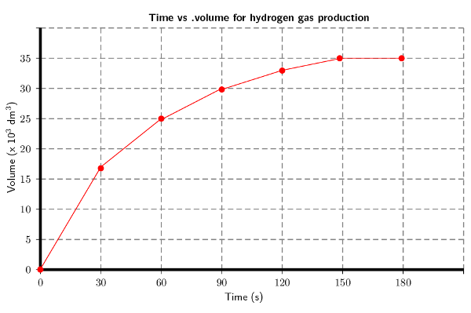
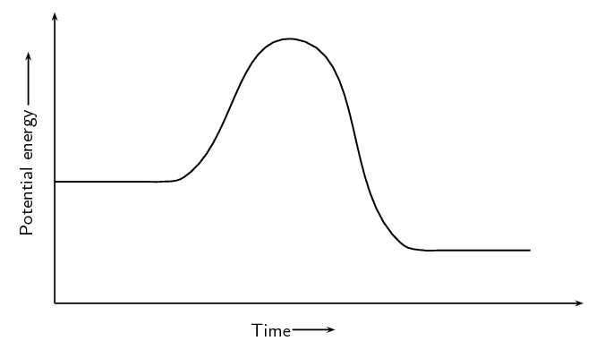
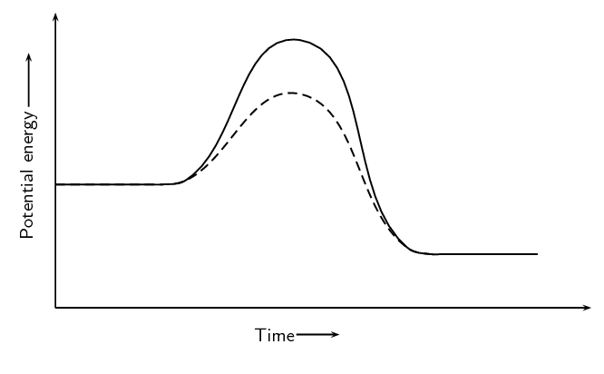
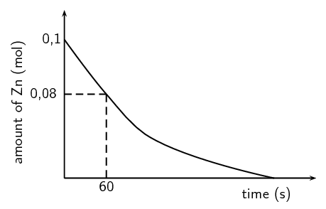
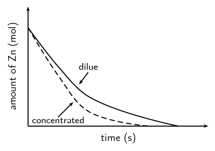

### Textbook Exercise 7.5

Explain the following:

**Problem:**
Reaction rate

**Solution:**
The reaction rate describes how quickly reactants are used up or how
                                                        quickly products are formed.

**Problem:**
Collision theory

**Solution:**
Reactant particles must collide with the correct energy and
                                                        orientation for the reactants to change into products.

For a reaction to occur the reactant particles must:

- collide
- have enough energy
- have the right orientation at the moment of impact

**Problem:**
Activation energy

**Solution:**
The minimum energy required for a chemical reaction to proceed.

**Problem:**
Catalyst

**Solution:**
A catalyst speeds up a chemical reaction. It increases the reaction
                                                        rate by lowering the activation energy for a reaction and
                                                        remains unchanged after the reaction is complete.

**Problem:**
\(2\text{Mg}(\text{s}) + \text{O}_{2}(\text{g})\) \(\to\)
                                                \(2\text{MgO}(\text{s})\)

\(\text{1}\) \(\text{g}\) of \(\text{Mg}\) is oxidised. The reaction takes 1
                                                day to reach completion. Which is the correct reaction rate for the
                                                oxidation of \(\text{Mg}\)?

2. \(\text{2,87} \times \text{10}^{-\text{7}}\)
                                                                   \(\text{mol·s$^{-1}$}\)
4. \(\text{1,74} \times \text{10}^{-\text{3}}\)
                                                                   \(\text{mol·s$^{-1}$}\)
6. \(\text{4,76} \times \text{10}^{-\text{7}}\)
                                                                   \(\text{mol·s$^{-1}$}\)
8. \(\text{3,62} \times \text{10}^{-\text{7}}\)
                                                                   \(\text{mol·s$^{-1}$}\)

**Solution:**
M(Mg) = \(\text{24,3}\) \(\text{g·mol$^{-1}$}\)

n = \(\dfrac{\text{m (g)}}{\text{M (g·mol}^{-1}{\text{)}}} =
                                                \dfrac{\text{1}
                                                \text{ g}}{\text{24,3} {\text{ g·mol}}^{-1}}\) = \(\text{0,0412}\)
                                                \(\text{mol}\)

time = \(\text{1}\) \(\text{day}\) \(\times \dfrac{\text{24} {\text{
                                                hours}}}{\text{1} {\text{ day}}}\) = \(\text{24}\) \(\text{hours}\)
                                                \(\times \dfrac{\text{60} {\text{ minutes}}}{\text{1} {\text{ hour}}}\)
                                                = \(\text{1,44} \times \text{10}^{\text{3}}\) \(\text{minutes}\)
                                                \(\times \dfrac{\text{60} {\text{ seconds}}}{\text{1} {\text{
                                                minute}}}\) = \(\text{8,64} \times \text{10}^{\text{4}}\) \(\text{s}\)

reaction rate = \(\dfrac{\text{n (mol)}}{\text{t (s)}} = \dfrac{\text{0,0412}
                                                {\text{ mol}}}{\text{8,64} \times \text{10}^{\text{4}} {\text{ s}}}\) =
                                                **c)** \(\text{4,76} \times \text{10}^{-\text{7}}\)
                                                \(\text{mol·s$^{-1}$}\)

\(\text{10}\) \(\text{g}\) of magnesium ribbon reacts with a \(\text{0,15}\)
                                                \(\text{mol·dm$^{-3}$}\) solution of hydrochloric acid at a
                                                temperature
                                                of \(\text{25}\) \(\text{℃}\).

**Problem:**
Write a balanced chemical equation for the reaction.

**Solution:**
\(\text{Mg}(\text{s}) + 2\text{HCl}(\text{aq})\) \(\to\)
                                                        \(\text{MgCl}_{2}(\text{aq}) + \text{H}_{2}(\text{g})\)

**Problem:**
State **two** ways of increasing the average rate of
                                                        production of \(\text{H}_{2}\) (g).

**Solution:**
Cut the magnesium into small pieces, increase the concentration of
                                                        hydrochloric acid.

A table of the results is given below:

| Time elapsed (min) | Vol of \(\text{H}_{2}\)(g)
                                                                                (\(\text{cm$^{3}$}\)) |
| --- | --- |
| \(\text{0}\) | \(\text{0}\) |
| \(\text{0,5}\) | \(\text{17}\) |
| \(\text{1,0}\) | \(\text{25}\) |
| \(\text{1,5}\) | \(\text{30}\) |
| \(\text{2,0}\) | \(\text{33}\) |
| \(\text{2,5}\) | \(\text{35}\) |
| \(\text{3,0}\) | \(\text{35}\) |

**Problem:**
Plot a graph of volume versus time for these results.

**Solution:**
Remember to convert time to seconds and volume to
                                                                \(\text{dm$^{3}$}\):

**Problem:**
Explain the shape of the graph during the following two time
                                                                intervals: t = \(\text{0}\) to t = \(\text{120}\)
                                                                \(\text{s}\) and then t = \(\text{150}\) and t =
                                                                \(\text{180}\) \(\text{s}\) by referring to the volume
                                                                of \(\text{H}_{2}\) (g) produced.

(IEB Paper 2, 2001)

**Solution:**
There is a sharp increase in the volume of hydrogen gas
                                                                produced for the first 120 seconds. This is when the
                                                                reaction is starting and there are lots of reactants.
                                                                Between 150 and 180 seconds equilibrium is established
                                                                and so the volume of hydrogen gas that has been produced
                                                                remains constant.

**Problem:**
Consider the following reaction, which takes place in a closed container:

\(\text{A}(\text{s}) + \text{B}(\text{g})\) \(\to\) \(\text{AB}(\text{g})\)

If you wanted to increase the average rate of the reaction, which of the
                                                following would you do?

2. decrease the concentration of B
4. grind A into a fine powder
6. decrease the pressure

(IEB Paper 2, 2002)

**Solution:**
**b)** grind A to a fine powder

Consider the following reaction and calculate the reaction rates for the
                                                situations that follow:

\(2\text{N}_{2}\text{O}_{5}(\text{g})\) \(\to\)
                                                        \(4\text{NO}_{2}(\text{g}) + \text{O}_{2}(\text{g})\)

**Problem:**
\(\text{1,35}\) \(\text{mol}\) \(\text{N}_{2}\text{O}_{5}\)
                                                                is used and the reaction goes to completion in 30
                                                                minutes.

**Solution:**
time = \(\text{30}\) \(\text{minutes}\) \(\times
                                                                \dfrac{\text{60} {\text{ s}}}{\text{1} {\text{
                                                                minute}}}\) = \(\text{1 800}\) \(\text{s}\)

reaction rate of \(\text{N}_{2}\text{O}_{5}\) used is =
                                                                \(=\dfrac{\text{1,35}\text{
                                                                mol}}{\text{1 800}\text{ s}}=\) \(\text{7,5} \times
                                                                \text{10}^{-\text{4}}\) \(\text{mol·s$^{-1}$}\)

**Problem:**
\(\text{2,7}\) \(\text{mol}\) \(\text{N}_{2}\text{O}_{5}\) is
                                                                used instead and the reaction goes to completion in 60
                                                                minutes.

**Solution:**
time = \(\text{60}\) \(\text{minutes}\) \(\times
                                                                \dfrac{\text{60} {\text{ s}}}{\text{1} {\text{
                                                                minute}}}\) = \(\text{3 600}\) \(\text{s}\)

reaction rate of \(\text{N}_{2}\text{O}_{5}\) used is =
                                                                \(=\dfrac{\text{2,7}\text{ mol}}{\text{3 600}\text{
                                                                s}}=\) \(\text{7,5} \times \text{10}^{-\text{4}}\)
                                                                \(\text{mol·s$^{-1}$}\)

\(\text{CaCO}_{3}(\text{s}) + 2\text{HCl}(\text{aq})\) \(\to\)
                                                        \(4\text{NO}_{2}(\text{g}) + \text{O}_{2}(\text{g})\)

**Problem:**
\(\text{2}\) \(\text{g}\) of \(\text{CaCO}_{3}\) is placed in
                                                                excess \(\text{HCl}\). The reaction goes to completion
                                                                over 4 hours.

**Solution:**
M(\(\text{CaCO}_{3}\)) = (\(\text{40,1}\) + \(\text{12}\) +
                                                                \(\text{3}\) x \(\text{16}\))
                                                                \(\text{g·mol$^{-1}$}\) =
                                                                \(\text{100,1}\) \(\text{g·mol$^{-1}$}\)

\(n=\dfrac{m}{M}=\dfrac{2 {\text{ g}}}{\text{100,1}\text{
                                                                g·mol$^{-1}$}}=\text{0,02}\text{ mol}\)

time = \(\text{4}\) \(\text{hours}\) \(\times
                                                                \dfrac{\text{60} {\text{ minutes}}}{\text{1} {\text{
                                                                hour}}}\) = \(\text{240}\) \(\text{minutes}\) \(\times
                                                                \dfrac{\text{60} {\text{ s}}}{\text{1} {\text{
                                                                minute}}}\) = \(\text{14 400}\) \(\text{s}\)

reaction rate \(\text{CaCO}_{3}\) used is =
                                                                \(=\dfrac{\text{0,02}\text{
                                                                mol}}{\text{14 400}\text{ s}}=\) \(\text{1,39}
                                                                \times \text{10}^{-\text{6}}\)
                                                                \(\text{mol·s$^{-1}$}\)

**Problem:**
The concentration of the \(\text{HCl}\) is increased and so
                                                                the reaction takes \(\text{2,5}\) \(\text{hours}\)
                                                                instead.

**Solution:**
M(\(\text{CaCO}_{3}\)) = \(\text{100,1}\)
                                                                \(\text{g·mol$^{-1}$}\)

\(n=\dfrac{m}{M}=\text{0,02}\text{ mol}\)

time = \(\text{2,5}\) \(\text{hours}\) \(\times
                                                                \dfrac{\text{60} {\text{ minutes}}}{\text{1} {\text{
                                                                hour}}}\) = \(\text{150}\) \(\text{minutes}\) \(\times
                                                                \dfrac{\text{60} {\text{ s}}}{\text{1} {\text{
                                                                minute}}}\) = \(\text{9 000}\) \(\text{s}\)

reaction rate \(\text{CaCO}_{3}\) used is =
                                                                \(\dfrac{\text{0,02}\text{ mol}}{\text{9 000}\text{
                                                                s}}=\) \(\text{2,22} \times \text{10}^{-\text{6}}\)
                                                                \(\text{mol·s$^{-1}$}\)

**Problem:**
\(\text{3,3}\) \(\text{g}\) of \(\text{CaCO}_{3}\) is used
                                                                with a dilute \(\text{HCl}\). \(\text{0,6}\)
                                                                \(\text{g}\) of solid \(\text{CaCO}_{3}\) remains after
                                                                \(\text{4,7}\) hours.

**Solution:**
M(\(\text{CaCO}_{3}\)) = \(\text{100,1}\)
                                                                \(\text{g·mol$^{-1}$}\)

m of \(\text{CaCO}_{3}\) used during the reaction =
                                                                \(\text{3,3}\) - \(\text{0,6}\) = \(\text{2,7}\)
                                                                \(\text{g}\)

\(n=\dfrac{m}{M}=\dfrac{\text{2,7}\text{
                                                                g}}{\text{100,1}\text{
                                                                g·mol$^{-1}$}}=\text{0,027}\text{
                                                                mol}\)

time = \(\text{4,7}\) \(\text{hours}\) \(\times
                                                                \dfrac{\text{60} {\text{ minutes}}}{\text{1} {\text{
                                                                hour}}}\) = \(\text{282}\) \(\text{minutes}\) \(\times
                                                                \dfrac{\text{60} {\text{ s}}}{\text{1} {\text{
                                                                minute}}}\) = \(\text{16 920}\) \(\text{s}\)

reaction rate = \(\dfrac{\text{0,027}\text{
                                                                mol}}{\text{16 920}\text{ s}}=\) \(\text{1,6}
                                                                \times \text{10}^{-\text{6}}\)
                                                                \(\text{mol·s$^{-1}$}\)

**Problem:**
Given:

A catalyst is added to this reaction. On the same set of axes draw the graph
                                                to represent this.

**Solution:**

A group of learners use the reaction between zinc and sulfuric acid to
                                                investigate one of the factors that affects reaction rate. The equation
                                                below represents the reaction that takes place.

\(\text{Zn}(\text{s}) + \text{H}_{2}\text{SO}_{4}(\text{aq})\) \(\to\)
                                                \(\text{ZnSO}_{4}(\text{aq}) + \text{H}_{2}(\text{g})\)

They add \(\text{6,5}\) \(\text{g}\) of zinc granules to excess
                                                *dilute* sulfuric acid and measure the mass of zinc used per unit
                                                time.

The learners then repeat the experiment using excess *concentrated*
                                                sulfuric acid.

The results obtained for the reaction using *dilute* sulfuric acid are
                                                represented in the graph below:

**Problem:**
Define the term *reaction rate*

**Solution:**
Amount of reactants used per unit time *or* amount of products
                                                        formed per unit time.

**Problem:**
Give a reason why the acid must be in excess

**Solution:**
To ensure that (nearly) all zinc is used up *or* to ensure
                                                        that zinc is a limiting reagent (and the acid is not a limiting
                                                        reagent).

**Problem:**
Write down a hypothesis for this investigation.

**Solution:**
(Learners must correctly identify the **dependent and
                                                                independent** variables. They must predict the
                                                        **correct relationship** between these variables)

Reaction rate increases with increase in concentration.

Reaction rate decreases with decrease in concentration.

Reaction rate is directly proportional to concentration.

The higher the concentration the faster the average rate of the
                                                        reaction.

**Problem:**
Give a reason why the learners must use the same amount of *zinc
                                                                granules* in both experiments.

**Solution:**
To make it a fair test.

or

Ensure validity (reliability) of results.

or

So that the contact/surface area may not influence the reaction rate.
                                                        The surface area must not change.

or

It is the controlled variable.

or

To ensure there is only one independent variable.

**Problem:**
Using the graph, calculate the mass of zinc used from t = 0 s to t =
                                                        60 s.

**Solution:**
Number of moles used = \(\text{0,1}\) - \(\text{0,08}\) =
                                                        \(\text{0,02}\) \(\text{mol}\)

M(Zn) = \(\text{65,4}\) \(\text{g}\)

\(\text{n}=\dfrac{\text{m}}{\text{M}}\), therefore m = n x M

m = \(\text{0,02}\) \(\text{mol}\) x \(\text{65,4}\)
                                                        \(\text{gmol$^{-1}$}\) = \(\text{1,31}\) \(\text{g}\)

**Problem:**
Calculate the average rate of the reaction (in grams per second)
                                                        during the first 60 s.

**Solution:**
Average rate = \(\dfrac{\text{mass Zn used (g)}}{\text{time (s)}} =
                                                        \dfrac{\text{1,31}\text{ g}}{\text{60}\text{ s}}\)

= \(\text{0,022}\) \(\text{g.s$^{-1}$}\)

**Problem:**
Copy the above graph and *on the same set of axes* use a
                                                        dotted line to show the curve that will be obtained when
                                                        concentrated sulfuric acid is used. No numerical values are
                                                        required.

(NSC, Paper 2, 2011)

**Solution:**
**Criteria for graph** - Concentrated sulfuric graph has
                                                        steeper slope than original graph and intercepts with x-axis
                                                        earlier.

