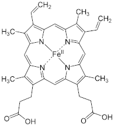
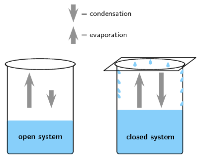
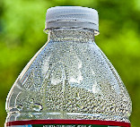
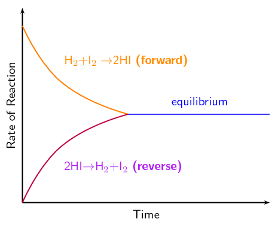

# Chapter 8: Chemical equilibrium

In this chapter learners will explore the concept of chemical equilibrium in detail. Before starting
                        this chapter it is essential that the learners have a thorough understanding of rates of
                        reactions and chemical kinetics as covered in Chapter 7. In Grade 11 the definition of
                        equilibrium in physics was covered, it is important that the learners understand the difference
                        between this and a dynamic, chemical equilibrium.

The following topics are covered in this chapter.

- **What the term *chemical equilibrium* means**
  In this section learners will be introduced to the concept of chemical equilibrium
                                          including everyday examples. Covered under this introduction are the concepts of
                                          open and closed systems, and the fact that reactions cannot reach equilibrium in
                                          an open system. Chemical equilibrium reactions require reversible reactions that
                                          can form a dynamic equilibrium, these concepts are also covered here.
- **The equilibrium constant**
  The equilibrium constant is used to determine whether reactants or products are
                                          favoured in a reaction at chemical equilibrium. Aside from introducing the
                                          meaning of \(\text{K}_{\text{c}}\) values, this section will require the
                                          learners to calculate equilibrium constants from known concentrations, as well
                                          as to calculate the concentrations of reactants and products. To do that they
                                          should use a RICE table. The acronym makes it easier for learners to remember
                                          the information necessary, and the table helps them to organise the information
                                          they have and see what information they still need.
  It is important that learners have a thorough understanding of equilibrium constants
                                          before they begin Chapter 9.
- **Le Chatelier's principle**
  The concept of understanding how a reaction will be affected by an external stress,
                                          without actually doing an experiment, is quite abstract and the learners often
                                          struggle with it. Lots of examples with different reactions would be a good idea
                                          here to make sure they understand the concepts, before you move on to the more
                                          advanced interpretations of graphs. The Haber process could be used as an
                                          example to make sure they understand the concepts, before you move on to that
                                          section.

The informal assessment in this chapter requires the use of concentrated hydrochloric acid. The
                        learners should be properly instructed on the correct use of safety equipment, including safety
                        goggles, gloves and protective clothing. They should also be reminded not to sniff any chemicals
                        as the fumes can be dangerous as well. More information on laboratory procedures as well as
                        safety precautions is provided in Chapter 1 (Science skills). The inital solution at room
                        temperature should be purple. When heated the solution should turn a deep blue, and when cooled
                        it should turn a pink or red colour.

Systems in equilibrium are balanced. For example, if you are running on a treadmill you are in constant
                motion. However, you are not moving forward or backwards. As fast as you run forward the treadmill is
                moving you backwards. You are in equilibrium with the treadmill.

In the same way chemical reactions can be in equilibrium (the products and reactants are produced at the same
                rate). We will begin by exploring chemical equilibrium in more detail. Ways of measuring equilibrium and
                the factors that affect equilibrium will be covered.

## 8.1 What is chemical equilibrium? (ESCND)

To define chemical equilibrium we need to ask some important questions about reactions:

2. Does a reaction always run its full course so that all the reactants are used up?
   - When all the reactants in a reaction are used up the reaction is said to
                                                     have **gone to completion**. However, in some reactions not
                                                     all the reactants are used. \(\color{red}{\textbf{Not all reactions go
                                                     to completion}}\).
4. Does a reaction always proceed in the same direction or can it be reversed? In other
                                           words, does a reaction always proceed *reactants \(\to\) products*, or is
                                           it possible that a reaction will reverse and go *products \(\to\)
                                                   reactants*?
   - Reactions that go to completion are *irreversible*. However, in
                                                     some reactions the reactants form products (in a
                                                     \(\color{red}{\textbf{forward reaction}}\)), and the products can change
                                                     back into reactants (in a \(\color{red}{\textbf{reverse reaction}}\)).
6. Can a reaction reach a point where reactants are still present, but there does not
                                           seem to be any further change taking place in the reaction?
   - In all reactions, as the amount of reactant in a reaction decreases
                                                             the product is formed more slowly. In a reversible reaction, as
                                                             the amount of product increases the reactant is formed more
                                                             quickly. Eventually the rate of the forward reaction (reactants
                                                             \(\to\) products) equals the rate of the reverse reaction
                                                             (products \(\to\) reactants).
     At this point there \(\color{red}{\textbf{are still reactants
                                                             present}}\) but there does not *appear* to be any further
                                                             change taking place. The reaction is said to be in
                                                             \(\color{blue}{\textbf{chemical}}\)
                                                             \(\color{blue}{\textbf{equilibrium}}\).

Chemical equilibrium is the state of a reversible reaction where the rate of the forward reaction
                        equals the rate of the reverse reaction. While a reaction is in equilibrium the concentration of
                        the reactants and products are constant.

Chemical equilibrium

A reaction is in chemical equilibrium when the rate of the forward reaction equals
                                        the rate of the reverse reaction.

There are many examples of chemical equilibrium all around you. One example is a bottle of fizzy
                        cooldrink. In the bottle there is carbon dioxide (\(\text{CO}_{2}\)) dissolved in the liquid.
                        There is also \(\text{CO}_{2}\) gas in the space between the liquid and the cap. There is a
                        constant movement of \(\text{CO}_{2}\) from the liquid to the gas phase, and from the gas phase
                        into the liquid. However, if you look at the bottle there does not appear to be any change. The
                        system is in equilibrium.

\[\text{CO}_{2}(\text{g}) + \text{H}_{2}\text{O}(\text{l}) \rightleftharpoons
                        \text{H}_{2}\text{CO}_{3}(\text{aq})\]

Without chemical equilibrium life as we know it would not be possible. Another example of equilibrium
                        in our everyday lives goes on within our very bodies. Haemoglobin is a macromolecule that
                        transports oxygen around our bodies. Without it we would not survive. The haemoglobin has to be
                        able to take up oxgen, but also to release it and this is done through changes in the chemical
                        equilibrium of this reaction in different places in our bodies.

\[ \text{haemoglobin(aq)} + 4\text{O}_{2}(\text{g}) \rightleftharpoons
                        \text{haemoglobin}(\text{O}_{2})_{4}(\text{aq})\]

<Callout type="note" title="Note">
Haemoglobin, inside red blood cells in the lungs, bonds with oxygen. This
                                *oxyhaemoglobin* moves with the red blood cells through the blood stream to cells
                                throughout the body.

</Callout>

This video is a good demonstration of how a reaction reaches equilibrium with time.

<Callout type="note" title="Note">
<VideoPlayer src="http://www.youtube.com/embed/C5jDmG4nVV8" title="Video: 27VF" />
</Callout>

### Open and closed systems (ESCNF)

The important thing for the students to understand in this experiment is that there
                                        is constant movement. Molecules at the surface of the water in the closed beaker
                                        are constantly evaporating, and gas molecules are constantly condensing. There
                                        is no change in the level of the liquid and the total number molecules in the
                                        liquid and the gas state remain constant.

Point out that the level of water in the sealed container also drops initially,
                                        before finally remaining constant. This concept will help learners understand
                                        how the rate of the forward reaction decreases until equilibrium is reached.

## Liquid-gas phase equilibrium

### Apparatus

- 2 beakers, glass cover
- water

### Method

2. Half-fill two beakers with water and mark the level of the
                                                                   water in each case.
4. Cover one of the beakers with a glass cover.
6. Leave the beakers and, over the course of a day or two,
                                                                   observe how the water levels in the two beakers change.
                                                                   What do you notice? Note: You could speed up this
                                                                   demonstration by placing the two beakers over a Bunsen
                                                                   burner, or in direct sunlight, to heat the water.

### Observations

You should notice that in the beaker that is uncovered, the water level drops
                                                more quickly than in the covered beaker. This is because of evaporation.
                                                In the beaker that is covered, there is an initial drop in the water
                                                level, but after a while evaporation appears to stop and the water level
                                                in this beaker is higher than that in the one that is open.

### Discussion

In the first beaker, liquid water becomes water vapour as a result of
                                                evaporation and the water level drops. A small amount of gas molecules
                                                will condense again, but because the gas molecules can escape from the
                                                system there is much less condensation than evaporation.

In the second beaker, evaporation also takes place. However, in this case,
                                                the vapour comes into contact with the surface of the glass cover and it
                                                cools and condenses to form liquid water again. This water is returned
                                                to the beaker. Once condensation has begun, the rate at which the water
                                                level drops will start to decrease. At some point, the rate of
                                                evaporation will be equal to the rate of condensation, and there will be
                                                no change in the water level in the beaker. This can be represented as
                                                follows:

**\(\text{liquid} \rightleftharpoons \text{vapour}\)**

In this example, the reaction (in this case, a change in the phase of water)
                                                can proceed in either direction. In the forward direction there is a
                                                change in phase from liquid to gas, present here as water vapour. A
                                                reverse change can also take place, when vapour condenses to form liquid
                                                again.

<Callout type="note" title="Note">
**Evaporation** is when a substance goes from the liquid phase to the
                                        gas phase (it evaporates). **Condensation** is when a substance
                                        goes from the gas phase to the liquid phase (it condenses).

The bottle contains water vapour (gas) and water droplets are condensing on the side
                                        of the bottle.

</Callout>

An **open system** is one in which matter or energy can flow into or out of the
                                system. In the liquid-gas demonstration we used, the first beaker was an example of an
                                open system because the beaker could be heated or cooled (a change in *energy*),
                                and water vapour (the *matter*) could evaporate from the beaker.

Open system

An *open system* is one whose borders allow the movement of
                                                **energy and matter** into and out of the system.

A **closed system** is one in which energy can enter or leave, but matter
                                cannot. The second beaker with the glass cover is an example of a closed system. The
                                beaker can still be heated or cooled, but water vapour cannot leave the system because
                                the glass cover is a barrier. Condensation changes the vapour to liquid and returns it
                                to the beaker. In other words, there is no loss of matter from the system.

<Callout type="note" title="Note">
Generally, some of the molecules at the surface of liquids and solids are moving into
                                        the gas phase. This means that matter is leaving the system. However, this is
                                        such a small fraction of the total volume of the liquid or solid that a reaction
                                        involving only solids or liquids can be considered a closed system.
</Callout>

<Callout type="note" title="Note">
It is useful to simplify situations in science by dividing the world into the
                                        *system* we are studying, and the surrounding environment that might
                                        influence the reaction, but is not part of it.
</Callout>

Closed system

A *closed system* is one in which **only energy** can
                                                move into and out of the system. Matter cannot be gained by the system
                                                nor lost from the system.

In a **closed system** it is possible for reactions to be reversible, such as in the
                        demonstration above. In a closed system, it is also possible for a chemical reaction to reach
                        **equilibrium**.

### Reversible reactions (ESCNG)

Some reactions can take place in two directions. In one direction the reactants combine to
                                form the products. This is called the **\(\color{orange}{\text{forward
                                        reaction}}\)**. In the other direction, the products react to form the
                                reactants again. This is called the **\(\color{purple}{\text{reverse
                                        reaction}}\)**. A special double-headed arrow ( \(\rightleftharpoons\))
                                is used to show this type of **\(\color{blue}{\text{reversible
                                        reaction}}\)**:

\[\text{XY} + \text{Z} \rightleftharpoons \text{X} + \text{YZ}\]

A reversible reaction

A reversible reaction is a chemical reaction that can proceed in both the
                                                forward and reverse directions. In other words, the reactants and
                                                products of the reaction may reverse roles.

<Callout type="note" title="Note">
Remember that \(\to\) implies that A goes to B and cannot become A again.
                                        \(\rightleftharpoons\) implies that the reaction is reversible. A can go to B
                                        and B can go to A.
</Callout>

So, in the following reversible reaction:

\[\overset{{\color{orange}{\textbf{forward}\longrightarrow}}}{\text{H}_{2}\text{(g)} +
                                \text{I}_{2}\text{(g)}} {\color{blue}{\rightleftharpoons}}
                                \underset{\color{purple}{\longleftarrow\textbf{reverse}}}{2\text{HI(g)}}\]

\(\color{orange}{{\text{H}}_{2}{\text{(g)}} + {\text{I}}_{2}{\text{(g)}} \to
                                {\text{2HI(g)}}}\) is the *\(\color{orange}{\text{forward}}\)* reaction.

The forward reaction is always taken from the given equation and written:
                                **left** to **right**.

\(\color{purple}{{\text{2HI(g)}} \to {\text{H}}_{2}{\text{(g)}} +
                                {\text{I}}_{2}{\text{(g)}}}\) is the *\(\color{purple}{\text{reverse}}\)*
                                reaction.

The reverse reaction is always taken from the given equation and written:
                                **right** to **left**.

## Chemical equilibrium

### Textbook Exercise 8.1

Which of the following situations describes a closed system?

**Problem:**
2. A pot of water (without a lid) heated
                                                                                           to
                                                                                           \(\text{80}\)\(\text{°C}\)
4. A pot of water (with a lid) heated to
                                                                                           \(\text{80}\)\(\text{°C}\)

**Solution:**
The water is being heated, therefore there is water
                                                                        in the liquid and the gas phase. The water
                                                                        vapour can leave the pot (system) if there is no
                                                                        lid.

ii) A closed pot of water (with a lid) heated to
                                                                        \(\text{80}\)\(\text{°C}\)

**Problem:**
2. \(\text{NaCl}(\text{aq}) +
                                                                                           \text{AgNO}_{3}(\text{aq})\)
                                                                                           \(\to\)
                                                                                           \(\text{NaNO}_{3}(\text{aq}) +
                                                                                           \text{AlCl}(\text{s})\)
   in an open container.
4. \(2\text{CO}(\text{g}) +
                                                                                           \text{MoO}_{2}(\text{s})\)
                                                                                           \(\to\)
                                                                                           \(2\text{CO}_{2}(\text{g}) +
                                                                                           \text{Mo}(\text{s})\)
   in an open container.

**Solution:**
Assume that none of the solid or liquid reactants or
                                                                        products go into the gas phase.

i) \(\text{NaCl}(\text{aq}) +
                                                                        \text{AgNO}_{3}(\text{aq})\) \(\to\)
                                                                        \(\text{NaNO}_{3}(\text{aq}) +
                                                                        \text{AlCl}(\text{s})\)

For the reaction: \(\text{A} + \text{B}\)
                                                                \(\rightleftharpoons\) \(\text{C} + \text{D}\)

**Problem:**
Write down the forward reaction

**Solution:**
\(\text{A} + \text{B}\) \(\rightarrow\) \(\text{C} +
                                                                        \text{D}\)

**Problem:**
Write down the reverse reaction

**Solution:**
\(\text{C} + \text{D}\) \(\rightarrow\) \(\text{A} +
                                                                        \text{B}\)

**Problem:**
This reaction is said to be ....... (fill in the
                                                                        missing word)

**Solution:**
This reaction is said to be reversible

### Dynamic equilibrium (ESCNH)

We will use the same reversible reaction that we used in an earlier example:

\[\color{blue}{\text{H}_{2}{\text{(g)}} + {\text{I}}_{2}{\text{(g)}} \rightleftharpoons
                                {\text{2HI(g)}}}\]

The \(\color{orange}{\text{forward}}\) reaction is: \(\color{orange}{\text{H}_{2}{\text{(g)}}
                                + {\text{I}}_{2}{\text{(g)}} \to {\text{2HI(g)}}}\)

The \(\color{purple}{\text{reverse}}\) reaction is: \(\color{purple}{\text{2HI(g)} \to
                                {\text{H}}_{2}{\text{(g)}} + {\text{I}}_{2}{\text{(g)}}}\)

When the rate of the forward reaction and the rate of the reverse reaction are equal, the
                                system is said to be in **\(\color{blue}{\text{equilibrium}}\)**. Figure 8.1 shows
                                this. Initially (time = \(\text{0}\)), the rate of the \(\color{orange}{\text{forward
                                reaction}}\) is high (fast). With time, the rate of the \(\color{orange}{\text{forward
                                reaction decreases}}\). As the reaction gets closer to equilibrium the rate of decrease
                                levels out until the forward reaction has a constant rate.

Initially the rate of the \(\color{purple}{\text{reverse reaction}}\) is low (slow). As the
                                reaction proceeds with time, the rate of the \(\color{purple}{\text{reverse reaction
                                increases}}\). As the reaction progresses the rate of increase levels out until the
                                reverse reaction has a constant rate.

At this point the forward and reverse reaction rates are equal and this is called
                                \(\color{blue}{\textbf{equilibrium}}\).

Figure 8.1: The change in rate of \(\color{orange}{\text{forward}}\) and
                                                \(\color{purple}{\text{reverse}}\) reactions in a closed system.

Although it is not always possible to observe any macroscopic changes, this does not mean
                                that the reaction has stopped. The forward and reverse reactions continue to take place
                                and so microscopic changes still occur in the system. This state is called
                                **dynamic equilibrium**.

Dynamic equilibrium

There is a dynamic equilibrium in a reversible reaction when the rate of the
                                                forward reaction equals the rate of the reverse reaction. The amounts of
                                                reactants and products remain constant.

In the liquid-gas phase equilibrium demonstration, dynamic equilibrium was reached when there
                                was no observable change in the level of the water in the second beaker even though
                                evaporation and condensation continued to take place.

For more information on dynamic equilibriums watch this video:

<Callout type="note" title="Note">
<VideoPlayer src="http://www.youtube.com/embed/yFqYrBxbURY" title="Video:
                                                27VJ" />
</Callout>

<QuizCard id="s12-08-01b" title="Interactive Exercise 8.2" question="The following graph can be drawn to represent the change in the rate of the reaction with time. NOTE: The graph is not drawn to scale. Label the graph by selecting the correct letters for each label given." options=["X", "Y", "Z", "X", "Y", "Z", "X", "Y", "Z"] answer="1, 0, 2" hint="" explanation="Recall what you know about how rates of reaction change with time When we draw a graph of reaction rates against time for a reaction that reaches equilibrium we note the following: Initially the rate of the forward reaction is high (fast). With time, the rate of the forward reaction decreases. As the reaction gets closer to equilibrium the rate of decrease levels out until the forward reaction has a constant rate. Initially the rate of the reverse reaction is zero. As the reaction proceeds with time, the rate of the reverse reaction increases (as there are now products to form reactants). As the reaction progresses the rate of increase levels out until the reverse reaction has a constant rate. The point where the forward and reverse reaction rates are equal is when equilibrium is reached. Choose the correct labels Therefore we can label the graph as follows: Label Y represents the forward reaction. Label X represents the reverse reaction. Label Z represents the rates when the reaction is in equilibrium. Submit your answer as: Y and X and Z" />
