## 8.3 Le Chatelier's principle (ESCNN)

Any factor that can affect the rate of either the forward or reverse reaction relative to the other
                        can potentially affect the equilibrium position. The following factors can change the chemical
                        equilibrium position of a reaction:

- **concentration**
- **temperature**
- **pressure** (for gaseous reactants)

It is important to understand what effect a change in one of these factors will have on a system that
                        is in chemical equilibrium. However, performing an experiment every time to find out would waste
                        a lot of time. Towards the end of the 1800s the French chemist Henry Louis Le Chatelier came up
                        with principle to predict those effects.

<Callout type="note" title="Note">
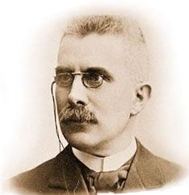

Henry Louis Le Chatelier.
</Callout>

**Le Chatelier's Principle** helps to predict what effect a change in temperature,
                        concentration or pressure will have on the position of the equilibrium in a chemical reaction.
                        This is very important, particularly in industrial applications, where yields must be accurately
                        predicted and maximised.

<Callout type="note" title="Note">
\(\color{darkgreen}{\Large\textbf{Le Chatelier's Principle}}\)

**When an external stress (change in pressure, temperature or concentration) is applied
                                        to a system in chemical equilibrium, the equilibrium will change in such a way
                                        as to reduce the effect of the stress.**
</Callout>

So if the concentration of one (or more) of the reactants or products is increased the equilibrium
                        will shift to decrease the concentration. Or if the temperature is decreased the equilibrium
                        will shift to increase the temperature by favouring the exothermic reaction. Le Chatelier's
                        principle is that:

- If you change the \(\color{blue}{\textbf{concentration}}\) of a reactant then the
                                          position of the equilibrium will shift to counteract that change.
- If you change the **\(\color{red}{\text{temperature}}\)** of the
                                          reaction the equilibrium will shift to counteract that change.
- If you change the \(\color{orange}{\textbf{pressure}}\) of the system the position of
                                          the equilibrium will shift to counteract that change.

Each of these concepts is discussed in detail in the following pages.

The following video gives an example of Le Chatelier's principle in action.

<Callout type="note" title="Note">
<VideoPlayer src="http://www.youtube.com/embed/_jypU3FvS_o" title="Video: 27VP" />
</Callout>

### The effect of concentration on equilibrium (ESCNP)

If the concentration of a substance is changed, the equilibrium will shift to minimise the
                                effect of that change.

- If the concentration of a \(\color{blue}{\textbf{reactant}}\) is
                                                  **increased** the equilibrium will shift in the direction
                                                  of the reaction that ***uses*** the reactants, so
                                                  that the reactant concentration decreases. **The forward reaction
                                                          is favoured**.
- The forward reaction is also favoured if the concentration of the
                                                  \(\color{red}{\textbf{product}}\) **is decreased**, so that
                                                  more product is formed.
- If the concentration of a \(\color{blue}{\textbf{reactant}}\) **is
                                                          decreased** the equilibrium will shift in the direction
                                                  of the reaction that ***produces*** the reactants,
                                                  so that the reactant concentration increases. **The reverse
                                                          reaction is favoured**.
- The reverse reaction is also favoured if the concentration of the
                                                  \(\color{red}{\textbf{product}}\) **is increased**, so that
                                                  product is used.

For example, in the reaction between sulfur dioxide and oxygen to produce sulfur trioxide:

\[\color{blue}{\text{2SO}_{2}\text{(g)}} + \color{blue}{\text{O}_{2}\text{(g)}}
                                \rightleftharpoons \color{red}{\text{2SO}_{3}\text{(g)}}\]

- If the \(\color{blue}{\text{SO}_{2}}\) or \(\color{blue}{\text{O}_{2}}\)
                                                  concentration was **increased**:
  - Le Chatelier's principle predicts that equilibrium will shift
                                                                    to decrease the concentration of reactants.
  - Increasing the rate of the **forward reaction**
                                                                    will mean a decrease in reactants.
  - So some of the sulfur dioxide or oxygen is used to produce
                                                                    sulfur trioxide.
  - Equilibrium shifts to the **right**. That is,
                                                                    when a new equilibrium is reached (when the rate of
                                                                    forward and reverse reactions are equal again), there
                                                                    will be more product than before.
    <Callout type="note" title="Note">
    When the concentration of reactants is increased, the
                                                                            equilibrium shifts to the right and there will
                                                                            be more product than before. There will also be
                                                                            more reactants than before (more reactants were
                                                                            added). Once equilibrium has been reestablished
                                                                            (the rate of the forward and reverse reactions
                                                                            are equal again), \(\text{K}_{\text{c}}\) will
                                                                            be the same as it was before the change to the
                                                                            system. This concept is explained in more detail
                                                                            later in this chapter.
    </Callout>
- If the \(\color{blue}{\text{SO}_{2}}\) or \(\color{blue}{\text{O}_{2}}\)
                                                  concentration was **decreased**:
  - Le Chatelier's principle predicts that the equilibrium will
                                                                    shift to increase the concentration of reactants.
  - Increasing the rate of the **reverse reaction**
                                                                    will mean an increase in reactants.
  - So some sulfur trioxide would change back to sulfur dioxide
                                                                    and oxygen to restore equilibrium.
  - Equilibrium shifts to the **left**. That is,
                                                                    when a new equilibrium is reached there will be less
                                                                    product than before.
- If [\(\color{red}{\text{SO}_{3}}\)] **decreases**:
  - Le Chatelier's principle predicts that the equilibrium will
                                                                    shift to increase the concentration of products.
  - Increasing the rate of the **forward reaction**
                                                                    will mean an increase in products.
  - So some sulfur dioxide or oxygen is used to produce sulfur
                                                                    trioxide.
  - Equilibrium shifts to the **right**. That is,
                                                                    when a new equilibrium is reached there will be more
                                                                    product than before.
- If [\(\color{red}{\text{SO}_{3}}\)] **increases**:
  - Le Chatelier's principle predicts that the equilibrium will
                                                                    shift to decrease the concentration of products.
  - Increasing the rate of the **reverse reaction**
                                                                    will mean a decrease in products.
  - So some of the sulfur trioxide would change back to sulfur
                                                                    dioxide and oxygen to restore equilibrium.
  - Equilibrium shifts to the **left**. That is,
                                                                    when a new equilibrium is reached there will be less
                                                                    product than before.

Although not required by CAPS the common-ion effect is a useful concept for the
                                        students to know if there is time.

Common-ion effect

In solutions the change in equilibrium position can come about due to the
                                        **common-ion effect**. The common-ion effect is where one substance
                                        releases ions (upon dissociating or dissolving) which are already present in the
                                        equilibrium reaction.

If solid sodium chloride is added to an aqueous solution and dissolves, the following
                                        dissociation occurs:

\[\text{NaCl}(\text{s}) \to \text{Na}^{+}(\text{aq}) +
                                        \text{Cl}^{-}(\text{aq})\]

If that solution contains the following equilibrium:

\[\text{HCl}(\text{ℓ}) + \text{H}_{2}\text{O}(\text{ℓ})
                                        \rightleftharpoons
                                        \text{Cl}^{-}(\text{aq}) + \text{H}_{3}\text{O}^{+}(\text{aq})\]

The added \(\text{Cl}^{-}\) ion (common-ion) interferes with the equilibrium by
                                        raising the concentration of the \(\text{Cl}^{-}\) ion. According to Le
                                        Chatelier's principle the reverse reaction speeds up as it tries to reduce the
                                        effect of the added \(\text{Cl}^{-}\). As a result the equilibrium position
                                        shifts to the left.

<QuizCard id="s12-08-03a" title="Interactive Exercise 8.4" question="Consider the following reaction, which takes place in a closed container: \[\begin{array}{c}\text{C}_{3}\text{H}_{8}\text{(g)} + 5\text{O}_{2}\text{(g)} \rightleftharpoons 4\text{H}_{2}\text{O(g)} + 3\text{CO}_{2}\text{(g)}\end{array}\] The forward reaction is exothermic. The concentration of C 3 H 8 is now increased. What will be the effect on the equilibrium position?" options=["shifts to the left", "stays the same", "shifts to the right"] answer="
                    1
                " hint="" explanation="Le Chatelier's principle states that when an external stress (change in pressure, temperature or concentration) is applied to a system in chemical equilibrium, the equilibrium will change in such a way as to reduce the effect of the stress. So when the concentration of one of the compounds is changed, the equilibrium will shift. An increase in the concentration of either the reactants or products will result in a shift to decrease that concentration. A decrease in the concentration of either the reactants or products will result in a shift to increase that concentration. Let us now apply this to the example given. We are told that the concentration of C 3 H 8 is increased. C 3 H 8 is a reactant in this reaction. When the concentration of C 3 H 8 is increased the equilibrium will shift to decrease the concentration of C 3 H 8 . This means the formation of products is favoured (forward reaction) and the equilibrium shifts to the right to reduce the stress on the system. Submit your answer as: shifts to the right" />

<QuizCard id="s12-08-03a" title="Interactive Exercise 8.4" question="Adapted from DBE Nov 2015 Grade 12, P2, Q1.8 Physical constants \(·\) Chemistry formulas \(·\) Periodic table \(·\) Standard reduction potentials The reaction represented by the balanced equation below reaches equilibrium in a closed container. Cl 2 (g) \(+\) H 2 O(ℓ) \(\rightleftharpoons\) \(\updownarrow\) Cl − (aq) \(+\) ClO − (aq) \(+\) 2H + (aq) Which one of the following reagents will favour the reverse reaction when added? A calcium hydroxide B chlorine C nitrogen D hydrogen chloride" options=["A", "B", "C", "D"] answer="
                    3
                " hint="" explanation="How will each of the substances affect the reverse reaction? We need to determine what effect each of the substances will have on the concentration of the reactants and products. We do this by applying Le Chatelier's Principle. Any substance that increases the concentration of the products, or decreases the concentration of the reactants, will favour the reverse reaction . Cl 2 (g) \(+\) H 2 O(ℓ) \(\rightleftharpoons\) \(\updownarrow\) Cl − (aq) \(+\) ClO − (aq) \(+\) 2H + (aq) A calcium hydroxide The hydroxide ions (OH − ) increase the \(\text{pH}\) of the system by reacting with the hydrogen ions (H + ) . The forward reaction is favoured to increase the hydrogen ion concentration and decrease the \(\text{pH}\) of the system. B chlorine Will increase the concentration of chlorine (Cl 2 ) . Increasing the concentration of one of the reactants favours the forward reaction. C nitrogen Will have no effect on the reaction. D \({\color{red}{{\checkmark}{\checkmark}}}\) hydrogen chloride Will increase the concentration of chloride (Cl − ) and hydrogen ( H + ) ions. Increasing the concentration of the products favours the reverse reaction (this is the common ion effect). Therefore the correct option is D . Submit your answer as: D" />

<QuizCard id="s12-08-03a" title="Interactive Exercise 8.4" question="Adapted from DBE Nov 2015 Grade 12, P2, Q6 Physical constants \(·\) Chemistry formulas \(·\) Periodic table \(·\) Standard reduction potentials An unknown gas, X 2 (g) , is sealed in a container and allowed to form X 3 (g) at \(\text{350}\text{°C}\) . The reaction reaches equilibrium according to the following balanced equation: \(\text{3}\) X 2 (g) \(\rightleftharpoons\) \(\updownarrow\) \(\text{2}\) X 3 (g) More X 3 (g) is now added to the container. Use this information and Le Chatelier's principle to determine how this change affects the amount of X 2 (g) ." options=["increases", "decreases", "remains the same"] answer="
                    0
                ,
                    0
                " hint="" explanation="Which reaction will be favoured by adding more X 3 (g) ? More X 3 (g) is added to the container.  According to Le Chatelier's principle, the system will respond to oppose this change. So the system will decrease the amount of X 3 (g) . \(\text{3}\) X 2 (g) \(\rightleftharpoons\) \(\updownarrow\) \(\text{2}\) X 3 (g) Looking at the chemical equation we can see that X 3 (g) is a product, and X 2 (g) is a reactant. So adding more X 3 (g) will favour the reverse reaction, which decreases the amount of X 3 (g) , and increases the amount of X 2 (g) . Answer the question We now have enough information to answer the question. More X 3 (g) is added to the container. According to Le Chatelier's principle, the system will respond to oppose this change . The system will decrease the amount of X 3 (g) . This will favour the reverse reaction to decrease the amount of X 3 (g) . Therefore, the amount of X 2 (g) increases . NOTE: Adding more of the reactant or the product will result in more of both the reactant and product once equilibrium is re-established. Submit your answer as: decrease the amount of X 3 (g) . This will favour the reverse reaction to decrease the amount of X 3 (g) . and increases" />

### The effect of temperature on equilibrium (ESCNQ)

If the temperature of a reaction mixture is changed, the equilibrium will shift to minimise
                                that change.

- If the temperature is **increased** the equilibrium will shift
                                                  to favour the reaction which will ***reduce the
                                                                  temperature***. **The endothermic
                                                          reaction is favoured**.
- If the temperature is **decreased** the equilibrium will shift
                                                  to favour the reaction which will ***increase the
                                                                  temperature***. **The exothermic
                                                          reaction is favoured.**

For example the forward reaction shown below is exothermic (shown by the negative value for
                                \(\Delta H\)). This means that the forward reaction, where nitrogen and hydrogen react
                                to form ammonia, gives off heat, increasing the temperature (**the forward
                                        reaction is exothermic**). In the reverse reaction, where ammonia
                                decomposes into hydrogen and nitrogen gas, heat is taken in by the reaction, cooling the
                                vessel (**the reverse reaction is endothermic**).

<Callout type="note" title="Note">
Remember that heat is released during an exothermic reaction. It is a
                                        *product* of the reaction.
</Callout>

\(\color{blue}{\text{N}_{2}\text{(g)}} + \color{blue}{\text{3H}_{2}\text{(g)}}
                                \rightleftharpoons {\color{red}{\text{2NH}_{3}\text{(g)}}} \qquad \Delta{H} = -92\)
                                \(\text{kJ}\)

- An **increase** in temperature:
  - Favours the **endothermic** reaction because it
                                                                    **takes in** energy (cools the container).
  - The reverse reaction is endothermic, so the **reverse
                                                                            reaction** is favoured.
  - The **yield** of ammonia \((\text{NH}_{3})\)
                                                                    will **decrease**.
- A **decrease** in temperature:
  - Favours the **exothermic** reaction because it
                                                                    **releases** energy (warms the container).
  - The forward reaction is exothermic, so the **forward
                                                                            reaction** is favoured.
  - The **yield** of \(\text{NH}_{3}\) will
                                                                    **increase**.

In the informal experiment on Le Chatelier's principle, the solution should be purple
                                        to start. To achieve this \(\text{CoCl}_{2}\) must be dissolved in ethanol and a
                                        few drops of water must be added. This solution is **toxic**, and
                                        all the usual laboratory precautions should be taken.

The hot water will make the solution a deep blue, the cold water will make the
                                        solution a pink/red colour. If necessary the test tube can be gently shaken to
                                        ensure mixing.

## Le Chatelier's principle

### Aim

To determine the effect of a change in concentration and temperature on
                                                chemical equilibrium

### Apparatus

- \(\text{0,2}\) \(\text{mol·dm$^{-3}$}\) purple
                                                                  \(\text{CoCl}_{2}\) in ethanol solution, concentrated
                                                                  \(\text{HCl}\), water
- test tube, tongs
- ice-bath, water-bath, hot-plate or bunsen burner

### Method

2. Place the water bath on the hot-plate and heat.
4. During each step observe and record the colour change that
                                                                   takes place.
6. Put \(\text{4}\) – \(\text{5}\) drops of \(\text{0,2}\)
                                                                   \(\text{mol·dm$^{-3}$}\) \(\text{CoCl}_{2}\)
                                                                   solution
                                                                   into the test tube.
8. Add \(\text{10}\) – \(\text{12}\) drops of water.
10. Add \(\text{20}\) – \(\text{25}\) drops of concentrated
                                                                   \(\text{HCl}\).
12. Place the test tube in the water-bath on the hot-plate (use
                                                                   tongs). Leave for \(\text{1}\) – \(\text{2}\)
                                                                   minutes. Record your observations.
14. Place the test tube in the ice-bath. Leave for \(\text{1}\)
                                                                   – \(\text{2}\) minutes. Record your observations.

The equation for the reaction that takes place is:

\[\underset{\color{blue}{\text{blue}}}{\underbrace{{\color{blue}{{\text{CoCl}}_{4}^{2-}\text{(aq)}}}}}
                                                + 6{\text{H}}_{2}{\text{O(ℓ)}} \rightleftharpoons
                                                \underset{\color{red}{\text{pink}}}{\underbrace{{\color{red}{{\text{Co(H}}_{2}{\text{O)}}_{6}^{2+}\text{(aq)}}}}}
                                                + 4{\text{Cl}}^{-}\text{(aq)}\]

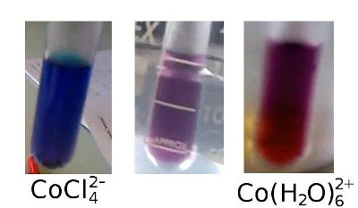

### Results

Complete your observations in the table below, noting the colour changes that
                                                take place, and also indicating whether the concentration of each of the
                                                ions in solution increases or decreases.

|  | Original colour | Final colour | \({\color{blue}{{\text{[CoCl}}_{4}^{2-}{\text{]}}}}\) | \({\color{red}{{\text{[Co(H}}_{2}{\text{O)}}_{6}^{2+}{\text{]}}}}\) | \({\color{red}{{\text{[Cl}}^{-}{\text{]}}}}\) |
| --- | --- | --- | --- | --- | --- |
| Add \(\text{HCl}\) |  |  |  |  |  |
| Add \(\text{H}_{2}\text{O}\) |  |  |  |  |  |
| Increase temp |  |  |  |  |  |
| Decrease temp |  |  |  |  |  |

### Conclusions

- Use Le Chatelier's principle to explain the changes that you
                                                                  recorded in the table above.
- Draw a conclusion about the effect of a *change in
                                                                          concentration* of either the reactants or
                                                                  products on the equilibrium position.
- Also draw a conclusion about the effect of a *change in
                                                                          temperature* on the equilibrium position.

<Callout type="note" title="Note">
<VideoPlayer src="http://www.youtube.com/embed/dmOif5MUPcE" title="Video:
                                                27VQ" />
</Callout>

### The effect of pressure on equilibrium (ESCNR)

If the pressure of a gaseous reaction mixture is changed the equilibrium will shift to
                                minimise that change.

- If the pressure is **increased** the equilibrium will shift to
                                                  favour a **decrease** in pressure.
- If the pressure is **decreased** the equilibrium will shift to
                                                  favour an **increase** in pressure.

When the volume of a system is decreased (and the temperature is constant), the pressure will
                                increase. There are more collisions with the walls of the container. If there are fewer
                                gas molecules there will be fewer collisions, and therefore lower pressure. The
                                equilibrium will shift in a direction that reduces the number of gas molecules so that
                                the pressure is also reduced. So, to predict in which direction the equilibrium will
                                shift to change pressure you need to \(\color{darkgreen}{\text{look at the number of gas
                                molecules in the balanced}}\) \(\color{darkgreen}{\text{reactions}}\).

<Callout type="tip" title="Note">
Remember from [Grade 11](http://www.everythingscience.co.za/grade-11) that:

\[\text{p} \propto \dfrac{\text{T}}{\text{V}}\]

That is, if the temperature remains constant, and the volume is increased, the
                                        pressure will decrease.

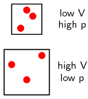

Figure 8.2 shows
                                        a decrease in pressure by an increase in the volume, and an increase in pressure
                                        by a decrease in the volume.
</Callout>

For example, the equation for the reaction between nitrogen and hydrogen is shown below:

\(\color{blue}{\text{N}_{2}\text{(g)}} + \color{blue}{\text{3H}_{2}\text{(g)}}
                                \rightleftharpoons \color{red}{\text{2NH}_{3}\text{(g)}}\)

The ratio in the balanced equation is \(1:3:2\). That is, for every \(\text{1}\)
                                \(\text{molecule}\) of \(\color{blue}{\text{N}_{2}\text{ gas}}\) there are \(\text{3}\)
                                \(\text{molecules}\) of \(\color{blue}{\text{H}_{2}\text{ gas}}\) and \(\text{2}\)
                                \(\text{molecules}\) of \(\color{red}{\text{NH}_{3}\text{ gas}}\) (from the balanced
                                equation). Therefore the ratio is \(\color{blue}{\textbf{4 molecules of reactant gas}}\)
                                to \(\color{red}{\textbf{2 molecules of product gas}}\).

- An **increase** in pressure will:
  - Favour the reaction that **decreases** the
                                                                    number of gas molecules.
  - There are \(\color{red}{\textbf{fewer molecules of product
                                                                    gas}}\) than reactant gas, so the **forward
                                                                            reaction** is favoured.
  - The equilibrium will **shift to the right** and
                                                                    the **yield** of
                                                                    \(\color{red}{\textbf{NH}_{3}}\) will
                                                                    **increase**.
- A **decrease** in pressure will:
  - Favour the reaction that **increases** the
                                                                    number of gas molecules.
  - There are \(\color{blue}{\textbf{more molecules of reactant
                                                                    gas}}\), so the **reverse reaction** is
                                                                    favoured.
  - The equilibrium will **shift to the left** and
                                                                    the **yield** of
                                                                    \(\color{red}{\textbf{NH}_{3}}\) will
                                                                    **decrease**.

Consider illustration in Figure 8.2.

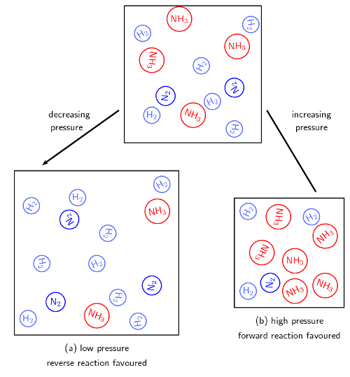

Figure 8.2: **(a)** A decrease in the pressure of this reaction
                                                favours the
                                                reverse reaction (more gas molecules), the equilibrium shifts to the
                                                left. **(b)** An increase in the pressure of this reaction
                                                favours the forward reaction (fewer gas molecules), the equilibrium
                                                shifts to the right.

Figure 8.2 shows how
                                changing the pressure of a system results in a shift in the equilibrium to counter that
                                change. In the original system there are **12** molecules in total:
                                \({\color{skyblue}{6{\text {H}}_{2}}} + {\color{blue}{2{\text{N}}_{2}}}
                                \rightleftharpoons {\color{red}{4{\text{NH}}_{3}}}\)

If you **decrease** the pressure (shown by an increase in volume), the
                                equilibrium will shift to **increase** the number of gas molecules. That
                                shift is to the left and the number of \(\text{H}_{2}\) and \(\text{N}_{2}\) molecules
                                will increase while the number of \(\text{NH}_{3}\) molecules will decrease:

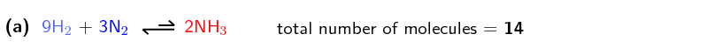

If you **increase** the pressure (shown by a decrease in volume), the
                                equilibrium will shift to **decrease** the number of gas molecules. That
                                shift is to the right and the number of \(\text{H}_{2}\) and \(\text{N}_{2}\) molecules
                                will decrease while the number of \(\text{NH}_{3}\) molecules will increase:

Note that the total number of nitrogen and hydrogen atoms remains the same in all three
                                situations. Equations (a) and (b) are not balanced equations.

Another example is the reaction between sulfur dioxide and oxygen:

\(\color{blue}{\text{2SO}_{2}\text{(g)}} + \color{blue}{\text{O}_{2}\text{(g)}}
                                \rightleftharpoons \color{red}{\text{2SO}_{3}\text{(g)}}\)

In this reaction, \(\color{red}{\textbf{two molecules of product gas}}\) are formed for every
                                \(\color{blue}{\textbf{three molecules of}}\) \(\color{blue}{\textbf{reactant gas}}\).

- An **increase** in pressure will:
  - Favour the reaction that **decreases** the
                                                                    number of gas molecules.
  - There are \(\color{red}{\textbf{fewer molecules of product
                                                                    gas}}\) than reactant gas, so the
                                                                    **forward** reaction is favoured.
  - The equilibrium will **shift to the right** and
                                                                    the **yield** of
                                                                    \(\color{red}{\textbf{SO}_{3}}\) will
                                                                    **increase**.
- A **decrease** in pressure will:
  - Favour the reaction that **increases** the
                                                                    number of gas molecules.
  - There are \(\color{blue}{\textbf{more molecules of reactant
                                                                    gas}}\) than product gas, so the
                                                                    **reverse** reaction is favoured.
  - The equilibrium will **shift to the left** and
                                                                    the **yield** of
                                                                    \(\color{red}{\textbf{SO}_{3}}\) will
                                                                    **decrease**.

<QuizCard id="s12-08-03b" title="Interactive Exercise 8.5" question="Consider the following reaction, which takes place in a closed container: \[\begin{array}{c}\textrm{C}_{3}\textrm{H}_{8}\textrm{(g)} + 5\textrm{O}_{2}\textrm{(g)} \rightleftharpoons 4\textrm{H}_{2}\textrm{O (g)} + 3\textrm{CO}_{2}\textrm{(g)}\end{array}\] The forward reaction is exothermic. The temperature is changed and the equilibrium shifts to the right. Did the temperature increase or decrease?" options=["increased", "decreased"] answer="decreased" hint="" explanation="Le Chatelier's principle states that when an external stress (change in pressure, temperature or concentration) is applied to a system in chemical equilibrium, the equilibrium will change in such a way as to reduce the effect of the stress. So when the temperature of the reaction is changed the equilibrium will change as well. Depending on how the temperature changes there will either be more products or more reactants. Let us now apply this to the example given. We are told that the equilibrium shifts to the right and that the forward reaction is exothermic. Therefore the reverse reaction is endothermic (remember that if the forward reaction is exothermic then the reverse reaction must be endothermic). An exothermic reaction releases heat or energy, and will therefore be favoured by a decrease in temperature. An endothermic reaction requires heat or energy, and will therefore be favoured by an increase in temperature. We know that the forward reaction is favoured since the equilibrium shifts to the right. Since the forward reaction is favoured and is exothermic the temperature must have decreased. Therefore the temperature decreased . Submit your answer as: decreased" />

<QuizCard id="s12-08-03b" title="Interactive Exercise 8.5" question="Consider the following reaction, which takes place in a closed container: \[\begin{array}{c}\text{C}_{3}\text{H}_{8}\text{(g)} + 5\text{O}_{2}\text{(g)} \rightleftharpoons 4\text{H}_{2}\text{O (g)} + 3\text{CO}_{2}\text{(g)}\end{array}\] The pressure of the system is now decreased while the temperature is kept constant. What will be the effect on the equilibrium position?" options=["shifts to the left", "stays the same", "shifts to the right"] answer="stays the same" hint="" explanation="Recall Le Chatelier's principle Le Chatelier's principle states that when an external stress (change in pressure, temperature or concentration) is applied to a system in chemical equilibrium, the equilibrium will change in such a way as to reduce the effect of the stress. So when the pressure of the system is changed, the equilibrium will shift to counteract that change. A decrease in pressure will favour the reaction that increases the number of particles in the gaseous state. An increase in pressure will favour the reaction that decreases the number of particles in the gaseous state. Apply Le Chatelier's principle to this example Let us now apply this to the example given. Remember that for changes in pressure it is only the reactants and the products in the gas phase that influence the equilibrium position. We are told that the pressure of the system is decreased. When the pressure is decreased the equilibrium will shift to increase the pressure. This means that the reaction that increases the number of particles in the gaseous phase will be favoured. In this reaction there are \(\text{6}\) units of gaseous reactants for every \(\text{7}\) units of gaseous products. Therefore, there are fewer gaseous reactants than gaseous products, and the forward reaction will be favoured to increase the number of gas particles and increase the pressure. When the pressure of the system is decreased the equilibrium shifts to the right . Submit your answer as: shifts to the right" />

<QuizCard id="s12-08-03b" title="Interactive Exercise 8.5" question="Adapted from DBE Nov 2016 Grade 12, P2, Q1.8 Physical constants \(·\) Chemistry formulas \(·\) Periodic table \(·\) Standard reduction potentials The reaction between nitrogen gas and water reaches equilibrium in a closed container according to the following balanced equation: N 2 (g) \(+\) 2H 2 O(g) \(\rightleftharpoons\) \(\updownarrow\) 2H 2 (g) \(+\) 2NO(g) Which one of the graphs below shows the relationship between the amount of NO(g) at equilibrium and the pressure in the container at constant temperature? A B C D" options=["A", "B", "C", "D"] answer="
                    0
                " hint="" explanation="What effect does changing pressure have on an equilibrium reaction? According to Le Chatelier's principle, if you increase the pressure of a system in equilibrium, the equilibrium position will shift to favour the reaction that decreases pressure. For example, the equation for the reaction between nitrogen and hydrogen is shown below: N 2 (g) \(+\) 3H 2 (g) \(\rightleftharpoons\) \(\updownarrow\) 2NH 3 (g) The molar ratio in the balanced equation is \(\text{1}\) : \(\text{3}\) : \(\text{2}\) . That is, for every \(\text{1}\) molecule of N 2 gas and \(\text{3}\) molecules of H 2 gas, \(\text{2}\) molecules of NH 3 gas can be formed. Every time the forward reaction takes place, four gas particles are turned into two gas particles. Every time the reverse reaction takes place, two gas particles are turned into four gas particles. So increasing the pressure will favour the reaction that decreases the number of gas molecules . This is the forward reaction . This causes: the equilibrium to shift to the right , the amount of NH 3 (g) to increase, and the amounts of H 2 (g) and N 2 (g) to decrease. However, if there are the same number of reactant gas molecules as product gas molecules, then changing the pressure will have no effect on the equilibrium. The amount of any of the substances present will remain constant. TIP: If any of the substances involved in the reaction is not a gas, then it must not be considered when determining the effect a change in pressure will have. What effect will pressure have on the amount of NO in the container? Looking at the balanced equation we see: N 2 (g) \(+\) 2H 2 O(g) \(\rightleftharpoons\) \(\updownarrow\) 2H 2 (g) \(+\) 2NO(g) \(\text{3}\) gaseous reactant molecules \(\text{4}\) gaseous product molecules In the graphs, pressure increases along the \(x\) -axis. Increasing the pressure will favour the reverse reaction , which means we expect to see a decrease in the amount of NO . A \({\color{red}{{\checkmark}{\checkmark}}}\) The amount of NO decreases. B The amount of NO increases. C The amount of NO is constant. D The amount of NO increases. So the correct choice is Option A . Submit your answer as: A" />

<QuizCard id="s12-08-03b" title="Interactive Exercise 8.5" question="Adapted from DBE Nov 2015 Grade 12, P2, Q6 Physical constants \(·\) Chemistry formulas \(·\) Periodic table \(·\) Standard reduction potentials An unknown gas, L 3 (g) , is sealed in a container and allowed to form L 2 (g) at \(\text{360}\text{°C}\) . The reaction reaches equilibrium according to the following balanced equation: \(\text{2}\) L 3 (g) \(\rightleftharpoons\) \(\updownarrow\) \(\text{3}\) L 2 (g) The pressure of the system is decreased. Use this information and Le Chatelier's principle to determine how this change affects the amount of L 2 (g) ." options=["increases", "decreases", "remains the same"] answer="
                    2
                ,
                    0
                " hint="" explanation="Which reaction will be favoured by decreasing the pressure? The pressure of the system is decreased.  According to Le Chatelier's principle, the system will respond to oppose this change. So the system will increase the pressure. And increasing the number of gas molecules will increase the pressure. \(\text{2}\) L 3 (g) \(\rightleftharpoons\) \(\updownarrow\) \(\text{3}\) L 2 (g) Looking at the chemical equation we can see that the forward reaction increases the number of gas molecules, so the forward reaction will be favoured . L 2 (g) is a product, and is formed by the forward reaction . Answer the question We now have enough information to answer the question. The pressure of the system is decreased. According to Le Chatelier's principle, the system will respond to oppose this change . The system will increase the pressure , by increasing the number of gas molecules . The forward reaction increases the number of gas molecules , so the forward reaction will be favoured. Therefore, the amount of L 2 (g) increases . NOTE: A decrease in the pressure of the system will decrease the rates of both the forward and reverse reaction. But one reaction will be favoured, and its rate will decrease less than the other when the stress occurs. Submit your answer as: increase the pressure, by increasing the number of gas molecules. The forward reaction increases the number of gas molecules, so the forward reaction will be favoured. and increases" />

### The effect of a catalyst on equilibrium (ESCNS)

If a catalyst is added to a reaction, both the **forward** and
                                **reverse** reaction rates will be increased. If both rates are increased
                                then the concentrations of the reactants and products will **remain the
                                        same**. This means that a catalyst has no effect on the equilibrium
                                position.

However, a catalyst will affect how *quickly equilibrium is reached*. This is very
                                important in industry where the longer a process takes, the more money it costs. So if a
                                catalyst reduces the amount of time it takes to form specific products, it also reduces
                                the cost of production.

### Factors that influence the value of \(\text{K}_{\text{c}}\) (ESCNT)

Concentration, pressure, and temperature all affect the equilibrium position of a reaction,
                                and a catalyst affects reaction rates. However, only
                                \(\color{red}{\textbf{temperature}}\) affects the value of \(\text{K}_{\text{c}}\).

- Changing \(\color{blue}{\text{concentration}}\):
  - Changing the concentration of a reactant or product results
                                                                    in one of the reactions (forward or reverse) being
                                                                    favoured.
  - This change in reaction rate minimises the effect of the
                                                                    change and restores the concentration ratio between
                                                                    reactants and products. There will just be more
                                                                    reactants and products.
  - \(\color{blue}{\text{K}_{\text{c}}}\)
                                                                    \(\color{blue}{\text{will remain the same}}\).
- Changing \(\color{orange}{\text{pressure}}\):
  - Changing the pressure of the system will change the ratio
                                                                    between the reactant and product concentrations.
  - The equilibrium then shifts to minimise the effect of the
                                                                    change and restores the ratio between reactant and
                                                                    product concentrations.
  - \(\color{orange}{\text{K}_{\text{c}}} \color{orange}{\text{
                                                                    will remain the same}}\).
- Adding a \(\color{purple}{\text{catalyst}}\) to the system:
  - Both the forward and reverse reactions rates are increased.
  - Therefore the ratio between reactant and product
                                                                    concentrations will remain the same.
  - \(\color{purple}{\text{K}_{\text{c}}}\color{purple}{\text{
                                                                    will remain the same}}\).
- Changing **\(\color{red}{\text{temperature}}\)**:
  - Changing the temperature will favour either the endothermic
                                                                    or exothermic reaction.
  - The ratio between the concentration of the reactants and
                                                                    products will change.
  - \(\color{red}{\text{K}_{\text{c}}}\)
                                                                    **\(\color{red}{\text{will change}}\)**.

<Callout type="note" title="Note">
So make sure that when comparing \(\text{K}_{\text{c}}\) values for different
                                        reactions, the different reactions took place at the same temperature.
</Callout>

### Using Le Chatelier's Principle (ESCNV)

When a system is in chemical equilibrium, and there has been a change in conditions (e.g.
                                concentration, pressure, temperature) the following steps are suggested:

2. Identify the disturbance or stress on the system.
   \(\color{blue}{\text{For example, there is an }\textbf{increase}\text{ in the
                                                   concentration of reactant}}\).
4. Use Le Chatelier's principle to decide how the system will respond.
   \(\color{blue}{\text{Le Chatelier predicts a shift to
                                                   }\textbf{decrease}\text{ the concentration of reactant}}\).
6. Look at the given equation and decide whether the rate of the forward
                                                   reaction or the rate of the reverse reaction is increased. State the
                                                   shift in equilibrium.
   \(\color{blue}{\text{The }\textbf{forward reaction will be favoured}\text{.
                                                   The equilibrium will shift }\textbf{to the right}}\).
8. Where appropriate, link equilibrium shift to any observed change in the
                                                   system.
   \(\color{blue}{\text{This might result in a }\textbf{colour change}}\).

<Callout type="tip" title="Worked example 6: Using Le Chatelier's principle">
**Question:**
Table salt is added to the (purple) solution in equilibrium:

\(\underset{\color{blue}{\text{blue}}}{\underbrace{{\color{blue}{{\text{CoCl}}_{4}^{2-}}}}}
                                                + 6{\text{H}}_{2}{\text{O}} \rightleftharpoons
                                                \underset{\color{red}{\text{pink}}}{\underbrace{{\color{red}{{\text{Co(H}}_{2}{\text{O)}}_{6}^{2+}}}}}
                                                + 4{\text{Cl}}^{-}\)

2. Use Le Chatelier's principle to predict the change in
                                                                   equilibrium position.
4. What would be observed?

**Identify the disturbance or stress on the system:**
Adding \(\text{NaCl}\) produces \(\text{Na}^{+}\) ions and \(\text{Cl}^{-}\)
                                                ions as the salt dissolves. Looking at the given equilibrium
                                                \(\text{Cl}^{-}\) is in the equation and the disturbance is the increase
                                                in concentration of the \(\text{Cl}^{-}\) ion.

**Use Le Chatelier's principle to decide how the system will
                                                respond:**
By Le Chatelier's principle, the equilibrium position will shift to reduce
                                                the concentration of \(\text{Cl}^{-}\) ions.

**Decide whether the rate of the forward reaction or the rate of
                                                the reverse reaction is increased and state the resulting shift in
                                                equilibrium:**
The reverse reaction uses \(\text{Cl}^{-}\) ions and hence the rate of the
                                                reverse reaction will increase. The reverse reaction is favoured and the
                                                equilibrium will shift to the left.

**What would the colour change be due to this equilibrium shift?:**
The solution will appear more blue as more blue \(\text{CoCl}_{4}^{2-}\) ions
                                                are formed.
</Callout>

#### Graphs and Le Chatelier's principle

Graphs can be used to represent data about equilibrium reactions. The following are
                                        some points to keep in mind when presented with a graph.

2. Identify the type of graph by looking at the label on the y-axis. You
                                                           will find either:
   2. a rate-time graph
   4. a mole-time or concentration-time graph
4. For rate-time graphs, when the rate for the forward reaction and the
                                                           rate for the reverse reaction are equal, the system is in
                                                           equilibrium.
   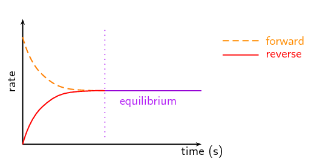
6. For concentration-time graphs or mole-time graphs equilibrium occurs
                                                           where the concentration or number of moles of the reactants and
                                                           products are **constant**. These values need not be
                                                           equal to one another.
   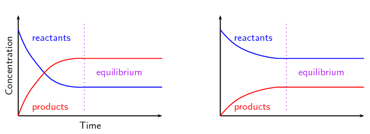
8. When calculating \(\text{K}_{\text{c}}\) make sure you only take
                                                           values from the sections of the graph where the y-value is
                                                           constant. \(\text{K}_{\text{c}}\) can only be calculated when
                                                           the system is in equilibrium.

**Rate-time graphs**

- **A change in concentration** of a substance will
                                                          favour the reaction that counteracts that change.
  - An **increase in concentration** of
                                                                            either the reactants
                                                                            or the products will result in both the forward
                                                                            and reverse **reaction rates being
                                                                                    higher** once
                                                                            equilibrium is re-established.
    An **increase in reactant
                                                                                    concentration**
                                                                            will *favour the
                                                                                    **forward** reaction*.
                                                                            The forward
                                                                            reaction rate will
                                                                            increase
                                                                            sharply, and then gradually decrease until
                                                                            equilibrium
                                                                            is re-established. At the same time the reverse
                                                                            reaction
                                                                            rate will gradually increase.
    An **increase in product
                                                                                    concentration**
                                                                            will *favour the
                                                                                    **reverse** reaction*.
                                                                            The reverse reaction rate will increase sharply,
                                                                            and
                                                                            then gradually decrease until equilibrium is
                                                                            re-established. At the same time the forward
                                                                            reaction
                                                                            rate will gradually increase.
  - A **decrease in concentration** of
                                                                            either the reactants
                                                                            or the products will result in both the forward
                                                                            and reverse **reaction rates being
                                                                                    lower** once
                                                                            equilibrium is re-established.
    A **decrease in reactant
                                                                                    concentration**
                                                                            will *favour the
                                                                                    **reverse** reaction*.
                                                                            The forward
                                                                            reaction rate will
                                                                            decrease
                                                                            sharply, and then gradually increase until
                                                                            equilibrium
                                                                            is re-established. At the same time the reverse
                                                                            reaction
                                                                            rate will gradually decrease.
    A **decrease in product
                                                                                    concentration**
                                                                            will *favour the
                                                                                    **forward** reaction*.
                                                                            The reverse reaction rate will decrease sharply,
                                                                            and
                                                                            then gradually increase until equilibrium is
                                                                            re-established. At the same time the forward
                                                                            reaction
                                                                            rate will gradually decrease.
- **A change in pressure** of a reaction will
                                                          favour the reaction that counteracts that change.
  - An **increase in pressure** will
                                                                            *sharply increase* both the forward and
                                                                            reverse reaction rates.
    The reaction that will reduce the pressure (fewer gas
                                                                            particles) will be
                                                                            favoured and will initially increase more. That
                                                                            reaction rate will then decrease gradually until
                                                                            equilibrium is re-established.
    The other reaction will initially increase less, and
                                                                            then gradually continue to increase until
                                                                            equilibrium is re-established.
  - A **decrease in pressure** will
                                                                            *sharply decrease* both the forward and
                                                                            reverse reaction rates.
    The reaction that will increase the pressure (more
                                                                            gas particles) will be
                                                                            favoured and will initially decrease less. That
                                                                            reaction rate will then continue to decrease
                                                                            gradually until
                                                                            equilibrium is re-established.
    The other reaction will initially decrease more, and
                                                                            then gradually increase until
                                                                            equilibrium is re-established.
- **A change in temperature** of a reaction will
                                                          favour the reaction that counteracts that change.
  - An **increase in temperature** will
                                                                            *sharply increase* both the forward and
                                                                            reverse reaction rates.
    The reaction that will decrease the temperature (the
                                                                            endothermic reaction) will be
                                                                            favoured and will initially increase more. That
                                                                            reaction rate will then decrease gradually until
                                                                            equilibrium is re-established.
    The other reaction will initially increase less, and
                                                                            then gradually continue to increase until
                                                                            equilibrium is re-established.
  - A **decrease in temperature** will
                                                                            *sharply decrease* both the forward and
                                                                            reverse reaction rates.
    The reaction that will increase the temperature (the
                                                                            exothermic reaction) will be
                                                                            favoured and will initially decrease less. That
                                                                            reaction rate will then continue to decrease
                                                                            gradually until
                                                                            equilibrium is re-established.
    The other reaction will initially decrease more, and
                                                                            then gradually increase until
                                                                            equilibrium is re-established.
- **The addition of a catalyst** will favour both the
                                                          forward and reverse reactions by the same amount.

<Callout type="tip" title="Worked example 7: Rate-time graphs">
**Question:**
For the reaction \(2\text{AB}(\text{g})\) \(\rightleftharpoons\)
                                                        \(2\text{A}(\text{g}) + \text{B}_{2}(\text{g})\), \(\Delta\)H =
                                                        \(\text{26}\) \(\text{kJ}\)

the following graph can be plotted:

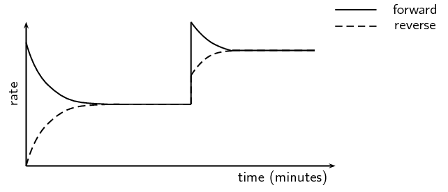

What stress has occurred in this system? Label the graph with what is
                                                        happening at each stage.

**Check the axes so that you know what the variables are
                                                        on this graph:**
The axes are labelled rate and time. Therefore this is a rate-time
                                                        graph.

**Are the rates both affected in the same way or is one
                                                        rate increased and the other decreased when the stress is
                                                        applied?:**
Both rates are affected in the same way (increased) therefore the
                                                        stress must be a catalyst or a change in temperature.

(A change in pressure or concentration would favour one reaction
                                                        direction only)

**Are both rates affected equally?:**
No, the forward rate is increased more than the reverse rate.
                                                        Therefore the stress must be a change in temperature.

(A catalyst would increase both rates equally)

**Was the temperature increased or decreased? (Use Le
                                                        Chatelier's principle):**
The forward reaction is endothermic (\(\Delta\)H is positive). The
                                                        forward reaction was favoured more than the reverse reaction. An
                                                        increase in temperature will favour the reaction that cools the
                                                        reaction vessel (the endothermic reaction). Therefore the stress
                                                        must have been an increase in temperature.

**Label what is occuring at each stage on the graph:**
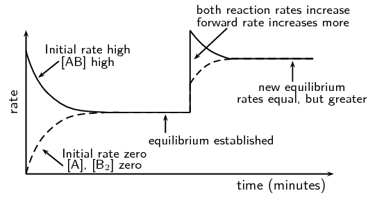
</Callout>

<Callout type="tip" title="Worked example 8: Rate-time graphs">
**Question:**
What is responsible for the change at t = \(\text{10}\)
                                                        \(\text{minutes}\) in the graph below?

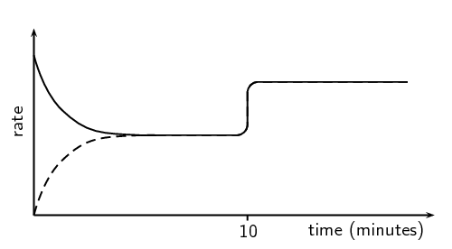

**Check the axes so that you know what the variables are
                                                        on this graph:**
The axes are labelled rate and time. Therefore this is a rate-time
                                                        graph.

**Are the rates both affected in the same way or is one
                                                        rate increased and the other decreased when the stress is
                                                        applied?:**
Both rates are affected in the same way (increased) therefore the
                                                        stress must be a catalyst or a change in temperature.

(A change in pressure or concentration would favour one reaction
                                                        direction only)

**Are both rates affected equally?:**
Yes, both rates are increased by the same amount.

**What was responsible for the change at t =
                                                        \(\text{10}\) \(\text{minutes}\)?:**
The addition of a catalyst (a change in temperature would affect both
                                                        rates, but unequally).
</Callout>

**Concentration-time and mole-time graphs**

- **A change in concentration** of a substance would
                                                          appear as a sharp increase or decrease in the concentration or
                                                          number of moles of that substance and a gradual change in the
                                                          other substances.
- **A change in temperature** would affect both the
                                                          forward and reverse reactions. However, one reaction would be
                                                          affected more than the other. So the reactants and products
                                                          would be affected gradually, in the opposite direction (one
                                                          increased, the other decreased).
- **A change in pressure** of the reaction would cause a
                                                          sharp increase or decrease in all the reactants and products.
                                                          For an increase in pressure, if the forward reaction is then
                                                          favoured the reactant concentrations will decrease, and if the
                                                          reverse reaction is then favoured the product concentrations
                                                          will decrease.
- **The addition of a catalyst** would increase both the
                                                          forward and reverse reaction rates, meaning the equilibrium is
                                                          reached faster. So if the reaction is already at equilibrium
                                                          there will be no effect on a concentration-time or moles-time
                                                          graph.

<Callout type="tip" title="Worked example 9: Concentration-time graphs">
**Question:**
Consider the following chemical equation and graph
                                                        and answer the
                                                        questions that follow.

                                                \[\text{CO}(\text{g}) + \text{Cl}_{2}(\text{g})
                                                \rightleftharpoons \text{COCl}_{2}(\text{g})\]

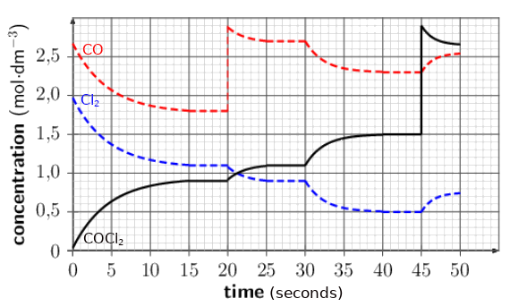

2. How much time was necessary for the system to reach
                                                                           equilibrium for the first time?
4. How do the rates of the forward and reverse reactions
                                                                           compare at the following times:
   - \(t = \text{5}\) \(\text{s}\)
   - \(t = \text{17}\) \(\text{s}\)
   - \(t = \text{23}\) \(\text{s}\)
6. Determine the equilibrium constants for the system at
                                                                           \(t = \text{17 s}\), \(\text{27 s}\), and
                                                                           \(\text{42 s}\).
8. What happens at \(t = \text{20 s}\)?
                                                                           Explain your answer by referring to Le
                                                                           Chatelier's principle.
10. What effect does the stress at \(t = \text{20 s}\)
                                                                           have on \(\text{K}_{\text{c}}\)?

**Check the axes so that you know what the variables are
                                                        on this graph:**
The axes are labelled concentration and time. Therefore this is a
                                                        concentration-time graph.

**How much time was necessary for the system to reach
                                                        equilibrium for the first time?:**
The concentration of all three compounds becomes constant at t =
                                                        \(\text{15}\) \(\text{s}\). This means that the reaction has
                                                        reached equilibrium.

**How can you determine which rate is faster from
                                                        concentration-time graphs?:**
If the concentrations of the **reactants** are steadily
                                                        **decreasing** and
                                                        the concentrations of the **products** are steadily
                                                        **increasing** then the forward reaction is using
                                                        reactants faster
                                                        than the reverse reaction is using products. The rate of
                                                        the *forward reaction* must be **faster**
                                                        than the rate of the *reverse
                                                                reaction*.

If the concentrations of the **reactants** are steadily
                                                        **increasing** and
                                                        the concentrations of the **products** are steadily
                                                        **decreasing** then the forward reaction must be
                                                        using reactants
                                                        slower than the reverse reaction is using products. The
                                                        rate of the *forward reaction* must be
                                                        **slower** than the rate of the
                                                        *reverse reaction*.

If the concentrations of the **reactants and products are
                                                                constant**, the
                                                        forward reaction must be using reactants at
                                                        the same rate as the reverse reaction is using products. The
                                                        rate of the *forward reaction* must be **equal
                                                                to** the rate of
                                                        the *reverse reaction* (the system is in equilibrium).

**Compare the forward and reverse reaction rates at \(t
                                                        =
                                                        \text{5} \text{ s}\), \(t = \text{17} \text{ s}\) and \(t
                                                        = \text{23} \text{ s}\):**
At \(t = \text{5} \text{ s}\) and at \(t = \text{23}
                                                        \text{ s}\) the concentrations of the reactants are decreasing
                                                        and the concentration of the product is increasing. Therefore
                                                        the rate of the forward reaction is faster than the rate of the
                                                        reverse reaction.

At \(t = \text{17} \text{s}\) the concentrations of the reactants
                                                        and products are constant (unchanging). Therefore the reaction
                                                        is in equilibrium and the rate of the forward reaction equals
                                                        the rate of the reverse reaction.

**What are the concentrations of \(\text{CO}\),
                                                        \(\text{Cl}_{2}\) and \(\text{COCl}_{2}\) at \(t = \text{17}
                                                        \text{ s}\), \(t = \text{27 s}\) and \(t = \text{42 s}\)?:**
Reading off the graph you can see that:

|  | Equilibrium
                                                                                concentration \((\text{mol·dm$^{-3}$})\) |
| --- | --- |
| Substance | \(t = \text{17 s}\) | \(t = \text{27 s}\) | \(t = \text{42 s}\) |
| \(\text{CO}\) | \(\text{1,8}\) | \(\text{2,7}\) | \(\text{2,3}\) |
| \(\text{Cl}_{2}\) | \(\text{1,1}\) | \(\text{0,9}\) | \(\text{0,5}\) |
| \(\text{COCl}_{2}\) | \(\text{0,9}\) | \(\text{1,1}\) | \(\text{1,5}\) |

**Write an expression for the equilibrium constant of
                                                        this reaction and calculate \(\text{K}_{\text{c}}\).:**
\(\text{K}_{\text{c}} =
                                                        \dfrac{\text{[COCl}_{2}{\text{]}}}{\text{[CO][Cl}_{2}{\text{]}}}\)

At \(t = \text{17 s}\): \(\;\text{K}_{\text{c}} =
                                                        \dfrac{\text{0,9}}{(\text{1,8})(\text{1,1})} =\)
                                                        \(\text{0,45}\)

At \(t = \text{27 s}\): \(\;\text{K}_{\text{c}} =
                                                        \dfrac{\text{1,1}}{(\text{2,7})(\text{0,9})} =\)
                                                        \(\text{0,45}\)

At \(t = \text{42 s}\): \(\;\text{K}_{\text{c}} =
                                                        \dfrac{\text{1,5}}{(\text{2,3})(\text{0,5})} =\)
                                                        \(\text{1,30}\)

Note that \(\text{K}_{\text{c}}\) is different at \(\text{42 s}\).
                                                        This
                                                        means that the stress at \(\text{30 s}\) must have been a change
                                                        in temperature.

**What happens at \(t = \text{20 s}\)?:**
The concentration of \(\text{CO}\) increases sharply. The
                                                        concentrations of the other compounds do not change
                                                        dramatically. Therefore \(\text{CO}\) must have been added to
                                                        the system.

After this addition of \(\text{CO}\) there is a shift to reduce the
                                                        amount of \(\text{CO}\), that is in the forward direction.
                                                        Therefore the concentration of the product increases while the
                                                        concentrations of the reactants decrease.

**What effect will this have on \(\text{K}_{\text{c}}\)?:**
Only a change in temperature affects \(\text{K}_{\text{c}}\),
                                                        therefore this will have no effect on \(\text{K}_{\text{c}}\).
</Callout>

<Callout type="tip" title="Worked example 10: Concentration-time graphs">
**Question:**
Consider the following chemical equilibrium and graph and answer the
                                                        questions that follow.

\(\text{H}_{2}(\text{g}) + \text{I}_{2}(\text{g})\)
                                                        \(\rightleftharpoons\) \(2\text{HI}(\text{g})\)

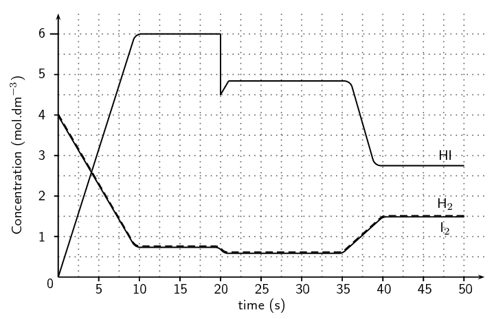

2. After how many seconds does the system reach
                                                                           equilibrium?
4. Calculate the value of the equilibrium constant.
6. Explain what happened at t = \(\text{20}\)
                                                                           \(\text{s}\).
8. If the change at t = \(\text{35}\) \(\text{s}\) is
                                                                           due to an increase in temperature, is the
                                                                           reaction exothermic or endothermic? Explain your
                                                                           answer.

**Check the axes so that you know what the variables are
                                                        on this graph:**
The axes are labelled concentration and time. Therefore this is a
                                                        concentration-time graph.

**After how many seconds does the system reach
                                                        equilibrium?:**
The concentration of all three compounds becomes constant at t =
                                                        \(\text{10}\) \(\text{s}\). This means that the system takes
                                                        \(\text{10}\) \(\text{s}\) to reach equilibrium.

**What are the concentrations of \(\text{H}_{2}\),
                                                        \(\text{I}_{2}\), and \(\text{HI}\) at t = \(\text{10}\)
                                                        \(\text{s}\), \(\text{25}\) \(\text{s}\), and \(\text{45}\)
                                                        \(\text{s}\)?:**
Reading off the graph you can see that at \(\text{10}\) \(\text{s}\):

\([\text{H}_{2}]\) and \([\text{I}_{2}]\) = \(\text{0,75}\)
                                                        \(\text{mol·dm$^{-3}$}\), \([\text{HI}]\) = \(\text{6,0}\)
                                                        \(\text{mol·dm$^{-3}$}\)

At \(\text{25}\) \(\text{s}\):

\([\text{H}_{2}]\) and \([\text{I}_{2}]\) = \(\text{0,6}\)
                                                        \(\text{mol·dm$^{-3}$}\), \([\text{HI}]\) = \(\text{4,8}\)
                                                        \(\text{mol·dm$^{-3}$}\)

At \(\text{45}\) \(\text{s}\):

\([\text{H}_{2}]\) and \([\text{I}_{2}]\) = \(\text{1,5}\)
                                                        \(\text{mol·dm$^{-3}$}\), \([\text{HI}]\) = \(\text{2,75}\)
                                                        \(\text{mol·dm$^{-3}$}\)

**Write an expression for the equilibrium constant of
                                                        this reaction and calculate \(\text{K}_{\text{c}}\).:**
\(\text{K}_{\text{c}} =
                                                        \dfrac{\text{[HI]}^{2}}{\text{[H}_{2}{\text{][I}_{2}{\text{]}}}}\)

At t = \(\text{10}\) \(\text{s}\):

\(\text{K}_{\text{c}} =
                                                        \dfrac{\text{6,0}^{2}}{(\text{0,75})(\text{0,75})} =\)
                                                        \(\text{64,0}\)

At t = \(\text{25}\) \(\text{s}\):

\(\text{K}_{\text{c}} =
                                                        \dfrac{\text{4,8}^{2}}{(\text{0,6})(\text{0,6})} =\)
                                                        \(\text{64,0}\)

At t = \(\text{45}\) \(\text{s}\):

\(\text{K}_{\text{c}} =
                                                        \dfrac{\text{2,75}^{2}}{(\text{1,5})(\text{1,5})} =\)
                                                        \(\text{3,4}\)

The different \(\text{K}_{\text{c}}\) at \(\text{45}\) \(\text{s}\)
                                                        means that the event at t = \(\text{35}\) \(\text{s}\) must be a
                                                        change in temperature.

**Explain what happened at t = \(\text{20}\)
                                                        \(\text{s}\)?:**
The concentration of \(\text{HI}\) decreases sharply, as a result
                                                        there is a slight decrease in the concentration of
                                                        \(\text{H}_{2}\) and \(\text{I}_{2}\). Therefore \(\text{HI}\)
                                                        must have been removed from the system.

After this there is a shift to increase the amount of \(\text{HI}\),
                                                        that is in the forward direction.

**If the change at t = \(\text{35}\) \(\text{s}\) is due
                                                        to an increase in temperature, is the reaction exothermic or
                                                        endothermic? Explain your answer.:**
An increase in temperature caused the concentration of the product to
                                                        decrease and the concentrations of the reactants to increase.
                                                        This means that the reverse reaction has been favoured.

An increase in temperature will favour the reaction that takes heat
                                                        in and cools the reaction vessel (endothermic). Therefore the
                                                        reverse reaction must be endothermic and the forward reaction
                                                        must be exothermic. The reaction is exothermic.
</Callout>

### Summary (ESCNW)

The following rules will help in predicting the changes that take place in equilibrium
                                reactions:

- If the concentration of a **reactant** (on the left) is
                                                  **increased**, then some of it must be used to form the
                                                  products (on the right) for equilibrium to be maintained. The
                                                  equilibrium position will shift to the **right**.
                                                  \(\text{K}_{\text{c}}\) is unchanged.
- If the concentration of a **reactant** (on the left) is
                                                  **decreased**, then some of the products (on the right)
                                                  must be used to form reactants for equilibrium to be maintained. The
                                                  equilibrium position will shift to the **left**.
                                                  \(\text{K}_{\text{c}}\) is unchanged.
- If the **forward reaction** is **endothermic**,
                                                  then an **increase** in temperature will favour this
                                                  reaction and the product **yield** and
                                                  **\(\text{K}_{\text{c}}\) will increase**. A
                                                  **decrease** in temperature will **decrease product
                                                          yield** and likewise **decrease
                                                          \(\text{K}_{\text{c}}\)**.
- If the **forward reaction** is **exothermic**, then
                                                  an **decrease** in temperature will favour this reaction
                                                  and the product **yield** and
                                                  **\(\text{K}_{\text{c}}\) will increase**. An
                                                  **increase** in temperature will **decrease product
                                                          yield** and likewise **decrease
                                                          \(\text{K}_{\text{c}}\)**.
- **Increasing** the pressure favours the reaction that will
                                                  **decrease the number of gas molecules**. This is shown
                                                  in the balanced chemical equation. This rule applies in reactions with
                                                  one or more gaseous reactants or products. \(\text{K}_{\text{c}}\) is
                                                  unchanged.
- **Decreasing** the pressure favours the the reaction that will
                                                  **increase the number of gas molecules**. This rule applies
                                                  in reactions
                                                  with one or more gaseous reactants or products. \(\text{K}_{\text{c}}\)
                                                  is unchanged.
- A **catalyst** does not affect the equilibrium position of a
                                                  reaction. It only influences the *rate of the reaction*, in other
                                                  words, how quickly equilibrium is reached.

The following simulation will help you to understand these concepts.

<Callout type="note" title="Note">
[Simulation:
                                                27VR](http://phet.colorado.edu/en/simulation/reversible-reactions)
</Callout>

<Callout type="tip" title="Worked example 11: Chemical equilibrium">
**Question:**
\(2\text{NO}(\text{g}) + \text{O}_{2}(\text{g})\) \(\rightleftharpoons\)
                                        \(2\text{NO}_{2}(\text{g})\) \(\quad \Delta{H} < 0\)

How will:

2. the reverse reaction
4. the equilibrium position be affected by:
   2. A decrease in temperature?
   4. The addition of a catalyst?
   6. The addition of more \(\text{NO}_{2}\) gas?

2. **The reverse reaction:**
   2. The forward reaction is exothermic (\(\Delta{H} < 0\)) so
                                                                      the reverse reaction must be endothermic. A decrease in
                                                                      temperature will cause the equilibrium to shift to
                                                                      favour the exothermic reaction. Therefore the reverse
                                                                      reaction rate will decrease sharply, and then gradually
                                                                      increase until equilibrium is re-established.
   4. The addition of a catalyst will speed up both the forward and
                                                                      reverse reactions.
   6. \(\text{NO}_{2}\) is a product. Therefore the addition of
                                                                      more \(\text{NO}_{2}\) will increase the rate of the
                                                                      formation of reactants. The rate of the reverse reaction
                                                                      will therefore increase sharply, and then gradually
                                                                      decrease until equilibrium is re-established.
4. **The equilibrium position:**
   2. A decrease in temperature will favour the exothermic reaction
                                                                      and the forward reaction is exothermic. Therefore the
                                                                      equilibrium position will shift to the right.
   4. The addition of a catalyst will have no effect on the
                                                                      equilibrium position as both the forward and reverse
                                                                      reactions rates would be increased equally.
   6. The addition of more \(\text{NO}_{2}\) will favour the
                                                                      formation of the reactants and so the equilibrium will
                                                                      shift to the left.
</Callout>

<Callout type="tip" title="Worked example 12: Graphs of equilibrium">
**Question:**
Study the graph and answer the questions that follow:

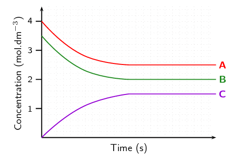

2. Does the equilibrium favour the reactants or the products?
4. Determine the value of \(\text{K}_{\text{c}}\) if the coefficients of
                                                           the balanced equation all equal 1.
6. The forward reaction has \(\Delta{H} > 0\). What effect will an
                                                           increase in temperature have on [A], [B] and [C]?

**Determine which compounds are the reactants and which are the products:**
The concentration of reactants decreases from the start of the reaction to
                                        equilibrium. Therefore *A* and *B* are reactants.

The concentration of products increases from the start of the reaction to
                                        equilibrium. Therefore *C* is a product.

\(\text{aA} + \text{bB}\) \(\rightleftharpoons\) \(\text{cC}\)

We are told that all coefficients in the balanced equation equal 1. Therefore the
                                        general equation is: \(\text{A} + \text{B}\) \(\rightleftharpoons\) \(\text{C}\)

**Do reactants or products have higher concentrations at equilibrium?:**
A and B (the reactants) have higher concentrations at equilibrium.

**Does the equilibrium favour the reactants or products?:**
The reactants have higher concentrations than the products, therefore the equilibrium
                                        must favour the reactants.

**Determine the equilibrium concentration values of A, B and C:**
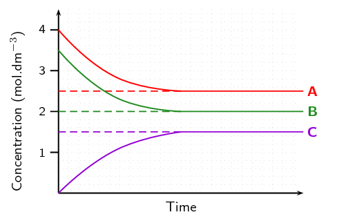

[A] = \(\text{2,5}\) \(\text{mol·dm$^{-3}$}\)

[B] = \(\text{2,0}\) \(\text{mol·dm$^{-3}$}\)

[C] = \(\text{1,5}\) \(\text{mol·dm$^{-3}$}\)

**Calculate \(\text{K}_{\text{c}}\):**
\[\text{K}_{\text{c}}=\frac{\text{[C]}}{\text{[A][B]}}=\frac{\text{1,5}}{(\text{2,5})(\text{2,0})}
                                        = \text{0,3}\]

**Determine which reaction is exothermic and which is endothermic:**
The forward reaction has \(\Delta{H} > 0\). This means that the forward reaction
                                        is endothermic. The reverse reaction must therefore be exothermic.

**Which reaction is favoured by an increase in temperature?:**
The endothermic reaction would be favoured by an increase in temperature (to lower
                                        the temperature). This is the forward reaction.

**How would [A], [B] and [C] change?:**
The forward reaction is favoured, therefore the equilibrium would shift to the right.
                                        This means that the reactant concentrations ([A] and [B]) would decrease and the
                                        product concentration ([C]) would increase.
</Callout>

## Equilibrium

### Textbook Exercise
                                        8.3

**Problem:**
The following reaction has reached equilibrium in a closed container:

\[\text{C}(\text{s}) + \text{H}_{2}\text{O}(\text{g})
                                                        \rightleftharpoons \text{CO}(\text{g}) +
                                                        \text{H}_{2}(\text{g}) \quad \Delta{H} > 0\]

The pressure of the system is then decreased. How will the
                                                        concentration of the \(\text{H}_{2}\)(g) and the value of
                                                        \(\text{K}_{\text{c}}\) be affected when the new equilibrium is
                                                        established? Assume that the temperature of the system remains
                                                        unchanged.

|  | Hydrogen concentration | \(\text{K}_{\text{c}}\) |
| --- | --- | --- |
| (a) | increases | increases |
| (b) | increases | stays the same |
| (c) | stays the same | stays the same |
| (d) | decreases | stays the same |

(IEB Paper 2, 2004)

**Solution:**
According to Le Chatelier's principle, the reaction that increases
                                                        the number of gas molecules (and therefore the pressure) will be
                                                        favoured. That is the forward reaction, and so the concentration
                                                        of hydrogen will
                                                        increase. Only temperature affects the value of
                                                        \(\text{K}_{\text{c}}\), therefore \(\text{K}_{\text{c}}\)
                                                        remains the same.

**b)** Hydrogen concentration increases and equilibrium
                                                        constant stays the same

During a classroom experiment copper metal reacts with concentrated
                                                        nitric acid to produce \(\text{NO}_{2}\) gas.

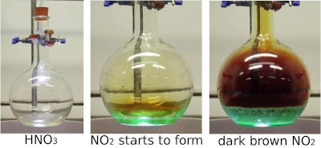

The \(\text{NO}_{2}\) is collected in a gas syringe.

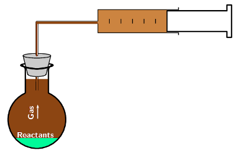

When enough gas has collected in the syringe, the delivery tube is
                                                        clamped so that no gas can escape. The brown \(\text{NO}_{2}\)
                                                        gas collected reaches an equilibrium with colourless
                                                        \(\text{N}_{2}\text{O}_{4}\) gas as represented by the following
                                                        equation:

\[2\text{NO}_{2}(\text{g}) \rightleftharpoons
                                                        \text{N}_{2}\text{O}_{4}(\text{g}), \quad \Delta H < 0\]

Once this equilibrium has been established, there are \(\text{0,01}\)
                                                        \(\text{moles}\) of \(\text{NO}_{2}\) gas and \(\text{0,03}\)
                                                        \(\text{moles}\) of \(\text{N}_{2}\text{O}_{4}\) gas present in
                                                        the syringe.

**Problem:**
A learner, noticing that the colour of the gas mixture in the
                                                                syringe is no longer changing, comments that all
                                                                chemical reactions in the syringe must have stopped. Is
                                                                this assumption correct? Explain.

**Solution:**
No. The learner is not correct. A dynamic chemical
                                                                equilibrium has been reached and the products are
                                                                changing into reactants at the same rate as reactants
                                                                are changing into products. This results in no colour
                                                                change being observed in the syringe.

**Problem:**
The gas in the syringe is cooled. The volume of the gas is
                                                                kept constant during the cooling process. Will the gas
                                                                be lighter or darker at the lower temperature? Explain
                                                                your answer.

**Solution:**
The forward reaction is exothermic (\(\Delta H < 0\)). A
                                                                decrease in temperature will favour the forward
                                                                reaction. \(\text{N}_{2}\text{O}_{4}(\text{g})\) is
                                                                colourless, therefore the gas will be lighter at the
                                                                lower temperature.

**Problem:**
The volume of the syringe is now reduced (at constant
                                                                temperature) to \(\text{75}\) \(\text{cm$^{3}$}\) by
                                                                pushing the plunger in and holding it in the new
                                                                position. There are \(\text{0,032}\) \(\text{moles}\) of
                                                                \(\text{N}_{2}\text{O}_{4}\) gas present once the
                                                                equilibrium has been re-established at the reduced
                                                                volume (\(\text{75}\) \(\text{cm$^{3}$}\)). Calculate
                                                                the value of the equilibrium constant for this
                                                                equilibrium.

(IEB Paper 2, 2004)

**Solution:**
The volume is reduced, so the pressure is increased. This
                                                                means that the foward reaction will be favoured to
                                                                reduce the number of gas molecules.

There are \(\text{0,01}\) moles of \(\text{NO}_{2}\) and
                                                                \(\text{0,03}\) moles of \(\text{N}_{2}\text{O}_{4}\)
                                                                initially.

For every 2x moles of \(\text{NO}_{2}\) used, 1x moles of
                                                                \(\text{N}_{2}\text{O}_{4}\) are produced.

| R eaction | \(2\text{NO}_{2}(\text{g})\) | \(1\text{N}_{2}\text{O}_{4}(\text{g})\) |
| --- | --- | --- |
| I nitial quantity
                                                                                        (mol) | \(\text{0,01}\) | \(\text{0,03}\) |
| C hange (mol) | -2x | +x |
| E quilibrium quantity
                                                                                        (mol) | \(\text{0,01}\)-2x | \(\text{0,03}\)+x |
| E quilibrium
                                                                                        concentration (\(\text{mol·dm$^{-3}$}\)) |  |  |

There are \(\text{0,032}\) \(\text{mol}\)
                                                                \(\text{N}_{2}\text{O}_{4}\) at the new equilibrium.

Therefore \(\text{0,03}\) \(\text{mol}\) + x =
                                                                \(\text{0,032}\) \(\text{mol}\)

x = \(\text{0,032}\) - \(\text{0,03}\) \(\text{mol}\) =
                                                                \(\text{0,002}\) \(\text{mol}\)

n(\(\text{NO}_{2}\)) at equilibrium = \(\text{0,01}\)
                                                                \(\text{mol}\) - \(\text{2}\) \(\times\)
                                                                \(\text{0,002}\) \(\text{mol}\) = \(\text{0,006}\)
                                                                \(\text{mol}\)

C(\(\text{NO}_{2}\)) at equilibrium =
                                                                \(\dfrac{\text{0,006}\text{ mol}}{\text{0,075}\text{
                                                                dm$^{3}$}}\) = \(\text{0,08}\)
                                                                \(\text{mol·dm$^{-3}$}\)

C(\(\text{N}_{2}\text{O}_{4}\)) at equilibrium =
                                                                \(\dfrac{\text{0,032}\text{ mol}}{\text{0,075}\text{
                                                                dm$^{3}$}}\) = \(\text{0,43}\)
                                                                \(\text{mol·dm$^{-3}$}\)

| R eaction | \(2\text{NO}_{2}(\text{g})\) | \(1\text{N}_{2}\text{O}_{4}(\text{g})\) |
| --- | --- | --- |
| I nitial quantity
                                                                                        (mol) | \(\text{0,01}\) | 0.03 |
| C hange (mol) | -2x | +x |
| E quilibrium quantity
                                                                                        (mol) | \(\text{0,01}\)-2x | \(\text{0,03}\)+x |
| E quilibrium
                                                                                        concentration
                                                                                        (\(\text{mol·dm$^{-3}$}\)) | \(\text{0,08}\) | \(\text{0,43}\) |

\(\text{K}_{\text{c}}=\dfrac{\text{[N}_{2}\text{O}_{4}\text{]}}{\text{[NO}_{2}\text{]}^{2}}=\dfrac{\text{0,43}}{(\text{0,08})^{2}}=\text{67,19}\)

Gases X and Y are pumped into a \(\text{2}\) \(\text{dm$^{3}$}\)
                                                        container. When the container is sealed, \(\text{4}\)
                                                        \(\text{moles}\) of gas X and \(\text{4}\) \(\text{moles}\) of
                                                        gas Y are present. The following equilibrium is established:

\(2\text{X}(\text{g}) + 3\text{Y}(\text{g})\) \(\rightleftharpoons\)
                                                        \(\text{X}_{2}\text{Y}_{3}(\text{g})\)

The graph below shows the number of moles of gas X and gas
                                                        \(\text{X}_{2}\text{Y}_{3}\) that are present from the time the
                                                        container is sealed.

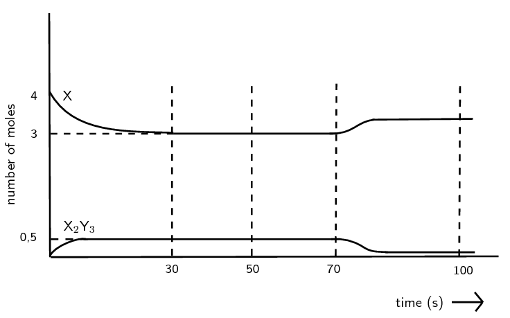

**Problem:**
How many moles of gas \(\text{X}_{2}\text{Y}_{3}\) are formed
                                                                by the time the reaction reaches equilibrium at
                                                                \(\text{30}\) \(\text{seconds}\)?

**Solution:**
From the graph: \(\text{0,5}\) \(\text{mol}\)

**Problem:**
Calculate the value of the equilibrium constant at t =
                                                                \(\text{50}\) \(\text{s}\).

**Solution:**
Draw up a RICE table.

| R eaction | \(2\text{X}(\text{g})\) | \(3\text{Y}(\text{g})\) | \(\text{X}_{2}\text{Y}_{3}(\text{g})\) |
| --- | --- | --- | --- |
| I nitial quantity
                                                                                        (mol) | \(\text{4}\) | \(\text{4}\) | \(\text{0}\) |
| C hange (mol) | -2x | -3x | +x |
| E quilibrium quantity
                                                                                        (mol) | \(\text{4}\) - 2x | \(\text{4}\) - 3x | \(\text{0}\) + x |
| E quilibrium
                                                                                        concentration (\(\text{mol·dm$^{-3}$}\)) |  |  |  |

There are \(\text{0,5}\) \(\text{mol}\) of \(\text{X}\)
                                                                present at equilibrium.

Therefore x = \(\text{0,5}\) \(\text{mol}\)

From the graph n(\(\text{X}\)) = \(\text{3}\) \(\text{mol}\)

n(\(\text{Y}\)) = \(\text{4}\) - \(\text{3}\) x
                                                                \(\text{0,5}\) \(\text{mol}\) = \(\text{2,5}\)
                                                                \(\text{mol}\)

| R eaction | \(2\text{X}(\text{g})\) | \(3\text{Y}(\text{g})\) | \(\text{X}_{2}\text{Y}_{3}(\text{g})\) |
| --- | --- | --- | --- |
| I nitial quantity
                                                                                        (mol) | \(\text{4}\) | \(\text{4}\) | \(\text{0}\) |
| C hange (mol) | \(-\text{1}\) | \(-\text{1,5}\) | \(\text{+0,5}\) |
| E quilibrium quantity
                                                                                        (mol) | \(\text{3}\) | \(\text{2,5}\) | \(\text{0,5}\) |
| E quilibrium
                                                                                        concentration (\(\text{mol·dm$^{-3}$}\)) |  |  |  |

C(\(\text{X}\)) = \(\dfrac{\text{3}\text{
                                                                mol}}{\text{2}\text{ dm$^{3}$}} =\)\(\text{1,5}\)
                                                                \(\text{mol·dm$^{-3}$}\)

C(\(\text{Y}\)) = \(\dfrac{\text{2,5}\text{
                                                                mol}}{\text{2}\text{ dm$^{3}$}} =\)\(\text{1,25}\)
                                                                \(\text{mol·dm$^{-3}$}\)

C(\(\text{X}_{2}\text{Y}_{3}\)) = \(\dfrac{\text{0,5}\text{
                                                                mol}}{\text{2}\text{ dm$^{3}$}} =\)\(\text{0,25}\)
                                                                \(\text{mol·dm$^{-3}$}\)

| R eaction | \(2\text{X}(\text{g})\) | \(3\text{Y}(\text{g})\) | \(\text{X}_{2}\text{Y}_{3}(\text{g})\) |
| --- | --- | --- | --- |
| I nitial quantity
                                                                                        (mol) | \(\text{4}\) | \(\text{4}\) | \(\text{0}\) |
| C hange (mol) | \(-\text{1}\) | \(-\text{1,5}\) | \(\text{+0,5}\) |
| E quilibrium quantity
                                                                                        (mol) | \(\text{3}\) | \(\text{2,5}\) | \(\text{0,5}\) |
| E quilibrium
                                                                                        concentration (\(\text{mol·dm$^{-3}$}\)) | \(\text{1,5}\) | \(\text{1,25}\) | \(\text{0,25}\) |

\({K}_{c}=\dfrac{\text{[X}_{2}\text{Y}_{3}\text{]}}{\text{[X]}^{2}\text{[Y]}^{3}}=\dfrac{\text{0,25}}{(\text{1,5})^{2}(\text{1,25})^{3}}=\text{0,057}\)

**Problem:**
At \(\text{70}\) \(\text{s}\) the temperature is increased.
                                                                Is the forward reaction endothermic or exothermic?
                                                                Explain in terms of Le Chatelier's Principle.

**Solution:**
Exothermic. The amount of product decreases (and amount of
                                                                reactants increases) when the temperature is increased
                                                                indicating that the reverse reaction is favoured. Le
                                                                Chatelier's principle states that an increase in
                                                                temperature will favour the endothermic reaction
                                                                (cooling the reaction vessel). Therefore the reverse
                                                                reaction must be endothermic and the forward reaction is
                                                                exothermic.

**Problem:**
How will this increase in temperature affect the value of the
                                                                equilibrium constant?

**Solution:**
A change in temperature is the only thing that affects the
                                                                equilibrium constant. The amount of product decreased
                                                                and the amount of reactants increased, therefore the
                                                                equilibrium constant will decrease.

Consider the following hypothetical reaction that takes place in a
                                                        **closed \(\text{2}\) \(\text{dm$^{3}$}\)** flask
                                                        at \(\text{298}\) \(\text{K}\).

\(\text{A}_{2}(\text{g}) + 2\text{B}_{2}(\text{g})\)
                                                        \(\rightleftharpoons\) \(2\text{AB}_{2}(\text{g})\)

The graph beneath represents the change in the number of moles of
                                                        each gas in the flask over a period of \(\text{20}\)
                                                        \(\text{minutes}\).

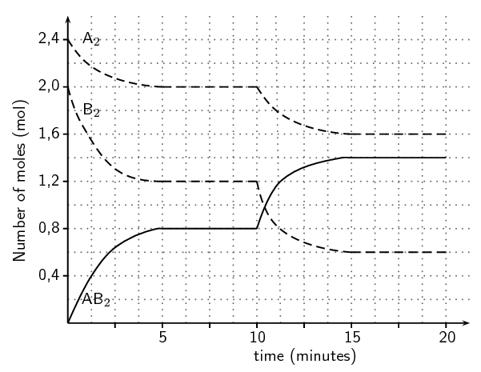

**Problem:**
State how long (in minutes) it took for the reaction to reach
                                                                equilibrium for the first time.

**Solution:**
The number of moles of each reactant and the product is
                                                                constant (have reached equilibrium) after t =
                                                                \(\text{5}\) \(\text{minutes}\)

**Problem:**
Write down an expression for the equilibrium constant,
                                                                \(\text{K}_{\text{c}}\), for this particular reaction.

**Solution:**
\(\text{K}_{\text{c}} =
                                                                \dfrac{\text{[AB}_{2}{\text{]}}^{2}}{\text{[A}_{2}{\text{][B}}_{2}{\text{]}}^{2}}\)

**Problem:**
Calculate the concentration of each of the reactants and the
                                                                product using figures from the graph between
                                                                \(\text{5}\) \(\text{minutes}\) and \(\text{10}\)
                                                                \(\text{minutes}\) and hence calculate the equilibrium
                                                                constant \(\text{K}_{\text{c}}\) for this reaction at
                                                                \(\text{298}\) \(\text{K}\)

**Solution:**
The concentration values are read off the graph.

C(\(\text{A}_{2}\)) \(= \dfrac{\text{2,0}\text{
                                                                mol}}{\text{2}\text{ dm$^{3}$}} =\) \(\text{1,0}\)
                                                                \(\text{mol·dm$^{-3}$}\)

C(\(\text{B}_{2}\)) \(= \dfrac{\text{1,2}\text{
                                                                mol}}{\text{2}\text{ dm$^{3}$}} =\) \(\text{0,6}\)
                                                                \(\text{mol·dm$^{-3}$}\)

C(\(\text{AB}_{2}\)) \(= \dfrac{\text{0,8}\text{
                                                                mol}}{\text{2}\text{ dm$^{3}$}} =\) \(\text{0,4}\)
                                                                \(\text{mol·dm$^{-3}$}\)

\(\text{K}_{\text{c}} =
                                                                \dfrac{\text{[AB}_{2}{\text{]}}^{2}}{\text{[A}_{2}{\text{][B}_{2}{\text{]}}^{2}}}
                                                                = \dfrac{\text{0,4}^{2}}{(\text{1,0})(\text{0,6})^{2}}
                                                                =\) \(\text{0,44}\)

**Problem:**
State what a low value of \(\text{K}_{\text{c}}\) indicates
                                                                about the yield of product for a reaction.

**Solution:**
A value of \(\text{K}_{\text{c}}\) between \(\text{0}\) and
                                                                \(\text{1}\) indicates that the equilibrium lies to the
                                                                left. Therefore the yield of product is low (more
                                                                reactants than products).

**Problem:**
Why is it not possible to calculate \(\text{K}_{\text{c}}\)
                                                                using figures from the graph during the first
                                                                \(\text{5}\) \(\text{minutes}\)

**Solution:**
\(\text{K}_{\text{c}}\) is the equilibrium constant,
                                                                therefore it cannot be calculated except when the
                                                                reaction is in equilibrium. During the first
                                                                \(\text{5}\) \(\text{minutes}\) the reaction is not in
                                                                equilibrium.

**Problem:**
State Le Chatelier's principle.

**Solution:**
When an external stress (change in pressure, temperature or
                                                                concentration) is applied to a system in chemical
                                                                equilibrium, the equilibrium will change in such a way
                                                                as to reduce the effect of the stress.

**Problem:**
At \(\text{10}\) \(\text{minutes}\) the temperature of the
                                                                flask was increased. Using Le Chatelier's principle,
                                                                determine if the production of \(\text{AB}_{2}\) is
                                                                exothermic or endothermic?

**Solution:**
\(\text{AB}_{2}\) is produced through the forward reaction.
                                                                Le Chatelier's principle states that if the temperature
                                                                is increased the equilibrium will change to decrease the
                                                                temperature of the vessel. That is the reaction that
                                                                takes in heat (endothermic) will be favoured.

The number of moles of the reactants decreases after the
                                                                temperature increase, while the number of moles of the
                                                                product increases. Therefore the temperature increase
                                                                favours the forward reaction. This means that the
                                                                forward reaction is endothermic.

How would the equilibrium **constant** be
                                                                affected by each of the following changes:

(state either increase, decrease or no effect)

**Problem:**
Increasing the pressure of the flask with no change
                                                                        to temperature.

**Solution:**
no effect

**Problem:**
Adding a catalyst to the flask.

**Solution:**
no effect

**Problem:**
Increasing the temperature of the flask.

**Solution:**
increase

### Industrial applications (ESCNX)

In industrial processes, it is important to get the product as quickly and as efficiently as
                                possible. The less expensive the process the better.

The **Haber process** is a good example of an industrial process which uses the
                                equilibrium principles that have been discussed. The equation for the process is as
                                follows:

\[\text{N}_{2}(\text{g}) + 3\text{H}_{2}(\text{g}) \rightleftharpoons
                                2\text{NH}_{3}(\text{g}) + \text{energy}\]

Since the forward reaction is exothermic, to produce a lot of product and favour the forward
                                reaction the system needs to be colder. However, cooling a system slows down all
                                chemical reactions and so the system can't be too cold. This process is carried out at a
                                much higher temperature to ensure the speed of production.

Because high temperature favours the reverse reaction, the \(\text{NH}_{3}\) product is
                                actually removed as it is made (product concentration decreased) to prevent ammonia
                                being used in the reverse reaction. The decrease of product concentration favours the
                                forward reaction.

High pressure is also used to ensure faster reaction time and to favour the production of
                                \(\text{NH}_{3}\). The forward reaction is favoured by higher pressures because there
                                are \(\text{2}\) gas molecules of product for every \(\text{4}\) gas molecules of
                                reactant.

Refer to Chapter 14 for more information on the Haber process and other industrial
                                applications.

## Applying equilibrium principles

### Textbook Exercise 8.4

Look at the values of \(\text{K}_{\text{c}}\) calculated for
                                                                the Haber process reaction at different temperatures,
                                                                and then answer the questions that follow:

| \(T\left(℃\right)\) | \(\text{K}_{\text{c}}\) |
| --- | --- |
| \(\text{25}\) | \(\text{6,4} \times \text{10}^{\text{2}}\) |
| \(\text{200}\) | \(\text{4,4} \times \text{10}^{-\text{1}}\) |
| \(\text{300}\) | \(\text{4,3} \times \text{10}^{-\text{3}}\) |
| \(\text{400}\) | \(\text{1,6} \times \text{10}^{-\text{4}}\) |
| \(\text{500}\) | \(\text{1,5} \times \text{10}^{-\text{5}}\) |

**Problem:**
What happens to the value of \(\text{K}_{\text{c}}\)
                                                                        as the temperature increases?

**Solution:**
The value of \(\text{K}_{\text{c}}\) decreases

**Problem:**
Which reaction is being favoured when the temperature
                                                                        is \(\text{300}\) \(\text{℃}\)?

**Solution:**
A value of \(\text{K}_{\text{c}}\) between 0 and 1
                                                                        means that there are more reactants than
                                                                        products. Therefore the reverse reaction is
                                                                        favoured.

**Problem:**
According to this table, which temperature would be
                                                                        best if you wanted to produce as much ammonia as
                                                                        possible? Explain.

**Solution:**
\(\text{25}\) \(\text{℃}\). At this temperature
                                                                        the forward reaction is favoured and so the the
                                                                        maximum yield of ammonia is achieved.
