# Chapter 9: Acids and bases

## 9.1 Acids and bases (ESCNZ)

In this chapter learners will look at acids and bases. In Grade 11 learners were introduced
                                to a lot of the concepts that are expanded on in this chapter. These include acid and
                                base models and definitions, conjugate acid-base pairs, and some basic acid-base
                                reactions. It is important that the learners have a good understanding of the work
                                covered in [Chapter 8](/read/science/grade-12/chemical-equilibrium), specifically
                                equilibrium
                                constants, before studying this chapter.

New concepts related to acids and bases will also be covered in this chapter. These include
                                pH, more in depth information on titrations and indicators, and real world applications
                                of acids and bases.

The following topics are covered in this chapter.

- **What are acids and bases?**
  This section is largely revision from Grade 11. The Arrhenius and
                                                  Brønsted-Lowry models for acids and bases are discussed. Conjugate
                                                  acid-base pairs are also covered in detail in this section, including
                                                  worked examples on how to determine the conjugate base of an acid and
                                                  the conjugate acid of a base.
- **Strong and weak acids and bases, and concentrated and dilute
                                                          solutions**
  The concept of strong and weak acids and bases is often confused with the
                                                  concept of concentrated and dilute solutions. It is important that the
                                                  learners understand the difference between these concepts, which are
                                                  discussed in detail in this section. The exercises will help to
                                                  determine if the learners truly understand this work.
- **\(\text{K}_{\text{a}}\) and \(\text{K}_{\text{b}}\)**
  Although learners will not have encountered these terms before, the idea of
                                                  an equilibrium constant should be familiar to them after encountering
                                                  the equilibrium constant (\(\text{K}_{\text{c}}\)) in [Chapter
                                                          8](/read/science/grade-12/chemical-equilibrium/08-chemical-equilibrium-02). The values of
                                                  \(\text{K}_{\text{a}}\) and \(\text{K}_{\text{b}}\) should be tied to
                                                  the ideas of strong and weak acids and bases.
- **Acid-base reactions**
  These neutralisation reactions should be familiar to learners from Grade 11.
                                                  They should revise these reactions through the revision activity
                                                  provided. It is important that learners undersand how salts are formed
                                                  from the acid and base, as well as the other products that are likely in
                                                  each type of reaction.
- **pH**
  The pH scale is a logarithmic scale with a base of \(\text{10}\). So a change
                                                  in pH of \(\text{3}\) is a significant change in the concentration of
                                                  \(\text{H}^{+}\) ions. A good understanding of pH is also essential to
                                                  understanding how indicators work. This section covers why a neutralised
                                                  solution will not necessarily have a pH of \(\text{7}\), the concept of
                                                  \(\text{K}_{\text{w}}\), and the hydrolysis of salts. Indicators are
                                                  also covered in this section and it important that learners understand
                                                  how to choose an indicator for an experiment before starting the next
                                                  section on titrations.
- **Titrations**
  Titrations are covered in great detail in this section. This includes
                                                  learners preparing their own standard solutions, performing several
                                                  titration experiments, and doing titration calculations. The learners
                                                  will be working with acids and bases a lot in this section and so should
                                                  be reminded of proper laboratory safety procedures. Each experiment will
                                                  take a large amount of time and at least an entire class should be
                                                  dedicated to these experiments. If possible one class should be for the
                                                  preparation of a standard solution and the first titration experiment,
                                                  while another, separate class is for to the second titration experiment.
- **Applications of acids and bases**
  The applications covered are the production of chlorine in industry and the
                                                  use of bases in hair products. The production of chlorine is not covered
                                                  in great detail in this chapter, for more detail see [Chapter
                                                          13](/read/science/grade-12/electrochemical-reactions). The hair care
                                                  products discussed include: hair permanent waving applications, hair
                                                  relaxers, and hair dyes. The learners must also perform an experiment
                                                  using drain cleaners or caustic soda. These products have a high pH and
                                                  can burn skin. This lesson can also be used to consolidate information
                                                  by going through the chapter summary and doing the end of chapter
                                                  exercises.

There are several experiments in this chapter. The learners will be using dangerous chemicals
                                and should be properly instructed on the correct use of safety equipment, including
                                safety goggles, gloves and protective clothing. They should also be reminded not to
                                sniff any chemicals as the fumes can be dangerous as well. More information on
                                laboratory procedures as well as safety precautions is provided in [Chapter 1](todo) (Science skills).

In the informal assessment the learners must determine the temperature change caused by the
                                exothermic reaction of sodium hydroxide and hydrochloric acid. They should understand
                                why the temperature stops changing when all the sodium hydroxide has been neutralised.

The formal assessment requires that the learners prepare a standard solution of sodium
                                hydroxide. It is important that the learners understand why the mass must be known to a
                                high accuracy, why the beakers must be rinsed with water (with the rinsings added to the
                                volumetric flask), why the sides of the volumetric flask must be washed with water, and
                                why it is important to have their eye level with the mark on the volumetric flask when
                                filling to that
                                mark.

### What are acids and bases? (ESCP2)

We encounter many examples of acids and bases in our daily lives. Some common examples of
                                household items that contain acids are vinegar (contains acetic acid), lemon juice
                                (contains citric and ascorbic acid), wine (contains tartaric acid). These acids are
                                often found to have a sour taste. Hydrochloric acid, sulfuric acid and nitric acid are
                                examples of acids that are more likely to be found in laboratories and industry.

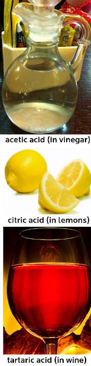

Figure 9.1: Some common household acids.

Hydrochloric acid is also found in the gastric juices in the stomach. Fizzy drinks contain
                                carbonic acid, while tea and wine contain tannic acid. People even use acids in an
                                artistic process known as *acid etching*. In acid etching, a metal is covered in
                                a waxy material that is resistant to acid. The bare metal is then exposed in the desired
                                pattern and the sample is placed in an acid bath. The top layers of the exposed metal
                                are permanently removed, creating the desired image. Some examples of this are shown
                                below (Figure 9.2).

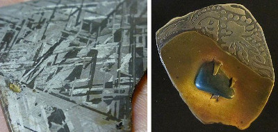

Figure 9.2: Some examples of the acid etching of metal.

Bases that you may know about include sodium hydroxide (commonly known as caustic soda),
                                ammonium hydroxide and ammonia. Some of these are found in household cleaning products.
                                Bases are usually found to have a bitter taste and feel *slippery* (soap is a
                                good example). Acids and bases are also important commercial components in the
                                fertiliser, plastics, and petroleum refining industries. Some common acids and bases,
                                and their chemical formulae, are shown in Table 9.1.

| Acid | Formula | Base | Formula |
| --- | --- | --- | --- |
| Hydrochloric acid | \(\text{HCl}\) | Sodium hydroxide | \(\text{NaOH}\) |
| Sulfuric acid | \(\text{H}_{2}\text{SO}_{4}\) | Potassium hydroxide | \(\text{KOH}\) |
| Nitric acid | \(\text{HNO}_{3}\) | Magnesium hydroxide | \(\text{Mg}(\text{OH})_{2}\) |
| Oxalic acid | \(\text{H}_{2}\text{C}_{2}\text{O}_{4}\) | Calcium hydroxide | \(\text{Ca}(\text{OH})_{2}\) |
| Sulfurous acid | \(\text{H}_{2}\text{SO}_{3}\) | Sodium bicarbonate | \(\text{NaHCO}_{3}\) |
| Phosphoric acid | \(\text{H}_{3}\text{PO}_{4}\) | Sodium carbonate | \(\text{Na}_{2}\text{CO}_{3}\) |
| Acetic (ethanoic) acid | \(\text{CH}_{3}\text{COOH}\) | Ammonium hydroxide | \(\text{NH}_{4}\text{OH}\) |
| Carbonic acid | \(\text{H}_{2}\text{CO}_{3}\) | Ammonia | \(\text{NH}_{3}\) |

Table 9.1: Some common acids and bases and their chemical formulae.

<Callout type="tip" title="Note">
**Dissociation** is the breaking apart of a molecule to form smaller
                                        molecules or ions, usually in a reversible manner.

For more information on *dissociation*, refer to Grade 10.
</Callout>

<Callout type="note" title="Note">
The wild lupin plant takes nitrogen from the atmosphere and creates
                                        **ammonia**. It uses that ammonia to fertilise the soil for itself
                                        and the surrounding plants.

</Callout>

<Callout type="note" title="Note">
Sodium bicarbonate is used in baking. It reacts with the acids in dough to release
                                        carbon dioxide. The carbon dioxide then causes the dough to expand.

</Callout>

## Naturally occurring acids and bases

Do research on three naturally occurring acids, and one naturally occurring base.
                                        That is, acids and bases that are found mostly in plants (not man-made).

Your research should include:

- Where the acid or base is found (e.g. the plant in which it occurs).
- Indigenous uses of the plant.
- What the chemical composition of the acid or base is.

The next section deals with some models used to describe acids and bases. It is important to
                                have a definition so that acids and bases can be correctly identified in reactions.

### Models for acids and bases (ESCP3)

For the acids you will encounter this year, an acid is a molecule that donates a
                                **\(\text{H}^{+}\)** ion.

Substances that will act as a base include hydroxides, oxides, carbonates or hydrogen
                                carbonate, among others. Bases often release free hydroxide ions
                                (**\(\text{OH}^{-}\)**) when dissociating in water.

#### Arrhenius model for acids and bases

A number of models for acids and bases have been developed over the years. One of the
                                        earliest was the **Arrhenius** definition. In 1884, Arrhenius
                                        discovered that water dissociates (splits up) into hydronium
                                        \((\text{H}_{3}\text{O}^{+})\) and hydroxide \((\text{OH}^{-})\) ions according
                                        to the following equation:

\(2\text{H}_{2}\text{O}(\text{ℓ})\) \(\rightleftharpoons
                                        {\color{red}{\text{H}_{3}{\text{O}}^{+}{\text{(aq)}}}} +
                                        {\color{blue}{\text{OH}^{-}{\text{(aq)}}}}\)

Another way of writing this is:

\(\text{H}_{2}\text{O}(\text{ℓ})\) \(\rightleftharpoons
                                        {\color{red}{\text{H}^{+}{\text{(aq)}}}} +
                                        {\color{blue}{\text{OH}^{-}{\text{(aq)}}}}\)

Arrhenius described an acid as a compound that forms \(\text{H}_{3}\text{O}^{+}\)
                                        when added to water. An Arrhenius acid therefore increases the concentration of
                                        \(\text{H}_{3}\text{O}^{+}\) ions ( [\(\text{H}_{3}\text{O}^{+}\)] ) in water.
                                        Arrhenius described a base as a compound that dissociates in water to form
                                        \(\text{OH}^{-}\) ions. An Arrhenius base therefore increases the concentration
                                        of \(\text{OH}^{-}\) ions ([\(\text{OH}^{-}\)] ) in water.

Arrhenius acids and bases

An Arrhenius acid forms \(\text{H}_{3}\text{O}^{+}\) in water
                                                        (increases [\(\text{H}_{3}\text{O}^{+}\)]). An Arrhenius base
                                                        forms \(\text{OH}^{-}\) in water (increases
                                                        [\(\text{OH}^{-}\)]).

| \(\color{red}{\textbf{Arrhenius acid}}\) | \(\text{increases
                                                                        }[\color{red}{\text{H}_{3}\text{O}^{+}}]\) |
| --- | --- |
| \(\color{blue}{\textbf{Arrhenius base}}\) | \(\text{increases }[\color{blue}{\text{OH}^{-}}]\) |

Table 9.2: The **Arrhenius** definition of acids and
                                                        bases.

Look at the following examples showing the dissociation of hydrochloric acid and
                                        sodium hydroxide:

2. \({\color{red}{\text{HCl(aq)}}}\) +
                                                           \(\text{H}_{2}\text{O}(\text{ℓ})\) \(\to
                                                           {\color{red}{\text{H}_{3}{\text{O}}^{+}{\text{(aq)}}}}\) +
                                                           \(\text{Cl}^{-}(\text{aq})\)
   \({\color{red}{\text{Hydrochloric acid}}}\) in water increases the
                                                           concentration of \({\color{red}{\text{H}_{3}{\text{O}}^{+}}}\)
                                                           ions and is therefore an \({\color{red}{\textit{acid}}}\).
4. \({\color{blue}{\text{NaOH(s)}}}\) +
                                                           \(\text{H}_{2}\text{O}(\text{ℓ})\) \(\to\)
                                                           \(\text{Na}^{+}(\text{aq})\) +
                                                           \({\color{blue}{\text{OH}^{-}{\text{(aq)}}}}\) +
                                                           \(\text{H}_{2}\text{O}(\text{ℓ})\)
   \({\color{blue}{\text{Sodium hydroxide}}}\) in water increases the
                                                           concentration of \({\color{blue}{\text{OH}^{-}}}\) ions and is
                                                           therefore a \({\color{blue}{\textit{base}}}\).

However, this definition can only be used for acids and bases **in
                                                water**. Since there are many reactions which do not occur in
                                        water, it was important to come up with a much broader definition for acids and
                                        bases.

#### Brønsted-Lowry model for acids and bases

In 1923, Lowry and Brønsted took the work of Arrhenius further to develop a
                                        broader definition for acids and bases. The **Brønsted-Lowry
                                                model** defines acids and bases in terms of their ability to
                                        donate or accept protons (Table 9.3).

<Callout type="note" title="Note">
Hydrogen atoms contain only one proton. \(\text{H}^{+}\) is a hydrogen atom
                                                that has lost its electron and is often called a proton.
</Callout>

Brønsted-Lowry acids and bases

An **acid** is a substance that donates (gives away)
                                                        protons (\(\text{H}^{+}\)). A **base** is a
                                                        substance that accepts (takes) protons.

Under the Brønsted-Lowry definition: an \(\color{red}{\text{acid}}\) is a
                                        \(\color{red}{\textbf{proton donor}}\); a \(\color{blue}{\text{base}}\) is a
                                        \(\color{blue}{\textbf{proton}}\) \(\color{blue}{\textbf{acceptor}}\).

| \(\color{red}{\textbf{Brønsted-Lowry acid}}\) | \(\text{donates H}^{+}\) | \(\text{proton }\color{red}{\textbf{donor}}\) |
| --- | --- | --- |
| \(\color{blue}{\textbf{Brønsted-Lowry base}}\) | \(\text{accepts H}^{+}\) | \(\text{proton }\color{blue}{\textbf{acceptor}}\) |

Table 9.3: The **Brønsted-Lowry** definition of
                                                        acids and bases.

Below are some examples:

2. \(\text{HCl}(\text{aq}) + \text{NH}_{3}(\text{g})\) \(\to\)
                                                           \(\text{NH}_{4}^{+}(\text{aq}) + \text{Cl}^{-}(\text{aq})\)
   In order to decide which substance is a \({\color{red}{\text{proton
                                                           donor}}}\) and which is a \({\color{blue}{\text{proton
                                                           acceptor}}}\), we need to look at what happens to each reactant.
                                                           The reaction can be broken down as follows:
   \(\text{HCl}(\text{aq})\) \(\to\)
                                                           \({\color{darkgreen}{\text{H}^{+}}}\)(aq) +
                                                           \(\text{Cl}^{-}(\text{aq})\)
   - \(\text{HCl}\) donates a
                                                                             \(\color{darkgreen}{\text{proton}}\).
     It is a \({\color{red}{\textit{proton donor}}}\) and
                                                                             is therefore the
                                                                             \({\color{red}{\textbf{acid}}}\).
   \(\text{NH}_{3}(\text{g})\) +
                                                           \({\color{darkgreen}{\text{H}^{+}}}{\text{(aq)}} \to\)
                                                           \(\text{NH}_{4}^{+}(\text{aq})\)
   - \(\text{NH}_{3}\) accepts a
                                                                             \(\color{darkgreen}{\text{proton}}\).
     It is a \(\color{blue}{\textit{proton acceptor}}\)
                                                                             and is therefore the
                                                                             \(\color{blue}{\textbf{base}}\).
4. \(\text{CH}_{3}\text{COOH}(\text{aq}) +
                                                           \text{H}_{2}\text{O}(\text{ℓ})\) \(\to\)
                                                           \(\text{H}_{3}\text{O}^{+}(\text{aq}) +
                                                           \text{CH}_{3}\text{COO}^{-}(\text{aq})\)
   The reaction can be broken down as follows:
   \(\text{CH}_{3}\text{COOH}(\text{aq})\) \(\to\)
                                                           \(\text{CH}_{3}\text{COO}^{-}(\text{aq})\) +
                                                           \(\color{darkgreen}{\text{H}^{+}}\)(aq)
   - \(\text{CH}_{3}\text{COOH}\) donates a
                                                                             \(\color{darkgreen}{\text{proton}}\).
     It is a \(\color{red}{\textit{proton donor}}\) and is
                                                                             therefore the \(\color{red}{\textbf{acid}}\).
   \(\text{H}_{2}\text{O}(\text{ℓ})\) +
                                                           \(\color{darkgreen}{\text{H}^{+}}\text{(aq)} \to\)
                                                           \(\text{H}_{3}\text{O}^{+}(\text{aq})\)
   - Water accepts a \(\color{darkgreen}{\text{proton}}\).
     It is a \(\color{blue}{\textit{proton acceptor}}\)
                                                                             and is therefore the
                                                                             \(\color{blue}{\textbf{base}}\).
6. \(\text{NH}_{3}(\text{g}) + \text{H}_{2}\text{O}(\text{ℓ})\)
                                                           \(\to\)
                                                           \(\text{NH}_{4}^{+}(\text{aq}) + \text{OH}^{-}(\text{aq})\)
   The reaction can be broken down as follows:
   \(\text{H}_{2}\text{O}(\text{ℓ})\) \(\to\)
                                                           \(\text{OH}^{-}(\text{aq})\) +
                                                           \(\color{darkgreen}{\text{H}^{+}}\)(aq)
   - Water donates a \(\color{darkgreen}{\text{proton}}\).
     It is a \(\color{red}{\textit{proton donor}}\) and is
                                                                             therefore the \(\color{red}{\textbf{acid}}\).
   \(\text{NH}_{3}(\text{g})\) +
                                                           \(\color{darkgreen}{\text{H}^{+}}\text{(aq)} \to\)
                                                           \(\text{NH}_{4}^{+}(\text{aq})\)
   - Ammonia accepts a
                                                                             \(\color{darkgreen}{\text{proton}}\).
     It is a \({\color{blue}{\textit{proton acceptor}}}\)
                                                                             and is therefore the
                                                                             \({\color{blue}{\textbf{base}}}\).
   Notice that in *example \(\text{2}\)*
                                                           \(\color{darkgreen}{\textbf{water}}\) acted as a
                                                           \({\color{blue}{\textbf{base}}}\), while in *example
                                                                   \(\text{3}\)* \(\color{darkgreen}{\textbf{water}}\)
                                                           acted as an \({\color{red}{\textbf{acid}}}\). Water can act as
                                                           both an acid and a base depending on the reaction. A substance
                                                           that can act as either an acid or a base is called
                                                           **amphoteric**.

Amphoteric

An amphoteric substance is one that can act as an acid in one
                                                        reaction, or a base in another reaction.

<Callout type="note" title="Note">
An amphoteric substance that contains both acidic and basic functional groups
                                                is called an **ampholyte**.
</Callout>

An **amphiprotic** substance is an amphoteric substance that can donate
                                        a proton in one reaction (a Brønsted-Lowry acid), or accept a proton in
                                        another reaction (a Brønsted-Lowry base).

Amphiprotic

An amphiprotic substance can donate a proton in one reaction, or
                                                        accept a proton in another reaction.

Substances such as ammonia (\(\text{NH}_{3}\)), zinc oxide (\(\text{ZnO}\)), and
                                        beryllium hydroxide (\(\text{Be}(\text{OH})_{2}\)) are amphoteric. Water and
                                        ammonia are also amphiprotic.

An acid that releases only *one* \({\color{darkgreen}{\text{H}^{+}}}\) ion per
                                        molecule of acid (e.g. \(\color{darkgreen}{\text{H}}\)Cl) is referred to as
                                        **mono**protic. An acid that can release *two*
                                        \({\color{darkgreen}{\text{H}^{+}}}\) ions per molecule of acid (e.g.
                                        \(\color{darkgreen}{\text{H}_{2}}\)\(\text{SO}_{4}\)) is referred to as
                                        **di**protic. Any acid than can donate *more than one*
                                        \({\color{darkgreen}{\text{H}^{+}}}\) ion per molecule of acid can be referred
                                        to as **poly**protic (this means that diprotic acids are also
                                        polyprotic).

### Conjugate acid-base pairs (ESCP4)

Look at the reaction between hydrochloric acid and ammonia to form ammonium and chloride
                                ions:

\(\text{HCl}(\text{aq}) + \text{NH}_{3}(\text{g})\) \(\rightleftharpoons\)
                                \(\text{NH}_{4}^{+}(\text{aq}) + \text{Cl}^{-}(\text{aq})\)

Looking at the **forward reaction** (i.e. the reaction that proceeds from
                                *left* to *right*), the changes that take place can be shown as follows:

- \({\color{red}{\text{HCl(aq)}}} \to {\text{Cl}}^{-}{\text{(aq)}} +
                                                  {\color{darkgreen}{{\text{H}}^{+}{\text{(aq)}}}}\)
- \({\color{blue}{\text{NH}_{3}{\text{(g)}}}} +
                                                  {\color{darkgreen}{\text{H}^{+}{\text{(aq)}}}} \to
                                                  {\text{NH}_{4}^{+}{\text{(aq)}}}\)
- In the *forward reaction*, HCl is a proton donor
                                                  (\({\color{red}{\textbf{acid}}}\)) and \(\text{NH}_{3}\) is a proton
                                                  acceptor (\({\color{blue}{\textbf{base}}}\)).

Looking at the **reverse reaction** (i.e. the reaction that proceeds from
                                *right* to *left*), the changes that take place are as follows:

- \({\color{blue}{\text{Cl}^{-}{\text{(aq)}}}} +
                                                  {\color{darkgreen}{{\text{H}}^{+}{\text{(aq)}}}} \to {\text{HCl(aq)}}\)
- \({\color{red}{\text{NH}_{4}^{+}{\text{(aq)}}}} \to
                                                  {\text{NH}_{3}{\text{(g)}}} +
                                                  {\color{darkgreen}{{\text{H}}^{+}{\text{(aq)}}}}\)
- In the *reverse reaction*, the chloride ion (\(\text{Cl}^{-}\)) is the
                                                  proton acceptor (\({\color{blue}{\textbf{base}}}\)) and the ammonium ion
                                                  (\(\text{NH}_{4}^{+}\)) is the proton donor
                                                  (\({\color{red}{\textbf{acid}}}\)).

In the forward reaction \(\color{red}{\text{HCl}}\) donates a proton (\(\text{H}^{+}\)) to
                                form \(\color{blue}{\text{Cl}^{-}}\). In the reverse reaction
                                \(\color{blue}{\text{Cl}^{-}}\) accepts a proton to form \(\color{red}{\text{HCl}}\).
                                \(\color{blue}{\text{Cl}^{-}}\) is the \(\color{blue}{\text{conjugate base}}\) of the
                                \(\color{red}{\text{acid HCl}}\). So \(\text{HCl}\) and \(\text{Cl}^{-}\) are a
                                \({\color{orange}{\textbf{conjugate acid-base pair}}}\).

Similarly, in the forward reaction \(\color{blue}{\text{NH}_{3}}\) accepts a proton
                                (\(\text{H}^{+}\)) to form \(\color{red}{{\text{NH}}_{4}^{+}}\). In the reverse reaction
                                \(\color{red}{{\text{NH}}_{4}^{+}}\) donates a proton to form
                                \(\color{blue}{\text{NH}_{3}}\). \(\color{red}{\text{NH}_{4}^{+}}\) is the
                                \(\color{red}{\text{conjugate acid}}\) of the \(\color{blue}{\text{base NH}_{3}}\). So
                                \(\text{NH}_{3}\) and \(\text{NH}_{4}^{+}\) are a \({\color{purple}{\textbf{conjugate
                                acid-base pair}}}\).

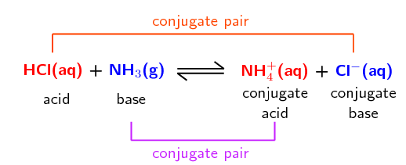

The reaction between ammonia and water is another example:

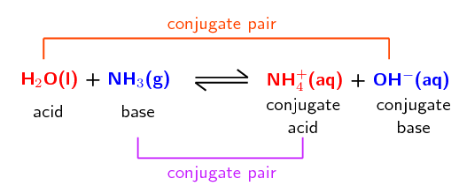

Conjugate acid-base pair

A conjugate acid-base pair contains two compounds that differ only by a
                                                hydrogen ion (\(\text{H}^{+}\)) and a charge of \(\text{+1}\).

<Callout type="tip" title="Worked example 1: Conjugate acid-base pairs">
**Question:**
Determine the conjugate acid-base pairs for the following reaction:

\(\text{HNO}_{3}(\text{aq}) + \text{OH}^{-}(\text{aq})\)
                                                \(\rightleftharpoons\) \(\text{NO}_{3}^{-}(\text{aq}) +
                                                \text{H}_{2}\text{O}(\text{ℓ})\)

**Which reactant is an acid and which is a base?:**
\(\text{HNO}_{3}\) is nitric acid. It donates a proton in the forward
                                                reaction:

\(\text{HNO}_{3}(\text{aq})\) \(\to\) \(\text{NO}_{3}^{-}(\text{aq}) +
                                                \text{H}^{+}(\text{aq})\)

\(\text{OH}^{-}\) accepts a proton in the forward reaction and is therefore
                                                the base:

\(\text{OH}^{-}(\text{aq}) + \text{H}^{+}(\text{aq})\) \(\to\)
                                                \(\text{H}_{2}\text{O}(\text{ℓ})\)

**Which product is the conjugate base of the acid?:**
Nitric acid (\(\text{HNO}_{3}\)) donates a proton to become
                                                \(\text{NO}_{3}^{-}\). In the reverse reaction \(\text{NO}_{3}^{-}\)
                                                accepts a proton to become \(\text{HNO}_{3}\). Therefore
                                                \(\text{NO}_{3}^{-}\) is the conjugate base of \(\text{HNO}_{3}\).

\(\text{NO}_{3}^{-}(\text{aq}) + \text{H}^{+}(\text{aq})\) \(\to\)
                                                \(\text{HNO}_{3}(\text{aq})\)

**Which product is the conjugate acid of the base?:**
\(\text{OH}^{-}\) accepts a proton to become \(\text{H}_{2}\text{O}\). In the
                                                reverse reaction \(\text{H}_{2}\text{O}\) donates a proton to become
                                                \(\text{OH}^{-}\). Therefore \(\text{H}_{2}\text{O}\) is the conjugate
                                                acid of \(\text{OH}^{-}\).

\(\text{H}_{2}\text{O}(\text{ℓ})\) \(\to\) \(\text{OH}^{-}(\text{aq}) +
                                                \text{H}^{+}(\text{aq})\)

**Label the conjugate acid-base pairs in this reaction:**
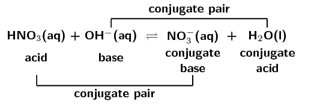
</Callout>

<QuizCard id="s12-09-01a" title="Interactive Exercise 9.1" question="Given the following reaction: \[\begin{array}{c}\text{HCl(aq)} + \text{OH}^{-}\text{(aq)} \rightleftharpoons  \text{H}_{2}\text{O(l)} + \text{Cl}^{-}\text{(aq)}\end{array}\] Which of the following correctly gives the two conjugate acid-base pairs? A HCl and OH − H 2 O and Cl − B HCl and Cl − OH − and H 2 O C HCl and H 2 O OH − and Cl −" options=["A", "B", "C"] answer="B" hint="" explanation="We begin by highlighting what happens to each species in the reaction: \[\begin{array}{c}\color{red}{\text{HCl}} \text{(aq)} + \color{blue}{\text{OH}^{-}} \text{(aq)} \rightleftharpoons  \color{blue}{\text{H}_{2}\text{O}}\text{(l)} + \color{red}{\text{Cl}^{-}}\text{(aq)}\end{array}\] Now we can use this to break the forward reaction up into two parts as follows: \[ 			\begin{array}{rcl} 			\color{red}{\text{HCl}} &\rightarrow& \color{green}{\text{H}^{+}} + \color{red}{\text{Cl}^{-}} \\ 			\color{blue}{\text{OH}^{-}} + \color{green}{\text{H}^{+}} &\rightarrow& \color{blue}{\text{H}_{2}\text{O}} 			\end{array} 		  \] From this we can see that HCl donates a proton and must therefore be the acid. We also see that OH − accepts this proton and must therefore be the base. When thinking about conjugate acid-base pairs it is good to consider this reaction taking place in reverse. \[             \begin{array}{rcl}             \color{blue}{\text{H}_{2}\text{O}} &\rightarrow& \color{green}{\text{H}^{+}} + \color{blue}{\text{OH}^{-}} \\             \color{red}{\text{Cl}^{-}} + \color{green}{\text{H}^{+}} &\rightarrow& \color{red}{\text{HCl}}             \end{array}           \] In the reverse reaction we see that H 2 O acts as an acid, donating a proton to form OH − . We also see that Cl − acts as a base, accepting this proton to form HCl . Another way to think about this is that conjugate acid-base pairs differ only by a hydrogen ion. H 2 O has one more hydrogen ion than OH − . Therefore H 2 O is the conjugate-acid of the base OH − . Cl − has one less hydrogen ion than HCl . Therefore Cl − is the conjugate-base of the acid HCl . Therefore correct answer is B : HCl and Cl − and OH − and H 2 O . Submit your answer as: B" />

## Acids and bases

### Textbook Exercise 9.1

In each of the following reactions, label the conjugate
                                                                acid-base pairs.

**Problem:**
\(\text{H}_{2}\text{SO}_{4}(\text{aq}) +
                                                                        \text{H}_{2}\text{O}(\text{aq})\)
                                                                        \(\rightleftharpoons\)
                                                                        \(\text{H}_{3}\text{O}^{+}(\text{aq}) +
                                                                        \text{HSO}_{4}^{-}(\text{aq})\)

**Solution:**

**Problem:**
\(\text{NH}_{4}^{+}(\text{aq}) +
                                                                        \text{F}^{-}(\text{aq})\) \(\rightleftharpoons\)
                                                                        \(\text{HF}(\text{aq}) +
                                                                        \text{NH}_{3}(\text{g})\)

**Solution:**
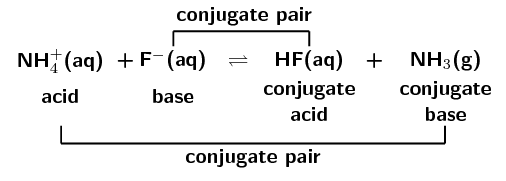

**Problem:**
\(\text{H}_{2}\text{O}(\text{ℓ}) +
                                                                        \text{CH}_{3}\text{COO}^{-}(\text{aq})\)
                                                                        \(\rightleftharpoons\)
                                                                        \(\text{OH}^{-}(\text{aq}) +
                                                                        \text{CH}_{3}\text{COOH}(\text{aq})\)

**Solution:**
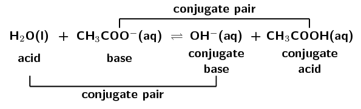

**Problem:**
\(\text{H}_{2}\text{SO}_{4}(\text{aq}) +
                                                                        \text{Cl}^{-}(\text{aq})\)
                                                                        \(\rightleftharpoons\) \(\text{HCl}(\text{aq}) +
                                                                        \text{HSO}_{4}^{-}(\text{aq})\)

**Solution:**
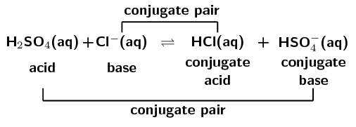

Write the conjugate base for:

**Problem:**
\(\text{H}_{2}\text{CO}_{3}\)

**Solution:**
This is an acid. A proton needs to be donated to form
                                                                        the conjugate base:

\(\text{H}_{2}\text{CO}_{3}\) \(\to\)
                                                                        \(\text{HCO}_{3}^{-} + \text{H}^{+}\)

\(\text{HCO}_{3}^{-}\) is the conjugate base of
                                                                        \(\text{H}_{2}\text{CO}_{3}\).

**Problem:**
\(\text{H}_{3}\text{O}^{+}\)

**Solution:**
This is an acid. A proton needs to be donated to form
                                                                        the conjugate base:

\(\text{H}_{3}\text{O}^{+}\) \(\to\)
                                                                        \(\text{H}_{2}\text{O} + \text{H}^{+}\)

\(\text{H}_{2}\text{O}\) is the conjugate base of
                                                                        \(\text{H}_{3}\text{O}^{+}\).

**Problem:**
\(\text{H}_{2}\text{PO}_{4}^{-}\)

**Solution:**
This is an acid. A proton needs to be donated to form
                                                                        the conjugate base:

\(\text{H}_{2}\text{PO}_{4}^{-}\) \(\to\)
                                                                        \(\text{HPO}_{4}^{2-} + \text{H}^{+}\)

\(\text{HPO}_{4}^{2-}\) is the conjugate base of
                                                                        \(\text{H}_{2}\text{PO}_{4}^{-}\).

Write the conjugate acid for:

**Problem:**
\(\text{OH}^{-}\)

**Solution:**
This is a base. A proton needs to be accepted to form
                                                                        the conjugate acid:

\(\text{OH}^{-} + \text{H}^{+}\) \(\to\)
                                                                        \(\text{H}_{2}\text{O}\)

\(\text{H}_{2}\text{O}\) is the conjugate acid of
                                                                        \(\text{OH}^{-}\).

**Problem:**
\(\text{CN}^{-}\)

**Solution:**
This is a base. A proton needs to be accepted to form
                                                                        the conjugate acid:

\(\text{CN}^{-} + \text{H}^{+}\) \(\to\)
                                                                        \(\text{HCN}\)

\(\text{HCN}\) is the conjugate acid of
                                                                        \(\text{CN}^{-}\).

**Problem:**
\(\text{CO}_{3}^{2-}\)

**Solution:**
This is a base. A proton needs to be accepted to form
                                                                        the conjugate acid:

\(\text{CO}_{3}^{2-} + \text{H}^{+}\) \(\to\)
                                                                        \(\text{HCO}_{3}^{-}\)

\(\text{HCO}_{3}^{-}\) is the conjugate acid of
                                                                        \(\text{CO}_{3}^{2-}\).

### Strong and weak acids and bases (ESCP5)

The term dissociate should be used for ionic solids that break into their component
                                        parts when dissolved in water. Ionise should be used when a reaction with water
                                        takes place and ions, that were not present in the original compound, are
                                        formed.

For example, \(\text{NaOH}\) is an ionic solid composed of \(\text{Na}^{+}\) ions and
                                        \(\text{OH}^{-}\) ions. Upon dissolution it **dissociates** into
                                        its component parts.

On the other hand, \(\text{HCl}\) is a covalent molecule. When dissolved in water it
                                        **ionises** to form \(\text{H}^{+}\) and \(\text{Cl}^{-}\) ions.

In general, strong bases dissociate, bases such as ammonia and organic amines ionise.
                                        All acids ionise.

#### Strong acids and bases

A strong acid or base is one that will almost completely *dissociate* or
                                        *ionise* to form ions in solution. That is, a large percentage of the
                                        moles of a strong acid or base will form ions when added to water.

Strong acid and strong base
A **strong** acid or base is one that almost completely
                                                dissociates to form ions in solution.

**\(\text{HCl}\) is a strong acid.** For example if
                                        \(\text{100 000}\) molecules of \(\text{HCl}\) are added to water and
                                        \(\text{90 000}\) ionise to form \(\text{H}^{+}\) and \(\text{Cl}^{-}\)
                                        ions, then there is a large amount of ionisation. This is what makes
                                        \(\text{HCl}\) a strong acid.

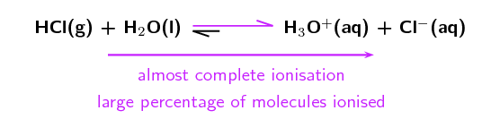

The unequal double arrows in the reaction equation indicate that the equilibrium
                                        position favours the formation of ions.

There are three strong acids that we commonly find: \(\text{HCl}\) (hydrochloric
                                        acid), \(\text{HNO}_{3}\) (nitric acid) and \(\text{H}_{2}\text{SO}_{4}\)
                                        (sulfuric acid). Two strong bases that are commonly found are: \(\text{NaOH}\)
                                        (sodium hydroxide) and \(\text{KOH}\) (potassium hydroxide).

#### Weak acids and bases

A weak acid or base is one where only a *small percentage* of molecules will
                                        dissociate to form ions in solution.

Weak acid and weak base
A **weak** acid or base is one where only a small percentage of
                                                molecules dissociate to form ions in solution.

**\(\text{HF}\) is a weak acid.** For example if \(\text{100 000}\)
                                        molecules of HF are added to water and only \(\text{100}\) ionise to form
                                        \(\text{H}^{+}\) and \(\text{F}^{-}\) ions, then there is only a small amount of
                                        ionisation. This is what makes \(\text{HF}\) a weak acid.

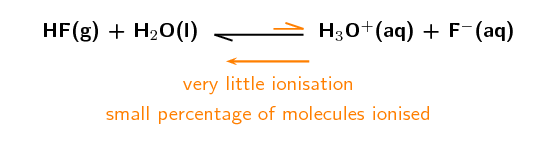

The unequal double arrows in the reaction equation indicate that the equilibrium
                                        position does not favour the formation of ions.

An example of a weak base is \(\text{Mg}(\text{OH})_{2}\) which will only dissociate
                                        partially into \(\text{Mg}^{2+}\) and \(\text{OH}^{-}\) ions.

### Dilute and concentrated solutions (ESCP6)

A different concept to strong and weak is the concept of **concentrated** and
                                **dilute**. Where \(\color{purple}{\text{strong and weak}}\) refer to the
                                \(\color{purple}{\text{characteristic of a compound}}\),
                                \(\color{orange}{\text{concentrated and dilute}}\) refer to the
                                \(\color{orange}{\text{characteristic of a solution}}\). Thus a strong acid can be
                                prepared as either a concentrated or a dilute solution. A solution of which the exact
                                concentration is known is called a **standard solution**.

Standard solution

A standard solution is one where the exact concentration of solute in a
                                                solvent is known.

#### Concentrated solutions

A concentrated solution is one where a large amount of a substance (solute) has been
                                        added to a solvent. Note that both strong and weak acids and bases can be used
                                        in concentrated solutions.

Concentrated solution
A concentrated solution is one where there is a high ratio of dissolved
                                                substance (e.g. acid or base) to solvent.

#### Dilute solutions

A dilute solution is one where a small amount of a substance has been added to a
                                        solvent. Note that both strong and weak acids and bases can be used in dilute
                                        solutions.

<Callout type="tip" title="Note">
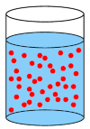

A concentrated solution has a lot of solute molecules (red circles) in the
                                                solvent.

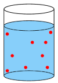

A dilute solution has few solute molecules (red circles) in the solvent.
</Callout>

Dilute solution
A dilute solution is one where there is a low ratio of dissolved substance
                                                to solvent.

A concentrated solution can be made from a strong or a weak acid or base. A dilute solution
                                can also be made from a strong or a weak acid or base. Whether a solution is
                                concentrated or dilute depends on how much of the acid or base was added to the solvent.

A **strong base** that is also **concentrated** would be a base
                                that **almost completely dissociates** when added to a solution, and you
                                also add a **large amount** of the base to the solution.

A **weak acid** that is also **dilute** would be an acid where only
                                a **small percentage of molecules ionise** when added to a solution, and
                                you also add only a **small amount** of the acid to the solution. Table 9.4
                                summarises these concepts.

The electrical conductivity of a solution depends on the concentration of **mobile
                                        ions** in the solution. This means that a concentrated solution of a
                                strong acid or base will have a high electrical conductivity, while a dilute solution of
                                a weak acid or base will have a low electrical conductivity.

<Callout type="note" title="Note">
Electric current is the movement of charged particles. Therefore, the more ions
                                        (charged particles) there are in a solution, the greater the electric current
                                        that can be conducted through the solution by the charged particles. This is the
                                        electrical conductivity of a solution.
</Callout>

<Callout type="tip" title="Note">
Mobile ions are ions that are able to move. These include ions in solution and ions
                                        in melted ionic materials. The ions in ionic solids are not mobile.
</Callout>

|  | \(\color{red}{\textbf{Acid}}\) | \(\color{blue}{\textbf{Base}}\) |
| --- | --- | --- |
| Strong | high percentage forms ions in solution | high percentage forms ions in solution |
| Weak | only a small percentage forms ions in solution | only a small percentage forms ions in solution |
| Concentrated | large number of moles of \(\color{red}{\text{acid}}\) in solution | large number of moles of \(\color{blue}{\text{base}}\) in solution |
| Dilute | small number of moles of \(\color{red}{\text{acid}}\) in solution | small number of moles of \(\color{blue}{\text{base}}\) in solution |

Table 9.4: A summary of the properties of strong, weak, concentrated, and
                                                dilute acids and bases.

<Callout type="tip" title="Worked example 2: Acids and bases">
**Question:**
Solution 1 contains \(\text{100}\) \(\text{dm$^{3}$}\) of \(\text{HCl}\)
                                                added to \(\text{10}\) \(\text{dm$^{3}$}\) of water. Almost all the
                                                \(\text{HCl}\) molecules ionise in the solution.

Solution 2 contains \(\text{0,01}\) \(\text{g}\) of
                                                \(\text{Mg}(\text{OH})_{2}\) added to \(\text{1 000}\)
                                                \(\text{dm$^{3}$}\) of water. Only a small percentage of the
                                                \(\text{Mg}(\text{OH})_{2}\) molecules dissociate in the solution.

Say whether these solutions:

2. Contain a strong or weak acid or base.
4. Are concentrated or dilute.

**Are the compounds acids or bases?:**
\(\text{HCl}\) is hydrochloric acid. It would donate a proton and is an acid.
                                                \(\text{Mg}(\text{OH})_{2}\) is magnesium hydroxide and is a base.

**What makes an acid or base strong or weak?:**
Almost complete ionisation or dissociation means an acid or base is strong.
                                                Only a small amount of ionisation or dissociation means an acid or base
                                                is weak.

**Are the compounds strong or weak acids and bases?:**
Almost all the \(\text{HCl}\) molecules ionise in the solution, therefore
                                                \(\text{HCl}\) is a strong acid.

Only a small percentage of the \(\text{Mg}(\text{OH})_{2}\) molecules
                                                dissociate, therefore \(\text{Mg}(\text{OH})_{2}\) is a weak base.

**What makes a solution concentrated or dilute?:**
A concentrated solution has a high ratio of solute to solvent. A dilute
                                                solution has a low ratio of solute to solvent.

**Are the solutions concentrated or dilute?:**
\(\text{100}\) \(\text{dm$^{3}$}\) of \(\text{HCl}\) is added to
                                                \(\text{10}\) \(\text{dm$^{3}$}\) of water. This is a high ratio,
                                                therefore the solution of \(\text{HCl}\) is concentrated.

\(\text{0,01}\) \(\text{g}\) of \(\text{Mg}(\text{OH})_{2}\) is added to
                                                \(\text{1 000}\) \(\text{dm$^{3}$}\) of water. This is a low ratio,
                                                therefore the solution of \(\text{Mg}(\text{OH})_{2}\) is dilute.

**Combine your information:**
Solution 1 is a **concentrated solution** of a **strong
                                                        acid**.

Solution 2 is a **dilute solution** of a **weak
                                                        base**.
</Callout>

<Callout type="tip" title="Worked example 3: Acids and bases">
**Question:**
Solution 1 contains \(\text{0,01}\) \(\text{dm$^{3}$}\) of \(\text{NaOH}\)
                                                added to \(\text{800}\) \(\text{dm$^{3}$}\) of water. Almost all the
                                                \(\text{NaOH}\) molecules dissociate in the solution.

Solution 2 contains \(\text{100}\) \(\text{g}\) of \(\text{HF}\) added to
                                                \(\text{10}\) \(\text{dm$^{3}$}\) of water. Only a small percentage of
                                                the \(\text{HF}\) molecules ionise in the solution.

Say whether these solutions:

2. Contain a strong or weak acid or base.
4. Are concentrated or dilute.

**Are the compounds acids or bases?:**
\(\text{NaOH}\) is sodium hydroxide and is a base. \(\text{HF}\) is
                                                hydrofluoric acid and is an acid.

**What makes an acid or base strong or weak?:**
Almost complete ionisation or dissociation means an acid or base is strong.
                                                Only a small amount of ionisation or dissociation means an acid or base
                                                is weak.

**Are the compounds strong or weak acids and bases?:**
Almost all the \(\text{NaOH}\) molecules dissociate in the solution,
                                                therefore \(\text{NaOH}\) is a strong base.

Only a small percentage of the \(\text{HF}\) molecules ionise, therefore
                                                \(\text{HF}\) is a weak acid.

**What makes a solution concentrated or dilute?:**
A concentrated solution has a high ratio of solute to solvent. A dilute
                                                solution has a low ratio of solute to solvent.

**Are the solutions concentrated or dilute?:**
\(\text{0,01}\) \(\text{g}\) of \(\text{NaOH}\) is added to \(\text{800}\)
                                                \(\text{dm$^{3}$}\) of water. This is a low ratio, therefore the
                                                solution of \(\text{NaOH}\) is dilute.

\(\text{100}\) \(\text{dm$^{3}$}\) of \(\text{HF}\) is added to \(\text{10}\)
                                                \(\text{dm$^{3}$}\) of water. This is a high ratio, therefore the
                                                solution of \(\text{HF}\) is concentrated.

**Combine your information:**
Solution 1 is a **dilute solution** of a **strong
                                                        base**.

Solution 2 is a **concentrated solution** of a **weak
                                                        acid**.
</Callout>

To calculate the concentration of a solution we use the formula:

\[\text{c (mol·dm}^{-3}{\text{)}}=\dfrac{\text{n (mol)}}{\text{V (dm}^{3}{\text{)}}}\]

<Callout type="tip" title="Worked example 4: Calculating concentration">
**Question:**
\(\text{0,27}\) \(\text{g}\) of \(\text{H}_{2}\text{SO}_{4}\) is added to
                                                \(\text{183,7}\) \(\text{dm$^{3}$}\) of water. Calculate the
                                                concentration of the solution.

**List the information you have and the information you need:**
\(V = \text{183,7}\) \(\text{dm$^{3}$}\); \(m = \text{0,27}\) \(\text{g}\)

The volume (\(V\)) and the mass (\(m\)) are given. The number of moles
                                                (\(n\))
                                                needs to
                                                be calculated. To do that the molar mass (\(M\)) needs to be calculated.

**Make sure all given units are correct and convert them if
                                                necessary:**
All the units are correct.

**What equations will be necessary to calculate the
                                                concentration?:**
\(c\text{ (mol·dm}^{-3}{\text{)}}=\dfrac{n\text{ (mol)}}{
                                                V\text{ (dm}^{3}{\text{)}}}\)

\(n\text{ (mol)} = \dfrac{m\text{ (g)}}{
                                                M\text{(g·mol}^{-1}{\text{)}}}\)

**Calculate the number of moles of the acid in the solution:**
\begin{align*}
                                                M(\text{H}_{2}\text{SO}_{4}) &= (\text{2} \times \text{1,01}) +
                                                \text{32,1} + (\text{4} \times \text{16}) \\
                                                & = \text{98,12} \text{ g·mol$^{-1}$}
                                                \end{align*}

\begin{align*}
                                                n &= \dfrac{m}{M} \\
                                                &= \dfrac{\text{0,27} {\text{ g}}}{\text{98,12} {\text{
                                                g·mol}}^{-1}} \\
                                                &= \text{0,00275}\ldots \text{ mol}
                                                \end{align*}

**Calculate the concentration of the solution:**
\begin{align*}
                                                c &= \dfrac{n}{V} \\
                                                &= \dfrac{\text{0,00275}\ldots {\text{ mol}}}{\text{183,7} {\text{
                                                dm}}^{3}} \\
                                                &= \text{0,00001497} \ldots \text{mol·dm$^{-3}$} \\
                                                & = \text{1,50} \times \text{10}^{-\text{5}} \text{
                                                mol·dm$^{-3}$}
                                                \end{align*}
</Callout>

<Callout type="tip" title="Worked example 5: Calculating concentration">
**Question:**
\(\text{16,4}\) \(\text{g}\) of \(\text{KOH}\) is added to \(\text{12,9}\)
                                                \(\text{cm$^{3}$}\) of water. Calculate the concentration of the
                                                solution.

**List the information you have and the information you need:**
\(V = \text{12,9}\) \(\text{cm$^{3}$}\); \(m = \text{16,4}\) \(\text{g}\)

The volume (\(V\)) and the mass (\(m\)) are given. The number of moles
                                                (\(n\)) needs to
                                                be calculated. To do that the molar mass (\(M\)) needs to be calculated.

**Make sure all given units are correct or convert them:**
The volume needs to be converted to \(\text{dm$^{3}$}\).

\(V = \text{12,9}\) \(\text{cm$^{3}$}\) \(\times \dfrac{\text{0,001} {\text{
                                                dm}}^{3}}{\text{1} {\text{ cm}}^{3}} = \text{0,0129}\)
                                                \(\text{dm$^{3}$}\)

**What equations will be necessary to calculate the
                                                concentration?:**
\(c\text{ (mol·dm}^{-3}{\text{)}}=\dfrac{n\text{ (mol)}}{
                                                V\text{ (dm}^{3}{\text{)}}}\)

\(n\text{ (mol)} = \dfrac{m\text{ (g)}}{
                                                M\text{ (g·mol}^{-1}{\text{)}}}\)

**Calculate the number of moles of base in the solution:**
\(M(\text{KOH}) = \text{39,1} + \text{16} + \text{1,01} =
                                                \text{56,11} \text{ g·mol$^{-1}$}\).

\(n = \dfrac{m}{M} = \dfrac{\text{16,4} {
                                                \text{ g}}}{\text{56,11} {\text{ g·mol}}^{-1}} = \text{0,292}
                                                \text{ mol}\)

**Calculate the concentration of the solution:**
\(c =\dfrac{n}{V} = \dfrac{\text{0,292} {\text{
                                                mol}}}{\text{0,0129} {\text{ dm}}^{3}} = \text{22,64}\)
                                                \(\text{mol·dm$^{-3}$}\)
</Callout>

<QuizCard id="s12-09-01b" title="Interactive Exercise 9.2" question="The relationship between number of moles, concentration, and volume can be shown as follows: \[\begin{array}{c}c = \dfrac{n}{V}\end{array}\] Mcebisi has two solutions of potassium nitrate. He knows that the molar concentration of both solutions is the same. He also knows that the first solution has a smaller volume than the second solution. What is the relationship between the number of moles in the first and second solutions? Give a reason for your answer." options=["fewer moles than", "a lower concentration than", "more moles than", "the same number of moles as", "a higher concentration than"] answer="
                    0
                ,
                    0
                " hint="" explanation="What is the relationship between number of moles, concentration, and volume? Firstly, we need to understand how number of moles, concentration, and volume are related to each other. The following equation represents that relationship: \[\begin{array}{c}c = \dfrac{n}{V}\end{array}\] The equation tells us that the molar concentration of a solution is equal to the number of moles divided by the volume of the solution. We are told that the molar concentration of both solutions is the same. So we can write the following relationship between number of moles and volume. \[\begin{array}{c}n \propto V\end{array}\] That is, number of moles is directly proportional to volume. For example, if the volume of a solution is increased by a certain factor and the molar concentration is constant, then the number of moles must have also increased by that same factor . NOTE: If \(n\) is directly proportional to \(V\) that means that \(V\) is also directly proportional to \(n\) . \[\begin{array}{c}V \propto n\end{array}\] What does having a smaller volume mean? Now that we know how \(c\) , \(n\) and \(V\) are related we can decide what it means to say the first solution has a smaller volume  ( \(V\) ) if the molar concentration of both solutions is the same. We know that: the number of moles in a solution and the volume of that solution are directly proportional to each other. the molar concentration of both solutions is the same. the first solution has a smaller volume than the second solution. Therefore, we can say that the first solution has fewer moles than the second solution because \(\boldsymbol{n}\) is directly proportional to \(\boldsymbol{V}\) and \(\boldsymbol{c}\) is constant . Submit your answer as: fewer moles than and \(n\) is directly proportional to \(V\) and \(c\) is constant" />

<QuizCard id="s12-09-01b" title="Interactive Exercise 9.2" question="To determine the concentration of the acid she wants to perform a titration                      reaction. First, she dissolves \(\text{1,5}\ \text{g}\) of sodium hydroxide in \(\text{200}\ \text{cm$^{3}$}\) of water. She then performs the titration and finds that \(\text{25}\ \text{cm$^{3}$}\) of the sulfuric acid neutralises \(\text{37}\ \text{cm$^{3}$}\) of the sodium hydroxide solution. The balanced chemical equation for this reaction is: H 2 SO 4 (aq) \(\:+\:\) \(\text{2}\) NaOH(aq) \(\rightarrow\) \(\downarrow\) Na 2 SO 4 (aq) \(\:+\:\) \(\text{2}\) H 2 O(ℓ) What is the concentration of the sulfuric acid? INSTRUCTION: Round your answer to two decimal places ." options=[] answer="
                        (0.14; 0.129; 0.15)
                    " hint="You should enter a number here. If you want to, you can use a space to separate thousands.                Example: 12 800,25 For scientific notation you need to use the multiply symbol                ( ∗ ) and the exponent symbol ( ^ ). For example 6,673 × 10 −11 should be written as: 6,673 ∗ 10^−11" explanation="List the information given and the information required Start by writing down what you know and what you need to calculate. Mass of NaOH in original solution: \(\text{1,5}\ \text{g}\) Volume of original NaOH solution: \(\text{200}\ \text{cm$^{3}$}\) Volume of NaOH used in the titration: \(\text{37}\ \text{cm$^{3}$}\) Volume of H 2 SO 4 used in the titration: \(\text{25}\ \text{cm$^{3}$}\) Concentration of NaOH solution \(= \;?\) Concentration of H 2 SO 4 \(= \;?\) We are given the balanced chemical equation. Determine the number of moles dissolved in the original NaOH solution \[                         \begin{aligned}                         n_{\text{NaOH}} & = \frac{m}{M} \\                         & = \frac{\text{1,5}}{\text{40}} \\                         & = \text{0,0375}\ \text{mol}                         \end{aligned}                     \] Calculate the concentration of the original NaOH solution TIP: Don't forget to convert the volume to \(\text{dm$^{3}$}\) ! \[                         \begin{aligned}                         c_{\text{NaOH}} & = \frac{n}{V} \\                         & = \frac{\text{0,0375}}{\text{0,2}} \\                         & = \text{0,1875}\ \text{mol·dm$^{-3}$}                         \end{aligned}                     \] Calculate the concentration of the acid Remember that only \(\text{37}\ \text{cm$^{3}$}\) of the base, and \(\text{25}\ \text{cm$^{3}$}\) of the acid, is used. NOTE: We do not need to convert the volume to S.I. units. This is because the units of the two volumes cancel each other out. \[                         \begin{aligned}                         \frac{c_{a}V_{a}}{c_{b}V_{b}} &= \frac{a}{b} \\                         \frac{(c_{\text{acid}})(\text{25})}{(\text{0,1875})(\text{37})} & = \frac{1}{2} \\                         \text{3,603603...}(c_{\text{acid}}) & = \text{0,5} \\                         c_{\text{acid}} & = \text{0,13875}\ \text{mol·dm$^{-3}$} \\ & \approx                         \text{0,14}\ \text{mol·dm$^{-3}$}                         \end{aligned}                     \] Therefore the concentration of the sulfuric acid is approximately \(\text{0,14}\ \text{mol·dm$^{-3}$}\) . Submit your answer as:" />

<QuizCard id="s12-09-01b" title="Interactive Exercise 9.2" question="Is the compound an acid or a base?" options=["acid", "base", "weak", "strong", "concentrated", "dilute"] answer="base" hint="" explanation="We are given several facts about the solution that Hannah has. These facts are: The pH of the solution is above \(\text{7}\) There is a small percentage of compound that dissociates (ionises) in the solution There is a large number of moles of compound in the solution. Each of these facts will help us decide what type of compound and what type of solution Hannah has. We are asked to determine if the solution is acidic or basic. One way to determine this is to look at the pH of the solution. Looking at the statements we are given we see that we have information about the pH: \"the pH of the solution is above \(\text{7}\) \". An acid has a pH below \(\text{7}\) and a base has a pH above \(\text{7}\) (a neutral compound has a pH of \(\text{7}\) ). Since the pH of this solution is above \(\text{7}\) this solution must be a base . Submit your answer as: base" />

## Types of acids and bases

### Textbook Exercise 9.2

Say whether the solutions of the acids and bases in the
                                                                following situations are concentrated or dilute.

**Problem:**
For every \(\text{1}\) mole of a solvent there are
                                                                        \(\text{50}\) moles of lithium hydroxide
                                                                        (\(\text{LiOH}\)).

**Solution:**
Concentrated. There are many more moles of the base
                                                                        than the solvent.

**Problem:**
For every \(\text{100}\) moles of a solvent there are
                                                                        \(\text{5}\) moles of nitric acid
                                                                        (\(\text{HNO}_{3}\)).

**Solution:**
Dilute. There are many more moles of the solvent than
                                                                        the acid.

95% of an unknown acid donates protons when the acid is added
                                                                to water. The pH of the final solution is
                                                                \(\text{6,5}\).

**Problem:**
Is the acid a strong or a weak acid? Give a reason
                                                                        for your answer.

**Solution:**
The acid is a strong acid. 95% of the acid ionises in
                                                                        the water. This means that it almost completely
                                                                        forms ions in solution and is therefore a strong
                                                                        acid.

**Problem:**
Is a solution with a pH of \(\text{6,5}\) strongly or
                                                                        weakly acidic?

**Solution:**
The solution is weakly acidic.

**Problem:**
Is the solution concentrated or dilute? Give a reason
                                                                        for your answer.

**Solution:**
The solution is dilute. Although this is a strong
                                                                        acid the solution is only weakly acidic. This
                                                                        means that there must be a very small number of
                                                                        moles of the acid in the total volume of the
                                                                        solution.

Calculate the concentration for of the following solutions.

**Problem:**
\(\text{27}\) \(\text{g}\) of sodium bicarbonate
                                                                        (\(\text{NaHCO}_{3}\)) added to \(\text{22,6}\)
                                                                        \(\text{cm$^{3}$}\) of water.

**Solution:**
You have the volume (\(V\)) and the mass (\(m\)). You
                                                                        need
                                                                        the number of moles (\(n\)) and the molar mass
                                                                        (\(M\)).

\(M(\text{NaHCO}_{3}) = \text{23} +
                                                                        \text{1,01} + \text{12} + (\text{3}
                                                                        \times \text{16}) = \text{84,01}
                                                                        \text{ g·mol$^{-1}$}\).

\(n(\text{NaHCO}_{3}) = \dfrac{\text{m(g)}}
                                                                        {\text{M (g·mol}^{-1}{\text{)}}} =
                                                                        \dfrac{\text{27} {\text{ g}}}{\text{84,01}
                                                                        {\text{ g·mol}}^{-1}} = \text{0,32} \text{
                                                                        mol}\)

\(V = \text{22,6} \text{cm$^{3}$} \times
                                                                        \dfrac{\text{0,001} {\text{ dm}}^{3}}{\text{1}
                                                                        {\text{ cm}}^{3}} = \text{0,0226}
                                                                        \text{ dm$^{3}$}\)

\(c(\text{NaHCO}_{3}) = \dfrac{
                                                                        \text{n (mol)}}{\text{V (dm}^{3}{\text{)}}} =
                                                                        \dfrac{\text{0,32} {\text{ mol}}}{\text{0,0226}
                                                                        {\text{ dm}}^{3}} = \text{14,16}
                                                                        \text{ mol·dm$^{-3}$}\)

**Problem:**
\(\text{0,893}\) \(\text{mol}\) of phosphoric acid
                                                                        (\(\text{H}_{3}\text{PO}_{4}\)) added to
                                                                        \(\text{4,79}\) \(\text{dm$^{3}$}\) of a
                                                                        solvent.

**Solution:**
You have the volume (\(V\)) and number of moles
                                                                        (\(n\)). You
                                                                        can calculate the concentration.

\(c(\text{H}_{3}\text{PO}_{4}) = \dfrac{
                                                                        \text{n (mol)}}{\text{V (dm}^{3}{\text{)}}} =
                                                                        \dfrac{\text{0,893} {\text{ mol}}}{\text{4,79}
                                                                        {\text{ dm}}^{3}} = \text{0,186}
                                                                        \text{ mol·dm$^{-3}$}\)

**Problem:**
\(\text{32,8}\) \(\text{mg}\) of hydrochloric acid
                                                                        (\(\text{HCl}\)) added to \(\text{12,76}\)
                                                                        \(\text{cm$^{3}$}\) of water.

**Solution:**
You have the volume (\(V\)) and the mass (\(m\)). You
                                                                        need
                                                                        the number of moles (\(n\)) and the molar mass
                                                                        (\(M\)).

\(M(\text{HCl}) = \text{1,01} +
                                                                        \text{35,45} = \text{36,46}
                                                                        \text{ g·mol$^{-1}$}\).

\(m(\text{HCl}) = \text{32,8} \text{mg}
                                                                        \times \dfrac{\text{0,001} {
                                                                        \text{ g}}}{\text{1} {\text{ mg}}} =
                                                                        \text{0,0328} \text{ g}\)

\(n(\text{HCl}) = \dfrac{\text{m (g)}}{
                                                                        \text{M (g·mol}^{-1}{\text{)}}} =
                                                                        \dfrac{\text{0,0328}
                                                                        {\text{ g}}}{\text{36,46} {\text{
                                                                        g·mol}}^{-1}}
                                                                        = \text{9,0} \times \text{10}^{-\text{4}}
                                                                        \text{ mol}\)

\(V = \text{12,76} \text{cm$^{3}$} \times
                                                                        \dfrac{\text{0,001} {\text{ dm}}^{3}}{\text{1}
                                                                        {\text{ cm}}^{3}} = \text{0,01276}
                                                                        \text{ dm$^{3}$}\)

\(c(\text{HCl}) = \dfrac{\text{n (mol)}}{
                                                                        \text{V (dm}^{3}{\text{)}}} = \dfrac{\text{9,0}
                                                                        \times
                                                                        \text{10}^{-\text{4}} {\text{
                                                                        mol}}}{\text{0,01276} {\text{ dm}}^{3}} =
                                                                        \text{0,07} \text{ mol·dm$^{-3}$}\)

**Problem:**
\(\text{1,12}\) \(\text{dm$^{3}$}\) of a
                                                                        \(\text{6,54}\) \(\text{mol·dm$^{-3}$}\)
                                                                        concentration solution of ammonia
                                                                        (\(\text{NH}_{3}\)) added to \(\text{0,50}\)
                                                                        \(\text{dm$^{3}$}\) of water.

**Solution:**
You have the volume (V) and original concentration of
                                                                        the ammonia solution, you need number of moles
                                                                        (n) in that original solution.

\(\text{c} = \dfrac{\text{n (mol)}}{
                                                                        \text{V (dm}^{3}{\text{)}}}\). Therefore \(n = c
                                                                        \times
                                                                        V\)

\(n\)(original solution of \(\text{NH}_{3}\)) \(=
                                                                        \text{6,54} \text{mol·dm$^{-3}$}
                                                                        \times
                                                                        \text{1,12} \text{dm$^{3}$} =
                                                                        \text{7,32} \text{mol}\).

The final volume used to calculate the concentration
                                                                        must be the volume of the water plus the volume
                                                                        of ammonia added.

\(V\)(total) = \(\text{0,50}\) \(\text{dm$^{3}$} +
                                                                        \text{1,12} \text{dm$^{3}$} =
                                                                        \text{1,62} \text{ dm$^{3}$}\)

\(c\)(final solution of \(\text{NH}_{3}\)) =
                                                                        \(\dfrac{n\text{ (mol)}}{
                                                                        V\text{ (dm}^{3}{\text{)}}} = \dfrac{\text{7,32}
                                                                        {\text{ mol}}}{\text{1,62} {\text{ dm}}^{3}}\) =
                                                                        \(\text{4,52}\) \(\text{mol·dm$^{-3}$}\)

### \(K_{a}\) and \(K_{b}\) (ESCP7)

The equilibrium constant for the ionisation process of an acid (the extent to which ions are
                                formed in solution) is given by the term \({\text{K}_{\color{red}{\textbf{a}}}}\), while
                                that for a base is given by \({\text{K}_{\color{blue}{\textbf{b}}}}\). These equilibrium
                                constants are a way of determining whether the acid or base is weak or strong.

Remember from [Chapter
                                        8](/read/science/grade-12/chemical-equilibrium/08-chemical-equilibrium-02) that we
                                calculate \(\text{K}\) as follows:

\({\text{K}} = \dfrac{\text{[products]}}{\text{[reactants]}}\)

#### Acids

- **Strong acids**
  Consider the ionisation of \(\text{HBr}\):
  \(\color{red}{\text{HBr(g)}}\) +
                                                          \(\text{H}_{2}\text{O}(\text{ℓ})\)
                                                          \(\to\) \(\text{H}_{3}\text{O}^{+}(\text{aq}) +
                                                          \text{Br}^{-}(\text{aq})\)
  We are calculating \(\color{red}{\text{K}_{\text{a}}}\) here as it is
                                                          an \(\color{red}{\text{acid}}\) being dissolved in water. The
                                                          *liquid* water is not included in the equation.
  \(\color{red}{\text{K}_{\text{a}}} =
                                                          \dfrac{\text{[H}_{3}{\text{O}}^{+}{\text{(aq)][Br}^{-}{\text{(aq)]}}}}{\color{red}{\text{[HBr(g)]}}}\)
  The value of \(\text{K}_{\text{a}}\) for this reaction is very high
                                                          (approximately \(\text{1} \times \text{10}^{\text{9}}\)). This
                                                          means that there are many more moles of product than reactant.
                                                          The \(\text{HBr}\) molecules are almost all ionised to
                                                          \(\text{H}^{+}\) and \(\text{Br}^{-}\).
  We can then show that in the ionisation reaction \(\text{HBr}\) is
                                                          almost completely ionised. Effectively, any value above
                                                          \(\text{1} \times \text{10}^{\text{3}}\) is large and shows that
                                                          almost complete ionisation has occurred:
  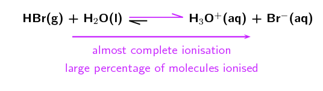
  The unequal double arrows in the reaction equation indicate that the
                                                          equilibrium position favours the formation of ions. This is in
                                                          contrast to the ionisation of a weak acid.
- **Weak acids**
  Consider the ionisation of ethanoic acid
                                                          (\(\text{CH}_{3}\text{COOH}\)):
  \(\color{red}{\text{CH}_{3}{\text{COOH(aq)}}}\) +
                                                          \(\text{H}_{2}\text{O}(\text{ℓ})\) \(\to\)
                                                          \(\text{H}_{3}\text{O}^{+}(\text{aq}) +
                                                          \text{CH}_{3}\text{COO}^{-}(\text{aq})\)
  Therefore, \(\color{red}{\text{K}_{\text{a}}} =
                                                          \dfrac{\text{[H}_{3}{\text{O}}^{+}{\text{(aq)][CH}}_{3}{\text{COO}}^{-}{\text{(aq)]}}}{\color{red}{\text{[CH}_{3}{\text{COOH(aq)]}}}}\)
  The value of \(\color{red}{\text{K}_{\text{a}}}\) for this reaction
                                                          is very low (approximately \(\text{1,7} \times
                                                          \text{10}^{-\text{5}}\)), showing that only a few of the
                                                          \(\text{CH}_{3}\text{COOH}\) molecules ionise to form
                                                          \(\text{H}_{3}\text{O}^{+}\) (in water) and
                                                          \(\text{CH}_{3}\text{COO}^{-}\).
  We can write the reaction with an unequal double arrow to show the
                                                          position of the equilibrium, which does not favour the formation
                                                          of ions:
  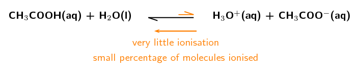

| Name | Formula | \(\text{K}_{\text{a}}\) values | Type |
| --- | --- | --- | --- |
| Hydrobromic acid | \(\text{HBr}\) | \(\text{1,0} \times \text{10}^{\text{9}}\) | strong acid |
| Hydrochloric acid | \(\text{HCl}\) | \(\text{1,3} \times \text{10}^{\text{6}}\) | strong acid |
| Sulfuric acid | \(\text{H}_{2}\text{SO}_{4}\) | First \(\text{H}^{+}\): \(\text{1,0}
                                                                        \times \text{10}^{\text{3}}\) Second \(\text{H}^{+}\):
                                                                        \(\text{1,0} \times \text{10}^{-\text{2}}\) | strong acid |
| Oxalic acid | \(\text{H}_{2}\text{C}_{2}\text{O}_{4}\) | First \(\text{H}^{+}\): \(\text{5,8}
                                                                        \times \text{10}^{-\text{2}}\) Second \(\text{H}^{+}\):
                                                                        \(\text{6,5} \times \text{10}^{-\text{5}}\) | weak acid |
| Sulfurous acid | \(\text{H}_{2}\text{SO}_{3}\) | First \(\text{H}^{+}\): \(\text{1,4}
                                                                        \times \text{10}^{-\text{2}}\) Second \(\text{H}^{+}\):
                                                                        \(\text{6,3} \times \text{10}^{-\text{8}}\) | weak acid |
| Hydrofluoric acid | \(\text{HF}\) | \(\text{3,5} \times \text{10}^{-\text{4}}\) | weak acid |
| Ethanoic acid | \(\text{CH}_{3}\text{COOH}\) | \(\text{1,7} \times \text{10}^{-\text{5}}\) | weak acid |

Table 9.5: \(\text{K}_{\text{a}}\) values for the ionisation of some
                                                        common acids. Note that sulfuric, oxalic and sulfurous acid can
                                                        all lose \(\text{2}\) \(\text{H}^{+}\) ions (they are diprotic
                                                        acids).

<Callout type="note" title="Note">
There are really only six strong inorganic acids, the rest are considered
                                                weak. These are:

\(\text{HClO}_{4}\) (perchloric acid),

\(\text{HI}\) (hydroiodic acid),

\(\text{HBr}\) (hydrobromic acid),

\(\text{HCl}\) (hydrochloric acid),

\(\text{H}_{2}\text{SO}_{4}\) (sulfuric acid) and

\(\text{HNO}_{3}\) (nitric acid).
</Callout>

#### Bases

The dissociation of bases is similar to that of acids in that we look at the
                                        \(\color{blue}{\text{K}_{\text{b}}}\) values in a similar manner:

- **Strong bases**
  For a strong base like \(\text{NaOH}\):
  \(\color{blue}{\text{NaOH(aq)}}\) +
                                                          \(\text{H}_{2}\text{O}(\text{ℓ})\) \(\to\)
                                                          \(\text{Na}^{+}(\text{aq}) + \text{OH}^{-}(\text{aq}) +
                                                          \text{H}_{2}\text{O}(\text{ℓ})\)
  \(\color{blue}{\text{K}_{\text{b}}} =
                                                          \dfrac{\text{[Na}^{+}{\text{(aq)][OH}}^{-}{\text{(aq)]}}}{\color{blue}{\text{[NaOH(aq)]}}}\)
  The \(\color{blue}{\text{K}_{\text{b}}}\) for \(\text{NaOH}\) is very
                                                          large (\(\text{NaOH}\) is a strong base and almost completely
                                                          dissociates) and shows that the equilibrium lies very far to the
                                                          \(\text{OH}^{-}\) side of the reaction. As a result we can write
                                                          the equilibrium as:
  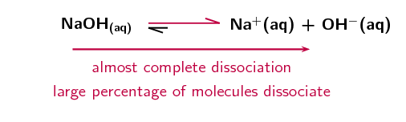
- **Weak bases**
  \(\color{blue}{\text{NH}_{3}{\text{(g)}}}\) +
                                                          \(\text{H}_{2}\text{O}(\text{ℓ})\) \(\to\)
                                                          \(\text{NH}_{4}^{+}(\text{aq}) + \text{OH}^{-}(\text{aq})\)
  \(\color{blue}{\text{K}_{\text{b}}} =
                                                          \dfrac{\text{[NH}_{4}^{+}{\text{(aq)][OH}}^{-}{\text{(aq)]}}}{\color{blue}{\text{[NH}_{3}{\text{(g)]}}}}\)
  The \(\color{blue}{\text{K}_{\text{b}}}\) for \(\text{NH}_{3}\) is
                                                          approximately \(\text{1,8} \times \text{10}^{-\text{5}}\)
                                                          (\(\text{NH}_{3}\) is a weak base) and shows that the
                                                          equilibrium lies to the \(\text{NH}_{3}\) side of the reaction.
                                                          As a result we can write the equilibrium as:
  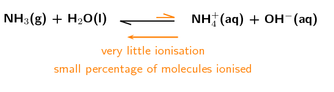

<Callout type="tip" title="Worked example 6: Equilibrium constant calculations">
**Question:**
Calculate the equilibrium constant for hydrochloric acid added to
                                                \(\text{1,38}\) \(\text{dm$^{3}$}\) of water:

\(\text{HCl}(\text{aq}) + \text{H}_{2}\text{O}(\text{ℓ})\) \(\to\)
                                                \(\text{H}_{3}\text{O}^{+}(\text{aq}) + \text{Cl}^{-}(\text{aq})\)

\(n(\text{HCl})\) in solution = \(\text{0,005}\) \(\text{mol}\)

\(n(\text{Cl}^{-})\) in solution = \(\text{87,3}\) \(\text{mol}\)

**Calculate the concentration of \(\text{HCl}\) at equilibrium:**
\(c(\text{HCl}) = \dfrac{n}{V} = \dfrac{\text{0,005}
                                                {\text{ mol}}}{\text{1,38} {\text{ dm}}^{3}} = \text{0,0036}
                                                \text{ mol·dm$^{-3}$}\)

**Calculate the concentration of \(\text{Cl}^{-}\) at
                                                equilibrium:**
\(c(\text{Cl}^{-}) = \dfrac{n}{V} = \dfrac{\text{87,3}
                                                {\text{ mol}}}{\text{1,38} {\text{ dm}}^{3}} = \text{63,3}
                                                \text{ mol·dm$^{-3}$}\)

**Calculate the concentration of \(\text{H}_{3}\text{O}^{+}\) at
                                                equilibrium:**
There is a \(\text{1}\):\(\text{1}\) mole ratio between
                                                \(\text{H}_{3}\text{O}^{+}\) and \(\text{Cl}^{-}\). Therefore, if
                                                \(\text{87,3}\) \(\text{mol}\) of \(\text{Cl}^{-}\) is present at
                                                equilibrium, \(\text{87,3}\) \(\text{mol}\) of
                                                \(\text{H}_{3}\text{O}^{+}\) must be present as well.

\(c(\text{H}_{3}\text{O}^{+}) = \dfrac{n}{V} =
                                                \dfrac{\text{87,3} {\text{ mol}}}{\text{1,38} {\text{ dm}}^{3}} =
                                                \text{63,3} \text{ mol·dm$^{-3}$}\)

**Calculate \(\text{K}_{\text{a}}\) (because \(\text{HCl}\) is
                                                an acid):**
\(\text{K}_{\text{a}} =
                                                \dfrac{\text{[H}_{3}{\text{O}}^{+}{\text{(aq)]}}^{1}{\text{[Cl}}^{-}{\text{(aq)]}}^{1}}{\text{[HCl]}^{1}}\)

\(\text{K}_{\text{a}} = \dfrac{\text{63,3} \times
                                                \text{63,3}}{\text{0,0036}}\) = \(\text{1,11} \times
                                                \text{10}^{\text{6}}\)
</Callout>

<Callout type="tip" title="Note">
In a balanced chemical equation such as:

\(2\text{C}\) \(\to\) \(\text{A} + \text{B}\)

\(\text{K}_{\text{a}}\) = \(\dfrac{\text{[A]}^{1}\text{[B]}^{1}}{\text{[C]}^{2}}\)

However, we generally do not include the superscripts when the coefficients in the
                                        balanced equation are **1**:

\(\text{K}_{\text{a}}\) = \(\dfrac{\text{[A][B]}}{\text{[C]}^{2}}\)

Remember that \(\text{x}^{1}\) = x.
</Callout>

<Callout type="tip" title="Worked example 7: Equilibrium constant calculations">
**Question:**
The equilibrium constant (\(\text{K}_{\text{b}}\)) for the following reaction
                                                is \(\text{1,8} \times \text{10}^{-\text{5}}\).

\(\text{NH}_{3}(\text{aq}) + \text{H}_{2}\text{O}(\text{ℓ})\) \(\to\)
                                                \(\text{NH}_{4}^{+}(\text{aq}) + \text{OH}^{-}(\text{aq})\)

Calculate the mass (at equilibrium) of \(\text{NH}_{3}\) molecules dissolved
                                                in \(\text{4}\) \(\text{dm$^{3}$}\) of water if there is a
                                                \(\text{0,00175}\) \(\text{mol·dm$^{-3}$}\) concentration of
                                                hydroxide
                                                ions at equilibrium.

**What is the \(\text{K}_{\text{b}}\) equation for this reaction:**
\(\text{K}_{\text{b}} =
                                                \dfrac{{\text{[NH}}_{4}^{+}{\text{(aq)]}}^{1}{\text{[OH}}^{-}{\text{(aq)]}}^{1}}{{\text{[NH}}_{3}{\text{(aq)]}}^{1}}\)

**Calculate the concentration of \(\text{NH}_{3}\) at
                                                equilibrium:**
If there is a \(\text{0,00175}\) \(\text{mol·dm$^{-3}$}\) concentration
                                                of
                                                \(\text{OH}^{-}\) ions at equilibrium there must be an equal
                                                concentration of \(\text{NH}_{4}^{+}\) ions.

                                        \begin{align*}
                                        \text{[NH}_{3}{\text{(aq)]}} & =
                                        \frac{{\text{[NH}}_{4}^{+}{\text{(aq)]}}^{1}{\text{[OH}}^{-}{\text{(aq)]}}^{1}}{{\text{K}}_{\text{b}}}
                                        \\
                                        & =
                                        \dfrac{{\text{(}}\text{0,00175}{\text{)}}{\text{(}}\text{0,00175}{\text{)}}}{\text{1,8}
                                        \times \text{10}^{-\text{5}}} \\
                                        & = \text{0,17}\text{ mol·dm$^{-3}$}
                                        \end{align*}

**Calculate the number of moles of \(\text{NH}_{3}\) at
                                                equilibrium:**
\(c\text{ (mol·dm}^{-3}{\text{)}} = \dfrac{n\text{ (mol)}}
                                                {V\text{ (dm}^{3}{\text{)}}}\), therefore:

\(n = c \times V = \text{0,17} \text{ mol·dm$^{-3}$} \times
                                                \text{4}
                                                \text{ dm$^{3}$} = \text{0,68} \text{ mol}\)

**Calculate the mass of \(\text{NH}_{3}\) in solution at
                                                equilibrium:**
\(n\text{ (mol)} = \dfrac{m\text{ (g)}}{
                                                M\text{ (g·mol}^{-1}{\text{)}}}\).
                                                Therefore \(m = n \times M\)

\(M(\text{NH}_{3}) = \text{14,0} + (\text{3} \times \text{1,01}) =
                                                \text{17,03} \text{ g·mol$^{-1}$}\)

\(m = \text{0,68} \text{ mol} \times \text{17,03}
                                                \text{ g·mol$^{-1}$}
                                                = \text{11,6} \text{ g}\)
</Callout>

<QuizCard id="s12-09-01c" title="Interactive Exercise 9.3" question="A learner has \(\text{1,2}\ \text{dm$^{3}$}\) of a lithium hydroxide solution: LiOH(aq) \(\rightleftharpoons\) \(\updownarrow\) Li + (aq) \(\:+\:\) OH − (aq) At equilibrium, the number of moles of LiOH in the solution is \(\text{0,02}\ \text{mol}\) ,                 and the number of moles of Li + in solution is \(\text{82}\ \text{mol}\) . Calculate the equilibrium constant. INSTRUCTION: Write your answer in scientific notation , and then round it to two decimal places ." options=[] answer="
                    (2.8e+5; 2.78e+5; 2.812e+5)
                " hint="You should enter a number here. If you want to, you can use a space to separate thousands.                Example: 12 800,25 For scientific notation you need to use the multiply symbol                ( ∗ ) and the exponent symbol ( ^ ). For example 6,673 × 10 −11 should be written as: 6,673 ∗ 10^−11" explanation="Calculate the concentration of LiOH at equilibrium We need to know the concentration of each substance at equilibrium in order to calculate the equilibrium constant. \[                     \begin{aligned}                         c(\text{L}\text{i}\text{O}\text{H}) & = \frac{n}{V} \\                         & = \frac{\text{0,02}}                         {\text{1,2}} \\                         & = \text{0,01666...}\ \text{mol·dm$^{-3}$}                     \end{aligned}                 \] Calculate the concentration of Li + at equilibrium \[                     \begin{aligned}                         c(\text{L}\text{i}^{+}) & = \frac{n}{V} \\                         & = \frac{\text{82}}                         {\text{1,2}} \\                         & = \text{68,33333...}\ \text{mol·dm$^{-3}$}                     \end{aligned}                 \] Determine the concentration of OH − at equilibrium There is a \(\text{1:1}\) molar ratio between OH − and Li + . Therefore, if \(\text{82}\ \text{mol}\) of Li + is present at equilibrium, \(\text{82}\ \text{mol}\) of OH − must be present as well. Therefore \(c(\text{O}\text{H}^{-}) = \text{68,33333...}\ \text{mol·dm$^{-3}$}\) as well. Calculate \(K_{b}\) We can use the following equation to calculate the equilibrium constant: \[                     \begin{array}{c}                         K_{b} = \dfrac{[\text{L}\text{i}^{+}][\text{O}\text{H}^{-}]}                         {[\text{L}\text{i}\text{O}\text{H}]}                     \end{array}                 \] NOTE: Lithium hydroxide is a base and so we calculate \(K_{b}\) . \[                     \begin{aligned}                         K_{b} & = \frac{[\text{L}\text{i}^{+}][\text{O}\text{H}^{-}]}                         {[\text{L}\text{i}\text{O}\text{H}]} \\                         & = \frac{(\text{68,33333...})(\text{68,33333...})}                         {(\text{0,01666...})} \\                         & = \text{2,80166...} \times \text{10}^{\text{5}} \\ & \approx \text{2,80} \times \text{10}^{\text{5}}                     \end{aligned}                 \] Submit your answer as:" />

<QuizCard id="s12-09-01c" title="Interactive Exercise 9.3" question="Adapted from DBE Nov 2015 Grade 12, P2, Q1.3 Physical constants \(·\) Chemistry formulas \(·\) Periodic table \(·\) Standard reduction potentials Consider the reaction represented by the balanced equation below. H 3 O + (aq) \(\:+\:\) S 2− (aq) \(\rightarrow\) \(\downarrow\) HS − (aq) \(\:+\:\) H 2 O(ℓ) Which one of the following is a conjugate acid-base pair? A S 2− (aq) and H 2 O(ℓ) B H 3 O + (aq) and H 2 O(ℓ) C HS − (aq) and H 2 O(ℓ) D H 3 O + (aq) and HS − (aq)" options=["A", "B", "C", "D"] answer="
                    1
                " hint="" explanation="Recall the basics of conjugate acid-base pairs A conjugate acid-base pair contains two chemical species that differ only by one hydrogen ion (H + ) (also referred to as a proton) . This can be seen if we look at what happens to ammonia in the reaction between hydrochloric acid and ammonia. HCl \(+\) NH 3 \(\rightleftharpoons\) \(\updownarrow\) NH 4 + \(+\) Cl − In the forward reaction , we see that NH 3 is a proton acceptor ( base ). NH 3 \(+\) H + \(\rightarrow\) \(\downarrow\) NH 4 + Looking at the reverse reaction , we see that NH 4 + is a proton donor ( acid ). NH 4 + \(\rightarrow\) \(\downarrow\) NH 3 \(+\) H + The only difference between NH 3 and NH 4 + is a proton (H + ) . NH 3 and NH 4 + are a conjugate acid-base pair. NOTE: Similarly, HCl and Cl − are also a conjugate acid-base pair. HCl is a proton donor in the forward reaction and Cl − is a proton acceptor in the reverse reaction . In fact, in all acid-base reactions there will be two conjugate acid-base pairs. Apply the basics of conjugate acid-base pairs We are interested in this equation: H 3 O + (aq) \(\:+\:\) S 2− (aq) \(\rightarrow\) \(\downarrow\) HS − (aq) \(\:+\:\) H 2 O(ℓ) We can see that there are two pairs that differ by just one H + : H 3 O + and H 2 O S 2− and HS − So now we can choose the conjugate acid-base pair from the table. A S 2− (aq) and H 2 O(ℓ) B \({\color{red}{{\checkmark}{\checkmark}}}\) H 3 O + (aq) and H 2 O(ℓ) C HS − (aq) and H 2 O(ℓ) D H 3 O + (aq) and HS − (aq) Therefore the correct option is B . Submit your answer as: B" />

## Acids and bases

### Textbook Exercise 9.3

State whether the acids and bases in the following balanced chemical
                                                        equations are strong or weak and give a reason for your answer.

**Problem:**
\(\text{HF}\):

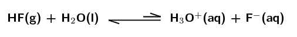

**Solution:**
Weak acid. The equilibrium lies far to the left meaning that
                                                                only a small percentage of the hydrofluoric acid
                                                                molecules donate a proton, ionisation is not favoured.

**Problem:**
\(\text{KOH}\) dissolved in water:

**Solution:**
Strong base. The equilibrium lies far to the right meaning
                                                                that a large percentage of the potassium hydroxide
                                                                molecules dissociate in water, dissociation is favoured.

**Problem:**
\(\text{NH}_{3}\):

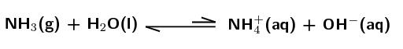

**Solution:**
Weak base. The equilibrium lies far to the left meaning that
                                                                only a small percentage of the ammonia molecules accept
                                                                a proton, ionisation is not favoured.

**Problem:**
\(\text{HCl}\):

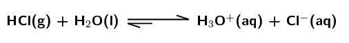

**Solution:**
Strong acid. The equilibrium lies far to the right meaning
                                                                that a large percentage of the hydrochloric acid
                                                                molecules donate a proton, ionisation is favoured.

State whether the acids and bases in the following questions are
                                                        strong or weak and give a reason for your answer.

**Problem:**
\(\text{CH}_{3}\text{COOH}\) has a \(\text{K}_{\text{a}}\)
                                                                value of \(\text{1,7} \times \text{10}^{-\text{5}}\).

**Solution:**
Weak acid. \(\text{K}_{\text{a}}\) is very small, meaning
                                                                that only a small percentage of the ethanoic acid
                                                                (\(\text{CH}_{3}\text{COOH}\)) molecules donate a
                                                                proton, ionisation is not favoured.

**Problem:**
\(\text{NH}_{3}\) has a \(\text{K}_{\text{b}}\) value of
                                                                \(\text{1,8} \times \text{10}^{-\text{5}}\).

**Solution:**
Weak base. \(\text{K}_{\text{b}}\) is very small, meaning
                                                                that only a small percentage of the ammonia
                                                                (\(\text{NH}_{3}\)) molecules accept a proton,
                                                                ionisation is not favoured.

**Problem:**
\(\text{HI}\) has a \(\text{K}_{\text{a}}\) value of
                                                                \(\text{3,2} \times \text{10}^{\text{9}}\).

**Solution:**
Strong acid. \(\text{K}_{\text{a}}\) is very large, meaning
                                                                that almost all of the hydroiodic acid (\(\text{HI}\))
                                                                molecules donate a proton, ionisation is favoured.
