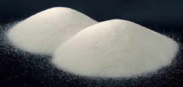
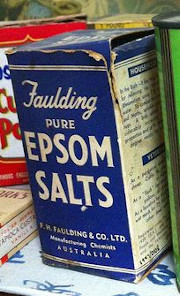
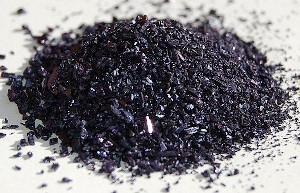
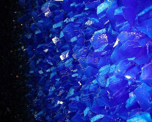
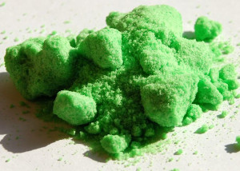
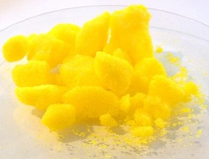
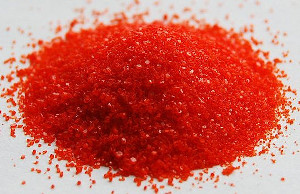

## 9.2 Acid-base reactions (ESCP8)

When an acid and a base react, they form a **salt**. If the base contains hydroxide
                        \((\text{OH}^{-})\) ions, then *water* will also be formed. The word *salt* is a
                        general term which applies to the products of all acid-base reactions. A salt is a product that
                        is made up of the \(\color{blue}{\textbf{cation}}\) from a \(\color{blue}{\textbf{base}}\) and
                        the \(\color{red}{\textbf{anion}}\) from an \(\color{red}{\textbf{acid}}\).

Salt

A salt is a neutral ionic compound composed of cations and anions. It is the result
                                        of an acid-base neutralisation reaction.

### Neutralisation reactions (ESCP9)

<Callout type="note" title="Note">
A **cation** is an ion (charged atom or molecule) with a positive (+)
                                        charge. An **anion** is an ion with a negative (-) charge.
</Callout>

<Callout type="note" title="Note">

Salts are not just the table salt you put on your food. A salt is any compound made
                                        up of stoichiometrically equivalent amounts of cations and anions to make a
                                        neutral, ionic compound.

Magnesium sulfate heptahydrate (\(\text{MgSO}_{4}.7\text{H}_{2}\text{O}\)), commonly
                                        known as Epsom salt, can be used as a gel to treat aches and pains, as bath
                                        salts, and has many other uses.
</Callout>

When an equivalent amount of acid and base react (so that neither the acid nor the base are
                                in excess), the reaction is said to have reached the **equivalence** point.
                                At this point **neutralisation** has been achieved.

Equivalence point

When a stoichiometrically equivalent number of moles of both reactants has
                                                been added to the reaction vessel.

To better understand stoichiometric equivalence look at the following equations:

2. \(1\color{red}{\text{HA(aq)}} + 1\color{blue}{\text{BOH(aq)}} \to\)
                                                   \(1\text{AB}(\text{aq}) + 1\text{H}_{2}\text{O}(\text{ℓ})\)
4. \(1\color{red}{\text{H}_{2}{\text{A(aq)}}} + 2\color{blue}{\text{BOH(aq)}}
                                                   \to\) \(1\text{AB}_{2}(\text{aq}) +
                                                   2\text{H}_{2}\text{O}(\text{ℓ})\)

In the first example above, a stoichiometrically equivalent number of moles is
                                **one** mole of \(\color{red}{\text{HA}}\) for every **one**
                                mole of \(\color{blue}{\text{BOH}}\). In the second example, a stoichiometrically
                                equivalent number of moles is **one** mole of
                                \(\color{red}{\text{H}_{2}{\text{A}}}\) for every **two** moles of
                                \(\color{blue}{\text{BOH}}\).

Neutralisation

A neutralisation reaction involves an acid and a base reacting to form a
                                                salt.

Look at the following examples:

- **Hydrochloric acid with sodium hydroxide**
  Hydrochloric acid reacts with sodium hydroxide to form sodium chloride (the
                                                  salt) and water. Sodium chloride is made up of \(\text{Na}^{+}\) cations
                                                  from the base \((\text{NaOH})\) and \(\text{Cl}^{-}\) anions from the
                                                  acid \((\text{HCl})\).
  \(\text{H}{\color{red}{\textbf{Cl}}}{\text{(aq)}} +
                                                  \color{blue}{\textbf{Na}}{\text{OH(aq)}} \to
                                                  {\color{blue}{\textbf{Na}}}{\color{red}{\textbf{Cl}}}{\text{(aq)}} +
                                                  {\text{H}}_{2}{\text{O(ℓ)}}\)
- **Hydrogen bromide with postassium hydroxide**
  Hydrogen bromide reacts with potassium hydroxide to form potassium bromide
                                                  (the salt) and water. Potassium bromide is made up of \(\text{K}^{+}\)
                                                  cations from the base \((\text{KOH})\) and \(\text{Br}^{-}\) anions from
                                                  the acid \((\text{HBr})\).
  \(\text{H}{\color{red}{\textbf{Br}}}{\text{(aq)}} +
                                                  \color{blue}{\textbf{K}}\text{OH(aq)} \to
                                                  \color{blue}{\textbf{K}}\color{red}{\textbf{Br}}{\text{(aq)}} +
                                                  {\text{H}}_{2}\text{O(ℓ)}\)
- **Hydrochloric acid with sodium hydrocarbonate**
  Hydrochloric acid reacts with sodium hydrocarbonate to form sodium chloride
                                                  (the salt), water and carbon dioxide. Sodium chloride is made up of
                                                  \(\text{Na}^{+}\) cations from the base \((\text{NaHCO}_{3})\) and
                                                  \(\text{Cl}^{-}\) anions from the acid \((\text{HCl})\).
  \(\text{H}{\color{red}{\textbf{Cl}}}{\text{(aq)}} +
                                                  {\color{blue}{\textbf{Na}}}{\text{HCO}}_{3}{\text{(aq)}} \to
                                                  \color{blue}{\textbf{Na}}\color{red}{\textbf{Cl}}{\text{(aq)}} +
                                                  {\text{H}_{2}{\text{O(ℓ)}}} + {\text{CO}}_{2}{\text{(g)}}\)

You should notice that in the first two examples, the base contained \(\text{OH}^{-}\) ions,
                                and therefore the products were a *salt* and *water*. \(\text{NaCl}\)
                                (table salt) and \(\text{KBr}\) are both salts. In the third example,
                                \(\text{NaHCO}_{3}\) also acts as a base, despite not having \(\text{OH}^{-}\) ions. A
                                salt is still formed as one of the products, but carbon dioxide (\(\text{CO}_{2}\)) is
                                produced as well as water.

This experiment can be used for an informal assessment. It will help determine if the
                                        learners understand what happens in a neutralisation reaction. Learners are
                                        working with a strong acid and a strong base in this reaction. Concentrated,
                                        strong acids and bases can cause serious burns. Please remind the learners to be
                                        careful and wear the appropriate safety equipment when handling all chemicals,
                                        especially concentrated acids and bases. The safety equipment includes gloves,
                                        safety glasses, and protective clothing.

## Temperature changes in neutralisation reactions

### Aim

To investigate the temperature change associated with a neutralisation
                                                reaction.

### Apparatus

- \(\text{1}\) \(\text{mol.dm$^{-3}$}\) solution of sodium
                                                                  hydroxide (\(\text{NaOH}\)), \(\text{1}\)
                                                                  \(\text{mol.dm$^{-3}$}\) solution of hydrochloric acid
                                                                  (\(\text{HCl}\))
- A thermometer, a beaker, a measuring cylinder

### Method

<Callout type="warning" title="Note">
Concentrated acids and bases can cause serious burns. We suggest
                                                        using gloves and safety glasses whenever you work with an acid
                                                        or a base. Remember to add the acid to the water and to avoid
                                                        sniffing any laboratory chemical. Handle all chemicals with
                                                        care.
</Callout>

2. Pour \(\text{20}\) \(\text{cm$^{3}$}\) of the sodium
                                                                   hydroxide solution into the beaker.
4. Measure the temperature.
6. Add \(\text{5}\) \(\text{cm$^{3}$}\) of hydrochloric acid to
                                                                   the beaker using the measuring cylinder.
8. Repeat steps \(\text{2}\) and \(\text{3}\) quite quickly
                                                                   until the temperature no longer changes significantly.

### Observations

You should record your temperatures and the volume in a table (remember that
                                                the volume of the sodium hydroxide is constant at \(\text{20}\)
                                                \(\text{cm$^{3}$}\)):

| Volume (HCl) | Temperature (℃) |
| --- | --- |
| \(\text{0}\) | room temperature |

### Discussion

You should find that the reaction releases heat and so the temperature
                                                increases. After all the base has been neutralised the temperature
                                                should no longer increase. This is because the neutralisation reaction
                                                is *exothermic* (it releases heat). When all the base has been
                                                neutralised there is no reaction on the addition of more acid, and no
                                                more heat is released.

After the reaction has finished (the base has been neutralised) there
                                                        is no more heat being produced. As a result the temperature will
                                                        not rise any more. In fact, there may even be a decrease in
                                                        temperature back to room temperature as the heat from the
                                                        reaction vessel (the beaker) dissipates.

<Callout type="note" title="Note">
Salts can come in many different colours.

\(\color{purple}{\textbf{Potassium permanganate}}\)
                                        (\(\color{purple}{\textbf{KMnO}_{4}}\))

\(\color{blue}{\textbf{Copper sulfate}}\) (\(\color{blue}{\textbf{CuSO}_{4}}\))

\(\color{darkgreen}{\textbf{Nickel chloride}}\)
                                        (\(\color{darkgreen}{\textbf{NiCl}_{2}}\))

\(\color{gold}{\textbf{Sodium chromate}}\)
                                        (\(\color{gold}{\textbf{Na}_{2}{\textbf{CrO}}_{4}}\))

\(\color{red}{\textbf{Potassim dichromate}}\)
                                        (\(\color{red}{\textbf{K}_{2}{\textbf{Cr}}_{2}{\textbf{O}}_{7}}\))
</Callout>

Neutralisation reactions are very important in every day life. Below are some examples:

- **Domestic uses**
  Calcium oxide \((\text{CaO})\) is used to neutralise acidic soil. Powdered
                                                  limestone \((\text{CaCO}_{3})\) can also be used, but its action is much
                                                  slower and less effective. These substances can also be used on a larger
                                                  scale in farming and in rivers.
- **Biological uses**
  Hydrochloric acid \((\text{HCl})\) in the stomach plays an important role in
                                                  helping to digest food. It is important to note that too much acid in
                                                  the stomach may lead to the formation of ulcers in cases where the
                                                  stomach lining is damaged (e.g. by an infection).
  **Antacids** (which are bases) are taken to neutralise excess
                                                  stomach acid, to prevent damage to the intestines. Examples of antacids
                                                  are aluminium hydroxide, magnesium hydroxide ('milk of magnesia') and
                                                  sodium bicarbonate ('bicarbonate of soda').
- **Industrial uses**
  Alkaline calcium hydroxide (limewater) is used to absorb harmful acidic
                                                  \(\text{SO}_{2}\) gas that is released from power stations and from the
                                                  burning of fossil fuels.

<Callout type="warning" title="Note">
Please **do not** use a base to neutralise an acid if you spill some on
                                        yourself during an experiment. A strong base can burn you as much as a strong
                                        acid. Rather wash the area thoroughly with water.
</Callout>

<Callout type="note" title="Note">
Bee stings are acidic and have a pH between \(\text{5}\) and \(\text{5,5}\). They can
                                        be soothed by using substances such as calomine lotion, which is a mild alkali
                                        based on zinc oxide. Bicarbonate of soda, or soap, can also be used. The alkalis
                                        help to neutralise the acidic bee sting and relieve some of the itchiness.

</Callout>

## Acids and metal compounds

Research the reactions that occur when an **acid is added** to the
                                        following compounds:

(Your Grade 11 book will be helpful with this research)

- a metal
- a metal hydroxide
- a metal oxide
- a metal carbonate
- a metal hydrogen carbonate

Write a report which includes:

- The general equation (in words) of each reaction.
- A description of what is happening in this reaction.
- An example of this type of reaction in the form of a balanced
                                                          equation.

The following is an example of how the learners **acids and metals compounds
                                                report** could look:

- **Acid + metal** \(\to\) **salt +
                                                                  hydrogen**
  A dilute acid is added to a pure metal to form a salt and hydrogen
                                                          gas. The salt is formed by the metal cation and the anion from
                                                          the acid. In this reaction the metal is acting as a base. For
                                                          example:
  \(\color{red}{\text{hydrochloric acid}} + \color{blue}{\text{zinc}}
                                                          \to \color{blue}{\text{zinc}} \color{red}{\text{ chloride}}\) +
                                                          hydrogen
  \(2\text{HCl}(\text{aq}) + \text{Zn}(\text{s})\) \(\to\)
                                                          \(\text{ZnCl}_{2}(\text{aq}) + \text{H}_{2}(\text{g})\)
- **Acid + metal hydroxide** \(\to\) **salt +
                                                                  water**
  A dilute acid is added to a metal hydroxide to form a salt and water.
                                                          The salt is formed by the metal cation and the anion from the
                                                          acid. In this reaction the metal hydroxide is acting as a base.
                                                          For example:
  \(\color{red}{\text{hydrochloric acid}} + \color{blue}{\text{zinc
                                                          hydroxide}} \to \color{blue}{\text{zinc}} \color{red}{\text{
                                                          chloride}}\) + water
  \(2\text{HCl}(\text{aq}) + \text{Zn}(\text{OH})_{2}(\text{s})\)
                                                          \(\to\) \(\text{ZnCl}_{2}(\text{aq}) +
                                                          2\text{H}_{2}\text{O}(\text{ℓ})\)
- **Acid + metal oxide** \(\to\) **salt +
                                                                  water**
  A dilute acid is added to a metal oxide to form a salt and water. The
                                                          salt is formed by the metal cation and the anion from the acid.
                                                          In this reaction the metal oxide is acting as a base. For
                                                          example:
  \(\color{red}{\text{hydrochloric acid}} + \color{blue}{\text{zinc
                                                          oxide}} \to \color{blue}{\text{zinc}} \color{red}{\text{
                                                          chloride}}\) + water
  \(2\text{HCl}(\text{aq}) + \text{ZnO}(\text{s})\) \(\to\)
                                                          \(\text{ZnCl}_{2}(\text{aq}) +
                                                          \text{H}_{2}\text{O}(\text{ℓ})\)
- **Acid + metal carbonate** \(\to\) **salt + water
                                                                  + carbon dioxide**
  A dilute acid is added to a metal carbonate to form a salt, water and
                                                          carbon dioxide gas. The salt is formed by the metal cation and
                                                          the anion from the acid. In this reaction the metal carbonate is
                                                          acting as a base. For example:
  \(\color{red}{\text{hydrochloric acid}} + \color{blue}{\text{zinc
                                                          carbonate}} \to \color{blue}{\text{zinc}} \color{red}{\text{
                                                          chloride}}\) + water + carbon dioxide
  \(2\text{HCl}(\text{aq}) + \text{ZnCO}_{3}(\text{s})\) \(\to\)
                                                          \(\text{ZnCl}_{2}(\text{aq}) +
                                                          \text{H}_{2}\text{O}(\text{ℓ}) +
                                                          \text{CO}_{2}(\text{g})\)
- **Acid + metal hydrogen carbonate** \(\to\) **salt
                                                                  + water + carbon dioxide**
  A dilute acid is added to a metal hydrogen carbonate to form a salt,
                                                          water and carbon dioxide gas. The salt is formed by the metal
                                                          cation and the anion from the acid. In this reaction the metal
                                                          hydrogen carbonate is acting as a base. For example:
  \(\color{red}{\text{hydrochloric acid}} + \color{blue}{\text{zinc
                                                          bicarbonate}} \to \color{blue}{\text{zinc}} \color{red}{\text{
                                                          chloride}}\) + water + carbon dioxide
  \(2\text{HCl}(\text{aq}) + \text{Zn}(\text{HCO}_{3})_{2}(\text{s})\)
                                                          \(\to\) \(>\text{ZnCl}_{2}(\text{aq}) +
                                                          2\text{H}_{2}\text{O}(\text{ℓ}) +
                                                          2\text{CO}_{2}(\text{g})\)

## The hazardous nature of acids and bases

Search for information about the following strong acids and bases:

- Hydrochloric acid (\(\text{HCl}\))
- Sulfuric acid (\(\text{H}_{2}\text{SO}_{4}\))
- Sodium hydroxide (\(\text{NaOH}\))
- Potassium hydroxide (\(\text{KOH}\))

Write a report which includes:

- The uses of these compounds in industry
- If applicable, the environmental waste that contains these compounds
- What the effect of a large spillage of these compounds would be

The following is an example of the sort of information learners should report on:

**Hydrochloric acid**

Hydrochloric acid is used industrially to clean rust from iron or steel as well as in
                                        the refining of ores. If released into the environment hydrochloric acid will
                                        lower the pH of any water it pollutes. This change in pH can seriously affect
                                        the growth of plants and damage ecosystems.

<Callout type="tip" title="Worked example 8: Determining equations from starting materials">
**Question:**
Magnesium carbonate (\(\text{MgCO}_{3}\)) is dissolved in nitric acid
                                                (\(\text{HNO}_{3}\)). Give the balanced chemical equation for this
                                                reaction.

**What are the reactants?:**
An acid (\(\text{HNO}_{3}\)) and a metal carbonate (\(\text{MgCO}_{3}\)).

**What will the products be?:**
As this is the reaction of an acid and a metal carbonate the products will be
                                                a salt, water and carbon dioxide.

nitric acid + magnesium carbonate \(\to\) salt + water + carbon dioxide

**What is the formula of the salt?:**
The cation will come from the metal carbonate (\(\text{Mg}^{2+}\)). The anion
                                                will come from the acid (\(\text{NO}_{3}^{-}\)). Due to the charges on
                                                the cation and anion there must be two \(\text{NO}_{3}^{-}\) for every
                                                one \(\text{Mg}^{2+}\).

Therefore the formula for the salt will be: \(\text{Mg}(\text{NO}_{3})_{2}\).

**Write the equation for this reaction:**
\(\text{HNO}_{3}(\text{aq}) + \text{MgCO}_{3}(\text{s})\) \(\to\)
                                                \(\text{Mg}(\text{NO}_{3})_{2}(\text{aq}) +
                                                \text{H}_{2}\text{O}(\text{ℓ}) + \text{CO}_{2}(\text{g})\)

**Make sure that the equation is balanced:**
The equation is not balanced.

|  | Number on left | Number on right |
| --- | --- | --- |
| H | \(\text{1}\) | \(\text{2}\) |
| N | \(\text{1}\) | \(\text{2}\) |
| O | \(\text{6}\) | \(\text{9}\) |
| Mg | \(\text{1}\) | \(\text{1}\) |
| C | \(\text{1}\) | \(\text{1}\) |

To balance this equation there needs to be two nitric acid molecules on the
                                                left hand side.

\(2\text{HNO}_{3}(\text{aq}) + \text{MgCO}_{3}(\text{s})\) \(\to\)
                                                \(\text{Mg}(\text{NO}_{3})_{2}(\text{aq}) +
                                                \text{H}_{2}\text{O}(\text{ℓ}) + \text{CO}_{2}(\text{g})\)

|  | Number on left | Number on right |
| --- | --- | --- |
| H | \(\text{2}\) | \(\text{2}\) |
| N | \(\text{2}\) | \(\text{2}\) |
| O | \(\text{9}\) | \(\text{9}\) |
| Mg | \(\text{1}\) | \(\text{1}\) |
| C | \(\text{1}\) | \(\text{1}\) |

The equation is now balanced.
</Callout>

<QuizCard id="s12-09-02a" title="Interactive Exercise 9.5" question="If there are \(\text{2}\) moles of base, then how many moles of acid will represent                     the equivalence point of a neutralisation reaction?" options=[] answer="
                        1
                    " hint="You should enter a number here. If you want to, you can use a space to separate thousands.                Example: 12 800,25 For scientific notation you need to use the multiply symbol                ( ∗ ) and the exponent symbol ( ^ ). For example 6,673 × 10 −11 should be written as: 6,673 ∗ 10^−11" explanation="The equivalence point of a neutralisation reaction is the point where there is a stoichiometrically equivalent number of moles of acid and                         base. We can use the balanced chemical equation to determine the stoichiometric ratio of the acid to the base. The stoichiometric ratio is                         determined by looking at the numbers in front of each compound in the balanced equation. \(\text{1}\) H 2 SO 4 (aq) \(\:+\:\) \(\text{2}\) NaOH(aq) \(\rightarrow\) \(\downarrow\) \(\text{1}\) Na 2 SO 4 (aq) \(\:+\:\) \(\text{2}\) H 2 O(ℓ) A stoichiometrically equivalent amount of moles is \(\color{red}{\text{1}}\) mole of sulfuric acid (the acid) for every \(\color{blue}{\text{2}}\) moles of sodium hydroxide (the base). So the correct answer is if there are \(\text{2}\) moles of base, then \(\text{1}\) mole of acid will represent the equivalence point                         of a neutralisation reaction. Submit your answer as:" />

<Callout type="tip" title="Worked example 9: Determining equations from starting materials">
**Question:**
Hydroiodic acid (\(\text{HI}\)) is added to solid potassium hydroxide
                                                (\(\text{KOH}\)). Give the balanced chemical equation for this reaction.

**What are the reactants?:**
An acid (\(\text{HI}\)) and a base (\(\text{KOH}\)).

**What will the products be?:**
As this is the reaction of an acid and base (which contains a hydroxide
                                                anion) the products will be a salt and water.

hydroiodic acid + potassium hydroxide \(\to\) salt + water

**What is the formula of the salt?:**
The cation will come from the base (\(\text{K}^{+}\)). The anion will come
                                                from the acid (\(\text{I}^{-}\)). Due to the charges on the cation and
                                                anion there must be one \(\text{K}^{+}\) for every one \(\text{I}^{-}\).

Therefore the formula for the salt will be: \(\text{KI}\).

**Write the equation for this reaction:**
\(\text{HI}(\text{aq}) + \text{KOH}(\text{s})\) \(\to\)
                                                \(\text{KI}(\text{aq}) + \text{H}_{2}\text{O}(\text{ℓ})\)

This can also be written:

\(\text{HI}(\text{aq}) + \text{KOH}(\text{s})\) \(\to\)
                                                \(\text{K}^{+}(\text{aq}) + \text{I}^{-}(\text{aq}) +
                                                \text{H}_{2}\text{O}(\text{ℓ})\)

**Make sure that the equation is balanced:**
The equation is balanced.
</Callout>

<Callout type="tip" title="Worked example 10: Determining equations from starting materials">
**Question:**
Sulfuric acid (\(\text{H}_{2}\text{SO}_{4}\)) and ammonia (\(\text{NH}_{3}\))
                                                are combined. Give the balanced chemical equation for this reaction.

**What are the reactants?:**
An acid (\(\text{H}_{2}\text{SO}_{4}\)) and a base (\(\text{NH}_{3}\)).

**What will the products be?:**
As this is the reaction of an acid and a base (with no hydroxide anion),
                                                there will be a salt as a product. There may or may not be another
                                                product.

sulfuric acid + ammonia \(\to\) salt (+ maybe another product)

**What is the formula of the salt?:**
The cation will come from the base (\(\text{NH}_{4}^{+}\)). The anion will
                                                come from the acid (\(\text{SO}_{4}^{2-}\)). Due to the charges on the
                                                cation and anion there must be two \(\text{NH}_{4}^{+}\) for every one
                                                \(\text{SO}_{4}^{2-}\).

Therefore the formula for the salt will be:
                                                \((\text{NH}_{4})_{2}\text{SO}_{4}\).

**Write the equation for this reaction so far:**
\(\text{H}_{2}\text{SO}_{4}(\text{aq}) + \text{NH}_{3}(\text{g})\) \(\to\)
                                                \((\text{NH}_{4})_{2}\text{SO}_{4}(\text{aq})\) (+ maybe another
                                                product)

**Determine if there will be another product:**
There are no atom types that are not accounted for on both sides of the
                                                equation, therefore it is unlikely that there will be another product.
                                                If the equation can be balanced then there is no other product.

**Make sure that the equation is balanced:**
The equation is not balanced.

|  | Number on left | Number on right |
| --- | --- | --- |
| H | \(\text{5}\) | \(\text{8}\) |
| S | \(\text{1}\) | \(\text{1}\) |
| O | \(\text{4}\) | \(\text{4}\) |
| N | \(\text{1}\) | \(\text{2}\) |

To balance this equation there needs to be two ammonia molecules on the left
                                                hand side.

\(\text{H}_{2}\text{SO}_{4}(\text{aq}) + 2\text{NH}_{3}(\text{g})\) \(\to\)
                                                \((\text{NH}_{4})_{2}\text{SO}_{4}(\text{aq})\)

|  | Number on left | Number on right |
| --- | --- | --- |
| H | \(\text{8}\) | \(\text{8}\) |
| S | \(\text{1}\) | \(\text{1}\) |
| O | \(\text{4}\) | \(\text{4}\) |
| N | \(\text{2}\) | \(\text{2}\) |

The equation is now balanced.
</Callout>

## Reactions of acids and bases

### Textbook Exercise 9.4

Write balanced equations for these acid and metal reactions:

**Problem:**
Hydrochloric acid and calcium

**Solution:**
acid (\(\text{HCl}\)) + metal (\(\text{Ca}\)) \(\to\)
                                                                        salt + hydrogen

Anion (from acid) is \(\text{Cl}^{-}\), cation (from
                                                                        metal) is \(\text{Ca}^{2+}\).

Therefore salt is \(\text{CaCl}_{2}\).

\(\text{HCl}(\text{aq}) + \text{Ca}(\text{s})\)
                                                                        \(\to\) \(\text{CaCl}_{2}(\text{aq}) +
                                                                        \text{H}_{2}(\text{g})\)

To balance this equation there must be two
                                                                        \(\text{HCl}\) molecules.

\(2\text{HCl}(\text{aq}) + \text{Ca}(\text{s})\)
                                                                        \(\to\) \(\text{CaCl}_{2}(\text{aq}) +
                                                                        \text{H}_{2}(\text{g})\)

**Problem:**
Nitric acid and magnesium

**Solution:**
acid (\(\text{HNO}_{3}\)) + metal (\(\text{Mg}\))
                                                                        \(\to\) salt + hydrogen

Anion (from acid) is \(\text{NO}_{3}^{-}\), cation
                                                                        (from metal) is \(\text{Mg}^{2+}\).

Therefore salt is \(\text{Mg}(\text{NO}_{3})_{2}\).

\(\text{HNO}_{3}(\text{aq}) + \text{Mg}(\text{s})\)
                                                                        \(\to\)
                                                                        \(\text{Mg}(\text{NO}_{3})_{2}(\text{aq}) +
                                                                        \text{H}_{2}(\text{g})\)

To balance this equation there must be two
                                                                        \(\text{HNO}_{3}\) molecules.

\(2\text{HNO}_{3}(\text{aq}) + \text{Mg}(\text{s})\)
                                                                        \(\to\)
                                                                        \(\text{Mg}(\text{NO}_{3})_{2}(\text{aq}) +
                                                                        \text{H}_{2}(\text{g})\)

Write balanced equations for these acid and metal hydroxide
                                                                reactions:

**Problem:**
Hydrochloric acid and magnesium hydroxide

**Solution:**
acid (\(\text{HCl}\)) + metal hydroxide
                                                                        (\(\text{Mg}(\text{OH})_{2}\)) \(\to\) salt +
                                                                        water

Anion (from acid) is \(\text{Cl}^{-}\), cation (from
                                                                        metal) is \(\text{Mg}^{2+}\).

Therefore salt is \(\text{MgCl}_{2}\).

\(\text{HCl}(\text{aq}) +
                                                                        \text{Mg}(\text{OH})_{2}(\text{s})\) \(\to\)
                                                                        \(\text{MgCl}_{2}(\text{aq}) +
                                                                        \text{H}_{2}\text{O}(\text{ℓ})\)

To balance this equation there must be two
                                                                        \(\text{HCl}\) molecules and two
                                                                        \(\text{H}_{2}\text{O}\) molecules.

\(2\text{HCl}(\text{aq}) +
                                                                        \text{Mg}(\text{OH})_{2}(\text{s})\) \(\to\)
                                                                        \(\text{MgCl}_{2}(\text{aq}) +
                                                                        2\text{H}_{2}\text{O}(\text{ℓ})\)

**Problem:**
Nitric acid and aluminium hydroxide

**Solution:**
acid (\(\text{HNO}_{3}\)) + metal hydroxide
                                                                        (\(\text{Al}(\text{OH})_{3}\)) \(\to\) salt +
                                                                        water

Anion (from acid) is \(\text{NO}_{3}^{-}\), cation
                                                                        (from metal) is \(\text{Al}^{3+}\).

Therefore salt is \(\text{Al}(\text{NO}_{3})_{3}\).

\(\text{HNO}_{3}(\text{aq}) +
                                                                        \text{Al}(\text{OH})_{3}(\text{s})\) \(\to\)
                                                                        \(\text{Al}(\text{NO}_{3})_{2}(\text{aq}) +
                                                                        \text{H}_{2}\text{O}(\text{ℓ})\)

To balance this equation there must be three
                                                                        \(\text{HNO}_{3}\) molecules and three
                                                                        \(\text{H}_{2}\text{O}\) molecules.

\(3\text{HNO}_{3}(\text{aq}) +
                                                                        \text{Al}(\text{OH})_{3}(\text{s})\) \(\to\)
                                                                        \(\text{Al}(\text{NO}_{3})_{3}(\text{aq}) +
                                                                        3\text{H}_{2}\text{O}(\text{ℓ})\)

Write balanced equations for these acid and metal oxide
                                                                reactions:

**Problem:**
Hydrochloric acid and aluminium oxide

**Solution:**
acid (\(\text{HCl}\)) + metal oxide
                                                                        (\(\text{Al}_{2}\text{O}_{3}\)) \(\to\) salt +
                                                                        water

Anion (from acid) is \(\text{Cl}^{-}\), cation (from
                                                                        metal) is \(\text{Al}^{3+}\).

Therefore salt is \(\text{AlCl}_{3}\).

\(\text{HCl}(\text{aq}) +
                                                                        \text{Al}_{2}\text{O}_{3}(\text{s})\) \(\to\)
                                                                        \(\text{AlCl}_{3}(\text{aq}) +
                                                                        \text{H}_{2}\text{O}(\text{ℓ})\)

To balance this equation there must be six
                                                                        \(\text{HCl}\) molecules, two
                                                                        \(\text{AlCl}_{3}\) molecules, and three
                                                                        \(\text{H}_{2}\text{O}\) molecules.

\(6\text{HCl}(\text{aq}) +
                                                                        \text{Al}_{2}\text{O}_{3}(\text{s})\) \(\to\)
                                                                        \(2\text{AlCl}_{3}(\text{aq}) +
                                                                        3\text{H}_{2}\text{O}(\text{ℓ})\)

**Problem:**
Sulfuric acid and magnesium oxide

**Solution:**
acid (\(\text{H}_{2}\text{SO}_{4}\)) + metal oxide
                                                                        (\(\text{MgO}\)) \(\to\) salt + water

Anion (from acid) is \(\text{SO}_{4}^{2-}\), cation
                                                                        (from metal) is \(\text{Mg}^{2+}\).

Therefore salt is \(\text{MgSO}_{4}\).

\(\text{H}_{2}\text{SO}_{4}(\text{aq}) +
                                                                        \text{MgO}(\text{s})\) \(\to\)
                                                                        \(\text{MgSO}_{4}(\text{aq}) +
                                                                        \text{H}_{2}\text{O}(\text{ℓ})\)

This equation is balanced.
