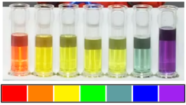
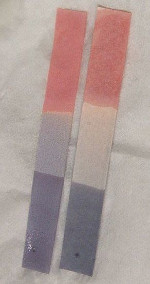
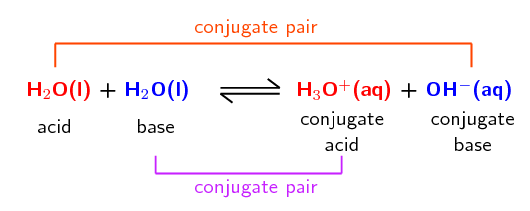
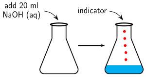
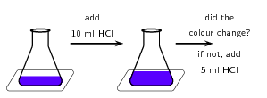
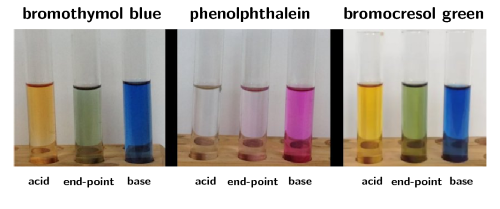
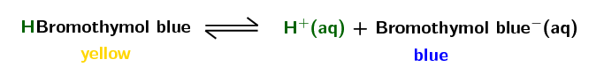

## 9.3 pH (ESCPB)

### The pH scale (ESCPC)

The concentration of specific ions in solution determines whether the solution is acidic or basic.
                        Acids and bases can be described as substances that either increase or decrease the
                        concentration of hydrogen (\(\text{H}^{+}\)) or hydronium (\(\text{H}_{3}\text{O}^{+}\)) ions in
                        a solution. An acid *increases* the hydrogen ion concentration in a solution, while a
                        base *decreases* the hydrogen ion concentration.

**pH** is used to measure the concentration of \(\text{H}^{+}\) ions
                        (\([\text{H}^{+}]\)) and therefore, whether a substance is acidic or basic (alkaline). Solutions
                        with a pH of less than seven are acidic, while those with a pH greater than seven are basic
                        (alkaline). The pH scale ranges from \(\text{0}\) to \(\text{14}\) and a pH of \(\text{7}\) is
                        considered neutral.

<Callout type="note" title="Note">
The universal indicator changes colour from \(\color{red}{\textbf{red}}\) in
                              \(\color{red}{\textbf{strongly acidic}}\) solutions through to
                              \(\color{purple}{\textbf{purple}}\) in \(\color{purple}{\textbf{strongly basic}}\)
                              solutions.

</Callout>

<Callout type="note" title="Note">
The term pH was first used by in 1909 by Søren Peter Lauritz Sørensen (a Danish
                              biochemist). The p stood for *potenz* and the H for *hydrogen*. This
                              translates to *power of hydrogen*.
</Callout>

pH

pH is a measure of the acidity or alkalinity of a solution.

At the beginning of the chapter we mentioned that we encounter many examples of acids and bases in
                        our day-to-day lives. The pH of solutions of some household acids and bases are given in Table 9.6.

<Callout type="note" title="Note">
Fizzy cooldrinks often have very low pH (are acidic).

| Drink | pH |
| --- | --- |
| Coke | \(\text{2,5}\) |
| Diet coke | \(\text{3,3}\) |
| Pepsi | \(\text{2,5}\) |
| Diet pepsi | \(\text{3,0}\) |
| Sprite | \(\text{3,2}\) |
| 7 Up | \(\text{3,2}\) |
| Diet 7 Up | \(\text{3,7}\) |
</Callout>

| Molecule | Found in | pH | Type |
| --- | --- | --- | --- |
| phosphoric acid | fizzy drinks | \(\text{2,15}\) | acid |
| tartaric acid | wine | \(\text{2,95}\) | acid |
| citric acid | lemon juice | \(\text{3,14}\) | acid |
| acetic acid | vinegar | \(\text{4,76}\) | acid |
| carbonic acid | fizzy drinks | \(\text{6,37}\) | acid |
| ammonia | cleaning products | \(\text{11,5}\) | base |
| ammonium hydroxide | cleaning products | \(\text{11,63}\) | base |
| sodium hydroxide | caustic soda | \(\text{13}\) | base |

Table 9.6: The pH of solutions of acids and bases as found in common household items.

### pH calculations (ESCPD)

<Callout type="tip" title="Note">
The pH scale is a **log** scale. Remember from mathematics that a difference of
                              one on a base \(\text{10}\) log scale (the one on your calculator) is equivalent to a
                              multiplication by 10. That is:

1 = log(10)

2 = log(100)

3 = log(\(\text{1 000}\))

4 = log(\(\text{10 000}\))

So a change from a pH of 2 to a pH of 6 represents a very large change in the
                              \(\text{H}^{+}\) concentration.
</Callout>

pH can be calculated using the following equation:

pH = -log[\(\text{H}^{+}\)]

[\(\text{H}^{+}\)] and [\(\text{H}_{3}\text{O}^{+}\)] can be substituted for one another:

pH = -log[\(\text{H}_{3}\text{O}^{+}\)]

The brackets in the above equation are used to show **concentration** in
                        \(\text{mol·dm$^{-3}$}\).

<Callout type="tip" title="Worked example 11: pH calculations">
**Question:**
Calculate the pH of a solution where the concentration of hydrogen ions is

\(\text{1} \times \text{10}^{-\text{7}}\) \(\text{mol·dm$^{-3}$}\).

**Determine the concentration of hydrogen ions:**
In this example, the concentration has been given: \(\text{1} \times
                                    \text{10}^{-\text{7}}\) \(\text{mol·dm$^{-3}$}\)

**Substitute this value into the pH equation and calculate the pH value:**
pH = -log[\(\text{H}^{+}\)]

= -log(\(\text{1} \times \text{10}^{-\text{7}}\))

= 7
</Callout>

<Callout type="tip" title="Note">
**Important:** It may be useful to know that for calculations involving the pH
                              scale, the following equations can also be used:

[\(\text{H}^{+}\)][\(\text{OH}^{-}\)] = \(\text{1} \times \text{10}^{-\text{14}}\)

[\(\text{H}_{3}\text{O}^{+}\)][\(\text{OH}^{-}\)] = \(\text{1} \times
                              \text{10}^{-\text{14}}\)

pH = 14 - p[\(\text{OH}^{-}\)]

pH = 14 - (-log[\(\text{OH}^{-}\)])
</Callout>

<Callout type="tip" title="Worked example 12: pH calculations">
**Question:**
In a \(\text{162}\) \(\text{cm$^{3}$}\) solution of ethanoic acid, the following
                                    equilibrium is established:

\(\text{CH}_{3}\text{COOH}(\text{aq}) + \text{H}_{2}\text{O}(\text{l})\)
                                    \(\rightleftharpoons\) \(\text{CH}_{3}\text{COO}^{-}(\text{aq}) +
                                    \text{H}_{3}\text{O}^{+}(\text{aq})\)

The number of moles of \(\text{CH}_{3}\text{COO}^{-}\) is found to be \(\text{0,001}\)
                                    \(\text{mol}\). Calculate the pH of the solution.

**Determine the number of moles of hydronium ions in the solution:**
According to the balanced equation for this reaction, the mole ratio of
                                    \(\text{CH}_{3}\text{COO}^{-}\) ions to \(\text{H}_{3}\text{O}^{+}\) ions is
                                    \(\text{1}\):\(\text{1}\), therefore the number of moles of these two ions in the
                                    solution will be the same.

So, \(n(\text{H}_{3}\text{O}^{+}) = \text{0,001} \text{ mol}\).

**Determine the concentration of hydronium ions in the solution:**
\(c\text{ (mol·dm}^{-3}{\text{)}} = \dfrac{n\text{ (mol)}}{
                                    V\text{ (dm}^{3}{\text{)}}}\)

\(V = \text{162}\) \(\text{cm$^{3}$}\) \(\times \dfrac{\text{0,001} {\text{
                                    dm}}^{3}}{\text{1} {\text{ cm}}^{3}}\) = \(\text{0,162}\) \(\text{dm$^{3}$}\)

[\(\text{H}_{3}\text{O}^{+}\)] \(= \dfrac{\text{0,001} {\text{ mol}}}{\text{0,162}
                                    {\text{ dm}}^{3}} =\) \(\text{0,0062}\) \(\text{mol·dm$^{-3}$}\)

**Substitute this value into the pH equation and calculate the pH value:**
pH = -log[\(\text{H}^{+}\)] = -log[\(\text{H}_{3}\text{O}^{+}\)]

\(= -\)log(\(\text{0,0062}\))

\(= \text{2,21}\)
</Callout>

<QuizCard id="s12-09-03a" title="Interactive Exercise 9.7" question="A solution contains \(\text{0,000476}\ \text{mol}\) of hydrogen ions and has a volume of \(\text{0,6}\ \text{dm$^{3}$}\) . Calculate the pH of the solution. INSTRUCTION: Round your answer to one decimal place." options=[] answer="3.1" hint="You should enter a number here. If you want to, you can use a space to separate thousands.                Example: 12 800,25 For scientific notation you need to use the multiply symbol                ( ∗ ) and the exponent symbol ( ^ ). For example 6,673 × 10 −11 should be written as: 6,673 ∗ 10^−11" explanation="What information is given, and what is required? We are given: number of moles hydrogen ions in the solution: \(\text{0,000476}\ \text{mol}\) volume of the solution: \(\text{0,6}\ \text{dm$^{3}$}\) We are asked to find: the pH of the solution Calculate the concentration of hydrogen ions First, we need to calculate the concentration of hydrogen ions. We can use the following equation: \[                     \begin{aligned}                         c & = \frac{n}{V} \\                         & = \frac{\text{0,000476}\ \text{mol}}{ \text{0,6}\ \text{dm$^{3}$}} \\                         & = \text{0,00079...}\ \text{mol·dm$^{-3}$}                     \end{aligned}                 \] Calculate the pH Next, we can use the concentration of hydrogen ions calculated in the previous step to determine the pH: \[                     \begin{aligned}                         \textrm{pH} &= -\log[\textrm{H}^{+}] \\                         & = -\log(\text{0,00079...})\\                         & = \text{3,10054...} \\ & \approx \text{3,1}                     \end{aligned}                 \] Therefore, the pH of the solution is \(\text{3,1}\) . Submit your answer as:" />

<QuizCard id="s12-09-03a" title="Interactive Exercise 9.7" question="Calculate the pOH of the solution. INSTRUCTION: Round your answer to one decimal place." options=["acidic", "basic", "neutral"] answer="
                        8.8
                    " hint="You should enter a number here. If you want to, you can use a space to separate thousands.                Example: 12 800,25 For scientific notation you need to use the multiply symbol                ( ∗ ) and the exponent symbol ( ^ ). For example 6,673 × 10 −11 should be written as: 6,673 ∗ 10^−11" explanation="pH and pOH are related to each other. In this question we are given the number of moles of OH − ions and are asked to calculate the pOH. Just as pH deals with hydrogen ions (pH is defined as the log of the hydrogen ion concentration) so pOH deals with hydroxide ions (pOH is defined as the log of the hydroxide ion concentration). We are given the number of moles of hydroxide ions in the solution and the volume of the solution. We are asked to find the pOH of the solution. We can use \(\text{pOH} = -\log[\text{OH}^{-}]\) to calculate the pOH. We first need to calculate the concentration of hydroxide ions. \[                         \begin{aligned}                         c & = \frac{n}{V} \\                         & = \frac{\text{3,96} \times \text{10}^{-\text{10}}}{\text{0,25}} \\                         & = \text{1,584} \times \text{10}^{-\text{9}}\ \text{mol·dm$^{-3}$}                         \end{aligned}                     \] Now we can calculate the pOH of the solution: \[                         \begin{aligned}                         \text{pOH} &= -\log[\text{OH}^{-}] \\                         & = -\log(\text{1,584} \times \text{10}^{-\text{9}}) \\                         & = \text{8,80024...} \\ & \approx \text{8,8}                         \end{aligned}                     \] Therefore the pOH of the solution is \(\text{8,8}\) . Submit your answer as:" />

Understanding pH is very important. In living organisms, it is necessary to maintain a constant pH
                        in the optimal range for that organism, so that chemical reactions can occur.

| pH | \(\text{1}\) | \(\text{6}\) | \(\text{7}\) | \(\text{8}\) | \(\text{13}\) |
| --- | --- | --- | --- | --- | --- |
| \([\text{H}^{+}]\) | \(\text{1} \times \text{10}^{-\text{1}}\) | \(\text{1} \times \text{10}^{-\text{6}}\) | \(\text{1} \times \text{10}^{-\text{7}}\) | \(\text{1} \times \text{10}^{-\text{8}}\) | \(\text{1} \times \text{10}^{-\text{13}}\) |
| \([\text{OH}^{-}]\) | \(\text{1} \times \text{10}^{-\text{13}}\) | \(\text{1} \times \text{10}^{-\text{8}}\) | \(\text{1} \times \text{10}^{-\text{7}}\) | \(\text{1} \times \text{10}^{-\text{6}}\) | \(\text{1} \times \text{10}^{-\text{1}}\) |
| Solution | \(\color{red}{\textbf{strongly acidic}}\) | \(\color{red}{\text{weakly acidic}}\) | neutral | \(\color{blue}{\text{weakly basic}}\) | \(\color{blue}{\textbf{strongly basic}}\) |

Table 9.7: The concentration of \([\text{H}^{+}]\) and \([\text{OH}^{-}]\) ions in
                                    solutions with different pH.

<Callout type="note" title="Note">
A build up of acid in the human body can be very dangerous. **Lactic acidosis**
                              is a condition caused by the buildup of lactic acid in the body. It leads to acidification
                              of the blood (acidosis) and can make a person very ill. Some of the symptoms of lactic
                              acidosis are deep and rapid breathing, vomiting, and abdominal pain. In the fight against
                              HIV, lactic acidosis is a problem. One of the antiretrovirals (ARV's) that is used in
                              anti-HIV treatment is Stavudine (also known as Zerit or d4T). One of the side effects of
                              Stavudine is lactic acidosis, particularly in overweight women. If it is not treated
                              quickly, it can result in death.
</Callout>

<Callout type="note" title="Note">
Litmus paper can be used as a pH indicator. It is sold in strips. Purple litmus paper will
                              become red in acidic conditions and blue in basic conditions. Blue litmus paper is used to
                              detect acidic conditions, while red litmus paper is used to detect basic conditions.

</Callout>

In agriculture, it is important for farmers to know the pH of their soils so that they are able to
                        plant the right kinds of crops. The pH of soils can vary depending on a number of factors, such
                        as rainwater, the kinds of rocks and materials from which the soil was formed and also human
                        influences such as pollution and fertilisers. The pH of rain water can also vary, and this too
                        has an effect on agriculture, buildings, water courses, animals and plants. Rainwater is
                        naturally acidic because carbon dioxide in the atmosphere combines with water to form carbonic
                        acid. Unpolluted rainwater has a pH of approximately \(\text{5,6}\). However, human activities
                        can alter the acidity of rain and this can cause serious problems such as acid rain.

## Calculating pH

### Textbook Exercise 9.5

Calculate the pH of each of the following solutions:

(Tip: \([\text{H}_{3}\text{O}^{+}][\text{OH}^{-}]\) = \(\text{1} \times
                                                \text{10}^{-\text{14}}\) can be used to determine
                                                \([\text{H}_{3}\text{O}^{+}]\))

**Problem:**
A \(\text{KOH}\) solution with a \(\text{0,2}\)
                                                      \(\text{mol·dm$^{-3}$}\) concentration of \(\text{OH}^{-}\).

**Solution:**
Remember that \([\text{OH}^{-}][\text{H}_{3}\text{O}^{+}]\) =
                                                      \(\text{1} \times \text{10}^{-\text{14}}\).

Therefore \([\text{H}_{3}\text{O}^{+}]\) = \(\dfrac{\text{1} \times
                                                      \text{10}^{-\text{14}}}{{\text{[OH}}^{-}{\text{]}}}\)

\([\text{H}_{3}\text{O}^{+}]\) = \(\dfrac{\text{1} \times
                                                      \text{10}^{-\text{14}}}{\text{0,2}}\)

\([\text{H}_{3}\text{O}^{+}]\) = \(\text{5} \times
                                                      \text{10}^{-\text{14}}\) \(\text{mol·dm$^{-3}$}\)

pH \(= -\)log[\(\text{H}_{3}\text{O}^{+}\)]

pH \(= -\)log(\(\text{5} \times \text{10}^{-\text{14}}\))

pH \(= \text{13,3}\)

**OR**

p[\(\text{OH}^{-}\)] \(= -\)log[\(\text{0,2}\)
                                                      \(\text{mol·dm$^{-3}$}\)]

p[\(\text{OH}^{-}\)] \(= \text{0,699}\)

pH \(= 14 -\) p[\(\text{OH}^{-}\)]

pH \(= 14 - \text{0,699}\)

pH \(= \text{13,3}\)

**Problem:**
An aqueous solution with a \(\text{1,83} \times
                                                      \text{10}^{-\text{7}}\) \(\text{mol·dm$^{-3}$}\)
                                                      concentration of
                                                      \(\text{HCl}\) molecules at equilibrium (\(\text{K}_{\text{a}}\) =
                                                      \(\text{1,3} \times \text{10}^{\text{6}}\))

**Solution:**
To determine the concentration of \(\text{H}_{3}\text{O}^{+}\) ions
                                                      in solution we must first write the expression for
                                                      \(\text{K}_{\text{a}}\), and to do that we need the balanced
                                                      equation:

\(\text{HCl}(\text{aq}) + \text{H}_{2}\text{O}(\text{l})\) \(\to\)
                                                      \(\text{H}_{3}\text{O}^{+}(\text{aq}) + \text{Cl}^{-}(\text{aq})\)

\(\text{K}_{\text{a}} =
                                                      \dfrac{\text{[H}_{3}{\text{O}}^{+}{\text{][Cl}}^{-}{\text{]}}}{\text{[HCl]}}\)

\([\text{H}_{3}\text{O}^{+}]\) = \(\dfrac{\text{K}_{\text{a}} \times
                                                      {\text{[HCl]}}}{\text{[Cl}^{-}{\text{]}}}\)

The concentration of \(\text{H}_{3}\text{O}^{+}\) will be the same as
                                                      the concentration of \(\text{Cl}^{-}\), therefore we can say:

\([\text{H}_{3}\text{O}^{+}]^{2}\) = \(\text{K}_{\text{a}}\) x
                                                      \([\text{HCl}]\) = \(\text{1,3} \times \text{10}^{\text{6}}\) x
                                                      \(\text{1,83} \times \text{10}^{-\text{7}}\) = \(\text{0,24}\)

\([\text{H}_{3}\text{O}^{+}]\) = \(\text{0,49}\)
                                                      \(\text{mol·dm$^{-3}$}\)

pH \(= -\)log[\(\text{H}_{3}\text{O}^{+}\)]

pH \(= -\)log(\(\text{0,49}\))

pH \(= \text{0,31}\)

**Problem:**
What is the concentration of \(\text{H}_{3}\text{O}^{+}\) ions in a
                                                solution with a pH of \(\text{12}\)?

**Solution:**
pH = -log[\(\text{H}^{+}\)] = -log[\(\text{H}_{3}\text{O}^{+}\)]

Therefore log[\(\text{H}_{3}\text{O}^{+}\)] = -pH

log[\(\text{H}_{3}\text{O}^{+}\)] = \(-\text{12}\)

[\(\text{H}_{3}\text{O}^{+}\)] = \(\text{1} \times \text{10}^{-\text{12}}\)
                                                \(\text{mol·dm$^{-3}$}\)

In a typical sample of seawater the concentration the hydronium
                                                (\(\text{H}_{3}\text{O}^{+}\)) ions is \(\text{1} \times
                                                \text{10}^{-\text{8}}\) \(\text{mol·dm$^{-3}$}\), while the
                                                concentration of the hydroxide (\(\text{OH}^{-}\)) ions is \(\text{1}
                                                \times \text{10}^{-\text{6}}\) \(\text{mol·dm$^{-3}$}\).

**Problem:**
Is the seawater acidic or basic?

**Solution:**
The concentration of \(\text{H}_{3}\text{O}^{+}\) is lower than that
                                                      of \(\text{OH}^{-}\). The seawater is therefore basic.

**Problem:**
What is the pH of the seawater?

**Solution:**
pH = -log[\(\text{H}_{3}\text{O}^{+}\)]

pH = -log(\(\text{1} \times \text{10}^{-\text{8}}\))

pH = 8

This confirms that the seawater is slightly basic

**Problem:**
Give a possible explanation for the pH of the seawater.

**Solution:**
Mineral salts are generally alkaline. There are lots of mineral salts
                                                      dissolved in the ocean and this leads to alkaline (basic)
                                                      seawater.

### \(K_{w}\) (ESCPF)

Water ionises to a very small extent:

\(\text{H}_{2}\text{O}(\text{l}) + \text{H}_{2}\text{O}(\text{l})\) \(\rightleftharpoons\)
                        \(\text{H}_{3}\text{O}^{+}(\text{aq}) + \text{OH}^{-}(\text{aq})\)

This type of reaction (the transfer of a proton between identical molecules) is known as
                        **auto-protolysis**. This reaction is also known as the
                        **auto-ionisation** of water and the ions formed are a conjugate acid and base pair
                        of water:

Auto-protolysis and auto-ionisation of water

Auto-protolysis is the transfer of a proton between two of the same molecules. The
                                    auto-ionisation of water is one example of auto-protolysis.

\(\text{K}_{\text{w}}\) is the equilibrium constant for this process:

\(\text{K}_{\text{w}}\) = \([\text{H}_{3}\text{O}^{+}][\text{OH}^{-}]\)

At \(\text{25}\) \(\text{℃}\): \([\text{H}_{3}\text{O}^{+}]\) = [\(\text{H}^{+}\)] =
                        \(\text{1} \times \text{10}^{-\text{7}}\), therefore:

\(\text{K}_{\text{w}}\) = \(\text{1} \times \text{10}^{-\text{14}}\) at \(\text{25}\)
                        \(\text{℃}\)

### Salt hydrolysis (ESCPG)

Does neutralisation mean that the pH of the solution is \(\text{7}\)? No. At the equivalence point
                        of a reaction, the pH of the solution need not be \(\text{7}\). This is because of the
                        interaction of the salt (formed by the reaction) and water.

At the equivalence point of an acid-base neutralisation reaction there is salt and water. The ions
                        of water interact with the salt present and form a small quantity of excess hydronium ions
                        (\(\text{H}_{3}\text{O}^{+}\)) or hydroxide ions (\(\text{OH}^{-}\)). This leads to pH values
                        that are not equal to \(\text{7}\).

A simple rule for determining the likely pH of a solution is as follows:

<Callout type="tip" title="Note">
A neutralisation reaction **does not imply** that the pH is neutral
                              (\(\text{7}\)).
</Callout>

- A \(\color{red}{\textbf{strong }\text{acid}} + \color{blue}{\textbf{strong
                                      }\text{base}}\) form a \(\color{darkgreen}{\textbf{neutral}}\) salt and water
                                      \(\color{darkgreen}{\textbf{solution}}\):
  \(\to\) pH = \(\text{7}\).
  \(\color{red}{\text{H}_{2}{\text{SO}}_{4}{\text{(aq)}}} + 2\color{blue}{\text{NaOH(s)}}
                                      \to \color{darkgreen}{\textbf{Na}_{2}{\textbf{SO}}_{4}{\textbf{(aq)}}} +
                                      2\color{darkgreen}{\text{H}_{2}{\text{O(ℓ)}}}\)
- A \(\color{red}{\textbf{weak }\text{acid}} + \color{blue}{\textbf{strong
                                      }\text{base}}\) form a \(\color{blue}{\textbf{weak basic}}\) salt and water
                                      \(\color{blue}{\textbf{solution}}\):
  \(\to\) pH = approximately \(\text{9}\).
  \(\color{red}{\text{HF(aq)}} + \color{blue}{\text{NaOH(s)}} \to
                                      \color{blue}{\textbf{NaF(aq)}} + \color{blue}{\text{H}_{2}{\text{O(ℓ)}}}\)
- A \(\color{red}{\textbf{strong }\text{acid}} + \color{blue}{\textbf{weak
                                      }\text{base}}\) form a \(\color{red}{\textbf{weak acidic}}\) salt
                                      \(\color{red}{\textbf{solution}}\):
  \(\to\) pH = approximately \(\text{5}\).
  \(\color{red}{\text{H}_{2}{\text{SO}}_{4}{\text{(aq)}}} +
                                      2\color{blue}{\text{NH}_{3}{\text{(ℓ)}}} \to
                                      \color{red}{\textbf{(NH}_{4}{\textbf{)}}_{2}{\textbf{SO}}_{4}{\textbf{(aq)}}}\)

| \(\color{red}{\textbf{acid}}\) | \(\color{blue}{\textbf{base}}\) | solution | approximate pH |
| --- | --- | --- | --- |
| strong | strong | \(\color{darkgreen}{\textbf{neutral}}\) | \(\text{7}\) |
| weak | strong | \(\color{blue}{\textbf{weak basic}}\) | \(\text{9}\) |
| strong | weak | \(\color{red}{\textbf{weak acidic}}\) | \(\text{5}\) |

Table 9.8: The approximate pH of neutralisation reaction solutions based on the
                                    strength of the acid and base used.

### Indicators (ESCPH)

A titration is a process for determining, with precision, the concentration of a solution with
                        unknown concentration. The theory behind titrations will be discussed later in this chapter. An
                        indicator is used to show the scientist carrying out the reaction exactly when the reaction has
                        reached completion.

This experiment looks at the change in colour of an indicator during an acid-base reaction.
                              It is effectively a very rough titration experiment. Principles that can be applied to
                              titrations, such as adding a small volume of acid, then swirling, can be applied here as
                              well. It is important that the learners understand that the pH range that the indicator
                              changes colour in is not always around \(\text{7}\).

Learners are working with a strong acid and a strong base in this reaction. Concentrated,
                              strong acids and bases can cause serious burns. Please remind the learners to be careful
                              and wear the appropriate safety equipment when handling all chemicals, especially
                              concentrated acids and bases. The safety equipment includes gloves, safety glasses, and
                              protective clothing.

## Indicators

### Aim

To investigate the use of an indicator in an acid-base reaction.

### Apparatus and materials

- one volumetric flask, one conical flask, one pipette, a piece of white
                                                  paper or a white tile
- A \(\text{1}\) \(\text{mol·dm$^{-3}$}\) solution of sodium hydroxide
                                                  (\(\text{NaOH}\)), a \(\text{1}\) \(\text{mol·dm$^{-3}$}\) solution
                                                  of
                                                  hydrochloric (\(\text{HCl}\)), an indicator

### Method

2. Measure \(\text{20}\) \(\text{ml}\) of the sodium hydroxide solution into a
                                                   conical flask. Add a few drops of the indicator.
   
4. In this experiment colour change is very important. So place the conical
                                                   flask on a piece of white paper or a white tile to make any colour
                                                   change easier to observe.
6. Slowly add \(\text{10}\) \(\text{ml}\) of hydrochloric acid. If there is a
                                                   colour change, then stop. If there is no colour change add another
                                                   \(\text{5}\) \(\text{ml}\). Continue adding \(\text{5}\) \(\text{ml}\)
                                                   increments until you notice a colour change.
   

### Observations and discussion

The solution changes colour after a certain amount of hydrochloric acid is added. This
                                    is because the solution now contains more acid than base and has therefore become
                                    acidic. It can be concluded that the indicator is one colour in a basic solution and
                                    a different colour in an acidic solution.

Indicators are chemical compounds that change colour depending on whether they are in an acidic or
                        a basic solution. A titration requires an indicator that will respond to the change in pH with a
                        sensitive and quick colour change. Typical indicators used in titrations are given in Table 9.9.

| Titration type | Preferred indicator | Colour of acid | Colour of end-point | Colour of base | pH range |
| --- | --- | --- | --- | --- | --- |
| strong acid + strong base | bromothymol blue | yellow | green | blue | \(\text{6,0}\) - \(\text{7,6}\) |
| weak acid + strong base | phenolphthalein | colourless | faint pink | pink | \(\text{8,3}\) - \(\text{10,0}\) |
| strong acid + weak base | bromocresol green | yellow | green | blue | \(\text{3,8}\) - \(\text{5,4}\) |

Table 9.9: Some typical indicators for typcial titrations.

<Callout type="tip" title="Note">
Revise Grade 11 Acids and Bases for more information on plants and foods that can be used as
                              indicators.
</Callout>

<Callout type="tip" title="Note">
Notice that the pH range for colour change of the indicator used should match the approximate
                              pH expected for that type of titration (see Table 9.8):

| solution | pH | pH range |
| --- | --- | --- |
| neutral | \(\text{7}\) | \(\text{6,0}\) - \(\text{7,6}\) |
| weak basic | \(\text{9}\) | \(\text{8,3}\) - \(\text{10,0}\) |
| weak acidic | \(\text{5}\) | \(\text{3,8}\) - \(\text{5,4}\) |
</Callout>

Figure 9.3: Some typical indicators for typcial titrations: bromothymol blue (left),
                                    phenolphthalein (centre), and bromocresol green (right).

Indicators change colour (Figure
                              9.3) according to where the \(\text{H}\) is:

So, when an acid is added to aqueous bromothymol blue there will be extra \(\text{H}^{+}\) ions.
                        The equilibrium will shift (remember le Chatalier's principle) to decrease the number of
                        \(\text{H}^{+}\) ions. That is, to the left. If sufficient acid is added, the entire solution
                        will become acidic. This means there will be more *HBromothymol blue* than
                        *bromothymol blue\(^{-}\)* and the solution will become yellow.
