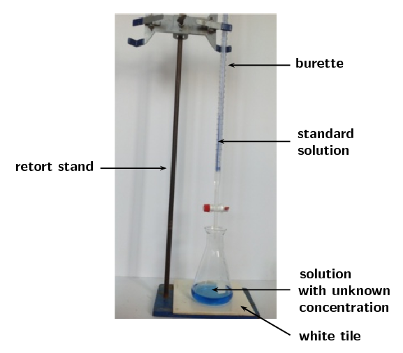
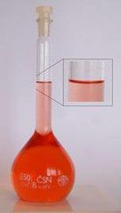
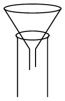
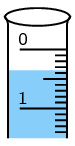
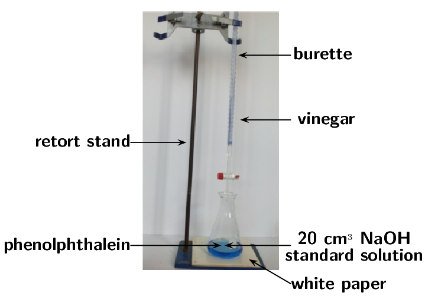

## 9.4 Titrations (ESCPJ)

### What are titrations? (ESCPK)

The neutralisation reaction between an acid and a base can be very useful. If an acidic
                                solution of known concentration (a standard solution) is added to a basic (alkaline)
                                solution of unknown concentration until the solution is exactly neutralised (i.e. there
                                is only salt and water), it is possible to calculate the exact concentration of the
                                unknown solution. It is possible to do this because, at the exact point where the
                                solution is neutralised, stoichiometrically equivalent mole amounts of acid and base
                                have reacted with each other.

Titration

The method used to determine the concentration of a known substance using
                                                another, standard, solution.

In a **titration**: a known volume of a standard solution (**A**)
                                is added to a known volume of a solution with unknown concentration
                                (**B**). The concentration of **B** can then be determined.

Acids and bases are commonly used in titrations, and the point of neutralisation is called
                                the **end-point** of the reaction. If you have an indicator that changes
                                colour in the range of the end-point pH then you will be able to see when the end-point
                                has occurred. Another name for a titration is **volumetric analysis**.

### Titration calculations (ESCPM)

So how exactly can a titration be carried out to determine an unknown concentration? Look at
                                the following steps to help you to understand the process.

2. A carefully measured volume of the solution with unknown concentration is put
                                                   into a conical flask.
4. A few drops of a suitable indicator is added to this solution (bromothymol
                                                   blue and phenolphthalein are common indicators, refer to [Table
                                                           9.9](/read/science/grade-12/acids-and-bases/09-acids-and-bases-03#tab:acidsandbases:indicators)).
6. The conical flask is placed on a white tile or piece of paper (to make colour
                                                   changes easier to see).
8. A volume of the standard solution (known concentration) is put into a burette
                                                   (a measuring device) and is slowly added to the solution in the flask,
                                                   drop by drop.
   
   It is better to have the acid in the burette as many bases will clog
                                                           the stopcock and damage the burette. It is much easier to clean
                                                           a burette that has contained acid only. It is important to make
                                                           sure the burette is perpendicular to the desk and clamped
                                                           securely.
   When filling the burette the stopcock should be closed and the funnel
                                                           should be lifted slightly to allow air to escape, otherwise it
                                                           will bubble through the liquid in the funnel and splash acid.
                                                           Once the burette is filled a beaker should be placed underneath
                                                           and a few centimeters of the solution should be drained through
                                                           the stopcock. This ensures that the entire burette is full.
                                                           There should be no air bubbles, as a bubble bursting can affect
                                                           the volume measurement and disrupt the accuracy of the
                                                           experiment.
10. At some point, adding one more drop will change the colour of the unknown
                                                   solution to the colour of the end-point of the reaction. Remember the
                                                   colour changes from [Figure 9.3](/read/science/grade-12/acids-and-bases/09-acids-and-bases-03#fig:acidsandbases:indicators).
12. Record the volume of standard solution that has been added up to this point.
14. Use the information you have gathered to calculate the exact concentration of
                                                   the unknown solution. Worked examples are given to walk you through this
                                                   step.
16. Note that adding more solution once the end-point has been reached will
                                                   result in a colour change from the end-point colour to that of the acid
                                                   (if the solution in the conical flask is a base) or of the base (if the
                                                   solution in the conical flask is an acid).

When you are busy with these calculations, you will need to remember the following:

\(\text{1}\) \(\text{dm$^{3}$}\) = \(\text{1}\) \(\text{ℓ}\) = \(\text{1 000}\)
                                \(\text{mL}\) = \(\text{1 000}\) \(\text{cm$^{3}$}\), therefore dividing
                                \(\text{cm$^{3}$}\) by \(\text{1 000}\) will give you an answer in
                                \(\text{dm$^{3}$}\).

Some other terms and equations which will be useful to remember are shown below:

- concentration of a solution is measured in \(\text{mol·dm$^{-3}$}\)
- moles (mol) \(=\) concentration (\(\text{mol·dm$^{-3}$}\)) \(\times\)
                                                  volume (\(\text{dm$^{3}$}\))
- \begin{align*}
                                          \text{concentration } = \frac{\text{moles}}{\text{volume}} \\
                                          c (\text{mol·dm$^{-3}$}) = \frac{n (\text{mol})}{V (\text{dm$^{3}$})}
                                          \end{align*}
- remember to make sure all the units are correct in your calculations

<Callout type="tip" title="Worked example 13: Titration calculations">
**Question:**
Given the equation:

\(\text{NaOH}(\text{aq}) + \text{HCl}(\text{aq})\) \(\to\)
                                                \(\text{NaCl}(\text{aq}) + \text{H}_{2}\text{O}(\text{ℓ})\)

\(\text{25}\) \(\text{cm$^{3}$}\) of sodium hydroxide solution was pipetted
                                                into a conical flask and titrated with \(\text{0,2}\)
                                                \(\text{mol·dm$^{-3}$}\) hydrochloric acid. Using a suitable
                                                indicator,
                                                it was found that \(\text{15}\) \(\text{cm$^{3}$}\) of acid was needed
                                                to neutralise the base. Calculate the concentration of the sodium
                                                hydroxide.

**Make sure that the equation is balanced:**
There are equal numbers of each type of atom on each side of the equation, so
                                                the equation is balanced.

**Write down all the information you know about the reaction,
                                                converting to the correct units:**
**NaOH:** \(V = \text{25}\) \(\text{cm$^{3}$}\) \(\times
                                                \dfrac{\text{0,001} {\text{ dm}}^{3}}{\text{1} {\text{ cm}}^{3}}\) =
                                                \(\text{0,025}\) \(\text{dm$^{3}$}\)

**HCl:** \(V = \text{15}\) \(\text{cm$^{3}$}\) \(\times
                                                \dfrac{\text{0,001} {\text{ dm}}^{3}}{\text{1} {\text{ cm}}^{3}}\) =
                                                \(\text{0,015}\) \(\text{dm$^{3}$}\)

\(\phantom{\rule{25pt}{0ex}}\)\(c = \text{0,2}\)
                                                \(\text{mol·dm$^{-3}$}\)

**Calculate the number of moles of HCl that are added:**
\(c = \dfrac{n}{V}\)

Therefore, \(n(\text{HCl})\) = \(c \times V\)

n(HCl) = \(\text{0,2}\) \(\text{mol·dm$^{-3}$}\) \(\times\)
                                                \(\text{0,015}\)
                                                \(\text{dm$^{3}$}\) = \(\text{0,003}\) \(\text{mol}\)

\(\text{0,003}\) \(\text{moles}\) of \(\text{HCl}\) are required to
                                                neutralise the base.

**Calculate the number of moles of sodium hydroxide in the
                                                reaction:**
Look at the equation for the reaction: the molar ratio of
                                                \(\text{HCl}\):\(\text{NaOH}\) is \(\text{1}\):\(\text{1}\).

So for every mole of \(\text{HCl}\), there is one mole of \(\text{NaOH}\)
                                                that is involved in the reaction. Therefore, if \(\text{0,003}\)
                                                \(\text{mol}\) \(\text{HCl}\) is required to neutralise the solution,
                                                \(\text{0,003}\) \(\text{mol}\) \(\text{NaOH}\) must have been present
                                                in the sample of the unknown solution.

**Calculate the concentration of the sodium hydroxide solution:**
\({c\text{(NaOH)}} = \dfrac{n}{V} = \dfrac{\text{0,003}\text{
                                                mol}}{\text{0,025}\text{ dm$^{3}$}} = \text{0,12}\text{
                                                mol·dm$^{-3}$}\)

The concentration of the \(\text{NaOH}\) solution is \(\text{0,12}\)
                                                \(\text{mol·dm$^{-3}$}\)
</Callout>

<Callout type="tip" title="Worked example 14: Titration calculations">
**Question:**
\(\text{10}\) \(\text{g}\) of solid sodium hydroxide is dissolved in
                                                \(\text{500}\) \(\text{cm$^{3}$}\) water. Using titration, it was found
                                                that \(\text{20}\) \(\text{cm$^{3}$}\) of this solution was able to
                                                completely neutralise \(\text{10}\) \(\text{cm$^{3}$}\) of a sulfuric
                                                acid solution. Calculate the concentration of the sulfuric acid.

**Write a balanced equation for the titration reaction:**
The reactants are sodium hydroxide (\(\text{NaOH}\)) and sulfuric acid
                                                (\(\text{H}_{2}\text{SO}_{4}\)). The base has a hydroxide anion
                                                (\(\text{OH}^{-}\)), therefore the products will be a salt and water.

The cation for the salt (\(\text{Na}^{+}\)) will come from the base. The
                                                anion for the salt (\(\text{SO}_{4}^{2-}\)) will come from the acid.
                                                There must be \(\text{2}\) \(\text{Na}^{+}\) cations for every one
                                                \(\text{SO}_{4}^{2-}\) and the salt will be
                                                \(\text{Na}_{2}\text{SO}_{4}\).

\(\text{H}_{2}\text{SO}_{4}(\text{aq}) + \text{NaOH}(\text{aq})\) \(\to\)
                                                \(\text{Na}_{2}\text{SO}_{4}(\text{aq}) +
                                                \text{H}_{2}\text{O}(\text{ℓ})\)

To balance the equation we need to multipy the number of sodium hydroxide
                                                molecules and the water molecules by two.

\(\text{H}_{2}\text{SO}_{4}(\text{aq}) + 2\text{NaOH}(\text{aq})\) \(\to\)
                                                \(\text{Na}_{2}\text{SO}_{4}(\text{aq}) +
                                                2\text{H}_{2}\text{O}(\text{ℓ})\)

**Calculate the concentration of the sodium hydroxide solution:**
The total volume that the \(\text{10}\) \(\text{g}\) was dissolved in must be
                                                used to calculate the concentration.

\(V = \text{500}\) \(\text{cm$^{3}$}\) \(\times \dfrac{\text{0,001} {\text{
                                                dm}}^{3}}{\text{1} {\text{ cm}}^{3}}\) = \(\text{0,5}\)
                                                \(\text{dm$^{3}$}\)

\(M(\text{NaOH}) = \text{23,0}\) + \(\text{16,0}\) + \(\text{1,01}\) =
                                                \(\text{40,01}\) \(\text{g.mol$^{-1}$}\)

\(n(\text{NaOH}) = \dfrac{\text{m}}{\text{M}} = \dfrac{\text{10}\text{
                                                g}}{\text{40,01}\text{ g.mol$^{-1}$}} = \text{0,25}\text{ mol}\)

\(c(\text{NaOH}) = \dfrac{\text{n}}{\text{V}} = \dfrac{\text{0,25}\text{
                                                mol}}{\text{0,5}\text{ dm$^{3}$}} = \text{0,50}\text{
                                                mol·dm$^{-3}$}\)

**Calculate the number of moles of sodium hydroxide that were
                                                used in the neutralisation reaction:**
Remember that only \(\text{20}\) \(\text{cm$^{3}$}\) of the sodium hydroxide
                                                solution is used:

\(V = \text{20}\) \(\text{cm$^{3}$}\) \(\times \dfrac{\text{0,001} {\text{
                                                dm}}^{3}}{\text{1} {\text{ cm}}^{3}}\) = \(\text{0,02}\)
                                                \(\text{dm$^{3}$}\)

\(c = \dfrac{n}{V}\), therefore \(n = {c}
                                                \times {\text{V}}\)

\(n = \text{0,50}\text{ mol·dm$^{-3}$} \times \text{0,02}\text{
                                                dm$^{3}$} = \text{0,01}\text{ mol}\)

**Calculate the number of moles of sulfuric acid that were
                                                neutralised:**
According to the balanced chemical equation, the mole ratio of
                                                \(\text{NaOH}\) to \(\text{H}_{2}\text{SO}_{4}\) is
                                                \(\text{2}\):\(\text{1}\). There are \(\text{2}\) moles of
                                                \(\text{NaOH}\) for every \(\text{1}\) mole of
                                                \(\text{H}_{2}\text{SO}_{4}\).

\(n(\text{H}_{2}\text{SO}_{4}) = \dfrac{\text{0,01}\text{
                                                mol}}{\text{2}}\) = \(\text{0,005}\) \(\text{mol}\).

**Calculate the concentration of the sulfuric acid solution:**
Remember that \(\text{10}\) \(\text{cm$^{3}$}\) of the sulfuric acid solution
                                                is neutralised.

\(V(\text{H}_{2}\text{SO}_{4}) = \text{10}\) \(\text{cm$^{3}$}\) \(\times
                                                \dfrac{\text{0,001} {\text{ dm}}^{3}}{\text{1} {\text{ cm}}^{3}}\) =
                                                \(\text{0,01}\) \(\text{dm$^{3}$}\)

\(C = \dfrac{n}{V} = \dfrac{\text{0,005}\text{
                                                mol}}{\text{0,01}\text{ dm$^{3}$}} = \text{0,5}\text{
                                                mol·dm$^{-3}$}\)
</Callout>

The formal assessment requires that the learners prepare a standard solution of
                                        sodium hydroxide. It is important that the learners understand that in order for
                                        the concentration of a standard solution to be accurately known:

- The mass must be precisely measured.
- The beakers must be rinsed with water (and the rinsings added to the
                                                          volumetric flask) so that no residue of the sodium hydroxide is
                                                          left behind.
- The sides of the volumetric flask must be washed with water for the
                                                          same reason.
- It is important to have their eye level with the mark on the
                                                          volumetric flask when filling to that mark so that the volume is
                                                          precise.

Learners are working with a strong base in this reaction. Concentrated, strong bases
                                        can cause serious burns. Please remind the learners to be careful and wear the
                                        appropriate safety equipment when handling all chemicals, especially
                                        concentrated bases. The safety equipment includes gloves, safety glasses, and
                                        protective clothing.

<QuizCard id="s12-09-04a" title="Interactive Exercise 9.9" question="A titration is carried out and the following information is obtained. The base is sodium hydroxide, NaOH . It has a concentration of \(\text{0,3}\ \text{mol·dm$^{-3}$}\) . The acid is hydrochloric acid, HCl . \(\text{0,037}\ \text{dm$^{3}$}\) of the base was used. \(\text{0,025}\ \text{dm$^{3}$}\) of hydrochloric acid was needed to neutralise the sodium hydroxide. The following equation can be written to represent this reaction. NaOH(aq) \(\:+\:\) HCl(aq) \(\rightarrow\) \(\downarrow\) NaCl(aq) \(\:+\:\) H 2 O(ℓ) Calculate the concentration of the hydrochloric acid solution. INSTRUCTION: Round your answer to two decimal places ." options=[] answer="
					(0.44; 0.43; 0.454)
				" hint="You should enter a number here. If you want to, you can use a space to separate thousands.                Example: 12 800,25 For scientific notation you need to use the multiply symbol                ( ∗ ) and the exponent symbol ( ^ ). For example 6,673 × 10 −11 should be written as: 6,673 ∗ 10^−11" explanation="Write down what you are given and what you need to calculate \(V_{\text{acid}} = \text{0,025}\ \text{dm$^{3}$}\) \(V_{\text{base}} = \text{0,037}\ \text{dm$^{3}$}\) \(C_{\text{base}} =  \text{0,3}\ \text{mol·dm$^{-3}$}\) NaOH(aq) \(\:+\:\) HCl(aq) \(\rightarrow\) \(\downarrow\) NaCl(aq) \(\:+\:\) H 2 O(ℓ) The volumes are in SI units, and we can use the following equation to calculate the unknown concentration: \[ 				\begin{aligned} 					\frac{c_{a}V_{a}}{a} &= \frac{c_{b}V_{b}}{b} 				\end{aligned} 				\] TIP: Remember that \(a\) and \(b\) are the stoichiometric coefficients of the hydrochloric acid and sodium hydroxide. Calculate the concentration of the hydrochloric acid \[ 					\begin{aligned} 						\frac{c_{a}V_{a}}{a} &= \frac{c_{b}V_{b}}{b} \\ 						\frac{(c_{\text{acid}})(\text{0,025})}{1} & = \frac{(\text{0,3})(\text{0,037})}{1}\\ 						\text{0,025}(c_{\text{acid}}) & = \text{0,0111} \\ 						&= \text{0,444} \\ & \approx \text{0,44}\ \text{mol·dm$^{-3}$} 					\end{aligned} 				\] Submit your answer as:" />

<QuizCard id="s12-09-04a" title="Interactive Exercise 9.9" question="Calculate the concentration of the potassium hydroxide solution." options=[] answer="
                        (0.452; 0.449; 0.454)
                    " hint="You should enter a number here. If you want to, you can use a space to separate thousands.                Example: 12 800,25 For scientific notation you need to use the multiply symbol                ( ∗ ) and the exponent symbol ( ^ ). For example 6,673 × 10 −11 should be written as: 6,673 ∗ 10^−11" explanation="Calculate the number of moles of potassium hydroxide in the standard solution We use the periodic table to calculate that the molar mass of potassium hydroxide, KOH , is \(\text{56}\ \text{g·mol$^{-1}$}\) . \[                         \begin{aligned}                         n(\text{K}\text{O}\text{H}) & = \frac{m}{M} \\                         & = \frac{\text{7,6}}{\text{56}} \\                         & = \text{0,135714...}\ \text{mol}                         \end{aligned}                     \] Calculate the concentration of the potassium hydroxide standard solution \[                         \begin{aligned}                         c(\text{K}\text{O}\text{H}) & = \dfrac{n}{V} \\                         & = \dfrac{\text{0,135714...}}{\text{0,30}} \\                         & = \text{0,452380...} \\ & \approx \text{0,452}\ \text{mol·dm$^{-3}$}                         \end{aligned}                     \] Submit your answer as:" />

## Preparation of a standard solution

### Aim

To prepare a standard solution of sodium hydroxide.

### Apparatus and materials

- one \(\text{250}\) \(\text{cm$^{3}$}\) volumetric flask, a
                                                                  beaker, a funnel, a plastic dropper
- A weighing scale, a spatula, a clean piece of paper
- solid sodium hydroxide

### Method

<Callout type="warning" title="Note">
Concentrated bases can cause serious burns. We suggest using gloves
                                                        and safety glasses whenever you work with a base. Handle all
                                                        chemicals with care.
</Callout>

2. Place the paper on the scale and tare (zero) the scale.
4. Weigh \(\text{5,00}\) \(\text{g}\) of solid sodium hydroxide
                                                                   onto the paper.
6. Transfer the sodium hydroxide to the beaker and dissolve it
                                                                   in a minimal amount of water.
8. Place the funnel in the mouth of the volumetric flask and use
                                                                   it to transfer the solution from the beaker to the
                                                                   flask, be careful not to spill.
10. Pour another \(\text{5}\) \(\text{cm$^{3}$}\) of water into
                                                                   the beaker, swirl gently, and pour this into the flask
                                                                   through the funnel as well.
12. Repeat step \(\text{5}\) another two times.
14. Pour \(\text{5}\) \(\text{cm$^{3}$}\) of water through the
                                                                   funnel into the flask.
16. Use the plastic dropper to pour water down the inside of the
                                                                   volumetric flask.
18. Fill the volumetric flask to the mark with water. Use the
                                                                   plastic dropper to fill the last few centimeters.
                                                                   Remember to lower yourself so that you are looking
                                                                   directly at the mark when adding the final drops.
   
20. Cap the flask and shake well. You now have a standard
                                                                   solution.

### Questions

- What is the concentration of this standard solution?
- What is the purpose of rinsing the beaker and funnel with
                                                                  water?
- What is the purpose of rinsing the inside of the volumetric
                                                                  flask with water?
- Why do you need to make sure your eyes are level with the
                                                                  mark when adding the final few drops of water?

A less accurate alternative to the titration of acetic acid with sodium hydroxide
                                        experiment is provided here (if titration equipment is not available).

## Titrations

### Aim

To determine the concentration of acetic acid (ethanoic acid) in a
                                                        sample of vinegar.

### Apparatus and materials

- 4 conical flasks, plastic droppers, two measuring
                                                                          cylinders
- a white piece of paper or a white tile
- the standard \(\text{NaOH}\) solution prepared in the
                                                                          previous experiment, white vinegar,
                                                                          phenolphthalein

### Method

<Callout type="warning" title="Note">
Concentrated acids and bases can cause serious burns. We
                                                                suggest using gloves and safety glasses whenever you
                                                                work with an acid or a base. Handle all chemicals with
                                                                care.
</Callout>

2. Label a conical flask **1** and add
                                                                           \(\text{20}\) \(\text{cm$^{3}$}\) of the sodium
                                                                           hydroxide solution to the conical flask using a
                                                                           measuring cylinder.
4. Add a few drops of the phenolphthalein indicator to
                                                                           conical flask 1.
6. Measure \(\text{10}\) \(\text{cm$^{3}$}\) vinegar in
                                                                           the second measuring cylinder.
8. Pour the \(\text{10}\) \(\text{cm$^{3}$}\) vinegar
                                                                           into conical flask 1. Swirl the flask.
10. If there is no colour change measure \(\text{5}\)
                                                                           \(\text{cm$^{3}$}\) vinegar in the measuring
                                                                           cylinder and add this to conical flask 1. Swirl
                                                                           the flask.
12. Repeat step \(\text{5}\) until the colour change
                                                                           remains after swirling. Calculate the volume of
                                                                           vinegar added. This is your *rough
                                                                                   titration*.
14. Repeat steps \(\text{1}\) and \(\text{2}\) with a
                                                                           second conical flask (label it
                                                                           **2**).
16. Add a volume of vinegar **no more than**
                                                                           \(\text{5}\) \(\text{cm$^{3}$}\) less than your
                                                                           rough titration volume to conical flask 2. This
                                                                           is your initial volume added.
18. Measure \(\text{10}\) \(\text{cm$^{3}$}\) of vinegar
                                                                           in the second measuring cylinder.
20. Use a dropper to transfer vinegar from the measuring
                                                                           cylinder to the conical flask. Swirl between
                                                                           each drop and be careful not to spill. If you
                                                                           get vinegar on the side of the conical flask,
                                                                           rinse with water.
22. When there is a permanent colour change after
                                                                           swirling, the end-point has been reached.
                                                                           Determine the volume added:
   Total volume added = initial volume added +
                                                                           (\(\text{10}\) \(\text{cm$^{3}$}\) - final
                                                                           volume in measuring cylinder)
24. Repeat steps \(\text{7}\) - \(\text{11}\), labelling
                                                                           the conical flasks **3** and
                                                                           **4**.

### Continue with the rest of the experiment as laid out in the learners
                                                        textbook

Although this method will not be as accurate, it will give the learners an idea of
                                        what a titration is like.

Different concentrations of the standard solution may be used, and the calculations
                                        will have to be adjusted in that case.

It is possible to put the sodium hydroxide in the burette and the vinegar in the
                                        conical flask. This is likely to clog the burette though, so if you do this make
                                        sure to wash your burette thoroughly after use to avoid the stopcock being
                                        damaged. It may be necessary to drain a few \(\text{cm$^{3}$}\) of the vinegar
                                        to remove all air bubbles from the burette. In this case add more vinegar to the
                                        burette after removing the air bubbles so that the top of the vinegar is between
                                        the \(\text{0}\) \(\text{cm$^{3}$}\) and \(\text{1}\) \(\text{cm$^{3}$}\) marks.

Learners are working with a strong base in this reaction. Concentrated, strong bases
                                        can cause serious burns. Please remind the learners to be careful and wear the
                                        appropriate safety equipment when handling all chemicals, especially strong,
                                        concentrated bases. The safety equipment includes gloves, safety glasses, and
                                        protective clothing.

## Titrations

### Aim

To determine the concentration of acetic acid (ethanoic acid) in a sample of
                                                vinegar.

### Apparatus and materials

- 4 conical flasks, one pipette, one burette, one small funnel,
                                                                  one beaker
- a retort stand, a white piece of paper or a white tile
- the standard \(\text{NaOH}\) solution prepared in the
                                                                  previous experiment, white vinegar, phenolphthalein

### Method

<Callout type="warning" title="Note">
Concentrated acids and bases can cause serious burns. We suggest
                                                        using gloves and safety glasses whenever you work with an acid
                                                        or a base. Handle all chemicals with care.
</Callout>

2. Clamp the burette to the retort stand and place the small
                                                                   funnel on top.
   
4. Making sure the burette is closed, carefully add the vinegar
                                                                   to the burette (lift the funnel slightly while doing
                                                                   this) until the burette is full.
6. Place a beaker below the burette and carefully let some of
                                                                   the vinegar run into it. This will ensure that there are
                                                                   no air bubbles in the burette. The top of the vinegar
                                                                   should now be between the \(\text{0}\) and \(\text{1}\)
                                                                   \(\text{cm$^{3}$}\) marks. Record the value to the
                                                                   second decimal place.
   
8. Use your pipette to measure \(\text{20}\) \(\text{cm$^{3}$}\)
                                                                   of the sodium hydroxide standard solution into a conical
                                                                   flask.
10. Add \(\text{3}\) - \(\text{4}\) drops of phenolphthalein
                                                                   indicator to the conical flask. What colour is the
                                                                   solution?
12. Do a rough titration experiment by adding the vinegar to the
                                                                   conical flask quickly, and constantly swirling the
                                                                   conical flask. Stop as soon as the colour of the
                                                                   solution changes, and remains changed after swirling.
                                                                   Make a note of the reading on the burette at this point
                                                                   and determine the volume added:
   (V(final) - V(initial)).
   
   If the colour change does not remain when the flask is
                                                                   swirled, add more vinegar until the colour remains.
14. Repeat steps \(\text{2}\) - \(\text{5}\) with a second
                                                                   conical flask.
16. Quickly add vinegar to the conical flask until you have added
                                                                   \(\text{2}\) \(\text{cm$^{3}$}\) less than your rough
                                                                   titration volume. There should be no lasting colour
                                                                   change at this point.
18. Drop by drop (slowly and carefully), add vinegar. Swirl
                                                                   between each drop and, if necessary, rinse the sides of
                                                                   the flask with water. When the solution changes colour
                                                                   and remains that new colour, make a note of the volume
                                                                   on the burette.
   Remember that the volume titrated is: (final volume reading)
                                                                   - (the initial volume reading).
20. For accuracy you should repeat steps \(\text{7}\) -
                                                                   \(\text{9}\) until you have three readings with a
                                                                   difference of no more than \(\text{0,1}\)
                                                                   \(\text{cm$^{3}$}\).

### Observations and questions

- What colour was the sodium hydroxide solution when the
                                                                  phenolphthalein was added?
- What was the colour when enough acid was added?

Fill in the details of this experiment on a table like the one below:

| Titration | Initial volume (\(\text{cm$^{3}$}\)) | Final volume (\(\text{cm$^{3}$}\)) | Volume (\(\text{cm$^{3}$}\)) |
| --- | --- | --- | --- |
| Rough |  |  |  |
| 1 |  |  |  |
| 2 |  |  |  |
| 3 |  |  |  |

- From the table determine the average titration volume for
                                                                  this experiment and use that value in the rest of your
                                                                  calculations.
- Using the previous worked examples, determine the
                                                                  concentration of acetic acid in the sample of vinegar.
                                                                  Remember that you have the following information:
  - the volume of vinegar
  - the volume of the sodium hydroxide solution
  - the concentration of the sodium hydroxide
                                                                                    solution
- The balanced chemical equation for this reaction is:
  \(\text{CH}_{3}\text{COOH}(\text{aq}) +
                                                                  \text{NaOH}(\text{aq})\) \(\to\)
                                                                  \(\text{CH}_{3}\text{COONa}(\text{aq}) +
                                                                  \text{H}_{2}\text{O}(\text{ℓ})\)

A less accurate alternative to the titration of sodium hydroxide with oxalic acid
                                        experiment is provided here (if titration equipment is not available).

## Titrations

### Aim

To determine the concentration of a sodium hydroxide solution of
                                                        unknown concentration.

### Apparatus and materials

- one \(\text{250}\) \(\text{cm$^{3}$}\) volumetric
                                                                          flask, 4 conical flasks, two plastic droppers,
                                                                          two measuring cylinders, one beaker
- a weighing scale, a spatula, a clean piece of paper,
                                                                          a white sheet of paper or a white tile
- solid sodium hydroxide (\(\text{NaOH}\)), solid
                                                                          oxalic acid
                                                                          (\(\text{H}_{2}\text{C}_{2}\text{O}_{ 4}\)),
                                                                          phenolphthalein

### Method

<Callout type="warning" title="Note">
Concentrated acids and bases can cause serious burns. We
                                                                suggest using gloves and safety glasses whenever you
                                                                work with an acid or a base. Handle all chemicals with
                                                                care.
</Callout>

2. Prepare a standard solution using \(\text{11,00}\)
                                                                           \(\text{g}\) of oxalic acid in the
                                                                           \(\text{250}\) \(\text{cm$^{3}$}\) volumetric
                                                                           flask (remember to follow the method from the
                                                                           formal *preparation of a standard
                                                                                   solution* experiment).
4. Label one of the beakers *\(\text{NaOH}\)*.
                                                                           Use a measuring cylinder to measure
                                                                           approximately \(\text{100}\) \(\text{cm$^{3}$}\)
                                                                           of water into the beaker. Add approximately
                                                                           \(\text{4}\) \(\text{g}\) of \(\text{NaOH}\) to
                                                                           the beaker and stir.
6. Label a conical flask **1** and transfer
                                                                           \(\text{20}\) \(\text{cm$^{3}$}\) of the sodium
                                                                           hydroxide to the conical flask.
8. Add a few drops of the phenolphthalein indicator to
                                                                           conical flask 1.
10. Measure \(\text{10}\) \(\text{cm$^{3}$}\) of the
                                                                           oxalic acid solution in the second measuring
                                                                           cylinder.
12. Pour the \(\text{10}\) \(\text{cm$^{3}$}\) oxalic
                                                                           acid solution into conical flask 1. Swirl the
                                                                           flask.
14. If there is no colour change measure \(\text{5}\)
                                                                           \(\text{cm$^{3}$}\) oxalic acid in the measuring
                                                                           cylinder and add this to conical flask 1. Swirl
                                                                           the flask.
16. Repeat step \(\text{7}\) until the colour change
                                                                           remains after swirling. Calculate the volume of
                                                                           oxalic acid solution added. This is your
                                                                           *rough titration*.
18. Repeat steps \(\text{3}\) and \(\text{4}\) with a
                                                                           second conical flask (label it
                                                                           **2**).
20. Add a volume of oxalic acid **no more
                                                                                   than** \(\text{5}\)
                                                                           \(\text{cm$^{3}$}\) less than your rough
                                                                           titration volume to conical flask 2. This is
                                                                           your initial volume added.
22. Measure \(\text{10}\) \(\text{cm$^{3}$}\) of oxalic
                                                                           acid in the second measuring cylinder.
24. Use a dropper to transfer oxalic acid from the
                                                                           measuring cylinder to the conical flask. Swirl
                                                                           between each drop and be careful not to spill.
                                                                           If you get oxalic acid on the side of the
                                                                           conical flask, rinse with water.
26. When there is a permanent colour change after
                                                                           swirling, the end-point has been reached.
                                                                           Determine the volume added:
   Total volume added = initial volume added +
                                                                           (\(\text{10}\) \(\text{cm$^{3}$}\) - final
                                                                           volume in measuring cylinder)
28. Repeat steps \(\text{9}\) - \(\text{13}\), labelling
                                                                           the conical flasks **3** and
                                                                           **4**.

### Continue with the rest of the experiment as laid out in the learners
                                                        textbook

Although this method will not be as accurate, it will give the learners an idea of
                                        what a titration is like.

Different concentrations of the standard solution may be used, and the calculations
                                        will have to be adjusted in that case.

It is possible to put the sodium hydroxide in the burette and the oxalic acid in the
                                        conical flask. This is likely to clog the burette though, so if you do this make
                                        sure to wash your burette thoroughly after use to avoid the stopcock being
                                        damaged. It may be necessary to drain a few \(\text{cm$^{3}$}\) of the oxalic
                                        acid to remove all air bubbles from the burette. In this case add more oxalic
                                        acid solution to the burette after removing the air bubbles so that the top of
                                        the solution is between the \(\text{0}\) \(\text{cm$^{3}$}\) and \(\text{1}\)
                                        \(\text{cm$^{3}$}\) marks.

Learners are working with a strong base in this reaction. Concentrated, strong bases
                                        can cause serious burns. Please remind the learners to be careful and wear the
                                        appropriate safety equipment when handling all chemicals, especially strong,
                                        concentrated bases. The safety equipment includes gloves, safety glasses, and
                                        protective clothing.

## Titrations

### Aim

To determine the concentration of a sodium hydroxide solution of unknown
                                                concentration.

### Apparatus and materials

- one \(\text{250}\) \(\text{cm$^{3}$}\) volumetric flask, 4
                                                                  conical flasks, one pipette, one burette, one small
                                                                  funnel, two beakers, one plastic dropper
- a retort stand, a weighing scale, a spatula, a clean piece of
                                                                  paper
- solid sodium hydroxide (\(\text{NaOH}\)), solid oxalic acid
                                                                  (\(\text{H}_{2}\text{C}_{2}\text{O}_{4}\)),
                                                                  phenolphthalein

### Method

<Callout type="warning" title="Note">
Concentrated acids and bases can cause serious burns. We suggest
                                                        using gloves and safety glasses whenever you work with an acid
                                                        or a base. Handle all chemicals with care.
</Callout>

2. Prepare a standard solution using \(\text{11,00}\)
                                                                   \(\text{g}\) of oxalic acid in the \(\text{250}\)
                                                                   \(\text{cm$^{3}$}\) volumetric flask.
4. Label one of the beakers *\(\text{NaOH}\)*. Use your
                                                                   pipette to measure \(\text{100}\) \(\text{cm$^{3}$}\) of
                                                                   water into the beaker. Add approximately \(\text{4}\)
                                                                   \(\text{g}\) of \(\text{NaOH}\) to the beaker and stir.
6. Clamp the burette to the retort stand and place the small
                                                                   funnel on top.
8. Making sure the burette is closed, carefully add the oxalic
                                                                   acid standard solution to the burette (lift the funnel
                                                                   slightly while doing this) until the burette is full.
10. Place the clean beaker below the burette and carefully let
                                                                   some of the oxalic acid solution run into it. This will
                                                                   ensure that there are no air bubbles in the burette. The
                                                                   top of the solution should now be between the
                                                                   \(\text{0}\) and \(\text{1}\) \(\text{cm$^{3}$}\) marks.
                                                                   Record the value to the second decimal place.
12. Use your pipette to measure \(\text{20}\) \(\text{cm$^{3}$}\)
                                                                   of the \(\text{NaOH}\) solution into a conical flask.
14. Add \(\text{3}\) - \(\text{4}\) drops of phenolphthalein
                                                                   indicator to the conical flask. What colour is the
                                                                   solution?
16. Do a rough titration experiment by adding the oxalic acid to
                                                                   the conical flask quickly, and constantly swirling the
                                                                   conical flask. Stop as soon as the colour of the
                                                                   solution changes, and remains changed after swirling.
                                                                   Make a note of the reading on the burette at this point
                                                                   and determine the volume added:
   V(final) - V(initial).
   If the colour change does not remain when the flask is
                                                                   swirled, add more oxalic acid until the colour remains.
18. Repeat steps \(\text{4}\) - \(\text{7}\) with a second
                                                                   conical flask.
20. Quickly add oxalic acid to the conical flask until you have
                                                                   added \(\text{2}\) \(\text{cm$^{3}$}\) less than your
                                                                   rough titration volume. There should be no lasting
                                                                   colour change at this point.
22. Drop by drop (slowly and carefully), add oxalic acid. Swirl
                                                                   between each drop and, if necessary, rinse the sides of
                                                                   the flask with water. When the solution changes colour,
                                                                   and remains that new colour, make a note of the volume
                                                                   on the burette.
   Remember that the volume titrated is: (final volume reading)
                                                                   - (the initial volume reading).
24. For accuracy, you should repeat steps \(\text{9}\) -
                                                                   \(\text{11}\) until you have three readings with a
                                                                   difference of no more than \(\text{0,1}\)
                                                                   \(\text{cm$^{3}$}\).

### Observations and questions

- What colour was the sodium hydroxide solution when the
                                                                  phenolphthalein was added?
- What was the colour when enough acid was added?

Fill in the details of this experiment on a table like the one below:

| Titration | Initial volume (\(\text{cm$^{3}$}\)) | Final volume (\(\text{cm$^{3}$}\)) | Volume (\(\text{cm$^{3}$}\)) |
| --- | --- | --- | --- |
| Rough |  |  |  |
| 1 |  |  |  |
| 2 |  |  |  |
| 3 |  |  |  |

- From the table, determine the average titration volume for
                                                                  this experiment and use that value in the rest of your
                                                                  calculations.
- Using the previous worked examples, determine the
                                                                  concentration of the sodium hydroxide solution. Remember
                                                                  that you have the following information:
  - the volume of sodium hydroxide solution
  - the volume of oxalic acid solution
  - the concentration of the oxalic acid
                                                                                    solution.
- The balanced chemical equation for this reaction is:
  \(\text{H}_{2}\text{C}_{2}\text{O}_{4}(\text{aq}) +
                                                                  2\text{NaOH}(\text{aq})\) \(\to\)
                                                                  \(\text{Na}_{2}\text{C}_{2}\text{O}_{4}(\text{aq}) +
                                                                  2\text{H}_{2}\text{O}(\text{ℓ})\)

## Acids and bases

### Textbook Exercise 9.6

A learner is asked to prepare a *standard solution* of
                                                                the weak acid, oxalic acid
                                                                (\(\text{H}_{2}\text{C}_{2}\text{O}_{4}\)), for use in a
                                                                titration. The volume of the solution must be
                                                                \(\text{500}\) \(\text{cm$^{3}$}\) and the concentration
                                                                must be \(\text{0,2}\) \(\text{mol·dm$^{-3}$}\).

**Problem:**
Calculate the mass of oxalic acid which the learner
                                                                        must dissolve to make up the required standard
                                                                        solution.

**Solution:**
We need the mass of oxalic acid. However, we don't
                                                                        know the number of moles yet.

V = \(\text{500}\) \(\text{cm$^{3}$}\) \(\times
                                                                        \dfrac{\text{0,001} {\text{ dm}}^{3}}{\text{1}
                                                                        {\text{ cm}}^{3}}\) = \(\text{0,5}\)
                                                                        \(\text{dm$^{3}$}\)

\(\text{C} = \dfrac{\text{n}}{\text{V}}\), therefore
                                                                        n = C x V

n = \(\text{0,2}\) \(\text{mol·dm$^{-3}$}\) x
                                                                        \(\text{0,5}\) \(\text{dm$^{3}$}\) =
                                                                        \(\text{0,1}\) \(\text{mol}\)

M(\(\text{H}_{2}\text{C}_{2}\text{O}_{4}\)) =
                                                                        (\(\text{2}\) x \(\text{1,01}\) + \(\text{2}\) x
                                                                        \(\text{12,0}\) + \(\text{4}\) x
                                                                        \(\text{16,0}\)) \(\text{g.mol$^{-1}$}\) =
                                                                        \(\text{90,02}\) \(\text{g.mol$^{-1}$}\)

\(\text{n} = \dfrac{\text{m}}{\text{M}}\), therefore
                                                                        m = n x M

m = \(\text{0,1}\) \(\text{mol}\) x \(\text{90,02}\)
                                                                        \(\text{g.mol$^{-1}$}\) = \(\text{9,00}\)
                                                                        \(\text{g}\)

**Problem:**
The learner titrates this \(\text{0,2}\)
                                                                        \(\text{mol·dm$^{-3}$}\) oxalic acid
                                                                        solution
                                                                        against a solution of sodium hydroxide. He finds
                                                                        that \(\text{40}\) \(\text{cm$^{3}$}\) of the
                                                                        oxalic acid solution completely neutralises
                                                                        \(\text{35}\) \(\text{cm$^{3}$}\) of the sodium
                                                                        hydroxide solution.

Calculate the concentration of the sodium hydroxide
                                                                        solution.

**Solution:**
The balanced equations is:

\(\text{H}_{2}\text{C}_{2}\text{O}_{4} +
                                                                        2\text{NaOH}\) \(\to\)
                                                                        \(\text{Na}_{2}\text{C}_{2}\text{O}_{4} +
                                                                        2\text{H}_{2}\text{O}\)

The number of moles of oxalic acid used is the number
                                                                        of moles in \(\text{40}\) \(\text{cm$^{3}$}\) of
                                                                        the standard solution:

V = \(\text{40}\) \(\text{cm$^{3}$}\) \(\times
                                                                        \dfrac{\text{0,001} {\text{ dm}}^{3}}{\text{1}
                                                                        {\text{ cm}}^{3}}\) = \(\text{0,04}\)
                                                                        \(\text{dm$^{3}$}\)

n = C x V = \(\text{0,2}\)
                                                                        \(\text{mol·dm$^{-3}$}\) x
                                                                        \(\text{0,04}\) \(\text{dm$^{3}$}\) =
                                                                        \(\text{0,008}\) \(\text{mol}\)

The molar ratio of oxalic acid to sodium hydroxide is
                                                                        \(\text{1}\):\(\text{2}\). For every one mole of
                                                                        oxalic acid there are two moles of sodium
                                                                        hydroxide.

n(\(\text{NaOH}\)) = \(\text{2}\) x \(\text{0,008}\)
                                                                        \(\text{mol}\) = \(\text{0,016}\) \(\text{mol}\)

V(\(\text{NaOH}\)) = \(\text{35}\)
                                                                        \(\text{cm$^{3}$}\) \(\times \dfrac{\text{0,001}
                                                                        {\text{ dm}}^{3}}{\text{1} {\text{ cm}}^{3}}\) =
                                                                        \(\text{0,035}\) \(\text{dm$^{3}$}\)

C(\(\text{NaOH}\)) \(= \dfrac{\text{n}}{\text{V}} =
                                                                        \dfrac{\text{0,016}\text{
                                                                        mol}}{\text{0,035}\text{ dm$^{3}$}} =\)
                                                                        \(\text{0,46}\) \(\text{mol·dm$^{-3}$}\)

\(\text{25,0}\) \(\text{cm$^{3}$}\) of a \(\text{0,1}\)
                                                                \(\text{mol·dm$^{-3}$}\) standard solution of
                                                                sodium
                                                                carbonate was used to neutralise \(\text{35,0}\)
                                                                \(\text{cm$^{3}$}\) of a solution of hydrochloric acid.

**Problem:**
Write a balanced chemical equation for the reaction.

**Solution:**
metal carbonate + acid \(\to\) salt + carbon dioxide
                                                                        + water

The cation will be from the metal
                                                                        (\(\text{Na}^{+}\)), the anion will be from the
                                                                        acid (\(\text{Cl}^{-}\)). Therefore the salt
                                                                        will be \(\text{NaCl}\).

\(\text{Na}_{2}\text{CO}_{3}(\text{aq}) +
                                                                        2\text{HCl}(\text{aq})\) \(\to\)
                                                                        \(2\text{NaCl}(\text{aq}) +
                                                                        \text{CO}_{2}(\text{g}) +
                                                                        \text{H}_{2}\text{O}(\text{ℓ})\)

**Problem:**
Calculate the concentration of the acid.

(DoE Grade 11 Exemplar, 2007)

**Solution:**
\(\text{C} = \dfrac{\text{n}}{\text{V}}\) therefore n
                                                                        = C \(\times\) V

V(\(\text{Na}_{2}\text{CO}_{3}\)) = \(\text{25,0}\)
                                                                        \(\text{cm$^{3}$}\) \(\times \dfrac{\text{0,001}
                                                                        {\text{ dm}}^{3}}{\text{1} {\text{ cm}}^{3}}\) =
                                                                        \(\text{0,0250}\) \(\text{dm$^{3}$}\)

n(\(\text{Na}_{2}\text{CO}_{3}\)) = C x V =
                                                                        \(\text{0,1}\) \(\text{mol·dm$^{-3}$}\) x
                                                                        \(\text{0,0250}\) \(\text{dm$^{3}$}\) =
                                                                        \(\text{0,0025}\) \(\text{mol}\)

From the balanced equation for every \(\text{1}\)
                                                                        \(\text{mol}\) of \(\text{Na}_{2}\text{CO}_{3}\)
                                                                        there are \(\text{2}\) \(\text{mol}\)
                                                                        \(\text{HCl}\).

n(HCl) = \(\text{2}\) x \(\text{0,0025}\)
                                                                        \(\text{mol}\) = \(\text{0,005}\) \(\text{mol}\)

V(HCl) = \(\text{35,0}\) \(\text{dm$^{3}$}\) \(\times
                                                                        \dfrac{\text{0,001} {\text{ dm}}^{3}}{\text{1}
                                                                        {\text{ cm}}^{3}}\) = \(\text{0,0350}\)
                                                                        \(\text{dm$^{3}$}\)

C(\(\text{HCl}\)) = \(\dfrac{\text{n}}{\text{V}} =
                                                                        \dfrac{\text{0,005}\text{
                                                                        mol}}{\text{0,0350}\text{ dm$^{3}$}}\) =
                                                                        \(\text{0,143}\) \(\text{mol·dm$^{-3}$}\)
