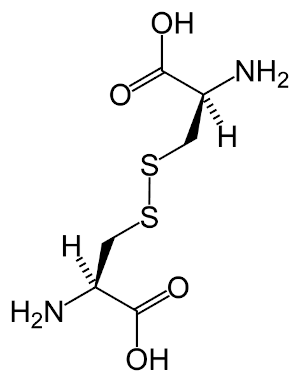
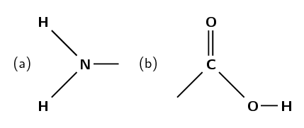
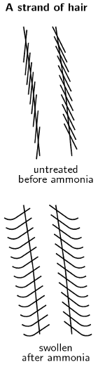
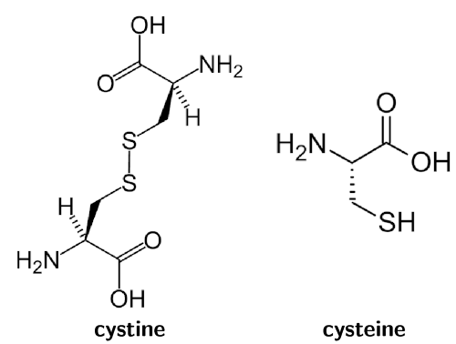
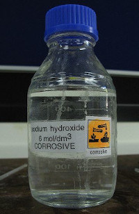
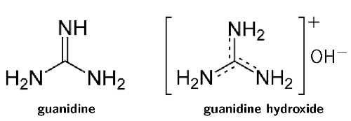

## 9.5 Applications of acids and bases (ESCPN)

### The production of chlorine (ESCPP)

The chlorine-alkali (chloralkali) industry is an important part of the chemical industry for the
                        production of **chlorine** and **sodium hydroxide**. The most common
                        method involves the electrolysis of a concentrated aqueous solution of sodium chloride
                        (\(\text{NaCl}\)), which is known as **brine**. For more information on
                        electrolysis see [Chapter 13](/read/science/grade-12/electrochemical-reactions).

The chemical reactions that take place in this process are:

\(2\text{Cl}^{-}(\text{aq})\) \(\to\) \(\text{Cl}_{2}(\text{g}) + 2\text{e}^{-}\)

\(2\text{H}_{2}\text{O}(\text{ℓ}) + 2\text{e}^{-}\) \(\to\) \(\text{H}_{2}(\text{g}) +
                        2\text{OH}^{-}(\text{aq})\)

There are also \(\text{Na}^{+}\) ions from the \(\text{NaCl}\) in the solution. If the products are
                        kept separate (to prevent a reaction between the chlorine and hydroxide) the \(\text{Na}^{+}\)
                        will react with the hydroxide ions making the overall reaction as follows:

\(2\text{NaCl}(\text{aq}) + 2\text{H}_{2}\text{O}(\text{ℓ})\) \(\to\)
                        \(\text{Cl}_{2}(\text{g}) +
                        \text{H}_{2}(\text{g}) + 2\text{NaOH}(\text{aq})\)

**The uses of chlorine include:**

- the purification of water
- as a disinfectant
- in the production of:
  - hypochlorous acid (used to kill bacteria in drinking water), chloroform,
                                                    carbon tetrachloride
  - paper, food
  - antiseptics, insecticides, medicines, textiles
  - paints, petroleum products, solvents, plastics (such as polyvinyl chloride)

**The uses of sodium hydroxide include:**

- making soap and other cleaning agents
- purification of bauxite (the ore of aluminium)
- making paper
- making rayon (artificial silk)

If the chlorine and hydroxide ions are not kept separate (i.e. are allowed to react), and the
                        temperature is kept below \(\text{60}\) \(\text{℃}\), then the following occurs:

\(\text{Cl}_{2}(\text{g}) + 2\text{OH}^{-}(\text{aq})\) \(\to\) \(\text{Cl}^{-}(\text{aq}) +
                        \text{ClO}^{-}(\text{aq}) + \text{H}_{2}\text{O}(\text{ℓ})\)

The balanced chemical equation with the inclusion of the \(\text{Na}^{+}\) ions is:

\(\text{Cl}_{2}(\text{g}) + 2\text{NaOH}(\text{aq})\) \(\to\) \(\text{NaCl}(\text{aq}) +
                        \text{NaClO}(\text{aq}) + \text{H}_{2}\text{O}(\text{ℓ})\)

**The uses of \(\text{NaClO}\) (sodium hypochlorite) include:**

- use in bleaches, disinfectants, and water treatments
- use during root canal surgery and to neutralise nerve agents

If the temperature is above \(\text{60}\) \(\text{℃}\) and mixing occurs, then:

\(3\text{Cl}_{2}(\text{g}) + 6\text{OH}^{-}(\text{aq})\) \(\to\) \(5\text{Cl}^{-}(\text{aq}) +
                        \text{ClO}_{3}(\text{aq}) + 3\text{H}_{2}\text{O}(\text{ℓ})\)

And the balanced chemical equation including \(\text{Na}^{+}\) ions is:

\(3\text{Cl}_{2}(\text{g}) + 6\text{NaOH}(\text{aq})\) \(\to\) \(5\text{NaCl}(\text{aq}) +
                        \text{NaClO}_{3}(\text{aq}) + 3\text{H}_{2}\text{O}(\text{ℓ})\)

**The uses of \(\text{NaClO}_{3}\) (sodium chlorate) include:**

- making chlorine dioxide
- use as a herbicide
- generating oxygen in chemical oxygen generators

If calcium chloride was used instead of sodium chloride, then the products would be calcium
                        chloride, calcium hypochlorite and calcium chlorate. Similarly, if potassium chloride was used,
                        the products would be potassium chloride, potassium hypochlorite and potassium chlorate.

### The chemistry of hair and hair products (ESCPQ)

Hair is primarily made up of a protein called **keratin**. Keratin is a macromolecule
                        and consists largely of the amino acid **cystine** (an organic acid, see Figure 9.4).

Figure 9.4: The main amino acid found in keratin: **cystine**.

Amino acids are composed of an amine group (Figure 9.5 (a)) and a carboxylic acid group (Figure 9.5 (b)) connected by
                        a carbon chain.

Figure 9.5: **a)** An amine functional group and **b)** a
                                    carboxylic acid
                                    functional group. Both of these are found in amino acids.

Proteins give hair a natural acidic pH of between \(\text{4}\) and \(\text{5}\). The following hair
                        products alter this pH and do *controlled damage* to get the desired effect.

#### Permanent waving application

Another name for a permanent waving application is a **perm**. Ammonium
                              thioglycolate is also known as a *perm salt*. The reversible reaction of ammonium
                              thioglycolate (reactant) to form thioglycolic acid and free ammonia (product) is given
                              below:

\(\text{HSCH}_{2}\text{COO}^{-}(\text{aq}) + \text{NH}_{4}^{+}(\text{aq})\)
                              \(\rightleftharpoons\) \(\text{HSCH}_{2}\text{COOH}(\text{aq}) +
                              \text{NH}_{3}(\text{aq})\)

There are four common steps in the perming process:

2. The basic ammonia swells the hair and makes it permeable.
   <Callout type="tip" title="Note">
   
   </Callout>
4. The thioglycolic acid reduces the sulfur-sulfur bonds in the
                                             **cystine** molecules in your hair. This reduces cystine to
                                             **cysteine** (Figure 9.6) and allows the hair structure to be
                                             changed.
   
   Figure 9.6: **Cystine** (left) is reduced to form
                                                         **cysteine** (right).
   This reaction occurs faster at higher temperatures, and the hair is generally
                                             heated at this time (e.g., on a hot curling iron).
6. The ammonium thioglycolate solution is washed out of the hair after the desired
                                             bond breaking has occurred.
8. The hair is treated with hydrogen peroxide (\(\text{H}_{2}\text{O}_{2}\)), which
                                             acts as a neutraliser. It oxidises the cysteine back to cystine (re-forming
                                             the sulfur-sulfur bonds). These bonds will form in the new positions formed
                                             during the ammonium thioglycolate application. These bonds then fix the hair
                                             in this new structure.

<Callout type="note" title="Note">
It is important to use the neutraliser as well as wash the hair thoroughly after a perm
                                    application. Excess exposure to the ammonium thioglycolate can cause scalp
                                    irritation, as well as permanent hair damage.
</Callout>

#### Hair relaxers

Hair relaxers work by doing *controlled damage* to your hair in much the same way as
                              perms do. They reduce the cystine to cysteine and allow the hair structure to be changed
                              (Figure 9.6).

There are two main types of hair relaxers: **lye** and **no-lye**.
                              The **lye** hair relaxers contain sodium hydroxide (\(\text{NaOH}\)) and have
                              a very high pH (in the range \(\text{12}\) - \(\text{14}\)). These types of hair relaxers
                              break bonds and strip the hair of its natural oils. Often heating is also used and this
                              damages the hair even more.

<Callout type="note" title="Note">
\(\text{NaOH}\) is used in drain cleaning products to dissolve hair, as well as in
                                    procedures that remove body hair.

</Callout>

<Callout type="note" title="Note">
Remember that the pH scale goes from \(\text{0}\) - \(\text{14}\).
</Callout>

Due to increasing worry about the damage caused by lye hair relaxers, companies have produced
                              **no-lye** hair relaxers. These still contain basic compounds and are still
                              caustic, but their pH is not as high (pH in the range \(\text{9}\) - \(\text{11}\)).

These products either use calcium hydroxide and guanidine carbonate (to form guanidine
                              hydroxide, Figure 9.7) or
                              lithium hydroxide. These are bases and act in a similar manner to sodium hydroxide.
                              Although they are milder on hair than sodium hydroxide, they are still damaging. Another
                              type of no-lye hair relaxer contains ammonium thioglycolate (the perm salt).

Figure 9.7: Guanidine (left) and guanidine hydroxide (right). Guanidine hydroxide
                                          is formed from guanidine carbonate and calcium hydroxide.

Some comparisons between lye and no-lye hair relaxers are given in Table 9.10.

|  | Lye | No-lye |
| --- | --- | --- |
| pH | \(\text{12}\) - \(\text{14}\) | \(\text{9}\) - \(\text{11}\) |
| Benefits | quick application time | more gentle on scalp |
| Problems | high pH, very damaging to scalp and hair | often left on too long, dries hair due to calcium build up |

Table 9.10: Lye versus no-lye hair relaxers.

#### Colouring hair

There are many different types of hair colourants, ranging from permanent hair dye to
                              temporary hair dye. Each of them works in a slightly different way.

- **Permanent**
  In permanent hair dyes there are three main ingredients: a diamino compound (that
                                            means two of the amine groups shown in Figure 9.5 (a)); a coupling agent; and an
                                            oxidising agent.
  The oxidising agent is generally hydrogen peroxide
                                            (\(\text{H}_{2}\text{O}_{2}\)). It oxidises the diamino compound to a state
                                            where it can bond with the coupling agent. This process also lightens the hair
                                            so that the dye will work more effectively. This new compound is then oxidised
                                            again to form the final dye.
  Permanent dyes are basic with a pH between \(\text{9}\) and\(\text{11}\) (usually
                                            ammonia, \(\text{NH}_{3}\)). The purpose of the base is to open up the hair
                                            and allow the small dye molecules to penetrate.
- **Demi-permanent**
  These dyes use ethanolamine or sodium carbonate as a base. These are less harsh
                                            bases than ammonia (pH between \(\text{8}\) and \(\text{9}\)), and so do not
                                            allow the dye to penetrate as far into the hair.
  They still contain a hydrogen peroxide developer that lightens the hair slightly.
                                            However, they cannot colour dark hair to a lighter colour. The hair colour
                                            will look more natural though, as the natural colour of the hair will affect
                                            the final dye. Demi-permanent dyes last a long time (at least \(\text{12}\)
                                            washes), but will eventually wash out.
  Demi-permanent hair dyes do not damage the hair as much as permanent dyes.
- **Semi-permanent**
  These dyes contain molecules that are small enough to partially penetrate the
                                            hair without the need of a base to open the hair. They last for about
                                            \(\text{4}\) - \(\text{5}\) washes and have, at most, very low levels of
                                            hydrogen peroxide or ammonia. They will not lighten hair and the final colour
                                            depends a lot on the original colour and the porosity of the hair.
- **Temporary**
  These are generally bright dyes. They are composed of large dye molecules, which
                                            are unable to penetrate the hair. These large molecules *stick* to the
                                            hair and usually can be removed with just one wash. If the hair is already dry
                                            or damaged the colour may last longer, as the damaged hair is more open and
                                            allows the dye molecules to penetrate.

It is worth noting that some of the possible side-effects of using perming applications, hair
                        relaxers and hair colourants are:

- scalp irritation, skin burns, and permanent scarring
- deep ulcerations, dermatitis, skin drying and cracking
- irreversible baldness, eye damage or blindness
- weak, broken, or damaged hair

Although they are common house hold items, drain cleaners and caustic soda are extremely
                              corrosive. Learners are working with a strong base and concentrated, strong bases can
                              cause serious burns. Please remind the learners to be careful and wear the appropriate
                              safety equipment when handling all chemicals, especially concentrated bases. The safety
                              equipment includes gloves, safety glasses, and protective clothing.

## The effect of drain cleaner on hair

### Aim

To determine the effect of caustic soda or drain cleaner on hair.

### Apparatus

- A pile of hair from your hairbrush
- A drain cleaning product or caustic soda flakes
- A watch glass

<Callout type="warning" title="Note">
Be careful when handling any drain cleaning products. They are very basic and can
                                          burn your skin. We suggest using gloves and safety glasses as well as
                                          protective clothing. Handle all chemicals with care.
</Callout>

### Method

2. Collect the hair from your hair brush for a week.
4. Place the hair on a watch glass.
6. If you have a liquid drain cleaning product perform step
                                                   **a**. If you have caustic soda perform step
                                                   **b**.
   2. Carefully pour a drain cleaning product onto the pile of hair
                                                                  and observe.
   4. Take the solid caustic soda and put a few flakes onto the hair.
                                                                  Boil some water, pour it carefully over the caustic soda and
                                                                  observe.

### Questions

- What is the main ingredient in the drain cleaning product and the caustic
                                                  soda?
- What happened to the hair when this product was applied to it?
- What is the main ingredient of lye hair relaxers?

### Conclusions

You should have observed that the hair disintegrated when the drain cleaner was
                                    applied. The main ingredient in these cleaners is also the main ingredient in many
                                    hair relaxers, although the concentration is lower in the hair relaxers.
