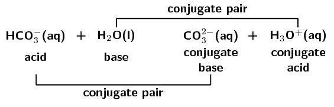

## 9.6 Chapter summary (ESCPR)

[Presentation: 27X4](http://www.slideshare.net/slideshow/embed_code/34431534)

- The **Arrhenius** definition of acids and bases defines an acid as a substance that
                      increases the concentration of hydronium ions \((\text{H}_{3}\text{O}^{+})\) in a solution. A base
                      is defined as a substance that increases the concentration of hydroxide ions \((\text{OH}^{-}\)) in
                      a solution. However, this definition only applies to aqueous solutions (in water).
- The **Brønsted-Lowry** definition is much broader. An **acid** is a
                      substance that **donates protons** (\(\text{H}^{+}\)) and a **base** is a
                      substance that **accepts protons**.
- In different reactions, certain substances can act as both an acid and a base. These substances are
                      **amphoteric** substances. **Amphiprotic** substances are amphoteric
                      substances that are Brønsted-Lowry acids and bases. Water is both amphoteric and amphiprotic.
- A **conjugate acid-base pair** refers to two compounds (one reactant and one product)
                      that differ only by a hydrogen ion (\(\text{H}^{+}\)) and a charge of +1.
- A large percentage of molecules in a **strong** acid or base dissociate or ionise to
                      form ions in solution.
- Only a small percentage of molecules in a **weak** acid or base dissociate or ionise to
                      form ions in solution.
- In a **concentrated** solution there is a **high ratio** of dissolved
                      substance to solvent.
- In a **dilute** solution there is a **low ratio** of dissolved substance to
                      solvent.
- **\(\text{K}_{\text{a}}\)** and **\(\text{K}_{\text{b}}\)** are the
                      equilibrium constants for the reaction of an acid or a base with water. A large
                      \(\text{K}_{\text{a}}\) or \(\text{K}_{\text{b}}\) means that the acid or base is
                      **strong**. A small \(\text{K}_{\text{a}}\) or \(\text{K}_{\text{b}}\) means that the
                      acid or base is **weak**.
- When an acid and a base react, they form a **salt** and **water**. The salt
                      is made up of a cation from the base and an anion from the acid. An example of a salt is sodium
                      chloride \((\text{NaCl})\), which is the product of the reaction between sodium hydroxide
                      \((\text{NaOH})\) and hydrochloric acid \((\text{HCl})\).
- The reaction between an acid and a base is a **neutralisation** reaction.
- In the reaction between an acid and a **metal** the products are a **salt**
                      and **hydrogen**.
- In the reaction between an acid and a **metal hydroxide** or **metal
                          oxide** the products are a **salt** and **water**.
- In the reaction between an acid and a **metal carbontae** or **metal hydrogen
                          carbonate** the products are a **salt**, **water** and
                      **carbon dioxide**.
- The **pH** scale is a measure of the acidity or alkalinity of a solution. It ranges from
                      \(\text{0}\) to \(\text{14}\). Values greater than \(\text{7}\) indicate a base, while those less
                      than \(\text{7}\) indicate an acid.
- Water ionises to a small extent. \(\textbf{K}_{\textbf{w}}\) is a measure of this auto-ionisation.
                      \(\text{K}_{\text{w}}\) is \(\text{1} \times \text{10}^{-\text{14}}\) at \(\text{25}\)
                      \(\text{℃}\).
- An **indicator** is a compound that is a different colour in a basic solution, an acidic
                      solution, and at the end-point of a reaction. They are used to determine the end-point during a
                      neutralisation reaction.
- **Titrations** are the method used to determine the concentration of a known substance
                      using another, standard, solution. Acid-base titrations are an example.
- Two notable applications of acids and bases are in the **chloralkali industry**, and in
                      hair products including **permanent waving applications**, **hair
                          relaxers**, and **hair dyes**.

<QuizCard id="s12-09-06a" title="Interactive Exercise 9.11" question="Hydrochloric acid is added to \(\text{2,6}\ \text{dm$^{3}$}\) of water: \[\begin{array}{c}\text{HCl}\text{(aq)} + \text{H}_{2}\text{O(l)} \rightleftharpoons \text{Cl}^{-}\text{(aq)} + \text{H}_{3}\text{O}^{+}\text{(aq)}\end{array}\] The following concentrations are given: Species Concentration ( \(\text{mol·dm$^{-3}$}\) ) HCl \(\text{1,082} \times \text{10}^{-\text{6}}\) Cl − \(\text{1,18}\) H 3 O + \(\text{1,18}\) Calculate the equilibrium constant for hydrochloric acid. INSTRUCTION: Write your answer in scientific notation , and then round it to two decimal places ." options=[] answer="
                    1.29e+6
                " hint="You should enter a number here. If you want to, you can use a space to separate thousands.                Example: 12 800,25 For scientific notation you need to use the multiply symbol                ( ∗ ) and the exponent symbol ( ^ ). For example 6,673 × 10 −11 should be written as: 6,673 ∗ 10^−11" explanation="We are given the concentrations of each species in the equilibrium equation and are asked to calculate the equilibrium constant. The equilibrium constant is the ratio between the concentration of products and reactants in a chemical reaction. We can use the following equation to calculate the equilibrium constant: \[\begin{array}{c}K_{a} = \frac{[\text{Cl}^{-}][\text{H}_{3}\text{O}^{+}]}{[\text{HCl}]}\end{array}\] Take care that you put the concentrations of the products in the numerator and the concentrations of the reactants in the denominator. Also, do not include pure solids or liquids in this equation. Note that hydrochloric acid is an acid and so we calculate \(K_{a}\) . Now we can calculate \(K_{a}\) : \[                     \begin{aligned}                     K_{a} & = \frac{[\text{Cl}^{-}][\text{H}_{3}\text{O}^{+}]}{[\text{HCl}]} \\                     & = \frac{(\text{1,18})(\text{1,18})}{(\text{1,082} \times \text{10}^{-\text{6}})} \\                     & = \text{1,286876...} \times \text{10}^{\text{6}} \\ & \approx \text{1,29} \times \text{10}^{\text{6}}                     \end{aligned}                 \] Therefore the value of \(K_{a}\) is \(\text{1,29} \times \text{10}^{\text{6}}\) . Submit your answer as:" />

<QuizCard id="s12-09-06a" title="Interactive Exercise 9.11" question="Physical constants \(·\) Chemistry formulas \(·\) Periodic table \(·\) Standard reduction potentials When magnesium carbonate reacts with water, it dissociates as shown in the balanced equation below: MgCO 3 (s) \(\:+\:\) H 2 O(ℓ) \(\rightarrow\) \(\downarrow\) Mg 2+ (aq) \(\:+\:\) HCO 3 − (aq) \(\:+\:\) OH − (aq) What is a Brønsted-Lowry base?" options=[] answer="0" hint="" explanation="Define a Brønsted-Lowry base According to the Brønsted-Lowry theory, a base is a proton ( H + ion) acceptor. Submit your answer as: an H + ion acceptor." />

<QuizCard id="s12-09-06a" title="Interactive Exercise 9.11" question="Which of the following statements best describes the term concentrated ? A large percentage of compound dissociates or ionises in solution B small percentage of compound dissociates or ionises in solution C large number of moles of compound in solution per unit volume D small number of moles of compound in solution per unit volume" options=["A", "B", "C", "D", "A", "B", "C", "D"] answer="C" hint="" explanation="We need to determine which options apply to the concentration of the solution. The number of moles of base in the solution tells us if the solution is concentrated or dilute. So we can now redraw the table with just the two options that tell us about the number of moles of base in the solution: C large number of moles of compound in solution per unit volume D small number of moles of compound in solution per unit volume The other options do not give us any indication of the concentration of the solution. Finally we need to decide whether this is option C or option D by looking at what we are told about the concentration. A concentrated solution has a large number of moles of compound in solution per unit volume. A dilute solution has a small number of moles of compound in solution per unit volume. We are told that the solution is concentrated and so the correct answer is option C . Submit your answer as: C" />

<QuizCard id="s12-09-06a" title="Interactive Exercise 9.11" question="Given the following reaction: \[\begin{array}{c}\textrm{HNO}_{3}\textrm{(aq)} + \textrm{NH}_{3}\textrm{(aq)} \rightarrow \textrm{NH}_{4}^{+}\textrm{(aq)} + \textrm{NO}_{3}^{-}\textrm{(aq)}\end{array}\] Which compound acts as the base ? Write only the formula of the compound." options=[] answer="NH_{3}" hint="You need to write a chemical compound here. A chemical compound can be any of the                following: Element: simply type in the element symbol as it appears on the periodic table. Chemical formula: just write the numbers showing the ratios of atoms normally. For example, water (H 2 O) is written as: H2O Ion: Use the exponent symbol ( ^ ) to represent a superscript. For example, the sodium ion (Na + ) is written as: Na^+ and the sulfate ion (SO 4 2− ) is written as: SO4^2− Electron: An electron is represented using e^- Compound formula: use round brackets around a compound ion in a formula. For example, calcium permanganate (Ca(MnO 4 ) 2 ) is written as: Ca(MnO4)2" explanation="There are two definitions for acids and bases that we can use. The first one is the Arrhenius definition and the second one is the Bronsted-Lowry definition. An Arrhenius acid forms H 3 O + in water. An Arrhenius base forms OH − in water. A Bronsted-Lowry acid donates protons. A Bronsted-Lowry base accepts protons. So we begin by breaking the reaction up into two parts and then using this to decide which compound is the acid and which is the base. We break the reaction up into two parts as follows: \[ 			\begin{aligned} 			\textrm{HNO}_{3} \rightarrow \textrm{H}^{+} +  \textrm{NO}_{3}^{-} \\ 			\textrm{NH}_{3} + \textrm{H}^{+} \rightarrow \textrm{NH}_{4}^{+} 			\end{aligned} 		  \] From this we see that the acid is HNO 3 . This compound donates a proton. The base is NH 3 . This compound accepts a proton. The compound that acts as the base in this reaction is NH 3 . Submit your answer as:" />

<QuizCard id="s12-09-06a" title="Interactive Exercise 9.11" question="If there are \(\text{2}\) moles of base, then how many moles of acid will represent                     the equivalence point of a neutralisation reaction?" options=[] answer="
                        1
                    " hint="You should enter a number here. If you want to, you can use a space to separate thousands.                Example: 12 800,25 For scientific notation you need to use the multiply symbol                ( ∗ ) and the exponent symbol ( ^ ). For example 6,673 × 10 −11 should be written as: 6,673 ∗ 10^−11" explanation="The equivalence point of a neutralisation reaction is the point where there is a stoichiometrically equivalent number of moles of acid and                         base. We can use the balanced chemical equation to determine the stoichiometric ratio of the acid to the base. The stoichiometric ratio is                         determined by looking at the numbers in front of each compound in the balanced equation. \(\text{1}\) H 2 SO 4 (aq) \(\:+\:\) \(\text{2}\) NaOH(aq) \(\rightarrow\) \(\downarrow\) \(\text{1}\) Na 2 SO 4 (aq) \(\:+\:\) \(\text{2}\) H 2 O(ℓ) A stoichiometrically equivalent amount of moles is \(\color{red}{\text{1}}\) mole of sulfuric acid (the acid) for every \(\color{blue}{\text{2}}\) moles of sodium hydroxide (the base). So the correct answer is if there are \(\text{2}\) moles of base, then \(\text{1}\) mole of acid will represent the equivalence point                         of a neutralisation reaction. Submit your answer as:" />

<QuizCard id="s12-09-06a" title="Interactive Exercise 9.11" question="Aqueous HCl reacts with solid MgO (a metal oxide) to produce a soluble salt, MgCl 2 . Write a balanced chemical equation to represent this reaction. INSTRUCTION: You don't need to include state symbols in your answer." options=[] answer="
                    ['2HCl(aq)+MgO(s) \\rightarrow MgCl_{2}(aq)+H_{2}O(l)', '2HCl+MgO \\rightarrow MgCl_{2}+H_{2}O', '2HCl(aq)+MgO(s) \\rightleftharpoons MgCl_{2}(aq)+H_{2}O(l)', '2HCl+MgO \\rightleftharpoons MgCl_{2}+H_{2}O', '2HCl(aq)+MgO(s) \\rightarrow MgCl_{2}(aq)+H_{2}O(aq)', '2HCl(aq)+MgO(s) \\rightleftharpoons MgCl_{2}(aq)+H_{2}O(aq)']
                " hint="Write a chemical equation here. You can use the following symbols to write equations: plus: + one-way arrow (→): −> (this is a minus and a greater than symbol) two-way arrow (⇌): <=> (this is a less than symbol, an equal symbol and a greater than symbol) Here are some examples of equations and how you should write them: Na + + Cl − → NaCl can be written as: Na^+  +  Cl^−  −>  NaCl CH 3 CO 2 H + H 2 O ⇌                CH 3 CO 2 − + H 3 O + can be written as: CH3CO2H  +  H2O  <=>  CH3CO2^-  +  H3O^+ State symbols can be added by writing the appropriate state in brackets. For example: Na + (aq) + Cl − (aq) → NaCl(aq) can be written as: Na^+ (aq)  +  Cl^− (aq)  −>  NaCl (aq) The chemical compounds in the equation should be written like this, for the different                types of compounds: Element: simply type in the element symbol as it appears on the periodic table. Chemical formula: just write the numbers showing the ratios of atoms normally. For example, water (H 2 O) is written as: H2O Ion: Use the exponent symbol ( ^ ) to represent a superscript. For example, the sodium ion (Na + ) is written as: Na^+ and the sulfate ion (SO 4 2− ) is written as: SO4^2− Electron: An electron is represented using e^- Compound formula: use round brackets around a compound ion in a formula. For example, calcium permanganate (Ca(MnO 4 ) 2 ) is written as: Ca(MnO4)2" explanation="What products form when an acid reacts with a metal oxide? MgO is a metal oxide. When an acid reacts                 	with a metal oxide the products are a salt and water. acid \(+\) metal oxide \(\rightarrow\) salt \(+\) water Write the unbalanced chemical equation The soluble salt is MgCl 2 , and we know that water is the only other product.  The chemical equation is: HCl(aq) \(\:+\:\) MgO(s) \(\rightarrow\) \(\downarrow\) MgCl 2 (aq) \(\:+\:\) H 2 O(ℓ) Balanced the equation We now check if the equation is balanced, and if not we must balance it. Doing so gives: \(\text{2}\) HCl(aq) \(\:+\:\) MgO(s) \(\rightarrow\) \(\downarrow\) MgCl 2 (aq) \(\:+\:\) H 2 O(ℓ) TIP: You can revise how to balance chemical equations here . Submit your answer as:" />

<QuizCard id="s12-09-06a" title="Interactive Exercise 9.11" question="A titration is carried out and the following information is obtained. The base is potassium hydroxide, KOH . It has a concentration of \(\text{0,3}\ \text{mol·dm$^{-3}$}\) . The acid is nitric acid, HNO 3 . \(\text{0,035}\ \text{dm$^{3}$}\) of the base was used. \(\text{0,026}\ \text{dm$^{3}$}\) of nitric acid was needed to neutralise the potassium hydroxide. The following equation can be written to represent this reaction. KOH(aq) \(\:+\:\) HNO 3 (aq) \(\rightarrow\) \(\downarrow\) KNO 3 (aq) \(\:+\:\) H 2 O(ℓ) Calculate the concentration of the nitric acid solution. INSTRUCTION: Round your answer to two decimal places ." options=[] answer="
					(0.4; 0.39; 0.433)
				" hint="You should enter a number here. If you want to, you can use a space to separate thousands.                Example: 12 800,25 For scientific notation you need to use the multiply symbol                ( ∗ ) and the exponent symbol ( ^ ). For example 6,673 × 10 −11 should be written as: 6,673 ∗ 10^−11" explanation="Write down what you are given and what you need to calculate \(V_{\text{acid}} = \text{0,026}\ \text{dm$^{3}$}\) \(V_{\text{base}} = \text{0,035}\ \text{dm$^{3}$}\) \(C_{\text{base}} =  \text{0,3}\ \text{mol·dm$^{-3}$}\) KOH(aq) \(\:+\:\) HNO 3 (aq) \(\rightarrow\) \(\downarrow\) KNO 3 (aq) \(\:+\:\) H 2 O(ℓ) The volumes are in SI units, and we can use the following equation to calculate the unknown concentration: \[ 				\begin{aligned} 					\frac{c_{a}V_{a}}{a} &= \frac{c_{b}V_{b}}{b} 				\end{aligned} 				\] TIP: Remember that \(a\) and \(b\) are the stoichiometric coefficients of the nitric acid and potassium hydroxide. Calculate the concentration of the nitric acid \[ 					\begin{aligned} 						\frac{c_{a}V_{a}}{a} &= \frac{c_{b}V_{b}}{b} \\ 						\frac{(c_{\text{acid}})(\text{0,026})}{1} & = \frac{(\text{0,3})(\text{0,035})}{1}\\ 						\text{0,026}(c_{\text{acid}}) & = \text{0,0105} \\ 						&= \text{0,40384...} \\ & \approx \text{0,40}\ \text{mol·dm$^{-3}$} 					\end{aligned} 				\] Submit your answer as:" />

<QuizCard id="s12-09-06a" title="Interactive Exercise 9.11" question="Calculate the concentration of the calcium hydroxide solution." options=[] answer="
                        (0.297; 0.295; 0.301)
                    " hint="You should enter a number here. If you want to, you can use a space to separate thousands.                Example: 12 800,25 For scientific notation you need to use the multiply symbol                ( ∗ ) and the exponent symbol ( ^ ). For example 6,673 × 10 −11 should be written as: 6,673 ∗ 10^−11" explanation="Calculate the number of moles of calcium hydroxide in the standard solution We use the periodic table to calculate that the molar mass of calcium hydroxide, Ca(OH) 2 , is \(\text{74}\ \text{g·mol$^{-1}$}\) . \[                         \begin{aligned}                         n(\text{C}\text{a}(\text{O}\text{H})_{2}) & = \frac{m}{M} \\                         & = \frac{\text{5,5}}{\text{74}} \\                         & = \text{0,074324...}\ \text{mol}                         \end{aligned}                     \] Calculate the concentration of the calcium hydroxide standard solution \[                         \begin{aligned}                         c(\text{C}\text{a}(\text{O}\text{H})_{2}) & = \dfrac{n}{V} \\                         & = \dfrac{\text{0,074324...}}{\text{0,25}} \\                         & = \text{0,297297...} \\ & \approx \text{0,297}\ \text{mol·dm$^{-3}$}                         \end{aligned}                     \] Submit your answer as:" />

<QuizCard id="s12-09-06a" title="Interactive Exercise 9.11" question="Calculate the pH of a solution where the concentration of hydrogen ions is \(\text{1,00} \times \text{10}^{-\text{12}}\ \text{mol·dm$^{-3}$}\) . INSTRUCTION: Round your answer to one decimal place." options=[] answer="
                    12.0
                " hint="You should enter a number here. If you want to, you can use a space to separate thousands.                Example: 12 800,25 For scientific notation you need to use the multiply symbol                ( ∗ ) and the exponent symbol ( ^ ). For example 6,673 × 10 −11 should be written as: 6,673 ∗ 10^−11" explanation="The pH of a solution tells us if the solution is acidic (pH less than \(\text{7}\) ), neutral (pH of exactly \(\text{7}\) ) or basic (pH greater than \(\text{7}\) ). We are given the concentration of hydrogen ions in the solution and are asked to find the pH of the solution. We can use \(\text{pH} = -\log[\text{H}^{+}]\) to calculate the pH. \[                     \begin{aligned}                     \text{pH} &= -\log[\text{H}^{+}] \\                     & = -\log(\text{1,00} \times \text{10}^{-\text{12}}) \\                     & =  \text{12,0}                     \end{aligned}                 \] Therefore the pH is \(\text{12,0}\) . Submit your answer as:" />

<QuizCard id="s12-09-06a" title="Interactive Exercise 9.11" question="He wants to titrate a weak base with a strong acid. Will the salt solution that is formed be neutral, weakly basic or weakly acidic? What will the approximate pH of the salt solution be?" options=["neutral", "weakly acidic", "weakly basic", "7", "9", "5", "3.8 - 5.4", "8.3 - 10.0", "6,0 - 7.6", "6,0 - 7.6", "8.3 - 10.0", "3.8 - 5.4", "3.8 - 5.4", "8.3 - 10.0", "6,0 - 7.6", "phenolphthalein", "bromocresol green", "bromothymol blue"] answer="
                        2
                    ,
                        0
                    " hint="" explanation="The following table summarises the approximate pH of neutralisation reaction solutions based on the strength of the acid and base used. acid strength base strength solution approximate pH strong strong neutral \(\text{7}\) weak strong weakly basic \(\text{9}\) strong weak weakly acidic \(\text{5}\) Therefore when a weak base reacts with a strong acid the salt wil be weakly acidic with an approximate pH of \(\text{5}\) . Submit your answer as: weakly acidic and 5" />

### Textbook Exercise 9.7

The stomach secretes gastric juice, which contains hydrochloric acid. The gastric juice helps
                            with digestion. Sometimes there is an overproduction of acid, leading to heartburn or
                            indigestion. Antacids, such as milk of magnesia, can be taken to neutralise the excess acid.
                            Milk of magnesia is only slightly soluble in water and has the chemical formula
                            \(\text{Mg}(\text{OH})_{2}\).

**Problem:**
Write a balanced chemical equation to show how the antacid reacts with the acid.

**Solution:**
base + acid \(\to\) salt + water

The cation (from the base) is \(\text{Mg}^{2+}\). The anion (from the acid) is
                                \(\text{Cl}^{-}\).

Therefore the salt is \(\text{MgCl}_{2}\)

\(\text{Mg}(\text{OH})_{2}(\text{s}) + 2\text{HCl}(\text{aq})\) \(\to\)
                                \(\text{MgCl}_{2}(\text{aq}) + 2\text{H}_{2}\text{O}(\text{ℓ})\)

**Problem:**
The instructions on the bottle recommend that children under the age of \(\text{12}\)
                                years take one teaspoon of milk of magnesia, whereas adults can take two teaspoons of
                                the antacid. Briefly explain why the dosages are different.

**Solution:**
Adults have a bigger mass and generally produce more acid than children. Adults will
                                therefore need more antacid to neutralise the excess acid. If children were to take the
                                same dosage as adults they would have excess base in their stomach.

**Problem:**
Why is it not advisable to take an overdose of the antacid? Refer to the hydrochloric
                                acid concentration in the stomach in your answer.

(DoE Grade 11 Exemplar, 2007)

**Solution:**
A low acid concentration (pH too high) in the stomach may slow down food digestion or may
                                cause further stomach upset.

The compound \(\text{NaHCO}_{3}\) is commonly known as baking soda. A recipe requires
                            \(\text{1,6}\) \(\text{g}\) of baking soda, mixed with other ingredients, to bake a cake.

**Problem:**
Calculate the number of moles of \(\text{NaHCO}_{3}\) used to bake the cake.

**Solution:**
\(M(\text{NaHCO}_{3}) = \text{23,0} + \text{1,01} + \text{12,0} +
                                (\text{3} \times \text{16,0}) = \text{84,01} \text{g·mol$^{-1}$}\)

\(n(\text{NaHCO}_{3}) = \dfrac{m}{M} = \dfrac{\text{1,6}\text{
                                g}}{\text{84,01}\text{ g·mol$^{-1}$}} = \text{0,019} \text{ mol}\)

**Problem:**
How many atoms of oxygen are there in \(\text{1,6}\) \(\text{g}\) of baking soda?

**Solution:**
\(\text{N}_{\text{A}}\) (Avogadro's number) = \(\text{6,022} \times
                                \text{10}^{\text{23}}\) \(\text{atoms·mol$^{-1}$}\).

Number of atoms = n x \(\text{N}_{\text{A}}\) = \(\text{0,019}\) \(\text{mol}\) x
                                \(\text{6,022} \times \text{10}^{\text{23}}\) \(\text{atoms·mol$^{-1}$}\)

Number of atoms = \(\text{1,14} \times \text{10}^{\text{22}}\) atoms.

**Problem:**
During the baking process, baking soda reacts with an acid (e.g. acetic acid in vinegar)
                                to produce carbon dioxide and water, as shown by the reaction equation below:

\(\text{NaHCO}_{3}(\text{aq}) + \text{CH}_{3}\text{COOH}(\text{aq})\) \(\to\)
                                \(\text{CH}_{3}\text{COONa}(\text{aq}) + \text{CO}_{2}(\text{g}) +
                                \text{H}_{2}\text{O}(\text{ℓ})\)

Use the above equation to explain why the cake rises during this baking process.

(DoE Grade 11 Paper 2, 2007)

**Solution:**
The carbon dioxide gas that is formed during the reaction forms bubbles in the cake
                                mixture causing it to rise along with the expanding volume of the gas bubbles.

**Problem:**
Label the acid-base conjugate pairs in the following equation:

\(\text{HCO}_{3}^{-}(\text{aq}) + \text{H}_{2}\text{O}(\text{ℓ})\)
                            \(\rightleftharpoons\)
                            \(\text{CO}_{3}^{2-}(\text{aq}) + \text{H}_{3}\text{O}^{+}(\text{aq})\)

**Solution:**

**Problem:**
A certain antacid tablet contains \(\text{22,0}\) \(\text{g}\) of baking soda
                            \((\text{NaHCO}_{3})\). It is used to neutralise the excess hydrochloric acid in the
                            stomach. The balanced equation for the reaction is:

\(\text{NaHCO}_{3}(\text{s}) + \text{HCl}(\text{aq})\) \(\to\) \(\text{NaCl}(\text{aq}) +
                            \text{H}_{2}\text{O}(\text{ℓ}) + \text{CO}_{2}(\text{g})\)

The hydrochloric acid in the stomach has a concentration of \(\text{1,0}\)
                            \(\text{mol·dm$^{-3}$}\). Calculate the volume of the hydrochloric acid that can be
                            neutralised by the antacid tablet.

(DoE Grade 11 Paper 2, 2007)

**Solution:**
\(M(\text{NaHCO}_{3}) = \text{23,0} + \text{1,01} + \text{12,0} + (\text{3}
                            \times \text{16,0}) = \text{84,01} \text{ g·mol$^{-1}$}\)

\(n\text{(NaHCO}_{3}{\text{)}} = \dfrac{m}{M}\)

\(n = \dfrac{\text{22,0}\text{ g}}{\text{84,01}\text{ g·mol$^{-1}$}}\) =
                            \(\text{0,26}\) \(\text{mol}\)

From the balanced equation we see that the molar ratio of \(\text{NaHCO}_{3}\) to
                            \(\text{HCl}\) is \(\text{1}\):\(\text{1}\).

Therefore, \(n(\text{HCl}) = n(\text{NaHCO}_{3}) = \text{0,26} \text{ mol}\)

\(c = \dfrac{n}{V}\) therefore \(V = \dfrac{n}{c}\)

\(V\text{(HCl)} = \dfrac{\text{0,26}\text{ mol}}{\text{1,0}\text{ mol·dm$^{-3}$}}\) =
                            \(\text{0,26}\) \(\text{dm$^{3}$}\)

A learner finds some sulfuric acid solution in a bottle labelled 'dilute sulfuric acid'. He
                            wants to determine the concentration of the sulfuric acid solution. To do this, he decides
                            to titrate the sulfuric acid against a standard potassium hydroxide (KOH) solution.

**Problem:**
What is a standard solution?

**Solution:**
A standard solution is a solution that contains a precisely known concentration of a
                                substance. This substance can then be used in titrations.

**Problem:**
Calculate the mass of \(\text{KOH}\) which he must use to make \(\text{300}\)
                                \(\text{cm$^{3}$}\) of a \(\text{0,2}\) \(\text{mol·dm$^{-3}$}\) \(\text{KOH}\)
                                solution.

**Solution:**
\(V(\text{KOH}) = \text{300} \text{ cm$^{3}$} \times \dfrac{\text{0,001}
                                {\text{ dm}}^{3}}{\text{1} {\text{ cm}}^{3}} = \text{0,3} \text{ dm$^{3}$}\)

\(C = \dfrac{n}{V}\), therefore \(n = C \times V\)

\(n(\text{KOH}) = \text{0,2} \text{ mol·dm$^{-3}$} \times \text{0,3}
                                \text{ dm$^{3}$} = \text{0,06} \text{ mol}\)

\(M(\text{KOH}) = (\text{39,1} + \text{16,0} + \text{1,01})
                                \text{ g·mol$^{-1}$} = \text{56,11} \text{ g·mol$^{-1}$}\)

\(n = \dfrac{m}{M}\), therefore \(m = n \times M\)

\(m(\text{KOH}) = \text{0,06} \text{mol} \times \text{56,11}
                                \text{ g·mol$^{-1}$} = \text{3,37} \text{ g}\)

**Problem:**
Calculate the pH of the \(\text{0,2}\) \(\text{mol·dm$^{-3}$}\) \(\text{KOH}\)
                                solution
                                (assume standard temperature).

**Solution:**
\(\text{KOH}\) is a very strong base and will completely dissociate in water. Therefore
                                the concentration of \(\text{OH}^{-}\) ions is the same as the concentration of the
                                solution.

pH is defined as: pH = -log\([\text{H}^{+}]\)

However, we can also define pOH in a similar way: pOH = -log\([\text{OH}^{-}]\)

The relationship between the two is: 14 = pH + pOH, therefore pH = 14 - pOH

pH = \(\text{14}\) - (-log\([\text{OH}^{-}]\)) = \(\text{14}\) - (-log[\(\text{0,2}\)]) =
                                \(\text{14}\) - \(\text{0,7}\) = \(\text{13,3}\)

**Problem:**
Write a balanced chemical equation for the reaction between \(\text{H}_{2}\text{SO}_{4}\)
                                and \(\text{KOH}\).

**Solution:**
Sulfuric acid is a strong acid and potassium hydroxide is a strong base, therefore the
                                equation is:

\(\text{H}_{2}\text{SO}_{4}(\text{aq}) + 2\text{KOH}(\text{aq})\) \(\to\)
                                \(\text{K}_{2}\text{SO}_{4}(\text{aq}) + 2\text{H}_{2}\text{O}(\text{ℓ})\)

**Problem:**
During the titration the learner finds that \(\text{15}\) \(\text{cm$^{3}$}\) of the KOH
                                solution neutralises \(\text{20}\) \(\text{cm$^{3}$}\) of the
                                \(\text{H}_{2}\text{SO}_{4}\) solution. Calculate the concentration of the
                                \(\text{H}_{2}\text{SO}_{4}\) solution.

(IEB Paper 2, 2003)

**Solution:**
\(V(\text{KOH}) = \text{15} \text{ cm$^{3}$} \times \dfrac{\text{0,001} {\text{
                                dm}}^{3}}{\text{1} {\text{ cm}}^{3}} = \text{0,015} \text{ dm$^{3}$}\)

The number of moles of \(\text{KOH}\) used to neutralise the
                                \(\text{H}_{2}\text{SO}_{4}\) is:

\(n(\text{KOH}) = c \times V = \text{0,2} \text{ mol·dm$^{-3}$} \times
                                \text{0,015} \text{ dm$^{3}$} = \text{0,003} \text{ mol}\)

From the balanced equation we see that the mole ratio of \(\text{H}_{2}\text{SO}_{4}\) to
                                \(\text{KOH}\) is \(\text{1}\):\(\text{2}\). There is one mole of sulfuric acid for
                                every two moles of potassium hydroxide.

\(n(\text{H}_{2}\text{SO}_{4}) = \dfrac{\text{0,003}\text{ mol}}{\text{2}} =
                                \text{0,0015} \text{ mol}\)

\(V(\text{H}_{2}\text{SO}_{4}) = \text{20} \text{ cm$^{3}$} \times
                                \dfrac{\text{0,001} {\text{ dm}}^{3}}{\text{1} {\text{ cm}}^{3}} = \text{0,020}
                                \text{ dm$^{3}$}\)

Therefore, the concentration of the sulfuric acid is:

\(c(\text{H}_{2}\text{SO}_{4}) = \dfrac{n}{V} =
                                \dfrac{\text{0,0015}\text{ mol}}{\text{0,020}\text{ dm$^{3}$}} = \text{0,075}
                                \text{ mol·dm$^{-3}$}\)
