## 10.2 Series and parallel resistor networks (Revision) (ESCPT)

In Grade 10 and Grade 11 you learnt about electric circuits and we introduced
                        three quantities which are fundamental to dealing with electric circuits. These quantities
                        are closely related and are **current, voltage
                                (potential difference)** and **resistance**.
                        To recap:

2. Electrical current, \(I\), is defined as the rate of flow of charge through a
                                           circuit.
4. Potential difference or voltage, \(V\), is related to the energy gained or lost per
                                           unit charge moving between two points in a circuit. Charge moving through a
                                           battery gains energy which is then lost moving through the circuit.
6. Resistance, \(R\), is an internal property of a circuit element that opposes the flow
                                           of charge. Work must be done for a charge to move through a resistor.

These quantities can be related, in circuit elements whose resistance remains constant, by Ohm's law.

<Callout type="note" title="Note">
**Ohm's Law**

For a resistor at constant temperature the ratio \(\frac{V}{I}\) is
                                constant. This ratio we call resistance.

This is equivalent to saying that the amount of electric current through a metal
                                conductor, at a constant
                                temperature, in a circuit is proportional to the voltage across the conductor and
                                can be described by

                        \[I = \frac{V}{R}\]

In other words, at constant temperature, the resistance of the conductor is
                                constant, independent of the voltage applied across it or current passed through it.
</Callout>

We have focused on the properties of a single component. Now we need to look at a
                        collection of components in a circuit.

<Callout type="note" title="Note">
You will often hear people switch between using the terms
                                *voltage* and
                                *potential difference* to
                                describe the same quantity. This is correct but very important to note.
</Callout>

Circuits don't consist of a single element and we've learnt about how voltage, current and resistance
                        are affected in circuits with multiple resistors.
                        There are two basic layouts we consider for a network of resistors, series and parallel.
                        Resistors in series and resistors in parallel have different features when talking about
                        current, voltage and equivalent resistance.

<Callout type="tip" title="Worked example 1: Ohm's Law [NSC 2011 Paper 1]">
**Question:**
Learners conduct an investigation to verify Ohm's law. They measure the current
                                        through a conducting wire for different potential differences across its ends.
                                        The results obtained are shown in the graph below.

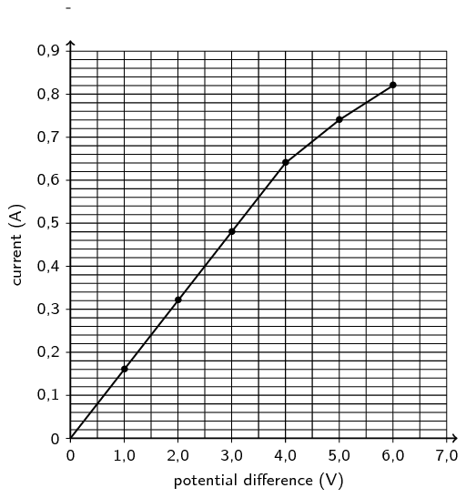

2. Which ONE of the measured quantities is the dependent variable?
   (1 mark)
4. The graph deviates from Ohm's law at some point.
   2. Write down the coordinates of the plotted point on
                                                                              the graph beyond which Ohm's law is not obeyed.
      (2 marks)
   4. Give a possible reason for the deviation from Ohm's
                                                                              law as shown in the graph. Assume that all
                                                                              measurements are correct.
      (2 marks)
6. Calculate the gradient of the graph for the section where Ohm's law
                                                           is obeyed.
   Use this to calculate the resistance of the conducting wire.
   (4 marks)

**Question 1**

Current **OR** I

(1 mark)

**Question 2**

The graph deviates from Ohm's law at some point.

2. (\(\text{4,0}\) ; \(\text{0,64}\))
   (2 marks)
4. Temperature was not kept constant.
   (2 marks)

**Question 3**

                        \begin{align*}
                        \text{Gradient:} \quad m & = \frac{\Delta y}{\Delta x} \\
                        & = \frac{\text{0,64}-\text{0}}{\text{4}-\text{0}} \\
                        & = \text{0,16}
                        \end{align*}\begin{align*}
                        R & = \frac{1}{\text{0,16}} \\
                        & = \text{6,25}\ \Omega
                        \end{align*}

(4 marks)

**[TOTAL: 9 marks]**
</Callout>

<QuizCard id="s12-10-02a" title="Interactive Exercise 10.2" question="A designer is investigating the electrical properties of a tablet computer. The figure on the right shows a simplified circuit diagram of the tablet computer. The designer has measured the potential difference over the power source of the tablet computer as \(V_A = \text{5,254}\ \text{V}\) and the current through the circuit of the tablet computer at \(I_A = \text{0,08346}\ \text{A}\) . Using the concepts of electric circuits , and Ohm's law , answer the following question: What is the total resistance of the electric circuit of the tablet computer, or \(R_A\) ? INSTRUCTION: round your answer to one decimal place after the decimal comma use the values for any physical constants you might need, as listed here" options=[] answer="
                    63.0
                " hint="You should enter a number here. If you want to, you can use a space to separate thousands.                Example: 12 800,25 For scientific notation you need to use the multiply symbol                ( ∗ ) and the exponent symbol ( ^ ). For example 6,673 × 10 −11 should be written as: 6,673 ∗ 10^−11" explanation="Using Ohm's law Recall that Ohm's law states that the resistance of a conductor is directly proportional to the voltage/potential difference over it, and inversely proportional to the current passing through it: \[\begin{array}{c}R = \frac{V}{I} ~~~~~\text{(1)}\end{array}\] Substitute the given information to calculate the final result We are given the following information: the potential difference over the circuit \(V_A = \text{5,254}\ \text{V}\) the current passing through the circuit \(I_A = \text{0,08346}\ \text{A}\) Substituting the above values in \(\text{(1)}\) , we get: \[                     \begin{aligned}                     R_A & = \frac{V_A}{I_A}\\                     & = \frac                     {\text{5,254}\ \text{V}}                     {\text{0,08346}\ \text{A}} \\                     & = \text{62,9523...}\ \text{Ω} \\ & \approx \text{63,0}\ \text{Ω}                     \end{aligned}                 \] Therefore, the total resistance of the electric circuit of the tablet computer is \(\text{63,0}\ \text{Ω}\) . Submit your answer as:" />

<Callout type="note" title="Note">
A circuit may consist of a combination of parallel and series networks that can in turn
                                be in parallel or series. We can treat parts of the total circuit independently by
                                applying Ohm's
                                Law to each of the components.
</Callout>

<Callout type="note" title="Note">
**
                                        Resistors connected in series**

Resistors are in series if they are consecutive elements in the sequence of the
                                circuit and there are no branches between them.
                                For \(n\) resistors in series the equivalent resistance is:

                        \[R_{s} = R_{1} + R_{2} + R_{3} + \ldots + R_{n}\]

For \(n\) resistors in series the potential difference is split across the resistors:

                        \[V_{\text{Total}} = V_{1} + V_{2} + V_{3} + \ldots + V_{n}\]

The current is constant through the resistors.

                        \[I_{\text{Total}} = I_{1} = I_{2} = I_{3} = \ldots = I_{n}\]

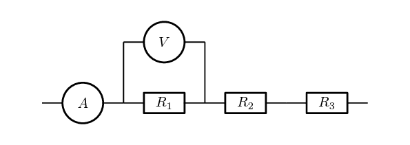
</Callout>

It makes sense to remind ourselves of why these are consistent with other topics we
                        have covered previously:

- **Conservation of charge:** we have learnt that charges are
                                  not created or destroyed. This is consistent with the current being the same throughout
                                  a
                                  resistor network that is in series. Charges aren't being added or lost or bunching up
                                  and, therefore, the rate at which charge moves past each point should be the same.
- **Conservation of energy:** we have learnt that energy isn't
                                  created or destroyed but transferred through work. The voltage across a resistor is the
                                  energy per
                                  unit charge (work) required to move through the resistor. The total work done to move
                                  through a network
                                  of resistors in series should be the sum of the work done to move through each
                                  individual resistor.

<Callout type="tip" title="Worked example 2: Ohm's Law, all components in series">
**Question:**
Two ohmic resistors (\(R_{1}\) and \(R_{2}\)) are
                                        connected in series with a cell with negligible internal resistance. Find
                                        the resistance of \(R_{2}\), given that the current flowing
                                        through \(R_{1}\) and \(R_{2}\) is
                                        \(\text{0,25}\) \(\text{A}\) and that
                                        the potential difference across the cell is
                                        \(\text{1,50}\) \(\text{V}\).
                                        \(R_{1}\) =\(\text{1,00}\) \(\text{Ω}\).

**Draw the circuit and fill in all known values.:**
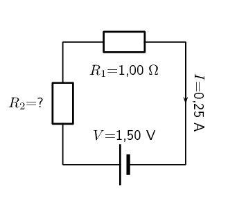

**Determine how to approach the problem.:**
We can use Ohm's Law to find the total resistance R in the circuit, and then
                                        calculate the unknown resistance using:

                                \[R = R_{1} + R_{2}\]

because \(R_{1}\) and \(R_{2}\) are connected
                                        in series.

**Find the total resistance:**
\begin{align*}
                                R & = \frac{V}{I} \\
                                & = \frac{\text{1,5}}{\text{0,25}} \\
                                & = \text{6}\text{ Ω}
                                \end{align*}

**Find the unknown resistance:**
We know that:

                                \[R = \text{6,00}\text{ Ω}\]

and that

                                \[R_{1} = \text{1,00}\text{ Ω}\]

Since

                                \[R = R_{1} + R_{2}\]
                                \[R_{2} = R - R_{1}\]

Therefore,

                                \[R_{1} = \text{5,00}\text{ Ω}\]
</Callout>

<Callout type="tip" title="Worked example 3: Ohm's Law, series circuit">
**Question:**
In the case of the circuit shown, calculate:

2. the potential difference of \(V_1\), \(V_2\) and \(V_3\) across the
                                                           resistors \(R_1\), \(R_2\), and \(R_3\)
4. the resistance of \(R_3\).

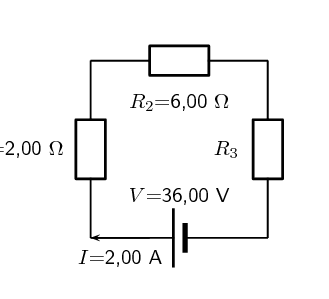

**Determine how to approach the problem:**
We are given the potential difference across the cell and the current in the circuit,
                                        as well as the resistances of two of the three resistors. We can use Ohm's Law
                                        to calculate the potential difference across the known resistors. Since the
                                        resistors are in a series circuit the potential difference is \(V = V_1 + V_2 +
                                        V_3\) and we can calculate \(V_3\). Now we can use this information to find the
                                        potential difference across the unknown resistor \(R_3\).

**Calculate potential difference across \(R_1\):**
Using Ohm's Law:
                                        \begin{align*}
                                        R_1 &= \frac{V_1}{I} \\
                                        I \cdot R_1 &= I \cdot \frac{V_1}{I} \\
                                        V_1 &= {I}\cdot{R_1}\\
                                        &= \text{2} \cdot \text{2} \\
                                        V_1 &= \text{4,00}\text{ V}
                                        \end{align*}

**Calculate potential difference across \(R_2\):**
Use Ohm's Law:
                                        \begin{align*}
                                        R_2 &= \frac{V_2}{I} \\
                                        I \cdot R_2 &= I \cdot \frac{V_2}{I} \\
                                        V_2 &= {I}\cdot{R_2}\\
                                        &= \text{2} \cdot \text{6} \\
                                        V_2 &= \text{12,00}\text{ V}
                                        \end{align*}

**Calculate potential difference across \(R_3\):**
Since the potential difference across all the resistors combined must be the same as
                                        the potential difference across the cell in a series circuit, we can find
                                        \(V_3\) using:
                                        \begin{align*}
                                        V &= V_1 + V_2 + V_3\\
                                        V_3 &= V - V_1 - V_2 \\
                                        &= \text{36} - \text{4} - \text{12} \\
                                        V_3&= \text{20,00}\text{ V}
                                        \end{align*}

**Find the resistance of \(R_3\):**
We know the potential difference across \(R_3\) and the current through it, so we can
                                        use Ohm's Law to calculate the value for the resistance:
                                        \begin{align*}
                                        R_3 &= \frac{V_3}{I}\\
                                        &= \frac{ \text{20}}{ \text{2}} \\
                                        R_3&= \text{10,00}~\Omega
                                        \end{align*}

**Write the final answer:**
- \(V_1 = \text{4,00}\text{ V}\)
- \(V_2 = \text{12,00}\text{ V}\)
- \(V_3 = \text{20,00}\text{ V}\)
- \(R_3 = \text{10,00}~\Omega\)
</Callout>

<Callout type="note" title="Note">
**Equivalent resistance in a parallel network**

A parallel configuration is when the current splits into a number of branches which contain
                                components (resistors in our case). A branch may contain multiple resistors in series
                                and still be part of the parallel
                                configuration. For \(n\) branches of resistors in parallel, the equivalent resistance
                                can be calculated from the total resistance of each branch and is:

                        \[\frac{1}{R_{p}} = \frac{1}{R_{B1}} + \frac{1}{R_{B2}} + \frac{1}{R_{B3}} + \ldots +
                        \frac{1}{R_{Bn}}\]

For \(n\) branches of resistors in parallel the potential difference is the same across each
                                of the branches:

                        \[V_{\text{Total}} = V_{B1} = V_{B2} = V_{B3} = \ldots = V_{Bn}\]

The current is split through the branches.

                        \[I_{\text{Total}} = I_{1} + I_{2} + I_{3} + \ldots + I_{n}\]

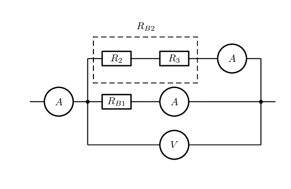
</Callout>

<QuizCard id="s12-10-02b" title="Interactive Exercise 10.3" question="The diagram shows an electric circuit consisting of a cell and two ohmic resistors. resistor \(R_1 = \text{8,8}\ \text{Ω}\) resistor \(R_2 = \text{5,3}\ \text{Ω}\) What is the equivalent resistance of the circuit? INSTRUCTION: Round your answer to one decimal place." options=[] answer="14.1" hint="You should enter a number here. If you want to, you can use a space to separate thousands.                Example: 12 800,25 For scientific notation you need to use the multiply symbol                ( ∗ ) and the exponent symbol ( ^ ). For example 6,673 × 10 −11 should be written as: 6,673 ∗ 10^−11" explanation="Choose which relationship to use In a series circuit there is one path along which current flows. Each resistor in the path of the current steals some of the potential in the circuit, thus we will see a potential difference over a resistor (a voltage drop). We can compare the circuit to a river where a resistor is like an obstacle in a river that resists the flow of water. The more obstacles in the way the more resistance occurs. Therefore in a series circuit, as you add more resistors (obstacles), the resistance increases. The equivalent (total) resistance is thus the sum of the resistances of all the resistors: \[               \begin{aligned}                 R_{\text{eq}} & = R_1 + R_2 + ... \\               \end{aligned}             \] Substitute and solve for the equivalent resistance There are two resistors in this circuit, thus: \[               \begin{aligned}                 R_{\text{eq}} & = R_1 + R_2 \\                        & = \text{8,8} + \text{5,3} \\                        & = \text{14,1}\ \text{Ω} \\               \end{aligned}             \] The equivalent resistance of the circuit is \(\text{14,1}\ \text{Ω}\) . Submit your answer as:" />

Let's take a moment to see if our conservation laws still make sense:

- **Conservation of charge:** we have learnt that charges are
                                  not created or destroyed. This is consistent with the current splitting between the
                                  branches.
                                  Charges aren't being added or lost or bunching up and, therefore, the total number of
                                  charges
                                  going through the branches must be the same as the number entering the point where the
                                  circuit branches.
- **Conservation of energy:** we have learnt that energy isn't
                                  created or destroyed but transferred through work. Energy per unit charge doesn't change
                                  unless
                                  work is done therefore it makes sense that the energy per unit charge in each branch
                                  should be
                                  the same.

<Callout type="tip" title="Worked example 4: Ohm's Law, resistors connected in parallel">
**Question:**
Calculate the current (\(I\)) in this circuit if the resistors are both ohmic in
                                        nature.

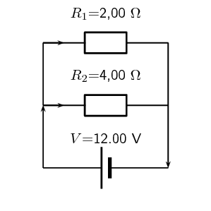

**Determine what is required:**
We are required to calculate the total current flowing in the circuit.

**Determine how to approach the problem:**
Since the resistors are ohmic in nature, we can use Ohm's Law. However, there
                                        are two resistors in the circuit and we need to find the total resistance.

**Find the equivalent resistance in the circuit:**
Since the resistors are connected in parallel, the total (equivalent) resistance R
                                        is:

                                \[\frac{1}{R} = \frac{1}{R_{1}} + \frac{1}{R_{2}}.\]
                                \begin{align*}
                                \frac{1}{R} &= \frac{\text{1}}{R_1} + \frac{\text{1}}{R_2} \\
                                &= \frac{\text{1}}{\text{2}} + \frac{\text{1}}{\text{4}} \\
                                &= \frac{\text{2}+\text{1}}{\text{4}} \\
                                &= \frac{\text{3}}{\text{4}} \\
                                \text{Therefore, } R &= \frac{\text{4}}{\text{3}} = \text{1,33}~\Omega
                                \end{align*}

**Apply Ohm's Law:**
\begin{align*}
                                R&= \frac{V}{I} \\
                                R \cdot \frac{I}{R} &= \frac{V}{I} \cdot \frac{I}{R} \\
                                I &= \frac{V}{R}\\
                                I &= V \cdot \frac{\text{1}}{R}\\
                                &= (\text{12}) \left(\frac{\text{3}}{\text{4}}\right) \\
                                &= \text{9,00}\text{ A}
                                \end{align*}

**Write the final answer:**
The total current flowing in the circuit is \(\text{9,00}\) \(\text{A}\).
</Callout>

<Callout type="tip" title="Worked example 5: Ohm's Law, parallel network of resistors">
**Question:**
An \(\text{18,00}\) \(\text{V}\) cell is connected to two parallel resistors of
                                        \(\text{2,00}\) \(\Omega\) and \(\text{6,00}\) \(\Omega\) respectively.
                                        Calculate the current through each of the ammeters when the switch is closed and
                                        when it is open.

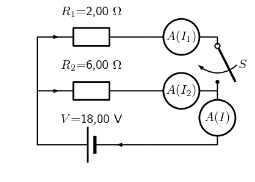

**Determine how to approach the problem:**
We need to determine the current through the cell and each of the parallel resistors.
                                        We have been given the potential difference across the cell and the resistances
                                        of the resistors, so we can use Ohm's Law to calculate the current.

There are two alternative approaches we could adopt:

- we could use the fact that the potential difference across each of the
                                                  resistors is the same as the
                                                  potential difference across the battery because they are in a parallel
                                                  configuration and then use
                                                  Ohm's Law; or
- we could determine the equivalent
                                                  resistance of the circuit and the total current and then use that to
                                                  determine the current
                                                  through each of the resistors.

<Callout type="note" title="Note">
Both methods will result in the correct answer if you don't make any
                                                calculation errors
                                                but one is shorter.
</Callout>

**Now determine the current through one of the parallel resistors:**
We know that for a configuration with just two resistors in parallel and a cell as in
                                        this case, the potential difference across the cell is the same as the potential
                                        difference across each of the resistors in parallel. For this circuit:
                                        \begin{align*}
                                        V &= V_1 = V_2 = \text{18,00}\text{ V}
                                        \end{align*}
                                        Let's start with calculating the current through \(R_1\) using Ohm's Law:
                                        \begin{align*}
                                        R_1 &= \frac{V_1}{I_1} \\
                                        I_1 &= \frac{V_1}{R_1} \\
                                        &= \frac{\text{18,00}}{\text{2,00}} \\
                                        I_1 &= \text{9,00}\text{ A}
                                        \end{align*}

**Calculate the current through the other parallel resistor:**
We can use Ohm's Law again to find the current in \(R_2\):
                                        \begin{align*}
                                        R_2 &= \frac{V_2}{I_2} \\
                                        I_2 &= \frac{V_2}{R_2} \\
                                        &= \frac{\text{18,00}}{\text{6,00}} \\
                                        I_2 &= \text{3,00}\text{ A}
                                        \end{align*}

**Calculate the total current:**
The current through each of the parallel resistors must add up to the total current
                                        through the cell:

                                        \begin{align*}
                                        I &= I_1 + I_2 \\
                                        &= \text{9,00} + \text{3,00} \\
                                        I_2 &= \text{12,00}\text{ A}
                                        \end{align*}

**When the switch is open:**
The branch through \(R_1\) is not complete so no current can flow through it.
                                        This means we can ignore it completely and consider a simple circuit with a
                                        battery and a
                                        single resistor, \(R_2\), in it.

We can use Ohm's Law again to find the current in \(R_2\):
                                        \begin{align*}
                                        R_2 &= \frac{V_2}{I_2} \\
                                        I_2 &= \frac{V_2}{R_2} \\
                                        &= \frac{\text{18,00}}{\text{6,00}} \\
                                        I_2 &= \text{3,00}\text{ A}
                                        \end{align*}

**Write the final answer:**
When the switch is closed:

- The current through the cell is \(\text{12,00}\) \(\text{A}\).
- The current through the \(\text{2,00}\) \(\Omega\) resistor is
                                                  \(\text{9,00}\) \(\text{A}\).
- The current through the \(\text{6,00}\) \(\Omega\) resistor is
                                                  \(\text{3,00}\) \(\text{A}\).

When the switch is open:

- The current through the \(\text{6,00}\) \(\Omega\) resistor is
                                                  \(\text{3,00}\) \(\text{A}\).
</Callout>

<QuizCard id="s12-10-02c" title="Interactive Exercise 10.4" question="The diagram shows an electric circuit consisting of a cell and two ohmic resistors. resistor \(R_1 = \text{6,1}\ \text{Ω}\) resistor \(R_2 = \text{5,4}\ \text{Ω}\) the voltage across the cell is \(V_A = \text{3,2}\ \text{V}\) What is the current flowing through resistor \(R_1\) ? INSTRUCTION: Round your answer to two decimal places ." options=[] answer="0.52" hint="You should enter a number here. If you want to, you can use a space to separate thousands.                Example: 12 800,25 For scientific notation you need to use the multiply symbol                ( ∗ ) and the exponent symbol ( ^ ). For example 6,673 × 10 −11 should be written as: 6,673 ∗ 10^−11" explanation="Apply Ohm's Law We are asked to determine the voltage across the cell. Let us recall Ohm's Law . It relates the amount of electric current through a metal conductor, at a constant temperature, in a circuit is proportional to the voltage across the conductor and can be described by, \[                     \begin{aligned}                       I = \frac{V}{R}                     \end{aligned}                   \] where \(I\) is the current through the conductor, \(V\) is the voltage across the conductor and \(R\) is the resistance of the conductor. We are interested in the voltage across the conductor, in this case the cell. If all the components are ohmic, then Ohm's Law holds for each component \(V_i = I_i R_i\) , and for resistors in parallel, the same potential difference is measured across each of the components \(V_A=V_1=V_2=...\) We are interested in the current flowing through resistor \(R_1\) . Therefore we can specify the values we are interested in: \[                   \begin{aligned}                     I_{1} = \frac{V_{1}}{R_{1}}                   \end{aligned}                 \] Thus to do this calculation using Ohm's Law we need: the resistance of resistor \(R_1\) ( \(\checkmark\) given) the potential difference \(V_{1}\) across resistor \(R_1\) ( \(\times\) not given) Substitute and calculate the final answer. We know that for resistance in parallel \(V_A = V_{1}\) , we are given the potential difference across the cell, therefore, \[                   \begin{aligned}                     V_{1} & = V_A \\                       & = \text{3,2}\ \text{V}                   \end{aligned}                 \] Now we have everything we need to apply Ohm's Law to resistor \(R_1\) : \[                   \begin{aligned}                     I_{1} & = \frac{V_{1}}{R_{1}} \\                     & = \frac{\text{3,2}}{\text{6,1}} \\                     & = \text{0,52459...}\ \text{A} \\ & \approx \text{0,52}\ \text{A}                   \end{aligned}                 \] The current flowing through resistor \(R_1\) is therefore \(\text{0,52}\ \text{A}\) . Submit your answer as:" />

## Series and parallel networks

### Aim

To investigate the changes in current and voltage when branches
                                        of circuits are open or closed..

### Apparatus

You will need the following items for this investigation:

- batterys / cells
- electric leads
- a set of resistors and/or light bulbs
- ammeters
- voltmeters

### Method

For this investigation, configure a circuit with resistors in both series and
                                        in parallel. For example, try:

- including parallel branches with different numbers of light bulbs in each
                                                  branch
- changing the numbers of light bulbs or resistors in each branch
- try adding a resistor in series with the parallel network

                                In each branch include an ammeter and a switch. Make notes about what happens
                                when you remove a branch by opening the switch in the branch. What happens to the
                                current in the other branches. Try to predict what will happen before opening or
                                closing a switch and before adding or removing any light bulbs or resistors.

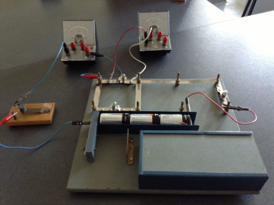

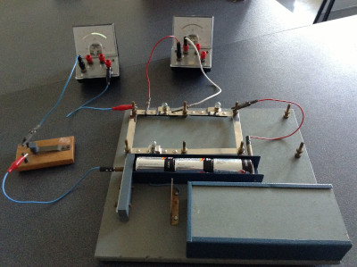

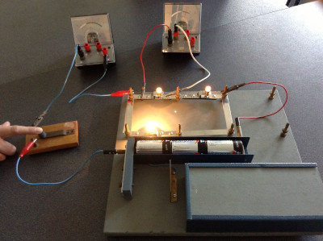

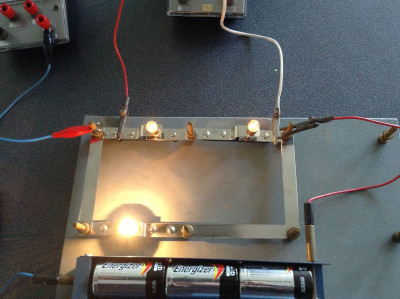

### Discussion

Be sure to note and discuss:

- whether adding a new branch increases or decreases the total current in the
                                                  circuit,
- whether adding a new branch increases or decreases the current in the
                                                  original branches,
- whether adding a resistor in series with a parallel network increases or
                                                  decreases the current, and
- compare what happens when you add a resistor in series with adding another
                                                  branch to the parallel network.

## Series and parallel networks

### Textbook Exercise 10.1

The diagram shows an electric circuit consisting of a battery and
                                                        four resistors.

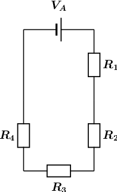

The **potential difference** (voltage) over the battery
                                                        is \(V_A = \text{2,8}\text{ V}\)

The resistors are rated as follows:

- \(R_1 = \text{7,2}\text{ Ω}\)
- \(R_2 = \text{4,3}\text{ Ω}\)
- \(R_3 = \text{7,5}\text{ Ω}\)
- \(R_4 = \text{4,1}\text{ Ω}\)

Assume that positive charge is flowing in the circuit (conventional
                                                        current).

Using the concepts of **Ohm's law**, and
                                                        **electric circuits**, determine the following:

**Problem:**
What type of circuit is shown in the diagram?

**Solution:**
We need to determine whether the circuit is a series,
                                                                parallel, or combination type of circuit. We do this by
                                                                looking at how current flows through a circuit.

Recall that current is the movement of electric charge from a
                                                                higher potential to a lower potential.

We assume that the flowing charge is positive (conventional
                                                                current). This means that the charges start at the
                                                                positive terminal of our power source (battery). Here
                                                                the charges have lots of electrical potential energy.

The charges then move towards the negative terminal through
                                                                the path that is created by the components and wires of
                                                                the circuit. During this process, the electrical
                                                                potential energy is converted into thermal energy by the
                                                                resistors. Therefore, the charges have less electrical
                                                                potential energy when they reach the negative terminal
                                                                of the power source (battery).

The flow of current is indicated by the arrows in the diagram
                                                                below:

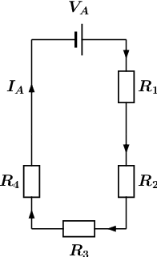

From the diagram it is clear that there is only one path for
                                                                the current to flow, since the circuit does not split
                                                                into two or more paths. This means that the current
                                                                flows through all the components, one after the other
                                                                (in series). We will label this current \(I_A\).

The circuit shown in the diagram is a **series**
                                                                circuit.

                                                        \(0\)

**Problem:**
What is the **total equivalent resistance**
                                                                \(R_{eq}\) of the circuit?

- round your answer to 1 digit after the decimal comma
- use the values for any physical constants you might
                                                                          need, as listed [here](http://www.everythingscience.co.za/physical-constants)

**Solution:**
We know that the circuit in the diagram is a series type
                                                                circuit.

Recall that in a series circuit the equivalent resistance can
                                                                be calculated by summing the resistance values of the
                                                                individual resistors:

\[R_{eq,S} = R_1 + R_2 + R_3 + \ldots ~~~~~\text{(1)}\]

We can rewrite \(\text{(1)}\) for the circuit in question as:

\[R_{eq} = R_1 + R_2 + R_3 + R_4 ~~~~~\text{(2)}\]

We can represent this by drawing an equivalent circuit:

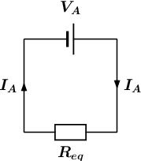

We are given the following information:

- the resistance of \(R_1 = \text{7,2}\text{ Ω}\)
- the resistance of \(R_2 = \text{4,3}\text{ Ω}\)
- the resistance of \(R_3 = \text{7,5}\text{ Ω}\)
- the resistance of \(R_4 = \text{4,1}\text{ Ω}\)

Substituting the above values in \(\text{(2)}\), we get:

\begin{align*}
                                                                R_{eq} & = R_1 + R_2 + R_3 + R_4\\
                                                                & = \text{7,2} + \text{4,3} + \text{7,5} +
                                                                \text{4,1}\\
                                                                & = \text{23,1}\text{ Ω}
                                                                \end{align*}

Therefore, the total equivalent resistance in the circuit, or
                                                                \(R_{eq} = \text{23,1}\text{ Ω}\)

                                                        \(\text{23,1}\)

**Problem:**
What is the potential difference (voltage) across \(R_1\), or
                                                                \(V_1\) ?

- round your answer to 3 digits after the decimal
                                                                          comma
- use the values for any physical constants you might
                                                                          need, as listed [here](http://www.everythingscience.co.za/physical-constants)

**Solution:**
Potential difference, or voltage is a way to describe the
                                                                difference in electrical potential energy across a
                                                                component in a circuit. Remember that a resistor
                                                                converts electrical potential energy into thermal
                                                                energy, so the electrical potential is higher on the
                                                                "in" side compared to the "out" side of a resistor.

Ohm's law describes the relationship between the total
                                                                current \(~I~\) through an ohmic conductor, its
                                                                resistance \(R\), and the potential difference \(V~\)
                                                                across it:

\[I = \frac{V}{R}~~~~~\text{(3)}\]

For the equivalent circuit, we can rewrite \(\text{(3)}\) as:

\[I_A = \frac{V_A}{R_{eq}}~~~~~\text{(4)}\]

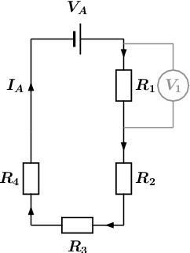

We are asked to calculate the potential difference \(V_{1}\)
                                                                over \(R_{1}\), as shown in the circuit diagram above,
                                                                so we use Ohm's law and rewrite \(\text{(3)}\) to get:

\[V_1 = I_1R_1~~~~~\text{(5)}\]

Since the circuit in question is a series circuit, we know
                                                                that the current \(I_{1}\) flowing through \(R_{1}\), is
                                                                the same as the current \(I_{A}\). This is represented
                                                                as:

\[I_1 = I_A~~~~~\text{(6)}\]

Substituting \(\text{(6)}\) into \(\text{(5)}\) we get:

\[V_1 = I_AR_1~~~~~\text{(7)}\]

Substituting \(\text{(4)}\) into \(\text{(7)}\) we get:

\[V_{1} = I_AR_1 = \left(\frac{V_A}{R_{eq}}\right)R_1 =
                                                                \frac{V_AR_1}{R_{eq}}~~~~~\text{(8)}\]

Recall from **Question 2**:

\[R_{eq} = R_1 + R_2 + R_3 + R_4 ~~~~~\text{(2)}\]

Substituting \(\text{(2)}\) into \(\text{(8)}\) we get:

\[V_{1} = \frac{V_AR_1}{R_1 + R_2 + R_3 +
                                                                R_4}~~~~~\text{(9)}\]

We are given the following information:

- the resistance of \(R_1 = \text{7,2}\text{ Ω}\)
- the resistance of \(R_2 = \text{4,3}\text{ Ω}\)
- the resistance of \(R_3 = \text{7,5}\text{ Ω}\)
- the resistance of \(R_4 = \text{4,1}\text{ Ω}\)
- the potential difference (voltage) over the battery
                                                                          \(V_A = \text{2,8}\text{ V}\)

Substituting the above values in \(\text{(9)}\), we get:

\begin{align*}
                                                                V_{1} & = \frac{V_AR_1}{R_1 + R_2 + R_3 + R_4}\\
                                                                & = \frac
                                                                {(\text{2,8})(\text{7,2})}
                                                                {\text{7,2} + \text{4,3} + \text{7,5} + \text{4,1}}\\
                                                                & = 0,87273 \ldots~~~~~\text{(calculated)}\\
                                                                & \approx \text{0,873}\text{ V}~~~~~\text{(rounded)}
                                                                \end{align*}

Therefore, the potential difference (voltage) across \(R_1\),
                                                                or \(V_1 \approx \text{0,873}\text{ V}\).

                                                        \(\text{0,873}\)

**Problem:**
What is the potential difference (voltage) across \(R_2\),
                                                                \(R_3\), and \(R_4\), or \(V_2\), \(V_3\), and \(V_4\)?

- round your answers to 3 digits after the decimal
                                                                          comma
- use the values for any physical constants you might
                                                                          need, as listed [here](http://www.everythingscience.co.za/physical-constants)

**Solution:**
We are asked to calculate the three remaining potential
                                                                differences, \(V_2\), \(V_3\), and \(V_4\). This is
                                                                shown in the diagram below:

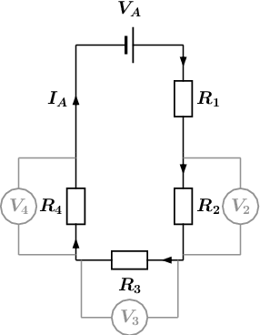

We will use the same method to obtain three expression for
                                                                \(V_2\), \(V_3\), and \(V_4\) as was used in
                                                                **Question 3** for \(V_1\). We get:

\[V_{2} = \frac{V_AR_2}{R_1 + R_2 + R_3 +
                                                                R_4}~~~~~\text{(10)}\]

\[V_{3} = \frac{V_AR_3}{R_1 + R_2 + R_3 +
                                                                R_4}~~~~~\text{(11)}\]

\[V_{4} = \frac{V_AR_4}{R_1 + R_2 + R_3 +
                                                                R_4}~~~~~\text{(12)}\]

We are given the following information:

- the resistance of \(R_1 = \text{7,2}\text{ Ω}\)
- the resistance of \(R_2 = \text{4,3}\text{ Ω}\)
- the resistance of \(R_3 = \text{7,5}\text{ Ω}\)
- the resistance of \(R_4 = \text{4,1}\text{ Ω}\)
- the potential difference (voltage) over the battery
                                                                          \(V_A = \text{2,8}\text{ V}\)

Substituting the above values in \(\text{(10)}\),
                                                                \(\text{(11)}\), and \(\text{(12)}\) we get:

\begin{align*}
                                                                V_{2} & = \frac{V_AR_2}{R_1 + R_2 + R_3 + R_4}\\
                                                                & = \frac
                                                                {(\text{2,8})(\text{4,3})}
                                                                {\text{7,2} + \text{4,3} + \text{7,5} + \text{4,1}}\\
                                                                & = 0,52121 \ldots~~~~~\text{(calculated)}\\
                                                                & \approx \text{0,521}\text{ V}~~~~~\text{(rounded)}
                                                                \end{align*}

\begin{align*}
                                                                V_{3} & = \frac{V_AR_3}{R_1 + R_2 + R_3 + R_4}\\
                                                                & = \frac
                                                                {(\text{2,8})(\text{7,5})}
                                                                {\text{7,2} + \text{4,3} + \text{7,5} + \text{4,1}}\\
                                                                & = 0,90909 \ldots~~~~~\text{(calculated)}\\
                                                                & \approx \text{0,909}\text{ V}~~~~~\text{(rounded)}
                                                                \end{align*}

\begin{align*}
                                                                V_{4} & = \frac{V_AR_4}{R_1 + R_2 + R_3 + R_4}\\
                                                                & = \frac
                                                                {(\text{2,8})(\text{4,1})}
                                                                {\text{7,2} + \text{4,3} + \text{7,5} + \text{4,1}}\\
                                                                & = 0,49697 \ldots~~~~~\text{(calculated)}\\
                                                                & \approx \text{0,497}\text{ V}~~~~~\text{(rounded)}
                                                                \end{align*}

Therefore, the potential difference (voltage) across \(R_2\),
                                                                or \(V_2 \approx \text{0,521}\text{ V}\).

The potential difference (voltage) across \(R_3\), or \(V_3
                                                                \approx \text{0,909}\text{ V}\).

The potential difference (voltage) across \(R_4\), or \(V_4
                                                                \approx \text{0,497}\text{ V}\).

                                                        \(\text{0,521}\)
                                                        \(\text{0,909}\)
                                                        \(\text{0,497}\)

For the following circuit, calculate:

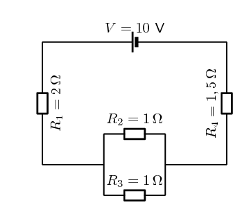

**Problem:**
the current through the cell

**Solution:**
To find the current we first need to find the equivalent
                                                                resistance. We start by calculating the equivalent
                                                                resistance of the parallel combination:

                                                        \begin{align*}
                                                        \frac{1}{R_{p}} & = \frac{1}{R_{2}} + \frac{1}{R_{3}} \\
                                                        & = \frac{1}{1} + \frac{1}{1} \\
                                                        & = 2\\
                                                        R_{p} & = \text{0,5}\text{ Ω}
                                                        \end{align*}

Now we have a circuit with two resistors in series so we can
                                                                calculate the equivalent resistance:

                                                        \begin{align*}
                                                        R_{s} & = R_{1} + R_{4} + R_{p} \\
                                                        & = \text{2} + \text{1,5} + \text{0,5} \\
                                                        & = \text{4}\text{ Ω}
                                                        \end{align*}

So the current through the cell is:

                                                        \begin{align*}
                                                        I & = \frac{V}{R} \\
                                                        & = \frac{\text{10}}{\text{4}} \\
                                                        & = \text{2,5}\text{ A}
                                                        \end{align*}

**Problem:**
the potential difference across \(R_4\)

**Solution:**
The current through all the resistors is \(\text{2,5}\)
                                                                \(\text{A}\). (The current is the same through series
                                                                combinations of resistors and we can consider the entire
                                                                parallel set of resistors as one series resistor.)

Using this we can find the potential difference through
                                                                \(R_{4}\):

                                                        \begin{align*}
                                                        V & = I \cdot R \\
                                                        & = (\text{2,5})(\text{1,5}) \\
                                                        & = \text{3,75}\text{ V}
                                                        \end{align*}

**Problem:**
the current through \(R_2\)

**Solution:**
The current through all the resistors is \(\text{2,5}\)
                                                                \(\text{A}\). (The current is the same through series
                                                                combinations of resistors and we can consider the entire
                                                                parallel set of resistors as one series resistor.)

Using this we can find the current through \(R_{2}\).

We first need to find the potential difference across the
                                                                parallel combination:

                                                        \begin{align*}
                                                        V & = I \cdot R \\
                                                        & = (\text{2,5})(\text{0,5}) \\
                                                        & = \text{1,25}\text{ V}
                                                        \end{align*}

Now we can find the current through \(R_{2}\) using the fact
                                                                that the potential difference is the same across each
                                                                resistor in the parallel combination:

                                                        \begin{align*}
                                                        I & = \frac{V}{R} \\
                                                        & = \frac{\text{1,25}}{\text{1}} \\
                                                        & = \text{1,25}\text{ A}
                                                        \end{align*}

**Problem:**
Calculate the equivalent resistance of:

2. three \(\text{2}\) \(\text{Ω}\) resistors in
                                                                           series;
4. two \(\text{4}\) \(\text{Ω}\) resistors in
                                                                           parallel;
6. a \(\text{4}\) \(\text{Ω}\) resistor in series
                                                                           with a \(\text{8}\) \(\text{Ω}\) resistor;
8. a \(\text{6}\) \(\text{Ω}\) resistor in series
                                                                           with two resistors (\(\text{4}\)
                                                                           \(\text{Ω}\) and \(\text{2}\)
                                                                           \(\text{Ω}\)) in parallel.

**Solution:**
2. three \(\text{2}\) \(\text{Ω}\) resistors in
                                                                           series:
                                                                   \begin{align*}
                                                                   R_T&= R_1 + R_2 + R_3 \\
                                                                   &= (2) + (2) + (2) \\
                                                                   &= \text{6}\text{ Ω}
                                                                   \end{align*}
4. two \(\text{4}\) \(\text{Ω}\) resistors in
                                                                           parallel:
                                                                   \begin{align*}
                                                                   \frac{1}{R_T}&= \frac{1}{R_1} + \frac{1}{R_2} \\
                                                                   \frac{1}{R_T}&= \frac{1}{4} + \frac{1}{4} \\
                                                                   \frac{1}{R_T}&= \frac{2}{4} \\
                                                                   R_T&= \frac{4}{2} \\
                                                                   R_T&= \text{2}\text{ Ω}
                                                                   \end{align*}
6. a \(\text{4}\) \(\text{Ω}\) resistor in series
                                                                           with a \(\text{8}\) \(\text{Ω}\) resistor:
                                                                   \begin{align*}
                                                                   R_T&= R_1 + R_2 \\
                                                                   &= (4) + (8) \\
                                                                   &= \text{12}\text{ Ω}
                                                                   \end{align*}
8. a \(\text{6}\) \(\text{Ω}\) resistor in series
                                                                           with two resistors (\(\text{4}\)
                                                                           \(\text{Ω}\) and \(\text{2}\)
                                                                           \(\text{Ω}\)) in parallel:
   First determine the equivalent resistance of the two
                                                                           resistors in parallel:
                                                                   \begin{align*}
                                                                   \frac{1}{R_P}&= \frac{1}{R_1} + \frac{1}{R_2} \\
                                                                   \frac{1}{R_P}&= \frac{1}{4} + \frac{1}{2} \\
                                                                   \frac{1}{R_P}&= \frac{3}{4} \\
                                                                   R_P&= \frac{4}{3} \\
                                                                   R_P&= \text{1,33}\text{ Ω}
                                                                   \end{align*}
   The parallel pair are in series with the third
                                                                           resistor, therefore the total resistance is:
                                                                   \begin{align*}
                                                                   R_T&= R_1 + R_P \\
                                                                   &= (6) + (1,33) \\
                                                                   &= \text{7,33}\text{ Ω}
                                                                   \end{align*}

                                                \(\text{6}\) \(\text{Ω}\); \(\text{2}\) \(\text{Ω}\) ;
                                                \(\text{12}\) \(\text{Ω}\); \(\text{7,33}\) \(\text{Ω}\)

**Problem:**
Calculate the total current in this circuit if both resistors are
                                                        ohmic.

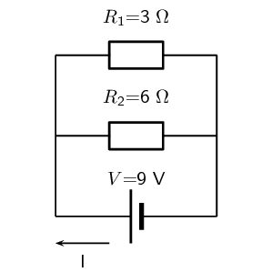

**Solution:**
There are two resistors in parallel so we calculate the equivalent
                                                        resistance of the combination:

                                                \begin{align*}
                                                \frac{1}{R_{p}} & = \frac{1}{R_{1}} + \frac{1}{R_{2}} \\
                                                & = \frac{1}{3} + \frac{1}{6} \\
                                                & = \frac{2}{6} + \frac{1}{6} \\
                                                & = \frac{3}{6} \\
                                                R_{p} & = \text{2}\text{ Ω}
                                                \end{align*}

Now we can use Ohm's law to find the current:

                                                \begin{align*}
                                                I & = \frac{V}{R} \\
                                                & = \frac{9}{2} \\
                                                & = \text{4,5}\text{ A}
                                                \end{align*}

**Problem:**
Two ohmic resistors are connected in series. The resistance of the
                                                        one resistor is \(\text{4}\) \(\text{Ω}\). What is the
                                                        resistance of the other resistor if a current of \(\text{0,5}\)
                                                        \(\text{A}\) flows through the resistors when they are connected
                                                        to a voltage supply of \(\text{6}\) \(\text{V}\)

**Solution:**
We first use Ohm's law to find the total resistance:

                                                \begin{align*}
                                                R & = \frac{V}{I} \\
                                                & = \frac{\text{6}}{\text{0,5}} \\
                                                & = \text{12}\text{ Ω}
                                                \end{align*}

Now we can find the resistance of the other resistor:

                                                \begin{align*}
                                                R_{s} & = R_{1} + R_{2} \\
                                                12 & = 4 + R_{2} \\
                                                R_{2} & = \text{8}\text{ Ω}
                                                \end{align*}

**Problem:**
Determine the equivalent resistance of the following circuits:

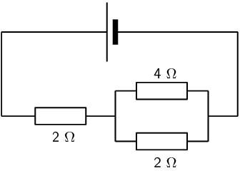

**Solution:**
We first determine the resistance of the parallel component:

                                                \begin{align*}
                                                \frac{1}{R_{p}} & = \frac{1}{R_{1}} + \frac{1}{R_{2}} \\
                                                & = \frac{1}{4} + \frac{1}{2} \\
                                                & = \frac{3}{4} \\
                                                R_{p} &= \frac{4}{3}\text{Ω}
                                                \end{align*}

Now we can calculate the total resistance:

                                                \begin{align*}
                                                R_{s} & = R_{3} + R_{p} \\
                                                & = 2 + \frac{4}{3} \\
                                                & = \frac{10}{3}\text{Ω}
                                                \end{align*}

**Problem:**
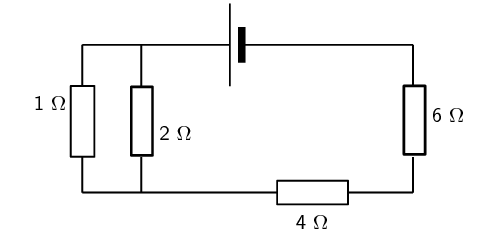

**Solution:**
We first calculate the equivalent resistance of the parallel part:

                                                \begin{align*}
                                                \frac{1}{R_{p}} & = \frac{1}{R_{1}} + \frac{1}{R_{2}} \\
                                                & = \frac{1}{2} + \frac{1}{1} \\
                                                & = \frac{3}{2} \\
                                                R_{p} &= \frac{2}{3}\text{Ω}
                                                \end{align*}

Now we calculate the total resistance:

                                                \begin{align*}
                                                R_{s} & = R_{p} + R_{3} + R_{4} \\
                                                & = \frac{2}{3} + 4 + 6 \\
                                                & = \text{10,67}\text{ Ω}
                                                \end{align*}

The diagram shows an electric circuit consisting of a battery and
                                                        four resistors.

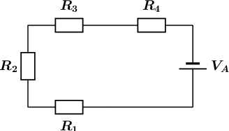

The **potential difference** (voltage) over the battery
                                                        is \(V_A = \text{1,2}\text{ V}\)

The the resistors are rated as follows:

- \(R_1 = \text{4,2}\text{ Ω}\)
- \(R_2 = \text{2,9}\text{ Ω}\)
- \(R_3 = \text{3,8}\text{ Ω}\)
- \(R_4 = \text{3,5}\text{ Ω}\)

Assume that positive charge is flowing in the circuit (conventional
                                                        current).

Using the concepts of **Ohm's law**, and
                                                        **electric circuits**, determine the following:

**Problem:**
What type of circuit is shown in the diagram?

**Solution:**
We need to determine whether the circuit is a series,
                                                                parallel, or combination type of circuit. We do this by
                                                                looking at how current flows through a circuit.

Recall that current is the movement of electric charge from a
                                                                higher potential to a lower potential.

We assume that the flowing charge is positive (conventional
                                                                current). This means that the charges start at the
                                                                positive terminal of our power source (battery). Here
                                                                the charges have lots of electrical potential energy.

The charges then move towards the negative terminal through
                                                                the path that is created by the components and wires of
                                                                the circuit. During this process, the electrical
                                                                potential energy is converted into thermal energy by the
                                                                resistors. Therefore, the charges have less electrical
                                                                potential energy when they reach the negative terminal
                                                                of the power source (battery).

The flow of current is indicated by the arrows in the diagram
                                                                below:

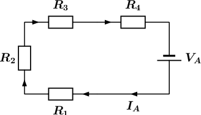

From the diagram it is clear that there is only one path for
                                                                the current to flow, since the circuit does not split
                                                                into two or more paths. This means that the current
                                                                flows through all the components, one after the other
                                                                (in series). We will label this current \(I_A\).

The circuit shown in the diagram is a **series**
                                                                circuit.

                                                        \(0\)

**Problem:**
What is the **total equivalent resistance**
                                                                \(R_{eq}\) of the circuit?

- round your answer to 1 digit after the decimal comma
- use the values for any physical constants you might
                                                                          need, as listed [here](http://www.everythingscience.co.za/physical-constants)

**Solution:**
We know that the circuit in the diagram is a series type
                                                                circuit.

Recall that in a series circuit the equivalent resistance can
                                                                be calculated by summing the resistance values of the
                                                                individual resistors:

\[R_{eq,S} = R_1 + R_2 + R_3 + \ldots ~~~~~\text{(1)}\]

We can rewrite \(\text{(1)}\) for the circuit in question as:

\[R_{eq} = R_1 + R_2 + R_3 + R_4 ~~~~~\text{(2)}\]

We can represent this by drawing an equivalent circuit:

We are given the following information:

- the resistance of \(R_1 = \text{4,2}\text{ Ω}\)
- the resistance of \(R_2 = \text{2,9}\text{ Ω}\)
- the resistance of \(R_3 = \text{3,8}\text{ Ω}\)
- the resistance of \(R_4 = \text{3,5}\text{ Ω}\)

Substituting the above values in \(\text{(2)}\), we get:

\begin{align*}
                                                                R_{eq} & = R_1 + R_2 + R_3 + R_4\\
                                                                & = \text{4,2} + \text{2,9} + \text{3,8} +
                                                                \text{3,5}\\
                                                                & = \text{14,4}\text{ Ω}
                                                                \end{align*}

Therefore, the total equivalent resistance in the circuit, or
                                                                \(R_{eq} = \text{14,4}\text{ Ω}\)

                                                        \(\text{14,4}\)

**Problem:**
What is the potential difference (voltage) across \(R_1\), or
                                                                \(V_1\) ?

- round your answer to 3 digits after the decimal
                                                                          comma
- use the values for any physical constants you might
                                                                          need, as listed [here](http://www.everythingscience.co.za/physical-constants)

**Solution:**
Potential difference, or voltage is a way to describe the
                                                                difference in electrical potential energy across a
                                                                component in a circuit. Remember that a resistor
                                                                converts electrical potential energy into thermal
                                                                energy, so the electrical potential is higher on the
                                                                "in" side compared to the "out" side of a resistor.

Ohm's law describes the relationship between the total
                                                                current \(~I~\) through an ohmic conductor, its
                                                                resistance \(R\), and the potential difference \(V~\)
                                                                across it:

\[I = \frac{V}{R}~~~~~\text{(3)}\]

For the equivalent circuit, we can rewrite \(\text{(3)}\) as:

\[I_A = \frac{V_A}{R_{eq}}~~~~~\text{(4)}\]

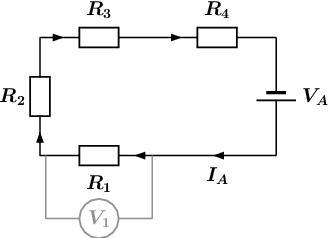

We are asked to calculate the potential difference \(V_{1}\)
                                                                over \(R_{1}\), as shown in the circuit diagram above,
                                                                so we use Ohm's law and rewrite \(\text{(3)}\) to get:

\[V_1 = I_1R_1~~~~~\text{(5)}\]

Since the circuit in question is a series circuit, we know
                                                                that the current \(I_{1}\) flowing through \(R_{1}\), is
                                                                the same as the current \(I_{A}\). This is represented
                                                                as:

\[I_1 = I_A~~~~~\text{(6)}\]

Substituting \(\text{(6)}\) into \(\text{(5)}\) we get:

\[V_1 = I_AR_1~~~~~\text{(7)}\]

Substituting \(\text{(4)}\) into \(\text{(7)}\) we get:

\[V_{1} = I_AR_1 = \left(\frac{V_A}{R_{eq}}\right)R_1 =
                                                                \frac{V_AR_1}{R_{eq}}~~~~~\text{(8)}\]

Recall from **Question 2**:

\[R_{eq} = R_1 + R_2 + R_3 + R_4 ~~~~~\text{(2)}\]

Substituting \(\text{(2)}\) into \(\text{(8)}\) we get:

\[V_{1} = \frac{V_AR_1}{R_1 + R_2 + R_3 +
                                                                R_4}~~~~~\text{(9)}\]

We are given the following information:

- the resistance of \(R_1 = \text{4,2}\text{ Ω}\)
- the resistance of \(R_2 = \text{2,9}\text{ Ω}\)
- the resistance of \(R_3 = \text{3,8}\text{ Ω}\)
- the resistance of \(R_4 = \text{3,5}\text{ Ω}\)
- the potential difference (voltage) over the battery
                                                                          \(V_A = \text{1,2}\text{ V}\)

Substituting the above values in \(\text{(9)}\), we get:

\begin{align*}
                                                                V_{1} & = \frac{V_AR_1}{R_1 + R_2 + R_3 + R_4}\\
                                                                & = \frac
                                                                {(\text{1,2})(\text{4,2})}
                                                                {\text{4,2} + \text{2,9} + \text{3,8} + \text{3,5}}\\
                                                                & = 0,35000 \ldots~~~~~\text{(calculated)}\\
                                                                & \approx \text{0,350}\text{ V}~~~~~\text{(rounded)}
                                                                \end{align*}

Therefore, the potential difference (voltage) across \(R_1\),
                                                                or \(V_1 \approx \text{0,350}\text{ V}\).

                                                        \(\text{0,350}\)

**Problem:**
What is the potential difference (voltage) across \(R_2\),
                                                                \(R_3\), and \(R_4\), or \(V_2\), \(V_3\), and \(V_4\)?

- round your answers to 3 digits after the decimal
                                                                          comma
- use the values for any physical constants you might
                                                                          need, as listed [here](http://www.everythingscience.co.za/physical-constants)

**Solution:**
We are asked to calculate the three remaining potential
                                                                differences, \(V_2\), \(V_3\), and \(V_4\). This is
                                                                shown in the diagram below:

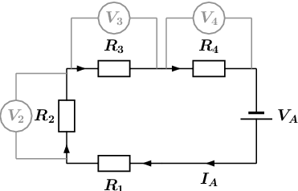

We will use the same method to obtain three expression for
                                                                \(V_2\), \(V_3\), and \(V_4\) as was used in
                                                                **Question 3** for \(V_1\). We get:

\[V_{2} = \frac{V_AR_2}{R_1 + R_2 + R_3 +
                                                                R_4}~~~~~\text{(10)}\]

\[V_{3} = \frac{V_AR_3}{R_1 + R_2 + R_3 +
                                                                R_4}~~~~~\text{(11)}\]

\[V_{4} = \frac{V_AR_4}{R_1 + R_2 + R_3 +
                                                                R_4}~~~~~\text{(12)}\]

We are given the following information:

- the resistance of \(R_1 = \text{4,2}\text{ Ω}\)
- the resistance of \(R_2 = \text{2,9}\text{ Ω}\)
- the resistance of \(R_3 = \text{3,8}\text{ Ω}\)
- the resistance of \(R_4 = \text{3,5}\text{ Ω}\)
- the potential difference (voltage) over the battery
                                                                          \(V_A = \text{1,2}\text{ V}\)

Substituting the above values in \(\text{(10)}\),
                                                                \(\text{(11)}\), and \(\text{(12)}\) we get:

\begin{align*}
                                                                V_{2} & = \frac{V_AR_2}{R_1 + R_2 + R_3 + R_4}\\
                                                                & = \frac
                                                                {(\text{1,2})(\text{2,9})}
                                                                {\text{4,2} + \text{2,9} + \text{3,8} + \text{3,5}}\\
                                                                & = 0,24167 \ldots~~~~~\text{(calculated)}\\
                                                                & \approx \text{0,242}\text{ V}~~~~~\text{(rounded)}
                                                                \end{align*}

\begin{align*}
                                                                V_{3} & = \frac{V_AR_3}{R_1 + R_2 + R_3 + R_4}\\
                                                                & = \frac
                                                                {(\text{1,2})(\text{3,8})}
                                                                {\text{4,2} + \text{2,9} + \text{3,8} + \text{3,5}}\\
                                                                & = 0,31667 \ldots~~~~~\text{(calculated)}\\
                                                                & \approx \text{0,317}\text{ V}~~~~~\text{(rounded)}
                                                                \end{align*}

\begin{align*}
                                                                V_{4} & = \frac{V_AR_4}{R_1 + R_2 + R_3 + R_4}\\
                                                                & = \frac
                                                                {(\text{1,2})(\text{3,5})}
                                                                {\text{4,2} + \text{2,9} + \text{3,8} + \text{3,5}}\\
                                                                & = 0,29167 \ldots~~~~~\text{(calculated)}\\
                                                                & \approx \text{0,292}\text{ V}~~~~~\text{(rounded)}
                                                                \end{align*}

Therefore, the potential difference (voltage) across \(R_2\),
                                                                or \(V_2 \approx \text{0,242}\text{ V}\).

The potential difference (voltage) across \(R_3\), or \(V_3
                                                                \approx \text{0,317}\text{ V}\).

The potential difference (voltage) across \(R_4\), or \(V_4
                                                                \approx \text{0,292}\text{ V}\).

                                                        \(\text{0,242}\)
                                                        \(\text{0,317}\)
                                                        \(\text{0,292}\)
