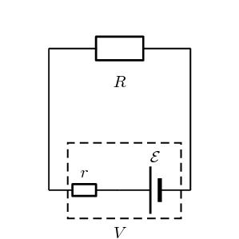
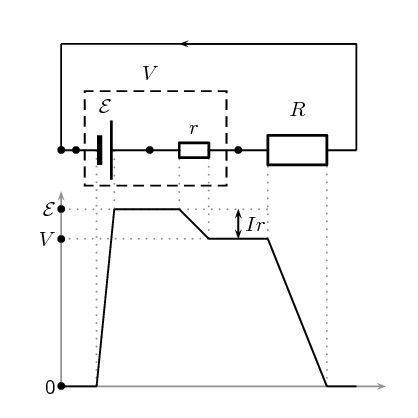
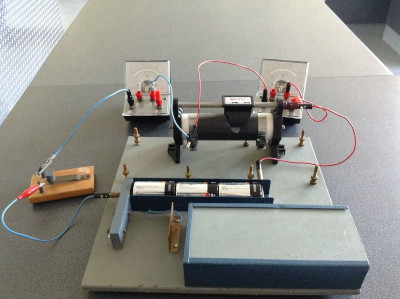
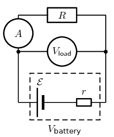
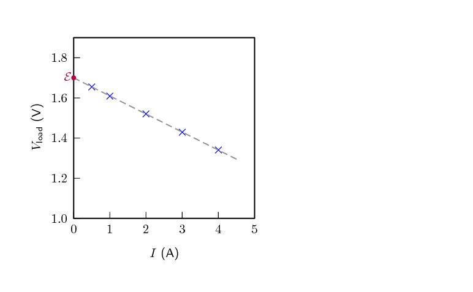

## 10.3 Batteries and internal resistance (ESCPV)

Up until now we have been dealing with ideal batteries in that they aren't affected
      by the circuit or current in any way and provide a precise voltage until they go flat.

If you measure the potential difference across the terminals of a
      battery on its own you will
      get a different value to what you measure when it is in a complete circuit. The value
      will be less when the battery is included in a complete circuit. Sometimes the difference
      is called the *lost volts*. Nothing has
      actually been lost but energy has been transferred.

Real batteries are made from materials which have resistance. This means that
      real batteries are not just sources of potential difference (voltage), but they
      also possess internal resistance. If the total potential difference source is
      referred to as the emf, \(\mathcal{E}\), then a real battery can be
      represented as an emf connected in series with a resistor \(r\). The internal
      resistance of the battery is represented by the symbol \(r\).

Load

The external resistance in the circuit is referred to as the load.

Suppose that the battery with emf \(\mathcal{E}\) and internal resistance \(r\) supplies a current \(I\) through
      an external load resistor \(R\). Then the potential difference across the load resistor is that supplied by the
      battery:

    \[V_{\text{load}}=I\cdot R\]

Similarly, from Ohm's Law, the potential difference across the internal resistance is:

    \[{V}_{\text{internal resistance}}=I\cdot r\]

The potential difference \(V\) of the battery is related to its emf \(\mathcal{E}\) and internal resistance \(r\)
      by:

    \begin{align*}
    \mathcal{E}& = V+Ir\\
    &\text{or}\\
    V& = \mathcal{E}-Ir
    \end{align*}

The battery is the source of energy and the energy provided per unit charge (emf) passing
      through the battery is equal to the total work done (potential difference) across the
      components in the circuit. This can be illustrated by showing the energy per unit charge
      as as function of the position in the circuit. The charge gains energy when moving through
      the battery and loses energy when moving through resistors.

2. Postive work is done on a unit charge by the battery transferring an energy equal to the emf.
4. The charge does work to overcome the internal resistance of the battery. Doing work requires that the
           charge lose some energy. The work done to overcome the internal resistance is
           \(V_{\text{internal resistance}}=Ir\).
6. When the unit charge leaves the battery it has less energy than the original emf. This is now the total
           energy that it can use to do work moving through the circuit, \(V_{\text{load}} = \mathcal{E}-Ir\).
8. As the charge moves around the circuit it does work passing through each component which is equal
           to \(IR\).

The emf of a battery is essentially constant because it only depends on the
      chemical reaction (that converts chemical energy into electrical energy) going on
      inside the battery. Therefore, we can see that the potential difference across
      the terminals of the battery is dependent on the current drawn by the load. The
      higher the current, the lower the potential difference across the terminals,
      because the emf is constant. For the same reason, the potential difference
      only equals the emf when the current is very small.

The current that can be drawn from a battery is limited by a critical, maximum value \({I}_{c}\). The more
      resistance in the circuit the less the current will be. Imagine that you have a wire with no resistance that you
      use to connect the terminals of the battery. The circuit is complete, current will flow and adding any resistance
      to the circuit would decrease the current. The current without any external resistance will be \({I}_{c}\). At a
      current of \({I}_{c}\), \(V=\text{0}\text{ V}\) because there is no load in the circuit. Then, the equation
      becomes:

    \begin{align*}
    \text{0}& = \mathcal{E}-{I}_{c}r\\
    {I}_{c}r& = \mathcal{E}\\
    {I}_{c}& = \frac{\mathcal{E}}{r}
    \end{align*}

The maximum current that can be drawn from a battery is less than \(\frac{\mathcal{E}}{r}\).

<Callout type="tip" title="Worked example 6: Internal resistance">
**Question:**
Determine the internal resistance of a battery that has an emf of
          \(\text{12,00}\) \(\text{V}\) and has a
          potential difference across its terminals of
          \(\text{10,00}\) \(\text{V}\) when a
          current of \(\text{4,00}\) \(\text{A}\)
          is flowing through the battery when connected in a circuit.

**Determine how to approach the problem:**
It is an internal resistance problem. So we use the equation:

        \begin{align*}
        \mathcal{E}& = V+Ir
        \end{align*}

**Solve the problem:**
\begin{align*}
        \mathcal{E}& = V+Ir\\
        \text{12}& = \text{10}+\text{4}\left(r\right)\\
        r & = \text{0,5}\text{ Ω}
        \end{align*}

**Write the final answer:**
The internal resistance of the battery is \(\text{0,50}\) \(\text{Ω}\).
</Callout>

<QuizCard id="s12-10-03a" title="Interactive Exercise 10.6" question="External resistance \((R_{\text{ext}})\) , total current \((I_{\text{total}})\) , and external potential difference \((V_{\text{ext}})\) are three important quantities when working with emf and internal resistance. Which one of the following equations correctly represents the relationship between these quantities? A \(R_{\text{ext}} = \dfrac{V_{\text{ext}}}{I_{\text{total}}}\) B \(R_{\text{ext}} = V_{\text{ext}} I_{\text{total}}\) C \(R_{\text{ext}} = \dfrac{I_{\text{total}}}{V_{\text{ext}}}\)" options=["A", "B", "C"] answer="A" hint="" explanation="Identify the relationship The external potential difference is the potential difference across all components in the external circuit. It is equal to the reading on a voltmeter across the battery when current is flowing in the circuit. The total current is the current flowing through the cell or battery. The external resistance is the equivalent resistance of all circuit components in the external circuit. These three variables are related to each other by Ohm's law. This law can be represented mathematically as: \[                     \begin{aligned}                         V_{\text{ext}} = I_{\text{total}} R_{\text{ext}}                     \end{aligned}                 \] TIP: The use of subscripts is very important when using this formula in tests and exams! Using subscripts will help you keep track of which quantity you're working with make your working easier to follow. Make \(R_{\text{ext}}\) the subject of the formula We need to isolate \(R_{\text{ext}}\) . We can  do this by dividing both sides of the equation by \({\color{blue}{I_{\text{total}}}}\) . \[                         \begin{aligned}                             V_{\text{ext}} &= I_{\text{total}} R_{\text{ext}} \\                             \frac{ V_{\text{ext}} }{ {\color{blue}{I_{\text{total}}}} } &= \frac{ I_{\text{total}} R_{\text{ext}} }{ {\color{blue}{I_{\text{total}}}} } \\                             \frac{V_{\text{ext}}}{I_{\text{total}}} &= \frac{ {\color{darkgray}{I_{\text{total}}}} }{ {\color{darkgray}{I_{\text{total}}}} } R_{\text{ext}} \\                             \therefore \frac{ V_{\text{ext}} }{ I_{\text{total}} } &= R_{\text{ext}}                         \end{aligned}                     \] Therefore the relationship with \(R_{\text{ext}}\) the subject of the formula is: \[                     \begin{array}{c}                         R_{\text{ext}} = \dfrac{V_{\text{ext}}}{I_{\text{total}}}                     \end{array}                 \] We can compare this equation to the given options: A ✔ \(R_{\text{ext}} = \dfrac{V_{\text{ext}}}{I_{\text{total}}}\) B ✘ \(R_{\text{ext}} = V_{\text{ext}} I_{\text{total}}\) C ✘ \(R_{\text{ext}} = \dfrac{I_{\text{total}}}{V_{\text{ext}}}\) Therefore the correct equation is A . Submit your answer as: A" />

<QuizCard id="s12-10-03a" title="Interactive Exercise 10.6" question="The diagram shows an electric circuit consisting of a cell with internal resistance, and four resistors which are connected as shown. The cell has an internal resistance of \(r = \text{0,181}~Ω\) . The total current flowing through the external circuit is \(I_{ext} = \text{3,05}~\text{A}\) . The four resistors are rated as follows: \(R_1 = \text{8,61}~Ω\) \(R_2 = \text{7,82}~Ω\) \(R_3 = \text{4,79}~Ω\) \(R_4 = \text{3,33}~Ω\) Assume that positive charge is flowing in the circuit (conventional current) and determine the following: What is the emf ( \(\mathcal{E}\) ) of the cell? round your answer to 4 decimal places use the values for any physical constants you might need, as listed here" options=[] answer="
                    5.9036
                " hint="You should enter a number here. If you want to, you can use a space to separate thousands.                Example: 12 800,25 For scientific notation you need to use the multiply symbol                ( ∗ ) and the exponent symbol ( ^ ). For example 6,673 × 10 −11 should be written as: 6,673 ∗ 10^−11" explanation="Determine the total resistance of the external circuit, or \(R_{ext}\) For the two resistors in series, determine the total equivalent resistance: \[\begin{array}{c}R_{eq,S} = R_1 + R_2 ~~~~~\text{(1)}\end{array}\] For the three parallel paths, determine the total equivalent resistance: \[\begin{array}{c}\frac{1}{R_{eq,P}} = \frac{1}{R_{eq,S}} + \frac{1}{R_3} + \frac{1}{R_4} ~~~~~\text{(2)}\end{array}\] Substitute for \(R_{eq,S}\) in equation \(\text{(2)}~\) using equation \(\text{(1)}~\) \[                     \begin{aligned}                     \frac{1}{R_{eq,P}} &   = \frac{1}{R_{eq,S}} + \frac{1}{R_3} + \frac{1}{R_4}\\                     &   = \frac{1}{(R_1 + R_2)} + \frac{1}{R_3} + \frac{1}{R_4}\\                     &   = \frac{1}{R_1 + R_2} + \frac{1}{R_3} + \frac{1}{R_4} ~~~~~\text{(3)}\\                     \end{aligned}                 \] The total external resistance of the circuit is the same as the total equivalent resistance for the three parallel paths: \[\begin{array}{c}R_{eq,P} = R_{ext} ~~~~~\text{(4)}\end{array}\] Substitute for \(R_{eq,P}\) in equation \(\text{(3)}~\) using equation \(\text{(4)}~\) \[                     \begin{aligned}                     \frac{1}{R_{eq,P}} &   = \frac{1}{R_1 + R_2} + \frac{1}{R_3} + \frac{1}{R_4}\\                     &   = \frac{1}{R_1 + R_2} + \frac{1}{R_3} + \frac{1}{R_4}\\                     &   = \frac{1}{R_1 + R_2} + \frac{1}{R_3} + \frac{1}{R_4} ~~~~~\text{(5)}\\                     \end{aligned}                 \] Substitute the given values in equation \(\text{(5)}~\) to calculate \(R_{ext}\) : \[                     \begin{aligned}                     \frac{1}{R_{ext}}                     &   = \frac{1}{R_1 + R_2} + \frac{1}{R_3} + \frac{1}{R_4}\\                     &   = \frac{1}{(\text{8,61}) + (\text{7,82})}                     + \frac{1}{(\text{4,79})} + \frac{1}{(\text{3,33})}\\                     & = \text{0,56993...} \\                    \therefore R_{ext}                     &   = \text{1,75459...}\ \text{Ω}~~~~~\text{(calculated)}\\                     \end{aligned}                 \] The total external resistance of the circuit is \(R_{ext} = \text{1,75459...}\ \text{Ω}\) . Determine the potential difference over the external circuit, or \(V_{ext}\) Using Ohm's law: \[\begin{array}{c}V_{ext} = I_{ext} R_{ext} ~~~~~\text{(6)}\end{array}\] Substitute the given and calculated values in equation \(\text{(6)}~\) to calculate \(V_{ext}\) : \[                     \begin{aligned}                     V_{ext}                     &   = I_{ext} R_{ext}\\                     &   = {(\text{3,05}\ \text{A}) \times (\text{1,75459...}\ \text{Ω})}\\                     &   = \text{5,35150...}\ \text{V}~~~~~\text{(calculated)}\\                     \end{aligned}                 \] The potential difference across the external circuit is \(V_{ext} = \text{5,35150...}\ \text{V}\) . Determine the emf of the cell, or \(\mathcal{E}\) Using Ohm's law: \[\begin{array}{c}V_r = I_r r ~~~~~\text{(7)}\end{array}\] The current through the cell is the same as the total current through the external circuit: \[\begin{array}{c}I_r = I_{ext} ~~~~~\text{(8)}\end{array}\] Substitute for \(I_r\) in equation \(\text{(7)}~\) using equation \(\text{(8)}~\) \[                     \begin{aligned}                     V_r &   = I_r r \\                     &   = (I_{ext}) r \\                     &   = I_{ext} r ~~~~~\text{(9)}                     \end{aligned}                 \] For a cell or battery with internal resistance we know: \[\begin{array}{c}\mathcal{E} = V_{ext} + V_r ~~~~~\text{(10)}\end{array}\] Substitute for \(V_r\) in equation \(\text{(10)}~\) using equation \(\text{(9)}~\) \[                     \begin{aligned}                     \mathcal{E} &   = V_{ext} + V_r \\                     &   = V_{ext} + (I_{ext} r) \\                     &   = V_{ext} + I_{ext} r ~~~~~\text{(11)}                     \end{aligned}                 \] Substitute the given and calculated values in equation \(\text{(11)}~\) to calculate \(\mathcal{E}\) : \[                     \begin{aligned}                     \mathcal{E}                     &   = V_{ext} + I_{ext} r\\                     &   = (\text{5,35150...}\ \text{V}) + (\text{3,05}\ \text{A}) \times (\text{0,181}\ \text{Ω})\\                     &   =          \text{5,9035577...}\ \text{V} ~~~~~~~\text{(calculated)} \\         & \approx \text{5,9036}\ \text{V}         ~~~~~\text{(rounded)}                     \end{aligned}                 \] Therefore, the emf of the cell is \(\text{5,9036}\ \text{V}\) . Submit your answer as:" />

## Finding the internal resistance of a battery

### Aim

To determine the internal resistance of a battery.

### Apparatus

You will need the following items for this experiment:

- battery / cell to be studied
- electric leads
- a set of resistors or a rheostat
- ammeter
- voltmeter

### Method

We will set up a circuit that contains the battery we want to study in series
          with a resistor. Then we will measure the potential difference across the load
          as well as the current for a number of different resistors/rheostat in the
          circuit. It doesn't matter if it is a different resistor each time or more
          resistors in series or parallel. What matters is that the overall resistance of
          the circuit changes so that the current is different each time. The reason
          that doing this can tell us about the internal resistance of the battery
          is because the potential difference across the internal resistance is
          \(V_{\text{internal resistance}}=I\cdot r\) and we can vary I by changing the resistance of the
          circuit. If the potential difference across the internal resistance is
          changing and we add up all the potential differences,
          \(\mathcal{E} = V_{\text{load}}+V_{\text{internal resistance}}\)
          we can determine the internal resistance.

To do this we will actually plot a graph of \(V_{\text{load}}\) versus \(I\) and then use the features of the
          graph to determine \(\mathcal{E}\) and \(r\). To understand why plotting the graph will help us we start with
          the equation for the magnitude of the \(\mathcal{E}\) and substitute Ohm's Law and re-arrange as follows:
          \begin{align*}
          \mathcal{E} & = V_{\text{load}} + V_{\text{internal resistance}} \\
          \mathcal{E} & = V_{\text{load}} + I\cdot r \\
          V_{\text{load}}& = \mathcal{E} -I\cdot r \\
          V_{\text{load}}& = -r\cdot I + \mathcal{E} \\
          \underbrace{V_{\text{load}}}_{y}& = \underbrace{-r}_{m}\cdot\underbrace{I}_x +
          \underbrace{\mathcal{E}}_{c}
          \end{align*}
          If we plot \(V_{\text{load}}\) versus \(I\) we will be plotting data that are governed by this relationship.
          This allows us to conclude that the slope of the graph, \(m\), will be \(-r\) and the intercept vertical axis,
          \(c\), will be the emf \(\mathcal{E}\).

### Results

Record your results in a table like the one below. You can take more readings if you like.

| Setup | \(V_{\text{load}}\) (\(\text{V}\)) | \(I\) (\(\text{A}\)) |
| --- | --- | --- |
| Resistance 1 |  |  |
| Resistance 2 |  |  |
| Resistance 3 |  |  |
| Resistance 4 |  |  |
| Resistance 5 |  |  |

### Discussion and conclusion

Plot your data on a set of axes similar to this example. The blue
          crosses represent the measured data points, the gray, dashed line is the
          drawn straight line through the data
          points. The best fit line you draw doesn't need to go through all the data points, it
          should, in general, have as many points above and below the line.
          The slope of the line can be measured and equated to \(-r\) and the
          intercept with the vertical axis will give you \(\mathcal{E}\). The
          intercept with the horizontal axis would give you the maximum possible current
          the battery could deliver.

- Do your data form a perfectly straight line?
- What errors were introduced?
