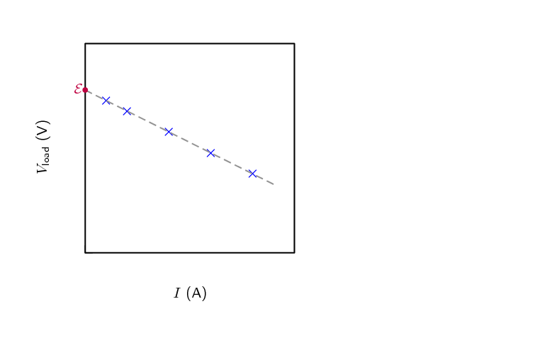
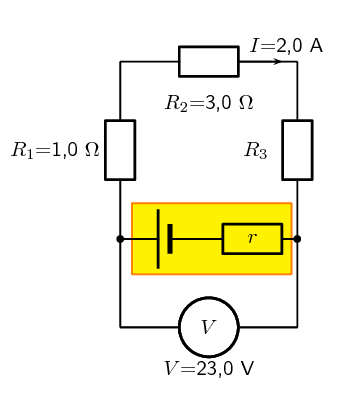
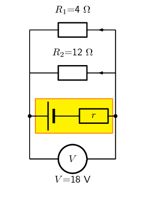
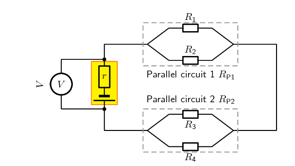
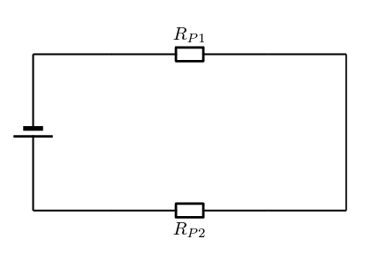
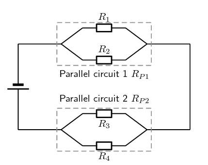
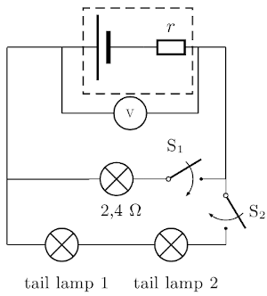
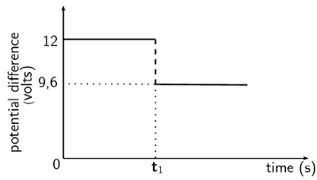

### Textbook Exercise 10.2

**Problem:**
Describe what is meant by the *internal resistance* of a real battery.

**Solution:**
Real batteries are made from materials which have
            resistance. This means that real batteries are not just sources of
            potential difference (voltage), but they also possess internal
            resistance.

So internal resistance is a measure of the resistance of the material that the battery is made of.

**Problem:**
Explain why there is a difference between the emf and terminal voltage of a battery if the load (external
            resistance in the circuit) is comparable in size to the battery's internal resistance

**Solution:**
The emf of a battery is essentially constant
            because it only depends on the chemical reaction (that converts chemical
            energy into electrical energy) going on inside the battery. Therefore,
            we can see that the voltage across the terminals of the battery is
            dependent on the current drawn by the load. The higher the current, the
            lower the voltage across the terminals, because the emf is constant. By
            the same reasoning, the voltage only equals the emf when the current is
            very small.

**Problem:**
What is the internal resistance of a battery if its emf is \(\text{6}\) \(\text{V}\) and the potential
            difference across its terminals is \(\text{5,8}\) \(\text{V}\) when a current of \(\text{0,5}\) \(\text{A}\)
            flows in the circuit when it is connected across a load?

**Solution:**
The voltage drop across the internal resistance is the difference between the emf and
            the terminal voltage when the battery is connected across a load. The internal resistance
            we treat as an ohmic resistor in series with a perfect battery. We know the voltage with
            and without a load and we know the current so we can use Ohm's law to determine the
            internal resistance:

          \begin{align*}
          V_r&= Ir \\
          (6)-(5,8)&= (0,5)r \\
          r &= \frac{0,2}{0,5} \\
          & = \text{0,4}\text{ Ω}
          \end{align*}
          \(\text{0,4}\) \(\text{Ω}\)

**Problem:**
A \(\text{12,0}\) \(\text{V}\) battery has an internal resistance of \(\text{7,0}\) \(\text{Ω}\).

2. What is the maximum current this battery could supply?
4. What is the potential difference across its terminals when it is supplying a current of 150.0 mA?
6. Draw a sketch graph to show how the terminal potential difference varies with the current supplied if
                 the internal resistance remains constant. How could the internal resistance be obtained from the graph?

**Solution:**
What is the maximum current this battery could supply?

          \begin{align*}
          I_{\text{max}} & =\frac{\mathcal{E}}{r} \\
          & =\frac{\text{12,0}}{\text{7,0}} \\
          & =\text{1,71428} \\
          & =\text{1,71}\text{ A}
          \end{align*}

What is the potential difference across its terminals when it is supplying a current of 150.0 mA?

          \begin{align*}
          V & =\mathcal{E} - Ir \\
          & =(\text{12,0})- (\text{1,50} \times \text{10}^{-\text{1}})(\text{7,0}) \\
          & =\text{10,95} \\
          & =\text{10,95}\text{ V}
          \end{align*}

Draw a sketch graph to show how the terminal potential difference varies with the current supplied if the
            internal resistance remains constant. How could the internal resistance be obtained from the graph?

The slope of the graph is the internal resistance.

**Problem:**
In a hearing aid a battery supplies a current of 25.0 mA through a resistance of 400 \(\Omega\). When the
            volume is increased, the resistance is changed to 100 \(\Omega\) and the current rises to 60 mA. What is the
            emf and internal resistance of the cell?

**Solution:**
We have two unknowns but information for two different scenarios so we can solve simultaneously.

In the first case:

          \begin{align*}
          V & =\mathcal{E} - Ir \\
          (\text{2,50} \times \text{10}^{-\text{2}})(\text{400}) = & =\mathcal{E} - (\text{2,50} \times
          \text{10}^{-\text{2}})r \\
          \mathcal{E} & = (\text{2,50} \times \text{10}^{-\text{2}})(\text{400}) + (\text{2,50} \times
          \text{10}^{-\text{2}})r
          \end{align*}

In the second case we will get:

          \begin{align*}
          V & =\mathcal{E} - Ir \\
          (\text{6,0} \times \text{10}^{-\text{2}})(\text{100}) = & =\mathcal{E} - (\text{6,0} \times
          \text{10}^{-\text{2}})r \\
          \mathcal{E} & = (\text{6,0} \times \text{10}^{-\text{2}})(\text{100}) + (\text{6,0} \times
          \text{10}^{-\text{2}})r
          \end{align*}

Subtracting the equation from the second case from the equation from the first case:

          \begin{align*}
          \mathcal{E} - \mathcal{E} & = ((\text{2,50} \times \text{10}^{-\text{2}})(\text{400}) + (\text{2,50}
          \times \text{10}^{-\text{2}})r) - ((\text{6,0} \times \text{10}^{-\text{2}})(\text{100}) + (\text{6,0} \times
          \text{10}^{-\text{2}})r)\\
          0 &= 10 + \text{2,50} \times \text{10}^{-\text{2}}r -6 -\text{6,0} \times \text{10}^{-\text{2}}r \\
          -\text{3,5} \times \text{10}^{-\text{2}}r = -4 \\
          r &= \frac{4}{\text{3,5} \times \text{10}^{-\text{2}}} \\
          &=\text{1,1428} \times \text{10}^{-\text{2}}
          \end{align*}

We substitute this back into one of the equations to get \(\mathcal{E}\):

          \begin{align*}
          \mathcal{E} & = (\text{2,50} \times \text{10}^{-\text{2}})(\text{400}) + (\text{2,50} \times
          \text{10}^{-\text{2}})r \\
          \mathcal{E} & = (\text{2,50} \times \text{10}^{-\text{2}})(\text{400}) + (\text{2,50} \times
          \text{10}^{-\text{2}})(\text{1,1428} \times \text{10}^{-\text{2}}) \\
          \mathcal{E} & = \text{10}
          \end{align*}

The emf is \(\text{10,0}\) \(\text{V}\) and the internal resistance is \(\text{1,1428} \times
            \text{10}^{-\text{2}}\) \(\text{Ω}\).

**Problem:**
A battery is connected in series with a rheostat and an ammeter. When the resistance of the resistor is 10
            \(\Omega\) the current is 2.0 A. When the resistance is 5 \(\Omega\) the current is 3.8 A. Find the emf and
            the internal resistance of the battery.

**Solution:**
We have two unknowns but information for two different scenarios so we can solve simultaneously.

In the first case:

          \begin{align*}
          V & =\mathcal{E} - Ir \\
          (\text{2})(\text{10}) = & =\mathcal{E} - (\text{2})r \\
          \mathcal{E} & = (\text{2})(\text{10}) + (\text{2})r
          \end{align*}

In the second case we will get:

          \begin{align*}
          V & =\mathcal{E} - Ir \\
          (\text{3,8})(\text{5}) = & =\mathcal{E} - (\text{3,8})r \\
          \mathcal{E} & = (\text{3,8})(\text{5}) + (\text{3,8})r
          \end{align*}

Subtracting the equation from the second case from the equation from the first case:

          \begin{align*}
          \mathcal{E} - \mathcal{E} & = ((\text{2})(\text{10}) + (\text{2})r) - ((\text{3,8})(\text{5}) +
          (\text{3,8})r)\\
          0 &= 20 + \text{2}r -19 - \text{3,8}r \\
          r &= \frac{1}{\text{1,8}} \\
          &=\text{0,55555}
          \end{align*}

We substitute this back into one of the equations to get \(\mathcal{E}\):

          \begin{align*}
          \mathcal{E} & = (\text{2})(\text{10}) + (\text{2})r \\
          \mathcal{E} & = (\text{2})(\text{10}) + (\text{2})(\text{0,55555}) \\
          \mathcal{E} & = \text{21,11111}
          \end{align*}

The emf is \(\text{21,11}\) \(\text{V}\) and the internal resistance is \(\text{0,55}\) \(\text{Ω}\).

**Problem:**
When a cell is connected directly across a high resistance voltmeter the reading is
            \(\text{1,5}\) \(\text{V}\). When the cell is shorted through a low resistance ammeter the current is
            \(\text{2,5}\) \(\text{A}\). What is the emf and internal resistance of the cell?

**Solution:**
In the case of the very high resistance voltmeter we need to assume that the current is zero. This means
            that
            the measurement is actually the emf and the potential difference across the internal resistance obeys Ohm's
            law,
            \(V=Ir=(0)r=0\).

In the case of a very low resistance ammeter, we can assume that the current that is flowing is the maximum
            current possible. We know the emf and the maxmimum curren so we can find \(r\):

          \begin{align*}
          {I}_{c}& = \frac{\mathcal{E}}{r} \\
          (\text{2,5})&= \frac{\text{1,5}}{r} \\
          r&= \frac{\text{1,5}}{\text{2,5}} \\
          r & = \text{0,6}\text{ Ω}
          \end{align*}

The emf is \(\text{1,5}\) \(\text{V}\) and the internal resistance is \(\text{0,6}\) \(\text{Ω}\).

## 10.4 Evaluating internal resistance in circuits (ESCPW)

### Approach (ESCPX)

The approach to solving problems that involve the internal resistance of batteries is straightforward, you just
        need to understand that each battery in previous examples was a source of emf, \(\mathcal{E}\), and a small
        resistor, \(r\), and then solve as before but include \(r\) in your calculations.

An important thing to realise is that the potential difference you calculated or were given in previous
        examples is not the emf, it is the emf less that potential difference across the internal resistance.

To emphasise that internal resistance is an extension to what you have already done we are going to take
        previous worked examples and consider the internal resistance of the battery. If the internal resistance did not
        behave like an ohmic resistor this wouldn't be possible but we won't deal with cases like that.

### Applications (ESCPY)

<Callout type="tip" title="Worked example 7: Internal resistance in circuit with resistors in series">
**Question:**
For the following circuit, calculate:

2. the potential differences \(V_\text{1}\), \(V_\text{2}\) and \(V_\text{3}\) across the resistors
                   \(R_\text{1}\), \(R_\text{2}\), and \(R_\text{3}\)
                 .
4. the resistance of \(R_\text{3}\).
6. the resistance of \(R_\text{3}\).

If the internal resistance is \(\text{0,1}\) \(\text{Ω}\), what is the emf of the battery and what
            power is dissipated by the internal resistance of the battery?

**Note:**
This is a very similar question to what you have seen earlier. This is to highlight the
            fact that the approach when dealing with internal resistance is built on all the same
            principles you have already been working with.

**Determine how to approach the problem:**
We are given the potential difference across the cell and the current in the circuit, as well as the
            resistances of two of the three resistors. We can use Ohm's Law to calculate the potential difference across
            the known resistors. Since the resistors are in a series circuit the potential difference is \(V =
            V_\text{1} + V_\text{2} + V_\text{3}\) and we can calculate \(V_\text{3}\). Now we can use this information
            to find the potential difference across the unknown resistor \(R_\text{3}\).

**Calculate potential difference across \(R_\text{1}\):**
Using Ohm's Law:
            \begin{align*}
            R_\text{1} &= \frac{V_\text{1}}{I} \\
            I \cdot R_\text{1} &= I \cdot \frac{V_\text{1}}{I} \\
            V_\text{1} &= {I}\cdot{R_\text{1}}\\
            &= 2 \cdot 1 \\
            V_\text{1} &= \text{2}\text{ V}
            \end{align*}

**Calculate potential difference across \(R_\text{2}\):**
Again using Ohm's Law:
            \begin{align*}
            R_\text{2} &= \frac{V_\text{2}}{I} \\
            I \cdot R_\text{2} &= I \cdot \frac{V_\text{2}}{I} \\
            V_\text{2} &= {I}\cdot{R_\text{2}}\\
            &= 2 \cdot 3 \\
            V_\text{2} &= \text{6}\text{ V}
            \end{align*}

**Calculate potential difference across \(R_\text{3}\):**
Since the potential difference across all the resistors combined must be the same as the potential
            difference across the cell in a series circuit, we can find \(V_\text{3}\) using:
            \begin{align*}
            V &= V_\text{1} + V_\text{2} + V_\text{3}\\
            V_\text{3} &= V - V_\text{1} - V_\text{2} \\
            &= 23 - 2 - 6 \\
            V_\text{3}&= \text{15}\text{ V}
            \end{align*}

**Find the resistance of \(R_\text{3}\):**
We know the potential difference across \(R_\text{3}\) and the current through it, so we can use Ohm's Law
            to calculate the value for the resistance:
            \begin{align*}
            R_\text{3} &= \frac{V_\text{3}}{I}\\
            &= \frac{\text{15}}{\text{2}} \\
            R_\text{3}&= \text{7,5}~\Omega
            \end{align*}

**Potential difference across the internal resistance of the battery:**
The value of the emf can be calculated from the potential difference of the load and the potential
            difference across the internal resistance.

          \begin{align*}
          \mathcal{E}& = V+Ir\\
          & = \text{23}+(\text{2})(\text{0,1})\\
          & = \text{23,2}\text{ V}
          \end{align*}

**Power dissipated in the battery:**
We know that the power dissipated in a resistor is given by \(P=VI=I^2R=\dfrac{V^2}{R}\) and we know the
            current in the circuit, the internal resistance and the potential difference across it so we can use any
            form of the equation for power:

          \begin{align*}
          P_r &= V_rI_r\\
          & = (\text{0,2})(\text{2})\\
          & = \text{0,4}\text{ W}
          \end{align*}

**Write the final answer:**
- \(V_\text{1} = \text{2,0}\text{ V}\)
- \(V_\text{2} = \text{6,0}\text{ V}\)
- \(V_\text{3} = \text{10,0}\text{ V}\)
- \(R_\text{3} = \text{7,5} \Omega\)
- \(\mathcal{E} = \text{23,2}\text{ V}\)
- \(P_r = \text{0,4}\text{ W}\)
</Callout>

<Callout type="tip" title="Worked example 8: Internal resistance and resistors in parallel">
**Question:**
The potential difference across a battery measures 18 V when it is connected to two parallel resistors of
            \(\text{4,00}\) \(\Omega\) and \(\text{12,00}\) \(\Omega\) respectively. Calculate the current through the
            cell and through each of the resistors. If the internal resistance of the battery is \(\text{0,375}\)
            \(\text{Ω}\) what is the emf of the battery?

**First draw the circuit before doing any calculations:**

**Determine how to approach the problem:**
We need to determine the current through the cell and each of the parallel resistors. We have been given
            the potential difference across the cell and the resistances of the resistors, so we can use Ohm's Law to
            calculate the current.

**Calculate the current through the cell:**
To calculate the current through the cell we first need to determine the equivalent resistance of the rest
            of the circuit. The resistors are in parallel and therefore:
            \begin{align*}
            \frac{\text{1}}{R} &= \frac{\text{1}}{R_\text{1}} + \frac{\text{1}}{R_\text{2}} \\
            &= \frac{\text{1}}{\text{4}} + \frac{\text{1}}{\text{12}} \\
            &= \frac{3+1}{\text{12}} \\
            &= \frac{\text{4}}{\text{12}} \\
            R &= \frac{\text{12}}{\text{4}} = \text{3,00} \ \Omega
            \end{align*}
            Now using Ohm's Law to find the current through the cell:
            \begin{align*}
            R &= \frac{V}{I} \\
            I &= \frac{V}{R} \\
            &= \frac{\text{18}}{\text{3}} \\
            I &= \text{6,00}\text{ A}
            \end{align*}

**Now determine the current through one of the parallel resistors:**
We know that for a purely parallel resistor configuration, the potential difference across the cell is the
            same as the potential difference across each of the parallel resistors. For this circuit:
            \begin{align*}
            V &= V_\text{1} = V_\text{2} = \text{18}\text{ V}
            \end{align*}
            Let's start with calculating the current through \(R_\text{1}\) using Ohm's Law:
            \begin{align*}
            R_\text{1} &= \frac{V_\text{1}}{I_\text{1}} \\
            I_\text{1} &= \frac{V_\text{1}}{R_\text{1}} \\
            &= \frac{\text{18}}{\text{4}} \\
            I_\text{1} &= \text{4,50}\text{ A}
            \end{align*}

**Calculate the current through the other parallel resistor:**
We can use Ohm's Law again to find the current in \(R_\text{2}\):
            \begin{align*}
            R_\text{2} &= \frac{V_\text{2}}{I_\text{2}} \\
            I_\text{2} &= \frac{V_\text{2}}{R_\text{2}} \\
            &= \frac{\text{18}}{\text{12}} \\
            I_\text{2} &= \text{1,50}\text{ A}
            \end{align*}

            An alternative method of calculating \(I_\text{2}\) would have been to use the fact that the currents
            through each of the parallel resistors must add up to the total current through the cell:

            \begin{align*}
            I &= I_\text{1} + I_\text{2} \\
            I_\text{2} &= I - I_\text{1} \\
            &= 6 - 4.5 \\
            I_\text{2} &= \text{1,5}\text{ A}
            \end{align*}

**Determine the emf:**
This total current through the battery is the current through the internal resistance of the battery.
            Knowing the current and resistance allows us to use Ohm's law to determine the potential difference across
            the internal resistance and therefore the emf of the battery.

Using Ohm's law we can determine the potential difference across the internal resistance:

          \begin{align*}
          V &=I \cdot r \\
          &=\text{6} \cdot \text{0,375} \\
          &= \text{2,25}\text{ V}
          \end{align*}

We know that the emf of the battery is the potential difference across the terminal summed with the
            potential difference across the internal resistance so:

          \begin{align*}
          \mathcal{E}& = V+Ir \\
          & = \text{18}+\text{2,25} \\
          & = \text{20,25}\text{ V}
          \end{align*}

**Write the final answer:**
The current through the cell is \(\text{6,00}\) \(\text{A}\).

The current through the \(\text{4,00}\) \(\Omega\) resistor is \(\text{4,50}\) \(\text{A}\).

The current through the \(\text{12,00}\) \(\Omega\) resistor is \(\text{1,50}\) \(\text{A}\).

The emf of the battery is \(\text{20,25}\) \(\text{V}\).
</Callout>

<Callout type="tip" title="Worked example 9: Power in series and parallel networks of resistors">
**Question:**
Given the following circuit:

The current leaving the battery is \(\text{1,07}\) \(\text{A}\), the total power dissipated in the external
            circuit is \(\text{6,42}\) \(\text{W}\), the ratio of the total resistances of the two parallel networks
            \(R_{P\text{1}} : R_{P\text{2}}\) is 1:2, the ratio \(R_\text{1} : R_\text{2}\) is 3:5 and
            \(R_\text{3}=\text{7,00}\text{ Ω}\).

Determine the:

2. potential difference of the battery,
4. the power dissipated in \(R_{P\text{1}}\) and \(R_{P\text{2}}\), and
6. if the battery is labelled as having an emf of \(\text{6,50}\) \(\text{V}\) what is the value of the
                 resistance of each resistor and the power dissipated in each of them.

**What is required:**
In this question you are given various pieces of information and asked to determine the power dissipated in
            each resistor and each combination of resistors. Notice that the information given is mostly for the overall
            circuit. This is a clue that you should start with the overall circuit and work downwards to more specific
            circuit elements.

**Calculating the potential difference of the battery:**
Firstly we focus on the battery. We are given the power for the overall circuit as well as the current
            leaving the battery. We know that the potential difference across the terminals of the battery is the
            potential difference across the circuit as a whole.

We can use the relationship \(P=VI\) for the entire circuit because the potential difference is the same as
            the potential difference across the terminals of the battery:
            \begin{align*}
            P &=VI \\
            V &= \frac{P}{I} \\
            &=\frac{\text{6,42}}{\text{1,07}} \\
            &= \text{6,00}\text{ V}
            \end{align*}

The potential difference across the battery is \(\text{6,00}\) \(\text{V}\).

**Power dissipated in \(R_{P\text{1}}\) and \(R_{P\text{2}}\):**
Remember that we are working from the overall circuit details down towards those for individual elements,
            this is opposite to how you treated this circuit earlier.

We can treat the parallel networks like the equivalent resistors so the circuit we are currently dealing
            with looks like:

We know that the current through the two circuit elements will be the same because it is a series circuit
            and that the resistance for the total circuit must be: \(R_{Ext}=R_{P\text{1}}+R_{P\text{2}}\). We can
            determine the total resistance from Ohm's Law for the circuit as a whole:
            \begin{align*}
            V_{battery}&=IR_{Ext} \\
            R_{Ext} &=\frac{V_{battery}}{I} \\
            &=\frac{\text{6,00}}{\text{1,07}}\\
            &=\text{5,61}\text{ Ω}
            \end{align*}

We know that the ratio between \(R_{P\text{1}} : R_{P\text{2}}\) is 1:2 which means that we know:
            \begin{align*}
            R_{P\text{1}} &= \frac{\text{1}}{\text{2}}R_{P\text{2}} \ \ \text{and} \\
            R_T &= R_{P\text{1}} + R_{P\text{2}} \\
            & = \frac{\text{1}}{\text{2}}R_{P\text{2}} + R_{P\text{2}} \\
            &=\frac{\text{3}}{\text{2}}R_{P\text{2}} \\
            (\text{5,61}) &=\frac{\text{3}}{\text{2}}R_{P\text{2}} \\
            R_{P\text{2}} &= \frac{\text{2}}{\text{3}}(\text{5,61}) \\
            R_{P\text{2}} &= \text{3,74}\text{ Ω}
            \end{align*}
            and therefore:
            \begin{align*}
            R_{P\text{1}} &= \frac{\text{1}}{\text{2}}R_{P\text{2}} \\
            &=\frac{\text{1}}{\text{2}}(3.74) \\
            &= \text{1,87}\text{ Ω}
            \end{align*}

Now that we know the total resistance of each of the parallel networks we can calculate the power
            dissipated in each:
            \begin{align*}
            P_{P\text{1}} &= I^2R_{P\text{1}} \\
            &= (\text{1,07})^2(\text{1,87}) \\
            &= \text{2,14}\text{ W}
            \end{align*}
            and
            \begin{align*}
            P_{P\text{2}} &= I^2R_{P\text{2}} \\
            &= (\text{1,07})^2(\text{3,74}) \\
            &= \text{4,28}\text{ W}
            \end{align*}
            These values will add up to the original power value we had for the external circuit. If they didn't
            we would have made a calculation error.

**Parallel network 1 calculations:**
Now we can begin to do the detailed calculation for the first set of parallel resistors.

We know that the ratio between \(R_{\text{1}} : R_{\text{2}}\) is 3:5 which means that we know
            \(R_{\text{1}}= \frac{\text{3}}{\text{5}}R_{\text{2}}\).
            We also know the total resistance for the two parallel resistors in this network
            is \(\text{1,87}\) \(\text{Ω}\). We can use the
            relationship between the values of the two resistors as well as the formula for the total
            resistance (\(\frac{\text{1}}{R_PT}=\frac{\text{1}}{R_\text{1}}+\frac{\text{1}}{R_\text{2}}\))
            to find the resistor values:
            \begin{align*}
            \frac{\text{1}}{R_{P\text{1}}}&=\frac{\text{1}}{R_\text{1}}+\frac{\text{1}}{R_\text{2}} \\
            \frac{\text{1}}{R_{P\text{1}}}&=\frac{\text{5}}{3R_\text{2}}+\frac{\text{1}}{R_\text{2}} \\
            \frac{\text{1}}{R_{P\text{1}}}&=\frac{\text{1}}{R_\text{2}}(\frac{\text{5}}{\text{3}}+1) \\
            \frac{\text{1}}{R_{P\text{1}}}&=\frac{\text{1}}{R_\text{2}}(\frac{\text{5}}{\text{3}}+\frac{\text{3}}{\text{3}})
            \\
            \frac{\text{1}}{R_{P\text{1}}}&=\frac{\text{1}}{R_\text{2}}\frac{\text{8}}{\text{3}} \\
            R_\text{2}&=R_{P\text{1}}\frac{\text{8}}{\text{3}} \\
            &=(\text{1,87})\frac{\text{8}}{\text{3}} \\
            &=\text{4,99}\text{ Ω}
            \end{align*}
            We can also calculate \(R_{\text{1}}\):
            \begin{align*}
            R_{\text{1}}&= \frac{\text{3}}{\text{5}}R_{\text{2}} \\
            &= \frac{\text{3}}{\text{5}}(\text{4,99}) \\
            &= \text{2,99}\text{ Ω}
            \end{align*}

To determine the power we need the resistance which we have calculated and either the potential difference
            or current. The two resistors are in parallel so the potential difference across them is the same as well as
            the same as the potential difference across the parallel network. We can use Ohm's Law to determine the
            potential difference across the network of parallel resistors as we know the total resistance and we know
            the current:
            \begin{align*}
            V &= I R \\
            &=(\text{1,07})(\text{1,87}) \\
            &=\text{2,00}\text{ V}
            \end{align*}

We now have the information we need to determine the power through each resistor:
            \begin{align*}
            P_\text{1}&=\frac{V^2}{R_\text{1}} \\
            &=\frac{(\text{2,00})^2}{\text{2,99}} \\
            &=\text{1,34}\text{ W}
            \end{align*}

            \begin{align*}
            P_\text{2}&=\frac{V^2}{R_\text{2}} \\
            &=\frac{(\text{2,00})^2}{\text{4,99}} \\
            &=\text{0,80}\text{ W}
            \end{align*}

**Parallel network 2 calculations:**
Now we can begin to do the detailed calculation for the second set of parallel resistors.

We are given \(R_\text{3}=\text{7,00}\text{ Ω}\) and we know \(R_{P\text{2}}\) so we can calculate
            \(R_\text{4}\) from:
            \begin{align*}
            \frac{\text{1}}{R_{P\text{2}}} &= \frac{\text{1}}{R_\text{3}}+\frac{\text{1}}{R_\text{4}} \\
            \frac{\text{1}}{\text{3,74}} &= \frac{\text{1}}{\text{7,00}}+\frac{\text{1}}{R_\text{4}} \\
            R_\text{4}&=\text{8,03}\text{ Ω}
            \end{align*}

We can calculate the potential difference across the second parallel network by subtracting the potential
            difference of the first parallel network from the battery potential difference, \(V_{P\text{2}} =
            \text{6,00}-\text{2,00}=\text{4,00}\text{ V}\).

We can now determine the power dissipated in each resistor:
            \begin{align*}
            P_\text{3}&=\frac{V^2}{R_\text{3}} \\
            &=\frac{(\text{4,00})^2}{\text{7,00}} \\
            &=\text{2,29}\text{ W}
            \end{align*}

            \begin{align*}
            P_\text{4}&=\frac{V^2}{R_\text{2}} \\
            &=\frac{(\text{4,00})^2}{\text{8,03}} \\
            &=\text{1,99}\text{ W}
            \end{align*}

**Internal resistance:**
We know that the emf of the battery is \(\text{6,5}\) \(\text{V}\) but that the potential difference
            measured across the terminals is only \(\text{6}\) \(\text{V}\). The difference is the potential difference
            across the internal resistance of the battery and we can use the known current and Ohm's law to determine
            the internal resistance:

          \begin{align*}
          V&=I \cdot R \\
          R&=\frac{V}{I} \\
          & = \frac{\text{0,5}}{\text{1,07}} \\
          & = \text{0,4672897}\\
          & = \text{0,47}\text{ Ω}
          \end{align*}

The power dissipated by the internal resistance of the battery is:

          \begin{align*}
          P &=VI \\
          & = \text{0,5}\cdot\text{1,07} \\
          &=\text{0,535}\text{ W}
          \end{align*}
</Callout>

<Callout type="tip" title="Worked example 10: Internal resistance and headlamps [NSC 2011 Paper 1]">
**Question:**
The headlamp and two IDENTICAL tail lamps of a scooter are connected in parallel to a battery with unknown
            internal resistance as shown in the simplified circuit diagram below. The headlamp has a resistance of
            \(\text{2,4}\) \(\text{Ω}\) and is controlled by switch \(\textbf{S}_1\). The tail lamps are controlled
            by switch \(\textbf{S}_2\). The resistance of the connecting wires may be ignored.

The graph alongside shows the potential difference across the terminals of the battery before and after
            switch \(\textbf{S}_1\) is closed (whilst switch \(\textbf{S}_2\) is open). Switch \(\textbf{S}_1\) is
            closed at time \(\textbf{t}_1\).

2. Use the graph to determine the emf of the battery.
   (1 mark)
4. WITH ONLY SWITCH \(\textbf{S}_1\) CLOSED, calculate the following:
   2. Current through the headlamp
      (3 marks)
   4. Internal resistance, \(r\), of the battery
      (3 marks)
6. BOTH SWITCHES \(\textbf{S}_1\) AND \(\textbf{S}_2\) ARE NOW CLOSED. The battery delivers a current of
                   \(\text{6}\) \(\text{A}\) during this period.
   Calculate the resistance of each tail lamp.
   (5 marks)
8. How will the reading on the voltmeter be affected if the headlamp burns out? (Both switches
                   \(\textbf{S}_1\) and \(\textbf{S}_2\) are still closed.)
   Write down only INCREASES, DECREASES or REMAINS THE SAME.
   Give an explanation.
   (3 marks)

**Question 1**

\(\text{12}\) \(\text{V}\)

(1 mark)

**Question 2.1**

**Option 1:**

        \begin{align*}
        I & = \frac{V}{R} \\
        & = \frac{\text{9,6}}{\text{2,4}} \\
        & = \text{4 A}
        \end{align*}

**Option 2:**

        \begin{align*}
        \text{emf} & = IR + Ir \\
        12 & = I(\text{2,4}) + \text{2,4} \\
        \therefore I & = \text{4 A}
        \end{align*}

(3 marks)

**Question 2.2**

**Option 1:**

        \begin{align*}
        \text{emf} & = IR +Ir \\
        12 & = \text{9,4} + 4r \\
        r & = \text{0,6}\ \Omega
        \end{align*}

**Option 2:**

        \begin{align*}
        V_{lost} & = Ir \\
        \text{2,4} & = \text{4}r \\
        \therefore r & = \text{0,6}\ \Omega
        \end{align*}

**Option 3:**

        \begin{align*}
        \text{emf} & = I(R + r) \\
        \text{12} & = \text{4}(\text{2,4} + r)\\
        \therefore r & = \text{0,6}\ \Omega
        \end{align*}

(3 marks)

**Question 3**

**Option 1:**

        \begin{align*}
        \text{emf} & = IR +Ir \\
        \text{12} & = \text{6}(R + \text{0,6}) \\
        R_{\text{ext}} & = \text{1,4}\ \Omega
        \end{align*}\begin{align*}
        \frac{1}{R} & = \frac{1}{R_{1}} + \frac{1}{R_{2}} \\
        \frac{1}{\text{1,4}} & = \frac{1}{\text{2,4}} + \frac{1}{R} \\
        R & = \text{3,36}\ \Omega
        \end{align*}

Each tail lamp: \(R = \text{1,68}\ \Omega\)

**Option 2:**

        \begin{align*}
        \text{Emf} & = V_{\text{terminal}} + Ir \\
        12 & = V_{\text{terminal}} + 6(\text{0,6}) \\
        \therefore V_{\text{terminal}} & = \text{8,4}\text{ V}
        \end{align*}\begin{align*}
        I_{\text{2,4}\ \Omega} &= \frac{V}{R} \\
        &= \frac{\text{8,4}}{\text{2,4}} \\
        &= \text{3,5 A}
        \end{align*}\begin{align*}
        I_{\text{tail lamps}} & = 6 - \text{3,5} \\
        & = \text{2,5}\text{ A} \\
        R_{\text{tail lamps}} & = \frac{V}{I} \\
        & = \frac{\text{8,4}}{\text{2,5}} \\
        & = \text{3,36}\ \Omega \\
        R_{\text{tail lamp}} & = \text{1,68}\ \Omega
        \end{align*}

**Option 3:**

        \begin{align*}
        V & = IR \\
        \text{12} & = \text{6}(R)\\
        R_{\text{ext}} & = 2\ \Omega
        \end{align*}\begin{align*}
        R_{\text{parallel}} & = 2 - \text{0,6} \\
        & = \text{1,4}\ \Omega \\
        \frac{1}{R} & = \frac{1}{R_{1}} + \frac{1}{R_{2}} \\
        \frac{1}{\text{1,4}} & = \frac{1}{\text{2,4}} + \frac{1}{R} \\
        R & = \text{3,36}\ \Omega
        \end{align*}

Each tail lamp: \(R = \text{1,68}\ \Omega\)

**Option 4:**

For parallel combination: \(I_{1} + I_{2} = 6\text{ A}\)

        \begin{align*}
        \therefore \frac{V}{\text{2,4}} + \frac{V}{R_{\text{tail lamps}}} & = \text{6} \\
        \text{8,4}\left(\frac{1}{\text{2,4}} + \frac{1}{R_{\text{tail lamps}}} \right) & = \text{6}\\
        \therefore R_{\text{tail lamps}} & = \text{3,36}\ \Omega \\
        R_{\text{tail lamp}} & = \text{1,68}\ \Omega
        \end{align*}

(5 marks)

**Question 4**

Increases

The resistance increases and the current decreases. So \(Ir\) (lost volts) must decrease which leads to an
          increase in the voltage.

(3 marks)

**[TOTAL: 15 marks]**
</Callout>

<QuizCard id="s12-10-04b" title="Interactive Exercise 10.8" question="Adapted from DBE Feb-Mar 2017 Grade 12, P1, Q8.2 Physical constants · Physics formulas A battery with an emf of \(\text{21}\ \text{V}\) and an internal resistance of \(\text{0,9}\ \text{Ω}\) is connected to three bulbs, as shown in the circuit below. Calculate the: Current flowing through the battery. Voltage across the \(\text{3}\ \text{Ω}\) bulb. Total power supplied by the battery. INSTRUCTION: Round all final numerical answers to two decimal places. Where appropriate, use unrounded answers from one sub question to another." options=["W", "A", "V", "\u03a9", "W", "A", "V", "\u03a9", "W", "A", "V", "\u03a9"] answer="['2.66', '2.66e+0'], 1, ['5.32', '5.32e+0', '5.32', '5.32e+0'], 2, ['55.82', '5.58e+1', '55.86', '5.59e+1', '55.82', '5.58e+1', '55.90', '5.59e+1', '55.82', '5.58e+1', '55.90', '5.59e+1'], 0" hint="You should enter a number here. If you want to, you can use a space to separate thousands.                Example: 12 800,25 For scientific notation you need to use the multiply symbol                ( ∗ ) and the exponent symbol ( ^ ). For example 6,673 × 10 −11 should be written as: 6,673 ∗ 10^−11" explanation="Calculate the resistance of the parallel combination \[                     \begin{aligned}                         \frac{1}{R_{\text{p}}} &= \frac{1}{R_{1}} + \frac{1}{R_{2}}  \\                         &= \frac{1}{\text{6}} + \frac{1}{\text{3}}  \\                         &= \text{0,5} \\                         \therefore R_{\text{p}} &= \text{2}\ \text{Ω}                     \end{aligned}                 \] TIP: Don't forget to invert when you're using the above formula to get the parallel resistance ! Also, make sure that the equivalent parallel resistance is lower than the resistance of the lowest-resistance branch. Calculate the external resistance \[                     \begin{aligned}                         R_{\text{ext}} &= R_{\text{s}} + R_{\text{p}} \\                         &= \text{5} + \text{2} \\                         &= \text{7}\ \text{Ω}                     \end{aligned}                 \] Use the emf formula \[                     \begin{aligned}                         \mathcal{E} & = I_{\text{total}}(R_{\text{ext}} + r)  \\                         \text{21} & = I_{\text{total}}(\text{7} + \text{0,9})                      \end{aligned}                 \] \[                     \begin{aligned}                         \therefore I_{\text{total}} & = \text{2,65822...} \\ & \approx \text{2,66}\ \text{A}                      \end{aligned}                 \] Work out which current to use Voltages across components in parallel are equal. \[                     \begin{array}{c}                         V_{1} = V_{2} = V_{\text{p}}                     \end{array}                 \] So we can use the current flowing through the parallel combination and the resistance of the parallel combination. Use Ohm's law with the parallel combination \[                     \begin{aligned}                         V &= I_{\text{total}} R_{\text{p}}  \\                         &= (\text{2,65822...})(\text{2}) \\                         &= \text{5,31645...} \\ & \approx \text{5,32}\ \text{V}                      \end{aligned}                 \] NOTE: You can also use the fraction of the current passing through the \(\text{3}\ \text{Ω}\) bulb together with its resistance. But that means doing an extra calculation that you don't need to do if you use the above method. Use any of the power formulas For total power, we need to use any two of: total voltage (emf), total current, and total resistance. Use emf and total current: \[                     \begin{aligned}                         P_{\text{total}} &= V_{\text{total}} I_{\text{total}}  \\                         &= \mathcal{E} I_{\text{total}} \\                         &= (\text{21})(\text{2,65822...})  \\                         &= \text{55,82278...} \\ & \approx \text{55,82}\ \text{W}                      \end{aligned}                 \] OR use emf and total resistance: \[                     \begin{aligned}                         P_{\text{total}} &= \dfrac{V_{\text{total}}^{2}}{R_{\text{total}}}  \\                         &= \dfrac{\mathcal{E}^{2}}{R_{\text{total}}} \\                         &= \frac{(\text{21})^{2}}{(\text{7} + \text{0,9})}  \\                         &= \text{55,82278...} \\ & \approx \text{55,82}\ \text{W}                     \end{aligned}                 \] OR use total current and total resistance: \[                     \begin{aligned}                         P_{\text{total}} &= I_{\text{total}}^{2} R_{\text{total}}  \\                         &= (\text{2,65822...})^{2}(\text{7} + \text{0,9})  \\                         &= \text{55,82278...} \\ & \approx \text{55,82}\ \text{W}                     \end{aligned}                 \] Submit your answer as: and A and and V and and W" />

<QuizCard id="s12-10-04b" title="Interactive Exercise 10.8" question="The diagram shows an electric circuit consisting of a cell with internal resistance, and four resistors which are connected as shown. The cell has an emf of \(\mathcal{E} = \text{12,6}~\text{V}\) and an internal resistance of \(\text{0,11}\ \text{Ω}\) . The potential difference accross the external circuit is \(V_{ext} = \text{11,5}~\text{V}\) . The resistance of resistor \(R_1\) is not known. The the other three resistors are rated as follows: \(R_2 = \text{1,5}\ \text{Ω}\) \(R_3 = \text{2,52}\ \text{Ω}\) \(R_4 = \text{7,09}\ \text{Ω}\) Assume that positive charge is flowing in the circuit (conventional current) and determine the following: What is the resistance of resistor \(R_1\) ? round your answer to two decimal places use the values for any physical constants you might need, as listed here" options=[] answer="1.51" hint="You should enter a number here. If you want to, you can use a space to separate thousands.                Example: 12 800,25 For scientific notation you need to use the multiply symbol                ( ∗ ) and the exponent symbol ( ^ ). For example 6,673 × 10 −11 should be written as: 6,673 ∗ 10^−11" explanation="Determine the total resistance of the external circuit, or \(R_{ext}\) For a cell or battery with internal resistance we know: \[                             \begin{aligned}                             \mathcal{E}                             &   = V_{ext} + V_r ~~~~~\text{(1)}\\                             \end{aligned}                         \] Using Ohm's law: \[\begin{array}{c}V_r = I_r r ~~~~~\text{(2)}\end{array}\] Substitute for \(V_r\) in equation \(\text{(1)}~\) using equation \(\text{(2)}~\) \[                             \begin{aligned}                             \mathcal{E}                             &   = V_{ext} + V_r\\                             &   = V_{ext} + (I_r r)\\                             I_r                             &   = \frac{\mathcal{E} - V_{ext}}{r} ~~~~~\text{(3)}\\                             \end{aligned}                         \] The current through the cell is the same as the total current through the external circuit: \[\begin{array}{c}I_r = I_{ext} ~~~~~\text{(4)}\end{array}\] Substitute for \(I_r\) in equation \(\text{(3)}~\) using equation \(\text{(4)}~\) \[                             \begin{aligned}                             I_r                             &   = \frac{\mathcal{E} - V_{ext}}{r}\\                             I_{ext}                             &   = \frac{\mathcal{E} - V_{ext}}{r} ~~~~~\text{(5)}                             \end{aligned}                         \] Using Ohm's law: \[\begin{array}{c}I_{ext} = \frac{V_{ext}}{R_{ext}} ~~~~~\text{(6)}\end{array}\] Substitute for \(I_{ext}\) in equation \(\text{(5)}~\) using equation \(\text{(6)}~\) \[                             \begin{aligned}                             I_{ext}                             &   = \frac{\mathcal{E} - V_{ext}}{r}\\                             \left({\frac{V_{ext}}{R_{ext}}}\right)                             &   = \frac{\mathcal{E} - V_{ext}}{r}\\                             R_{ext}(\mathcal{E} - V_{ext})                             &   = r V_{ext}\\                             R_{ext}                             &   = \frac{r V_{ext}}{\mathcal{E} - V_{ext}} ~~~~~\text{(7)}\\                             \end{aligned}                         \] Substitute the given values in equation \(\text{(7)}~\) to calculate \(R_{ext}\) : \[                             \begin{aligned}                             R_{ext}                             &   = \frac{r V_{ext}}{\mathcal{E} - V_{ext}}\\                             &   = \frac{(\text{0,11})(\text{11,5})}{(\text{12,6}) - (\text{11,5})}\\                             &   = \text{1,15}\ \text{Ω}~~~~~\text{(calculated)}\\                             \end{aligned}                         \] Determine the final result using equivalent resistance For the two resistors in series, determine the total equivalent resistance: \[\begin{array}{c}R_{eq,S} = R_1 + R_2 ~~~~~\text{(8)}\end{array}\] For the three parallel paths, determine the total equivalent resistance: \[\begin{array}{c}\frac{1}{R_{eq,P}} = \frac{1}{R_{eq,S}} + \frac{1}{R_3} + \frac{1}{R_4} ~~~~~\text{(9)}\end{array}\] Substitute for \(R_{eq,S}\) in equation \(\text{(8)}~\) using equation \(\text{(9)}~\) \[                             \begin{aligned}                             \frac{1}{R_{eq,P}}                             &   = \frac{1}{R_{eq,S}} + \frac{1}{R_3} + \frac{1}{R_4}\\                             &   = \frac{1}{(R_1 + R_2)} + \frac{1}{R_3} + \frac{1}{R_4}\\                             &   = \frac{1}{R_1 + R_2} + \frac{1}{R_3} + \frac{1}{R_4} ~~~~~\text{(10)}\\                             \end{aligned}                         \] The total external resistance of the circuit is the same as the total equivalent resistance for the three parallel paths: \[\begin{array}{c}R_{eq,P} = R_{ext} ~~~~~\text{(11)}\end{array}\] Substitute for \(R_{eq,P}\) in equation \(\text{(10)}~\) using equation \(\text{(11)}~\) \[                             \begin{aligned}                             \frac{1}{R_{eq,P}}                             &   = \frac{1}{R_1 + R_2} + \frac{1}{R_3} + \frac{1}{R_4}\\                             \frac{1}{R_{ext}}                             &   = \frac{1}{R_1 + R_2} + \frac{1}{R_3} + \frac{1}{R_4} ~~~~~\text{(12)}                             \end{aligned}                         \] Substitute the given and calculated values in equation \(\text{(12)}~\) to calculate \(R_1\) : \[                             \begin{aligned}                             \frac{1}{R_{ext}}                             &   = \frac{1}{R_1 + R_2} + \frac{1}{R_3} + \frac{1}{R_4}\\                             \frac{1}{(\text{1,15})}                             &   = \frac{1}{(R_1) + (\text{1,5})}                                     + \frac{1}{(\text{2,52})} + \frac{1}{(\text{7,09})}\\                             R_1                             &   = \text{1,51480...}\ \text{Ω} \qquad (\text{calculated})\\ & \approx \text{1,51}\ \text{Ω}~~~~~\text{(rounded)}\\                             \end{aligned}                         \] Therefore, resistor \(R_1\) has a resistance of \(\text{1,51}\ \text{Ω}\) . Submit your answer as:" />
