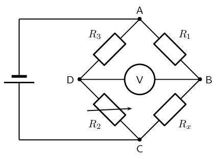
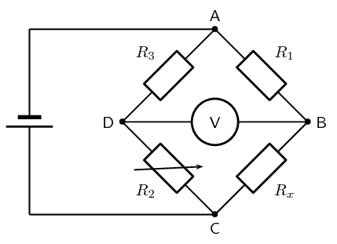

## 10.5 Extension: Wheatstone bridge [Not examinable] (ESCPZ)

<QuizCard id="s12-10-05a" title="Interactive Exercise 10.9" question="The diagram shows an electric circuit consisting of a cell with internal resistance, and four resistors which are connected as shown. The cell has an emf of \(\mathcal{E} = \text{9,43}~\text{V}\) and an internal resistance of \(r = \text{0,19}\ \text{Ω}\) . The total current flowing through the external circuit is \(I_{ext} = \text{2,98}~\text{A}\) . The resistance of resistor \(R_1\) is not known. The the other three resistors are rated as follows: \(R_2 = \text{8,63}\ \text{Ω}\) \(R_3 = \text{7,87}\ \text{Ω}\) \(R_4 = \text{3,3}\ \text{Ω}\) Assume that positive charge is flowing in the circuit (conventional current) and determine the following: What is the resistance of resistor \(R_1\) ? round your answer to two decimal places use the values for any physical constants you might need, as listed here" options=[] answer="2.21" hint="You should enter a number here. If you want to, you can use a space to separate thousands.                Example: 12 800,25 For scientific notation you need to use the multiply symbol                ( ∗ ) and the exponent symbol ( ^ ). For example 6,673 × 10 −11 should be written as: 6,673 ∗ 10^−11" explanation="Determine the total resistance of the external circuit, or \(R_{ext}\) For a cell or battery with internal resistance we know: \[                             \begin{aligned}                             \mathcal{E}                             &   = V_{ext} + V_r\\                             V_{ext}                             &   = \mathcal{E} - V_r ~~~~~\text{(1)}\\                             \end{aligned}                         \] Using Ohm's law: \[\begin{array}{c}V_r = I_r r ~~~~~\text{(2)}\end{array}\] Substitute for \(V_r\) in equation \(\text{(1)}~\) using equation \(\text{(2)}~\) \[                             \begin{aligned}                             V_{ext}&   = \mathcal{E} - V_r\\                             &   = \mathcal{E} - (I_r r)\\                             &   = \mathcal{E} - I_r r ~~~~~\text{(3)}\\                             \end{aligned}                         \] The current through the cell is the same as the total current through the external circuit: \[\begin{array}{c}I_r = I_{ext} ~~~~~\text{(4)}\end{array}\] Substitute for \(I_r\) in equation \(\text{(3)}~\) using equation \(\text{(4)}~\) \[                             \begin{aligned}                             V_{ext}&   = \mathcal{E} - I_r r\\                             &   = \mathcal{E} - (I_{ext}) r\\                             &   = \mathcal{E} - I_{ext} r ~~~~~\text{(5)}\\                             \end{aligned}                         \] Using Ohm's law: \[\begin{array}{c}V_{ext} = I_{ext} R_{ext} ~~~~~\text{(6)}\end{array}\] Substitute for \(V_{ext}\) in equation \(\text{(5)}~\) using equation \(\text{(6)}~\) \[                             \begin{aligned}                             V_{ext}                             &   = \mathcal{E} - I_r r\\                             (I_{ext} R_{ext})                             &   = \mathcal{E} - I_{ext} r\\                             R_{ext}                             &   = \frac{\mathcal{E}}{I_{ext}} - r ~~~~~\text{(7)}\\                             \end{aligned}                         \] Substitute the given values in equation \(\text{(7)}~\) to calculate \(R_{ext}\) : \[                             \begin{aligned}                             R_{ext}&   = \frac{\mathcal{E}}{I_{ext}} - r \\                             &   = \frac{(\text{9,43})}{(\text{2,98})} - (\text{0,19}) \\                             &   = \text{2,97442...}\ \text{Ω}~~~~~\text{(calculated)}\\                             \end{aligned}                         \] Determine the total resistance of the external circuit, or \(R_{ext}\) For the two resistors in parallel, determine the total equivalent resistance: \[                             \begin{aligned}                             \frac{1}{R_{eq,P1}}                             &   = \frac{1}{R_3} + \frac{1}{R_4}\\                             {R_{eq,P1}}^{-1}                             &   = {R_3}^{-1} + {R_4}^{-1}\\                             R_{eq,P1}                             &   = \left( {R_3}^{-1} + {R_4}^{-1} \right)^{-1} ~~~~~\text{(8)}\\                             \end{aligned}                         \] For the two parts in series paths, determine the total equivalent resistance: \[\begin{array}{c}R_{eq,S} = R_{eq,P1} + R_1 ~~~~~\text{(9)}\end{array}\] Substitute for \(R_{eq,P1}\) in equation \(\text{(9)}~\) using equation \(\text{(8)}~\) \[                             \begin{aligned}                             R_{eq,S}                             &   = R_{eq,P1} + R_1\\                             &   = \left( \left( {R_3}^{-1} + {R_4}^{-1} \right)^{-1} \right) + R_1\\                             &   = \left( {R_3}^{-1} + {R_4}^{-1}\right)^{-1} + R_1 ~~~~~\text{(10)}\\                             \end{aligned}                         \] For the three paths in parallel, determine the total equivalent resistance: \[                             \begin{aligned}                             \frac{1}{R_{eq,P2}}                             &   = \frac{1}{R_{eq,S}} + \frac{1}{R_2}\\                             {R_{eq,P2}}^{-1}                             &   = {R_{eq,S}}^{-1} + {R_2}^{-1} ~~~~~\text{(11)}                             \end{aligned}                         \] Substitute for \(R_{eq,S}\) in equation \(\text{(11)}~\) using equation \(\text{(10)}~\) \[                             \begin{aligned}                             {R_{eq,P2}}^{-1}                             &   = {R_{eq,S}}^{-1} + {R_2}^{-1}\\                             &   = \left( \left({R_3}^{-1} + {R_4}^{-1} \right)^{-1} + R_1 \right)^{-1} + {R_2}^{-1}\\                             R_{eq,P2}                             &   = \left( \left( \left({R_3}^{-1} + {R_4}^{-1} \right)^{-1} + R_1 \right)^{-1} + {R_2}^{-1}\right)^{-1} ~~~~~\text{(12)}\\                             \end{aligned}                         \] The total external resistance of the circuit is the same as the total equivalent resistance for the three parallel paths: \[\begin{array}{c}R_{eq,P2} = R_{ext} ~~~~~\text{(13)}\end{array}\] Substitute for \(R_{eq,P2}\) in equation \(\text{(12)}~\) using equation \(\text{(13)}~\) \[                             \begin{aligned}                             R_{eq,P2}                             &   = \left( \left( \left({R_3}^{-1} + {R_4}^{-1} \right)^{-1} + R_1 \right)^{-1} + {R_2}^{-1}\right)^{-1}\\                             (R_{ext})                             &   = \left( \left( \left({R_3}^{-1} + {R_4}^{-1} \right)^{-1} + R_1 \right)^{-1} + {R_2}^{-1}\right)^{-1}\\                             &   = \left( \left( \left({R_3}^{-1} + {R_4}^{-1} \right)^{-1} + R_1 \right)^{-1} + {R_2}^{-1}\right)^{-1} ~~~~~\text{(14)}\\                             \end{aligned}                         \] Substitute the given and calculated values in equation \(\text{(14)}~\) to calculate \(R_1\) : \[                             \begin{aligned}                             R_{ext}                             &   = \left( \left( \left({R_3}^{-1} + {R_4}^{-1} \right)^{-1} + R_1 \right)^{-1} + {R_2}^{-1}\right)^{-1}\\                             \text{2,97442...}                             &   = \left( \left( \left({(\text{7,87})}^{-1} + {(\text{3,3})}^{-1} \right)^{-1} + (R_1) \right)^{-1} + {(\text{8,63})}^{-1}\right)^{-1}\\                             R_1                             &   = \text{2,21370...}\ \text{Ω} \qquad (\text{calculated})\\ & \approx \text{2,21}\ \text{Ω} \qquad \text{(rounded)}\\                             \end{aligned}                         \] Therefore, resistor \(R_1\) has a resistance of \(\text{2,21}\ \text{Ω}\) . Submit your answer as:" />

Using what we know about parallel networks of resistors we can devise another method of finding an
                        unknown resistance, the *Wheatstone bridge*. A Wheatstone bridge is a measuring
                        instrument that is used to measure an unknown electrical resistance by balancing two legs of a
                        bridge circuit, one leg of which includes the unknown component. Its operation is similar to the
                        original potentiometer except that in potentiometer circuits the meter used is a sensitive
                        galvanometer.

<Callout type="note" title="Note">
The Wheatstone bridge was invented by Samuel Hunter Christie in 1833 and improved and
                                popularised by Sir Charles Wheatstone in 1843.
</Callout>

Despite the fact that we have given this circuit a special name, it is just a circuit containing a
                        parallel configuration of four resistors. This is not actually a new concept, this particular
                        configuration is just particularly useful.

In the circuit of the Wheatstone bridge, \({R}_{x}\) is the unknown resistance. \({R}_{\text{1}}\),
                        \({R}_{\text{2}}\) and \({R}_{\text{3}}\) are resistors of known resistance and the resistance
                        of \({R}_{\text{2}}\) is adjustable. If the ratio of \({R}_{\text{2}}\): \({R}_{\text{1}}\) is
                        equal to the ratio of \({R}_{x}\): \({R}_{\text{3}}\), then the potential difference between the
                        two midpoints will be zero and no current will flow between the midpoints. In order to determine
                        the unknown resistance, \({R}_{\text{2}}\) is varied until this condition is reached. That is
                        when the voltmeter reads 0 V.

<Callout type="tip" title="Worked example 11: Wheatstone bridge">
**Question:**
What is the resistance of the unknown resistor \({R}_{x}\) in the diagram below if
                                        \({R}_{\text{1}} = \text{4}\) \(\text{Ω}\) \({R}_{\text{2}}
                                        =\text{8}\) \(\text{Ω}\) and \({R}_{\text{3}} =\text{6}\)
                                        \(\text{Ω}\).

**Determine how to approach the problem:**
The arrangement is a Wheatstone bridge. So we use the equation:

                                \begin{align*}
                                {R}_{x}:{R}_{\text{3}}& = {R}_{\text{2}}:{R}_{\text{1}}
                                \end{align*}

**Solve the problem:**
\begin{align*}
                                {R}_{x}:{R}_{\text{3}}& = {R}_{\text{2}}:{R}_{\text{1}}\\
                                {R}_{x}:6& = 8:4\\
                                {R}_{x}& = 12\phantom{\rule{3.33333pt}{0ex}}\Omega \phantom{\rule{4pt}{0ex}}
                                \end{align*}

**Write the final answer:**
The resistance of the unknown resistor is \(\text{12}\) \(\text{Ω}\).
</Callout>
