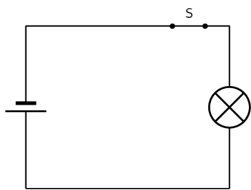
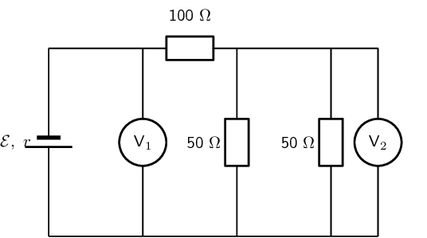
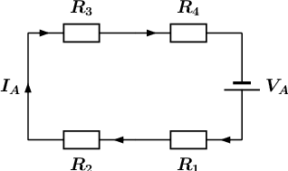
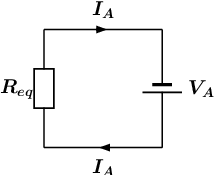
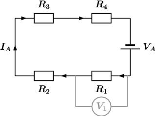
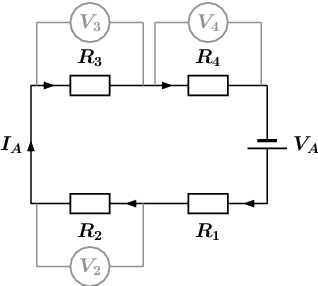

### Textbook Exercise 10.3

**Problem:**
[IEB 2001/11 HG1] - **Emf**

2. Explain the meaning of each of these two statements:
   2. “The current through the battery is
                                                                                      \(\text{50}\) \(\text{mA}\).”
   4. “The emf of the battery is \(\text{6}\)
                                                                                      \(\text{V}\).”
4. A battery tester measures the current supplied when the
                                                                   battery is connected to a resistor of \(\text{100}\)
                                                                   \(\text{Ω}\). If the current is less than
                                                                   \(\text{50}\) \(\text{mA}\), the battery is
                                                                   “flat” (it needs to be replaced). Calculate
                                                                   the maximum internal resistance of a \(\text{6}\)
                                                                   \(\text{V}\) battery that will pass the test.

**Solution:**
\begin{align*}
                                        V & = IR \\
                                        \mathcal{E} - Ir & = IR \\
                                        r &= \frac{IR - \mathcal{E}}{-I} \\
                                        &= \frac{(\text{5,0} \times \text{10}^{-\text{2}})(\text{100}) -
                                        (6)}{-(\text{5,0} \times \text{10}^{-\text{2}})} \\
                                        &= \frac{-1}{-\text{0,05}} \\
                                        &= \text{20}\text{ Ω}
                                        \end{align*}
                                        \(\text{20}\) \(\text{Ω}\)

**Problem:**
[IEB 2005/11 HG] The electric circuit of a torch consists of a cell, a switch
                                                and a small light bulb, as shown in the diagram below.

The electric torch is designed to use a D-type cell, but the only cell that
                                                is available for use is an AA-type cell. The specifications of these two
                                                types of cells are shown in the table below:

| Cell | emf | Appliance for which it is
                                                                                designed | Current drawn from cell when connected to the
                                                                                appliance for which it is
                                                                                designed |
| --- | --- | --- | --- |
| D | \(\text{1,5}\) \(\text{V}\) | torch | \(\text{300}\) \(\text{mA}\) |
| AA | \(\text{1,5}\) \(\text{V}\) | TV remote control | \(\text{30}\) \(\text{mA}\) |

What is likely to happen and why does it happen when the AA-type cell
                                                replaces the D-type cell in the electric torch circuit?

|  | What happens | Why it happens |
| --- | --- | --- |
| (a) | the bulb is dimmer | the AA-type cell has greater internal resistance |
| (b) | the bulb is dimmer | the AA-type cell has less internal resistance |
| (c) | the brightness of the bulb is the same | the AA-type cell has the same internal resistance |
| (d) | the bulb is brighter | the AA-type cell has less internal resistance |

**Solution:**
The internal resistance of the type AA cell is greater than that for the type
                                                D cell. The bulb will be dimmer.

The correct answer is option A.

**Problem:**
[IEB 2005/11 HG1]
                                                A battery of emf ε and internal resistance r = \(\text{25}\)
                                                \(\text{Ω}\) is connected to this arrangement of resistors.

The resistances of voltmeters \({V}_{\text{1}}\) and \({V}_{\text{2}}\) are
                                                so high that they do not affect the current in the circuit.

2. Explain what is meant by “the emf of a battery”.
   The power dissipated in the \(\text{100}\) \(\text{Ω}\)
                                                                   resistor is \(\text{0,81}\) \(\text{W}\).
4. Calculate the current in the \(\text{100}\) \(\text{Ω}\)
                                                                   resistor.
6. Calculate the reading on voltmeter \({V}_{\text{2}}\).
8. Calculate the reading on voltmeter \({V}_{\text{1}}\).
10. Calculate the emf of the battery.

**Solution:**
Solution not yet available

**Problem:**
[SC 2003/11] A kettle is marked \(\text{240}\) \(\text{V}\);
                                                \(\text{1 500}\) \(\text{W}\).

2. Calculate the resistance of the kettle when operating
                                                                   according to the above specifications.
4. If the kettle takes \(\text{3}\) \(\text{minutes}\) to boil
                                                                   some water, calculate the amount of electrical energy
                                                                   transferred to the kettle.

**Solution:**
2. Explain what is meant by “the emf of a battery”:
   The emf of a battery is the maximum electrical potential
                                                                   energy it can impart to a
                                                                   unit charge in a circuit.
   The power dissipated in the \(\text{100}\) \(\text{Ω}\)
                                                                   resistor is \(\text{0,81}\) \(\text{W}\).
4. Calculate the current in the \(\text{100}\) \(\text{Ω}\)
                                                                   resistor:
   We can use the power dissipated in a known resistor to
                                                                   determine the current through the resistor:
                                                           \begin{align*}
                                                           P&= I^2R \\
                                                           (\text{0,81})&= I^2(100) \\
                                                           I&=\sqrt{\frac{\text{0,81}}{100}} \\
                                                           &=\text{0,09}\text{ A}
                                                           \end{align*}
6. Calculate the reading on voltmeter \({V}_{\text{2}}\).
   \({V}_{\text{2}}\) is the potential difference across the
                                                                   parallel combination. We know the current so we can
                                                                   determine the resistance and then
                                                                   the potential difference. The equivalent resistance is:
                                                           \begin{align*}
                                                           \frac{1}{R_P}&= \frac{1}{R_1} + \frac{1}{R_2} \\
                                                           \frac{1}{R_P}&= \frac{1}{50} + \frac{1}{50} \\
                                                           \frac{1}{R_P}&= \frac{2}{50} \\
                                                           R_p&= \text{25}\text{ Ω}
                                                           \end{align*}
   The total current through the equivalent resistance is the
                                                                   same as we calculated as the parallel network
                                                                   is in series with the \(\text{100}\) \(\text{Ω}\)
                                                                   resistor. Therefore the
                                                                   potential difference across the parallel combination is:
                                                           \begin{align*}
                                                           V_P&= IR_P \\
                                                           &= \text{0,09}\text{25} \\
                                                           &= \text{2,25}\text{ V}
                                                           \end{align*}
8. Calculate the reading on voltmeter \({V}_{\text{1}}\).
   We can calculate the potential difference across the
                                                                   \(\text{100}\) \(\text{Ω}\) and add it to the
                                                                   potential difference across the parallel combination to
                                                                   determine the potential difference
                                                                   measured by \({V}_{\text{1}}\).
                                                           \begin{align*}
                                                           V_{100}&= IR \\
                                                           &= \text{0,09}(100) \\
                                                           &= \text{9}\text{ V}
                                                           \end{align*}
                                                           \begin{align*}
                                                           {V}_{\text{1}}&= V_{100} + V_P \\
                                                           &= \text{9}+\text{2,25} \\
                                                           & \text{11,25}\text{ V}
                                                           \end{align*}
10. Calculate the emf of the battery.
   The emf of the battery will be \({V}_{\text{1}}\), the
                                                                   potential difference
                                                                   across the load added to the potential difference across
                                                                   the internal resistance.
                                                           \begin{align*}
                                                           V_r&= Ir \\
                                                           &= \text{0,09}\text{25} \\
                                                           &= \text{2,25}\text{ V}
                                                           \end{align*}
                                                           \begin{align*}
                                                           \mathcal{E}&= \text{2,25} + \text{11,25} \\
                                                           &= \text{13,50}\text{ V}
                                                           \end{align*}

                                        \(\text{0,09}\) \(\text{A}\); \(\text{2,25}\) \(\text{V}\); \(\text{11,25}\)
                                        \(\text{V}\) ; \(\text{13,50}\) \(\text{V}\)

**Problem:**
[IEB 2001/11 HG1] - **Electric Eels**

Electric eels have a series of cells from head to tail. When the cells are
                                                activated by a nerve impulse, a potential difference is created from
                                                head to tail. A healthy electric eel can produce a potential difference
                                                of \(\text{600}\) \(\text{V}\).

2. What is meant by “a potential difference of
                                                                   \(\text{600}\) \(\text{V}\)”?
4. How much energy is transferred when an electron is moved
                                                                   through a potential difference of \(\text{600}\)
                                                                   \(\text{V}\)?

**Solution:**
The work done on a charge \(q\) when moving through a potential difference
                                                \(V\)
                                                is:

                                        \begin{align*}
                                        W&=Vq \\
                                        &= (600)(\text{1,6} \times \text{10}^{-\text{19}} \\
                                        &= (600)(\text{1,6} \times \text{10}^{-\text{19}} \\
                                        &= \text{9,6} \times \text{10}^{-\text{17}}\text{ J}
                                        \end{align*}
                                        \(\text{9,6} \times \text{10}^{-\text{17}}\) \(\text{J}\)

The diagram shows an electric circuit consisting of a battery and four
                                                resistors.

The **potential difference** (voltage) over the battery is \(V_A
                                                = \text{7,6}\text{ V}\)

The the resistors are rated as follows:

- \(R_1 = \text{4,7}\text{ Ω}\)
- \(R_2 = \text{6,9}\text{ Ω}\)
- \(R_3 = \text{4,9}\text{ Ω}\)
- \(R_4 = \text{4,3}\text{ Ω}\)

Assume that positive charge is flowing in the circuit (conventional current).

Using the concepts of **Ohm's law**, and **electric
                                                        circuits**, determine the following:

**Problem:**
What type of circuit is shown in the diagram?

**Solution:**
We need to determine whether the circuit is a series, parallel, or
                                                        combination type of circuit. We do this by looking at how
                                                        current flows through a circuit.

Recall that current is the movement of electric charge from a higher
                                                        potential to a lower potential.

We assume that the flowing charge is positive (conventional current).
                                                        This means that the charges start at the positive terminal of
                                                        our power source (battery). Here the charges have lots of
                                                        electrical potential energy.

The charges then move towards the negative terminal through the path
                                                        that is created by the components and wires of the circuit.
                                                        During this process, the electrical potential energy is
                                                        converted into thermal energy by the resistors. Therefore, the
                                                        charges have less electrical potential energy when they reach
                                                        the negative terminal of the power source (battery).

The flow of current is indicated by the arrows in the diagram below:

From the diagram it is clear that there is only one path for the
                                                        current to flow, since the circuit does not split into two or
                                                        more paths. This means that the current flows through all the
                                                        components, one after the other (in series). We will label this
                                                        current \(I_A\).

The circuit shown in the diagram is a **series**
                                                        circuit.

                                                \(0\)

**Problem:**
What is the **total equivalent resistance** \(R_{eq}\)
                                                        of the circuit?

- round your answer to 1 digit after the decimal comma
- use the values for any physical constants you might need, as
                                                                  listed [here](http://www.everythingscience.co.za/physical-constants)

**Solution:**
We know that the circuit in the diagram is a series type circuit.

Recall that in a series circuit the equivalent resistance can be
                                                        calculated by summing the resistance values of the individual
                                                        resistors:

\[R_{eq,S} = R_1 + R_2 + R_3 + \ldots ~~~~~\text{(1)}\]

We can rewrite \(\text{(1)}\) for the circuit in question as:

\[R_{eq} = R_1 + R_2 + R_3 + R_4 ~~~~~\text{(2)}\]

We can represent this by drawing an equivalent circuit:

We are given the following information:

- the resistance of \(R_1 = \text{4,7}\text{ Ω}\)
- the resistance of \(R_2 = \text{6,9}\text{ Ω}\)
- the resistance of \(R_3 = \text{4,9}\text{ Ω}\)
- the resistance of \(R_4 = \text{4,3}\text{ Ω}\)

Substituting the above values in \(\text{(2)}\), we get:

\begin{align*}
                                                        R_{eq} & = R_1 + R_2 + R_3 + R_4\\
                                                        & = \text{4,7} + \text{6,9} + \text{4,9} + \text{4,3}\\
                                                        & = \text{20,8}\text{ Ω}
                                                        \end{align*}

Therefore, the total equivalent resistance in the circuit, or
                                                        \(R_{eq} = \text{20,8}\text{ Ω}\)

                                                \(\text{20,8}\)

**Problem:**
**Question 3**

What is the potential difference (voltage) across \(R_1\), or \(V_1\)
                                                        ?

- round your answer to 3 digits after the decimal comma
- use the values for any physical constants you might need, as
                                                                  listed [here](http://www.everythingscience.co.za/physical-constants)

**Solution:**
Potential difference, or voltage is a way to describe the difference
                                                        in electrical potential energy across a component in a circuit.
                                                        Remember that a resistor converts electrical potential energy
                                                        into thermal energy, so the electrical potential is higher on
                                                        the "in" side compared to the "out" side of a resistor.

Ohm's law describes the relationship between the total current
                                                        \(~I~\) through an ohmic conductor, its resistance \(R\), and
                                                        the potential difference \(V~\) across it:

\[I = \frac{V}{R}~~~~~\text{(3)}\]

For the equivalent circuit, we can rewrite \(\text{(3)}\) as:

\[I_A = \frac{V_A}{R_{eq}}~~~~~\text{(4)}\]

We are asked to calculate the potential difference \(V_{1}\) over
                                                        \(R_{1}\), as shown in the circuit diagram above, so we use
                                                        Ohm's law and rewrite \(\text{(3)}\) to get:

\[V_1 = I_1R_1~~~~~\text{(5)}\]

Since the circuit in question is a series circuit, we know that the
                                                        current \(I_{1}\) flowing through \(R_{1}\), is the same as the
                                                        current \(I_{A}\). This is represented as:

\[I_1 = I_A~~~~~\text{(6)}\]

Substituting \(\text{(6)}\) into \(\text{(5)}\) we get:

\[V_1 = I_AR_1~~~~~\text{(7)}\]

Substituting \(\text{(4)}\) into \(\text{(7)}\) we get:

\[V_{1} = I_AR_1 = \left(\frac{V_A}{R_{eq}}\right)R_1 =
                                                        \frac{V_AR_1}{R_{eq}}~~~~~\text{(8)}\]

Recall from **Question 2**:

\[R_{eq} = R_1 + R_2 + R_3 + R_4 ~~~~~\text{(2)}\]

Substituting \(\text{(2)}\) into \(\text{(8)}\) we get:

\[V_{1} = \frac{V_AR_1}{R_1 + R_2 + R_3 + R_4}~~~~~\text{(9)}\]

We are given the following information:

- the resistance of \(R_1 = \text{4,7}\text{ Ω}\)
- the resistance of \(R_2 = \text{6,9}\text{ Ω}\)
- the resistance of \(R_3 = \text{4,9}\text{ Ω}\)
- the resistance of \(R_4 = \text{4,3}\text{ Ω}\)
- the potential difference (voltage) over the battery \(V_A =
                                                                  \text{7,6}\text{ V}\)

Substituting the above values in \(\text{(9)}\), we get:

\begin{align*}
                                                        V_{1} & = \frac{V_AR_1}{R_1 + R_2 + R_3 + R_4}\\
                                                        & = \frac
                                                        {(\text{7,6})(\text{4,7})}
                                                        {\text{4,7} + \text{6,9} + \text{4,9} + \text{4,3}}\\
                                                        & = 1,71731 \ldots~~~~~\text{(calculated)}\\
                                                        & \approx \text{1,717}\text{ V}~~~~~\text{(rounded)}
                                                        \end{align*}

Therefore, the potential difference (voltage) across \(R_1\), or
                                                        \(V_1 \approx \text{1,717}\text{ V}\).

                                                \(\text{1,717}\)

**Problem:**
What is the potential difference (voltage) across \(R_2\), \(R_3\),
                                                        and \(R_4\), or \(V_2\), \(V_3\), and \(V_4\)?

- round your answers to 3 digits after the decimal comma
- use the values for any physical constants you might need, as
                                                                  listed [here](http://www.everythingscience.co.za/physical-constants)

**Solution:**
We are asked to calculate the three remaining potential differences,
                                                        \(V_2\), \(V_3\), and \(V_4\). This is shown in the diagram
                                                        below:

We will use the same method to obtain three expression for \(V_2\),
                                                        \(V_3\), and \(V_4\) as was used in **Question 3**
                                                        for \(V_1\). We get:

\[V_{2} = \frac{V_AR_2}{R_1 + R_2 + R_3 + R_4}~~~~~\text{(10)}\]

\[V_{3} = \frac{V_AR_3}{R_1 + R_2 + R_3 + R_4}~~~~~\text{(11)}\]

\[V_{4} = \frac{V_AR_4}{R_1 + R_2 + R_3 + R_4}~~~~~\text{(12)}\]

We are given the following information:

- the resistance of \(R_1 = \text{4,7}\text{ Ω}\)
- the resistance of \(R_2 = \text{6,9}\text{ Ω}\)
- the resistance of \(R_3 = \text{4,9}\text{ Ω}\)
- the resistance of \(R_4 = \text{4,3}\text{ Ω}\)
- the potential difference (voltage) over the battery \(V_A =
                                                                  \text{7,6}\text{ V}\)

Substituting the above values in \(\text{(10)}\), \(\text{(11)}\),
                                                        and \(\text{(12)}\) we get:

\begin{align*}
                                                        V_{2} & = \frac{V_AR_2}{R_1 + R_2 + R_3 + R_4}\\
                                                        & = \frac
                                                        {(\text{7,6})(\text{6,9})}
                                                        {\text{4,7} + \text{6,9} + \text{4,9} + \text{4,3}}\\
                                                        & = 2,52115 \ldots~~~~~\text{(calculated)}\\
                                                        & \approx \text{2,521}\text{ V}~~~~~\text{(rounded)}
                                                        \end{align*}

\begin{align*}
                                                        V_{3} & = \frac{V_AR_3}{R_1 + R_2 + R_3 + R_4}\\
                                                        & = \frac
                                                        {(\text{7,6})(\text{4,9})}
                                                        {\text{4,7} + \text{6,9} + \text{4,9} + \text{4,3}}\\
                                                        & = 1,79038 \ldots~~~~~\text{(calculated)}\\
                                                        & \approx \text{1,790}\text{ V}~~~~~\text{(rounded)}
                                                        \end{align*}

\begin{align*}
                                                        V_{4} & = \frac{V_AR_4}{R_1 + R_2 + R_3 + R_4}\\
                                                        & = \frac
                                                        {(\text{7,6})(\text{4,3})}
                                                        {\text{4,7} + \text{6,9} + \text{4,9} + \text{4,3}}\\
                                                        & = 1,57115 \ldots~~~~~\text{(calculated)}\\
                                                        & \approx \text{1,571}\text{ V}~~~~~\text{(rounded)}
                                                        \end{align*}

Therefore, the potential difference (voltage) across \(R_2\), or
                                                        \(V_2 \approx \text{2,521}\text{ V}\).

The potential difference (voltage) across \(R_3\), or \(V_3 \approx
                                                        \text{1,790}\text{ V}\).

The potential difference (voltage) across \(R_4\), or \(V_4 \approx
                                                        \text{1,571}\text{ V}\).

                                                \(\text{2,521}\)
                                                \(\text{1,790}\)
                                                \(\text{1,571}\)
