## 11.2 Electrical machines - generators and motors (ESCQ4)

We have seen that when a conductor is moved in a magnetic field or when a magnet is moved
                        near a conductor, a current flows in the conductor. The amount of current depends on:

- the speed at which the conductor experiences a changing magnetic field,
- the number of coils that make up the conductor, and
- the position of the plane of the conductor with respect to the magnetic
                                  field.

                The effect of the orientation of the conductor with respect to the magnetic field
                is illustrated in Figure 11.1.

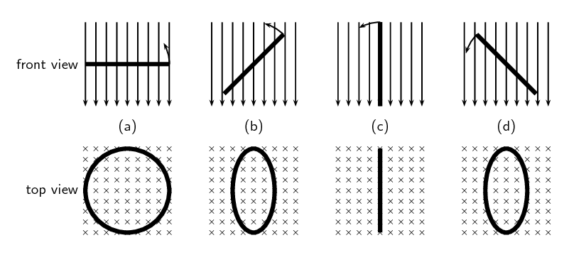

Figure 11.1: Series of figures showing that the magnetic flux through a conductor is
                                        dependent
                                        on the angle that the plane of the conductor makes with the magnetic field. The
                                        greatest
                                        flux passes through the conductor when the plane of the conductor is
                                        perpendicular to
                                        the magnetic field lines as in Figure 11.1 (a). The number
                                        of field lines passing through the conductor decreases, as the conductor rotates
                                        until
                                        it is parallel to the magnetic field Figure 11.1 (c).

If the emf induced and the current in the conductor were plotted as a function of the angle
                        between the plane of the conductor and the magnetic field for a conductor that has
                        a constant speed of rotation, then the induced emf and current would
                        vary as shown in Figure 11.2. The current alternates
                        around zero
                        and is known as an *alternating current* (abbreviated AC).

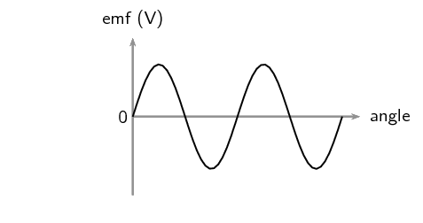

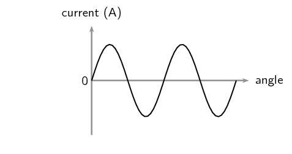

Figure 11.2: Variation of induced emf and current as the angle between the plane of a
                                        conductor and the
                                        magnetic field changes.

The angle changes as a function of time so the above plots can be mapped onto the time axis
                        as well.

Recall Faraday's Law, which you learnt about in Grade 11:

Faraday's Law

The emf,
                                        \(\mathcal{E}\), induced around a single loop of conductor is proportional to
                                        the rate of change of the magnetic flux, φ, through the area,
                                        \(A\), of the loop. This can be stated mathematically as:

                                \[\mathcal{E} =-N\frac{\Delta \phi }{\Delta t}\]

where \(\phi =B·A\cos\theta\) and \(B\) is the strength of the magnetic field.

Faraday's Law relates induced emf to the rate of change of magnetic flux,
                        which is the product of the magnetic field strength and the cross-sectional
                        area the field lines pass through. The cross-sectional area changes as the loop of the conductor
                        rotates
                        which gives rise the \(\cos\theta\) factor. \(\theta\) is the angle between
                        the normal to the surface area of the loop of the conductor and the magnetic field.
                        As the closed loop conductor changes orientation with respect to the magnetic field, the amount
                        of magnetic flux through the area of the loop changes and an emf is induced in the conducting
                        loop.

<QuizCard id="s12-11-02a" title="Interactive Exercise 11.2" question="Which of the following graphs correctly shows the current vs. time graph for a DC generator? A B C D" options=["A", "B", "C", "D"] answer="A" hint="" explanation="We begin by looking at the diagrams. Each diagram shows a current vs. time graph and so we need to consider the shape of each graph: Diagram A shows the current describing the absolute value of a sine wave with time. The current does not alternate between positive and negative values, but is positive over time. Diagram B shows a straight, horizontal line (a constant positive current) over time Diagram C shows the current describing a sine wave with time, the current alternates between positive and negative values. Diagram D shows a straight, horizontal line (a constant negative current) over time. Next we note the following information about alternating current generators and direct current generators: For an alternating current generator, the current vs. time graph is a sine graph and alternates between positive and negative values. For a direct current generator, the current vs. time graph is the absolute value of a sine graph and does not alternate between positive and negative values. We are asked to determine which of the graphs correctly shows the current vs. time graph for a DC generator. Combining what we have noted about the shape of each graph and what we know about the shape of the current vs. time curve for a DC generator we can conclude that the correct answer is diagram A . Submit your answer as: A" />

### Electrical generators (ESCQ5)

### AC generator (ESCQ6)

The principle of rotating a conductor in a magnetic field to generate current is used
                                in electrical generators. A generator converts mechanical energy (motion) into
                                electrical energy.

Generator

A generator is a device that converts mechanical energy into electrical
                                                energy.

The layout of a simple AC generator is shown in Figure 11.3.
                                The conductor is formed of a coil of wire, placed inside a magnetic field. The
                                conductor is manually rotated within the magnetic field. This generates an alternating
                                emf. The alternating current needs to be transmitted from the conductor to the load,
                                which is the system requiring the electrical energy to function.

The load and the conductor are connected by a slip ring. A slip ring
                                is a connector which is able to transmit electricity between rotating portions
                                of a machine. It is made up of a ring and brushes, one of which is stationary
                                with respect to the other. Here, the ring attaches to the conductor and the brushes
                                are attached to the load. Current is generated in the rotating conductor, passes
                                into the slip rings, which rotate against the brushes. The current is transmitted
                                through the brushes into the load, and the system is thus powered.

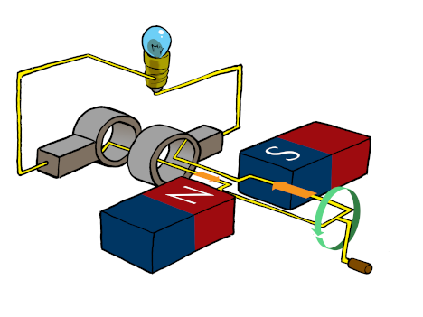

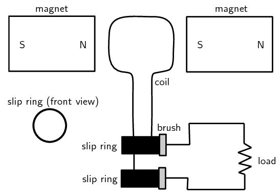

Figure 11.3: Layout of an alternating current generator.

The direction of the current
                                changes with every half turn of the coil. As one side of the loop moves to the other
                                pole of the magnetic field, the current in the loop changes direction.
                                This type of current which changes direction is known as alternating
                                current and Figure 11.4 shows how it
                                comes about
                                as the conductor rotates.

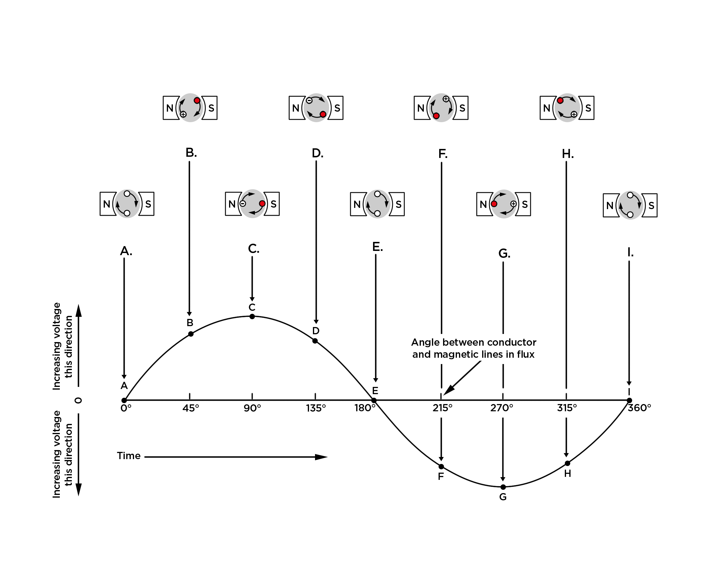

Figure 11.4:
                                        The red (solid) dots represent current coming out of the page and the crosses
                                        show current
                                        going into the page.

<Callout type="note" title="Note">
AC generators are also known as alternators. They are found in motor cars to charge
                                        the car battery.
</Callout>

<QuizCard id="s12-11-02b" title="Interactive Exercise 11.3" question="Adapted from DBE Feb-Mar 2017 Grade 12, P1, Q1.9 Physical constants · Physics formulas In a DC motor the current from the external power source is delivered through the ... A magnets. B coils. C slip rings. D split rings (commutators)." options=["A", "B", "C", "D"] answer="D" hint="" explanation="Choose the correct option Below is a diagram of a DC motor. We can see that the current from the external power source is delivered through the split rings (commutators). These are connected to low-friction, carbon (graphite) brushes which conduct electricity and enable the smooth motion of the motor. A magnets. B coils. C slip rings. D \({\color{red}{{\checkmark}{\checkmark}}}\) split rings (commutators). So Option D is correct. Submit your answer as: D" />

<QuizCard id="s12-11-02b" title="Interactive Exercise 11.3" question="State the energy conversion that takes place inside a generator." options=["electrical", "chemical", "magnetic", "mechanical", "electrical", "chemical", "magnetic", "mechanical", "out of", "into", "slit rings", "slip rings", "a split-ring commutator", "a slip-ring commutator", "a battery", "an AC power source", "a load", "an AC adapter"] answer="3, 0" hint="" explanation="State the energy conversion In a generator, mechanical energy is converted to electrical energy . Submit your answer as: mechanical and electrical" />

### DC generator (ESCQ7)

A simple DC generator is constructed the same way as an AC generator except that there
                                is one slip ring which is split into two pieces, called a commutator, so the current in
                                the
                                external circuit does not change direction. The layout of a DC generator is shown in
                                Figure 11.5. The split-ring commutator
                                accommodates for the change in
                                direction of the current in the loop, thus creating direct current (DC) current going
                                through
                                the brushes and out to the circuit. The current in the loop does reverse direction but
                                if you look
                                carefully at the 2D image you will see that the section of the split-ring commutator
                                also changes
                                which side of the circuit it is touching. If the current changes direction at the same
                                time
                                that the commutator swaps sides the external circuit will always have current going in
                                the
                                same direction.

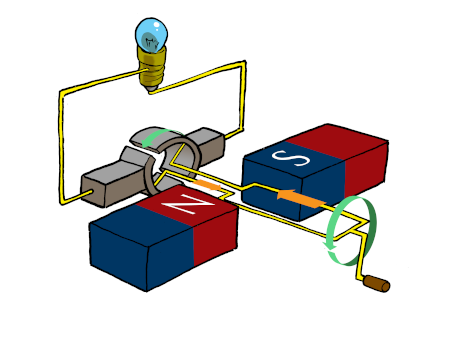

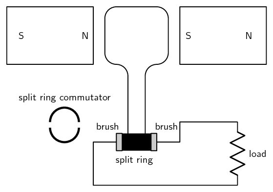

Figure 11.5: Layout of a direct current generator.

The shape of the emf from a DC generator is shown in Figure 11.6. The emf is not steady but is the absolute
                                value of a sine/cosine wave.

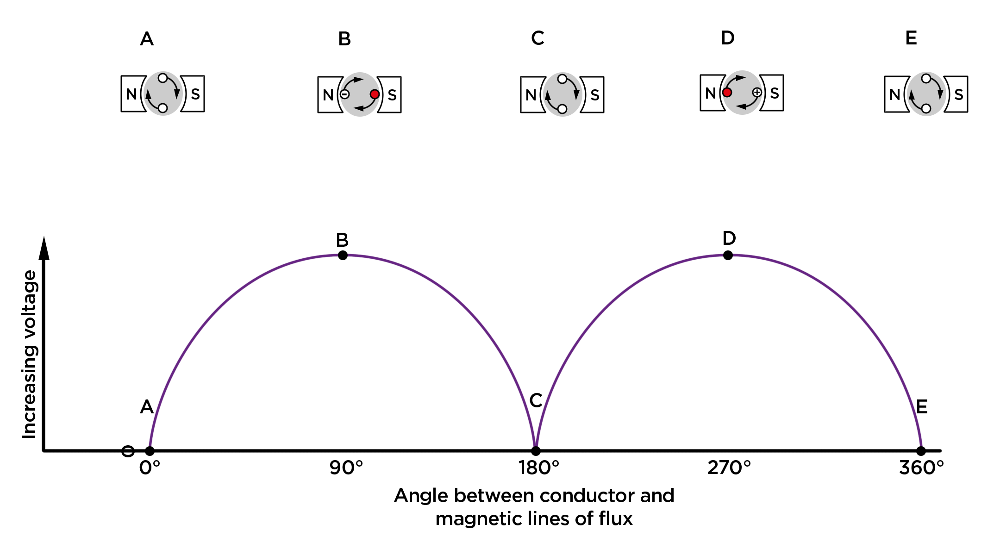

Figure 11.6: Variation of emf in a DC generator.

### AC versus DC generators (ESCQ8)

The problems involved with making and breaking electrical contact with a moving coil are
                                sparking and heat, especially if the generator is turning at high speed. If the
                                atmosphere surrounding the machine contains flammable or explosive vapours, the
                                practical problems of spark-producing brush contacts are even greater.

If the magnetic field, rather than the coil/conductor is rotated, then brushes are not needed
                                in an AC generator (alternator), so an alternator will not have the same problems as DC
                                generators.
                                The same benefits of AC over DC for generator design also apply to electric motors.
                                While DC motors need brushes to make electrical contact with moving coils of wire, AC
                                motors do not. In fact, AC and DC motor designs are very similar to their generator
                                counterparts.
                                The AC motor is depends on the reversing magnetic field produced by alternating current
                                through its stationary coils of wire to make the magnet rotate. The DC motor depends on
                                the brush contacts making and breaking
                                connections to reverse current through the rotating coil every 1/2 rotation (180
                                degrees).

<QuizCard id="s12-11-02c" title="Interactive Exercise 11.4" question="Are the following statements true or false?" options=["True", "False", "True", "False", "True", "False", "True", "False"] answer="0, 0, 0, 1" hint="" explanation="A generator converts mechanical energy into electrical energy. True Brush-less AC generators are used in environments with an increased fire risk. True A DC generator produces a direct current. True A generator converts electrical energy into mechanical energy. False Submit your answer as: True and True and True and False" />

### Electric motors (ESCQ9)

The basic principles of operation for an electric motor are the same as that of a generator,
                                except that a motor converts electrical energy into mechanical energy (motion).

Electric motor

An electric motor is a device that converts electrical energy into mechanical
                                                energy.

If one were to place a moving charged particle in a magnetic field, it
                                would experience a force called the **Lorentz force**.

The Lorentz Force

The Lorentz force is the force experienced by a moving charged particle in an
                                                electric
                                                and magnetic field. The magnetic component is:

                                        \[F=qvB\]

where \(F\) is the force (in newtons, N), \(q\) is the electric charge (in
                                                coulombs, C), \(v\) is the velocity of the charged particle (in
                                                \(\text{m·s$^{-1}$}\)) and \(B\) is the magnetic field strength (in
                                                teslas, T).

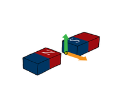

In this diagram a positive charge is shown moving between two opposite poles of
                                        magnets. The
                                        direction of the charge's motion is indicated by the orange arrow. It will
                                        experience a
                                        Lorentz force which will be in the direction of the green arrow.

A current-carrying conductor, where the current is in the direction of the orange
                                        arrow, will also experience a magnetic force, the green arrow, due to the
                                        Lorentz
                                        force on the individual charges moving
                                        in the current flow.

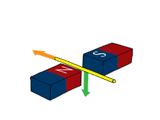

If the direction of the current is reversed, for the same magentic field direction,
                                        then
                                        the direction of the magnetic force will also be reversed as indiced in this
                                        diagram.

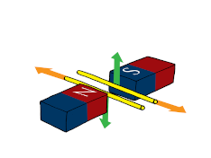

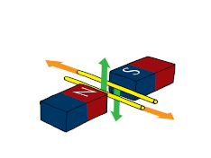

We can if there are two parallel conductors with current in opposite direcions they
                                        will experience magnetic forces in opposite directions.

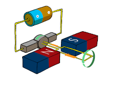

An electric motor works by using a source of emf to make a current flow in a loop of
                                        conductor such that the Lorentz force on opposite sides of the loop are in
                                        opposite
                                        directions which can cause the loop to rotate about a central axis.

<Callout type="note" title="Note">
The force on a current-carrying conductor due to a magnetic field is called Ampere's
                                        law.
</Callout>

The direction of the magnetic force is perpendicular to both the direction of the flow
                                of current and the direction of the magnetic field and can be found
                                using the **
                                        Right Hand Rule** as shown in the picture below. Use your
                                *right hand*; your first finger points in the direction of
                                the current, your second finger in the direction of the magnetic field and your thumb
                                will then point in the direction of the force.

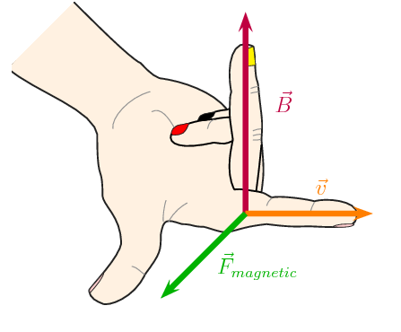

Both motors and generators can be explained in terms of a coil that rotates in a magnetic
                                field. In a generator the coil is attached to an external circuit that is turned,
                                resulting in a changing flux that induces an emf. In a motor, a current-carrying coil in
                                a magnetic field experiences a force on both sides of the coil, creating a twisting
                                force (called a *torque*, pronounce like 'talk') which makes it turn.

If the current is AC, the two slip rings are required to create an AC motor. An AC motor is
                                shown in Figure 11.7

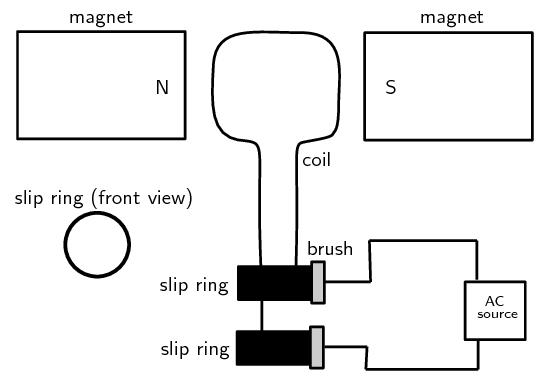

Figure 11.7: Layout of an alternating current motor.

If the current is DC, split-ring commutators are required to create a DC motor. This is shown
                                in Figure 11.8.

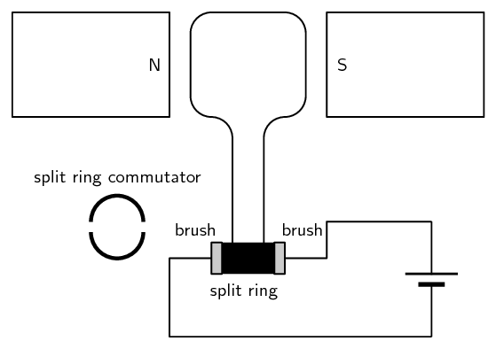

Figure 11.8: Layout of a direct current motor.

<QuizCard id="s12-11-02d" title="Interactive Exercise 11.5" question="Identify which physical quantity is represented by each finger (A, B and C) as proposed by Fleming's right hand rule for generators." options=["Force (F)", "Magnetic Field (B)", "Induced Current (I)", "Force (F)", "Magnetic Field (B)", "Induced Current (I)", "Force (F)", "Magnetic Field (B)", "Induced Current (I)"] answer="0, 1, 2" hint="" explanation="The right hand rule. The diagram below shows the physical quantities associated with each finger for Fleming's right hand rule for generators. To apply the rule follow, these steps: Point your thumb in the direction of the force (F) on the conductor (or in the direction of motion of the conductor) Point your index finger in the direction of the magnetic field (B) (Remember: North to South) Your middle finger will now point in the direction of the induced current (I) in the conductor You can use the mnemonic \"FBI\" to memorise this. Just remember to always start with your thumb! Therefore we get the following answers: Finger A represents the Force (F) Finger B represents the Magnetic Field (B) Finger C represents the Induced Current (I) Submit your answer as: Force (F) and Magnetic Field (B) and Induced Current (I)" />

### Real-life applications (ESCQB)

#### Cars

A car contains an alternator. When the car's engine is running the
                                        alternator charges its battery and powers the car's electric system.

## Alternators

Try to find out the different current values produced by alternators for
                                                different types of machines. Compare these to understand what numbers
                                                make sense in the real world. You will find different values for cars,
                                                trucks, buses, boats etc. Try to find out what other machines might have
                                                alternators.

A car also contains a DC electric motor, the starter motor, to turn over the engine
                                        to start it.
                                        A starter motor consists of the very powerful DC electric motor and starter
                                        solenoid that is attached to the motor.
                                        A starter motor requires a very high current to crank the engine and is
                                        connected to the battery with large cables to carry large current.

#### Electricity generation

In order to produce electricity for mass distribution (to homes, offices, factories
                                        and so forth), AC generators are usually used. The electricity produced by
                                        massive
                                        power plants usually has a low voltage which is converted to high voltage. It is
                                        more efficient to distribute electricity over long distances in the form of high
                                        voltage power lines.

The high voltages are then coverted to 240 V for consumption in homes and offices.
                                        This
                                        is usually done within a few kilometres of where it will be used.

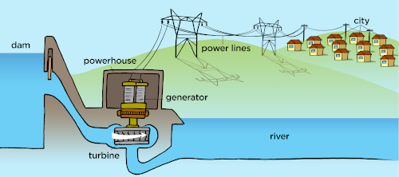

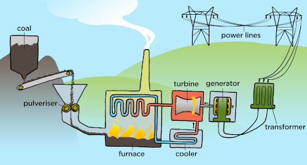

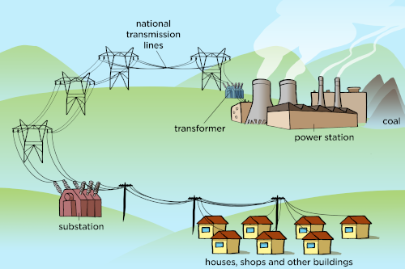

Figure 11.9: AC generators are used at power plants (all types,
                                                        hydro- and coal-plants shwon) to generate electricity.

## Generators and motors

### Textbook Exercise
                                                        11.1

**Problem:**
State the difference between a generator and a motor.

**Solution:**
An electrical generator is a mechanical device to
                                                                        convert energy from a source into electrical
                                                                        energy.

An electrical motor is a mechanical device to convert
                                                                        electrical energy from a source into another
                                                                        form energy.

**Problem:**
Use Faraday's Law to explain why a current is induced
                                                                        in a coil that is rotated in a magnetic field.

**Solution:**
Faraday's law says that a changing magnetic flux can
                                                                        induce an emf, when the coil rotates in a
                                                                        magnetic
                                                                        field it is possible for the rotation to change
                                                                        the flux thereby inducing an emf.

If the rotation of the coil is such that the flux
                                                                        doesn't change, i.e. the surface of the coil
                                                                        remains
                                                                        parallel to the magenetic field, then there will
                                                                        be no induced emf.

**Problem:**
Explain the basic principle of an AC generator in
                                                                        which a coil is mechanically rotated in a
                                                                        magnetic field. Draw a diagram to support your
                                                                        answer.

**Solution:**
Solution not yet available

**Problem:**
Explain how a DC generator works. Draw a diagram to
                                                                        support your answer. Also, describe how a DC
                                                                        generator differs from an AC generator.

**Solution:**
Solution not yet available

**Problem:**
Explain why a current-carrying coil placed in a
                                                                        magnetic field (but not parallel to the field)
                                                                        will turn. Refer to the force exerted on moving
                                                                        charges by a magnetic field and the torque on
                                                                        the coil.

**Solution:**
A current-carrying coil in a magnetic field
                                                                        experiences a force on both sides of the coil
                                                                        that are not
                                                                        parallel to the magnetics field, creating a
                                                                        twisting force (called a torque) which makes it
                                                                        turn.
                                                                        Any coil carrying current can feel a force in a
                                                                        magnetic field. The force is due to the
                                                                        magnetic component of the Lorentz force on the
                                                                        moving charges in the conductor, called Ampere's
                                                                        Law.
                                                                        The force on opposite sides of the coil will be
                                                                        in opposite directions because the charges are
                                                                        moving in opposite directions.

**Problem:**
Explain the basic principle of an electric motor.
                                                                        Draw a diagram to support your answer.

**Solution:**
Solution not yet available

**Problem:**
Give examples of the use of AC and DC generators.

**Solution:**
Cars (both AC and DC), electricity generation (AC
                                                                        only), anywhere where a power supply is needed.

**Problem:**
Give examples of the uses of motors.

**Solution:**
Pumps, fans, appliances, power tools, household
                                                                        appliances, office equipment.
