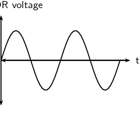
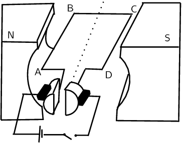
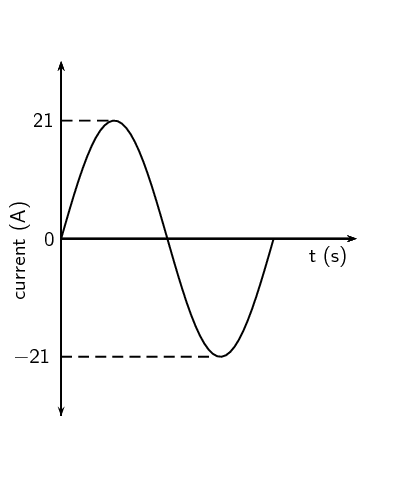
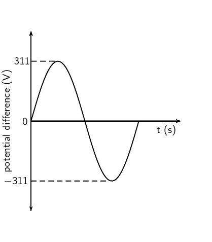

## 11.3 Alternating current (ESCQC)

Most students learning about electricity begin with what is known as *direct current* (DC),
                        which is electricity flowing in one direction only. DC is the kind of electricity made by a
                        battery, with definite positive and negative terminals.

However, we have seen that the electricity produced by some generators constantly
                        alternates (switches direction) and is therefore known as
                        *alternating current* (AC). There are a number
                        of advantages to AC current, the main advantage to
                        AC is that the voltage can be changed using transformers. That means that the voltage
                        can be "stepped up" at power stations to a very high voltage so that electrical
                        energy can be transmitted along power lines at low current and therefore
                        experience low energy loss due to heating. The voltage can then be stepped
                        down for use in buildings and street lights.

A list of the advantages of AC current:

- Easy to be
                                  transformed (step up or
                                  step down using a
                                  transformer).
- Easier to
                                  convert from AC to DC
                                  than from DC to AC.
- Easier to generate.
- It
                                  can be transmitted at
                                  high voltage and low
                                  current over long
                                  distances with less
                                  energy lost.
- High
                                  frequency used in AC
                                  makes it suitable for
                                  motors.

<Callout type="note" title="Note">
In South Africa alternating current is generated at a frequency of \(\text{50}\)
                                \(\text{Hz}\).
</Callout>

The circuit symbol for alternating current is:

<QuizCard id="s12-11-03a" title="Interactive Exercise 11.7" question="Maximum potential difference \((V_{\text{max}})\) , maximum current \((I_{\text{max}})\) , and maximum power \((P_{\text{max}})\) are three important quantities when working with alternating current (AC). Which one of the following equations correctly represents the relationship between these quantities? A \(V_{\text{max}} = P_{\text{max}} I_{\text{max}}\) B \(V_{\text{max}} = \dfrac{I_{\text{max}}}{P_{\text{max}}}\) C \(V_{\text{max}} = \dfrac{P_{\text{max}}}{I_{\text{max}}}\)" options=["A", "B", "C"] answer="C" hint="" explanation="Identify the relationship Maximum potential difference, maximum current, and maximum power are related to each other by the following equation: \[                     \begin{aligned}                         P_{\text{max}} = V_{\text{max}} I_{\text{max}}                     \end{aligned}                 \] TIP: The use of subscripts is very important when using this formula in tests and exams. It is important to differentiate between maximum ( max ), root mean square ( rms ), and average ( avg ) values. Make \(V_{\text{max}}\) the subject of the formula We need to isolate \(V_{\text{max}}\) . We can do this by dividing both sides of the equation by \({\color{blue}{I_{\text{max}}}}\) . \[                         \begin{aligned}                             P_{\text{max}} &= V_{\text{max}} I_{\text{max}} \\                             \frac{ P_{\text{max}} }{ {\color{blue}{I_{\text{max}}}} } &= \frac{ V_{\text{max}}I_{\text{max}} }{ {\color{blue}{I_{\text{max}}}} } \\                             \frac{P_{\text{max}}}{I_{\text{max}}} &= V_{\text{max}} \frac{ {\color{darkgray}{I_{\text{max}}}} }{ {\color{darkgray}{I_{\text{max}}}} } \\                             \therefore \frac{ P_{\text{max}} }{ I_{\text{max}} } &= V_{\text{max}}                         \end{aligned}                     \] Therefore the relationship with \(V_{\text{max}}\) the subject of the formula is: \[                     \begin{array}{c}                         V_{\text{max}} = \dfrac{P_{\text{max}}}{I_{\text{max}}}                     \end{array}                 \] We can compare this equation to the given options: A ✘ \(V_{\text{max}} = P_{\text{max}} I_{\text{max}}\) B ✘ \(V_{\text{max}} = \dfrac{I_{\text{max}}}{P_{\text{max}}}\) C ✔ \(V_{\text{max}} = \dfrac{P_{\text{max}}}{I_{\text{max}}}\) Therefore the correct equation is C . Submit your answer as: C" />

### Current and voltage (ESCQD)

In an ideal DC circuit, current and voltage are constant. In an AC circuit, current and
                                voltage vary with time. The value of the current or voltage at any specific time is
                                called the *instantaneous current or voltage* and is calculated as follows:

                        \begin{align*}
                        %i& = {I}_{\max}\sin\left(\text{2}\pi ft \right)\\
                        % v& = {V}_{\max}\sin\left(\text{2}\pi ft\right) \\
                        i& = {I}_{\max}\sin\left(\omega t \right)\\
                        v& = {V}_{\max}\sin\left(\omega t\right)
                        \end{align*}

\(i\) is the instantaneous current. \({I}_{\max}\) is the maximum current. \(v\) is the
                                instantaneous voltage. \({V}_{\max}\) is the maximum voltage. \(f\) is the frequency of
                                the AC and t is the time at which the instantaneous current or voltage is being
                                calculated.

The value we use for AC is known as the root mean square (rms) average. This is the same as
                                what the DC voltage would be
                                for the same source and is defined as:

                        \begin{align*}
                        {I}_{rms}& = \frac{{I}_{\max}}{\sqrt{\text{2}}}\\
                        {V}_{rms}& = \frac{{V}_{\max}}{\sqrt{\text{2}}}
                        \end{align*}

Since AC varies sinusoidally, with as much positive as negative, doing a straight average
                                would get you zero for the average voltage. The rms value by-passes this problem.

<QuizCard id="s12-11-03b" title="Interactive Exercise 11.8" question="What does the symbol \( V_{\text{rms}}\) represent?" options=["maximum", "minimum", "root mean square", "average", "position", "potential difference", "velocity", "resistance", "current", "V", "W", "\u03a9", "A"] answer="2, 1" hint="" explanation="What do the symbols in the equation mean? The equation we are working with is: \[                         \begin{aligned}                         V_{\text{rms}} & = I_{\text{rms}} R                         \end{aligned}                     \] This equation shows the relationship between the root mean square potential difference across a circuit, the root mean square current through the circuit, and the resistance of that circuit. The symbol for: root mean square potential difference is \(V_{\text{rms}}\) . root mean square current is \(I_{\text{rms}}\) . resistance is \(R\) . Therefore the symbol \(V_{\text{rms}}\) represents the root mean square potential difference . Submit your answer as: root mean square and potential difference" />

<Callout type="tip" title="Worked example 1: Laptop transformer">
**Question:**
The transformer for the laptop on which this book was written has the
                                                following information:

- INPUT: \(\text{100}\)-\(\text{240}\) \(\text{V}\); \(\text{1,5}\)
                                                          \(\text{A}\); \(\text{50}\)/\(\text{60}\) \(\text{Hz}\)
- OUTPUT: \(\text{20}\) \(\text{V}\); \(\text{3,25}\) \(\text{A}\)

What changes from input to output, apart from the voltage and current values,
                                                and what does that imply? In addition, calculate the maximum current and
                                                voltage values for the input and/or output as
                                                appropriate.

**Comparing input and output:**
The input description includes a frequency because it is designed for regular
                                                household use where we use alternating current. The output doesn't
                                                include a frequency. This implies that the output is not alternating
                                                current. This means that the output voltage and current will be constant
                                                with time.

**Maximum values:**
When dealing with alternating current, the value given on electrical
                                                appliances is the
                                                root mean square (rms) value. The transformer takes alternating current
                                                input and produces
                                                direct current output, this means that we only need to determine the
                                                maximum
                                                values for the input.

                                        \begin{align*}
                                        V_{\text{rms}} & = \frac{V_{\text{max}}}{\sqrt{\text{2}}} \\
                                        \text{240}\text{ V} & = \frac{V_{\text{max}}}{\sqrt{\text{2}}} \\
                                        \therefore V_{\text{max}} &= \text{339,41125}\ldots\text{ V}
                                        \end{align*}

Therefore \(V_{\text{max}}\approx\text{339,41}\text{ V}\)

                                        \begin{align*}
                                        I_{\text{rms}} & = \frac{I_{\text{max}}}{\sqrt{\text{2}}} \\
                                        \text{1,5 A} & = \frac{I_{\text{max}}}{\sqrt{\text{2}}} \\
                                        \therefore I_{\text{max}}& = \text{2,1213}\ldots\text{ A}
                                        \end{align*}

Therefore \(I_{\text{max}}\approx\text{2,12}\text{ A}\)
</Callout>

<Callout type="tip" title="Worked example 2: Camera battery charger">
**Question:**
A camera charger has the following information:

- INPUT: \(\text{100}\)-\(\text{240}\) \(\text{V}\); \(\text{0,085}\)
                                                          \(\text{A}\) (\(\text{100}\) \(\text{V}\)) - \(\text{0,05}\)
                                                          \(\text{A}\) (\(\text{240}\) \(\text{V}\)) ;
                                                          \(\text{50}\)/\(\text{60}\) \(\text{Hz}\)
- OUTPUT: \(\text{4,2}\) \(\text{V}\); \(\text{0,7}\) \(\text{A}\)

Calculate the maximum current and voltage values for both
                                                \(\text{100}\) \(\text{V}\) and \(\text{240}\) \(\text{V}\) input.

**Understanding the two cases:**
The reason the transformer has the different input voltages listed is because
                                                it may be used internationally and not all countries use the same
                                                household voltage. The transformers purpose is to ensure that the output
                                                is consistent regardless of the input voltage. The different input
                                                voltages of \(\text{100}\) \(\text{V}\) and \(\text{240}\) \(\text{V}\)
                                                result in different input current values. This is why two different
                                                current values are listed under input but the voltage in parentheses
                                                tells you which case they are applicable to.

The cases are:

- **\(\text{100}\) \(\text{V}\):** \(\text{0,085}\)
                                                          \(\text{A}\)
- **\(\text{240}\) \(\text{V}\):** \(\text{0,05}\)
                                                          \(\text{A}\)

**Input voltage of \(\text{100}\) \(\text{V}\):**
\begin{align*}
                                        V_{\text{rms}} & = \frac{V_{\text{max}}}{\sqrt{\text{2}}} \\
                                        \text{100}\text{ V} & = \frac{V_{\text{max}}}{\sqrt{\text{2}}} \\
                                        \therefore V_{\text{max}} & = \text{141,42135}\ldots\text{ V}
                                        \end{align*}

Therefore \(V_{\text{max}}\approx\text{141,42}\text{ V}\)

                                        \begin{align*}
                                        I_{\text{rms}} & = \frac{I_{\text{max}}}{\sqrt{\text{2}}} \\
                                        \text{0,085}\text{ A} & = \frac{I_{\text{max}}}{\sqrt{\text{2}}} \\
                                        \therefore I_{\text{max}} & = \text{0,12020}\ldots\text{ A}
                                        \end{align*}

Therefore \(I_{\text{max}}\approx\text{0,12}\text{ A}\)

**Input voltage of \(\text{240}\) \(\text{V}\):**
\begin{align*}
                                        V_{\text{rms}} & = \frac{V_{\text{max}}}{\sqrt{\text{2}}} \\
                                        \text{240 V} & = \frac{V_{\text{max}}}{\sqrt{\text{2}}} \\
                                        \therefore V_{\text{max}}& = \text{339,41125}\ldots\text{ V}
                                        \end{align*}

Therefore \(V_{\text{max}}\approx\text{339,41}\text{ V}\)

                                        \begin{align*}
                                        I_{\text{rms}} & = \frac{I_{\text{max}}}{\sqrt{\text{2}}} \\
                                        \text{0,5 A} & = \frac{I_{\text{max}}}{\sqrt{\text{2}}} \\
                                        \therefore I_{\text{max}}& = \text{0,70710}\ldots\text{ A}
                                        \end{align*}

Therefore \(I_{\text{max}}\approx\text{0,71}\text{ A}\)
</Callout>

## Alternating current

### Textbook Exercise 11.2

**Problem:**
Explain the advantages of alternating current.

**Solution:**
- Easy to be
                                                                  transformed (step up or
                                                                  step down using a
                                                                  transformer).
- Easier to
                                                                  convert from AC to DC
                                                                  than from DC to AC.
- Easier to generate.
- It
                                                                  can be transmitted at
                                                                  high voltage and low
                                                                  current over long
                                                                  distances with less
                                                                  energy lost.
- High
                                                                  frequency used in AC
                                                                  makes it suitable for
                                                                  motors.

**Problem:**
Which of the following graphs correctly shows the current vs. time
                                                        graph for an AC generator?

| A | B |
| C | D |

**Solution:**
For an alternating current generator, the current vs. time graph is a
                                                        sine wave and alternates between positive and negative values.

For a direct current generator, the current vs. time graph is the
                                                        absolute value of a sine wave and does not alternate between
                                                        positive and negative values.

The correct answer is C.

**Problem:**
Write expressions for the current and voltage in an AC circuit.

**Solution:**
\begin{align*}
                                                i & = I_{\max}\sin(\text{2}πft+φ)\\
                                                v & = V_{\max}\sin(\text{2}πft)
                                                \end{align*}

**Problem:**
Define the rms (root mean square) values for current and voltage for
                                                        AC.

**Solution:**
The root mean square is the value that we use for AC and is what it's
                                                        DC equivalent would be.

                                                \begin{align*}
                                                I_{rms} & =\frac{I_{\max}}{\sqrt{\text{2}}}\\
                                                V_{rms} & =\frac{V_{\max}}{\sqrt{\text{2}}}
                                                \end{align*}

**Problem:**
What is the frequency of the AC generated in South Africa?

**Solution:**
In South Africa the frequency is \(\text{50}\) \(\text{Hz}\)

**Problem:**
If \({V}_{\mathrm{\max}}\) at a power station generator is
                                                        \(\text{340}\) \(\text{V}\) AC, what is the mains supply (rms
                                                        voltage) in our household?

**Solution:**
\begin{align*}
                                                V_{rms} & = \frac{V_{\max}}{\sqrt{\text{2}}} \\
                                                & = \frac{\text{340}}{\sqrt{\text{2}}}\\
                                                & = \text{240,42}\text{ V}
                                                \end{align*}

**Problem:**
Given: \(I_{\text{max}}\) is \(\text{10}\) \(\text{A}\)

Calculate the rms (root mean square) current to two decimal places.

**Solution:**
\begin{align*}
                                                I_{\text{rms}} & = \frac{I_{\text{max}}}{\sqrt{\text{2}}}
                                                \end{align*}\begin{align*}
                                                I_{\text{rms}} & = \frac{\text{10}\text{ A}}{\sqrt{\text{2}}} \\
                                                & = \text{7,07}\text{ A}
                                                \end{align*}

Therefore \(I_{\text{rms}}=\text{7,07}\text{ A}\)

                                                \(\text{7,07}\)

**Problem:**
Given: \(V_{\text{max}}\) is \(\text{266}\) \(\text{V}\)

Calculate the rms (root mean square) voltage to two decimal places.

**Solution:**
\begin{align*}
                                                V_{\text{rms}} & = \frac{V_{\text{max}}}{\sqrt{\text{2}}}
                                                \end{align*}\begin{align*}
                                                V_{\text{rms}} & = \frac{\text{266}\text{ V}}{\sqrt{\text{2}}} \\
                                                & = \text{188,09}\text{ V}
                                                \end{align*}

Therefore \(V_{\text{rms}}=\text{188,09}\text{ V}\)

                                                \(\text{188,09}\) \(\text{V}\)

**Problem:**
Draw a graph of voltage vs time and current vs time for an AC
                                                        circuit.

**Solution:**
The graph is the same for both voltage and for current:

### Power (ESCQF)

If the current and voltage are functions of time, so they are always changing, then so will
                                the power that is dissipated in any circuit element. In circuits which contain only
                                ohmic resistors the **average** power dissipated in any component can be
                                calculated in terms of the rms values.

                        \begin{align*}
                        P_{av} &=I_{rms}V_{rms} \\
                        &=\frac{I_{\max}}{\sqrt{\text{2}}}\frac{V_{\max}}{\sqrt{\text{2}}}\\
                        &=\frac{\text{1}}{\text{2}}I_{\max}V_{\max}
                        \end{align*}

You might ask why we don't need to use an rms value for power. In an AC circuit both the
                                current and voltage have the same sign so they are both either positive or negative.
                                This means that power, the product of the two is always positive. If power is always
                                positive then the average value won't be zero as in the case of current or voltage in AC
                                circuits.

<Callout type="tip" title="Worked example 3: Laptop transformer power">
**Question:**
The transformer for a laptop has the following information:

- INPUT: \(\text{100}\)-\(\text{240}\) \(\text{V}\); \(\text{1,5}\)
                                                          \(\text{A}\); \(\text{50}\)/\(\text{60}\) \(\text{Hz}\)
- OUTPUT: \(\text{20}\) \(\text{V}\); \(\text{3,25}\) \(\text{A}\)

Using the input values and assuming \(\text{240}\) \(\text{V}\), what is the
                                                average power dissipated in the transformer?

**Calculate the average power:**
The values given on electrical appliance labels are the root mean square
                                                (rms) values. We use those to calculate the average power.

                                        \begin{align*}
                                        P_{avg} &=I_{rms}V_{rms} \\
                                        &= \text{1,5}\text{ A} \cdot \text{240}\text{ V}\\
                                        & = \text{360}\text{ W}
                                        \end{align*}
</Callout>

<Callout type="tip" title="Worked example 4: Motors and generators [NSC 2011 Paper 1]">
**Question:**
Diesel-electric trains make use of electric motors as well as generators.

2. The table below compares a motor and a generator in terms of
                                                                   the type of energy conversion and the underlying
                                                                   principle on which each operates. Complete the table by
                                                                   writing down only the question number
                                                                   (11.1.1–11.1.4) in the ANSWER BOOK and next to
                                                                   each number the answer.
   |  | TYPE OF ENERGY
                                                                                                   CONVERSION | PRINCIPLE OF
                                                                                                   OPERATION |
   | --- | --- | --- |
   | Motor | 11.1.1 | 11.1.3 |
   | Generator | 11.1.2 | 11.1.4 |
   (4 marks)
4. The simplified diagram below represents an electric motor.
   
   Give a reason why the section of the coil labelled
                                                                   **BC** in the above diagram does not
                                                                   experience a magnetic force whilst the coil is in the
                                                                   position as shown.
   (2 marks)
6. Graphs of the current and potential difference outputs of an
                                                                   AC generator are shown below.
   
   
   Calculate the average power output of this generator.
   (6 marks)

**[TOTAL: 12 marks]**

**1**

2. Electrical (energy) to mechanical (kinetic) energy
4. Mechanical (kinetic) energy to electrical (energy)
6. Motor effect
8. Electromagnetic induction

(4 marks)

**Question 2**

BC (conductor) is parallel to the magnetic field.

**OR**

Open switch, no current

(2 marks)

**Question 3**

**Option 1:**

                                \begin{align*}
                                P_{\text{ave}} &= V_{\text{rms}} I_{\text{rms}} \\
                                &= \frac{V_{\text{max}}}{\sqrt{2}} \cdot \frac{I_{\text{max}}}{\sqrt{2}} \\
                                &= \frac{(311)(21)}{2} \\
                                &= \text{3265,5 W}
                                \end{align*}

**OR**

                                \begin{align*}
                                P_{\text{max}} &= V_{\text{max}}I_{\text{max}} \\
                                & = (311)(21) \\
                                & = \text{6531 W} \\
                                \therefore P_{\text{ave}} & = \frac{P_{\text{max}}}{2} \\
                                & = \frac{\text{6 531}}{2} \\
                                & = \text{3265,5 W}
                                \end{align*}

**Option 2:**

                                \begin{align*}
                                V_{\text{rms}} &= \frac{V_{\text{max}}}{\sqrt{2}} \\
                                &= \frac{311}{\sqrt{2}} \\
                                &= \text{219,91}\text{ V}
                                \end{align*}\begin{align*}
                                I_{\text{rms}} &= \frac{I_{\text{max}}}{\sqrt{2}} \\
                                &= \frac{21}{\sqrt{2}} \\
                                &= \text{14,85}\text{ A}
                                \end{align*}\begin{align*}
                                P_{\text{ave}} & =V_{\text{rms}}I_{\text{rms}}\\
                                & =(\text{219,91})(\text{14,85})\\
                                & = \text{3 265,66}\text{ W}
                                \end{align*}

**Option 3:**

                                \begin{align*}
                                R & = \frac{V}{I} \\
                                & = \frac{\text{311}}{\text{21}}\\
                                & = \text{14,81}\ \Omega
                                \end{align*}\begin{align*}
                                I_{\text{rms}} &= \frac{I_{\text{max}}}{\sqrt{2}} \\
                                &= \frac{21}{\sqrt{2}} \\
                                &= \text{14,85}\text{ A}
                                \end{align*}\begin{align*}
                                P_{\text{ave}} &= I_{\text{rms}}^{2}R \\
                                &= (\text{14,85})^{2}(\text{14,81}) \\
                                &= \text{3 265,83}\text{ W}
                                \end{align*}

**Option 4:**

                                \begin{align*}
                                R & = \frac{V}{I} \\
                                & = \frac{\text{311}}{\text{21}}\\
                                & = \text{14,81}\ \Omega
                                \end{align*}\begin{align*}
                                V_{\text{rms}} &= \frac{V_{\text{max}}}{\sqrt{2}} \\
                                &= \frac{311}{\sqrt{2}} \\
                                &= \text{219,91}\text{ V}
                                \end{align*}\begin{align*}
                                P_{\text{ave}} &= \frac{V_{\text{rms}}^{2}}{R} \\
                                &= \frac{(\text{219,41})^2}{(\text{14,81})} \\
                                &= \text{3 265,83}\text{ W}
                                \end{align*}

(6 marks)

**[TOTAL: 12 marks]**
</Callout>

<QuizCard id="s12-11-03d" title="Interactive Exercise 11.10" question="Adapted from WCED Metro Central Sep 2017 Grade 12, P1, Q1.9 Physical constants · Physics formulas A fan is powered by an AC power source. The current through the fan is measured over a certain time period and the following current-time graph is produced. Which one of the following graphs shows the corresponding power-time graph over the same time period? A B C D" options=["A", "B", "C", "D"] answer="D" hint="" explanation="Think about how power depends on current For AC electricity, the sign of the current gives the direction of motion of charges and this direction keeps changing. So current alternates between positive and negative values . But power is always positive because no matter which direction the charges are moving, the fan is using up electrical energy. We can also think about this mathematically: \[                     \begin{array}{c}                         P = I^{2}R                     \end{array}                 \] So power is proportional to the square of the current. So when negative current values are squared we get positive power values. If current is zero , then power is zero as well. Whenever current is at its largest positive \((I_{\text{max}})\) and largest negative \((-I_{\text{max}})\) values, then power is at a positive maximum value . We can see these features in the current-time graph (top) and the correct power-time graph (bottom) below. We can also see that over one full AC cycle (one period of the current graph) the power graph goes through two full periods. This is because both maximum and minimum current correspond to maximum power. A B C D \({\color{red}{{\checkmark}{\checkmark}}}\) The correct power-time graph is Graph D . Submit your answer as: D" />

<QuizCard id="s12-11-03d" title="Interactive Exercise 11.10" question="The maximum value of a physical quantity divided by \(\sqrt{2}\) , is the ______ value of that physical quantity." options=[] answer="['root mean square', 'rms', 'root-mean-square', 'r.m.s.', 'root mean squared']" hint="" explanation="Correct answer: root mean square Submit your answer as:" />

<QuizCard id="s12-11-03d" title="Interactive Exercise 11.10" question="A designer is investigating the electrodynamic properties of a desktop PC. The figure on the right shows a simplified circuit diagram of the desktop PC. The designer has measured the maximum voltage of the alternating current supplied to the desktop PC as \(V_{max} = \text{230,55}\ \text{V}\) , and the maximum value of the alternating current as \(I_{max} = \text{0,86}\ \text{A}\) . What is the average power rating of the desktop PC, or \(P_{avg}\) ? round your answer to two decimal places use the values for any physical constants you might need, as listed here" options=[] answer="99.14" hint="You should enter a number here. If you want to, you can use a space to separate thousands.                Example: 12 800,25 For scientific notation you need to use the multiply symbol                ( ∗ ) and the exponent symbol ( ^ ). For example 6,673 × 10 −11 should be written as: 6,673 ∗ 10^−11" explanation="Calculating the average power rating Recall that: \[                         \begin{array}{c}                             V_{rms} = \frac{V_{max}}{\sqrt{2}} ~~~~~\text{(1)}                             \end{array}                         \] and that: \[                         \begin{array}{c}                             I_{rms} = \frac{I_{max}}{\sqrt{2}} ~~~~~\text{(2)}                             \end{array}                         \] We also know that for alternating current: \[                         \begin{array}{c}                             P_{avg} = V_{rms}I_{rms} ~~~~~\text{(3)}                             \end{array}                         \] We can now substitute for \(V_{rms}\) and \(I_{rms}\) in equation \((3)\) , using equations \((1)\) and \((2)\) : \[                             \begin{aligned}                             P_{avg} & = V_{rms}I_{rms}\\                             & = \left(\frac{V_{max}}{\sqrt{2}}\right)\left(\frac{I_{max}}{\sqrt{2}}\right)\\                             & = \frac{V_{max}I_{max}}{2} ~~~~~\text{(4)}                             \end{aligned}                         \] Substitute the given information to calculate the final result We are given the following information: the maximum voltage of the alternating current \(V_{max} = \text{230,55}\ \text{V}\) the maximum value of the alternating current \(I_{max} = \text{0,86}\ \text{A}\) Substituting the above values in \(\text{(4)}\) , we get: \[                             \begin{aligned}                             P_{avg} & = \frac{V_{max}I_{max}}{2}\\                                     & = \frac                                         {(\text{230,55})(\text{0,86})}                                         {2} \\                                     & = \text{99,1365}\ \text{W} \qquad (\text{calculated})\\ & \approx \text{99,14}\ \text{W} \qquad \text{(rounded)}                             \end{aligned}                         \] Therefore, the average power rating of the desktop PC is \(\text{99,14}\ \text{W}\) . Submit your answer as:" />

<QuizCard id="s12-11-03d" title="Interactive Exercise 11.10" question="A designer is investigating the electrodynamic properties of a desktop PC. The figure on the right shows a simplified circuit diagram of the desktop PC. The designer has determined the root mean square value of the alternating current supplied to the desktop PC as \(I_{rms} = \text{0,61}\ \text{A}\) . What is the maximum value of the alternating current supplied to the desktop PC, or \(I_{max}\) ? round your answer to two decimal places use the values for any physical constants you might need, as listed here" options=[] answer="0.86" hint="You should enter a number here. If you want to, you can use a space to separate thousands.                Example: 12 800,25 For scientific notation you need to use the multiply symbol                ( ∗ ) and the exponent symbol ( ^ ). For example 6,673 × 10 −11 should be written as: 6,673 ∗ 10^−11" explanation="Calculating the maximum current Recall that: \[                         \begin{array}{c}                             I_{rms} = \frac{I_{max}}{\sqrt{2}} ~~~~~\text{(1)}                             \end{array}                         \] Rearrange equation \(\text{(1)}\) , to make \(I_{max}\) the subject of the equation: \[                             \begin{aligned}                             I_{rms} & = \frac{I_{max}}{\sqrt{2}}\\                             I_{max} & = \sqrt{2} \cdot I_{rms} ~~~~~\text{(2)}                             \end{aligned}                         \] Substitute the given information to calculate the final result We are given the following information: the root mean square value of the alternating current \(I_{rms} = \text{0,61}\ \text{A}\) Substituting the above values in \(\text{(2)}\) , we get: \[                             \begin{aligned}                             I_{max} & = \sqrt{2} \cdot I_{rms}\\                                     & = \sqrt{2} \cdot (\text{0,61})\\                                     & = \text{0,86267...}\ \text{A} \qquad (\text{calculated})\\ & \approx \text{0,86}\ \text{A} \qquad \text{(rounded)}                             \end{aligned}                         \] Therefore, the maximum value of the alternating current supplied to the desktop PC is \(\text{0,86}\ \text{A}\) . Submit your answer as:" />

<QuizCard id="s12-11-03d" title="Interactive Exercise 11.10" question="A student is investigating the electrodynamic properties of a washing machine. The figure on the right shows a simplified circuit diagram of the washing machine. The student has measured the maximum voltage of the alternating current supplied to the washing machine as \(V_{max} = \text{202,26}\ \text{V}\) , and the washing machine has an average power rating of \(P_{avg} = \text{567,1}\ \text{W}\) . What is the maximum value of the alternating current supplied to the washing machine, or \(I_{max}\) ? round your answer to two decimal places use the values for any physical constants you might need, as listed here" options=[] answer="5.61" hint="You should enter a number here. If you want to, you can use a space to separate thousands.                Example: 12 800,25 For scientific notation you need to use the multiply symbol                ( ∗ ) and the exponent symbol ( ^ ). For example 6,673 × 10 −11 should be written as: 6,673 ∗ 10^−11" explanation="Calculating the maximum current Recall that: \[                             \begin{array}{c}                             V_{rms} = \frac{V_{max}}{\sqrt{2}} ~~~~~\text{(1)}                             \end{array}                         \] and that: \[                             \begin{array}{c}                             I_{rms} = \frac{I_{max}}{\sqrt{2}} ~~~~~\text{(2)}                             \end{array}                         \] Rearrange \((2)\) to make \(I_{max}\) the subject of the equation: \[                             \begin{aligned}                             I_{rms} & = \frac{I_{max}}{\sqrt{2}}\\                             I_{max} & = \sqrt{2} \cdot I_{rms} ~~~~~\text{(3)}                             \end{aligned}                         \] We also know that for alternating current: \[                             \begin{array}{c}                             P_{avg} = V_{rms}I_{rms} ~~~~~\text{(4)}                             \end{array}                         \] Rearrange \((4)\) to make \(I_{rms}\) the subject of the equation: \[                             \begin{aligned}                             P_{avg} & = V_{rms}I_{rms}\\                             I_{rms} & = \frac{P_{avg}}{V_{rms}} ~~~~~\text{(5)}                             \end{aligned}                         \] We now substitute for \(V_{rms}\) in equation \((5)\) , using equation \((1)\) : \[                             \begin{aligned}                             I_{rms} & = \frac{P_{avg}}{V_{rms}}\\                             & = \frac{P_{avg}}{\left(\frac{V_{max}}{\sqrt{2}}\right)}\\                             & = \frac{\sqrt{2} \cdot P_{avg}}{V_{max}} ~~~~~\text{(6)}                             \end{aligned}                         \] We now substitute for \(I_{rms}\) in equation \((3)\) , using equation \((6)\) : \[                             \begin{aligned}                             I_{max} & = \sqrt{2} \cdot I_{rms}\\                             & = \sqrt{2} \left(\frac{\sqrt{2} \cdot P_{avg}}{V_{max}}\right)\\                             & = \frac{2 \cdot P_{avg}}{V_{max}} ~~~~~\text{(7)}                             \end{aligned}                         \] Substitute the given information to calculate the final result We are given the following information: the maximum voltage of the alternating current \(V_{max} = \text{202,26}\ \text{V}\) the average power rating \(P_{avg} = \text{567,1}\ \text{W}\) Substituting the above values in \(\text{(7)}\) , we get: \[                             \begin{aligned}                             I_{max} & = \frac{2 \cdot P_{avg}}{V_{max}}\\                                     & = \frac                                         {2 \cdot (\text{567,1})}                                         {(\text{202,26})} \\                                     & = \text{5,60763...}\ \text{A} \qquad (\text{calculated})\\ & \approx \text{5,61}\ \text{A} \qquad \text{(rounded)}                             \end{aligned}                         \] Therefore, the maximum value of the alternating current supplied to the washing machine is \(\text{5,61}\ \text{A}\) . Submit your answer as:" />

<QuizCard id="s12-11-03d" title="Interactive Exercise 11.10" question="Name the component in this arrangement that makes it different from a DC generator." options=["i", "ii", "iii", "iv"] answer="['slip ring', 'slip-ring', 'slipring', 'slip rings', 'slip-rings', 'sliprings']" hint="" explanation="Name the component Here is a labelled diagram of an AC generator: And here is a labelled diagram of a DC generator: AC and DC generators (and motors too) differ by how the carbon brushes connect the external circuit to the coil. From the diagrams above, we can see that this component in an AC generator is a slip ring . Submit your answer as:" />

<QuizCard id="s12-11-03d" title="Interactive Exercise 11.10" question="A designer is investigating the electrodynamic properties of a home stereo. The figure on the right shows a simplified circuit diagram of the home stereo. The designer has determined the root mean square value of the alternating current supplied to the home stereo as \(I_{rms} = \text{0,06}\ \text{A}\) . What is the maximum value of the alternating current supplied to the home stereo, or \(I_{max}\) ? round your answer to two decimal places use the values for any physical constants you might need, as listed here" options=[] answer="0.08" hint="You should enter a number here. If you want to, you can use a space to separate thousands.                Example: 12 800,25 For scientific notation you need to use the multiply symbol                ( ∗ ) and the exponent symbol ( ^ ). For example 6,673 × 10 −11 should be written as: 6,673 ∗ 10^−11" explanation="Calculating the maximum current Recall that: \[                         \begin{array}{c}                             I_{rms} = \frac{I_{max}}{\sqrt{2}} ~~~~~\text{(1)}                             \end{array}                         \] Rearrange equation \(\text{(1)}\) , to make \(I_{max}\) the subject of the equation: \[                             \begin{aligned}                             I_{rms} & = \frac{I_{max}}{\sqrt{2}}\\                             I_{max} & = \sqrt{2} \cdot I_{rms} ~~~~~\text{(2)}                             \end{aligned}                         \] Substitute the given information to calculate the final result We are given the following information: the root mean square value of the alternating current \(I_{rms} = \text{0,06}\ \text{A}\) Substituting the above values in \(\text{(2)}\) , we get: \[                             \begin{aligned}                             I_{max} & = \sqrt{2} \cdot I_{rms}\\                                     & = \sqrt{2} \cdot (\text{0,06})\\                                     & = \text{0,08485...}\ \text{A} \qquad (\text{calculated})\\ & \approx \text{0,08}\ \text{A} \qquad \text{(rounded)}                             \end{aligned}                         \] Therefore, the maximum value of the alternating current supplied to the home stereo is \(\text{0,08}\ \text{A}\) . Submit your answer as:" />

<QuizCard id="s12-11-03d" title="Interactive Exercise 11.10" question="Adapted from WCED Metro Central Sep 2017 Grade 12, P1, Q9.2 Physical constants · Physics formulas The energy-efficiency of a tumble dryer can be defined as a measure of the amount of energy it uses per unit time in order to produce a given heating effect. A manufacturer claims that their tumble dryer is more energy-efficient than older tumble dryers. To test these claims, some researchers connect the tumble dryer to an AC generator which produces a root mean square voltage of \(\text{250}\ \text{V}\) . The researchers manage to produce the same heating effect as the manufacturer. They measure the current passing through the tumble dryer over time and plot the following graph: The following information was taken from a label on the back of the tumble dryer: RATING: \(\text{250}\ \text{V}\) \(\sim\) \(\text{70}\ \text{Hz}\) , \(\text{1 700}\ \text{W}\) Is the tumble dryer as energy-efficient as the manufacturer claims? Perform a calculation to support your answer. INSTRUCTION: Round your answer to two decimal places ." options=["voltage", "power", "resistance", "current draw", "greater than", "almost equal to", "less than", "more efficient than", "as efficient as", "less efficient than"] answer="1, ['1831.41', '1.83e+3', '1832.50'], 0, 2" hint="" explanation="Calculate the root mean square current We need to calculate the measured average power dissipated by the tumble dryer. We'll compare this to the power value that the manufacturer has claimed. This will tell us if the device uses more energy per unit time or less energy per unit than that claimed by the manufacturer (for the same heating effect). If the measured power draw is less than the claimed value then we can say that the device is more efficient than claimed. If the measured power draw is more than the claimed value then we will conclude that the device is less efficient than claimed. And if the measured power value and claimed power value are roughly the same, then we will conclude that the manufacturer's claim stands. TIP: Ratings on the labels of electrical appliances are always average values (for power) or rms values (for potential difference or current). The graph gives us the maximum current . We need to calculate the root mean square current before we can calculate the power dissipated in the tumble dryer. \[                     \begin{aligned}                         I_{\text{rms}} & = \dfrac{I_{\text{max}}}{\sqrt{2}} \\                         & = \dfrac{\text{10,36}}{\sqrt{2}} \\                         & = \text{7,32562...}\ \text{A}                     \end{aligned}                 \] Calculate the average power drawn by the tumble dryer \[                     \begin{aligned}                         P_{\text{avg}} & = V_{\text{rms}} I_{\text{rms}} \\                         & = \left(\text{250}\right)\left(\text{7,32562...}\right) \\                         & = \text{1 831,40656...} \\ & \approx \text{1 831,41}\ \text{W}                     \end{aligned}                 \] Compare the actual power with the claimed value The value that we have calculated for the power of the tumble dryer is greater than the power claimed by the manufacturer. This means to produce the same heating effect, the tumble dryer uses more energy per unit time than claimed. So the tumble dryer is less efficient than claimed. Submit your answer as: power and and greater than and less efficient than" />

<QuizCard id="s12-11-03d" title="Interactive Exercise 11.10" question="Which two of the following factors would decrease the induced emf? 1 using a coil with a smaller surface area 2 having more turns in the coil 3 causing the coil to rotate slower 4 increasing the magnetic field strength" options=["1", "2", "3", "4", "1", "2", "3", "4", "equivalent DC", "maximum AC", "minimum AC", "varying DC", "same", "maximum", "minimum", "A", "\u03a9", "W", "V"] answer="0, 2" hint="" explanation="What affects emf? The induced emf is directly proportional to the rate of change of magnetic flux. It is given to us by Faraday's law of electromagnetic induction: \[                         \begin{array}{c}                             \mathcal{E} = -N \dfrac{\Delta \phi}{\Delta t}                         \end{array}                     \] and the magnetic flux ( \(\phi\) ) is given by \[                         \begin{array}{c}                             \phi = B{\cdot}A \cos{\theta}                         \end{array}                     \] So the induced emf ( \(\mathcal{E}\) ) is affected by the: number of turns in the coil ( \(N\) ) size (surface area) of the coil ( \(A\) ) strength of the magnetic field ( \(B\) ) speed of rotation (affected by \(\Delta t\) ) How can the induced emf be decreased? The induced emf can be decreased by: using a coil with a smaller surface area causing the coil to rotate slower Submit your answer as: 1 and 3" />

<QuizCard id="s12-11-03d" title="Interactive Exercise 11.10" question="A designer is investigating the electrodynamic properties of a desktop PC. The figure on the right shows a simplified circuit diagram of the desktop PC. The designer has measured the maximum voltage of the alternating current supplied to the desktop PC as \(V_{max} = \text{230,55}\ \text{V}\) , and the desktop PC has an average power rating of \(P_{avg} = \text{99,82}\ \text{W}\) . What is the maximum value of the alternating current supplied to the desktop PC, or \(I_{max}\) ? round your answer to two decimal places use the values for any physical constants you might need, as listed here" options=[] answer="0.87" hint="You should enter a number here. If you want to, you can use a space to separate thousands.                Example: 12 800,25 For scientific notation you need to use the multiply symbol                ( ∗ ) and the exponent symbol ( ^ ). For example 6,673 × 10 −11 should be written as: 6,673 ∗ 10^−11" explanation="Calculating the maximum current Recall that: \[                             \begin{array}{c}                             V_{rms} = \frac{V_{max}}{\sqrt{2}} ~~~~~\text{(1)}                             \end{array}                         \] and that: \[                             \begin{array}{c}                             I_{rms} = \frac{I_{max}}{\sqrt{2}} ~~~~~\text{(2)}                             \end{array}                         \] Rearrange \((2)\) to make \(I_{max}\) the subject of the equation: \[                             \begin{aligned}                             I_{rms} & = \frac{I_{max}}{\sqrt{2}}\\                             I_{max} & = \sqrt{2} \cdot I_{rms} ~~~~~\text{(3)}                             \end{aligned}                         \] We also know that for alternating current: \[                             \begin{array}{c}                             P_{avg} = V_{rms}I_{rms} ~~~~~\text{(4)}                             \end{array}                         \] Rearrange \((4)\) to make \(I_{rms}\) the subject of the equation: \[                             \begin{aligned}                             P_{avg} & = V_{rms}I_{rms}\\                             I_{rms} & = \frac{P_{avg}}{V_{rms}} ~~~~~\text{(5)}                             \end{aligned}                         \] We now substitute for \(V_{rms}\) in equation \((5)\) , using equation \((1)\) : \[                             \begin{aligned}                             I_{rms} & = \frac{P_{avg}}{V_{rms}}\\                             & = \frac{P_{avg}}{\left(\frac{V_{max}}{\sqrt{2}}\right)}\\                             & = \frac{\sqrt{2} \cdot P_{avg}}{V_{max}} ~~~~~\text{(6)}                             \end{aligned}                         \] We now substitute for \(I_{rms}\) in equation \((3)\) , using equation \((6)\) : \[                             \begin{aligned}                             I_{max} & = \sqrt{2} \cdot I_{rms}\\                             & = \sqrt{2} \left(\frac{\sqrt{2} \cdot P_{avg}}{V_{max}}\right)\\                             & = \frac{2 \cdot P_{avg}}{V_{max}} ~~~~~\text{(7)}                             \end{aligned}                         \] Substitute the given information to calculate the final result We are given the following information: the maximum voltage of the alternating current \(V_{max} = \text{230,55}\ \text{V}\) the average power rating \(P_{avg} = \text{99,82}\ \text{W}\) Substituting the above values in \(\text{(7)}\) , we get: \[                             \begin{aligned}                             I_{max} & = \frac{2 \cdot P_{avg}}{V_{max}}\\                                     & = \frac                                         {2 \cdot (\text{99,82})}                                         {(\text{230,55})} \\                                     & = \text{0,86592...}\ \text{A} \qquad (\text{calculated})\\ & \approx \text{0,87}\ \text{A} \qquad \text{(rounded)}                             \end{aligned}                         \] Therefore, the maximum value of the alternating current supplied to the desktop PC is \(\text{0,87}\ \text{A}\) . Submit your answer as:" />

<QuizCard id="s12-11-03d" title="Interactive Exercise 11.10" question="A designer is investigating the electrodynamic properties of a toaster. The figure on the right shows a simplified circuit diagram of the toaster. The designer has measured the maximum value of the alternating current supplied to the toaster as \(I_{\text{max}} = \text{8,49}\ \text{A}\) , and the toaster has an average power rating of \(P_{\text{avg}} = \text{977,68}\ \text{W}\) . What is the maximum voltage of the alternating current supplied to the toaster, or \(V_{\text{max}}\) ? INSTRUCTIONS: Round your answer to two decimal places. Use the values for any physical constants you might need, as listed here ." options=[] answer="230.31" hint="You should enter a number here. If you want to, you can use a space to separate thousands.                Example: 12 800,25 For scientific notation you need to use the multiply symbol                ( ∗ ) and the exponent symbol ( ^ ). For example 6,673 × 10 −11 should be written as: 6,673 ∗ 10^−11" explanation="Choose which relationships to use We are given the following information: the maximum value of the alternating current \(I_{\text{max}} = \text{8,49}\ \text{A}\) the average power rating \(P_{\text{avg}} = \text{977,68}\ \text{W}\) The maximum power is double the average power: \[                         \begin{array}{c}                             P_{\text{max}} = 2P_{\text{avg}}                         \end{array}                     \] and using maximum values with one of of the power relationships, we have: \[                         \begin{array}{c}                             P_{\text{max}} = V_{\text{max}}I_{\text{max}}                         \end{array}                     \] Substitute the given information to calculate the final result We combine the two above equations and then substitute: \[                         \begin{aligned}                         V_{\text{max}} & = \dfrac{2 P_{\text{avg}}}{I_{\text{max}}}\\                                 & = \frac                                     {2(\text{977,68})}                                     {\text{8,49}} \\                                 & = \text{230,31330...}\ \text{V}\\ & \approx \text{230,31}\ \text{V}                         \end{aligned}                     \] Therefore, the maximum voltage of the alternating current supplied to the toaster is \(\text{230,31}\ \text{V}\) . Submit your answer as:" />
