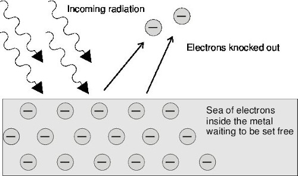
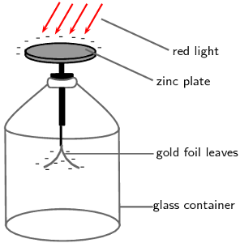
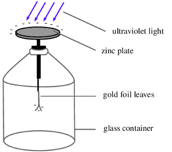
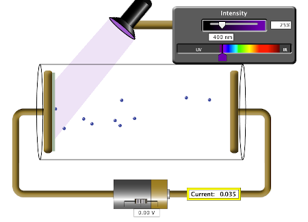
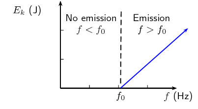
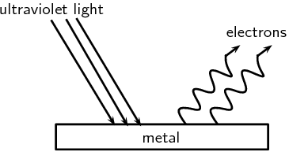
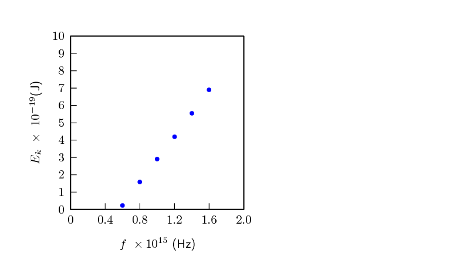

## 12.2 The photoelectric effect (ESCQJ)

Around the turn of the twentieth century, it was observed by a number of physicists
            (including Hertz, Thomson and Von Lenard) that when light was shone onto a metal plate,
            electrons were emitted by the metal. This is called the photoelectric effect.
            (*photo* for light,
            *electric* for the electron.)

The characteristics of the photoelectric effect were a surprise and a very important
            development in modern Physics. To understand why it was a surprise we need to look at the
            history to understand what physicists were expecting to happen and then understand
            the implications for Physics going forward.

### History and expectations as to the photoelectric effect (ESCQK)

In 1887, Heinrich Hertz (a German physicist) noticed that ultraviolet light incident
                on a metal plate could cause sparks. Metals were known to be good conductors of electricity,
                because the electrons are more able to move. They should be able to
                be dislodged if energy were added through the incident light. The problem was that
                different metals requred different minimum frequencies of light.

The expectation at the time was that electrons would be emitted for any
                frequency of light, after a delay (for low intensities) during which the
                electrons absorbed sufficient energy to escape from the metal surface. The
                higher the intensity the shorter the delay was be as they would absorb energy faster. This
                was based on the idea that light was a wave continuously delivering energy to the
                electrons.

It is important to remember that higher frequency light corresponds to higher
                energy.

The next piece of the puzzle came from Philipp Lenard (a Hungarian physicist) in 1902 when he discovered
                that the maximum velocity with which electrons are ejected by ultraviolet
                light is entirely independent of the intensity of light.

His expectation was that at high intensities the electrons would absorb more energy and so would have a
                greater velocity.

A **paradox** existed as the expectations and the observations did not match.

Albert Einstein (a German physicist) solved this paradox by proposing
                that light is made up of packets
                of energy called *quanta* (now called photons)
                which interacted with the electrons in the metal like particles instead of waves.
                Each incident photon would transfer all its energy to one electron in the metal.

The photoelectric effect

The photoelectric effect is the process whereby an electron
                        is emitted by a substance when light shines on it.

Einstein received the 1921 Nobel Prize for his contribution to understanding the
                photoelectric effect. His explanation wasn't very popular and took a while to be accepted,
                in fact, some scientists at the time felt that is was a big mistake.

In the motivation letter for Einstein to be accepted into the Prussian Academy of Science
                it was specifically mentioned as a mistake:

                In sum, one can say that there is hardly one among
                the great problems in which modern physics is so rich
                to which Einstein has not made a remarkable
                contribution. That he may sometimes have missed the
                targeting his speculations, as, for example, in his
                hypothesis of light-quanta, cannot really be held too
                much against him, for it is not possible to introduce
                really new ideas even in the most exact sciences
                without sometimes taking a risk
                - A. Pais, “Subtle is the Lord: The Science and the Life of Albert Einstein,” New York:
                Oxford
                University Press, 1982, p. 382

### Implications of Einstein's model (ESCQM)

For a paper on the history of the photoelectric effect and the analysis of its treatment
                    in a variety of textbooks see: http://onlinelibrary.wiley.com/doi/10.1002/sce.20389/pdf

Einstein's model is consistent with the observation that the electrons were
                emitted immediately when light was shone on the metal and that the *intensity* of the light made
                *no difference* to the maximum kinetic energy of the emitted electrons.

The energy needed to knock an electron out of the substance is called the **work function**
                (symbol \(W_{0}\)) of the substance. This is a characteristic of the substance. If the energy of the
                photon is less than the work function then no electron can be emitted, no matter how many photons strike
                the substance. We know that the frequency of light is related to the energy, that is why there is a
                minimum frequency of light that can eject electrons. This minimum frequency we call the cut-off
                frequency, \(f_0\). For a specific colour of light (i.e. a certain frequency or wavelength), the energy
                of the photons is given by \(E=hf=\frac{hc}{\lambda}\), where \(h\) is Planck's constant. This tells us
                that the \(W_{0} = hf_0\)
                .

Work function

                    The minimum energy needed to knock an electron out of a metal is called the
                    **work function** (symbol \(W_{0}\))
                    of the metal. As it is energy, it measured in joules (J).

Energy is conserved so if the photon has a higher energy than \(W_{0}\)
                then the excess energy goes into the kinetic energy \({E}_{k}\) of the electron
                that was emitted from
                the substance.

The excess over and above the binding energy is actually the
                **maximum** kinetic energy the emitted electron can
                have. This is because not all electrons are on
                the surface of the substance. For electrons below the surface there is additional energy
                required to eject the electron from the material which then cannot contribute to the
                kinetic energy of the electron.

            \begin{align*}
            E & = W_{0}+{E}_{k\max} \\
            {E}_{k\max}& = hf-W_{0}
            \end{align*}

This equation is known as the photoelectric equation.

The last piece of the puzzle is now clear, the question was `why does increasing the
                intensity of the light not affect the maximum kinetic energy of the emitted photons?'. The answer
                is that each emitted electron has absorbed **one** photon, increasing
                the intensity just increases the number of photons (we expect more electrons but we don't expect
                their maximum kinetic energy to change).

The discovery and understanding of the photoelectric effect was one of the major breakthroughs in science
                in the twentieth century as it provided concrete evidence of the particle nature of light. It overturned
                previously held views that light was composed purely of a continuous transverse wave. On the one hand,
                the wave nature is a good description of phenomena such as diffraction and interference for light, and
                on the other hand, the photoelectric effect demonstrates the particle nature of light. This is now known
                as the 'dual-nature' of light. (dual means two)

Einstein won the 1921 Nobel Prize for Physics for this quantum theory and his explanation of the
                photoelectric effect.

Figure 12.1: The photoelectric effect: Incoming photons on the left hit the electrons inside the
                        metal surface. The electrons absorb the energy from the photons, and are ejected from the metal
                        surface.

We can observe this effect in the following practical demonstration of photoelectric
            emission. A zinc plate is charged negatively and placed onto the cap of an electroscope.
            In Figure 12.2, red light is shone onto
            the zinc plate. There is no change observed even if the
            intensity (brightness) of the red light is increased. In Figure 12.3, ultraviolet
            light of low intensity is shone onto the zinc and it is observed that the leaf of the
            electroscope collapse. This allows us to conclude that the negative charge on the plate
            decreased as electrons were ejected from the metal when the ultraviolet light was incident
            on the plate.

Figure 12.2: Red light incident on the zinc plate of an electroscope.

Figure 12.3: Ultraviolet light incident on the zinc plate of an electroscope.

<Callout type="note" title="Note">
<VideoPlayer src="http://www.youtube.com/watch?v=Q_h4IoPJXZw" title="Video: 27Z4" />
</Callout>

<Callout type="note" title="Note">
<VideoPlayer src="http://www.youtube.com/watch?v=_riIY-v2Ym8" title="Video: 27Z5" />
</Callout>

The work function is different for different elements. The smaller the work function, the easier it is for
            electrons to be emitted from the metal. Metals with low work functions make good conductors. This is because
            the electrons are attached less strongly to their surroundings and can move more easily through these
            materials. This reduces the resistance of the material to the flow of current i.e. it conducts well. Table 12.1 shows the work functions for a range of
            elements.

| Element | Work Function (J) |
| --- | --- |
| Aluminium | \(\text{6,9} \times \text{10}^{-\text{19}}\) |
| Beryllium | \(\text{8,0} \times \text{10}^{-\text{19}}\) |
| Calcium | \(\text{4,6} \times \text{10}^{-\text{19}}\) |
| Copper | \(\text{7,5} \times \text{10}^{-\text{19}}\) |
| Gold | \(\text{8,2} \times \text{10}^{-\text{19}}\) |
| Lead | \(\text{6,9} \times \text{10}^{-\text{19}}\) |
| Silicon | \(\text{1,8} \times \text{10}^{-\text{19}}\) |
| Silver | \(\text{6,9} \times \text{10}^{-\text{19}}\) |
| Sodium | \(\text{3,7} \times \text{10}^{-\text{19}}\) |

Table 12.1: Work functions of selected elements determined from the photoelectric effect. (From the
                    *Handbook of Chemistry and Physics.)*

<QuizCard id="s12-12-02a" title="Interactive Exercise 12.2" question="A group of scientists perform an experiment involving the photoelectric effect and an unknown material. The scientists shine electromagnetic radiation with a wavelength of \(\text{121}\ \text{nm}\) onto the surface of the unknown material. Photoelectrons are ejected and the maximum kinetic energy of these electrons is measured to be \(\text{9,341} \times \text{10}^{-\text{19}}\ \text{J}\) . The unknown material is known to be one of the following: Element Work function \(\text{(J)}\) platinum \(\text{1,00} \times \text{10}^{-\text{19}}\) tin \(\text{7,10} \times \text{10}^{-\text{19}}\) cobalt \(\text{8,00} \times \text{10}^{-\text{19}}\) potassium \(\text{3,70} \times \text{10}^{-\text{19}}\) caesium \(\text{3,40} \times \text{10}^{-\text{19}}\) Calculate the work function for the unknown material. Hence identify the material. INSTRUCTIONS: Write your answer in scientific notation , and then round it to two decimal places . Use the list of physical constants available here ." options=[] answer="['7.10e-19', '7.09e-19', '7.08e-19', '7.06e-19'], 1" hint="You should enter a number here. If you want to, you can use a space to separate thousands.                Example: 12 800,25 For scientific notation you need to use the multiply symbol                ( ∗ ) and the exponent symbol ( ^ ). For example 6,673 × 10 −11 should be written as: 6,673 ∗ 10^−11" explanation="Consider what is given and what is required Given: the maximum kinetic energy of the emitted electrons is \(E_{\text{k,max}} = \text{9,341} \times \text{10}^{-\text{19}}\ \text{J}\) the wavelength of the incident electromagnetic radiation is \( \lambda = \text{121}\ \text{nm} = \text{1,21} \times \text{10}^{-\text{7}}\ \text{m} \) Planck's constant \(h=\text{6,63} \times \text{10}^{-\text{34}}\ \text{J·s}\) The speed of light \(c=\text{3} \times \text{10}^{\text{8}}\ \text{m·s$^{-1}$}\) Required: the work function of the unknown material in \(\text{J}\) the identity of the unknown material Work out a strategy to solve the problem We are given the wavelength of the incident light and therefore we can calculate the photon energy of the light with the equation: \[                     \begin{array}{c}                         E_{\text{photon}} = \dfrac{hc}{\lambda}                     \end{array}                 \] The relationship between the maximum kinetic energy of the emitted electrons, the photon energy, and the work function is given by Einstein's photoelectric equation. Some of the photon energy is used to overcome the work function and any leftover energy is converted into kinetic energy. \[                     \begin{array}{c}                         E_{\text{photon}} = W_{0} + E_{\text{k,max}}                     \end{array}                 \] Once we have calculated the photon energy we will be able to calculate the work function. Calculate the photon energy \[                     \begin{aligned}                         E_{\text{photon}} &= \dfrac{h c}{\lambda} \\                         &= \frac{(\text{6,63} \times \text{10}^{-\text{34}})(\text{3} \times \text{10}^{\text{8}})}{\text{1,21} \times \text{10}^{-\text{7}}} \\                         &= \text{1,643801...} \times \text{10}^{-\text{18}}\ \text{J}                     \end{aligned}                 \] Calculate the work function \[                     \begin{aligned}                         E_{\text{photon}} &= W_{0} + E_{\text{k,max}} \\                         \text{1,643801...} \times \text{10}^{-\text{18}} &= W_{0} +  \text{9,341} \times \text{10}^{-\text{19}} \\                         \therefore W_{0} &= \text{7,09701...} \times \text{10}^{-\text{19}} \\ & \approx \text{7,10} \times \text{10}^{-\text{19}}\ \text{J}                     \end{aligned}                 \] Therefore the work function of the material is \(\text{7,10} \times \text{10}^{-\text{19}}\ \text{J}\) . Use the table to identify the unknown material We need to look at the table of possible elements and their work functions to find an element that has a work function closest to \(\text{7,10} \times \text{10}^{-\text{19}}\ \text{J}\) . The possible elements were: Element Work function \(\text{(J)}\) platinum \(\text{1,00} \times \text{10}^{-\text{19}}\) tin \(\text{7,10} \times \text{10}^{-\text{19}}\) cobalt \(\text{8,00} \times \text{10}^{-\text{19}}\) potassium \(\text{3,70} \times \text{10}^{-\text{19}}\) caesium \(\text{3,40} \times \text{10}^{-\text{19}}\) From the table, tin has a work function of \(\text{7,10} \times \text{10}^{-\text{19}}\ \text{J}\) which is an exact match. Therefore the unknown material is most likely to be tin . NOTE: The work function of a material is not necessarily unique and certain materials have the same work function. So, while determining the work function can help identify a substance, it is not guaranteed to be enough on its own. Submit your answer as: and tin" />

### Units of energy (ESCQN)

When dealing with calculations at a small scale (like at the level of electrons) it is more convenient to
                use different units for energy rather than the joule (J). We define a unit called the electron-volt (eV)
                as the kinetic energy gained by an electron passing through a potential difference of one volt.

            \(E=q\times V\)

where q is the charge of the electron and V is the potential difference applied. The charge of 1 electron
                is \(\text{1,6} \times \text{10}^{-\text{19}}\) \(\text{C}\), so \(\text{1}\) \(\text{eV}\) is
                calculated to be:

            \(1 \mathrm{eV}=\left(\text{1,6} \times \text{10}^{-\text{19}}\text{ C} \times \text{1}\text{ V}
            \right)= \text{1,6} \times \text{10}^{-\text{19}}\text{ J}\)

You can see that \(\text{1,6} \times \text{10}^{-\text{19}}\) \(\text{J}\) is a very small amount of
                energy and so using electron-volts (eV) at this level is easier.

Hence, \(\text{1}\) \(\text{eV}\) = \(\text{1,6} \times \text{10}^{-\text{19}}\) \(\text{J}\) which means
                that \(\text{1}\) \(\text{J}\) = \(\text{6,241} \times \text{10}^{\text{18}}\) \(\text{eV}\)

<QuizCard id="s12-12-02b" title="Interactive Exercise 12.3" question="Use the data in the above table to plot a graph of maximum kinetic energy against frequency. Then use your graph to determine the gradient of the graph.  Ensure that you also work out the unit of the gradient of the graph. INSTRUCTION: Write your answer in scientific notation , and then round it to two decimal places ." options=["Hz", "J\u00b7s\u207b\u00b9", "J", "s\u00b7J\u207b\u00b9", "s", "J\u00b7s", "J\u00b7s\u207b\u00b9", "J", "s", "J\u00b7s", "s\u00b7J\u207b\u00b9", "Hz"] answer="['6.66e-34', '6.60e-34', '6.62e-34', '6.63e-34', '6.65e-34', '6.64e-34', '6.67e-34', '6.68e-34', '6.69e-34', '6.70e-34'], 0" hint="You should enter a number here. If you want to, you can use a space to separate thousands.                Example: 12 800,25 For scientific notation you need to use the multiply symbol                ( ∗ ) and the exponent symbol ( ^ ). For example 6,673 × 10 −11 should be written as: 6,673 ∗ 10^−11" explanation="Plot a graph of the data We first need to plot the graph of maximum kinetic energy against frequency: Calculate and interpret the gradient of the graph We can calculate the gradient of a straight line graph by using any two points. We have chosen to use the first and last points given. NOTE: The values on the \(x\) and \(y\) -values are given using exponential notation. \[ 				\begin{aligned} 				m & = \frac{y_{2}-y_{1}}{x_{2}-x_{1}} \qquad \longleftarrow ^\text{ from the mathematical} _\text{ definition of gradient}\\                 & = \frac{E_\text{k,2}-E_\text{k,1}}{f_{2}-f_{1}} \qquad \longleftarrow ^\text{ using symbols} _\text{ from this graph}\\ 				& = \frac{(\text{16,62} \times \text{10}^{-\text{19}}\ \text{J}) - (\text{3,30} \times \text{10}^{-\text{19}}\ \text{J})}{(\text{2,65} \times \text{10}^{\text{15}}\ \text{Hz}) - (\text{0,65} \times \text{10}^{\text{15}}\ \text{Hz})} \\ 				& = \text{6,66} \times \text{10}^{-\text{34}}\ \text{J·s} \qquad \longleftarrow ^\text{ recall that} _{ \text{1}\ \text{Hz} \; = \; \text{1}\ \text{s$^{-1}$}} 				\end{aligned} 			  \] Now we need to interpret what this gradient represents. This graph is for the photoelectric effect. From Einstein's photoelectric equation we have: \[                     \begin{aligned}                         hf = W_0 + E_\text{k,max}                     \end{aligned}                 \] We can rearrange this equation and compare it to the equation for a straight line graph: \[                     \begin{aligned}                         \begin{array}{cccc}                             E_\text{k,max} & = & h f & -W_0 \\                             \uparrow &  & \uparrow \uparrow & \uparrow \\                             y & = & m x & +c                         \end{array}                     \end{aligned}                 \] We have plotted \(E_\text{k,max}\) on the \(y\) -axis and \(f\) of the \(x\) -axis. This makes Planck's constant ( \(h\) ) the gradient of our graph. We have not plotted negative kinetic energies (because these would not have physical meaning), but if we had extended the graph below the frequency axis then the \(y\) -intercept would have been \(-W_0\) . Planck's constant is equal to \(\text{6,63} \times \text{10}^{-\text{34}}\ \text{J·s}\) and we find that our answer for the gradient is correct within experimental limits. NOTE: The answer we have calculated will be slightly different to Planck's constant since all experimental data has a certain level of error in it. Also note that you may get a slightly different answer depending on which points you chose. Submit your answer as: and J·s" />

## Demonstration of the photoelectric effect

We can set up an experiment similar to the one used originally to study the photoelectric effect. The
                experiment allows us to measure the number of electrons emitted and the maximum kinetic energy of the
                ejected electrons.

Figure 12.4: Photoelectric effect apparatus

In the diagram of the Photoelectric Effect Apparatus, an ammeter allows for a current to be measured.
                Measuring the current allows us to deduce information about the number of electrons emitted and the
                kinetic energy of the ejected electrons.

In the diagram, notice that the potential difference supplied by the battery is zero and yet a current is
                still measured on the ammeter. This is due to the incoming photons having sufficient frequency and hence
                energy greater than the work function to eject electrons. The ejected electrons travel across the
                evacuated space and allow for a current to be measured in the circuit.

**Remember**, photon energy is related to frequency while intensity is related to the number
                of photons.

<Callout type="note" title="Note">
[Simulation: 27Z6](http://phet.colorado.edu/en/simulation/photoelectric)
</Callout>

### Using the photoelectric effect equation (ESCQP)

It is useful to observe the photoelectric effect equation represented graphically.

It can be seen from the graph that \(E_{k}\) is plotted on the \(y-\)axis and \(f\) is plotted on the
                \(x-\)axis. Using the straight line equation, \(y=mx+c\), we can identify

\begin{align*}
                {E}_{k\max}& = hf-W_{0} \\
                \underbrace{{E}_{k\max}}_{y}& = h\underbrace{f}_x-hf_{0}
                \end{align*}
                This allows us to conclude that the slope of the graph \(m\) is Planck's constant \(h\). Also, the \(x\)
                intercept is the cut-off frequency \(f_{0}\).

<Callout type="tip" title="Worked example 1: The photoelectric effect using silver">
**Question:**
Ultraviolet radiation with a wavelength of
                        \(\text{250}\) \(\text{nm}\) is incident on
                        a silver foil (work function \(W_0\) =
                        \(\text{6,9} \times \text{10}^{-\text{19}}\) \(\text{J}\)). What is the maximum
                        kinetic energy of the emitted electrons?

**Determine what is required and how to approach the problem:**
We need to determine the maximum kinetic energy of an electron
                        ejected from a silver foil by ultraviolet radiation.

The photoelectric effect tells us that:

                    \begin{align*}
                    {E}_{k\max}& = {E}_{\mathrm{photon}}-W_0 \\
                    {E}_{k\max}& = h\frac{c}{\lambda }-W_0
                    \end{align*}

We also have:

- Work function of silver: \(W_{0~\text{silver}} =\text{6,9} \times
                              \text{10}^{-\text{19}}\text{ J}\)
- UV radiation wavelength = \(\text{250}\) \(\text{nm}\)
                              = \(\text{250} \times \text{10}^{-\text{9}}\) \(\text{m}\)
                              = \(\text{2,50} \times \text{10}^{-\text{7}}\) \(\text{m}\)
- Planck's constant: \(h=\text{6,63} \times \text{10}^{-\text{34}}\text{
                              m$^{2}$·kg·s$^{-1}$}\)
- Speed of light: \(c=\text{3} \times \text{10}^{\text{8}}\text{ m·s$^{-1}$}\)

**Solve the problem:**
\begin{align*}
                    {E}_{k}& = \frac{hc}{\lambda }-W_{0~\text{silver}} \\
                    & = \left[ \text{6,63} \times \text{10}^{-\text{34}} \times \frac{\text{3} \times
                    \text{10}^{\text{8}}}{\text{2,5} \times \text{10}^{-\text{7}}}\right]-\text{6,9} \times
                    \text{10}^{-\text{19}}\\
                    & = \text{1,06} \times \text{10}^{-\text{19}}\text{ J}
                    \end{align*}

The maximum kinetic energy of the emitted electron will be \(\text{1,06} \times
                        \text{10}^{-\text{19}}\) \(\text{J}\).
</Callout>

<Callout type="tip" title="Worked example 2: The photoelectric effect using gold">
**Question:**
If we were to shine the same ultraviolet radiation
                        (\(f=\text{1,2} \times \text{10}^{\text{15}}\text{ Hz}\))
                        on a gold foil (work function =
                        \(\text{8,2} \times \text{10}^{-\text{19}}\) \(\text{J}\)
                        ) would any electrons be emitted from the surface of the gold foil?

**Calculate the energy of the incident photons:**
For the electrons to be emitted from the surface, the energy of each photon needs to be
                        *greater* than the work function of the material.

                    \begin{align*}
                    {E}_{\mathrm{photon}}& = hf\\
                    & = \text{6,63} \times \text{10}^{-\text{34}}\times \text{1,2} \times \text{10}^{\text{15}}\\
                    & = \text{7,96} \times \text{10}^{-\text{19}}\text{ J}
                    \end{align*}

Therefore each photon of ultraviolet light has an energy of \(\text{7,96} \times
                        \text{10}^{-\text{19}}\) \(\text{J}\).

**Write down the work function for gold.:**
\begin{align*}
                    W_{0~\mathrm{gold}}& = \text{8,92} \times \text{10}^{-\text{19}}\text{ J}
                    \end{align*}

**Is the energy of the photons greater or smaller than the work function?:**
\begin{align*}
                    \text{7,96} \times \text{10}^{-\text{19}}\text{ J}& < \text{8,92} \times
                    \text{10}^{-\text{19}}\text{ J}\\
                    {E}_{\mathrm{photons}}& < W_{0~\mathrm{gold}}
                    \end{align*}

Since the energy of each photon is less than the work function of gold,
                        the photons do not have enough energy to knock electrons out of the gold.
                        No electrons would be emitted from the gold foil.
</Callout>

<Callout type="tip" title="Worked example 3: [NSC 2011 Paper 1]">
**Question:**
A metal surface is illuminated with ultraviolet light of wavelength \(\text{330}\) \(\text{nm}\).
                        Electrons are emitted from the metal surface.

The minimum amount of energy required to emit an electron from the surface of this metal is
                        \(\text{3,5} \times \text{10}^{-\text{19}}\) \(\text{J}\).

2. Name the phenomenon illustrated above.
   (1 mark)
4. Give ONE word or term for the underlined sentence in the above paragraph.
   (1 mark)
6. Calculate the frequency of the ultraviolet light.
   (4 marks)
8. Calculate the kinetic energy of a photoelectron emitted from the surface of the metal
                                   when the ultraviolet light shines on it.
   (4 marks)
10. The intensity of the ultraviolet light illuminating the metal is now increased. What
                                   effect will this change have on the following:
   2. Kinetic energy of the emitted photoelectrons (Write down only INCREASES,
                                              DECREASES or REMAINS THE SAME.)
      (1 mark)
   4. Number of photoelectrons emitted per second (Write down only INCREASES, DECREASES
                                              or REMAINS THE SAME.)
      (1 mark)
12. Overexposure to sunlight causes damage to skin cells.
   2. Which type of radiation in sunlight is said to be primarily responsible for this
                                              damage?
      (1 mark)
   4. Name the property of this radiation responsible for the damage.
      (1 mark)

**[TOTAL: 14 marks]**

**Question 1**

Photo-electric effect

(1 mark)

**Question 2**

Work function

(1 mark)

**Question 3**

                \begin{align*}
                c & = f \lambda \\
                \text{3} \times \text{10}^{\text{8}} & = f(\text{330} \times \text{10}^{-\text{9}})\\
                \therefore f & = \text{9,09} \times \text{10}^{\text{14}}\text{ Hz}
                \end{align*}

**OR**

                \begin{align*}
                E & = \frac{hc}{\lambda} \\
                & = \frac{(\text{6,63} \times \text{10}^{-\text{34}})(\text{3} \times
                \text{10}^{\text{8}})}{(\text{330} \times \text{10}^{-\text{9}})} \\
                & = \text{6,03} \times \text{10}^{-\text{19}}\text{ J}
                \end{align*}\begin{align*}
                E & = hf \\
                \text{6,03} \times \text{10}^{-\text{19}}\text{ J} & = (\text{6,63} \times
                \text{10}^{-\text{34}})f\\
                \therefore f & = \text{9,09} \times \text{10}^{\text{14}}\text{ Hz}
                \end{align*}

(4 marks)

**Question 4**

**Option 1:**

                \begin{align*}
                E & = W_{o} + K \\
                \frac{hc}{\lambda} & = W_{o} + K \\
                \therefore \frac{(\text{6,63}\times10^{-34})(3\times10^8)}{330\times10^{-9}} & =
                \text{3,5}\times10^{-19} + K\\
                \therefore K & = \text{2,53}\times10^{-19}\text{ J}
                \end{align*}

**Option 2:**

                \begin{align*}
                E & = W_{o} + K \\
                hf & = W_{o} + K \\
                \therefore (\text{6,63}\times10^{-34})(\text{9,09}\times10^{14} & = \text{3,5}\times10^{-19} + K\\
                \therefore K & = \text{2,53}\times10^{-19}\text{ J}
                \end{align*}

(4 marks)

**Question 5.1**

Remains the same.

(1 mark)

**Question 5.2**

Increases

(1 mark)

**Question 6.1**

Ultraviolet radiation

(1 mark)

**Question 6.2**

High energy or high frequency

(1 mark)

**[TOTAL: 12 marks]**
</Callout>

<QuizCard id="s12-12-02c" title="Interactive Exercise 12.4" question="The figure below shows the energy levels of the hydrogen atom. An emission line is observed at \(\text{473,6}\ \text{nm}\) (in the visible part of the electromagnetic spectrum). Between which energy levels of the hydrogen atom did the electrons make a transition?" options=["E\u2081", "E\u2082", "E\u2083", "E\u2084", "E\u2085", "E\u2086", "E\u2081", "E\u2082", "E\u2083", "E\u2084", "E\u2085", "E\u2086"] answer="3, 1" hint="" explanation="Given: the energy levels of the electron transitions in the hydrogen atom the emission line is at a wavelength of \(\lambda = \text{473,6}\ \text{nm}\) Required: the energy levels between which photons are absorbed or emitted that have the given wavelength whether the electron is transitioning from a lower to higher or a higher to a lower energy level For the visible photons to be either absorbed or emitted they will transition between the second energy level and the third, fourth, fifth and sixth level. (See the figure.) To know the wavelengths of those photons we need their energy. The photons will have the energy of the difference between the two energy levels, also called the energy of the transition. They are: \[             \begin{aligned}               E_{3,2} & = E_{3} - E_{2} = \text{3,10} \times \text{10}^{-\text{19}}\ \text{J}\\               E_{4,2} & = E_{4} - E_{2} = \text{4,20} \times \text{10}^{-\text{19}}\ \text{J}\\               E_{5,2} & = E_{5} - E_{2}               = \text{4,70} \times \text{10}^{-\text{19}}\ \text{J} \\ E_{6,2} & = E_{6} - E_{2} = \text{5,00} \times \text{10}^{-\text{19}}\ \text{J}             \end{aligned}           \] The wavelength of the photon is related to its energy by \[             \begin{aligned}               E_{\text{photon}} & =  \frac{hc}{\lambda}\\               & =  \frac{(\text{6,63} \times \text{10}^{-\text{34}}\ \text{m$^{2}$·kg·s$^{-1}$})(\text{3} \times \text{10}^{\text{8}}\ \text{m·s$^{-1}$})}{\text{4,736} \times \text{10}^{-\text{7}}\ \text{m}}\\               & = \text{4,19974...} \times \text{10}^{-\text{19}}\ \text{J} \\ & \approx \text{4,20} \times \text{10}^{-\text{19}}\ \text{J}             \end{aligned}           \] NOTE: Where applicable, we round our answer to a sensible number to compare the energy of the photon to the energy of the transition. Therefore the energy of the photon \(E_{\text{photon}}\) corresponds to an electron transition between \(E_4\) and \(E_2\) . And because an emission line is observed the transition occurs from \(E_4\) to \(E_2\) . Submit your answer as: E₄ and E₂" />

### Solar cells (ESCQQ)

The generation of electricity using solar cells isn't due to the photoelectric effect
                but is similar in nature. Photons in sunlight hit the solar panel and are absorbed
                by semiconducting materials, such as silicon.

Electrons (negatively charged) are knocked
                loose from their atoms, allowing them to flow through the material to produce electricity.
                This is called the photovoltaic effect.
                The photovoltaic effect was first observed by French physicist Antoine E. Becquerel in 1839.

Due to the special composition of solar cells, the electrons are only allowed to move
                in a single direction.
                An array of solar cells converts solar energy into a usable amount of direct
                current (DC) electricity.

## The photoelectric effect

### Textbook Exercise 12.1

**Problem:**
Describe the photoelectric effect.

**Solution:**
The photoelectric effect its the process whereby an electron is emitted by a metal when
                                light shines on it, on the condition that the energy of the photons (light energy
                                packets) are greater than or equal to the work function of the metal.

**Problem:**
List two reasons why the observation of the photoelectric effect was significant.

**Solution:**
Two reasons why the observation of the photoelectric effect was significant are (1) that
                                it provides evidence for the particle nature of light and (2) that it opened up a new
                                branch for technological advancement e.g. photocathodes (like in old TVs) and night
                                vision devices.

**Problem:**
Refer to Table 12.1: If I shine
                                ultraviolet light with a wavelength of \(\text{288}\) \(\text{nm}\) onto some aluminium
                                foil, what would the kinetic energy of the emitted electrons be?

**Solution:**
\begin{align*}
                                E_k & = E_{photon} - W_0 \\
                                & = h\frac{c}{\lambda} - W_0 \\
                                & = (\text{6,63} \times \text{10}^{-\text{34}}\text{
                                m$^{2}$kg·s$^{-1}$})\frac{\text{3} \times \text{10}^{\text{8}}\text{
                                m·s$^{-1}$}}{\text{288} \times \text{10}^{-\text{9}}\text{ m}} - \text{6,9} \times
                                \text{10}^{-\text{19}}\text{ J} \\
                                & = \text{6,25} \times \text{10}^{-\text{22}}\text{ J}
                                \end{align*}

                            \(\text{6,25} \times \text{10}^{-\text{22}}\) \(\text{J}\)

**Problem:**
I shine a light of an unknown wavelength onto some silver foil. The light has only enough
                                energy to eject electrons from the silver foil but not enough to give them kinetic
                                energy. (Refer to Table 12.1 when
                                answering the questions below:)

2. If I shine the same light onto some copper foil, would electrons be ejected?
4. If I shine the same light onto some silicon, would electrons be ejected?
6. If I increase the intensity of the light shining on the silver foil, what
                                           happens?
8. If I increase the frequency of the light shining on the silver foil, what
                                           happens?

**Solution:**
2. The kinetic energy of the ejected photon is given by
                                           \begin{align*}
                                           E_k & = E_{photon} - W_0
                                           \end{align*}
                                           and if for silver foil \(E_k = 0\) then \(E_{photon} = W_{0~\text{silver}}\).
                                           Therefore, if the same light falls on copper foil we require \(E_{photon} >
                                           W_{0~\text{copper}}\) for electrons to be ejected.
   The work function for silver is \(W_{0~\text{silver}} = \text{6,9} \times
                                           \text{10}^{-\text{19}}\text{ J}\) and the work function for copper is
                                           \(W_{0~\text{copper}} = \text{7,5} \times \text{10}^{-\text{19}}\text{ J}\). Now
                                           \begin{align*}
                                           W_{0~\text{silver}} & < W_{0~\text{copper}} \\
                                           ∴ E_{photon} &< W_{0~\text{copper}}
                                           \end{align*}
                                           and thus no electrons will be ejected.
4. Similarly to the previous question we know the kinetic energy of the ejected
                                           photon is given by
                                           \begin{align*}
                                           E_k & = E_{photon} - W_0
                                           \end{align*}
                                           and if for silver foil \(E_k = 0\) then \(E_{photon} = W_{0~\text{silver}}\).
                                           Therefore, if the same light falls on copper foil we require \(E_{photon} >
                                           W_{0~\text{silicon}}\) for electrons to be ejected.
   The work function for silver is \(W_{0~\text{silver}} = \text{6,9} \times
                                           \text{10}^{-\text{19}}\text{ J}\) and the work function for silicon is
                                           \(W_{0~\text{silicon}} = \text{1,8} \times \text{10}^{-\text{19}}\text{ J}\).
                                           Now
                                           \begin{align*}
                                           W_{0~\text{silver}} & > W_{0~\text{silicon}} \\
                                           ∴ E_{photon} & > W_{0~\text{silicon}}
                                           \end{align*}
                                           and thus electrons will be ejected.
6. More electrons will be ejected from the silver.
8. Increasing the frequency of the light would increase \(E_{photon}\) and therefore
                                       \(E_{photon} > W_{0~\text{silver}}\) which means that the electron will be
                                       ejected with a kinetic energy of \(E_k = E_{photon} - W_{0~\text{silver}} > 0\).

**Problem:**
The following results were obtained from a photoelectric effect experiment.

| \(f~(\times 10^{15}~\text{Hz})\) | \(E_{k}~(\times 10^{-19}~\text{J})\) |
| --- | --- |
| 0.60 | 0.24 |
| 0.80 | 1.59 |
| 1.00 | 2.89 |
| 1.20 | 4.20 |
| 1.40 | 5.55 |
| 1.60 | 6.89 |

2. Plot a graph of \(E_{k}\) on the \(y\) axis and \(f\) on the x axis
4. Calculate the gradient of the graph.
6. The metal used in the experiment is Sodium which has a work function of \(3,7
                                       \times 10^{-19}\). Calculate the cut-off frequency for sodium.
8. Determine the \(x\) intercept. Compare your \(x\) intercept value with the cut-off
                                       frequency you calculated.
10. If the sodium metal was replaced with another metal with double the work function,
                                       sketch on the same graph for sodium, the result you would expect to obtain.

**Solution:**
2. 
4. gradient = \(6.6 \times 10^{-34}\)
6. \begin{align*}
                                       W_{0}&=h~f_{0} \\
                                       3.7 \times 10^{-19} &= 6.6 \times 10^{-34} f_{0} \\
                                       f_0 &= 0.56 \times 10^{15} ~\text{Hz}
                                       \end{align*}
8. Check that your \(x\) intercept is close to \(\text{0,56} \times
                                       \text{10}^{\text{15}}\) which is the cut-off frequency
10.
