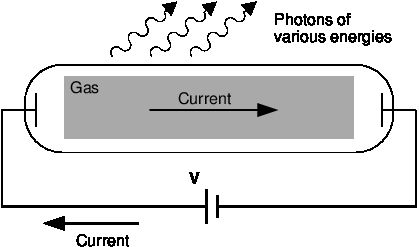
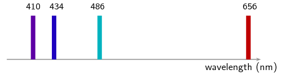
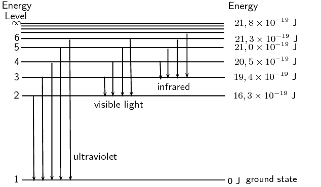
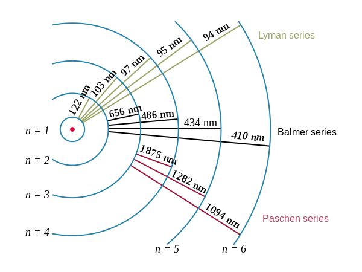
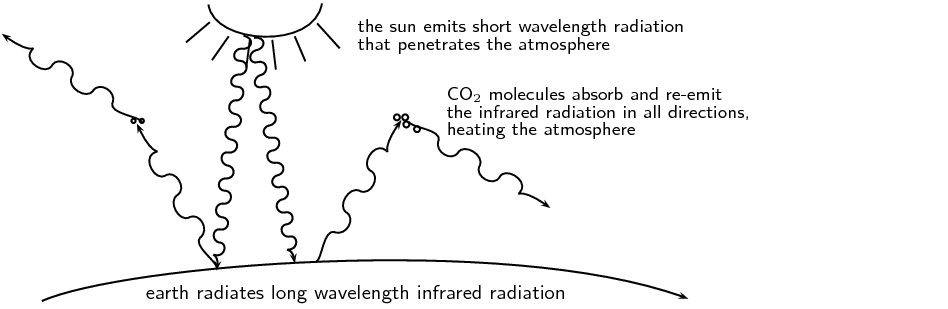

## 12.3 Emission and absorption spectra (ESCQR)

### Emission spectra (ESCQS)

You have learnt previously about the structure of an atom. The electrons
        surrounding the atomic nucleus are arranged in a series of levels of increasing
        energy. Each element has a unique number of electrons in a unique configuration
        therefore each element has its own distinct set of energy levels. This arrangement
        of energy levels serves as the atom's unique fingerprint.

In the early 1900s, scientists found that a liquid or solid heated to high
        temperatures would give off a broad range of colours of light. However, a gas
        heated to similar temperatures would emit light only at certain specific wavelengths
        (colours). The reason for this observation was not understood at the time.

Scientists studied this effect using a discharge tube.

Figure 12.5: Diagram of a discharge tube. The tube is filled with a gas. When a high
            enough voltage is applied across the tube, the gas ionises and acts like a
            conductor, allowing a current to flow through the circuit. The current excites
            the atoms of the ionised gas. When the atoms fall back to their ground state,
            they emit photons to carry off the excess energy.

A discharge tube (shown in Figure 12.5) is a
        gas-filled, glass tube with a metal plate at both ends. If a large enough voltage difference
        is applied between the two metal plates, the gas atoms inside the tube will absorb
        enough energy to make some of their electrons come off, i.e. the gas atoms are ionised.
        These electrons start moving through the gas and create a current, which raises some
        electrons in other atoms to higher energy levels. Then as the electrons in the atoms
        fall back down, they emit electromagnetic radiation (light). The amount of light
        emitted at different wavelengths, called the **emission
          spectrum**, is shown for a discharge tube filled with hydrogen gas in
        Figure 12.6 below. Only certain wavelengths (i.e. colours)
        of light are seen, as shown by the lines in the picture.

Figure 12.6: Diagram of the emission spectrum of hydrogen in the visible spectrum. Four lines are visible,
            and are labelled with their wavelengths. The three lines in the \(\text{400}\)–\(\text{500}\)
            \(\text{nm}\) range are in the blue part of the spectrum, while the higher line (\(\text{656}\)
            \(\text{nm}\)) is in the red/orange part.

Eventually, scientists realised that these lines come from photons of
        a specific energy, emitted by electrons making transitions between specific
        energy levels of the atom. Figure 12.7 shows an example
        of this happening. When an electron in an atom falls from a higher energy
        level to a lower energy level, it emits a photon to carry off the extra energy.
        This photon's energy is equal to the energy difference between the two energy
        levels
        (\(\Delta E\)).

      \[\Delta E_{\text{electron}} = E_f - E_i\]

As we previously discussed, the frequency of a photon is related to its
        energy through the equation \(E=hf\). Since a specific photon
        frequency (or wavelength) gives us a specific colour, we can see how each
        coloured line is associated with a specific transition.

Figure 12.7: In the first diagram are shown some of the electron energy levels for the
            hydrogen atom. The arrows show the electron transitions from higher energy
            levels to lower energy levels. The energies of the emitted photons are the
            same as the energy difference between two energy levels. You can think of
            absorption as the opposite process. The arrows would point upwards and the
            electrons would jump up to higher levels when they absorb a photon of the
            right energy. The second representation shows the wavelengths of the light
            that is emitted for the the various transitions. The transistions are
            grouped into a series based on the lowest level involved in the transition.

Visible light is not the only kind of electromagnetic radiation emitted. More energetic or less energetic
        transitions can produce ultraviolet or infrared radiation. However, because each atom has its own distinct set
        of energy levels (its fingerprint!), each atom has its own distinct emission spectrum.

<QuizCard id="s12-12-03a" title="Interactive Exercise 12.6" question="An electron moves from \(E_{3}\) to \(E_{2}\) . What is the difference in energy for this transition?" options=["neither", "absorption", "emission"] answer="-1.9" hint="You should enter a number here. If you want to, you can use a space to separate thousands.                Example: 12 800,25 For scientific notation you need to use the multiply symbol                ( ∗ ) and the exponent symbol ( ^ ). For example 6,673 × 10 −11 should be written as: 6,673 ∗ 10^−11" explanation="Interpret the diagram and work out how to answer the question We first need to understand what we are being asked to calculate. We are asked to find the difference between \(E_{3}\) and \(E_{2}\) . So we need to find the energy of \(E_{3}\) and the energy of \(E_{2}\) . Then we need to subtract these energies. The diagram shows the energy levels for hydrogen. Each energy level has an energy associated with it. This energy is the amount of energy needed to excite an electron to that energy level from the ground state. So for example the energy shown for energy level four is the amount of energy that is needed to excite an electron to the fourth energy level from the ground state. Since we are interested in the difference in energy between two energy states we can simply read off the energy for each energy level and subtract these values to get the difference. Use the definition of change in energy as the difference between final and initial energies For energy level 3 the energy is \(\text{12,1}\ \text{eV}\) and for energy level 2 the energy is \(\text{10,2}\ \text{eV}\) . Therefore the difference is: \[ 				\begin{aligned} 				\Delta E & = E_{2} - E_{3} \\ 				& = \text{10,2}\ \text{eV} - \text{12,1}\ \text{eV} \\ 				& = -\text{1,9}\ \text{eV} 				\end{aligned} 			  \] Notice that it does not matter what units we use so long as we use the same unit for both energies. Submit your answer as:" />

### Absorption spectra (ESCQT)

Atoms do not only emit photons; they also absorb photons. If a photon hits an
        atom and the energy of the photon is the same as the gap between two electron energy
        levels in the atom, then the electron in the lower energy level can absorb the photon
        and jump up to the higher energy level. If the photon energy does not correspond
        to the difference between two energy levels then the photon will not be absorbed (it
        can still be scattered).

Using this effect, if we have a source of photons of various energies we can
        obtain the **absorption spectra** for different materials.
        To get an absorption spectrum, just shine white light on a sample of the material that
        you are interested in. White light is made up of all the different wavelengths of
        visible light put together. In the absorption spectrum there will be gaps.
        The gaps correspond to energies (wavelengths) for which there is a corresponding
        difference in energy levels for the particular element.

The absorbed photons show up as black lines because the photons of these wavelengths
        have been absorbed and do not show up. Because of this, the absorption spectrum is
        the exact *inverse* of the emission spectrum.
        Look at the two figures below. In Figure 12.8 you can see
        the line emission spectrum of hydrogen. Figure 12.9 shows
        the
        absorption spectrum. It is the exact opposite of the emission spectrum! Both emission
        and absorption techniques can be used to get the same information about
        the energy levels of an atom.

*Emission* spectrum of Hydrogen.

*Absorption* spectrum of Hydrogen.

The dark lines correspond to the frequencies of light that have been
        absorbed by the gas. As the photons of light are absorbed by electrons, the electrons
        move into higher energy levels. This is the opposite process of emission.

The dark lines, absorption lines, correspond to the frequencies of the emission
        spectrum of the same element. The amount of energy absorbed by the electron to move
        into a higher level is the same as the amount of energy released when returning to the
        original energy level.

<Callout type="tip" title="Worked example 4: Absorption">
**Question:**
I have an unknown gas in a glass container. I shine a bright white light
            through one side of the container and measure the spectrum of transmitted light.
            I notice that there is a black line
            (*absorption* line) in the middle of the
            visible red band at \(\text{642}\) \(\text{nm}\).
            I have a hunch that the gas might be hydrogen. If I am correct, between which
            2 energy levels does this transition occur? (Hint: look
            at Figure 12.7 and the transitions which are in the visible
            part of the spectrum.)

**What is given and what needs to be done?:**
We have an absorption line at \(\text{642}\) \(\text{nm}\). This means that the substance in the glass
            container absorbed photons with a wavelength of 642 nm.
            We need to calculate which 2 energy levels of hydrogen this transition would correspond to. Therefore we
            need to know what energy the absorbed photons had.

**Calculate the energy of the absorbed photons:**
\begin{align*}
          E& = \frac{hc}{\lambda }\\
          & = \frac{\left(\text{6,63} \times \text{10}^{-\text{34}}\right)\times \left(\text{3} \times
          \text{10}^{\text{8}}\right)}{\text{642} \times \text{10}^{-\text{9}}}\\
          & = \text{3,1} \times \text{10}^{-\text{19}}\text{ J}
          \end{align*}

The absorbed photons had an energy of \(\text{3,1} \times \text{10}^{-\text{19}}\) \(\text{J}\).

**Find the energy of the transitions resulting in radiation at visible wavelengths:**
Figure 12.7 shows various energy level
            transitions. The transitions related to visible wavelengths are marked as
            the transitions beginning or ending on Energy Level 2.
            Let us find the energy of those transitions and compare with the energy of
            the absorbed photons we have just calculated.

Energy of transition (absorption) from Energy Level 2 to Energy Level 3:

          \begin{align*}
          \Delta E_{electron} = {E}_{2,3}& = {E}_{2}-{E}_{3}\\
          & = \text{16,3} \times \text{10}^{-\text{19}}- \text{19,4} \times \text{10}^{-\text{19}}\\
          & = -\text{3,1} \times \text{10}^{-\text{19}}\text{ J}
          \end{align*}

Therefore the energy of the photon that an electron must absorb to jump from Energy Level 2 to Energy Level
            3 is \(\text{3,1} \times \text{10}^{-\text{19}}\) \(\text{J}\).
            (NOTE: The minus sign means that *absorption* is occurring.)

This is the same energy as the photons which were absorbed by the gas in the container! Therefore, since
            the transitions of all elements are unique, we can say that the gas in the container is hydrogen. The
            transition is absorption of a photon between Energy Level 2 and Energy Level 3.
</Callout>

<Callout type="note" title="Note">
The energy of the photon does not correspond to the energy of an energy level, it
          corresponds to the **difference** in energy between two
          energy levels.
</Callout>

<QuizCard id="s12-12-03b" title="Interactive Exercise 12.7" question="Are the above line spectra emission or absorption line spectra?" options=["emission", "absorption", "H", "I"] answer="
                        0
                    " hint="" explanation="What is the difference between emission and absorption spectra? A line emission spectrum shows the specific wavelengths, frequencies, or energies of light that are produced when atoms emit light. A line absorption spectrum shows the specific wavelengths, frequencies, or energies of light that are absorbed by atoms when light is shone on them. Both emission and absorption spectra show characteristic lines that are unique to a given element . These lines occur at the same positions in the emission and absorption spectra for a given element. For example, the following spectra are for hydrogen . The white emission lines in the emission spectrum show the specific energies of light that were observed . The black absorption lines in the absorption spectrum show the specific energies of light that were not observed . This light couldn't be observed because it was absorbed by hydrogen atoms! So the line spectra provided are emission spectra. Submit your answer as: emission" />

### Applications of emission and absorption spectra (ESCQV)

The study of spectra from stars and galaxies in astronomy is i
        called *spectroscopy*. Spectroscopy is a
        tool widely used in astronomy to learn different things about astronomical objects.

#### Identifying elements in astronomical objects using their spectra

Measuring the spectrum of light from a star can tell astronomers what the
          star is made of. Since each element emits or absorbs light only at particular
          wavelengths, astronomers can identify what elements are in the stars from
          the lines in their spectra. From studying the spectra of many stars we know
          that there are many different types of stars which contain different
          elements and in different amounts.

#### Determining velocities of galaxies using spectroscopy

You have already learnt in [Chapter 6](/read/science/grade-12/doppler-effect)
          about the Doppler
          effect and how the frequency (and wavelength) of sound waves changes
          depending on whether the object emitting the sound is moving
          *towards* or
          *away* from you. The same thing happens
          to electromagnetic radiation (light). If the object emitting the light is
          moving *towards* us, then the wavelength
          of the light appears shorter (called **blueshifted**).
          If the object is moving *away* from us,
          then the wavelength of its light appears stretched out
          (called **redshifted**).

The Doppler effect affects the spectra of objects in
          space depending on their motion relative to us on the earth. For
          example, the light from a distant galaxy that is moving away from us
          at some velocity will appear redshifted. This means that the emission
          and absorption lines in the galaxy's spectrum will be shifted to a longer
          wavelength (lower frequency). Knowing where each line in the spectrum
          would normally be if the galaxy was not moving and comparing it to
          the redshifted position, allows astronomers to precisely measure the velocity
          of the galaxy relative to the Earth.

#### Global warming and greenhouse gases

The sun emits radiation (light) over a range of wavelengths that
          are mainly in the visible part of the spectrum. Radiation at these
          wavelengths passes through the gases of the atmosphere to warm the
          land and the oceans below. The warm earth then radiates this heat
          at longer infrared wavelengths. Carbon dioxide (one of the main
          greenhouse gases) in the atmosphere has energy levels that correspond
          to the infrared wavelengths that allow it to absorb the infrared radiation.
          It then also emits at infrared wavelengths in all directions. This
          effect stops a large amount of the infrared radiation from getting out of the
          atmosphere, which causes the atmosphere and the earth to heat up. More
          radiation is coming in than is getting back out.

So increasing the amount of greenhouse gases in the atmosphere increases the amount of trapped infrared
          radiation and therefore the overall temperature of the earth. The earth is a very sensitive and complicated
          system upon which life depends and changing the delicate balances of temperature and atmospheric gas content
          may have disastrous consequences if we are not careful.

## Emission and absorption spectra

### Textbook Exercise 12.2

**Problem:**
Explain how atomic emission spectra arise and how they relate to each element on the periodic table.

**Solution:**
Atomic emission spectra arise from electrons dropping from higher energy levels to lower energy
                  levels within the atom, photons (light packets) with specific wavelengths are released. The energy
                  levels in an atom are specific/unique to each element on the periodic table therefore the wavelength
                  of light emitted can be used to determine which element the light came from.

**Problem:**
How do the lines on the atomic spectrum relate to electron transitions between energy levels?

**Solution:**
The lines on the atomic spectrum relate to electron transitions between energy levels, if the
                  electron drops an energy level a photon is released resulting in an emission line and if the electron
                  absorbs a photon and rises an energy level an absorption line is observed on the spectrum.

**Problem:**
Explain the difference between atomic absorption and emission spectra.

**Solution:**
The difference between absorption and emission spectra are that absorption lines are where light has
                  been absorbed by the atom thus you see a dip in the spectrum whereas emission spectra have spikes in
                  the spectra due to atoms releasing photons at those wavelengths.

**Problem:**
Describe how the absorption and emission spectra of the gases in the atmosphere give rise to the
                  Greenhouse Effect.

**Solution:**
The following needs to be in your answer: in what wavelength range the sunlight reaches the earth,
                  the absorption of the sunlight and the re-radiation as infrared light, and finally the scattering of
                  the infrared light by the carbon-dioxide and how this scattering contributes to the Greenhouse Effect.

**Problem:**
What colour is the light emitted by hydrogen when an electron makes the transition from energy level
                  5 down to energy level 2? (Use Figure 12.7 to find the
                  energy of the released photon.)

**Solution:**
\begin{align*}
                  \Delta E & = E_5 - E_2 \\
                  & = \text{21,0} \times \text{10}^{-\text{19}}\text{ J} - \text{16,3} \times
                  \text{10}^{-\text{19}}\text{ J} \\
                  & = \text{4,7} \times \text{10}^{-\text{19}}\text{ J}
                  \end{align*}

\begin{align*}
                  \lambda & = \frac{hc}{\Delta E} \\
                  & = \frac{(\text{6,63} \times \text{10}^{-\text{34}}\text{ m$^{2}$kg·s$^{-1}$})(\text{3}
                  \times \text{10}^{\text{8}}\text{ m·s$^{-1}$})}{\text{4,7} \times \text{10}^{-\text{19}}\text{
                  J}} \\
                  & = \text{423}\text{ nm}
                  \end{align*}
                  The colour of light emitted at \(\text{423}\) \(\text{nm}\) is violet.

**Problem:**
I have a glass tube filled with hydrogen gas. I shine white light onto the tube. The spectrum I then
                  measure has an absorption line at a wavelength of 474 nm. Between which two energy levels did the
                  transition occur? (Use Figure 12.7 in solving the
                  problem.)

**Solution:**
\begin{align*}
                  \Delta E & = \frac{hc}{\lambda} \\
                  & = \frac{(\text{6,63} \times \text{10}^{-\text{34}}\text{ m$^{2}$kg·s$^{-1}$})(\text{3}
                  \times \text{10}^{\text{8}}\text{ m·s$^{-1}$})}{\text{474} \times \text{10}^{-\text{9}}\text{
                  nm}}\\
                  & = \text{4,20} \times \text{10}^{-\text{19}}\text{ J}
                  \end{align*}
                  This energy interval corresponds to a transition from energy level 4 to energy level 2.
