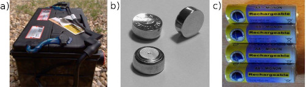
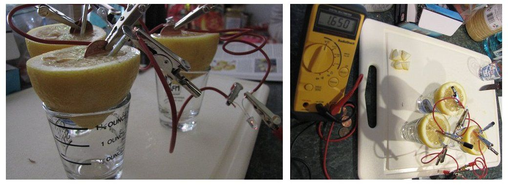
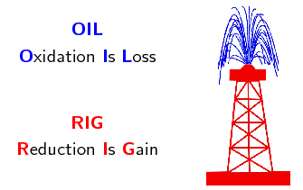

# Chapter 13: Electrochemical reactions

This section is allocated \(\text{8}\) hours in CAPS and covers electrochemical reactions, the
                        galvanic cell, the electrolytic cell, and applications of electrochemistry. The first step
                        should be to revise redox reactions, oxidation numbers, and oxidation and reduction before
                        continuing with the chapter. Note that the sections are not ordered in this way in the CAPS
                        document, but learners are more likely to struggle if you do not revise these concepts first. A
                        good understanding of these topics is essential.

The chapter ends with applications of electrochemisty in industry, this is a good opportunity to make
                        sure the learners understand the principles, but it is not necessary for them to learn the
                        reactions by heart or study the industry itself.

The following topics are covered in this chapter.

- **Revision of oxidation, reduction and redox reactions**
  It is important to revise the concepts of oxidation number, oxidation and reduction
                                          reactions, as well as how to write and balance redox reactions and
                                          half-reactions. An understanding of these concepts is very important in every
                                          aspect of this chapter.
- **Galvanic and electrolytic cells**
  This section introduces the concept of an electrochemical reaction, it may be worth a
                                          brief revision of the zinc-copper experiment performed in Grade 11. Two types of
                                          electrochemical cell are covered: galvanic cells and electrolytic cells.
                                          Galvanic cells convert chemical potential energy to electrical potential energy,
                                          while electrolytic cells convert electrical potential energy to chemical
                                          potential energy. Learners should be able to draw and label a simple diagram of
                                          both of these types of cells and write the standard cell notation for the cell.
- **Processes in electrochemical cells**
  This section is a more indepth look at the oxidation and reduction reactions taking
                                          place at the anode and cathode in electrochemical cells. Learners should be able
                                          to predict whether an electrode is the anode or cathode depending on the
                                          half-reaction taking place there. They must also know which half-reaction will
                                          take place at the anode and which will take place at the cathode.
- **Effects of current and potential on rate and equilibrium**
  Learners should understand that when a cell is *flat* the reactions inside are
                                          in equilibrium and the concentration of the reactants and products are constant.
                                          There is no potential difference and so no current can flow. The more current
                                          there is, the faster the electrons are flowing and the higher the rate of the
                                          reaction must be. None of the cells they deal with in this chapter are in
                                          equilibrium, because then there would be nothing to measure.
- **Standard electrode potentials**
  A standard hydrogen electrode is used to help determine the EMF of cells. The
                                          learners should understand that the electrode potentials in the table of
                                          standard electrode potentials are **relative** electrode
                                          potentials, and allow us to compare different metals without having to set up a
                                          new reaction each time. They should realise that the table provided is for the
                                          reduction half-reactions and that the oxidation half-reaction table would have
                                          the reactions reversed and the \(E^{\circ}\) V value with the opposite sign.
                                          They need to be able to use the table to:
  - determine which metal is more likely to be reduced or oxidised when
                                                            comparing two metals
  - and determine whether a reaction is spontaneous or not.
- **Applications of electrochemistry**
  The applications covered in this section are electroplating, the chloralkali
                                          industry, and the extraction of aluminium. The learners should understand the
                                          processes involved, but do not need to memorise the exact reactions, and need
                                          not study the industries themselves.

There are several experiments in this chapter. The learners will be using dangerous chemicals and
                        should be properly instructed on the correct use of safety equipment, including safety goggles,
                        gloves and protective clothing. They should also be reminded not to sniff any chemicals as the
                        fumes can be dangerous as well. More information on laboratory procedures as well as safety
                        precautions is provided in Chapter 1 (Science skills).

The informal experiment is the electrolysis of sodium iodide and water. It is a very effective
                        experiment, and should be easy to perform. The learners will need to be careful as they handle
                        concentrated sulfuric acid. It is advisable to test that current will run through the pencils
                        before the experiment, in case the pencil lead is broken inside. If you have access to graphite
                        rods these can be used instead.

We use batteries throughout our day-to-day lives. Cell phones use lithium-ion batteries, cars use lead-acid
                batteries (Figure 13.1 (left)),
                while silver-oxide batteries (Figure
                        13.1 (top right)) are used in watches. Some batteries are rechargeable (Figure 13.1 (bottom right)),
                while others cannot be recharged and have to be thrown away.

Figure 13.1: **a)** A car battery, **b)** rechargeable AA batteries
                                and
                                **c)** watch batteries.

A battery consists of multiple **electrochemical cells**. And within each cell there are
                **electrochemical reactions** taking place. This can be seen in the *lemon battery*
                experiment shown in Figure 13.2.
                Each lemon is a cell in the battery, which consists of three lemon cells. The reactions the copper and
                zinc undergo in the lemons are electrochemical reactions, and a current is produced.

Figure 13.2: A current is produced by connecting lemons with zinc and copper metal. The
                                reactions taking place here are electrochemical reactions.

Electrochemical reactions, and electrochemical cells are covered in this chapter. Before going into any more
                detail however, it is important to revise oxidation and reduction, as well as redox reactions and how to
                balance them, as these concepts are very important in electrochemistry.

## 13.1 Revision of oxidation and reduction (ESCQX)

<QuizCard id="s12-13-01a" title="Interactive Exercise 13.1" question="Adapted from DBE Nov 2016 Grade 12, P2, Q1.1 Physical constants \(·\) Chemistry formulas \(·\) Periodic table \(·\) Standard reduction potentials In a chemical reaction an oxidising agent will ... A donate protons. B donate electrons. C accept protons. D accept electrons." options=["A", "B", "C", "D"] answer="
                    3
                " hint="" explanation="Recall the basics of reduction and oxidation Reduction and oxidation involve a transfer of electrons . Reduction is the gain of electrons. An oxidising agent is itself reduced and accepts electrons. Oxidation is the loss of electrons. A reducing agent is itself oxidised and donates electrons. Apply the basics of reduction and oxidation In a chemical reaction an oxidising agent will ... A donate protons. B donate electrons. C accept protons. D \({\color{red}{{\checkmark}{\checkmark}}}\) accept electrons. So the correct choice is Option D . Submit your answer as: D" />

<QuizCard id="s12-13-01a" title="Interactive Exercise 13.1" question="Adapted from DBE Nov 2015 Grade 11, P2, Q9 Physical constants \(·\) Chemistry formulas \(·\) Periodic table \(·\) Standard reduction potentials In the reaction below, a reducing agent and an oxidising agent react with each other and a redox reaction takes place. Cu + (aq) \(\:+\:\) Fe 3+ (aq) \(\rightarrow\) \(\downarrow\) Cu 2+ (aq) \(\:+\:\) Fe 2+ (aq) Define the term reducing agent ." options=[] answer="
                    1
                " hint="" explanation="Define a reducing agent A reducing agent donates electrons to another substance which decreases the oxidation number of the other substance . The reducing agent is itself oxidised. The above definition means that the reducing agent causes another species to be reduced.                     This is why it is called the reducing agent! NOTE: In the given equation, Cu + (aq) loses an electron                     to form Cu 2+ (aq) . It is oxidised, so it is the                     reducing agent. Submit your answer as: donates electrons to another substance." />

You should remember the terms *oxidation* and *reduction* from Grade 11:

- \(\color{blue}{\textbf{Oxidation}}\) involves a **loss of electrons**
- \(\color{red}{\textbf{Reduction}}\) involves a **gain of electrons**.

An easy way to remember this is:

In both oxidation and reduction a **transfer of electrons** is involved resulting in a
                        change in the oxidation state of the elements.

- An element or compound that **loses** electrons is
                                          \(\color{blue}{\textbf{oxidised}}\).
  e.g. \(\color{blue}{\textbf{Zn(s)} \to {\textbf{Zn}}^{\textbf{2+}}
                                          \textbf{(aq) + 2e}^{\textbf{-}}}\)
  As it loses electrons it *gives* them away to another element or compound and
                                          the element or compound it gives the electrons to is
                                          \(\color{red}{\textbf{reduced}}\).
  This makes the compound or element which loses electrons a
                                          \(\color{blue}{\textbf{reducing agent}}\).
- An element or compound that **gains** electrons is
                                          \(\color{red}{\textbf{reduced}}\).
  e.g. \(\color{red}{\textbf{Cu}^{\textbf{2+}}{\textbf{(aq) + 2e}}^{\textbf{-}} \to
                                          \textbf{Cu(s)}}\)
  As it gains electrons it *takes* them away from another element or compound
                                          and the element or compound it takes them from is
                                          \(\color{blue}{\textbf{oxidised}}\).
  This makes the compound or element which gains electrons an
                                          \(\color{red}{\textbf{oxidising agent}}\).

## Oxidation and reduction

### Textbook Exercise 13.1

Define the following terms:

**Problem:**
oxidation

**Solution:**
Oxidation is the loss of electrons by a molecule, atom or
                                                                ion.

**Problem:**
reduction

**Solution:**
Reduction is the gain of electrons by a molecule, atom or
                                                                ion.

**Problem:**
oxidising agent

**Solution:**
The molecule, atom or ion that is reduced, or the molecule,
                                                                atom or ion that causes oxidation.

**Problem:**
reducing agent

**Solution:**
The molecule, atom or ion that is oxidised, or the molecule,
                                                                atom or ion that causes reduction.

In each of the following reactions say whether the reactant
                                                        **iron species** (\(\text{Fe}\),
                                                        \(\text{Fe}^{2+}\), \(\text{Fe}^{3+}\)) is oxidised or reduced.

**Problem:**
\(\text{Fe}(\text{s})\) \(\to\) \(\text{Fe}^{2+}(\text{aq}) +
                                                                2\text{e}^{-}\)

**Solution:**
The oxidation number of \(\text{Fe}\) in:

- \(\text{Fe}(\text{s})\) is \(\text{0}\)
- \(\text{Fe}^{2+}(\text{aq})\) is
                                                                                  \(\text{+2}\)

\(\text{Fe}(\text{s})\) \(\to\) \(\text{Fe}^{2+}(\text{aq}) +
                                                                2\text{e}^{-}\)

\(\text{Fe}\) loses two electrons to become
                                                                \(\text{Fe}^{2+}\). The iron species
                                                                (\(\text{Fe}(\text{s})\)) is oxidised.

**Problem:**
\(\text{Fe}^{3+}(\text{aq}) + \text{e}^{-}\) \(\to\)
                                                                \(\text{Fe}^{2+}(\text{aq})\)

**Solution:**
The oxidation number of \(\text{Fe}\) in:

- \(\text{Fe}^{3+}(\text{aq})\) is
                                                                                  \(\text{+3}\)
- \(\text{Fe}^{2+}(\text{aq})\) is
                                                                                  \(\text{+2}\)

\(\text{Fe}^{3+}(\text{aq}) + \text{e}^{-}\) \(\to\)
                                                                \(\text{Fe}^{2+}(\text{aq})\)

\(\text{Fe}^{3+}\) gains one electron to become
                                                                \(\text{Fe}^{2+}\). The iron species
                                                                (\(\text{Fe}^{3+}(\text{aq})\)) is reduced.

**Problem:**
\(\text{Fe}_{2}\text{O}_{3}(\text{s}) +
                                                                3\text{CO}(\text{g})\) \(\to\) \(2\text{Fe}(\text{s}) +
                                                                3\text{CO}_{2}(\text{g})\)

**Solution:**
The oxidation number of \(\text{O}\) is \(-\text{2}\).
                                                                Therefore the oxidation number of \(\text{O}_{3}\) in
                                                                \(\text{Fe}_{2}\text{O}_{3}\) is \(-\text{6}\).

Therefore the oxidation number of \(\text{Fe}_{2}\) in
                                                                \(\text{Fe}_{2}\text{O}_{3}\) is \(\text{+6}\).

The oxidation number of \(\text{Fe}\) in:

- \(\text{Fe}_{2}\text{O}_{3}(\text{s})\) is
                                                                                  \(\text{+3}\)
- \(\text{Fe}(\text{s})\) is \(\text{0}\)

\(\text{Fe}^{3+}(\text{s}) + 3\text{e}^{-}\) \(\to\)
                                                                \(\text{Fe}(\text{s})\)

\(\text{Fe}^{3+}\) gains three electrons to become
                                                                \(\text{Fe}(\text{s})\). The iron species
                                                                (\(\text{Fe}^{3+}(\text{s})\)) is
                                                                **reduced**.

**Problem:**
\(\text{Fe}^{2+}(\text{aq})\) \(\to\)
                                                                \(\text{Fe}^{3+}(\text{aq}) + \text{e}^{-}\)

**Solution:**
The oxidation number of \(\text{Fe}\) in:

- \(\text{Fe}^{2+}(\text{aq})\) is
                                                                                  \(\text{+2}\)
- \(\text{Fe}^{3+}(\text{aq})\) is
                                                                                  \(\text{+3}\)

\(\text{Fe}^{2+}(\text{aq})\) \(\to\)
                                                                \(\text{Fe}^{3+}(\text{aq}) + \text{e}^{-}\)

\(\text{Fe}^{2+}\) loses an electron to become
                                                                \(\text{Fe}^{3+}\). The iron species
                                                                (\(\text{Fe}^{2+}(\text{aq})\)) is
                                                                **oxidised**.

**Problem:**
\(\text{Fe}_{2}\text{O}_{3}(\text{s}) +
                                                                2\text{Al}(\text{s})\) \(\to\)
                                                                \(\text{Al}_{2}\text{O}_{3}(\text{s}) +
                                                                2\text{Fe}(\text{s})\)

**Solution:**
The oxidation number of \(\text{O}\) is \(-\text{2}\).
                                                                Therefore the oxidation number of \(\text{O}_{3}\) in
                                                                \(\text{Fe}_{2}\text{O}_{3}\) is \(-\text{6}\).

Therefore the oxidation number of \(\text{Fe}_{2}\) in
                                                                \(\text{Fe}_{2}\text{O}_{3}\) is \(\text{+6}\).

The oxidation number of \(\text{Fe}\) in:

- \(\text{Fe}_{2}\text{O}_{3}(\text{s})\) is
                                                                                  \(\text{+3}\)
- \(\text{Fe}(\text{s})\) is \(\text{0}\)

\(\text{Fe}^{3+}(\text{s}) + 3\text{e}^{-}\) \(\to\)
                                                                \(\text{Fe}(\text{s})\)

\(\text{Fe}^{3+}\) gains three electrons to become
                                                                \(\text{Fe}(\text{s})\). The iron species
                                                                (\(\text{Fe}^{3+}(\text{aq})\)) is
                                                                **reduced**.
