## 13.3 Galvanic and electrolytic cells (ESCR3)

### Electrochemical reactions (ESCR4)

In Grade 11, you carried out an experiment to see what happens when zinc granules are added
                                to a solution of copper(II) sulfate.

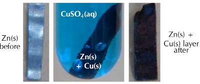

Figure 13.3: When a sheet of zinc is placed in an aqueous solution of
                                                copper(II) sulfate, solid copper forms on the zinc sheet.

(Screenshots taken from a video by Aaron Huggard on Youtube)

<Callout type="note" title="Note">
<VideoPlayer src="https://www.youtube.com/embed/JYLtXWDZ2sU" title="Video:
                                                27ZX" />
</Callout>

In the experiment, the \(\text{Cu}^{2+}\) ions from the \(\color{blue}{\textbf{blue
                                copper(II) sulfate}}\) solution were reduced (gained electrons) to copper metal, which
                                was then deposited as a layer on the solid zinc. The zinc atoms were oxidised (lost
                                electrons) to form \(\text{Zn}^{2+}\) ions in the solution.
                                \(\text{Zn}^{2+}(\text{aq})\) is colourless, therefore the blue solution lost colour. As
                                discussed in Grade 11, the half-reactions are as follows:

\(\text{Cu}^{2+}(\text{aq}) + 2\text{e}^{-}\) \(\to\) \(\text{Cu}(\text{s})\)
                                (\(\color{red}{\text{reduction half-reaction}}\))

\(\text{Zn}(\text{s})\) \(\to\) \(\text{Zn}^{2+}(\text{aq}) + 2\text{e}^{-}\)
                                (\(\color{blue}{\text{oxidation half-reaction}}\))

The overall redox reaction is:

\(\text{Cu}^{2+}(\text{aq}) + \text{Zn}(\text{s})\) \(\to\) \(\text{Cu}(\text{s}) +
                                \text{Zn}^{2+}(\text{aq})\)

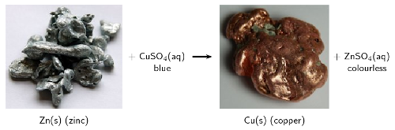

Figure 13.4: Solid zinc loses two electrons to form zinc ions
                                                (\(\text{Zn}^{2+}\)) in an aqueous solution of copper(II) sulfate. The
                                                copper ions (\(\text{Cu}^{2+}\)) gain two electrons and deposit as solid
                                                copper.

(Photos by benjah-bmm27 and Jurii on wikipedia)

Remember that there was an increase in the temperature of the reaction when you carried out
                                this experiment (it was exothermic). An exothermic reaction **releases
                                        energy**. This raises a few questions:

- Is it possible that this heat energy could be converted into electrical
                                                  energy?
- Can we use a chemical reaction with an exchange of electrons, to produce
                                                  electricity?
- If we supplied an electrical current could we *cause* some type of
                                                  chemical reaction to take place?

The answers to these questions are the focus of this chapter:

- The energy of a chemical reaction can be converted to electrical potential
                                                  energy, which forms an electric current.
- The transfer of electrons in a chemical reaction can cause electrical current
                                                  to flow.
- If you supply an electric current it can cause a chemical reaction to take
                                                  place, by supplying the electrons (and potential energy) necessary for
                                                  the reactions taking place within the cell.

These types of reactions are called **electrochemical reactions**. An
                                *electrochemical reaction* is a reaction where:

- a chemical reaction creates an *electrical potential difference*, and
                                                  therefore an electric current in the external conducting wires
  ***or***
- an electric current provides electrical potential energy and electrons, and
                                                  therefore a *chemical reaction takes place*

Electrochemical reaction

An electrochemical reaction involves a transfer of electrons. There is a
                                                conversion of chemical potential energy to electrical potential energy,
                                                **or** electrical potential energy to chemical potential
                                                energy.

**Electrochemistry** is the branch of chemistry that studies these
                                electrochemical reactions. An **electrochemical cell** is a device in which
                                electrochemical reactions take place.

Electrochemical cell

A device where electrochemical reactions take place.

<QuizCard id="s12-13-03a" title="Interactive Exercise 13.5" question="Complete the table comparing galvanic and electrolytic cells below. You may only use the following words: negative spontaneous non-spontaneous two half-cells batteries reduction separate oxidation electrical electrolysis chemical positive one cell same Galvanic cell Electrolytic cell Chemical reactions spontaneous reactions non-spontaneous reactions Energy changes chemical potential energy to 1. ____ energy electrical energy to chemical potential energy Anode has a negative charge, oxidation occurs at this electrode has a 2. ____ charge, 3. ____ occurs at this electrode Cathode has a 4. ____ charge, reduction at this electrode has a negative charge, 5. ____ at this electrode Cell set-up two half-cells, one electrode in each, connected by a salt bridge one cell, two electrodes, no salt bridge Electrolyte solution(s) separate electrolyte solutions connected by a salt bridge same electrolyte solution Applications batteries electrolysis" options=[] answer="
					electrical
				,
					positive
				,
					oxidation
				,
					positive
				,
					reduction
				" hint="" explanation="Galvanic cell Electrolytic cell Chemical reactions spontaneous reactions non-spontaneous reactions Energy changes Chemical potential energy to electrical energy Electrical energy to chemical potential energy Anode has a negative charge, oxidation occurs at this electrode has a positive charge, oxidation occurs at this electrode Cathode has a positive charge, reduction occurs at this electrode has a negative charge, reduction occurs at this electrode Cell set-up two half-cells, one electrode in each, connected by a salt bridge one cell, two electrodes, no salt bridge Electrolyte solution(s) Separate electrolyte solutions connected by a salt bridge Same electrolyte solution Applications batteries electrolysis Submit your answer as: and and and and" />

## Electrochemical reactions

### Textbook Exercise 13.3

In each of the following equations, say which elements in the
                                                                reactants are oxidised and which are reduced.

**Problem:**
\(\text{CuO}(\text{s}) + \text{H}_{2}(\text{g})\)
                                                                        \(\to\) \(\text{Cu}(\text{s}) +
                                                                        \text{H}_{2}\text{O}(\text{g})\)

**Solution:**
The oxidation number of \(\text{O}\) is
                                                                        \(-\text{2}\). \(\text{O}\) is neither oxidised
                                                                        nor reduced.

The oxidation number of \(\text{Cu}\) in:

- \(\text{CuO}(\text{s})\) is
                                                                                          \(\text{+2}\)
- \(\text{Cu}(\text{s})\) is
                                                                                          \(\text{0}\)

\(\text{Cu}^{2+}(\text{s}) + 2\text{e}^{-}\) \(\to\)
                                                                        \(\text{Cu}(\text{s})\)

\(\text{Cu}^{2+}\) gains two electrons to form
                                                                        \(\text{Cu}\). Copper is
                                                                        **reduced**

The oxidation number of \(\text{H}\) in:

- \(\text{H}_{2}(\text{g})\) is
                                                                                          \(\text{0}\)
- \(\text{H}_{2}\text{O}(\text{g})\) is
                                                                                          \(\text{+1}\)

\(\text{H}_{2}(\text{g})\) \(\to\)
                                                                        \(2\text{H}^{+}(\text{g}) + 2\text{e}^{-}\)

\(\text{H}_{2}\) loses two electrons to form
                                                                        \(2\text{H}^{+}\). Hydrogen is
                                                                        **oxidised**.

Note: Each hydrogen atom in \(\text{H}_{2}\) releases
                                                                        one electron, and these two electrons are taken
                                                                        up by a \(\text{Cu}^{2+}\) ion.

**Problem:**
\(2\text{NO}(\text{g}) + 2\text{CO}(\text{g})\)
                                                                        \(\to\) \(\text{N}_{2}(\text{g}) +
                                                                        2\text{CO}_{2}(\text{g})\)

**Solution:**
The oxidation number of \(\text{O}\) is
                                                                        \(-\text{2}\). \(\text{O}\) is neither oxidised
                                                                        nor reduced.

The oxidation number of \(\text{N}\) in:

- \(\text{NO}(\text{g})\) is
                                                                                          \(\text{+2}\)
- \(\text{N}_{2}(\text{g})\) is
                                                                                          \(\text{0}\)

\(2\text{N}^{2+}(\text{g}) + 4\text{e}^{-}\) \(\to\)
                                                                        \(\text{N}_{2}(\text{g})\)

Two \(\text{N}^{2+}\) each gain two electrons to
                                                                        become \(\text{N}_{2}\). Nitrogen is
                                                                        **reduced**.

The oxidation number of \(\text{C}\) in:

- \(\text{CO}(\text{g})\) is
                                                                                          \(\text{+2}\)
- \(\text{CO}_{2}(\text{g})\) is
                                                                                          \(\text{+4}\)

\(\text{C}^{2+}(\text{g})\) \(\to\)
                                                                        \(\text{C}^{4+}(\text{g}) + 2\text{e}^{-}\)

\(\text{C}^{2+}\) loses two electrons to form
                                                                        \(\text{C}^{4+}\). Carbon is
                                                                        **oxidised**.

**Problem:**
\(\text{Mg}(\text{s}) + \text{FeSO}_{4}(\text{aq})\)
                                                                        \(\to\) \(\text{MgSO}_{4}(\text{aq}) +
                                                                        \text{Fe}(\text{s})\)

**Solution:**
The oxidation number of the ion \(\text{SO}_{4}\) is
                                                                        \(-\text{2}\) as both a reactant and a product.

The oxidation number of \(\text{O}\) is
                                                                        \(-\text{2}\). \(\text{O}\) is neither oxidised
                                                                        nor reduced.

The oxidation number of \(\text{O}_{4}\) in
                                                                        \(\text{SO}_{4}^{2-}\) is \(-\text{8}\).
                                                                        Therefore the oxidation number of \(\text{S}\)
                                                                        in \(\text{SO}_{4}^{2-}\) is \(\text{+6}\).
                                                                        \(\text{S}\) is neither oxidised nor reduced.

The oxidation number of \(\text{Mg}\) in:

- \(\text{Mg}(\text{s})\) is
                                                                                          \(\text{0}\)
- \(\text{MgSO}_{4}(\text{aq})\) is
                                                                                          \(\text{+2}\)

\(\text{Mg}(\text{s})\) \(\to\)
                                                                        \(\text{Mg}^{2+}(\text{aq}) + 2\text{e}^{-}\)

\(\text{Mg}\) loses two electrons to become
                                                                        \(\text{Mg}^{2+}\). Magnesium is
                                                                        **oxidised**.

The oxidation number of \(\text{Fe}\) in:

- \(\text{FeSO}_{4}(\text{aq})\) is
                                                                                          \(\text{+2}\)
- \(\text{Fe}(\text{s})\) is
                                                                                          \(\text{0}\)

\(\text{Fe}^{2+}(\text{aq}) + 2\text{e}^{-}\) \(\to\)
                                                                        \(\text{Fe}(\text{s})\)

\(\text{Fe}^{2+}\) gains two electrons to become
                                                                        \(\text{Fe}\). Iron is **reduced**.

**Problem:**
\(\text{Zn}(\text{s}) + 2\text{AgNO}_{3}(\text{aq})\)
                                                                        \(\to\) \(2\text{Ag}(\text{s}) +
                                                                        \text{Zn}(\text{NO}_{3})_{2}(\text{aq})\)

**Solution:**
The oxidation number of the ion \(\text{NO}_{3}\) is
                                                                        \(-\text{1}\) as both a reactant and a product.

The oxidation number of \(\text{O}\) is
                                                                        \(-\text{2}\). \(\text{O}\) is neither oxidised
                                                                        nor reduced.

The oxidation number of \(\text{O}_{3}\) in
                                                                        \(\text{NO}_{3}\) is \(-\text{6}\). Therefore
                                                                        the oxidation number of \(\text{N}\) in
                                                                        \(\text{NO}_{3}^{-}\) is \(\text{+5}\).
                                                                        \(\text{N}\) is neither oxidised nor reduced.

The oxidation number of \(\text{Zn}\) in:

- \(\text{Zn}(\text{s})\) is
                                                                                          \(\text{0}\)
- \(\text{Zn}(\text{NO}_{3})_{2}(\text{aq})\)
                                                                                          is \(\text{+2}\)

\(\text{Zn}(\text{s})\) \(\to\)
                                                                        \(\text{Zn}^{2+}(\text{aq}) + 2\text{e}^{-}\)

\(\text{Zn}\) loses two electrons to become
                                                                        \(\text{Zn}^{2+}\). Zinc is
                                                                        **oxidised**.

The oxidation number of \(\text{Ag}\) in:

- \(\text{AgNO}_{3}(\text{aq})\) is
                                                                                          \(\text{+1}\)
- \(\text{Ag}(\text{s})\) is
                                                                                          \(\text{0}\)

\(\text{Ag}^{+}(\text{aq}) + \text{e}^{-}\) \(\to\)
                                                                        \(\text{Ag}(\text{s})\)

\(\text{Ag}^{+}\) gains an electron to form
                                                                        \(\text{Ag}\). Silver is
                                                                        **reduced**.

Note: The two electrons released by Zn are taken up
                                                                        by two \(\text{Ag}^{+}\) ions, this is shown in
                                                                        the balanced chemical equation.

**Problem:**
Which one of the substances listed below acts as the
                                                                oxidising agent in the following reaction?

\(3\text{SO}_{2}(\text{g}) +
                                                                \text{Cr}_{2}\text{O}_{7}^{2-}(\text{aq}) +
                                                                2\text{H}^{+}(\text{aq})\) \(\to\)
                                                                \(3\text{SO}_{4}^{2-}(\text{aq}) +
                                                                2\text{Cr}^{3+}(\text{aq}) +
                                                                \text{H}_{2}\text{O}(\text{ℓ})\)

2. \(\text{H}^{+}\)
4. \(\text{Cr}^{3+}\)
6. \(\text{SO}_{2}\)
8. \(\text{Cr}_{2}\text{O}_{7}^{2-}\)

**Solution:**
The oxidising agent causes another reactant to be oxidised
                                                                and is itself reduced.

\(\text{H}^{+}\) remains as \(\text{H}^{+}\) in
                                                                \(\text{H}_{2}\text{O}\)

\(\text{Cr}^{3+}\) is a product.

\(\text{SO}_{2}\) contains \(\text{S}^{4+}\), while
                                                                \(\text{SO}_{4}^{2-}\) contains \(\text{S}^{6+}\).
                                                                Therefore \(\text{S}^{4+}\) loses two electrons and is
                                                                oxidised.

\(\text{Cr}_{2}\text{O}_{7}^{2-}\) contains
                                                                \(\text{Cr}^{6+}\). Therefore \(\text{Cr}^{6+}\) gains
                                                                three electrons to become \(\text{Cr}^{3+}\) and is
                                                                reduced. It is the oxidising agent.

**d)** \(\text{Cr}_{2}\text{O}_{7}^{2-}\)

There are two types of electrochemical cells we will be looking more closely in this chapter:
                                **galvanic** and **electrolytic cells**. Before we go into
                                detail on galvanic and electrolytic cells you'll need to know a few definitions:

Electrode

An electrode is an electrical conductor that connects the electrochemical
                                                species from its solution to the external electrical circuit of the
                                                cell.

There are two types of electrodes in an electrochemical cell, the
                                \(\color{blue}{\textbf{anode}}\) and the \(\color{red}{\textbf{cathode}}\).

\(\color{blue}{\text{Oxidation}}\) always occurs at the \(\color{blue}{\textbf{anode}}\)
                                while \(\color{red}{\text{reduction}}\) always occurs at the
                                \(\color{red}{\textbf{cathode}}\). So when trying to determine which electrode you are
                                looking at first determine whether oxidation or reduction is occurring there. An easy
                                way to remember this is:

<Callout type="tip" title="Note">
**Oxidation** is the **loss of electrons**.

**Reduction** is the **gain of electrons**.

</Callout>

| \(\color{blue}{\textbf{O}}\)xidation
                                                                \(\color{blue}{\textbf{i}}\)s
                                                                \(\color{blue}{\textbf{l}}\)oss of electrons | \(\color{blue}{\textbf{OIL}}\) |
| --- | --- |
| \(\color{red}{\textbf{R}}\)eduction
                                                                \(\color{red}{\textbf{i}}\)s
                                                                \(\color{red}{\textbf{g}}\)ain of electrons | \(\color{red}{\textbf{RIG}}\) |
| \(\color{blue}{\textbf{O}}\)xidation is
                                                                \(\color{blue}{\textbf{l}}\)oss of electrons at the
                                                                \(\color{blue}{\textbf{a}}\)node | \(\color{blue}{\textbf{An Ox}}\) |
| \(\color{red}{\textbf{Red}}\)uction is gain of electrons at
                                                                the \(\color{red}{\textbf{cat}}\)hode | \(\color{red}{\textbf{Red Cat}}\) |

Table 13.1: A summary of phrases useful to help you remember the oxidation
                                                and reduction rules.

The electrode is placed in an **electrolyte** solution within the cell. If the
                                cell is made up of two compartments, those compartments will be connected by a
                                **salt bridge**.

Electrolyte

An electrolyte is a solution that contains free ions, and which therefore
                                                behaves as a conductor of charges (electrical conductor) in solution.

Salt bridge

A salt bridge is a material which contains electrolytic solution and acts as
                                                a connection between two half-cells (completes the circuit). It
                                                maintains electrical neutrality in and between the electrolytes in the
                                                half-cell compartments.

### Galvanic cells (ESCR5)

A **galvanic cell** (which is also sometimes referred to as a
                                **voltaic** or **wet** cell) consists of two half-cells, which
                                convert chemical potential energy into electrical potential energy.

Galvanic cell

A galvanic cell is an electrochemical cell which converts chemical potential
                                                energy to electrical potential energy through a spontaneous chemical
                                                reaction.

In a galvanic cell there are two half-cells. Each half-cell contains an electrode in an
                                electrolyte. The separation is necessary to prevent direct chemical contact of the
                                oxidation and reduction reactions, creating a potential difference. The electrons
                                released in the oxidation reaction travel through an external circuit (and do work)
                                before being used by the reduction reaction.

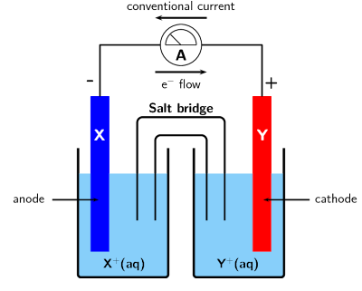

Figure 13.5: A sketch of a galvanic cell.

<Callout type="tip" title="Note">
Remember that cells are not two-dimensional, although when asked to sketch a cell you
                                        should draw it as shown in Figure 13.5 or Figure
                                                13.6.

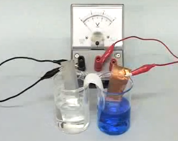
</Callout>

**In a galvanic cell** (for example the cell shown in Figure 13.5):

<Callout type="tip" title="Note">
The electrons released in the oxidation of \(\text{X}\) remain on the anode,
                                        \(\text{X}^{+}\) moves into solution.

The \(\text{Y}^{+}\) ions are being reduced at the cathode and forming solid
                                        \(\text{Y}\).

</Callout>

- The metal at the anode is \(\color{blue}{\textbf{X}}\).
                                                  \(\color{blue}{\textbf{Ox}}\)idation is loss of electrons at the
                                                  \(\color{blue}{\textbf{An}}\)ode.
  - The \(\color{blue}{\textbf{anode half-reaction}}\) is
                                                                    \(\color{blue}{{\textbf{X(s)}} \to
                                                                    {\textbf{X}}^{+}{\textbf{(aq) + e}}^{-}}\)
  - This half-reaction occurs in the half-cell containing the
                                                                    X(s) anode and the \(\text{X}^{+}(\text{aq})\)
                                                                    electrolyte solution.
  - The electrons released in the
                                                                    \(\color{blue}{\textbf{oxidation}}\) of the metal remain
                                                                    on the \(\color{blue}{\textbf{anode}}\), while the metal
                                                                    cations formed move into solution.
- The metal at the cathode is Y. \(\color{red}{\textbf{Red}}\)uction is gain of
                                                  electrons at the \(\color{red}{\textbf{Cat}}\)hode.
  - The \(\color{red}{\textbf{cathode half-reaction}}\) is
                                                                    \(\color{red}{{\textbf{Y}}^{+}{\textbf{(aq) + e}}^{-}
                                                                    \to {\textbf{Y(s)}}}\)
  - This half-reaction occurs in the half-cell containing the
                                                                    Y(s) cathode and the \(\text{Y}^{+}(\text{aq})\)
                                                                    electrolyte solution.
  - At the \(\color{red}{\textbf{cathode}}\) metal ions in the
                                                                    solution are being \(\color{red}{\textbf{reduced}}\)
                                                                    (accepting electrons) and deposited on the electrode.
- There are **more electrons** at the anode than at the cathode.
- Electrons will flow from areas of high concentration to areas of low
                                                  concentration, therefore the electrons move \(\color{blue}{\textbf{from
                                                  the anode}}\), through the external circuit, \(\color{red}{\textbf{to
                                                  the}}\) \(\color{red}{\textbf{cathode}}\)
- Conventional current is measured as a flow of positive charge and so is in
                                                  the opposite direction (from the cathode to the anode)

- The overall reaction is: **\(\text{X}(\text{s}) +
                                                          \text{Y}^{+}(\text{aq})\)** \(\to\)
                                                  **\(\text{X}^{+}(\text{aq}) + \text{Y}(\text{s})\)**.
- To represent this reaction using **standard cell notation** we
                                                  write the following:
  \(\color{blue}{\textbf{X(s)}}\)\(|\)\(\color{blue}{\textbf{X}^{+}{\textbf{(aq)}}}\)\(||\)\(\color{red}{\textbf{Y}^{+}{\textbf{(aq)}}}\)\(|\)\(\color{red}{\textbf{Y(s)}}\)
  By convention:
  - The \(\color{blue}{\textbf{anode}}\) is always written on the
                                                                    \(\color{blue}{\textbf{left}}\).
  - The \(\color{red}{\textbf{cathode}}\) is always written on
                                                                    the \(\color{red}{\textbf{right}}\).
  - The anode and cathode half-cells are divided by \(||\)
                                                                    representing the salt bridge.
  - The different phases within each half-cell (solid (s) and
                                                                    aqueous (aq) here) are separated by \(|\).
- The electrodes in each half-cell are connected through a wire in the external
                                                  circuit. There is also a salt bridge between the individual half-cells.

A galvanic cell uses the reactions that take place at at the two electrodes to produce
                                electrical energy, i.e. the reaction occurs without the need to add energy.

<Callout type="note" title="Note">
A spontaneous reaction is one that will occur without the need for external energy.
                                        Refer to the subsection on spontaneity for more information.
</Callout>

The zinc-copper reaction you performed in Grade 11 can be modified to make a galvanic cell.
                                Bars of zinc and copper are used as **electrodes**, with zinc(II) sulfate
                                and copper(II) sulfate solutions as the **electrolytes**.

In the galvanic cell experiment, make sure that the sodium chloride paste is highly
                                        concentrated and fills the U-tube for the best results.

## A galvanic cell

### Aim

To investigate the reactions that take place in a galvanic cell.

### Apparatus

- Zinc plate, copper plate, zinc(II) sulfate
                                                                  (\(\text{ZnSO}_{4}\)) solution (\(\text{1}\)
                                                                  \(\text{mol.dm$^{-3}$}\)), copper(II) sulfate
                                                                  (\(\text{CuSO}_{4}\)) solution (\(\text{1}\)
                                                                  \(\text{mol.dm$^{-3}$}\)), \(\text{NaCl}\) paste
- Measuring balance, two \(\text{250}\) \(\text{ml}\) beakers,
                                                                  U-tube, cotton wool, zero-centered ammeter, connecting
                                                                  wire.
- Cleaning ethanol, ether (if available)

### Method

2. Weigh the copper and zinc plates and record their mass.
4. Pour \(\text{200}\) \(\text{ml}\) of the zinc sulfate
                                                                   solution into a beaker and place the zinc plate in the
                                                                   beaker.
6. Pour \(\text{200}\) \(\text{ml}\) of the copper(II) sulfate
                                                                   solution into the second beaker and place the copper
                                                                   plate in the beaker.
   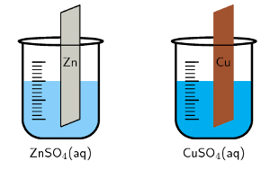
8. Fill the U-tube with the \(\text{NaCl}\) paste and seal the
                                                                   ends of the tubes with the cotton wool (making a
                                                                   salt-bridge). The cotton will help stop the paste from
                                                                   dissolving in the electrolyte.
   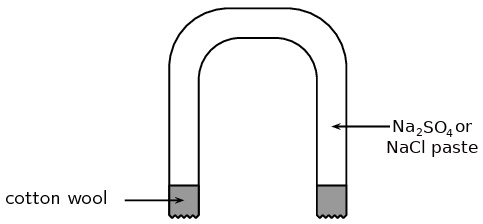
10. Connect the zinc and copper plates to the zero-centered
                                                                   ammeter and observe the ammeter.
12. Place the U-tube so that one end is in the copper(II) sulfate
                                                                   solution and the other end is in the zinc sulfate
                                                                   solution. Observe the ammeter.
   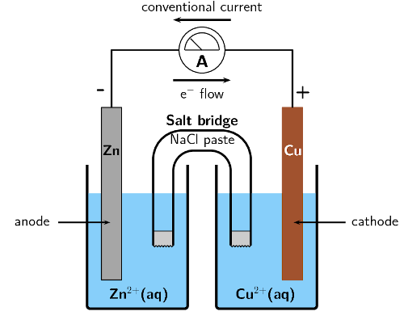
14. Take the ammeter away and connect the copper and zinc plates
                                                                   to each other directly using copper wire. Leave to stand
                                                                   for about one day.
16. After a day, remove the two plates and rinse them: first with
                                                                   distilled water, then with alcohol, and finally with
                                                                   ether (if available). Dry the plates using a hair dryer.
18. Weigh the zinc and copper plates and record their mass.

### Note

A voltmeter can also be used in place of the zero-centered ammeter. A
                                                zero-centered voltmeter will measure the potential difference across the
                                                cell (not the flow of electrons), while an ammeter will measure the
                                                current.

### Discussion

- Did the ammeter record a reading before the salt-bridge was
                                                                  placed in the solutions?
- Did the ammeter record a reading after the salt-bridge was
                                                                  placed in the solutions? If yes, in what direction does
                                                                  the current flow?
- Fill in the table below:
  | Plate | Initial mass | Final mass |
  | --- | --- | --- |
  | Zinc |  |  |
  | Copper |  |  |
- How did the mass of the zinc and copper plates change?
- Based on what you know of oxidation and reduction, why did
                                                                  those mass changes take place?
- Which electrode is the anode and which is the cathode?

### Results

During the experiment, you should have noticed the following:

- When the salt bridge was absent, there was no reading on the
                                                                  ammeter.
- When the salt bridge was connected, a reading was recorded on
                                                                  the ammeter.
- The direction of electron flow is from the zinc plate towards
                                                                  the copper plate, meaning that conventional current flow
                                                                  is from the copper plate towards the zinc plate.
- After the plates had been connected directly to each other
                                                                  and left for a day, there was a change in their mass.
                                                                  The mass of the zinc plate decreased, while the mass of
                                                                  the copper plate increased.
- \(\color{blue}{\textbf{O}}\)xidation
                                                                  \(\color{blue}{\textbf{i}}\)s
                                                                  \(\color{blue}{\textbf{l}}\)oss of electrons,
                                                                  \(\color{red}{\textbf{R}}\)eduction
                                                                  \(\color{red}{\textbf{i}}\)s
                                                                  \(\color{red}{\textbf{G}}\)ain of electrons.
  The zinc electrode lost mass. This implies that solid Zn
                                                                  metal atoms become ions and move into the electrolyte
                                                                  solution: \(\text{Zn}(\text{s})\) \(\to\)
                                                                  \(\text{Zn}^{2+}(\text{aq}) + 2\text{e}^{-}\). Oxidation
                                                                  occurs at the zinc electrode.
  The copper electrode gained mass. This implies that the Cu
                                                                  metal ions in the electrolyte solution become metal
                                                                  atoms and deposit on the electrode:
                                                                  \(\text{Cu}^{2+}(\text{aq}) + 2\text{e}^{-}\) \(\to\)
                                                                  \(\text{Cu}(\text{s})\). Reduction occurs at the copper
                                                                  electrode.
- \(\color{blue}{\textbf{Ox}}\)idation is loss of electrons at
                                                                  the \(\color{blue}{\textbf{an}}\)ode. Oxidation occurs
                                                                  at the zinc electrode, therefore the zinc plate is the
                                                                  anode.
  \(\color{red}{\textbf{Red}}\)uction is gain of electrons at
                                                                  the \(\color{red}{\textbf{cat}}\)hode. Reduction occurs
                                                                  at the copper electrode, therefore the copper plate is
                                                                  the cathode.
- When \(\text{Zn}(\text{s})\) \(\to\)
                                                                  \(\text{Zn}^{2+}(\text{aq}) + 2\text{e}^{-}\) the
                                                                  electrons are deposited on the anode, which becomes
                                                                  negatively charged.
  When \(\text{Cu}^{2+}(\text{aq}) + 2\text{e}^{-}\) \(\to\)
                                                                  \(\text{Cu}(\text{s})\) the electrons are taken from the
                                                                  cathode, which becomes positively charged.

### Conclusions

When a zinc(II) sulfate solution containing a zinc plate is connected by a
                                                salt bridge to a copper(II) sulfate solution containing a copper plate,
                                                reactions occur in both solutions. The decrease in mass of the zinc
                                                plate suggests that the zinc metal electrode has been oxidised to form
                                                \(\text{Zn}^{2+}\) ions in solution. The increase in mass of the copper
                                                plate suggests that reduction of \(\text{Cu}^{2+}\) ions has occurred
                                                here to produce more copper metal.

The important thing to notice in this experiment is that:

- the chemical reactions that take place at the two electrodes cause an
                                                  electric current to flow through the external circuit
- the overall reaction must be a spontaneous redox reaction
- **chemical energy** is converted to **electrical
                                                          energy**
- the zinc-copper cell is one example of a **galvanic cell**

<Callout type="note" title="Note">
It was the Italian physician and anatomist Luigi Galvani who marked the birth of
                                        electrochemistry by making a link between chemical reactions and electricity. In
                                        1780, Galvani discovered that when two different metals (copper and zinc for
                                        example) were connected to each other and then both touched to different parts
                                        of a nerve of a frog leg at the same time, they made the leg contract. He called
                                        this 'animal electricity'.

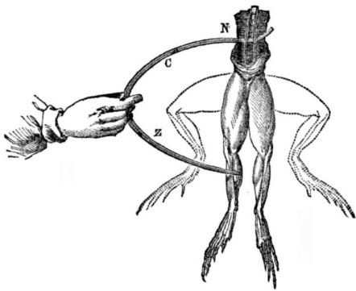
</Callout>

In the zinc-copper cell, the copper and zinc plates are the **electrodes**. The
                                salt bridge plays a very important role in a galvanic cell:

- An electrolyte solution consists of metal cations and spectator anions.
  \(\text{NaCl}(\text{aq})\) is \(\text{Na}^{+}(\text{aq})\) and
                                                  \(\text{Cl}^{-}(\text{aq})\) in the paste.
- There is a build up of positive charge in the \(\color{blue}{\textbf{anode
                                                  half-cell compartment}}\) as solid metal is
                                                  \(\color{blue}{\textbf{oxidised}}\) and the positive ions move into
                                                  solution. So there are more **postive metal ions** in the
                                                  electrolyte than negative ions.
  \(\color{blue}{\textbf{Zn(s)} \to \textbf{Zn}^{2+}\textbf{(aq)}}\), while the
                                                  number of \(\text{SO}_{4}^{2-}\) ions remains the same.
- To balance the charge, negative ions from the salt bridge move into the anode
                                                  half-cell compartment.
  \(\text{Cl}^{-}\) ions move from the salt bridge to the anode half-cell
                                                  compartment.
- There is a decrease in positive charge in the \(\color{red}{\textbf{cathode
                                                  half-cell compartment}}\) as metal ions are
                                                  \(\color{red}{\textbf{reduced}}\) and form solid metal. So there are
                                                  more **negative ions** in the electrolyte than positive
                                                  metal ions.
  \(\color{red}{\textbf{Cu}^{2+}\text{(aq)} \to \textbf{Cu(s)}}\), while the
                                                  number of \(\text{SO}_{4}^{2-}\) ions remains the same.
- To balance the charge, positive ions from the salt bridge move into the
                                                  cathode half-cell compartment.
  \(\text{Na}^{+}\) ions move from the salt bridge to the cathode half-cell
                                                  compartment.

The salt bridge acts as a transfer medium that allows ions to flow through without allowing
                                the different solutions to mix and react directly. It allows a balancing of the charges
                                in the electrolyte solutions, and allows the reactions in the cell to continue.

Without the salt bridge, the flow of electrons in the outer circuit stops completely. This is
                                because the salt bridge is needed to complete the circuit.

### Electrolytic cells (ESCR6)

In an **electrolytic cell** electrical potential energy is converted to chemical
                                potential energy. An electrolytic cell uses an electric current to force a particular
                                chemical reaction to occur, which would otherwise not take place.

Electrolytic cell

An electrolytic cell is an electrochemical cell that converts electrical
                                                potential energy to chemical potential energy by using electricity to
                                                drive a non-spontaneous chemical reaction.

<Callout type="note" title="Note">
Sometimes galvanic cells are just called electrochemical cells. While they are
                                        electrochemical cells, electrolytic cells are also electrochemical cells.
                                        Electrolytic and galvanic cells are not the same however.
</Callout>

An electrolytic cell is activated by applying an electrical potential across the electrodes
                                to force an internal chemical reaction between the electrodes and the ions that are in
                                the electrolyte solution. This process is called **electrolysis**.

Electrolysis

Electrolysis is a method of driving chemical reactions by passing an electric
                                                current through an electrolyte.

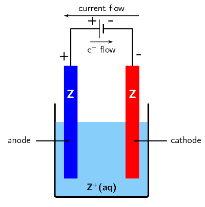

Figure 13.6: A sketch of an electrolytic cell.

**In an electrolytic cell** (for example the cell shown in Figure 13.6):

- The electrolyte solution consists of the metal cations and spectator anions.
- The oxidation and reduction reactions occur in the same container but are
                                                  non-spontaneous.They require the electrodes to be connected to an
                                                  external power source to proceed.
- The electrodes in an electrolytic cell can be the same metal or different
                                                  metals. The prinicple is the same. Let there be only one metal, and let
                                                  that metal be Z.
- An electrode is connected to the \(\color{blue}{\textbf{positive terminal}}\)
                                                  of the battery.
  - To balance the charge at the \(\color{blue}{\textbf{positive
                                                                    electrode}}\) metal atoms are
                                                                    \(\color{blue}{\textbf{oxidised}}\) to form metal ions.
                                                                    The ions move into solution, leaving their electrons on
                                                                    the electrode.
  - The following reaction takes place:
                                                                    \(\color{blue}{\textbf{Z(s)} \to
                                                                    {\textbf{Z}}^{+}{\textbf{(aq)}} + {\textbf{e}}^{-}}\)
  - \(\color{blue}{\textbf{Ox}}\)idation is loss at the
                                                                    \(\color{blue}{\textbf{an}}\)ode, therefore this
                                                                    electrode is the \(\color{blue}{\textbf{anode}}\).
- An electrode is connected to the \(\color{red}{\textbf{negative terminal}}\)
                                                  of the battery.
  - When positive ions come in contact with the
                                                                    \(\color{red}{\textbf{negative electrode}}\) the ions
                                                                    gain electrons and are
                                                                    \(\color{red}{\textbf{reduced}}\).
  - The following reaction takes place:
                                                                    \(\color{red}{\textbf{Z}^{+}{\textbf{(aq)}} +
                                                                    {\textbf{e}}^{-} \to {\textbf{Z(s)}}}\)
  - \(\color{red}{\textbf{Red}}\)uction is gain at the
                                                                    \(\color{red}{\textbf{cat}}\)hode, therefore this
                                                                    electrode is the \(\color{red}{\textbf{cathode}}\).
- This means that the overall reaction is: \(\text{Z}(\text{s}) +
                                                  \text{Z}^{+}(\text{aq})\) \(\to\) \(\text{Z}^{+}(\text{aq}) +
                                                  \text{Z}(\text{s})\). While this might seem trivial this is an important
                                                  technique to purify metals (see [Section 13.7](/read/science/grade-12/electrochemical-reactions/13-electrochemical-reactions-07)).

In the movement of coloured ions experiment, to make the ammonia and ammonium
                                        chloride buffer solution you need to combine equimolar amounts of ammonia and
                                        ammonium chloride. The volume doesn't matter, so long as there are the same
                                        number of moles of each compound in the solution.

Concentrated, strong bases can cause serious burns. Please remind the learners to be
                                        careful and wear the appropriate safety equipment when handling all chemicals,
                                        especially strong, concentrated bases. The safety equipment includes gloves,
                                        safety glasses, and protective clothing.

## The movement of coloured ions under the effect of electrical charge

### Aim

To demonstrate how ions migrate in solution towards oppositely charged
                                                electrodes.

### Apparatus

- Filter paper, glass slide, a 9V battery, two crocodile clips
                                                                  connected to wires, tape
- Ammonia (\(\text{NH}_{3}(\text{aq})\)) and ammonium chloride
                                                                  (\(\text{NH}_{4}\text{Cl}\)) buffer solution, copper(II)
                                                                  chromate solution

### Method

2. Connect the wire from one crocodile clip to one end of the
                                                                   battery and secure with tape. Repeat with the other
                                                                   crocodile clip wire and the other end of the battery.
4. Soak a piece of filter paper in the ammonia and ammonium
                                                                   chloride buffer solution and place it on the glass
                                                                   slide.
6. Connect the filter paper to the battery using one of the
                                                                   crocodile clips, keep the other one nearby.
8. Place a line of copper(II) chromate solution at the centre of
                                                                   the filter paper. The colour of this solution is
                                                                   initially green-brown.
   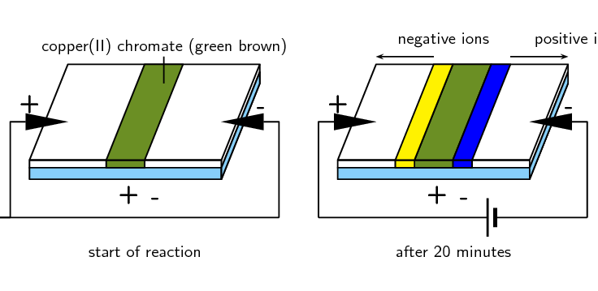
10. Attach the other crocodile clip opposite the first one (as
                                                                   shown in the diagram) and leave the experiment to run
                                                                   for about \(\text{20}\) \(\text{minutes}\).

### Results

- After \(\text{20}\) \(\text{minutes}\) you should see that
                                                                  the central coloured band disappears and is replaced by
                                                                  two bands, one yellow and the other blue, which seem to
                                                                  have separated out from the first band of copper(II)
                                                                  chromate.
- The cell that is used to supply an electric current sets up a
                                                                  potential difference across the circuit, so that one of
                                                                  the electrodes is positive and the other is negative.
- The chromate (\(\text{CrO}_{4}^{2-}\)) ions in the copper(II)
                                                                  chromate solution are attracted to the positive
                                                                  electrode, this creates a yellow band. The
                                                                  \(\text{Cu}^{2+}\) ions are attracted to the negative
                                                                  electrode, this creates a blue band.

### Conclusion

The movement of ions occurs because the electric current in the external
                                                circuit provides a potential difference between the two electrodes.

In the electrolytic cell experiment it is important that the learners weigh the
                                        copper electrodes carefully before the experiment, and wash and dry the
                                        electrodes before weighing after the experiment.

## An electrolytic cell

### Aim

To investigate the reactions that take place in an electrolytic cell.

### Apparatus

- Two copper plates (of equal size and mass), copper(II)
                                                                  sulfate (\(\text{CuSO}_{4}\)) solution (\(\text{1}\)
                                                                  \(\text{mol.dm$^{-3}$}\))
- A \(\text{9}\) \(\text{V}\) battery, two connecting wires, a
                                                                  beaker.

### Method

2. Half fill the beaker with copper(II) sulfate solution. What
                                                                   colour is the solution?
4. Weigh each copper electrode carefully and record the weight.
6. Place the two copper electrodes (of known mass) in the
                                                                   solution and make sure they are not touching each other.
8. Connect the electrodes to the battery as shown below and
                                                                   leave the experiment for a day. What colour is the
                                                                   solution after a day?
   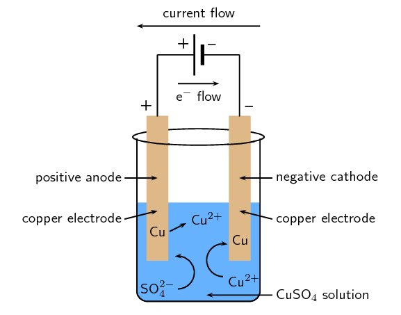

### Discussion

- What colour was the copper(II) sulfate solution before the
                                                                  experiment?
- What colour was the copper(II) sulfate solution after the
                                                                  experiment?
- Examine the two electrodes, what do you observe?
- What is the charge on each electrode?
- Which electrode is the anode and which is the cathode?

### Observations

- The initial blue colour of the solution remains unchanged
                                                                  throughout the experiment.
- It appears that copper has been *deposited* on one of
                                                                  the electrodes (it increased in mass) but
                                                                  *dissolved* from the other (it decreased in
                                                                  mass).
- The electrode connected to the negative terminal of the
                                                                  battery will have a negative charge. The electrode
                                                                  connected to the positive terminal of the battery will
                                                                  have a positive charge.
- When positively charged \(\text{Cu}^{2+}\) ions encounter the
                                                                  negatively charged electrode they gain electrons and are
                                                                  reduced to form copper metal. This metal is deposited on
                                                                  the electrode. The half-reaction that takes place is as
                                                                  follows:
  \(\text{Cu}^{2+}(\text{aq}) + 2\text{e}^{-}\) \(\to\)
                                                                  \(\text{Cu}(\text{s})\) ** (reduction
                                                                          half-reaction)**
  **Red**uction occurs at the
                                                                  **cat**hode. Therefore, the electrode which
                                                                  increased in mass is the cathode.
- At the positive electrode, copper metal is oxidised to form
                                                                  \(\text{Cu}^{2+}\) ions, leaving electrons on the
                                                                  electrode. The half-reaction that takes place is as
                                                                  follows:
  \(\text{Cu}(\text{s})\) \(\to\) \(\text{Cu}^{2+}(\text{aq}) +
                                                                  2\text{e}^{-}\) ** (oxidation
                                                                          half-reaction)**
  **Ox**idation occurs at the
                                                                  **an**ode. Therefore, the electrode which
                                                                  decreased in mass is the anode.
- The amount of copper that is *deposited* at one
                                                                  electrode is approximately the same as the amount of
                                                                  copper that is *dissolved* from the other. The
                                                                  number of \(\text{Cu}^{2+}\) ions in the solution
                                                                  therefore remains almost the same, and the blue colour
                                                                  of the solution is unchanged.

### Conclusion

In this demonstration, the container held aqueous \(\text{CuSO}_{4}\)
                                                (\(\text{Cu}^{2+}(\text{aq})\) and \(\text{SO}_{4}^{2-}(\text{aq})\)).
                                                The copper atoms of the electrode connected to the positive terminal
                                                (the anode) were oxidised and formed \(\text{Cu}^{2+}(\text{aq})\) ions,
                                                causing a decrease in mass. The copper atoms of the electrode connected
                                                to the negative terminal (the cathode) were reduced to form solid
                                                copper, causing an increase in mass. This process is called
                                                *electrolysis*, and is very useful in the purification of metals.

Note that the cathode is negative and the anode is positive. Reduction still
                                                occurs at the cathode (Red Cat), and oxidation still occurs at the anode
                                                (An Ox).

<Callout type="tip" title="Note">

</Callout>

**The electrolysis of water**

<Callout type="note" title="Note">

August Wilhelm von Hofmann was a German chemist who invented the Hofmann cell, which
                                        uses a current to form \(\text{H}_{2}(\text{g})\) and \(\text{O}_{2}(\text{g})\)
                                        from water through electrolysis.
</Callout>

Water can undergo electrolysis to form hydrogen gas and oxygen gas according to the following
                                reaction:

\(2\text{H}_{2}\text{O}(\text{ℓ})\) \(\to\) \(2\text{H}_{2}(\text{g}) +
                                \text{O}_{2}(\text{g})\)

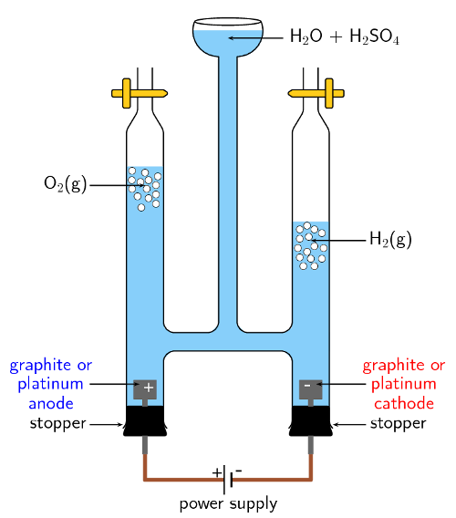

Figure 13.7: Hofmann apparatus for the electrolysis of water.

This reaction is very important because hydrogen gas has the potential to be used as an
                                energy source. The electrolytic cell for this reaction consists of two electrodes,
                                submerged in an electrolyte and connected to a source of electric current (Figure 13.7).

The \(\color{blue}{\textbf{oxidation half-reaction}}\) is as follows: The
                                \(\color{red}{\textbf{reduction half-reaction}}\) is as follows:

\(\color{blue}{\text{2H}_{2}\text{O(l)} \to \text{O}_{2}\text{(g) + 4H}^{+}\text{(aq) +
                                4e}^{-}} \color{red}{\text{ 2H}^{+}\text{(aq) + 2e}^{-} \to \text{H}_{2}\text{(g)}}\)

The informal experiment is the electrolysis of sodium iodide and water. It would be
                                        advisable to check that current flows through the pencils, as the pencil lead
                                        may be broken. If you have access to graphite rods they can be used instead. In
                                        the second part of the experiment, there should be an obvious colour change when
                                        the phenolphthalein and \(\text{NaOH}\) mix at the cathode.

Learners are required to work with a concentrated, strong acid. Concentrated, strong
                                        acids can cause serious burns. Please remind the learners to be careful and wear
                                        the appropriate safety equipment when handling all chemicals, especially
                                        concentrated acids. The safety equipment includes gloves, safety glasses and
                                        protective clothing.

<QuizCard id="s12-13-03b" title="Interactive Exercise 13.6" question="Give the oxidation and reduction half-reactions for this cell." options=[] answer="
                        ['Li(s) \\rightarrow Li^{+}(aq)+e^{-}', 'Li \\rightarrow Li^{+}+e^{-}', 'Li \\rightarrow Li^{+}(aq)+e^{-}', 'Li(s) \\rightarrow Li^{+}+e^{-}', '2Li(s) \\rightarrow 2Li^{+}(aq)+2e^{-}', '2Li \\rightarrow 2Li^{+}+2e^{-}', '2Li \\rightarrow 2Li^{+}(aq)+2e^{-}', '2Li(s) \\rightarrow 2Li^{+}+2e^{-}', 'Li(s) \\rightarrow Li^{+}(aq)+e', 'Li \\rightarrow Li^{+}+e', 'Li \\rightarrow Li^{+}(aq)+e', 'Li(s) \\rightarrow Li^{+}+e', '2Li(s) \\rightarrow 2Li^{+}(aq)+2e', '2Li \\rightarrow 2Li^{+}+2e', '2Li \\rightarrow 2Li^{+}(aq)+2e', '2Li(s) \\rightarrow 2Li^{+}+2e']
                    ,
                        ['Mn^{2+}(aq)+2e^{-} \\rightarrow Mn(s)', 'Mn^{2+}+2e^{-} \\rightarrow Mn', 'Mn^{2+}(aq)+2e^{-} \\rightarrow Mn', 'Mn^{2+}+2e^{-} \\rightarrow Mn(s)', 'Mn^{2+}(aq)+2e \\rightarrow Mn(s)', 'Mn^{2+}+2e \\rightarrow Mn', 'Mn^{2+}(aq)+2e \\rightarrow Mn', 'Mn^{2+}+2e \\rightarrow Mn(s)']
                    " hint="Write a chemical equation here. You can use the following symbols to write equations: plus: + one-way arrow (→): −> (this is a minus and a greater than symbol) two-way arrow (⇌): <=> (this is a less than symbol, an equal symbol and a greater than symbol) Here are some examples of equations and how you should write them: Na + + Cl − → NaCl can be written as: Na^+  +  Cl^−  −>  NaCl CH 3 CO 2 H + H 2 O ⇌                CH 3 CO 2 − + H 3 O + can be written as: CH3CO2H  +  H2O  <=>  CH3CO2^-  +  H3O^+ State symbols can be added by writing the appropriate state in brackets. For example: Na + (aq) + Cl − (aq) → NaCl(aq) can be written as: Na^+ (aq)  +  Cl^− (aq)  −>  NaCl (aq) The chemical compounds in the equation should be written like this, for the different                types of compounds: Element: simply type in the element symbol as it appears on the periodic table. Chemical formula: just write the numbers showing the ratios of atoms normally. For example, water (H 2 O) is written as: H2O Ion: Use the exponent symbol ( ^ ) to represent a superscript. For example, the sodium ion (Na + ) is written as: Na^+ and the sulfate ion (SO 4 2− ) is written as: SO4^2− Electron: An electron is represented using e^- Compound formula: use round brackets around a compound ion in a formula. For example, calcium permanganate (Ca(MnO 4 ) 2 ) is written as: Ca(MnO4)2" explanation="Recall which reaction occurs at the anode, and which reaction occurs at the cathode Oxidation occurs at the anode . That is, electrons are lost at the anode. So the oxidation half-reaction will occur at the lithium anode . TIP: O xidation is L oss at the A node                         ( An Ox ). Reduction occurs at the cathode . That is, electrons are gained at the cathode. So the reduction half-reaction will occur at the manganese cathode . TIP: Red uction is gain at the Cat hode                         ( Red Cat ). Determine the half-reactions Oxidation half-reaction (at the anode): Li(s) \(\rightarrow\) \(\downarrow\) Li + (aq) \(\:+\:\) e − Reduction half-reaction (at the cathode): Mn 2+ (aq) \(\:+\:\) \(\text{2}\) e − \(\rightarrow\) \(\downarrow\) Mn(s) Submit your answer as: and" />

<QuizCard id="s12-13-03b" title="Interactive Exercise 13.6" question="Label the following sketch of an electrolytic cell." options=["A", "B", "C", "D", "E", "F", "A", "B", "C", "D", "E", "F", "A", "B", "C", "D", "E", "F", "A", "B", "C", "D", "E", "F", "A", "B", "C", "D", "E", "F", "A", "B", "C", "D", "E", "F"] answer="
					2
				,
					4
				,
					0
				,
					1
				,
					3
				,
					5
				" hint="" explanation="For an electrolytic cell we note the following information: The electrode connected to the positive terminal of the battery is positive . The metal atoms of the positive electrode are oxidised to form metal cations. Oxidation is loss at the anode (OLA), so the positive electrode is the anode . The electrode connected to the negative terminal of the battery is negative . The metal cations in solution are reduced at the negative terminal. Reduction is gain at the cathode (RED CAT), so the negative electrode is the cathode . Electrons flow from the anode, through the external wire, to the cathode. Conventional current is from the cathode, through the external wire, to the anode. We are given a diagram with the terminals of the battery labelled. So we must ensure that our labels have the anode connected to the positive terminal (the long line of the battery) and the cathode connected to negative terminal (short line of the battery). The correct answers are: Anode C Cathode E Direction of conventional current A Direction of electrons B Negative charge D Positive charge F The completed diagram is: Submit your answer as: C and E and A and B and D and F" />

## The electrolysis of sodium iodide and water

### Aim

To study the electrolysis of water and sodium iodide.

### Apparatus

- \(\text{4}\) pencils, copper wire attached to crocodile
                                                                  clips, \(\text{9}\) \(\text{V}\) battery, \(\text{2}\)
                                                                  beakers, pencil sharpener, spatula, glass rod
- distilled water, sodium iodide (\(\text{NaI}\)),
                                                                  phenolphthalein, \(\text{1}\) \(\text{mol.dm$^{-3}$}\)
                                                                  sulfuric acid (\(\text{H}_{2}\text{SO}_{4}\)) solution

### Method

2. Label one beaker **1** and half fill it with
                                                                   distilled \(\text{H}_{2}\text{O}\).
   
4. Sharpen both ends of two of the pencils. Strip away some of
                                                                   the wood to expose more of the graphite. (Graphite rods
                                                                   can be used instead of pencils if they are available).
   
6. Attach one end of the crocodile clips to the pencils and the
                                                                   other end to the battery.
   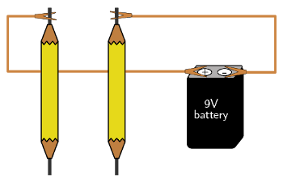
8. Place the pencils in the beaker, making sure they are not
                                                                   touching each other. Observe what happens.
10. Pour approximately \(\text{5}\) \(\text{cm$^{3}$}\) of the
                                                                   \(\text{H}_{2}\text{SO}_{4}\) solution into the beaker.
                                                                   Observe what happens.
   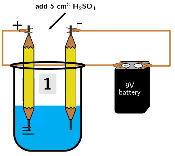
12. Label a second beaker **2** and add \(\text{5}\)
                                                                   spatula tips of \(\text{NaI}\) to the beaker.
14. Half fill beaker \(\text{2}\) with distilled
                                                                   \(\text{H}_{2}\text{O}\) and stir with the glass rod
                                                                   until all the sodium iodide has dissolved.
   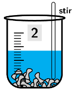
16. Repeat steps \(\text{2}\) - \(\text{4}\) with the second set
                                                                   of pencils.
18. After a few minutes add \(\text{3}\) - \(\text{4}\) drops of
                                                                   the phenolphthalein to the beaker. Observe what happens.
   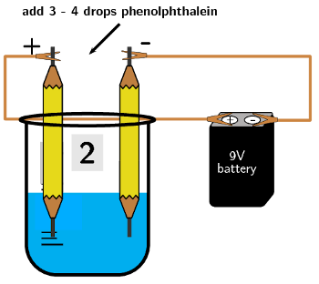

### Questions

- In beaker **1**:
  2. What happened when the pencils were first put
                                                                                     in the water?
  4. What happened when the sulfuric acid was
                                                                                     added to the beaker?
  6. Why is the sulfuric acid necessary in this
                                                                                     reaction?
  8. What is happening at the negative electrode
                                                                                     (the pencil attached to the negative
                                                                                     terminal of the battery)?
  10. What is happening at the positive electrode
                                                                                     (the pencil attached to the positive
                                                                                     terminal of the battery)?
  12. Which electrode is the anode and which is the
                                                                                     cathode?
- In beaker **2**:
  2. What happened when the pencils were first put
                                                                                     in the water?
  4. What is happening at the negative electrode?
  6. What is happening at the positive eletrode?
  8. Which electrode is the anode and which is the
                                                                                     cathode?
  10. What happened when you added the
                                                                                     phenolphthalein? Why did the change take
                                                                                     place?

### Results

- In the electrolysis of water two \(\text{H}^{+}\) ions each
                                                                  gain an electron (are reduced) and combine to form
                                                                  hydrogen gas (\(\text{H}_{2}(\text{g})\)):
  \(2\text{H}^{+}(\text{aq}) + 2\text{e}^{-}\) \(\to\)
                                                                  \(\text{H}_{2}(\text{g})\)
  Two \(\text{O}^{2-}\) ions each lose two electrons (are
                                                                  oxidised) and combine to form oxygen gas
                                                                  (\(\text{O}_{2}(\text{g})\)):
  \(2\text{O}^{2-}(\text{aq})\) \(\to\)
                                                                  \(\text{O}_{2}(\text{g}) + 4\text{e}^{-}\)
- When the positive \(\text{H}^{+}\) ions encounter the
                                                                  negative electrode they are reduced. Reduction is a gain
                                                                  of electrons at the cathode, therefore the negative
                                                                  electrode is the cathode.
- When the negative \(\text{O}^{2-}\) ions encounter the
                                                                  positive electrode they are oxidised. Oxidation is a
                                                                  loss of electrons at the anode, therefore the positive
                                                                  electrode is the anode.
- Remember that pure water does not conduct electricity. So, an
                                                                  electrolyte (such as sulfuric acid) is necessary for the
                                                                  reaction to take place.
- A salt dissolved in the water is also an electrolyte, so
                                                                  sulfuric acid is not necessary in the second beaker.
- The electrolysis of water occurs in beaker
                                                                  **2**, but there are other reactions taking
                                                                  place as well because of the presence of the
                                                                  \(\text{Na}^{+}\) and \(\text{I}^{-}\) ions.
- When the negative \(\text{I}^{-}\) ions encounter the
                                                                  positive electrode they are oxidised:
  \(2\text{I}^{-}(\text{aq})\) \(\to\) \(\text{I}_{2}(\text{s})
                                                                  + 2\text{e}^{-}\)
  You should have observed solid iodine forming at the positive
                                                                  electrode.
- When the positive \(\text{Na}^{+}\) ions encounter the
                                                                  negative electrode they are reduced:
  \(\text{Na}^{+}(\text{aq}) + \text{e}^{-}\) \(\to\)
                                                                  \(\text{Na}(\text{s})\)
  \(\text{Na}(\text{s})\) is very reactive with water:
  \(2\text{Na}(\text{s}) +
                                                                  2\text{H}_{2}\text{O}(\text{ℓ})\)
                                                                  \(\to\) \(2\text{NaOH}(\text{aq}) +
                                                                  \text{H}_{2}(\text{g})\).
- Remember that phenolphthalein turns pink in the presence of a
                                                                  base. So when the phenolphthalein is added, the water
                                                                  around the negative electrode should become pink due to
                                                                  the \(\text{NaOH}\).

### Conclusion

The application of an electric current to water splits the water molecules
                                                and causes hydrogen and oxygen gas to form. This can only happen in the
                                                presence of an electrolyte (for example sulfuric acid). Sodium iodide
                                                dissolved in the water is also an electrolyte and enables the
                                                electrolysis of water. However, the cation and anion of the salt will
                                                also undergo a reaction. \(\text{NaOH}\) will form at the cathode, while
                                                solid iodine will form at the anode.

## Galvanic and electrolytic cells

### Textbook Exercise 13.4

An electrolytic cell consists of two electrodes in a silver
                                                                chloride (\(\text{AgCl}\)) solution, connected to a
                                                                source of current. A current is passed through the
                                                                solution and \(\text{Ag}^{+}\) ions are reduced to a
                                                                silver metal deposit on one of the electrodes.

**Problem:**
What is the name of this process?

**Solution:**
Electrolysis

**Problem:**
Does reduction occur at the electrode where the
                                                                        deposit formed?

**Solution:**
Yes. Reduction is a gain of electrons. In an
                                                                        electrolytic cell the electrode connected to the
                                                                        negative terminal of the battery is negative.
                                                                        When the metal cations encounter this electrode
                                                                        they gain electrons and form metal atoms that
                                                                        deposit on the electrode
                                                                        (\(\text{Ag}^{+}(\text{aq}) +\text{e}^{-}\)
                                                                        \(\to\) \(\text{Ag}(\text{s})\)).

**Problem:**
Give the equation for the reduction half-reaction.

**Solution:**
\(\text{Ag}^{+}(\text{aq}) + \text{e}^{-}\) \(\to\)
                                                                        \(\text{Ag}(\text{s})\)

**Problem:**
Give the equation for the oxidation half-reaction.

**Solution:**
\(\text{Ag}(\text{s})\) \(\to\)
                                                                        \(\text{Ag}^{+}(\text{aq}) + \text{e}^{-}\)

A galvanic cell consists of two half-cells: a copper anode in
                                                                a copper nitrate
                                                                (\(\text{Cu}(\text{NO}_{3})_{2}(\text{aq})\)) solution,
                                                                and a silver cathode in a silver nitrate
                                                                (\(\text{AgNO}_{3}(\text{aq})\)) solution.

**Problem:**
Give equations for the half-reactions that take place
                                                                        at the anode and cathode.

**Solution:**
You are told that the copper electrode is the anode,
                                                                        oxidation is a loss of electrons at the anode:

Anode half-reaction: \(\text{Cu}(\text{s})\) \(\to\)
                                                                        \(\text{Cu}^{2+}(\text{aq}) + 2\text{e}^{-}\)

You are told that the silver electrode is the
                                                                        cathode, reduction is a gain of electrons at the
                                                                        cathode:

Cathode half-reaction: \(\text{Ag}^{+}(\text{aq}) +
                                                                        \text{e}^{-}\) \(\to\) \(\text{Ag}(\text{s})\)

**Problem:**
Write the overall reaction for this cell.

**Solution:**
\(\text{Cu}(\text{s}) + 2\text{Ag}^{+}(\text{aq})\)
                                                                        \(\to\) \(\text{Cu}^{2+}(\text{aq}) +
                                                                        2\text{Ag}(\text{s})\)

OR

\(\text{Cu}(\text{s}) + 2\text{AgNO}_{3}(\text{aq})\)
                                                                        \(\to\)
                                                                        \(\text{Cu}(\text{NO}_{3})_{2}(\text{aq}) +
                                                                        2\text{Ag}(\text{s})\)

**Problem:**
Give standard cell notation for this cell.

**Solution:**
\(\text{Cu}(\text{s})|\text{Cu}^{2+}(\text{aq})||\text{Ag}^{+}(\text{aq})|\text{Ag}(\text{s})\)

**Problem:**
Draw a simple diagram of the galvanic cell.

On your diagram, show the direction in which current
                                                                        flows.

**Solution:**
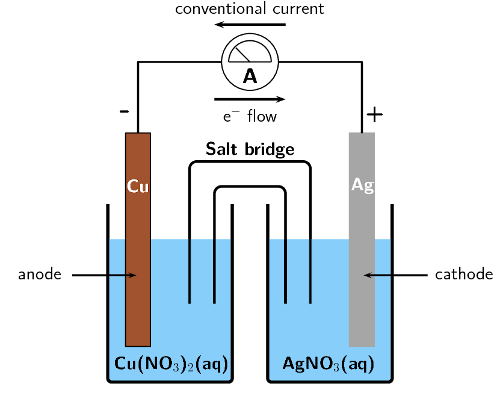

Remember that conventional current flow is in the
                                                                        opposite direction to electron flow.

Electrolysis takes place in a solution of molten lead bromide
                                                                (\(\text{PbBr}_{2}\)) to produce lead atoms.

**Problem:**
Give equations for the half-reactions that take place
                                                                        at the anode and cathode.

**Solution:**
Oxidation is a loss of electrons at the anode:

Anode half-reaction: \(\text{Pb}(\text{s})\) \(\to\)
                                                                        \(\text{Pb}^{2+}(\text{ℓ}) +
                                                                        2\text{e}^{-}\)

Reduction is a gain of electrons at the cathode:

Cathode half-reaction:
                                                                        \(\text{Pb}^{2+}(\text{ℓ}) +
                                                                        2\text{e}^{-}\) \(\to\) \(\text{Pb}(\text{s})\)

**Problem:**
Draw a simple diagram of the electrolytic cell.

On your diagram, show the direction in which current
                                                                        flows.

**Solution:**
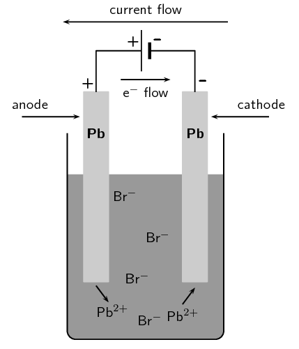

Remember that conventional current flow is in the
                                                                        opposite direction to electron flow.

**Problem:**
Fill in the table below to summarise the information on
                                                                galvanic and electrolytic cells:

|  | Galvanic cells | Electrolytic cells |
| --- | --- | --- |
| spontaneity |  |  |
| type of energy |  |  |
| anode |  |  |
| cathode |  |  |
| cell set-up |  |  |

**Solution:**
|  | Galvanic cells | Electrolytic cells |
| --- | --- | --- |
| spontaneity | spontaneous reactions | non-spontaneous reactions |
| type of energy | converts chemical potential energy to electrical energy | converts electrical energy to chemical potential energy |
| anode | is negative ,
                                                                                        oxidation occurs at anode | is positive ,
                                                                                        oxidation occurs at anode |
| cathode | is positive ,
                                                                                        reduction occurs at cathode | is negative ,
                                                                                        reduction occurs at cathode |
| cell set-up | two half-cells, one electrode in each, connected by a salt-bridge | one cell, both electrodes in cell, no salt-bridge |
