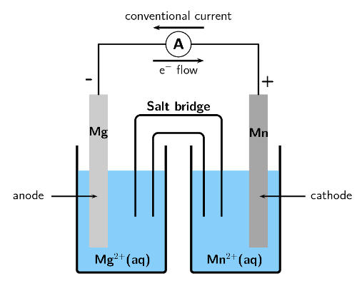
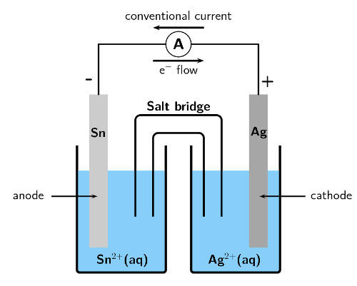

## 13.4 Processes in electrochemical cells (ESCR7)

### Half-cells and half-reactions (ESCR8)

Galvanic cells are actually made up of two half-cells. One half-cell contains the anode and
                                an electrolyte containing the same metal cations. The other half-cell contains the
                                cathode and an electrolyte containing the same metal cations. These half-cells are
                                connected by a salt-bridge and the electrodes are connected through an external circuit.

Earlier in this chapter we discussed a zinc-copper cell. This was made up of a zinc
                                **half-cell**, containing a zinc electrode and a zinc(II) sulphate
                                (\(\text{ZnSO}_{4}\)) electrolyte solution, and a copper **half-cell**,
                                containing a copper electrode and a copper(II) sulphate solution.

Half-cell

A half-cell is a structure that consists of a conductive electrode surrounded
                                                by a conductive electrolyte.

In each half-cell a half-reaction takes place:

- **Copper plate**
  At the copper plate, there was an *increase* in mass. This means that
                                                  \(\text{Cu}^{2+}\) ions from the copper(II) sulfate solution were
                                                  deposited onto the plate as atoms of copper metal. The half-reaction
                                                  that takes place at the copper plate is:
  \(\text{Cu}^{2+}(\text{aq}) + 2\text{e}^{-}\) \(\to\) \(\text{Cu}(\text{s})\)
  As electrons are gained by the copper ions this is the
                                                  \(\color{red}{\textbf{reduction half-reaction}}\).
- **Zinc plate**
  At the zinc plate, there was a *decrease* in mass. This means that
                                                  some of the solid zinc goes into solution as \(\text{Zn}^{2+}\) ions.
                                                  The electrons remain on the zinc plate, giving it a negative charge. The
                                                  half-reaction that takes place at the zinc plate is:
  \(\text{Zn}(\text{s})\) \(\to\) \(\text{Zn}^{2+}(\text{aq}) + 2\text{e}^{-}\)
  As electrons are lost by the zinc atoms this is the
                                                  \(\color{blue}{\textbf{oxidation half-reaction}}\).
- **The overall reaction**
  You can then combine the two half-reactions from these two half-cells to get
                                                  the overall reaction:
  \(\color{blue}{\text{Zn(s)}} + \color{red}{\text{Cu}^{2+}\text{(aq)}} +
                                                  \color{red}{\text{2e}^{-}} \to \color{blue}{\text{Zn}^{2+}\text{(aq)}} +
                                                  \color{red}{\text{Cu(s)}} + \color{blue}{\text{2e}^{-}}\) or, if we
                                                  cancel the electrons:
  \(\color{blue}{\text{Zn(s)}} + \color{red}{\text{Cu}^{2+}\text{(aq)}} \to
                                                  \color{blue}{\text{Zn}^{2+}\text{(aq)}} + \color{red}{\text{Cu(s)}}\)

It is possible to look at the half-reaction taking place in a half-cell and determine which
                                electrode is the anode and which is the cathode.

- \(\color{blue}{\textbf{Oxidation}}\) is loss at the
                                                  \(\color{blue}{\textbf{anode}}\), therefore the oxidation half-reaction
                                                  occurs in the half-cell containing the anode.
- \(\color{red}{\textbf{Reduction}}\) is gain at the
                                                  \(\color{red}{\textbf{cathode}}\) so the reduction half-reaction occurs
                                                  in the half-cell containing the cathode.

Remember that for an electrochemical cell the standard cell notation is:

\(\color{blue}{\textbf{Zn(s)}}\)\(|\)\(\color{blue}{\textbf{Zn}^{2+}\textbf{(aq)}}\)\(||\)\(\color{red}{\textbf{Cu}^{2+}\textbf{(aq)}}\)\(|\)\(\color{red}{\textbf{Cu(s)}}\)

\(|\) = a phase boundary (solid/aqueous)

\(||\) = the salt bridge

<Callout type="tip" title="Worked example 4: Understanding galvanic cells">
**Question:**
For the following cell:

\(\text{Zn}(\text{s})|\text{Zn}^{2+}(\text{aq})||\text{Ag}^{+}(\text{aq})|\text{Ag}(\text{s})\)

2. Give the anode and cathode half-reactions.
4. Write the overall equation for the chemical reaction.
6. Give the direction of the current in the external circuit.

**Identify the oxidation and reduction reactions:**
By convention in standard cell notation, the anode is written on the left and
                                                the cathode is written on the right. So, in this cell:

Zinc is the anode (solid zinc is oxidised).

Silver is the cathode (silver ions are reduced).

**Write the two half-reactions:**
Oxidation is loss of electrons at the anode: \(\text{Zn}(\text{s})\) \(\to\)
                                                \(\text{Zn}^{2+}(\text{aq}) + 2\text{e}^{-}\)

Reduction is gain of electrons at the cathode: \(\text{Ag}^{+}(\text{aq}) +
                                                \text{e}^{-}\) \(\to\) \(\text{Ag}(\text{s})\)

**Combine the half-reactions to get the overall equation:**
Balance the charge by multiplying the reduction half-reaction by
                                                \(\text{2}\).

\(2\text{Ag}^{+}(\text{aq}) + 2\text{e}^{-}\) \(\to\)
                                                \(2\text{Ag}(\text{s})\)

\(\text{Zn}(\text{s}) + 2\text{Ag}^{+}(\text{aq})\) \(\to\)
                                                \(\text{Zn}^{2+}(\text{aq}) + \text{Ag}(\text{s})\)

**Determine the direction of current flow:**
The solid zinc is oxidised to form zinc ions. These electrons are left on the
                                                zinc electrode (anode) making it negative.

The silver ions take electrons and are reduced to form solid silver. This
                                                makes the silver electrode (cathode) positive.

Electron flow is from negative to positive, so from the anode to the cathode.
                                                Conventional current is in the opposite direction to electron flow.
                                                Therefore current will flow from the cathode (silver) to the anode
                                                (zinc).
</Callout>

<QuizCard id="s12-13-04a" title="Interactive Exercise 13.8" question="Give the oxidation and reduction half-reactions for this cell." options=[] answer="
                        ['Cr(s) \\rightarrow Cr^{2+}(aq)+2e^{-}', 'Cr \\rightarrow Cr^{2+}+2e^{-}', 'Cr \\rightarrow Cr^{2+}(aq)+2e^{-}', 'Cr(s) \\rightarrow Cr^{2+}+2e^{-}', 'Cr(s) \\rightarrow Cr^{2+}(aq)+2e', 'Cr \\rightarrow Cr^{2+}+2e', 'Cr \\rightarrow Cr^{2+}(aq)+2e', 'Cr(s) \\rightarrow Cr^{2+}+2e']
                    ,
                        ['Fe^{2+}(aq)+2e^{-} \\rightarrow Fe(s)', 'Fe^{2+}+2e^{-} \\rightarrow Fe', 'Fe^{2+}(aq)+2e^{-} \\rightarrow Fe', 'Fe^{2+}+2e^{-} \\rightarrow Fe(s)', 'Fe^{2+}(aq)+2e \\rightarrow Fe(s)', 'Fe^{2+}+2e \\rightarrow Fe', 'Fe^{2+}(aq)+2e \\rightarrow Fe', 'Fe^{2+}+2e \\rightarrow Fe(s)']
                    " hint="Write a chemical equation here. You can use the following symbols to write equations: plus: + one-way arrow (→): −> (this is a minus and a greater than symbol) two-way arrow (⇌): <=> (this is a less than symbol, an equal symbol and a greater than symbol) Here are some examples of equations and how you should write them: Na + + Cl − → NaCl can be written as: Na^+  +  Cl^−  −>  NaCl CH 3 CO 2 H + H 2 O ⇌                CH 3 CO 2 − + H 3 O + can be written as: CH3CO2H  +  H2O  <=>  CH3CO2^-  +  H3O^+ State symbols can be added by writing the appropriate state in brackets. For example: Na + (aq) + Cl − (aq) → NaCl(aq) can be written as: Na^+ (aq)  +  Cl^− (aq)  −>  NaCl (aq) The chemical compounds in the equation should be written like this, for the different                types of compounds: Element: simply type in the element symbol as it appears on the periodic table. Chemical formula: just write the numbers showing the ratios of atoms normally. For example, water (H 2 O) is written as: H2O Ion: Use the exponent symbol ( ^ ) to represent a superscript. For example, the sodium ion (Na + ) is written as: Na^+ and the sulfate ion (SO 4 2− ) is written as: SO4^2− Electron: An electron is represented using e^- Compound formula: use round brackets around a compound ion in a formula. For example, calcium permanganate (Ca(MnO 4 ) 2 ) is written as: Ca(MnO4)2" explanation="Recall which reaction occurs at the anode, and which reaction occurs at the cathode Oxidation occurs at the anode . That is, electrons are lost at the anode. So the oxidation half-reaction will occur at the chromium anode . TIP: O xidation is L oss at the A node                         ( An Ox ). Reduction occurs at the cathode . That is, electrons are gained at the cathode. So the reduction half-reaction will occur at the iron cathode . TIP: Red uction is gain at the Cat hode                         ( Red Cat ). Determine the half-reactions Oxidation half-reaction (at the anode): Cr(s) \(\rightarrow\) \(\downarrow\) Cr 2+ (aq) \(\:+\:\) \(\text{2}\) e − Reduction half-reaction (at the cathode): Fe 2+ (aq) \(\:+\:\) \(\text{2}\) e − \(\rightarrow\) \(\downarrow\) Fe(s) Submit your answer as: and" />

## Galvanic cells

### Textbook Exercise 13.5

The following half-reactions take place in an electrochemical cell:

\(\text{Fe}(\text{s})\) \(\to\) \(\text{Fe}^{3+}(\text{aq}) +
                                                        3\text{e}^{-}\)

\(\text{Fe}^{2+}(\text{aq}) + 2\text{e}^{-}\) \(\to\)
                                                        \(\text{Fe}(\text{s})\)

**Problem:**
Which is the oxidation half-reaction?

**Solution:**
Oxidation is the loss of electrons.

\(\text{Fe}(\text{s})\) \(\to\) \(\text{Fe}^{3+}(\text{aq}) +
                                                                3\text{e}^{-}\)

**Problem:**
Which is the reduction half-reaction?

**Solution:**
Reduction is the gain of electrons.

\(\text{Fe}^{2+}(\text{aq}) + 2\text{e}^{-}\)
                                                                \(\to\)\(\text{Fe}(\text{s})\)

**Problem:**
Name the oxidising agent.

**Solution:**
An oxidising agent causes oxidation and is itself reduced.

\(\text{Fe}^{2+}(\text{aq})\)

**Problem:**
Name the reducing agent.

**Solution:**
A reducing agent causes reduction and is itself oxidised.

\(\text{Fe}(\text{s})\)

**Problem:**
Use standard notation to represent this electrochemical cell.

**Solution:**
Oxidation is loss at the anode, therefore
                                                                \(\text{Fe}(\text{s})\) in oxidation half-reaction is
                                                                the anode.

Reduction is gain at the cathode, therefore
                                                                \(\text{Fe}(\text{s})\) in reduction half-reaction is
                                                                the cathode.

\(\text{Fe}(\text{s})|\text{Fe}^{3+}(\text{aq})||\text{Fe}^{2+}(\text{aq})|\text{Fe}(\text{s})\)

For the following cell:

\(\text{Mg}(\text{s})|\text{Mg}^{2+}(\text{aq})||\text{Mn}^{2+}(\text{aq})|\text{Mn}(\text{s})\)

**Problem:**
Give the cathode half-reaction.

**Solution:**
The cathode is written on the right, therefore manganese is
                                                                the cathode. Reduction is gain at the cathode.

\(\text{Mn}^{2+}(\text{aq}) + 2\text{e}^{-}\) \(\to\)
                                                                \(\text{Mn}(\text{s})\)

**Problem:**
Give the anode half-reaction.

**Solution:**
The anode is written on the left, therefore magnesium is the
                                                                anode. Oxidation is loss at the anode.

\(\text{Mg}(\text{s})\) \(\to\) \(\text{Mg}^{2+}(\text{aq}) +
                                                                2\text{e}^{-}\)

**Problem:**
Give the overall equation for the electrochemical cell.

**Solution:**
The charge of the two half-reactions is balanced.

\(\text{Mg}(\text{s}) + \text{Mn}^{2+}(\text{aq})\) \(\to\)
                                                                \(\text{Mg}^{2+}(\text{aq}) + \text{Mn}(\text{s})\)

**Problem:**
What metals could be used for the electrodes in this
                                                                electrochemical cell?

**Solution:**
Magnesium metal and manganese metal

**Problem:**
Suggest two electrolytes for this electrochemical cell.

**Solution:**
Magnesium sulfate and manganese sulfate, or magnesium nitrate
                                                                and manganese nitrate

**Problem:**
In which direction will the current flow?

**Solution:**
The solid \(\text{Mg}\) is oxidised to form
                                                                \(\text{Mg}^{2+}\) ions at the anode. This makes the
                                                                anode negative.

The \(\text{Mn}^{2+}\) ions are reduced to form
                                                                \(\text{Mn}(\text{s})\) at the cathode. This makes the
                                                                cathode positive.

Electron flow is from negative to positive, so from the anode
                                                                to the cathode. Conventional current is in the opposite
                                                                direction (from cathode to anode).

Therefore conventional current is from the manganese plate to
                                                                the magnesium plate.

**Problem:**
Draw a simple sketch of the complete cell.

**Solution:**

For the following cell:

\(\text{Sn}(\text{s})|\text{Sn}^{2+}(\text{aq})||\text{Ag}^{+}(\text{aq})|\text{Ag}(\text{s})\)

**Problem:**
Give the cathode half-reaction.

**Solution:**
The cathode is written on the right, therefore silver is the
                                                                cathode. Reduction is gain at the cathode.

\(\text{Ag}^{+}(\text{aq}) + \text{e}^{-}\) \(\to\)
                                                                \(\text{Ag}(\text{s})\)

**Problem:**
Give the anode half-reaction.

**Solution:**
The anode is written on the left, therefore tin is the anode.
                                                                Oxidation is loss at the anode.

\(\text{Sn}(\text{s})\) \(\to\) \(\text{Sn}^{2+}(\text{aq}) +
                                                                2\text{e}^{-}\)

**Problem:**
Give the overall equation for the electrochemical cell.

**Solution:**
To balance the charges the cathode half-reaction must be
                                                                multiplied by \(\text{2}\).

\(2\text{Ag}^{+}(\text{aq}) + 2\text{e}^{-}\) \(\to\)
                                                                \(2\text{Ag}(\text{s})\)

\(\text{Sn}(\text{s}) + 2\text{Ag}^{+}(\text{aq})\) \(\to\)
                                                                \(\text{Sn}^{2+}(\text{aq}) + 2\text{Ag}(\text{s})\)

**Problem:**
Draw a simple sketch of the complete cell.

**Solution:**

### Predictions in half-cells (ESCR9)

<Callout type="tip" title="Worked example 5: Reactions at the anode and cathode">
**Question:**
A cell contains a silver anode and a copper cathode. Give the half-cell
                                                reactions occurring at the anode and cathode, as well as standard cell
                                                notation for this cell.

**What type of reaction occurs at the anode, and what type
                                                occurs at the cathode?:**
Oxidation is loss of electrons at the anode. So the silver anode will be
                                                oxidised.

Reduction is gain of electrons at the cathode. So the copper cathode will be
                                                reduced.

**Write down the half-reactions as they would occur in the cell:**
\(\text{Ag}(\text{s})\) \(\to\) \(\text{Ag}^{+}(\text{aq}) + \text{e}^{-}\)
                                                (oxidation half-reaction)

\(\text{Cu}^{2+}(\text{aq}) + 2\text{e}^{-}\) \(\to\) \(\text{Cu}(\text{s})\)
                                                (reduction half-reaction)

**Give the standard cell notation for this reaction:**
The anode is always written first (on the left):
                                                \(\text{Ag}(\text{s})|\text{Ag}^{+}(\text{aq})\)

The cathode is always written second (on the right):
                                                \(\text{Cu}^{2+}(\text{aq})|\text{Cu}(\text{s})\)

Therefore the standard cell notation is:

\(\text{Ag}(\text{s})|\text{Ag}^{+}(\text{aq})||\text{Cu}^{2+}(\text{aq})|\text{Cu}(\text{s})\)
</Callout>

<Callout type="tip" title="Worked example 6: Determining overall reactions">
**Question:**
The following half-reactions take place in a cell:

\(\text{Fe}(\text{s})\) \(\to\) \(\text{Fe}^{2+}(\text{aq}) + 2\text{e}^{-}\)

\(\text{Cu}^{2+}(\text{aq}) + 2\text{e}^{-}\) \(\to\) \(\text{Cu}(\text{s})\)

Determine the overall reaction that takes place as a balanced chemical
                                                equation and in standard cell notation.

**Identify the oxidation and reduction half-reactions:**
\(\text{Fe}(\text{s})\) \(\to\) \(\text{Fe}^{2+}(\text{aq}) + 2\text{e}^{-}\)
                                                (oxidation half-reaction)

\(\text{Cu}^{2+}(\text{aq}) + 2\text{e}^{-}\) \(\to\) \(\text{Cu}(\text{s})\)
                                                (reduction half-reaction)

**Which metal is the anode and which is the cathode?:**
Oxidation is loss of electrons at the anode, therefore \(\text{Fe}\) is the
                                                anode. Reduction is gain of electrons at the cathode, therefore
                                                \(\text{Cu}\) is the cathode.

**Compare the number of electrons in each equation:**
There are 2 electrons in both equations, so the charges are balanced.

**Combine the equations into one equation:**
\(\text{Cu}^{2+}(\text{aq}) + 2\text{e}^{-} + \text{Fe}(\text{s})\) \(\to\)
                                                \(\text{Cu}(\text{s}) + \text{Fe}^{2+}(\text{aq}) + 2\text{e}^{-}\)

**Clean reaction up by combining appropriate ions and molecules:**
\(\text{Cu}^{2+}(\text{aq}) + \text{Fe}(\text{s})\) \(\to\)
                                                \(\text{Cu}(\text{s}) + \text{Fe}^{2+}(\text{aq})\)

**Give the standard cell notation for this reaction:**
The anode is always written first (on the left):
                                                \(\text{Fe}(\text{s})|\text{Fe}^{2+}(\text{aq})\)

The cathode is always written second (on the right):
                                                \(\text{Cu}^{2+}(\text{aq})|\text{Cu}(\text{s})\)

Therefore the standard cell notation is:

\(\text{Fe}(\text{s})|\text{Fe}^{2+}(\text{aq})||\text{Cu}^{2+}(\text{aq})|\text{Cu}(\text{s})\)
</Callout>

<QuizCard id="s12-13-04b" title="Interactive Exercise 13.9" question="Adapted from DBE Nov 2015 Grade 12, P2, Q1.9 Physical constants \(·\) Chemistry formulas \(·\) Periodic table \(·\) Standard reduction potentials The following half-reactions take place in a galvanic cell: Cr 3+ (aq) \(\:+\:\) e − \(\rightleftharpoons\) \(\updownarrow\) Cr 2+ (aq) Sr 2+ (aq) \(\:+\:\) \(\text{2}\) e − \(\rightleftharpoons\) \(\updownarrow\) Sr(s) Which one of the following is the cell notation for this cell? A Sr(s) \(\vert\) Sr 2+ (aq) \(\vert\) \(\vert\) Cr 3+ (aq) , Cr 2+ (aq) \(\vert\) Pt B Sr(s) \(\vert\) Sr 2+ (aq) \(\vert\vert\) Cr 3+ (aq) , Cr 2+ (aq) C Pt \(\vert\) Cr 2+ (aq) , Cr 3+ (aq) \(\vert\) \(\vert\) Sr 2+ (aq) \(\vert\) Sr(s) D Sr(s) \(\vert\) Sr 2+ (aq) \(\vert\vert\) Cr 2+ (aq) , Cr 3+ (aq) \(\vert\) Pt" options=["A", "B", "C", "D"] answer="
                    0
                " hint="" explanation="Determine the anode and the cathode For a spontaneous reaction, the species with the stronger reducing ability will be the reducing agent. If the reaction is non-spontaneous, an                     external energy source allows the species with the weaker reducing ability to be the reducing agent. From the table of half-reactions, the following two half-reactions are involved in this cell: Cr 3+ (aq) \(\:+\:\) e − \(\rightleftharpoons\) \(\updownarrow\) Cr 2+ (aq) \(\qquad E^{\theta} = -\text{0,41}\ \text{V}\) and Sr 2+ (aq) \(\:+\:\) \(\text{2}\) e − \(\rightleftharpoons\) \(\updownarrow\) Sr(s) \(\qquad E^{\theta} = -\text{2,89}\ \text{V}\) The cell is galvanic so the reaction must be spontaneous. Strontium is the anode because it is the                         stronger reducing agent . So solid strontium must be oxidised in a spontaneous reaction. Chromium(II) is the cathode because it is                         the weaker reducing agent . So chromium(III) ions must be reduced in a spontaneous reaction. Therefore, strontium is the anode , and chromium(II) is the cathode . NOTE: We can now calculate the cell emf: \[                         \begin{aligned}                             {E^{\theta}_{\text{cell}}} &= {E^{\theta}_{\text{cathode}}} - {E^{\theta}_{\text{anode}}} \\                             &= {E^{\theta}_{\text{chromium(II)}}} - {E^{\theta}_{\text{strontium}}} \\                             &= (-\text{0,41}) -                             (-\text{2,89}) \\                             &= \text{2,48}\ \text{V}                         \end{aligned}                     \] The cell emf is positive, which is what we expect in a galvanic cell. Choose the correct cell notation We write down the cell notation using the following rules: Write the anode half-cell on the left and the cathode half-cell on the right. Separate the half-cells with a double vertical line \((\vert\vert)\) , which represents the salt-bridge. Separate species with different states with a single vertical line \((\vert)\) . Separate species with the same state with a comma. For the anode, write the species being oxidised on the left. Then write the product of the oxidation half-reaction. For the cathode, write the species being reduced first. Then write the product of the reduction half-reaction on the right. If the cell notation begins or ends with an aqueous or gaseous species then it is necessary to add an electrode. Write this first for the anode                         (e.g. Pt \(\vert\) ), or last for the cathode (e.g. \(\vert\) Pt ). The correct cell notation for this galvanic cell is: Sr(s) \(\vert\) Sr 2+ (aq) \(\vert\) \(\vert\) Cr 3+ (aq) , Cr 2+ (aq) \(\vert\) Pt A \({\color{red}{{\checkmark}{\checkmark}}}\) Sr(s) \(\vert\) Sr 2+ (aq) \(\vert\) \(\vert\) Cr 3+ (aq) , Cr 2+ (aq) \(\vert\) Pt B Sr(s) \(\vert\) Sr 2+ (aq) \(\vert\vert\) Cr 3+ (aq) , Cr 2+ (aq) C Pt \(\vert\) Cr 2+ (aq) , Cr 3+ (aq) \(\vert\) \(\vert\) Sr 2+ (aq) \(\vert\) Sr(s) D Sr(s) \(\vert\) Sr 2+ (aq) \(\vert\vert\) Cr 2+ (aq) , Cr 3+ (aq) \(\vert\) Pt So the correct cell notation is Option A . Submit your answer as: A" />
