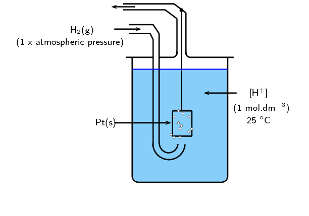
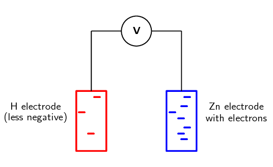
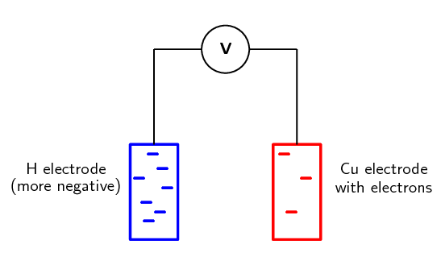
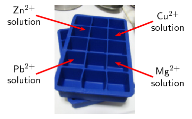
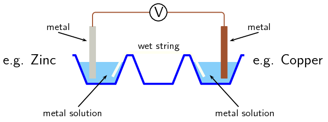
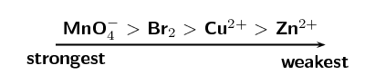
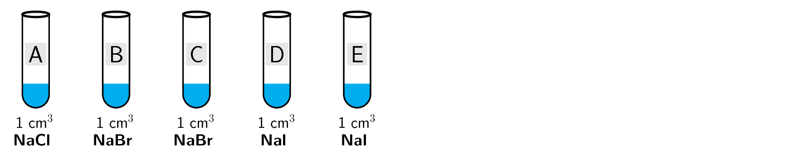
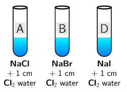
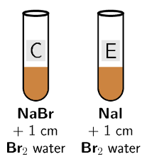
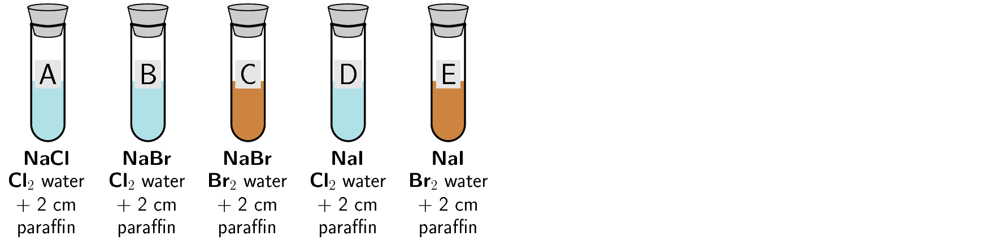

## 13.6 Standard electrode potentials (ESCRF)

### Standard conditions (ESCRG)

Standard electrode potentials are a measurement of equilibrium potentials. The position of
                                this equilibrium can change if you change some of the conditions (e.g. concentration,
                                temperature). It is therefore important that standard conditions be used:

- pressure = \(\text{101,3}\) \(\text{kPa}\) (\(\text{1}\) \(\text{atm}\))
- temperature = \(\text{298}\) \(\text{K}\) (\(\text{25}\) \(\text{℃}\))
- concentration = \(\text{1}\) \(\text{mol·dm$^{-3}$}\)

### The standard hydrogen electrode (ESCRH)

It is the **potential difference** (recorded as a voltage) between the two
                                electrodes that causes electrons to flow from the \(\color{blue}{\textbf{anode}}\) to
                                the \(\color{red}{\textbf{cathode}}\) through the external circuit of a galvanic cell
                                (remember, conventional current goes in the opposite direction).

It is possible to measure the potential of an electrode and electrolyte. It is not a simple
                                process however, and the value obtained will depend on the concentration of the
                                electrolyte solution, the temperature and the pressure.

A way to remove these inconsistencies is to compare all electrode potentials to a
                                **standard reference electrode**. These comparisons are all done with the
                                same concentrations, temperature and pressure. This means that these values can be used
                                to calculate the potential difference between two electrodes. It also means that
                                electrode potentials can be compared without the need to construct the specific cell
                                being studied.

This reference electrode can be used to calculate the *relative* electrode potential
                                for a substance. The reference electrode that is used is the **standard hydrogen
                                        electrode** (Figure 13.8).

Standard hydrogen electrode

The standard hydrogen electrode is a redox electrode which forms the basis of
                                                the scale of oxidation-reduction potentials.

Figure 13.8: A simplified version of the standard hydrogen electrode.

The standard hydrogen electrode consists of a platinum electrode in a solution containing
                                \(\text{H}^{+}\) ions. The solution (e.g. \(\text{H}_{2}\text{SO}_{4}\)) has a
                                concentration of \(\text{1}\) \(\text{mol·dm$^{-3}$}\). As the hydrogen gas bubbles
                                over
                                the platinum electrode, the reaction is as follows:

\(2\text{H}^{+}(\text{aq}) + 2\text{e}^{-}\) \(\rightleftharpoons\)
                                \(\text{H}_{2}(\text{g})\)

<Callout type="note" title="Note">
The standard hydrogen electrode used now is actually the potential of a platinum
                                        electrode in a theoretical acidic solution.

The electrode potential of the hydrogen electrode at \(\text{25}\) \(\text{℃}\)
                                        is estimated to be \(\text{4,4}\) \(\text{V}\). However, in order to use this as
                                        a reference electrode this value is set to **zero at all
                                                temperatures** so that it can be compared with other electrodes.
</Callout>

### Standard electrode potentials (ESCRJ)

In order to *use* the hydrogen electrode, it needs to be attached to the electrode
                                system that you are investigating. For example, if you are trying to determine the
                                electrode potential of copper, you will need to connect the copper half-cell to the
                                hydrogen electrode; if you are trying to determine the electrode potential of zinc, you
                                will need to connect the zinc half-cell to the hydrogen electrode and so on. Let's look
                                at the examples of zinc and copper in more detail.

**Zinc**

Zinc has a greater tendency than hydrogen to form ions (to be oxidised), so if the standard
                                hydrogen electrode is connected to the zinc half-cell, the
                                \(\color{blue}{\textbf{zinc}}\) will be relatively \(\color{blue}{\textbf{more
                                negative}}\) because the electrons that are released when zinc is oxidised will
                                accumulate on the metal.

\(\text{Zn}^{2+}(\text{aq}) + 2\text{e}^{-}\) \(\to\) \(\text{Zn}(\text{s})\)

\(2\text{H}^{+}(\text{aq}) + 2\text{e}^{-}\) \(\to\) \(\text{H}_{2}(\text{g})\)

The solid zinc is more likely to form zinc ions than the hydrogen gas is to form ions. A
                                simplified representation of the cell is shown in Figure 13.9.

Figure 13.9: When zinc is connected to the standard hydrogen electrode,
                                                relatively few electrons build up on the platinum (hydrogen) electrode.
                                                There are lots of electrons on the zinc electrode.

<Callout type="note" title="Note">
When determining standard electrode reduction potentials the standard hydrogen
                                        electrode is considered to be *on the left*
                                        (\(\text{Pt}(\text{s})|\text{H}_{2}(\text{g}),\text{H}^{+}(\text{aq})||\)). So a
                                        negative value means that the other element or compound has a greater tendency
                                        to oxidise, and a positive value means that the other element or compound has a
                                        greater tendency to be reduced.
</Callout>

The voltmeter measures the potential difference between the charge on these electrodes. In
                                this case, the voltmeter would read \(-\text{0,76}\) \(\text{V}\) as the \(\text{Zn}\)
                                electrode has a relatively higher number of electrons.

**Copper**

Copper has a lower tendency than hydrogen to form ions, so if the standard hydrogen electrode
                                is connected to the copper half-cell, the \(\color{red}{\textbf{copper}}\) will be
                                relatively \(\color{red}{\textbf{less negative}}\).

\(\text{Cu}^{2+}(\text{aq}) + 2\text{e}^{-}\) \(\to\) \(\text{Cu}(\text{s})\)

\(2\text{H}^{+}(\text{aq}) + 2\text{e}^{-}\) \(\to\) \(\text{H}_{2}(\text{g})\)

The copper ions are more likely to form solid copper than the hydrogen ions are to form
                                hydrogen gas. A simplified representation of the cell is shown in Figure
                                        13.10.

Figure 13.10: When copper is connected to the standard hydrogen electrode,
                                                relatively few electrons build up on the copper electrode. There are
                                                lots of electrons on the hydrogen electrode.

The voltmeter measures the potential difference between the charge on these electrodes. In
                                this case, the voltmeter would read \(\text{+0,34}\) \(\text{V}\) as the \(\text{Cu}\)
                                electrode has a relatively lower number of electrons.

The voltages recorded when zinc and copper were connected to a standard hydrogen electrode
                                are in fact the **standard electrode potentials** for these two metals. It
                                is important to remember that these are not *absolute* values, but are potentials
                                that have been measured *relative* to the potential of hydrogen if the standard
                                hydrogen electrode is taken to be zero.

<Callout type="tip" title="Note">
By convention, we always write the reduction half-reaction when giving the standard
                                        electrode potential.
</Callout>

<Callout type="tip" title="Note">
In the examples we used earlier, zinc's electrode reduction potential is
                                        \(-\text{0,76}\) and copper's is \(\text{+0,34}\). So, if an element or compound
                                        has a *negative* standard electrode reduction potential, it means it
                                        forms ions easily. The more negative the value, the easier it is for that
                                        element or compound to form ions (be oxidised, and be a reducing agent). If an
                                        element or compound has a *positive* standard electrode potential, it
                                        means it does not form ions as easily.
</Callout>

Luckily for us, we do not have to determine the standard electrode potential for every metal.
                                This has been done already and the results are recorded in a table of standard electrode
                                potentials. Table
                                        13.2 is presented as the standard electrode reduction potentials.

| Half-Reaction | E° V |
| --- | --- |
| \(\text{Li}^{+} + \text{e}^{-}\) \(\rightleftharpoons\)
                                                                \(\text{Li}\) | \(-\text{3,05}\) |
| \(\text{K}^{+} + \text{e}^{-}\) \(\rightleftharpoons\)
                                                                \(\text{K}\) | \(-\text{2,93}\) |
| \(\text{Ba}^{2+} + 2\text{e}^{-}\) \(\rightleftharpoons\)
                                                                \(\text{Ba}\) | \(-\text{2,90}\) |
| \(\text{Ca}^{2+} + 2\text{e}^{-}\) \(\rightleftharpoons\)
                                                                \(\text{Ca}\) | \(-\text{2,87}\) |
| \(\text{Na}^{+} + \text{e}^{-}\) \(\rightleftharpoons\)
                                                                \(\text{Na}\) | \(-\text{2,71}\) |
| \(\text{Mg}^{2+} + 2\text{e}^{-}\) \(\rightleftharpoons\)
                                                                \(\text{Mg}\) | \(-\text{2,36}\) |
| \(\text{Al}^{3+} + 3\text{e}^{-}\) \(\rightleftharpoons\)
                                                                \(\text{Al}\) | \(-\text{1,66}\) |
| \(\text{Mn}^{2+} + 2\text{e}^{-}\) \(\rightleftharpoons\)
                                                                \(\text{Mn}\) | \(-\text{1,18}\) |
| \(2\text{H}_{2}\text{O} + 2\text{e}^{-}\)
                                                                \(\rightleftharpoons\) \(\text{H}_{2}(\text{g}) +
                                                                2\text{OH}^{-}\) | \(-\text{0,83}\) |
| \(\text{Zn}^{2+} + 2\text{e}^{-}\) \(\rightleftharpoons\)
                                                                \(\text{Zn}\) | \(-\text{0,76}\) |
| \(\text{Cr}^{3+} + 3\text{e}^{-}\) \(\rightleftharpoons\)
                                                                \(\text{Cr}\) | \(-\text{0,74}\) |
| \(\text{Fe}^{2+} + 2\text{e}^{-}\) \(\rightleftharpoons\)
                                                                \(\text{Fe}\) | \(-\text{0,44}\) |
| \(\text{Cr}^{3+} + \text{e}^{-}\) \(\rightleftharpoons\)
                                                                \(\text{Cr}^{2+}\) | \(-\text{0,41}\) |
| \(\text{Cd}^{2+} + 2\text{e}^{-}\) \(\rightleftharpoons\)
                                                                \(\text{Cd}\) | \(-\text{0,40}\) |
| \(\text{Co}^{2+} + 2\text{e}^{-}\) \(\rightleftharpoons\)
                                                                \(\text{Co}\) | \(-\text{0,28}\) |
| \(\text{Ni}^{2+} + 2\text{e}^{-}\) \(\rightleftharpoons\)
                                                                \(\text{Ni}\) | \(-\text{0,27}\) |
| \(\text{Sn}^{2+} + 2\text{e}^{-}\) \(\rightleftharpoons\)
                                                                \(\text{Sn}\) | \(-\text{0,14}\) |
| \(\text{Pb}^{2+} + 2\text{e}^{-}\) \(\rightleftharpoons\)
                                                                \(\text{Pb}\) | \(-\text{0,13}\) |
| \(\text{Fe}^{3+} + 3\text{e}^{-}\) \(\rightleftharpoons\)
                                                                \(\text{Fe}\) | \(-\text{0,06}\) |
| \(2\text{H}^{+} + 2\text{e}^{-}\) \(\rightleftharpoons\)
                                                                \(\text{H}_{2}(\text{g})\) | 0,00 |
| \(\text{S} + 2\text{H}^{+} + 2\text{e}^{-}\)
                                                                \(\rightleftharpoons\)
                                                                \(\text{H}_{2}\text{S}(\text{g})\) | \(\text{+0,14}\) |
| \(\text{Sn}^{4+} + 2\text{e}^{-}\) \(\rightleftharpoons\)
                                                                \(\text{Sn}^{2+}\) | \(\text{+0,15}\) |
| \(\text{Cu}^{2+} + \text{e}^{-}\) \(\rightleftharpoons\)
                                                                \(\text{Cu}^{+}\) | \(\text{+0,16}\) |
| \(\text{SO}_{4}^{2-} + 4\text{H}^{+} + 2\text{e}^{-}\)
                                                                \(\rightleftharpoons\) \(\text{SO}_{2}(\text{g}) +
                                                                2\text{H}_{2}\text{O}\) | \(\text{+0,17}\) |
| \(\text{Cu}^{2+} + 2\text{e}^{-}\) \(\rightleftharpoons\)
                                                                \(\text{Cu}\) | \(\text{+0,34}\) |
| \(2\text{H}_{2}\text{O} + \text{O}_{2} + 4\text{e}^{-}\)
                                                                \(\rightleftharpoons\) \(4\text{OH}^{-}\) | \(\text{+0,40}\) |
| \(\text{Cu}^{+} + \text{e}^{-}\) \(\rightleftharpoons\)
                                                                \(\text{Cu}\) | \(\text{+0,52}\) |
| \(\text{I}_{2} + 2\text{e}^{-}\) \(\rightleftharpoons\)
                                                                \(2\text{I}^{-}\) | \(\text{+0,54}\) |
| \(\text{O}_{2}(\text{g}) + 2\text{H}^{+} + 2\text{e}^{-}\)
                                                                \(\rightleftharpoons\) \(\text{H}_{2}\text{O}_{2}\) | \(\text{+0,68}\) |
| \(\text{Fe}^{3+} + \text{e}^{-}\) \(\rightleftharpoons\)
                                                                \(\text{Fe}^{2+}\) | \(\text{+0,77}\) |
| \(\text{NO}_{3}^{-} + 2\text{H}^{+} + \text{e}^{-}\)
                                                                \(\rightleftharpoons\) \(\text{NO}_{2}(\text{g}) +
                                                                \text{H}_{2}\text{O}\) | \(\text{+0,80}\) |
| \(\text{Ag}^{+} + \text{e}^{-}\) \(\rightleftharpoons\)
                                                                \(\text{Ag}\) | \(\text{+0,80}\) |
| \(\text{Hg}^{2+} + 2\text{e}^{-}\) \(\rightleftharpoons\)
                                                                \(\text{Hg}(\text{ℓ})\) | \(\text{+0,85}\) |
| \(\text{NO}_{3}^{-} + 4\text{H}^{+} + 3\text{e}^{-}\)
                                                                \(\rightleftharpoons\) \(\text{NO}(\text{g}) +
                                                                2\text{H}_{2}\text{O}\) | \(\text{+0,96}\) |
| \(\text{Br}_{2} + 2\text{e}^{-}\) \(\rightleftharpoons\)
                                                                \(2\text{Br}^{-}\) | \(\text{+1,07}\) |
| \(\text{O}_{2}(\text{g}) + 4\text{H}^{+} + 4\text{e}^{-}\)
                                                                \(\rightleftharpoons\) \(2\text{H}_{2}\text{O}\) | \(\text{+1,23}\) |
| \(\text{MnO}_{2} + 4\text{H}^{+} + 2\text{e}^{-}\)
                                                                \(\rightleftharpoons\) \(\text{Mn}^{2+} +
                                                                2\text{H}_{2}\text{O}\) | \(\text{+1,23}\) |
| \(\text{Cr}_{2}\text{O}_{7}^{2-} + 14\text{H}^{+} +
                                                                6\text{e}^{-}\) \(\rightleftharpoons\) \(2\text{Cr}^{3+}
                                                                + 7\text{H}_{2}\text{O}\) | \(\text{+1,33}\) |
| \(\text{Cl}_{2} + 2\text{e}^{-}\) \(\rightleftharpoons\)
                                                                \(2\text{Cl}^{-}\) | \(\text{+1,36}\) |
| \(\text{MnO}_{4}^{-} + 8\text{H}^{+} + 5\text{e}^{-}\)
                                                                \(\rightleftharpoons\) \(\text{Mn}^{2+} +
                                                                4\text{H}_{2}\text{O}\) | \(\text{+1,51}\) |
| \(\text{Au}^{3+} + 3\text{e}^{-}\) \(\rightleftharpoons\)
                                                                \(\text{Au}\) | \(\text{+1,52}\) |
| \(\text{Co}^{3+} + \text{e}^{-}\) \(\rightleftharpoons\)
                                                                \(\text{Co}^{2+}\) | \(\text{+1,81}\) |
| \(\text{F}_{2} + 2\text{e}^{-}\) \(\rightleftharpoons\)
                                                                \(2\text{F}^{-}\) | \(\text{+2,87}\) |

Table 13.2: Table of standard electrode (reduction) potentials.

A few examples from the table are shown in Table 13.3. These will be used to explain some of the
                                trends in the table of electrode potentials.

| Half-Reaction | E° V |
| --- | --- |
| \(\text{Li}^{+} + \text{e}^{-}\) \(\rightleftharpoons\)
                                                                \(\text{Li}\) | \(-\text{3,05}\) |
| \(\text{Mg}^{2+} + 2\text{e}^{-}\) \(\rightleftharpoons\)
                                                                \(\text{Mg}\) | \(-\text{2,36}\) |
| \(\text{Zn}^{2+} + 2\text{e}^{-}\) \(\rightleftharpoons\)
                                                                \(\text{Zn}\) | \(-\text{0,76}\) |
| \(\text{Fe}^{2+} + 2\text{e}^{-}\) \(\rightleftharpoons\)
                                                                \(\text{Fe}\) | \(-\text{0,44}\) |
| \(\text{Pb}^{2+} + 2\text{e}^{-}\) \(\rightleftharpoons\)
                                                                \(\text{Pb}\) | \(-\text{0,13}\) |
| \(2\text{H}^{+} + 2\text{e}^{-}\) \(\rightleftharpoons\)
                                                                \(\text{H}_{2}(\text{g})\) | 0,00 |
| \(\text{Cu}^{2+} + 2\text{e}^{-}\) \(\rightleftharpoons\)
                                                                \(\text{Cu}\) | \(\text{+0,34}\) |
| \(\text{Ag}^{+} + \text{e}^{-}\) \(\rightleftharpoons\)
                                                                \(\text{Ag}\) | \(\text{+0,80}\) |
| \(\text{Au}^{3+} + 3\text{e}^{-}\) \(\rightleftharpoons\)
                                                                \(\text{Au}\) | \(\text{+1,52}\) |

Table 13.3: A few examples of standard electrode potentials.

- A **large negative value** (e.g. \(\text{Li}^{+} +
                                                  \text{e}^{-}\) \(\rightleftharpoons\) \(\text{Li}\)) means that the
                                                  element or compound ionises easily, in other words, it releases
                                                  electrons easily. This element or compound is
                                                  \(\color{blue}{\textbf{easily oxidised}}\) and is therefore a good
                                                  \(\color{blue}{\textbf{reducing agent}}\).
- A **large positive value** (e.g. \(\text{Au}^{3+} +
                                                  3\text{e}^{-}\) \(\rightleftharpoons\) \(\text{Au}\)) means that the
                                                  element or compound gains electrons easily. This element or compound is
                                                  \(\color{red}{\textbf{easily reduced}}\) and is therefore a good
                                                  \(\color{red}{\textbf{oxidising agent}}\).
- The \(\color{blue}{\textbf{reducing ability}}\) (i.e. the ability to act as a
                                                  reducing agent) of the elements or compounds in the table
                                                  **decreases** as you move **down** in the
                                                  table.
- The \(\color{red}{\textbf{oxidising ability}}\) of elements or compounds
                                                  **increases** as you move **down** in the
                                                  table.

The voltages produced in the ice cube tray experiment may be significantly different
                                        from the E\(^{\circ}\) calculations. This is because the salt-bridge is not that
                                        effective (being only a piece of string soaked in electrolyte). To get the best
                                        results use a saturated sodium nitrate solution when soaking the string.

<QuizCard id="s12-13-06a" title="Interactive Exercise 13.10" question="Determine which half-reaction gives us the reduction half-reaction in a spontaneous redox                     reaction." options=[] answer="
                        1
                    " hint="" explanation="Recall how the table of standard reduction electrode potentials works The table below shows a selection of reactions from the full table of standard reduction                         electrode potentials . This is a table of reduction potentials. A large negative value indicates that the substance to the right of the arrow is a strong reducing agent. This means it is easily oxidised. So half-reactions higher up on this                         table are more likely to take place as oxidation half-reactions in a spontaneous reaction. A large positive value indicates that the substance to the left of the arrow is a strong oxidising agent. This means it                         is easily reduced. So half-reactions lower down on this table are more likely to take place as reduction half-reactions in a spontaneous                         reaction. EXAMPLE: Li + (aq) \(\:+\:\) e − \(\rightleftharpoons\) \(\updownarrow\) Li(s) has the smallest (most negative) reduction potential of \(-\text{3,05}\ \text{V}\) . This means that Li(s) is a strong reducing agent. Li(s) is easily oxidised to form Li + (aq) ions. Li(s) \(\rightarrow\) \(\downarrow\) Li + (aq) \(\:+\:\) e − While F 2 (g) \(\:+\:\) \(\text{2}\) e − \(\rightleftharpoons\) \(\updownarrow\) \(\text{2}\) F − (aq) has the largest (most positive) reduction potential of \(\text{2,87}\ \text{V}\) . This means that F 2 (g) is a strong oxidising agent. F 2 (g) is easily reduced to form F − (aq) ions. F 2 (g) \(\:+\:\) \(\text{2}\) e − \(\rightarrow\) \(\downarrow\) \(\text{2}\) F − (aq) Identify the reduction half-reaction For a spontaneous reaction to occur the reduction half-reaction should have the larger positive value (be more easily reduced). The oxidation half-reaction should have the larger negative value (be more easily oxidised). TIP: Stronger oxidising agents (lower down on the left of the table) are more easily reduced and will give us the reduction half-reaction in a spontaneous reaction. Stronger reducing agents (higher up on the right of the table) are more easily oxidised and will give us the oxidation half-reaction in a spontaneous reaction. Looking at the reduction potentials we see: A \(\quad\) Zn 2+ (aq) \(\:+\:\) \(\text{2}\) e − \(\rightleftharpoons\) \(\updownarrow\) Zn(s) \(\qquad \text{E}^{\theta} = -\text{0,76}\ \text{V}\) B \(\quad\) Cu + (aq) \(\:+\:\) e − \(\rightleftharpoons\) \(\updownarrow\) Cu(s) \(\qquad \text{E}^{\theta} = \text{0,52}\ \text{V}\) Reaction A has a smaller reduction potential (it is negative). So, for a spontaneous reaction, the half-reaction in A will take place in the reverse direction and give                         us the oxidation half-reaction: Zn(s) \(\rightarrow\) \(\downarrow\) Zn 2+ (aq) \(\:+\:\) \(\text{2}\) e − Reaction B has a greater reduction potential. So, for a spontaneous                         reaction, the half-reaction in B will take place in the forward direction and give                         us the reduction half-reaction: Cu + (aq) \(\:+\:\) e − \(\rightarrow\) \(\downarrow\) Cu(s) Therefore the half-reaction in B will act as the reduction half-reaction in a spontaneous reaction. Submit your answer as: B" />

## Ice cube tray redox experiment

### Aim

To determine relative reactivity of the respective metals and to gain
                                                understanding of the workings of a simple electrochemical cell.

### Apparatus

- Ice cube tray, voltmeter and connecting wires.
- Lead (\(\text{Pb}\)), magnesium (\(\text{Mg}\)), zinc
                                                                  (\(\text{Zn}\)), copper (\(\text{Cu}\)) strips.
- \(\text{1}\) \(\text{mol·dm$^{-3}$}\) solutions of lead
                                                                  (e.g.
                                                                  \(\text{PbSO}_{4}\)), magnesium (e.g.
                                                                  \(\text{MgSO}_{4}\)), zinc (e.g. \(\text{ZnSO}_{4}\))
                                                                  and copper (e.g. \(\text{CuSO}_{4}\)).
- String soaked in a sodium nitrate (\(\text{NaNO}_{3}\))
                                                                  solution.

### Pre-knowlege

Electrons move from the anode to the cathode. Conventional current moves from
                                                the cathode to the anode - therefore the positive terminal of the
                                                voltmeter will be on the cathode and the negative terminal will be on
                                                the anode.

### Method

2. Place approximately \(\text{15}\) \(\text{cm$^{3}$}\) of the
                                                                   \(\text{Pb}\), \(\text{Zn}\), \(\text{Cu}\) and
                                                                   \(\text{Mg}\) solutions into four different ice cube
                                                                   depressions.
   These should not be next to each other to avoid mixing of
                                                                   solutions.
   
4. Attach two different metals to the crocodile clips. Drape the
                                                                   wet string across the two solutions being used (so that
                                                                   each end of the string is in a solution). Then place the
                                                                   metal into its respective ion solution.
   i.e. zinc electrode **must** go into the
                                                                   \(\text{Zn}^{2+}\) solution, copper electrode
                                                                   **must** go into the \(\text{Cu}^{2+}\)
                                                                   solution.
   
   Use the cell combinations in the following order:
   Pb/Zn; Pb/Cu; Pb/Mg; Zn/Cu; Zn/Mg; Cu/Mg
6. Determine the combinations of metals that give a positive
                                                                   reading.
8. Draw up a table that shows:
   - the combination of the metals
   - which metal is the anode in that pair of
                                                                                     metals
   - which metal is the cathode in that pair of
                                                                                     metals
   | Metal combination | Anode | Cathode |
   | --- | --- | --- |
10. Use this table to rank the metals from the strongest
                                                                   **reducing agent** (rank from the strongest
                                                                   to the weakest).
12. For each combination - write down the reduction half-reaction
                                                                   and oxidation half-reaction and then the overall cell
                                                                   reaction.
14. Note all observations for each cell.

### Questions

2. Explain why the voltages appear to be lower/higher than
                                                                   expected.
4. What is the purpose of the string?

### Conclusions

Depending on the electrode potential of each metal, the same metal could be
                                                the anode in one reaction and the cathode in another reaction. This can
                                                be seen by the positive, or negative, reading on the voltmeter.

For example, lead is more likely to be reduced than zinc, therefore in that
                                                pair lead will be the cathode and zinc will be the anode. However, lead
                                                is more likely to be oxidised than copper, therefore in that pair copper
                                                will be the cathode and lead will be the anode.

## Table of standard electrode potentials

### Textbook Exercise 13.6

Give the standard electrode potential for each of the
                                                                following metals:

**Problem:**
magnesium

**Solution:**
\(-\text{2,36}\) \(\text{V}\)

**Problem:**
lead

**Solution:**
\(-\text{0,13}\) \(\text{V}\)

**Problem:**
nickel

**Solution:**
\(-\text{0,27}\) \(\text{V}\)

Refer to the electrode potentials in Table 13.2.

**Problem:**
Which of the metals is most likely to be oxidised?

**Solution:**
lithium

**Problem:**
Which metal ion is most likely to be reduced?

**Solution:**
cobalt(III) (fluorine is not a metal)

**Problem:**
Which metal is the strongest reducing agent?

**Solution:**
lithium

**Problem:**
If the other electrode is magnesium, is reduction or
                                                                        oxidation more likely to take place in the
                                                                        copper half-reaction? Explain your answer.

**Solution:**
Reduction. The values given are for the reduction
                                                                        half-reactions. Copper is more easily reduced
                                                                        (postive electrode potential) than magnesium
                                                                        (negative electrode potential)

**Problem:**
If the other electrode is tin, is reduction or
                                                                        oxidation more likely to take place in the
                                                                        mercury half-reaction? Explain your answer.

**Solution:**
Reduction. The values given are for the reduction
                                                                        half-reactions. Mercury is more easily reduced
                                                                        (large, positive electrode potential) than tin
                                                                        (small, negative electrode potential).

**Problem:**
Use the table of standard electrode potentials to put the
                                                                following in order from the **strongest oxidising
                                                                        agent** to the **weakest oxidising
                                                                        agent**.

- \(\text{Cu}^{2+}\)
- \(\text{MnO}_{4}^{-}\)
- \(\text{Br}_{2}\)
- \(\text{Zn}^{2+}\)

**Solution:**
The strongest oxidising agent will the compound that is most
                                                                easily reduced. That is the the compound with the
                                                                largest, positive E° value in the table of standard
                                                                reduction potentials.

Look at the following half-reactions:

- \(\text{Ca}^{2+}(\text{aq}) + 2\text{e}^{-}\)
                                                                          \(\to\) \(\text{Ca}(\text{s})\)
- \(\text{Cl}_{2}(\text{g}) + 2\text{e}^{-}\)
                                                                          \(\to\) \(2\text{Cl}^{-}(\text{aq})\)
- \(\text{Fe}^{3+}(\text{aq}) + 3\text{e}^{-}\)
                                                                          \(\to\) \(\text{Fe}(\text{s})\)
- \(\text{I}_{2}(\text{s}) + 2\text{e}^{-}\)
                                                                          \(\to\) \(2\text{I}^{-}(\text{aq})\)

**Problem:**
Which substance is the strongest oxidising agent?

**Solution:**
Chlorine is the strongest oxidising agent.

**Problem:**
Which substance is the strongest reducing agent?

**Solution:**
Calcium is the strongest reducing agent.

### Uses of the standard electrode potentials (ESCRK)

So now that you understand this useful table of reduction potentials, it is important that
                                you can use these values to calculate the potential energy differences. The following
                                worked examples will help you do this. In all of these cases it is important that you
                                understand what the question is asking.

<Callout type="tip" title="Note">
In this worked example you are given two half-reactions. Both are presented as shown
                                        in the table of standard reduction potentials, but in reality only one metal is
                                        being reduced, the other is being oxidised. The question being asked is: Which
                                        metal is being oxidised and which is being reduced?
</Callout>

<Callout type="tip" title="Worked example 7: Using the table of standard electrode potentials">
**Question:**
The following reactions take place in an electrochemical cell:

\(\text{Cu}^{2+}(\text{aq}) + 2\text{e}^{-}\) \(\rightleftharpoons\)
                                                \(\text{Cu}(\text{s})\)

\(\text{Ag}^{+}(\text{aq}) + \text{e}^{-}\) \(\rightleftharpoons\)
                                                \(\text{Ag}(\text{s})\)

Determine which reaction is the oxidation half-reaction and which is the
                                                reduction half-reaction in this cell.

**Determine the electrode potential for each metal:**
From the table of standard electrode potentials:

\(\text{Cu}^{2+}(\text{aq}) + 2\text{e}^{-}\) \(\rightleftharpoons\)
                                                \(\text{Cu}(\text{s})\) (E° = \(\text{+0,34}\) \(\text{V}\))

\(\text{Ag}^{+}(\text{aq}) + \text{e}^{-}\) \(\rightleftharpoons\)
                                                \(\text{Ag}(\text{s})\) (E° = \(\text{+0,80}\) \(\text{V}\))

**Use the electrode potential values to determine which metal is
                                                oxidised and which is reduced:**
Both values are positive, but silver has a larger, positive electrode
                                                potential than copper. Therefore silver is more easily reduced than
                                                copper, and copper is more easily oxidised than silver.

**Write the reduction and oxidation half-reactions:**
The E° values are taken from the table of standard
                                                **reduction** potentials. Therefore the reduction
                                                half-reaction is as seen in the table.

The reduction half-reaction: \(\text{Ag}^{+}(\text{aq}) + \text{e}^{-}\)
                                                \(\to\) \(\text{Ag}(\text{s})\) (reduction is a gain of electrons)

Oxidation is a loss of electrons, and so would be written in reverse.

The oxidation half-reaction: \(\text{Cu}(\text{s})\) \(\to\)
                                                \(\text{Cu}^{2+}(\text{aq}) + 2\text{e}^{-}\).
</Callout>

<Callout type="tip" title="Worked example 8: Using the table of standard electrode potentials">
**Question:**
Is magnesium able to displace silver from a solution of silver nitrate?

**Find appropriate reactions on the table of standard electrode
                                                potentials:**
The reaction involves magnesium and silver.

\(\text{Mg}^{2+}(\text{aq}) + 2\text{e}^{-}\) \(\rightleftharpoons\)
                                                \(\text{Mg}(\text{s})\)

\(\text{Ag}^{+}(\text{aq}) + \text{e}^{-}\) \(\rightleftharpoons\)
                                                \(\text{Ag}(\text{s})\)

**Determine the electrode potential for each metal:**
From the table of standard electrode potentials:

\(\text{Mg}^{2+}(\text{aq}) + 2\text{e}^{-}\) \(\rightleftharpoons\)
                                                \(\text{Mg}(\text{s})\) (E° = \(-\text{2,36}\) \(\text{V}\))

\(\text{Ag}^{+}(\text{aq}) + \text{e}^{-}\) \(\rightleftharpoons\)
                                                \(\text{Ag}(\text{s})\) (E° = \(\text{+0,80}\) \(\text{V}\))

**Which metal is more likely to be reduced, which is more likely
                                                to be oxidised?:**
Silver has a positive E°, while magnesium has a negative E°.
                                                Therefore silver is more easily reduced than magnesium, and magnesium is
                                                more easily oxidised than silver. The following reactions would occur:

Reduction half-reaction: \(\text{Ag}^{+}(\text{aq}) + \text{e}^{-}\) \(\to\)
                                                \(\text{Ag}(\text{s})\)

Oxidation half-reaction: \(\text{Mg}(\text{s})\) \(\to\)
                                                \(\text{Mg}^{2+}(\text{aq}) + 2\text{e}^{-}\)

It can be concluded that magnesium **will** displace silver from
                                                a silver nitrate solution so that there will be silver metal and
                                                magnesium ions in the solution.
</Callout>

<Callout type="tip" title="Note">
If magnesium is able to displace silver from a solution of silver nitrate, this means
                                        that magnesium metal will form magnesium ions and the silver ions will become
                                        silver metal. In other words, there will now be **silver** metal
                                        and a solution of **magnesium nitrate**. This will only happen if
                                        magnesium has a greater tendency than silver to form ions. In other words, what
                                        this worked example is asking is whether magnesium or silver will form ions more
                                        easily.
</Callout>

<Callout type="tip" title="Note">
Remember that solid metal will not always be formed when an ion is reduced. For
                                        example \(\text{Sn}^{4+} + 2\text{e}^{-}\) \(\to\) \(\text{Sn}^{2+}\).
</Callout>

<Callout type="tip" title="Worked example 9: Determining overall reactions">
**Question:**
For a zinc (\(\text{Zn}\)) and gold(III) oxide
                                                (\(\text{Au}_{2}\text{O}_{3}\)) cell in solution of \(\text{KOH}\)
                                                determine the:

- oxidation and reduction half-reactions
- overall balanced chemical equation
- standard cell notation for the cell

**Find appropriate reactions on the table of standard electrode
                                                potentials:**
The reaction involves zinc and gold.

\(\text{Zn}^{2+}(\text{aq}) + 2\text{e}^{-}\) \(\rightleftharpoons\)
                                                \(\text{Zn}(\text{s})\)

\(\text{Au}^{3+}(\text{aq}) + 3\text{e}^{-}\) \(\rightleftharpoons\)
                                                \(\text{Au}(\text{s})\)

**Determine the electrode potential for each metal:**
From the table of standard electrode potentials:

\(\text{Zn}^{2+}(\text{aq}) + 2\text{e}^{-}\) \(\rightleftharpoons\)
                                                \(\text{Zn}(\text{s})\) (E° = \(-\text{0,76}\) \(\text{V}\))

\(\text{Au}^{3+}(\text{aq}) + 3\text{e}^{-}\) \(\rightleftharpoons\)
                                                \(\text{Au}(\text{s})\) (E° = \(\text{+1,52}\) \(\text{V}\))

**Which metal is more likely to be reduced, which is more likely
                                                to be oxidised?:**
Zinc has a negative E°, while gold has a positive E°. Therefore
                                                gold is more easily reduced than zinc, and zinc is more easily oxidised
                                                than gold. The following reactions would occur:

Reduction half-reaction: \(\text{Au}^{3+}(\text{aq}) + 3\text{e}^{-}\)
                                                \(\to\) \(\text{Au}(\text{s})\)

Oxidation half-reaction: \(\text{Zn}(\text{s})\) \(\to\)
                                                \(\text{Zn}^{2+}(\text{aq}) + 2\text{e}^{-}\)

**Compare the number of electrons in each equation:**
There are \(\text{3}\) electrons in the reduction half-reaction, and
                                                \(\text{2}\) electrons in the oxidation half-reaction.

**Oxidation:** \(\color{red}{\times 3}\):
                                                \(\phantom{\rule{6.pt}{0ex}}\) \(\color{red}{3}\)\(\text{Zn}(\text{s})\)
                                                \(\to \color{red}{3}\)\(\text{Zn}^{2+}(\text{aq}) +\)
                                                \(\color{red}{\textbf{6}}\textbf{e}^{-}\)

**Reduction:** \(\color{red}{\times 2}\):
                                                \(\color{red}{2}\)\(\text{Au}^{3+}(\text{aq}) +\)
                                                \(\color{red}{\textbf{6}}\textbf{e}^{-} \to
                                                \color{red}{2}\)\(\text{Au}(\text{s})\)

**Combine the equations into one equation:**
\(2\text{Au}^{3+}(\text{aq}) + 6\text{e}^{-} + 3\text{Zn}(\text{s})\) \(\to\)
                                                \(2\text{Au}(\text{s}) + 3\text{Zn}^{2+}(\text{aq}) + 6\text{e}^{-}\)

**Add the spectator ions and remove the electrons from the
                                                equation:**
\(\text{Au}_{2}\text{O}_{3}(\text{aq}) + 3\text{Zn}(\text{s})\) \(\to\)
                                                \(2\text{Au}(\text{s}) + 3\text{ZnO}(\text{aq})\)

**Which material is the anode and which is the cathode?:**
Oxidation is loss of electrons at the anode, therefore
                                                \(\text{Zn}(\text{s})\) is the anode.

Reduction is gain of electrons at the cathode, therefore
                                                \(\text{Au}_{2}\text{O}_{3}\) is the cathode.

**Give the standard cell notation for this reaction:**
The anode is always written first (on the left):
                                                \(\text{Zn}(\text{s})|\text{ZnO}(\text{aq})\)

The cathode is always written second (on the right):
                                                \(\text{Au}_{2}\text{O}_{3}(\text{s}),\text{Au}(\text{s})\)

Therefore the standard cell notation is:

\(\text{Zn}(\text{s})|\text{ZnO}(\text{aq})||\text{Au}_{2}\text{O}_{3}(\text{s}),\text{Au}(\text{s})\)
</Callout>

In the displacement experiment you can use xylene, toluene or carbon disulfide
                                        instead of paraffin. These are not great chemicals to work with however. If you
                                        do use one of these chemicals make sure the learners research the hazards of the
                                        materials they are working with.

Learners are required to work with a concentrated, strong acid. Concentrated, strong
                                        acids can cause serious burns. Please remind the learners to be careful and wear
                                        the appropriate safety equipment when handling all chemicals, especially
                                        concentrated acids. The safety equipment includes gloves, safety glasses and
                                        protective clothing.

## Displacement experiment

### Aim

To demonstrate the effect of reacting a halogen with a halide.

### Apparatus

- Bleach (approximately \(\text{10}\) \(\text{cm$^{3}$}\)),
                                                                  bromine water, aqueous solutions of sodium chloride
                                                                  (\(\text{NaCl}\)), sodium bromide (\(\text{NaBr}\)) and
                                                                  sodium iodide (\(\text{NaI}\)), paraffin, concentrated
                                                                  \(\text{HCl}\).
- 5 test tubes, 2 plastic droppers.

### Method

<Callout type="warning" title="Note">
Concentrated \(\text{HCl}\) can cause serious burns. We suggest using
                                                        gloves and safety glasses whenever you work with an acid.
                                                        Remember to add the acid to the water and to avoid sniffing the
                                                        acid. Handle all chemicals with care.
</Callout>

2. Label the test tubes A, B, C, D and E.
   
4. Place \(\text{1}\) \(\text{cm$^{3}$}\) \(\text{NaCl}\)
                                                                   solution into test tube A.
6. Place \(\text{1}\) \(\text{cm$^{3}$}\) \(\text{NaBr}\)
                                                                   solution into both test tubes B and C.
8. Place \(\text{1}\) \(\text{cm$^{3}$}\) \(\text{NaI}\)
                                                                   solution into both test tubes D and E.
   
10. Activate \(\text{10}\) \(\text{cm$^{3}$}\) of the bleach by
                                                                   adding \(\text{2}\) \(\text{cm$^{3}$}\) of the
                                                                   concentrated \(\text{HCl}\).
   Observe the liquid and note what happens on adding
                                                                   \(\text{HCl}\), record your observations. *You have
                                                                           formed a solution of chlorine in water*.
12. Using a plastic dropper transfer approximately \(\text{1}\)
                                                                   \(\text{cm}\) height of the chlorine water into the test
                                                                   tubes labelled A, B and D.
   Note any changes to the test tube. Record all observations.
   
14. Pour \(\text{1}\) \(\text{cm$^{3}$}\) of bromine water into
                                                                   the test tubes labelled C and E.
   Note any changes to the test tube. Record all observations.
   
16. Using a plastic dropper transfer approximately \(\text{2}\)
                                                                   \(\text{cm}\) height of the paraffin into each test
                                                                   tube. Use a cork or rubber stopper to close the test
                                                                   tube, hold it firmly in place with your thumb, and shake
                                                                   the mixture.
   
18. Use the redox table to write overall net ionic equations for
                                                                   the reactions in test tubes B, D and E.
20. Using your understanding of solubility rules (*like
                                                                           dissolves like*) explain why the layer of
                                                                   paraffin became coloured in test tubes B, D and E.
                                                                   Explain what caused the paraffin to become coloured in
                                                                   test tube C.
22. Why was there no reaction and no colour change in test tube
                                                                   A?

### Results

- In test tube A \(\text{Cl}_{2}\) is present, but is not
                                                                  coloured and so no change in the colour of the paraffin
                                                                  is observed.
- In test tubes B and D the chlorine displaces the
                                                                  \(\text{Br}^{-}\) and \(\text{I}^{-}\) ions.
                                                                  \(\text{Br}_{2}\) and \(\text{I}_{2}\) are formed.
  \(\text{Br}_{2}\) is a brown colour in paraffin, while
                                                                  \(\text{I}_{2}\) is a purple colour in paraffin.
- In test tube C the \(\text{Br}_{2}\) was already present and
                                                                  coloured the paraffin a brown colour.
- In test tube E the \(\text{Br}_{2}\) displaced the
                                                                  \(\text{I}^{-}\) ions to form \(\text{I}_{2}\) which
                                                                  would turn the paraffin a purple colour.

### Conclusion

Halogen molecules are non-polar. They will therefore dissolve in a non-polar
                                                solvent such as paraffin. The paraffin layer will become the colour of
                                                the halogen present in the solution. Chlorine is the most likely of
                                                these three halogens to be reduced, followed by bromine, and then
                                                iodine. This can be seen on the standard electrode potential table as
                                                chlorine has the largest, positive electrode potential of the three
                                                halogens.

## Using standard electrode potentials

### Textbook Exercise 13.7

**Problem:**
If silver was added to a solution of copper(II) sulfate,
                                                                would it displace the copper from the copper(II) sulfate
                                                                solution? Explain your answer.

**Solution:**
No.

We use the table of standard electrode potentials to find the
                                                                electrode potential for silver and for copper.

Silver: \(\text{Ag}^{+}(\text{aq}) + \text{e}^{-}\)
                                                                \(\rightleftharpoons\) \(\text{Ag}(\text{s})\) (E°
                                                                = \(\text{+0,80}\) \(\text{V}\))

Copper: \(\text{Cu}^{2+}(\text{aq}) + 2\text{e}^{-}\)
                                                                \(\rightleftharpoons\) \(\text{Cu}(\text{s})\) (E°
                                                                = \(\text{+0,34}\) \(\text{V}\))

Silver has a larger, positive E° than copper. Therefore
                                                                silver is more easily reduced (more easily forms solid
                                                                metal) than copper (more easily forms copper ions) and
                                                                will not be able to displace the copper ions from the
                                                                solution.

**Problem:**
If zinc is added to a solution of magnesium sulfate, will the
                                                                zinc displace the magnesium from the solution? Give a
                                                                detailed explanation for your answer.

**Solution:**
No.

We use the table of standard electrode potentials to find the
                                                                electrode potential for zinc and for magnesium.

Zinc: \(\text{Zn}^{2+}(\text{aq}) + 2\text{e}^{-}\)
                                                                \(\rightleftharpoons\) \(\text{Zn}(\text{s})\) (E°
                                                                = \(-\text{0,76}\) \(\text{V}\))

Magnesium: \(\text{Mg}^{2+}(\text{aq}) + 2\text{e}^{-}\)
                                                                \(\rightleftharpoons\) \(\text{Mg}(\text{s})\) (E°
                                                                = \(-\text{2,36}\) \(\text{V}\))

Zinc has a smaller, negative E° than magnesium.
                                                                Therefore zinc is more easily reduced (more easily forms
                                                                solid metal) than magnesium (more easily forms magnesium
                                                                ions) and will not be able to displace the magnesium
                                                                ions from the solution.

**Problem:**
If aluminium is added to a solution of cobalt sulfate, will
                                                                the aluminium displace the cobalt from the solution?
                                                                Give a detailed explanation for your answer.

**Solution:**
Yes.

We use the table of standard electrode potentials to find the
                                                                electrode potential for aluminium and for cobalt.

Aluminium: \(\text{Al}^{3+}(\text{aq}) + 3\text{e}^{-}\)
                                                                \(\rightleftharpoons\) \(\text{Al}(\text{s})\) (E°
                                                                = \(-\text{1,66}\) \(\text{V}\))

Cobalt: \(\text{Co}^{2+}(\text{aq}) + 2\text{e}^{-}\)
                                                                \(\rightleftharpoons\) \(\text{Co}(\text{s})\) (E°
                                                                = \(-\text{0,28}\) \(\text{V}\))

Aluminium has a larger, negative E° than cobalt.
                                                                Therefore aluminium is more easily oxidised (more easily
                                                                forms aluminium ions) than cobalt (more easily forms
                                                                solid metal) and will be able to displace the cobalt
                                                                ions from the solution.

### EMF of a cell (ESCRM)

Using the example of the zinc and copper half-cells, we know that when these two half-cells
                                are combined, zinc will be the oxidation half-reaction and copper will be the reduction
                                half-reaction. A voltmeter connected to this cell will show that the zinc electrode is
                                more negative than the copper electrode.

\(\color{red}{\text{Cu}^{2+}\text{(aq) + 2e}^{-} \rightleftharpoons \text{Cu(s)}}\) (E°
                                = \(\text{+0,34}\) \(\text{V}\))

\(\color{blue}{\text{Zn}^{2+}\text{(aq) + 2e}^{-} \rightleftharpoons
                                \text{Zn(s)}}\) (E° = \(-\text{0,76}\) \(\text{V}\))

The reading on the meter will show the potential difference between the two half-cells. This
                                is known as the **EMF** of the cell. The higher the EMF, the greater amount
                                of energy released per unit charge.

EMF of a cell

The EMF of a cell is defined as the maximum potential difference between two
                                                electrodes or half-cells in a galvanic cell.

<Callout type="note" title="Note">
The EMF of a cell is a the same as the **voltage** across a disconnected
                                        cell (*electric circuit theory*). A voltmeter is effectively a high
                                        resistance ammeter, so a very small current will flow when a voltmeter reading
                                        is taken (although this is too small to be noticeable).
</Callout>

<Callout type="tip" title="Note">
**Remember:**

Standard conditions are:

p = \(\text{101,3}\) \(\text{kPa}\)

C = \(\text{1}\) \(\text{mol·dm$^{-3}$}\)

T = \(\text{298}\) \(\text{K}\).

\(\_\_\_\_\_\_\_\_\_\_\_\_\_\_\)

In standard cell notation the \(\color{blue}{\textbf{anode half-cell}}\) is always
                                        written on the \(\color{blue}{\text{left}}\) and the
                                        \(\color{red}{\textbf{cathode half-cell}}\) is always written on the
                                        \(\color{red}{\text{right}}\).

\(\_\_\_\_\_\_\_\_\_\_\_\_\_\_\)

The \(\color{blue}{\text{reducing agent}}\) is being
                                        \(\color{blue}{\text{oxidised}}\). \(\color{blue}{\text{Oxidation}}\) is a loss
                                        of electrons at the \(\color{blue}{\text{anode}}\).

The \(\color{red}{\text{oxidising agent}}\) is being \(\color{red}{\text{reduced}}\).
                                        \(\color{red}{\text{Reduction}}\) is a gain of electrons at the
                                        \(\color{red}{\text{cathode}}\).

</Callout>

It is important to be able to calculate the EMF of an electrochemical cell. To calculate the
                                EMF of a cell:

- take the E° of the atom that is being \(\color{red}{\text{reduced}}\)
- subtract the E° of the atom that is being
                                                  \(\color{blue}{\text{oxidised}}\)

The reason for defining a reference electrode becomes obvious now. Potential differences can
                                be calculated from the electrode potentials (determined relative to the hydrogen
                                half-cell) without having to construct the cells themselves each time.

You can use any one of the following equations:

- E°\(_{\text{(cell)}}=\) E°(\(\color{red}{\text{reduction
                                                  half-reaction}}\)) - E°(\(\color{blue}{\text{oxidation
                                                  half-reaction}}\))
- E°\(_{\text{(cell)}}=\) E°(\(\color{red}{\text{oxidising agent}}\))
                                                  - E°(\(\color{blue}{\text{reducing agent}}\))
- E°\(_{\text{(cell)}}=\) E°(\(\color{red}{\text{cathode}}\)) -
                                                  E°(\(\color{blue}{\text{anode}}\))

So, for the \(\text{Zn}\)-\(\text{Cu}\) cell:

E°\(_{\text{(cell)}} =\) \(\text{0,34} - (-\text{0,76}\)) = \(\text{0,34}\) +
                                \(\text{0,76}\) = \(\text{1,10}\) \(\text{V}\)

Standard EMF

Standard EMF (E°\(_{\text{cell}}\)) is the EMF of a galvanic cell
                                                operating under standard conditions. The symbol ° denotes standard
                                                conditions.

<Callout type="tip" title="Worked example 10: Calculating the EMF of a cell">
**Question:**
A cell contains a solid lead anode in a gold ion solution.

2. Represent the cell using standard notation.
4. Calculate the cell potential (EMF) of the electrochemical cell.

**Find appropriate reactions on the table of standard electrode
                                        potentials:**
The reaction involves lead and gold.

\(\text{Pb}^{2+}(\text{aq}) + 2\text{e}^{-}\) \(\rightleftharpoons\)
                                        \(\text{Pb}(\text{s})\) (E° V = \(-\text{0,13}\) \(\text{V}\))

\(\text{Au}^{3+}(\text{aq}) + 3\text{e}^{-}\) \(\rightleftharpoons\)
                                        \(\text{Au}(\text{s})\) (E° V = \(\text{+1,52}\) \(\text{V}\))

**Which metal is more likely to be reduced, which is more likely to be
                                        oxidised?:**
The E° of lead is a small, negative value and the E° of gold is a large,
                                        positive number. Therefore lead is more easily oxidised than gold, and gold is
                                        more easily reduced than lead.

**Determine which metal is the cathode and which is the anode:**
Oxidation is loss at the anode, therefore lead is the anode.

Reduction is gain at the cathode, therefore gold is the cathode.

**Represent the cell using standard cell notation:**
The anode is always written on the left, the cathode on the right.

\(\text{Pb}(\text{s})|\text{Pb}^{2+}(\text{aq})||\text{Au}^{3+}(\text{aq})|\text{Au}(\text{s})\)

**Calculate the cell potential:**
E°\(_{\text{(cell)}}=\) E°\(_\text{(cathode)}\) -
                                        E°\(_\text{(anode)}\)

E°\(_{\text{(cell)}}=\) E°\(_\text{(gold)}\) - E°\(_\text{(lead)}\)

= \(\text{+1,52} - (-\text{0,13}\))

= \(\text{+1,65}\) \(\text{V}\)
</Callout>

<Callout type="tip" title="Worked example 11: Calculating the EMF of a cell">
**Question:**
Calculate the cell potential of the electrochemical cell in which the following
                                        reaction takes place, and represent the cell using standard notation.

\(\text{Mg}(\text{s}) + 2\text{H}^{+}(\text{aq})\) \(\to\)
                                        \(\text{Mg}^{2+}(\text{aq}) + \text{H}_{2}(\text{g})\)

**Find appropriate reactions on the table of standard electrode
                                        potentials:**
\(\text{Mg}^{2+}(\text{aq}) + 2\text{e}^{-}\) \(\rightleftharpoons\)
                                        \(\text{Mg}(\text{s})\) (E° = \(-\text{2,36}\) \(\text{V}\))

\(2\text{H}^{+}(\text{aq}) + 2\text{e}^{-}\) \(\rightleftharpoons\)
                                        \(\text{H}_{2}(\text{g})\) (E° = \(\text{0,00}\) \(\text{V}\))

**Which element is more likely to be reduced, which is more likely to be
                                        oxidised?:**
The E° of magnesium is a more negative value than the E° of hydrogen.
                                        Therefore magnesium is more easily oxidised than hydrogen, and hydrogen is more
                                        easily reduced than magnesium.

**Determine which metal is the cathode and which is the anode:**
Oxidation is loss at the anode, therefore magnesium is the anode.

Reduction is gain at the cathode, therefore hydrogen is the cathode reaction.

**Represent the cell using standard notation:**
The anode is always written on the left, the cathode on the right. The hydrogen
                                        electrode includes an inert platinum plate.

\(\text{Mg}(\text{s})|\text{Mg}^{2+}(\text{aq})||\text{H}^{+}(\text{aq}),\text{H}_{2}(\text{g})|\text{Pt}(\text{s})\)

**Calculate the cell potential:**
E\(_{\text{(cell)}} =\) E°\(_\text{(cathode)}\) - E°\(_\text{(anode)}\)

E\(_{\text{(cell)}} =\) E°\(_\text{(hydrogen)}\) -
                                        E°\(_\text{(magnesium)}\)

= \(\text{0,00} - (-\text{2,37}\))

=\(\text{+2,36}\) \(\text{V}\)
</Callout>

<QuizCard id="s12-13-06b" title="Interactive Exercise 13.11" question="The following two half-reactions take place in an electrochemical cell: Oxidation half-reaction: Co(s) \(\rightarrow\) \(\downarrow\) Co 2+ (aq) \(\:+\:\) \(\text{2}\) e − Reduction half-reaction: O 2 (g) \(\:+\:\) \(\text{4}\) H + (aq) \(\:+\:\) \(\text{4}\) e − \(\rightarrow\) \(\downarrow\) \(\text{2}\) H 2 O(ℓ) What is the emf of the cell? INSTRUCTIONS: Use the values given in the table of standard electrode potentials . Give your answer rounded to two decimal places." options=[] answer="
                    (1.51; 1.499; 1.52)
                " hint="You should enter a number here. If you want to, you can use a space to separate thousands.                Example: 12 800,25 For scientific notation you need to use the multiply symbol                ( ∗ ) and the exponent symbol ( ^ ). For example 6,673 × 10 −11 should be written as: 6,673 ∗ 10^−11" explanation="Determine the standard reduction potentials The emf of a cell is defined as the maximum potential difference between two electrodes or half-cells in an electrochemical cell. We are given the oxidation and reduction half-reactions in the electrochemical cell. We can use the table of standard electrode potentials to get the standard reduction                     potentials for the two half-reactions: Oxidation half-reaction: Co 2+ (aq) \(\:+\:\) \(\text{2}\) e − \(\rightleftharpoons\) \(\updownarrow\) Co(s) \(\quad \text{E}^{\theta} = -\text{0,28}\ \text{V}\) Reduction half-reaction: O 2 (g) \(\:+\:\) \(\text{4}\) H + (aq) \(\:+\:\) \(\text{4}\) e − \(\rightleftharpoons\) \(\updownarrow\) \(\text{2}\) H 2 O(ℓ) \(\quad \text{E}^{\theta} = \text{1,23}\ \text{V}\) Calculate the cell potential: \[                     \begin{aligned}                         \text{E}^{\theta}_{\text{(cell)}} & = \text{E}^{\theta}_{\text{(reduction)}} - \text{E}^{\theta}_{\text{(oxidation)}} \\                         & = \text{1,23} -                         (-\text{0,28}) \\                         & = \text{1,51}\ \text{V}                     \end{aligned}                 \] Therefore the emf of the cell is \(\text{1,51}\ \text{V}\) . Submit your answer as:" />

<QuizCard id="s12-13-06b" title="Interactive Exercise 13.11" question="The following two half-reactions represent a electrolytic cell: Hg 2+ (aq) \(\:+\:\) \(\text{2}\) e − \(\rightleftharpoons\) \(\updownarrow\) Hg(ℓ) SO 4 2− (aq) \(\:+\:\) \(\text{4}\) H + (aq) \(\:+\:\) \(\text{2}\) e − \(\rightleftharpoons\) \(\updownarrow\) SO 2 (g) \(\:+\:\) \(\text{2}\) H 2 O(ℓ) What is the emf of the cell? INSTRUCTIONS: Round your answer to two decimal places . Use this table of standard electrode potentials for your calculations." options=[] answer="
                    (-0.68; -0.69; -0.61)
                " hint="You should enter a number here. If you want to, you can use a space to separate thousands.                Example: 12 800,25 For scientific notation you need to use the multiply symbol                ( ∗ ) and the exponent symbol ( ^ ). For example 6,673 × 10 −11 should be written as: 6,673 ∗ 10^−11" explanation="Find the standard reduction potential of each half-reaction We begin by looking at the table of standard electrode potentials to determine the standard                     reduction potentials for each half-reaction. Hg 2+ (aq) \(\:+\:\) \(\text{2}\) e − \(\rightleftharpoons\) \(\updownarrow\) Hg(ℓ) \(\quad \text{E}^{\theta} = \text{0,85}\ \text{V}\) SO 4 2− (aq) \(\:+\:\) \(\text{4}\) H + (aq) \(\:+\:\) \(\text{2}\) e − \(\rightleftharpoons\) \(\updownarrow\) SO 2 (g) \(\:+\:\) \(\text{2}\) H 2 O(ℓ) \(\quad \text{E}^{\theta} = \text{0,17}\ \text{V}\) Determine the reduction and oxidation half-reactions Because we are using the reduction potentials: The more negative (or less positive) the electrode potential the more likely it is to be the oxidation half-reaction. The more positive (or less negative) the electrode potential the more likely it is to be the reduction half-reaction. Both reduction potentials are positive. The first half-reaction has a larger positive reduction potential than the second half-reaction, so we expect the first half-reaction to be the reduction half-reaction in a spontaneous reaction. We are told this is an electrolytic cell, so the reaction will be non-spontaneous . This means the oxidation and reduction reactions will                     be the opposite of our expectations above. TIP: Recall OIL RIG : O xidation i s l oss of electrons (at the anode ). R eduction i s g ain of electrons (at the cathode ). Oxidation half-reaction: Hg(ℓ) \(\rightarrow\) \(\downarrow\) Hg 2+ (aq) \(\:+\:\) \(\text{2}\) e − \(\quad \text{E}^{\theta} = \text{0,85}\ \text{V}\) NOTE: Some data sheets have the cell potential as \(\text{0,79}\ \text{V}\) for this half-reaction. Reduction half-reaction: SO 4 2− (aq) \(\:+\:\) \(\text{4}\) H + (aq) \(\:+\:\) \(\text{2}\) e − \(\rightarrow\) \(\downarrow\) SO 2 (g) \(\:+\:\) \(\text{2}\) H 2 O(ℓ) \(\quad \text{E}^{\theta} = \text{0,17}\ \text{V}\) Calculate the cell potential \[                     \begin{aligned}                     \text{E}^{\theta}_{\text{(cell)}} & = \text{E}^{\theta}_{\color{red}{\text{(reduction)}}} -                     \text{E}^{\theta}_{\color{blue}{\text{(oxidation)}}} \\                     & = (\text{0,17}) - (\text{0,85}) \\                     & = -\text{0,68}\ \text{V}                     \end{aligned}                 \] NOTE: The cell emf is negative , which is what we expect for a non-spontaneous reaction in an electrolytic cell . Submit your answer as:" />

## Standard electrode potentials

### Textbook Exercise 13.8

**Problem:**
In your own words, explain what is meant by the 'electrode potential'
                                                        of a metal.

**Solution:**
Electrode potential of a metal is the: 'EMF of a cell in which the
                                                        electrode on the left is a standard hydrogen electrode and the
                                                        electrode on the right is the electrode in question' - from the
                                                        IUPAC Gold Book (goldbook.iupac.org)

That is, the standard electrode potential for a metal was measured in
                                                        a cell where there was a standard hydrogen electrode on the
                                                        left, and the metal being studied on the right. The EMF measured
                                                        for that cell is the standard electrode potential of that metal.
                                                        The positive or negative value obtained depends on whether the
                                                        metal is more, or less easily reduced than hydrogen.

Calculate the EMF for each of the following standard electrochemical
                                                        cells:

**Problem:**
\(\text{Mn}(\text{s})|\text{Mn}^{2+}(\text{aq})||\text{H}^{+}(\text{aq}),\text{H}_{2}(\text{g})|\text{Pt}(\text{s})\)

**Solution:**
The anode is written on the left, the cathode is written on
                                                                the right.

\(\text{Mn}^{2+}(\text{aq}) + 2\text{e}^{-}\)
                                                                \(\rightleftharpoons\) \(\text{Mn}(\text{s})\) (E°
                                                                = \(-\text{1,18}\) \(\text{V}\))

\(2\text{H}^{+}(\text{aq}) + 2\text{e}^{-}\)
                                                                \(\rightleftharpoons\) \(\text{H}_{2}(\text{g})\)
                                                                (E° = \(\text{0,00}\) \(\text{V}\))

E°\(_\text{(cell)}\) = E°\(_\text{(cathode)}\) -
                                                                E°\(_\text{(anode)}\)

E°\(_\text{(cell)}\) = E°\(_\text{(hydrogen)}\) -
                                                                E°\(_\text{(manganese)}\) = \(\text{0}\) -
                                                                (\(-\text{1,18}\)) = \(\text{+1,18}\) \(\text{V}\)

**Problem:**
\(\text{Fe}(\text{s})|\text{Fe}^{3+}(\text{aq})||\text{Fe}^{2+}(\text{aq})|\text{Fe}(\text{s})\)

**Solution:**
The anode is written on the left, the cathode is written on
                                                                the right.

\(\text{Fe}^{3+}(\text{aq}) + 3\text{e}^{-}\)
                                                                \(\rightleftharpoons\) \(\text{Fe}(\text{s})\) (E°
                                                                = \(-\text{0,06}\) \(\text{V}\))

\(\text{Fe}^{2+}(\text{aq}) + 2\text{e}^{-}\)
                                                                \(\rightleftharpoons\) \(\text{Fe}(\text{s})\) (E°
                                                                = \(-\text{0,44}\) \(\text{V}\))

E°\(_\text{(cell)}\) = E°\(_\text{(cathode)}\) -
                                                                E°\(_\text{(anode)}\)

E°\(_\text{(cell)}\) = E°\(_\text{(iron(II))}\) -
                                                                E°\(_\text{(iron(III))}\) = \(-\text{0,44} -
                                                                (-\text{0,06}\)) = \(-\text{0,38}\) \(\text{V}\)

**Problem:**
\(\text{Cr}(\text{s})|\text{Cr}^{2+}(\text{aq})||\text{Cu}^{2+}(\text{aq})|\text{Cu}(\text{s})\)

**Solution:**
The anode is written on the left, the cathode is written on
                                                                the right.

\(\text{Cr}^{2+}(\text{aq}) + 2\text{e}^{-}\)
                                                                \(\rightleftharpoons\) \(\text{Cr}(\text{s})\) (E°
                                                                = \(-\text{0,74}\) \(\text{V}\))

\(\text{Cu}^{2+}(\text{aq}) + 2\text{e}^{-}\)
                                                                \(\rightleftharpoons\) \(\text{Cu}(\text{s})\) (E°
                                                                = \(\text{+0,34}\) \(\text{V}\))

E°\(_\text{(cell)}\) = E°\(_\text{(cathode)}\) -
                                                                E°\(_\text{(anode)}\)

E°\(_\text{(cell)}\) = E°\(_\text{(copper)}\) -
                                                                E°\(_\text{(chromium)}\) = \(\text{+0,34}\) -
                                                                (\(-\text{0,74}\)) = \(\text{+1,08}\) \(\text{V}\)

**Problem:**
\(\text{Pb}(\text{s})|\text{Pb}^{2+}(\text{aq})||\text{Hg}^{2+}(\text{aq})|\text{Hg}(\text{ℓ})\)

**Solution:**
The anode is written on the left, the cathode is written on
                                                                the right.

\(\text{Pb}^{2+}(\text{aq}) + 2\text{e}^{-}\)
                                                                \(\rightleftharpoons\) \(\text{Pb}(\text{s})\) (E°
                                                                = \(\text{+0,13}\) \(\text{V}\))

\(\text{Hg}^{2+}(\text{aq}) + 2\text{e}^{-}\)
                                                                \(\rightleftharpoons\) \(\text{Hg}(\text{ℓ})\)
                                                                (E°
                                                                = \(\text{+0,85}\) \(\text{V}\))

E°\(_\text{(cell)}\) = E°\(_\text{(cathode)}\) -
                                                                E°\(_\text{(anode)}\)

E°\(_\text{(cell)}\) = E°\(_\text{(mercury)}\) -
                                                                E°\(_\text{(lead)}\) = \(\text{+0,85} -
                                                                (-\text{0,13}\)) = \(\text{+0,98}\) \(\text{V}\)

Given the following two half-reactions:

\(\text{Fe}^{3+}(\text{aq}) + \text{e}^{-}\) \(\rightleftharpoons\)
                                                        \(\text{Fe}^{2+}(\text{aq})\)

\(\text{MnO}_{4}^{-}(\text{aq}) + 8\text{H}^{+}(\text{aq}) +
                                                        5\text{e}^{-}\) \(\rightleftharpoons\)
                                                        \(\text{Mn}^{2+}(\text{aq}) +
                                                        4\text{H}_{2}\text{O}(\text{ℓ})\)

**Problem:**
Give the standard electrode potential for each half-reaction.

**Solution:**
\(\text{Fe}^{3+}(\text{aq}) + \text{e}^{-}\)
                                                                \(\rightleftharpoons\) \(\text{Fe}^{2+}(\text{aq})\)
                                                                (E° = \(\text{+0,77}\) \(\text{V}\))

\(\text{MnO}_{4}^{-}(\text{aq}) + 8\text{H}^{+}(\text{aq}) +
                                                                5\text{e}^{-}\) \(\rightleftharpoons\)
                                                                \(\text{Mn}^{2+}(\text{aq}) +
                                                                4\text{H}_{2}\text{O}(\text{ℓ})\) (E° =
                                                                \(\text{+1,51}\) \(\text{V}\))

**Problem:**
Which reaction takes place at the cathode and which reaction
                                                                takes place at the anode?

**Solution:**
The permanganate ion has a larger, positive E° than an
                                                                iron(III) ion. Therefore permanganate is more easily
                                                                reduced. Reduction occurs at the cathode, therefore the
                                                                permanganate ion is the cathode.

The iron ion is more easily oxidised. Oxidation occurs at the
                                                                anode, therefore iron(II) ion is the anode.

**Problem:**
Represent the electrochemical cell using standard notation
                                                                (the cathode and anode reactions take place at inert
                                                                platinum electrodes).

**Solution:**
\(\text{Pt}(\text{s})|\text{Fe}^{2+}(\text{aq}),\text{Fe}^{3+}(\text{aq})||\text{MnO}_{4}^{-}(\text{aq}),\text{Mn}^{2+}(\text{aq})|\text{Pt}(\text{s})\)

**Problem:**
Calculate the EMF of the cell

**Solution:**
E°\(_\text{(cell)}\) = E°\(_\text{(cathode)}\) -
                                                                E°\(_\text{(anode)}\)

E°\(_\text{(cell)}\) = E°\(
                                                                _\text{(permanganate ion)}\) - E°\(
                                                                _\text{(iron ion)}\)= \(\text{1,52}
                                                                - \text{0,77} = \text{+0,75} \text{ V}\)

### Spontaneity (ESCRN)

<Callout type="tip" title="Note">
| Spontaneous |
| --- |
| positive EMF |
| Non-spontaneous |
| negative EMF |

Table 13.4: Using EMF to determine cell spontaneity.
</Callout>

You can see from the table of reduction potentials (Table
                                        13.2) that different metals have different reactivities. Some are reduced
                                more easily than others. You can also say that some are oxidised more easily than
                                others.

For example, copper (E° = \(\text{+0,34}\) \(\text{V}\)) is more easily reduced than
                                zinc (E° = \(-\text{0,76}\) \(\text{V}\)). Therefore, if a reaction involves the
                                reduction of copper and the oxidation of zinc, it will occur spontaneously. If, however,
                                it requires the oxidation of copper and the reduction of zinc, it will not occur
                                spontaneously.

To predict whether a reaction occurs spontaneously you can look at the sign of the EMF value
                                for the cell. If the EMF is **positive** then the reaction is
                                **spontaneous**. If the EMF is **negative** then the reaction
                                is **not spontaneous**.

<Callout type="note" title="Note">
One can perform experiments to predict whether a reaction will be spontaneous or not.
                                        It turns out that the sign of the EMF is equivalent to whether a cell reaction
                                        is spontaneous or not. Those reactions that are spontaneous have a positive EMF
                                        and those reactions that are non-spontaneous have a negative EMF.
</Callout>

Look at the following example to help you to understand how to predict whether a reaction
                                will take place spontaneously or not.

In the reaction: \(\color{red}{\text{Pb}^{2+}{\text{(aq)}}} +
                                \color{blue}{\text{2Br}^{-}{\text{(aq)}}} \rightleftharpoons
                                \color{blue}{\text{Br}_{2}{\text{(l)}}} + \color{red}{\text{Pb(s)}}\)

the two half-reactions are as follows:

\(\color{red}{\text{Pb}^{2+}{\text{(aq)}} + {\text{2e}}^{-} \rightleftharpoons
                                \text{Pb(s)}}\) (E° = \(-\text{0,13}\) \(\text{V}\))

\(\color{blue}{\text{Br}_{2}{\text{(l)}} + {\text{2e}}^{-} \rightleftharpoons
                                \text{2Br}^{-}{\text{(aq)}}}\) (E° = \(\text{+1,07}\) \(\text{V}\))

EMF = E°(reduction half-reaction) - E°(oxidation half-reaction)

EMF = E°(lead) - E°(bromide)

EMF = \(-\text{0,13}\) \(\text{V} - \text{1,07}\) = \(-\text{1,2}\) \(\text{V}\)

The sign of the EMF is negative, therefore this reaction will not take place spontaneously.
                                Let's look at the reasoning behind this in more detail.

Look at the electrode potential for the first half-reaction. The negative value shows that
                                lead loses electrons more easily than bromine, in other words it is easily oxidised.
                                However, in the original equation, lead ions (\(\text{Pb}^{2+}\)) are being reduced.
                                This part of the reaction is not spontaneous.

For the second half-reaction the positive electrode potential value shows that bromine is
                                more easily reduced than lead: bromine will more easily gain electrons to become
                                \(\text{Br}^{-}\). This is not what is happening in the original equation and therefore
                                this is also not spontaneous.

It therefore makes sense that the reaction will not proceed spontaneously.

<Callout type="tip" title="Worked example 12: Determining spontaneity">
**Question:**
Will copper react with dilute sulfuric acid (\(\text{H}_{2}\text{SO}_{4}\))?
                                                You are given the following half-reactions:

\(\text{Cu}^{2+}(\text{aq}) + 2\text{e}^{-}\) \(\rightleftharpoons\)
                                                \(\text{Cu}(\text{s})\) (E° = \(\text{+0,34}\) \(\text{V}\))

\(2\text{H}^{+}(\text{aq}) + 2\text{e}^{-}\) \(\rightleftharpoons\)
                                                \(\text{H}_{2}(\text{g})\) (E° = \(\text{0,00}\) \(\text{V}\))

**Determine the overall equation for this reaction:**
The question asked if copper metal will react with dilute sulfuric acid,
                                                therefore the reactants are \(\text{Cu}(\text{s})\) and
                                                \(\text{H}^{+}(\text{aq})\):

\(\text{Cu}(\text{s}) + 2\text{H}^{+}(\text{aq})\) \(\to\)
                                                \(\text{Cu}^{2+}(\text{aq}) + \text{H}_{2}(\text{g})\)

**Which reactant should be oxidised, and which should be
                                                reduced?:**
\(\text{Cu}(\text{s})\) \(\to\) \(\text{Cu}^{2+}(\text{aq}) +
                                                2\text{e}^{-}\), therefore copper needs to be oxidised.

\(2\text{H}^{+}(\text{aq}) + 2\text{e}^{-}\) \(\to\)
                                                \(\text{H}_{2}(\text{g})\), therefore hydrogen ions needs to be reduced.

**Predict whether the reaction will be spontaneous or
                                                non-spontaneous:**
Copper has a larger, positive E° than hydrogen. Therefore copper is more
                                                easily reduced than hydrogen, and hydrogen is more easily oxidised than
                                                copper.

The reaction is non-spontaneous.

**Calculate the EMF of the cell:**
E\(^{\circ}_{\text{(cell)}}\) = E\(_{\text{(reduction)}}\) -
                                                E\(_{\text{(oxidation)}}\)

E\(^{\circ}_{\text{(cell)}}\) = E\(_{\text{(hydrogen ions)}}\) -
                                                E\(_{\text{(copper)}}\)

E\(^{\circ}_{\text{(cell)}}\) = \(\text{0,00}\) \(\text{V}\) -
                                                (\(\text{+0,34}\) \(\text{V}\)) = \(-\text{0,34}\) \(\text{V}\)

**Is the reaction spontaneous?:**
The EMF is negative, therefore the reaction is non-spontaneous.
</Callout>

<Callout type="tip" title="Worked example 13: Determining spontaneity">
**Question:**
Will zinc react with dilute hydrochloric acid (\(\text{HCl}\))? You are given
                                                the following half-reactions:

\(\text{Zn}^{2+}(\text{aq}) + 2\text{e}^{-}\) \(\rightleftharpoons\)
                                                \(\text{Zn}(\text{s})\) (E° = \(-\text{0,76}\) \(\text{V}\))

\(2\text{H}^{+}(\text{aq}) + 2\text{e}^{-}\) \(\rightleftharpoons\)
                                                \(\text{H}_{2}(\text{g})\) (E° = \(\text{0,00}\) \(\text{V}\))

**Determine the overall equation for this reaction:**
The question asked if zinc metal will react with dilute hydrochloric acid,
                                                therefore the reactants are \(\text{Zn}(\text{s})\) and
                                                \(\text{H}^{+}\):

\(\text{Zn}(\text{s}) + 2\text{H}^{+}(\text{aq})\) \(\to\)
                                                \(\text{Zn}^{2+}(\text{aq}) + \text{H}_{2}(\text{g})\)

**Which reactant should be oxidised, and which should be
                                                reduced?:**
\(\text{Zn}(\text{s})\) \(\to\) \(\text{Zn}^{2+}(\text{aq}) +
                                                2\text{e}^{-}\), therefore zinc needs to be oxidised.

\(2\text{H}^{+}(\text{aq}) + 2\text{e}^{-}\) \(\to\)
                                                \(\text{H}_{2}(\text{g})\), therefore hydrogen ions need to be reduced.

**Predict whether the reaction will be spontaneous or
                                                non-spontaneous:**
Zinc has a larger, negative E° than hydrogen. Therefore zinc is more
                                                easily oxidised than hydrogen, and hydrogen is more easily reduced than
                                                copper.

The reaction is spontaneous.

**Calculate the EMF of the cell:**
E\(^{\circ}_{\text{(cell)}}\) = E\(_{\text{(reduction)}}\) -
                                                E\(_{\text{(oxidation)}}\)

E\(^{\circ}_{\text{(cell)}}\) = E\(_{\text{(hydrogen ions)}}\) -
                                                E\(_{\text{(zinc)}}\)

E\(^{\circ}_{\text{(cell)}}\) = \(\text{0,00}\) \(\text{V}\) -
                                                (\(-\text{0,76}\) \(\text{V}\)) = \(\text{+0,76}\) \(\text{V}\)

**Is the reaction spontaneous?:**
The EMF is positive, therefore the reaction is spontaneous.
</Callout>

<QuizCard id="s12-13-06c" title="Interactive Exercise 13.12" question="Will solid gold react with dilute sulfuric acid, H 2 SO 4 ? You are given the following half-reactions: Au 3+ (aq) \(\:+\:\) \(\text{3}\) e − \(\rightleftharpoons\) \(\updownarrow\) Au(s) \(\qquad \text{E}^{\theta} = \text{1,52}\ \text{V}\) \(\text{2}\) H + (aq) \(\:+\:\) \(\text{2}\) e − \(\rightleftharpoons\) \(\updownarrow\) H 2 (g) \(\qquad \text{E}^{\theta} = \text{0}\ \text{V}\)" options=["will", "will not"] answer="
                    1
                " hint="" explanation="Determine the reaction To determine if solid gold will react with dilute sulfuric acid we need to determine if                     the reaction between solid gold and dilute sulfuric acid is spontaneous. TIP: Use the following half-reactions: Au 3+ (aq) \(\:+\:\) \(\text{3}\) e − \(\rightleftharpoons\) \(\updownarrow\) Au(s) \(\quad \text{E}^{\theta} = \text{1,52}\ \text{V}\) \(\text{2}\) H + (aq) \(\:+\:\) \(\text{2}\) e − \(\rightleftharpoons\) \(\updownarrow\) H 2 (g) \(\quad \text{E}^{\theta} = \text{0}\ \text{V}\) We begin by determining the overall equation for this reaction. The question asks if solid gold                     will react with dilute sulfuric acid, therefore the reactants are Au(s) and H + (aq) (the SO 4 2− is a spectator ion in this                     reaction) : \(\text{2}\) Au(s) \(\:+\:\) \(\text{6}\) H + (aq) \(\rightarrow\) \(\downarrow\) \(\text{2}\) Au 3+ (aq) \(\:+\:\) \(\text{3}\) H 2 (g) Determine the half-reactions Now we determine which reactant is oxidised, and which reactant is reduced. We note that Au loses electrons . So this is the oxidation half-reaction : Au(s) \(\rightarrow\) \(\downarrow\) Au 3+ (aq) \(\:+\:\) \(\text{3}\) e − We also see that H + gains electrons . So this is the reduction half-reaction : \(\text{2}\) H + (aq) \(\:+\:\) \(\text{2}\) e − \(\rightarrow\) \(\downarrow\) H 2 (g) Calculate the emf of the cell \[                     \begin{aligned}                     \text{E}^{\theta}_{\text{(cell)}} & = \text{E}^{\theta}_{\color{red}{\text{(reduction)}}} -                     \text{E}^{\theta}_{\color{blue}{\text{(oxidation)}}} \\                     & = \text{E}^{\theta}_{\text{(hydrogen ions)}} - \text{E}^{\theta}_{\text{(gold)}} \\                     & = \text{0} - (\text{1,52}) \\                     & = -\text{1,52}\ \text{V}                     \end{aligned}                 \] NOTE: Some data sheets have the cell potential as \(\text{1,42}\ \text{V}\) for the gold half-reaction, but that does not affect the final answer here. The emf is negative so the reaction is non-spontaneous .                     Therefore solid gold will not react with dilute sulfuric acid. NOTE: For a spontaneous reaction we expect the half-reaction with the more negative (or less positive) standard electrode potential to be the oxidation half-reaction, and that with the more positive (or less negative) standard electrode potential to be the reduction half-reaction. As expected, this is not the case here. Submit your answer as: will not" />

## Predicting spontaneity

### Textbook Exercise 13.9

**Problem:**
Will the following reaction take place spontaneously or not?
                                                                Show all your working.

\(2\text{Ag}(\text{s}) + \text{Cu}^{2+}(\text{aq})\) \(\to\)
                                                                \(\text{Cu}(\text{s}) + 2\text{Ag}^{+}(\text{aq})\)

**Solution:**
\(\text{Ag}^{+}(\text{aq}) + \text{e}^{-}\)
                                                                \(\rightleftharpoons\) \(\text{Ag}(\text{s})\) (E°
                                                                = \(\text{+0,80}\) \(\text{V}\))

\(\text{Cu}^{2+}(\text{aq}) + 2\text{e}^{-}\)
                                                                \(\rightleftharpoons\) \(\text{Cu}(\text{s})\) (E°
                                                                = \(\text{+0,34}\) \(\text{V}\))

In the balanced chemical equation solid Ag is oxidised and
                                                                copper ions are reduced:

Oxidation half-reaction: \(\text{Ag}(\text{s})\) \(\to\)
                                                                \(\text{Ag}^{+}(\text{aq}) + \text{e}^{-}\)

Reduction half-reaction: \(\text{Cu}^{2+}(\text{aq}) +
                                                                2\text{e}^{-}\) \(\to\) \(\text{Cu}(\text{s})\)

E°\(_{\text{(cell)}}\) =
                                                                E°\(_{\text{(reduction)}}\) -
                                                                E°\(_{\text{(oxidation)}}\)

E°\(_{\text{(cell)}}\) = E°\(_{\text{(copper)}}\) -
                                                                E°\(_{\text{(silver)}}\)

E°\(_{\text{(cell)}}\) = \(\text{+0,34}\) \(\text{V}\) -
                                                                (\(\text{+0,80}\) \(\text{V}\)) = \(-\text{0,46}\)
                                                                \(\text{V}\)

The E°\(_{\text{(cell)}}\) is negative, therefore this
                                                                reaction is not spontaneous.

Nickel metal reacts with an acid, \(\text{H}^{+}\) (aq) to
                                                                produce hydrogen gas.

**Problem:**
Write an equation for the reaction, using the table
                                                                        of electrode potentials.

**Solution:**
\(\text{Ni}^{2+}(\text{aq}) + 2\text{e}^{-}\)
                                                                        \(\rightleftharpoons\) \(\text{Ni}(\text{s})\),
                                                                        however nickel metal is reacting therefore:

Oxidation half-reaction: \(\text{Ni}(\text{s})\)
                                                                        \(\to\) \(\text{Ni}^{2+}(\text{aq}) +
                                                                        2\text{e}^{-}\)

Reduction half-reaction: \(2\text{H}^{+}(\text{aq}) +
                                                                        2\text{e}^{-}\) \(\to\)
                                                                        \(\text{H}_{2}(\text{g})\)

Therefore the overall balanced chemical equation is:

\(\text{Ni}(\text{s}) + 2\text{H}^{+}\) \(\to\)
                                                                        \(\text{Ni}^{2+}(\text{aq}) +
                                                                        \text{H}_{2}(\text{g})\)

**Problem:**
Predict whether the reaction will take place
                                                                        spontaneously. Show your working.

**Solution:**
\(\text{Ni}^{2+}(\text{aq}) + 2\text{e}^{-}\)
                                                                        \(\rightleftharpoons\) \(\text{Ni}(\text{s})\)
                                                                        (E° = \(-\text{0,27}\) \(\text{V}\))

\(2\text{H}^{+}(\text{aq}) + 2\text{e}^{-}\)
                                                                        \(\rightleftharpoons\)
                                                                        \(\text{H}_{2}(\text{g})\) (E° =
                                                                        \(\text{0,00}\) \(\text{V}\))

E°\(_{\text{(cell)}}\) =
                                                                        E°\(_{\text{(reduction)}}\) -
                                                                        E°\(_{\text{(oxidation)}}\)

E°\(_{\text{(cell)}}\) =
                                                                        E°\(_{\text{(hydrogen ion)}}\) -
                                                                        E°\(_{\text{(nickel)}}\)

E°\(_{\text{(cell)}}\) = \(\text{0,00}\)
                                                                        \(\text{V} - (-\text{0,27}\) \(\text{V}\)) =
                                                                        \(\text{+0,27}\) \(\text{V}\)

The E°\(_{\text{(cell)}}\) is positive,
                                                                        therefore this reaction is spontaneous.

Zinc is added to a beaker containing a solution. Will a
                                                                spontaneous reaction take place if the solution is:

**Problem:**
\(\text{Mg}(\text{NO}_{3})_{2}\)

**Solution:**
The reaction uses zinc and magnesium:

\(\text{Zn}^{2+}(\text{aq}) + 2\text{e}^{-}\)
                                                                        \(\rightleftharpoons\) \(\text{Zn}(\text{s})\)
                                                                        (E° = \(-\text{0,76}\) \(\text{V}\))

\(\text{Mg}^{2+}(\text{aq}) + 2\text{e}^{-}\)
                                                                        \(\rightleftharpoons\) \(\text{Mg}(\text{s})\)
                                                                        (E° = \(-\text{2,36}\) \(\text{V}\))

The reaction involves solid zinc and magnesium ions
                                                                        therefore the overall balanced equation is:

\(\text{Zn}(\text{s}) +
                                                                        \text{Mg}(\text{NO}_{3})_{2}(\text{aq})\)
                                                                        \(\to\) \(\text{Mg}(\text{s}) +
                                                                        \text{Zn}(\text{NO}_{3})_{2}(\text{aq})\)

Oxidation half-reaction: \(\text{Zn}(\text{s})\)
                                                                        \(\to\) \(\text{Zn}^{2+}(\text{aq}) +
                                                                        2\text{e}^{-}\)

Reduction half-reaction: \(\text{Mg}^{2+}(\text{aq})
                                                                        + 2\text{e}^{-}\) \(\to\)
                                                                        \(\text{Mg}(\text{s})\)

E°\(_{\text{(cell)}}\) =
                                                                        E°\(_{\text{(reduction)}}\) -
                                                                        E°\(_{\text{(oxidation)}}\)

E°\(_{\text{(cell)}}\) =
                                                                        E°\(_{\text{(magnesium)}}\) -
                                                                        E°\(_{\text{(zinc)}}\)

E°\(_{\text{(cell)}}\) = \(-\text{2,36}\)
                                                                        \(\text{V} - (-\text{0,76}\) \(\text{V}\)) =
                                                                        \(-\text{1,6}\) \(\text{V}\)

The sign of the E°\(_{\text{(cell)}}\) is
                                                                        negative, therefore this reaction is not
                                                                        spontaneous.

**Problem:**
\(\text{Ba}(\text{NO}_{3})_{2}\)

**Solution:**
The reaction uses zinc and barium:

\(\text{Zn}^{2+}(\text{aq}) + 2\text{e}^{-}\)
                                                                        \(\rightleftharpoons\) \(\text{Zn}(\text{s})\)
                                                                        (E° = \(-\text{0,76}\) \(\text{V}\))

\(\text{Ba}^{2+}(\text{aq}) + 2\text{e}^{-}\)
                                                                        \(\rightleftharpoons\) \(\text{Ba}(\text{s})\)
                                                                        (E° = \(-\text{2,90}\) \(\text{V}\))

The reaction involves solid zinc and barium ions
                                                                        therefore the overall balanced equation is:

\(\text{Zn}(\text{s}) +
                                                                        \text{Ba}(\text{NO}_{3})_{2}(\text{aq})\)
                                                                        \(\to\) \(\text{Ba}(\text{s}) +
                                                                        \text{Zn}(\text{NO}_{3})_{2}(\text{aq})\)

Oxidation half-reaction: \(\text{Zn}(\text{s})\)
                                                                        \(\to\) \(\text{Zn}^{2+}(\text{aq}) +
                                                                        2\text{e}^{-}\)

Reduction half-reaction: \(\text{Ba}^{2+}(\text{aq})
                                                                        + 2\text{e}^{-}\) \(\to\)
                                                                        \(\text{Ba}(\text{s})\)

E°\(_{\text{(cell)}}\) =
                                                                        E°\(_{\text{(reduction)}}\) -
                                                                        E°\(_{\text{(oxidation)}}\)

E°\(_{\text{(cell)}}\) =
                                                                        E°\(_{\text{(barium)}}\) -
                                                                        E°\(_{\text{(zinc)}}\)

E°\(_{\text{(cell)}}\) = \(-\text{2,90}\)
                                                                        \(\text{V}\) - (\(-\text{0,76}\) \(\text{V}\)) =
                                                                        \(-\text{2,14}\) \(\text{V}\)

The sign of the E°\(_{\text{(cell)}}\) is
                                                                        negative, therefore this reaction is not
                                                                        spontaneous.

**Problem:**
\(\text{Cu}(\text{NO}_{3})_{2}\)

**Solution:**
The reaction uses zinc and copper:

\(\text{Zn}^{2+}(\text{aq}) + 2\text{e}^{-}\)
                                                                        \(\rightleftharpoons\) \(\text{Zn}(\text{s})\)
                                                                        (E° = \(-\text{0,76}\) \(\text{V}\))

\(\text{Cu}^{2+}(\text{aq}) + 2\text{e}^{-}\)
                                                                        \(\rightleftharpoons\) \(\text{Cu}(\text{s})\)
                                                                        (E° = \(\text{+0,34}\) \(\text{V}\))

The reaction involves solid zinc and copper ions
                                                                        therefore the overall balanced equation is:

\(\text{Zn}(\text{s}) +
                                                                        \text{Cu}(\text{NO}_{3})_{2}(\text{aq})\)
                                                                        \(\to\) \(\text{Cu}(\text{s}) +
                                                                        \text{Zn}(\text{NO}_{3})_{2}(\text{aq})\)

Oxidation half-reaction: \(\text{Zn}(\text{s})\)
                                                                        \(\to\) \(\text{Zn}^{2+}(\text{aq}) +
                                                                        2\text{e}^{-}\)

Reduction half-reaction: \(\text{Cu}^{2+}(\text{aq})
                                                                        + 2\text{e}^{-}\) \(\to\)
                                                                        \(\text{Cu}(\text{s})\)

E°\(_{\text{(cell)}}\) =
                                                                        E°\(_{\text{(reduction)}}\) -
                                                                        E°\(_{\text{(oxidation)}}\)

E°\(_{\text{(cell)}}\) =
                                                                        E°\(_{\text{(copper)}}\) -
                                                                        E°\(_{\text{(zinc)}}\)

E°\(_{\text{(cell)}}\) = \(\text{0,34}\)
                                                                        \(\text{V}\) - (\(-\text{0,76}\) \(\text{V}\)) =
                                                                        \(\text{+1,1}\) \(\text{V}\)

The sign of the E°\(_{\text{(cell)}}\) is
                                                                        positive, therefore this reaction is
                                                                        spontaneous.

**Problem:**
\(\text{Cd}(\text{NO}_{3})_{2}\)

**Solution:**
The reaction uses zinc and cadmium:

\(\text{Zn}^{2+}(\text{aq}) + 2\text{e}^{-}\)
                                                                        \(\rightleftharpoons\) \(\text{Zn}(\text{s})\)
                                                                        (E° = \(-\text{0,76}\) \(\text{V}\))

\(\text{Cd}^{2+}(\text{aq}) + 2\text{e}^{-}\)
                                                                        \(\rightleftharpoons\) \(\text{Cd}(\text{s})\)
                                                                        (E° = \(-\text{0,40}\) \(\text{V}\))

The reaction involves solid zinc and cadmium ions
                                                                        therefore the overall balanced equation is:

\(\text{Zn}(\text{s}) +
                                                                        \text{Cd}(\text{NO}_{3})_{2}(\text{aq})\)
                                                                        \(\to\) \(\text{Cd}(\text{s}) +
                                                                        \text{Zn}(\text{NO}_{3})_{2}(\text{aq})\)

Oxidation half-reaction: \(\text{Zn}(\text{s})\)
                                                                        \(\to\) \(\text{Zn}^{2+}(\text{aq}) +
                                                                        2\text{e}^{-}\)

Reduction half-reaction: \(\text{Cd}^{2+}(\text{aq})
                                                                        + 2\text{e}^{-}\) \(\to\)
                                                                        \(\text{Cd}(\text{s})\)

E°\(_{\text{(cell)}}\) =
                                                                        E°\(_{\text{(reduction)}}\) -
                                                                        E°\(_{\text{(oxidation)}}\)

E°\(_{\text{(cell)}}\) =
                                                                        E°\(_{\text{(cadmium)}}\) -
                                                                        E°\(_{\text{(zinc)}}\)

E°\(_{\text{(cell)}}\) = \(-\text{0,40}\)
                                                                        \(\text{V}\) - (\(-\text{0,76}\) \(\text{V}\)) =
                                                                        \(\text{+0,36}\) \(\text{V}\)

The sign of the E°\(_{\text{(cell)}}\) is
                                                                        positive, therefore this reaction is
                                                                        spontaneous.

State whether the following solutions can be stored in an
                                                                aluminium container.

**Problem:**
\(\text{CuSO}_{4}\)

**Solution:**
The solution can be stored in an aluminium container
                                                                        if the displacement of solid aluminium by the
                                                                        metal ions is a non-spontaneous reaction:

The reaction uses aluminium and copper:

\(\text{Al}^{3+}(\text{aq}) + 3\text{e}^{-}\)
                                                                        \(\rightleftharpoons\) \(\text{Al}(\text{s})\)
                                                                        (E° = \(-\text{1,66}\) \(\text{V}\))

\(\text{Cu}^{2+}(\text{aq}) + 2\text{e}^{-}\)
                                                                        \(\rightleftharpoons\) \(\text{Cu}(\text{s})\)
                                                                        (E° = \(\text{+0,34}\) \(\text{V}\))

\(2\text{Al}(\text{s}) +
                                                                        3\text{CuSO}_{4}(\text{aq})\) \(\to\)
                                                                        \(3\text{Cu}(\text{s}) +
                                                                        \text{Al}_{2}(\text{SO}_{4})_{3}(\text{aq})\)

Oxidation half-reaction: \(\text{Al}(\text{s})\)
                                                                        \(\to\) \(\text{Al}^{3+}(\text{aq}) +
                                                                        3\text{e}^{-}\)

Reduction half-reaction: \(\text{Cu}^{2+}(\text{aq})
                                                                        + 2\text{e}^{-}\) \(\to\)
                                                                        \(\text{Cu}(\text{s})\)

E°\(_{\text{(cell)}}\) =
                                                                        E°\(_{\text{(reduction)}}\) -
                                                                        E°\(_{\text{(oxidation)}}\)

E°\(_{\text{(cell)}}\) =
                                                                        E°\(_{\text{(copper)}}\) -
                                                                        E°\(_{\text{(aluminium)}}\)

E°\(_{\text{(cell)}}\) = \(\text{+0,34}\)
                                                                        \(\text{V}\) - (\(-\text{1,66}\) \(\text{V}\)) =
                                                                        \(\text{+2,00}\) \(\text{V}\)

The sign of the E°\(_{\text{(cell)}}\) is
                                                                        positive so this reaction is spontaneous.
                                                                        Therefore, \(\text{CuSO}_{4}\) cannot be stored
                                                                        in an aluminium container.

**Problem:**
\(\text{ZnSO}_{4}\)

**Solution:**
The solution can be stored in an aluminium container
                                                                        if the displacement of solid aluminium by the
                                                                        metal ions is a non-spontaneous reaction:

The reaction uses aluminium and zinc:

\(\text{Al}^{3+}(\text{aq}) + 3\text{e}^{-}\)
                                                                        \(\rightleftharpoons\) \(\text{Al}(\text{s})\)
                                                                        (E° = \(-\text{1,66}\) \(\text{V}\))

\(\text{Zn}^{2+}(\text{aq}) + 2\text{e}^{-}\)
                                                                        \(\rightleftharpoons\) \(\text{Zn}(\text{s})\)
                                                                        (E° = \(-\text{0,76}\) \(\text{V}\))

\(2\text{Al}(\text{s}) +
                                                                        3\text{ZnSO}_{4}(\text{aq})\) \(\to\)
                                                                        \(3\text{Zn}(\text{s}) +
                                                                        \text{Al}_{2}(\text{SO}_{4})_{3}(\text{aq})\)

Oxidation half-reaction: \(\text{Al}(\text{s})\)
                                                                        \(\to\) \(\text{Al}^{3+}(\text{aq}) +
                                                                        3\text{e}^{-}\)

Reduction half-reaction: \(\text{Zn}^{2+}(\text{aq})
                                                                        + 2\text{e}^{-}\) \(\to\)
                                                                        \(\text{Zn}(\text{s})\)

E°\(_{\text{(cell)}}\) =
                                                                        E°\(_{\text{(reduction)}}\) -
                                                                        E°\(_{\text{(oxidation)}}\)

E°\(_{\text{(cell)}}\) =
                                                                        E°\(_{\text{(zinc)}}\) -
                                                                        E°\(_{\text{(aluminium)}}\)

E°\(_{\text{(cell)}}\) = \(-\text{0,76}\)
                                                                        \(\text{V}\) - (\(-\text{1,66}\) \(\text{V}\)) =
                                                                        \(\text{+0,90}\) \(\text{V}\)

The sign of the E°\(_{\text{(cell)}}\) is
                                                                        positive so this reaction is spontaneous.
                                                                        Therefore, \(\text{ZnSO}_{4}\) cannot be stored
                                                                        in an aluminium container.

**Problem:**
\(\text{NaCl}\)

**Solution:**
The solution can be stored in an aluminium container
                                                                        if the displacement of solid aluminium by the
                                                                        metal ions is a non-spontaneous reaction:

The reaction uses aluminium and sodium:

\(\text{Al}^{3+}(\text{aq}) + 3\text{e}^{-}\)
                                                                        \(\rightleftharpoons\) \(\text{Al}(\text{s})\)
                                                                        (E° = \(-\text{1,66}\) \(\text{V}\))

\(\text{Na}^{+}(\text{aq}) + \text{e}^{-}\)
                                                                        \(\rightleftharpoons\) \(\text{Na}(\text{s})\)
                                                                        (E° = \(-\text{2,71}\) \(\text{V}\))

\(2\text{Al}(\text{s}) +
                                                                        3\text{Na}_{2}\text{SO}_{4}(\text{aq})\) \(\to\)
                                                                        \(6\text{Na}(\text{s}) +
                                                                        \text{Al}_{2}(\text{SO}_{4})_{3}(\text{aq})\)

Oxidation half-reaction: \(\text{Al}(\text{s})\)
                                                                        \(\to\) \(\text{Al}^{3+}(\text{aq}) +
                                                                        3\text{e}^{-}\)

Reduction half-reaction: \(\text{Na}^{+}(\text{aq}) +
                                                                        \text{e}^{-}\) \(\to\) \(\text{Na}(\text{s})\)

E°\(_{\text{(cell)}}\) =
                                                                        E°\(_{\text{(reduction)}}\) -
                                                                        E°\(_{\text{(oxidation)}}\)

E°\(_{\text{(cell)}}\) =
                                                                        E°\(_{\text{(sodium)}}\) -
                                                                        E°\(_{\text{(aluminium)}}\)

E°\(_{\text{(cell)}}\) = \(-\text{2,71}\)
                                                                        \(\text{V}\) - (\(-\text{1,66}\) \(\text{V}\)) =
                                                                        \(-\text{1,05}\) \(\text{V}\)

The sign of the E°\(_{\text{(cell)}}\) is
                                                                        negative so this reaction is not spontaneous.
                                                                        Therefore, \(\text{NaCl}\) can be stored in an
                                                                        aluminium container.

**Problem:**
\(\text{Pb}(\text{NO}_{3})_{2}\)

**Solution:**
The solution can be stored in an aluminium container
                                                                        if the displacement of solid aluminium by the
                                                                        metal ions is a non-spontaneous reaction:

The reaction uses aluminium and lead:

\(\text{Al}^{3+}(\text{aq}) + 3\text{e}^{-}\)
                                                                        \(\rightleftharpoons\) \(\text{Al}(\text{s})\)
                                                                        (E° = \(-\text{1,66}\) \(\text{V}\))

\(\text{Pb}^{2+}(\text{aq}) + 2\text{e}^{-}\)
                                                                        \(\rightleftharpoons\) \(\text{Pb}(\text{s})\)
                                                                        (E° = \(-\text{0,13}\) \(\text{V}\))

\(2\text{Al}(\text{s}) +
                                                                        3\text{PbSO}_{4}(\text{aq})\) \(\to\)
                                                                        \(3\text{Pb}(\text{s}) +
                                                                        \text{Al}_{2}(\text{SO}_{4})_{3}(\text{aq})\)

Oxidation half-reaction: \(\text{Al}(\text{s})\)
                                                                        \(\to\) \(\text{Al}^{3+}(\text{aq}) +
                                                                        3\text{e}^{-}\)

Reduction half-reaction: \(\text{Pb}^{2+}(\text{aq})
                                                                        + 2\text{e}^{-}\) \(\to\)
                                                                        \(\text{Pb}(\text{s})\)

E°\(_{\text{(cell)}}\) =
                                                                        E°\(_{\text{(reduction)}}\) -
                                                                        E°\(_{\text{(oxidation)}}\)

E°\(_{\text{(cell)}}\) =
                                                                        E°\(_{\text{(lead)}}\) -
                                                                        E°\(_{\text{(aluminium)}}\)

E°\(_{\text{(cell)}}\) = \(-\text{0,13}\)
                                                                        \(\text{V}\) - (\(-\text{1,66}\) \(\text{V}\)) =
                                                                        \(\text{+1,53}\) \(\text{V}\)

The sign of the E°\(_{\text{(cell)}}\) is
                                                                        positive, so this reaction is spontaneous.
                                                                        Therefore, \(\text{Pb}(\text{NO}_{3})_{2}\)
                                                                        cannot be stored in an aluminium container.
